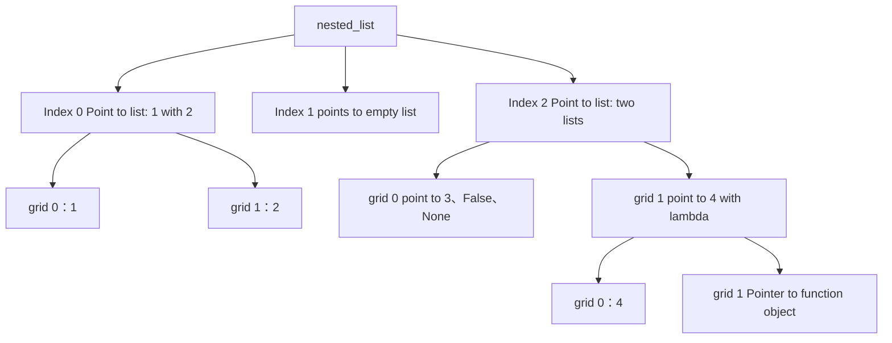
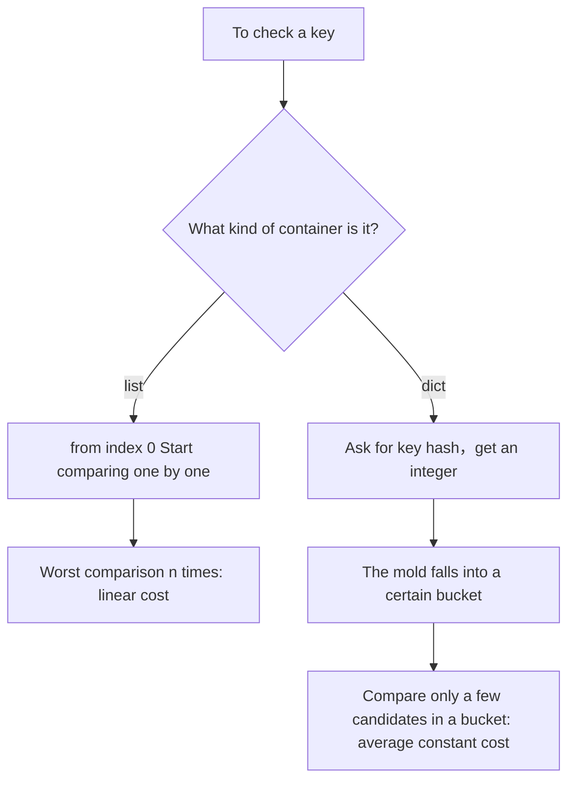
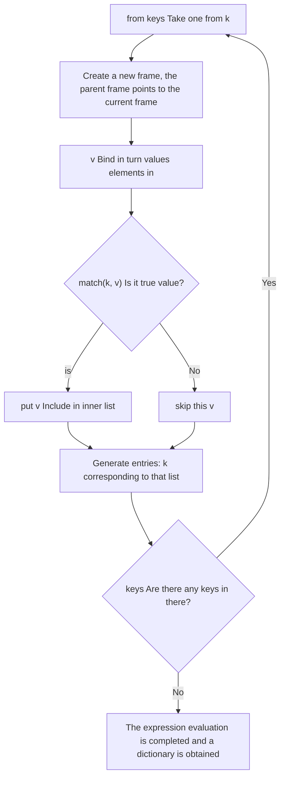
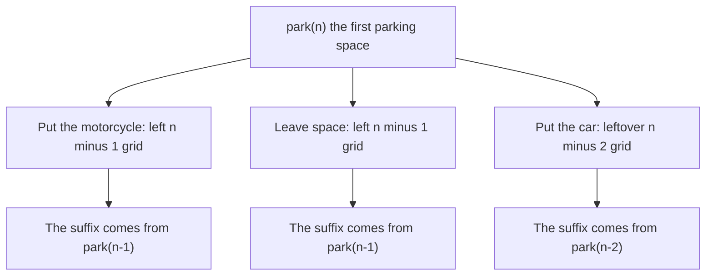

> **courses**: UC Berkeley CS61A · Structure and Interpretation of Computer Programs(Fall 2024)
> **This lecture**: Lecture 12 ｜ 27:53 ｜ Station B P 12 ｜ [Original video](https://www.bilibili.com/video/BV1sy411z7nA?p=12)
> **courseware**: `11-Containers.pdf` (16 pages, official PDF, page-by-page renderings see text illustrations)
> **subtitles**: Original English subtitles from Station B; this note is a reconstruction of Chinese writing, not a sentence-by-sentence translation.
> **Copyright**: The copyright of the course and courseware belongs to the UC Berkeley CS61A teaching team; this article is a secondary arrangement for learning purposes

## Quick overview of this lecture

- **Mastered**: list with  `range`  structure, `len`  Take the length and use  `for`  Access elements one by one, and the "name-to-value" drawing method in the environment diagram.
- **Main line of this lecture**:
    - Containers can contain containers (closure property), so a notation is needed to clearly draw "what is contained in what" - box pointer notation.
    - slice  `s[i:j]`  Yes "Press  `range`  A compact way of writing the rule "to take a subsequence", and **always create new values**.
    - `sum`, `max`, `all`  Compress "traverse an entire container" into one call; `max`  of  `key`  The function determines "what to compare with".
    - Strings are sequences, but not exactly ordinary sequences: indexing returns a single-character string, `in`  What you are looking for is a continuous substring.
    - Dictionaries use keys to look up values, and they only look in one direction; keys have two hard restrictions (not repeatable, must be hashable), and values can be anything.
    - The comprehension writes "do something with each element" as a one-line expression, and a list comprehension can be embedded in the dictionary comprehension.
- **Key conclusions**: The container turns "a piece of data" into a "batch of data"; once the data is in a batch, **Traverse** with **Find** It became the main line of all subsequent algorithms, and  `dict`  The time of "comparison by comparison" is replaced by space.

*(Reference time: 00:00:01 – 00:00:08｜Lecture 12)*


## 1. Nested lists and box pointer notation

*(Reference time: 00:00:10 – 00:03:26｜Lecture 12)*


In the previous lecture, the list was treated as a sequence of "access by position": there  `len`, can be indexed, and can be traversed. At this point, sequences begin to nest within each other, and the act of drawing immediately becomes extraordinary. The reason given by the lecturer is **closure property**: A method of combining data values satisfies closure if and only if "the result combined by this method can itself be combined again by the same method."

The specific form of this sentence on lists is: if you can put elements into a list, you should be able to put that list into a list again. Closures are important because they enable hierarchical structures—hierarchical structures made up of parts, which are themselves made up of smaller parts, and so on. Organizations in the real world almost always have this shape: folders within folders, sections within chapters, and subtrees within syntax trees.

The price is: once a list can hold a list, "which element is on which level" is no longer a matter of seeing through it at a glance. So a notation specifically used to track this relationship is needed, which is **box-and-pointer notation**. The courseware only gives two rules, but they are enough to draw any complex structure:

- The list is drawn in a row in the environment diagram **Adjacent squares with index labels**, one grid for each element;
- Each grid can be installed directly **primitive value**, or point an arrow to a **compound value**.

Let’s look at the simplest example first:

```python
pair = [1, 2]
```

In the environment map, the name in the global frame  `pair`  There is an arrow pointing to two adjacent grids; the small numbers in the corners of the grid  `0`, `1`  is the index; because the list has two elements, there are exactly two grids.


Let’s look at the much more complicated example in the courseware:

```python
pair = [1, 2]

nested_list = [[1, 2], [],
               [[3, False, None],
                [4, lambda: 5]]]
```

`nested_list`  It is a three-element list, so there are three adjacent grids on the screen. its three elements **It's all a list**, and the list is a composite value, so the contents in the three grids are not specific values, but **arrow**--points to the list in which each is included. The lecturer gives a general rule here: lists are composite values, and functions are also composite values. Anything that is "composed of multiple parts" has an arrow pointing to its depiction, rather than stuffing the content directly into the grid.

Match each arrow in the picture above one by one:

- Index 0 points to  `[1, 2]`  This two-element list directly writes in the two grids  `1`  and  `2`;
- Index 1 points to **empty list**, there is an arrow with "empty list" written on the screen, and the empty list has no grid;
- Index 2 points to another two-element list, and its two elements are lists: the arrow in cell 0 points to  `[3, False, None]`, the arrow in grid 1 points to  `[4, lambda: 5]`.

Among the two innermost lists, `3`, `False`, `None`, `4`  They are all basic values and are written directly into the grid. that  `lambda: 5`  It is a function and is a composite value, so it is drawn as an arrow pointing to the function object.  `func λ() <line 5> [parent=Global]`. The small print next to this arrow is worth noting: it says "This function object is the element at index 1 of this list, and this list is in a list, and that list is in  `nested_list` "Li" - three levels of inclusive relationships, all connected by arrows.



This picture illustrates the sentence "Hierarchies are made up of parts, and parts are made up of parts": `nested_list`  is the root, the arrow is the side, `nested_list`  It is separated by two levels from the innermost value.

> **Editor's note**: When the lecturer dictated, he referred to the last inner list as "the element at index 3", but on the screen it was index 2 - the list only has three positions: 0, 1, and 2. This was a minor slip of the tongue, and the structure itself is not controversial.

### 1.1 Two types of arrows for box pointers

Reading the above example into two types of relationships, all subsequent environment diagrams can be broken down like this:

| arrow | starting point | end point | what does it mean |
| :--- | :--- | :--- | :--- |
| name → value | name in frame | Basic values, lists, functions | binding |
| value → component | A certain cell in the list | contained list or function | containment |

The reason why the environment diagram can simultaneously express "how many names are there in the global frame" and "what is contained in a certain list" is that these two types of arrows are stacked together. When reading a picture, first find the object by its name, and then follow the grid down layer by layer. This is a complete structure traversal.

### 1.2 Discussion question: The printed result is not equal to the structure

The courseware includes a discussion question here, requiring you to draw an environment diagram and predict the output:

```python
def f(s):
    x = s[0]
    return [x]

t = [3, [2+2, 5]]
u = [f(t[1]), t]
print(u)
```

Go through it in order of evaluation: `t`  The list expression of first calculates the inner level  `[2+2, 5]`, get  `[4, 5]`, so  `t`  is  `[3, [4, 5]]`. Then evaluate  `f(t[1])`:The actual parameter is  `t[1]`, that is, that  `[4, 5]`  The list itself (not a copy), formal parameters  `s`  bound to it; `x = s[0]`  get 4; `return [x]` **New** a list  `[4]`. So  `u`  is a two-element list: index 0 points to the new list  `[4]`, index 1 points to  `t`  myself. `print(u)`  print out  `[[4], [3, [4, 5]]]`.


What this question really wants to ask is the last step: the line on the screen  `[[4], [3, [4, 5]]]` **Completely unable to distinguish structural differences**. If  `u`  The second element of is  `t`  An independent copy of the print result is exactly the same, but in the environment map  `u[1]`  with  `t`  are two arrows pointing to different lists. This is exactly the meaning of the box pointer notation——**Print text only describes the value, environment diagram describes the structure**.

> **Editor's note**: The video does not discuss this page (the subtitles jump directly to the slice after the box pointer explanation). The environment map analysis and printing results are written by the editor according to the courseware code. `print`  The square bracket form of the output is Python's representation of a list  `repr`, is not the same thing as "how the list looks in memory".

## 2. Slicing: a compact way of writing range rules

*(Reference time: 00:03:30 – 00:06:05｜Lecture 12)*


Suppose you already have a sequence and want a section of it:

```python
odds = [3, 5, 7, 9, 11]
```

The goal is to take out  `5`  and  `7`. By position number, they are at indexes 1 and 2. The simplest way is to take out the index and then use a list comprehension to move the elements there:

```python
>>> [odds[i] for i in range(1, 3)]
[5, 7]
```

Here is a detail that must be remembered: `range(1, 3)`  given is  `1`  and  `2`, **Does not contain** `3`. Slicing is just a compact notation for "moving elements according to range rules". The rules are exactly the same:

```python
>>> odds[1:3]
[5, 7]
```

Slicing also has several flexibility points, which correspond exactly to  `range`  Behavior when parameters are omitted:

- Omit the starting point and start from the beginning: `odds[:3]`  Taking the indexes 0, 1, 2, we get  `[3, 5, 7]`;
- Omit the end point and go to the end: `odds[1:]`  Skip index 0  `3`, got  `[5, 7, 9, 11]`;
- Omit both ends: `odds[:]`  Get all elements of the original list.

If there is a colon in the square brackets, this symbol is called **slicing operator**. Its semantics are the same as  `range`  Share the same rule: **Including lower bound, excluding upper bound**.

| expression | Semantics | value |
| :--- | :--- | :--- |
| `odds[1:3]` | Starting from index 1 and before 3 | `[5, 7]` |
| `odds[:3]` | before index 3 | `[3, 5, 7]` |
| `odds[1:]` | index 1 to end | `[5, 7, 9, 11]` |
| `odds[:]` | a copy of the entire list | `[3, 5, 7, 9, 11]` |

Immediately following is the most important sentence of this section: **Slicing always creates new values**. The courseware uses three slices to illustrate this sentence:

```python
digits = [1, 8, 2, 8]
```

The three slices are  `digits[:1]`  Got  `[1]`, `digits[1:3]`  Got  `[8, 2]`, `digits[2:]`  Got  `[2, 8]`. After doing these three slices, the environment map has a total of **four** List: original  `digits`  Plus three new listings. `digits`  Not a single cell has changed - slicing is not "cutting a section of the original name", but "creating another copy based on the content".

This difference has no consequences until there is no mutable operation, but it determines many subsequent behaviors: modifications to the slice will not affect the original list, and modifying the original list in place will not affect the fragments that have been cut from it.

### 2.1 Use slices to make sliding windows: double\_eights

One of the most practical uses of slicing is to fix a "window" into two elements. The questions given in the courseware are: Judgment List  `s`  Is there any **two adjacent** `8`.


The first way of writing uses the index to scan backward:

```python
def double_eights(s):
    """Return whether two consecutive items of list s are 8.

    >>> double_eights([1, 2, 8, 8])
    True
    >>> double_eights([8, 8, 0])
    True
    >>> double_eights([5, 3, 8, 8, 3, 5])
    True
    >>> double_eights([2, 8, 4, 6, 8, 2])
    False
    """
    for i in range(len(s) - 1):
        if s[i] == 8 and s[i + 1] == 8:
            return True
    return False
```

`range`  The upper bound of is written as  `len(s) - 1`  There is a reason: you need to access it in the loop body  `s[i + 1]`, `i`  The maximum can only reach  `len(s) - 2`, while  `range(len(s) - 1)`  The upper bound of does not include  `len(s) - 1`, stopping exactly at  `len(s) - 2`. If written as  `range(len(s))`, the final round will cross the line.

The second way of writing uses the slice as a window and uses recursion to express "move to the right one cell at a time":

```python
def double_eights(s):
    """Return whether two consecutive items of list s are 8.

    >>> double_eights([1, 2, 8, 8])
    True
    """
    if s[:2] == [8, 8]:
        return True
    elif len(s) < 2:
        return False
    else:
        return double_eights(s[1:])
```

`s[:2]`  It is "fetched from the beginning to before index 2", that is, the first two elements; the comparison object is written as  `[8, 8]`  instead of  `'88'`, because  `s`  is a list. If it misses, throw away the first element, right  `s[1:]`  Keep asking the same question - moving the window one space to the right at a time.

`elif len(s) < 2`  This branch is the exit from the recursion. Without it, a list of length 0 or 1 would go all the way  `else`, do it repeatedly for the empty list  `s[1:]` (The list is still empty when cut out), never stops. The position is also important: it must come after the real judgment, otherwise  `[8, 8]`  This input of length 2 is rejected as "too short" before being compared.

| criterion | Loop version | recursive version |
| :--- | :--- | :--- |
| expression | Index + `range` | slice + self call |
| How to move the window | `i`  self-increasing | `s[1:]`  Throw away the first element |
| export | `return False` (Complete the cycle) | `len(s) < 2` |
| Whether to copy the list | Do not copy | Make a copy of each slice |

> **Editor's note**: Both versions of the solutions are in the courseware (answers have been filled in), but the video does not cover this page, which faces  `range`  The explanations of upper bounds and recursive exit positions were added by the editor. Additionally, the recursive version each time  `s[1:]`  A new list must be copied, and the total cost is square, while the loop version only performs a linear comparison - the courseware shows the two writing methods to compare "two expressions of the same problem", not to imply that the two have the same cost. If  `s`  is a string rather than a list, the window comparison should be written as  `s[:2] == '88'`.

## 3. Aggregation: compress traversal into one call

*(Reference time: 00:06:07 – 00:09:33｜Lecture 12)*


To handle container values, what you need to do most of the time is **Iterate through all the values ​​in it**. handwriting  `for`  Loops work, of course, but Python has a bunch of built-in functions just for that: they accept **iterable **Parameters, "fold" a batch of values inside into one value. This type of operation is called** sequence aggregation**.

The instructor's approach is very straightforward: read the official documentation of Python 3 and then explain how to use it. Because there is a mark in the document that needs to be explained in advance——`sum(iterable[, start])`  square brackets inside **It doesn’t require you to write square brackets when calling**, which is the convention in the documentation to indicate "this parameter is optional".


```text
sum(iterable[, start]) -> value
    Return the sum of an iterable (not of strings) plus the value of
    parameter 'start' (which defaults to 0). When the iterable is
    empty, return start.

max(iterable[, key=func]) -> value
max(a, b, c, ...[, key=func]) -> value
    With a single iterable argument, return its largest item.
    With two or more arguments, return the largest argument.

all(iterable) -> bool
    Return True if bool(x) is True for all values x in the iterable.
    If the iterable is empty, return True.
```

`sum([2, 3, 4])`  Got 9, which is the most straightforward usage. The sentence "not of strings" in the documentation is also worth remembering: `sum`  It cannot be used to spell strings, it only does digital addition.

What's really interesting is  `start`.`sum([2, 3, 4], 5)`  would treat 5 as the first addend and get 14. Why leave such a parameter? The motivation given by the lecturer was very specific: **When the thing you want to add is not a number, you must provide a "starting point" of the same type to start adding.**. List addition is an example - adding two lists will result in a longer list, so you can feed the list directly to  `sum`, but you must give it a list as a starting point:

```python
>>> sum([[2, 3], [4]])
TypeError: unsupported operand type(s) for +: 'int' and 'list'
>>> sum([[2, 3], [4]], [])
[2, 3, 4]
```

When no starting point is added, `sum`  from default  `0`  Start, the first step is to calculate  `0 + [2, 3]`, numbers plus lists are illegal. Given an empty list as a starting point, the first step becomes  `[] + [2, 3]`  Got  `[2, 3]`, second step  `[2, 3] + [4]`  Got  `[2, 3, 4]`, so the entire iterable is "connected" into a list. this is  `start`  The essence of: It is not "adding an extra number", but **Tell the aggregator which addition to use and which identity element to start from**.

`max`  There are two forms, the difference is the number of parameters:

- pass **an iterable**: Returns the largest item, which is the element in the list itself;
- pass **Two or more parameters**: Returns the largest of these parameters.

So  `max(range(5))`  Get 4; replace with  `max(0, 1, 2, 3, 4)`  Get the same result - the former selects from a sequence, the latter selects from a list of actual parameters. Both forms can accept one more  `key`  function.

| criterion | `sum` | `max` | `all` |
| :--- | :--- | :--- | :--- |
| what to accept | an iterable (number) | An iterable, or more than two parameters | an iterable |
| Optional parameters | `start`: starting point of addition | `key`: Comparison basis | None |
| folding rules | Add up one by one | Keep the largest | Take one by one  `bool`  Then take "all true" |
| Empty input | Return  `start` | Report an error | Return  `True` |
| Typical uses | Sum, splice | Get the best element | Determine "whether all are satisfied" |

> **Editor's note**: `max`  It is the only one among these three functions that does not define empty input behavior——`max([])`  Can throw  `ValueError: max() iterable argument is empty`. This is not a flaw: an empty collection has no maximum value, and returning any "default value" will hide the caller's error, so Python chooses to report an error directly.

## 4. key function: pass "what to compare" as a parameter

*(Reference time: 00:09:34 – 00:10:39｜Lecture 12)*

`max`  It is written in the documentation  `key=func`, but did not write what it does. The lecturer's statement is "The document doesn't tell me, but I can tell you": `key`  The specified function will be **Apply to each candidate element**, the comparison is based on these **return value** carried out; but the final returned element is still the original element, not the return value of the function.

He demonstrated this using a parabola. in  `0`  Arrive  `9`  In the range of , what we care about is the maximum value of a certain algebraic expression. The vertex of this parabola falls exactly on  `x = 3`  At:

```python
>>> max(range(10), key=lambda x: 7 - (x - 4) * (x - 2))
3
```

put  `x = 3`  Substituting in, the expression is 8; Substitute  `x = 2`  or  `x = 4`  Get 7, which is smaller than 8; substitute  `x = 5`, `6`, `7`  It will only be smaller. So  `key`  The largest "comparison value" picked out is 8, while  `max`  Returns the element that produced this value  `3`. This distinction is  `key`  All the points:

| criterion | `max(s)` | `max(s, key=f)` |
| :--- | :--- | :--- |
| Comparison object | element itself | `f(元素)`  return value |
| returned object | largest element | such that  `f`  The largest element |
| when needed | Elements can be compared in size | The elements are not comparable, or you want to use a different ruler to measure them. |
| Example | `max([1, 5, 3])`  Got  `5` | `max([1, 5, 3], key=lambda x: -x)`  Got  `1` |

`key`  Therefore, it is a mechanism to "inject comparison basis": `max`  Responsible for traversing and retaining, `key`  Responsible for defining what "big" means. The function is passed in as a parameter, which is exactly how higher-order functions are used -`max`  It doesn't know what you are comparing, it only knows how to repeat the action of "competing" to the end.

> **Editor's note**:The above line  `max(range(10), key=...)`  It is restored according to the subtitles: the lecturer said "7 minus (x minus 4) multiplied by (x minus 2)", which is exactly  `-x*x + 6*x - 1`, the vertex is at  `x = 3`, the value is 8, which is consistent with the oral statement "the maximum value falls at 3". This code was typed on the spot and there is no corresponding slide.

### 4.1 Two related lists: press y to find x

`key`  There is also a more common usage: having two copies on hand **Same length, aligned by position** list, I want to know "the position that makes the value of one part the smallest corresponds to what in the other part". Examples of courseware are:

```python
xs = range(-10, 11)
ys = [x*x - 2*x + 1 for x in xs]
```


`ys`  is calculated item by item using a list comprehension, so  `ys`  of the  `i`  element is exactly  `xs`  No.  `i`  function value of elements. The courseware prints out both lists (`xs`  from -10 to 10, `ys`  Decreasing from 121 to 0 and back to 81), then ask: **Write an expression to find the x corresponding to the minimum of y**. The answer is  `1`.

The key is not to directly  `ys`  Find the minimum:

```python
>>> min(ys)
0
>>> min(xs, key=lambda x: x*x - 2*x + 1)
1
```

`min(ys)`  Return  `0`, that is **value of y**, not x; there is no automatic alignment between the two lists, `min`  only in  `ys`  Internal comparison. Give the same expression to  `key`, `min`  will be right  `xs`  for each candidate  `x`  Calculate the corresponding y first, and then retain the one that "minimizes y" `x`.`key`  What it does here is **Alignment channel between two lists**:

| Writing method | `min`  What are you comparing? | return value |
| :--- | :--- | :--- |
| `min(ys)` | `ys`  The value in | `0` (a y) |
| `min(xs, key=...)` | each  `x`  Corresponding y | `1` (the x that produced it) |

> **Editor's note**: The video does not cover this page. The above answers and explanations are supplemented by the editor according to the courseware. By the way, `x*x - 2*x + 1`  Constant equal to  `(x - 1) ** 2`, so the minimum value is  `x = 1`  Take 0, which is the same as courseware printing  `ys`  consistent.

## 5. all and truth value: judge "whether all are satisfied" at once

*(Reference time: 00:10:41 – 00:12:15｜Lecture 12)*

The third aggregate function is  `all`: It applies to each item in the iterable  `x`  call  `bool(x)`, if **All are true values** Just return  `True`;Also returned when the iterable is empty  `True`.

`bool`  The function is to press a value to "true" or "false". The lecturer reviewed the conclusion when talking about conditional statements: `5`  is the true value, `True`  It's true value, even  `-1`  It is also a truth value; `0`  is a false value; `'hello'`  is a true value, the empty string  `''`  is a false value. This set of conventions is the one in Boolean context, except this time it is explicitly written as a function call.

```python
>>> [x < 5 for x in range(5)]
[True, True, True, True, True]
>>> all([x < 5 for x in range(5)])
True
```

The derivation first creates a string of Boolean values, `all`  Then aggregate them into a Boolean value——`all`  His duty is to answer "Is this string completely true?" The lecturer also emphasized: pass on  `all`  does not have to be a Boolean list, you can just give it a string of numbers because it will call  `bool`.

> **Editor's note**: There is a pitfall that is very easy to step on——`all(range(5))`  The result is  `False`, because  `range(5)`  from  `0`  start while  `bool(0)`  is a false value. If you want to express "0 to 4 are all less than 5", what you want to pass is **result of predicate**(`[x < 5 for x in range(5)]`), not the number itself.

`min`  with  `any`  is  `max`  with  `all`  Duality of: `any`  Returns as long as one element is true  `True`, an empty iterable returns  `False`. Three aggregate functions plus two duals form the minimum toolbox for "pressing the entire container into one value".

## 6. String: the most special type of sequence

*(Reference time: 00:12:18 – 00:17:12｜Lecture 12)*


The lecturer started by saying that strings were his favorite topic. The reason is that it is a **abstraction**: It hides the details of "how to encode", but it does carry information.

The courseware uses three types of examples to illustrate "what a string can represent":

- **numbers**: Scientific notation and writing with decimal points are all strings, but the shape of these strings itself conveys information;
- **Language**: The courseware quotes a poem by Shakespeare - "As imagination bodies forth / The forms of things unknown, the poet's pen / Turns them to shapes and gives to airy nothing / A local habitation and a name." (Imagine giving form to these unknown things, and the poet's pen turns them into shapes, giving the nothingness a home and a name.) The lecturer used it to string together language, computer science, and abstraction: what abstraction does is "giving nothingness a name"; the subtitles have incomplete recognition of these lines, and are corrected here according to the original text.
- **program**: Python source files themselves are strings.

The last point was demonstrated on site. The following string is a valid Python program:

```python
curry = lambda f: lambda x: lambda y: f(x, y)
```

Write it into the source file and execute it, `curry`  It's defined; similarly, if this code is created as a string in the interpreter, it is "just a string", and **execute** This string, `curry`  It appears, and then you can use it to  `curry` `add`, add the two numbers.

> **Editor's note**: The subtitles only describe the process of this demonstration and do not record the specific input. To reproduce it, you need to use the built-in  `exec`  Execute a string: first  `from operator import add`, again  `exec('curry = lambda f: lambda x: lambda y: f(x, y)')`, finally  `curry(add)(2)(3)`  Got  `5`.`exec`  It is not included in the subtitles and courseware of this lecture. It is only used as a reminder to reproduce the demonstration.

### 6.1 Three writing methods, line breaks and escaping

There are three ways to write a string:

- **single quote** with **double quotes** Completely equivalent. The difference is only one: you can safely write apostrophes in double-quoted strings (`"it's"`), and writing an apostrophe in a single-quoted string will end the string early;
- **triple quotes** Can span multiple lines. The lecturer said that he often uses it to write docstrings, because once doctest is added, the docstring is often too long to fit on one line.

The string does not have to contain English characters. `'你好'`  Totally legal.

When displaying a multi-line string, it will be squeezed into one line on the screen, with a special symbol in the middle to indicate "the end of one line and the beginning of the next line" - this symbol is called **line feed**, writing  `\n`. The function of backslash here is called **escape**: The backslash and the character after it are actually just **one** element. So  `\n`  Not the two characters "backslash + n", but a newline character.

### 6.2 Strings are sequences, but behave slightly differently

The string is a sequence, and the length is the same as the element selection rule and the list, but the "element" is called by a different name. **character**: `len('Berkeley')`  It's 8 because the word has 8 letters.

The indexing scheme also starts at 0, but **What is returned may not be what you think**: Select an element from the string, and the result is **a string**, but this string only has one character. The lecturer specifically compared the list: if there is a list of numbers, indexing the third element will get a number, not a list; this is not the case for strings -`'Berkeley'[3]`  What you get is  `'k'`, a string of length 1.

`in`  with  `not in`  It also has its own semantics on strings: instead of looking for individual letters, it looks for **Whole word, continuous substring**.

```python
>>> 'here' in 'where'
True
>>> [2, 3] in [1, 2, 3, 4]
False
```

The first line is true because  `'where'`  does appear continuously in  `h`, `e`, `r`, `e`;The second line does not hold because the list  `in`  Find only once **a complete element**, while  `[2, 3]`  No  `[1, 2, 3, 4]`  an element in it. The reason given by the lecturer is very practical: when processing strings, in most cases you care about the whole word rather than individual letters, so the language is designed to allow you to find the word directly.

| criterion | list  `list` | string  `str` |
| :--- | :--- | :--- |
| what are elements | any value | single character |
| `len`  statistics | Number of elements | Number of characters |
| `s[i]`  Return | No.  `i`  element itself | string of length 1 |
| `x in s`  What to look for | a complete element | a continuous substring |
| slice | Support, get new list | Support, get new string |

So a string is a special abstraction that "is like a sequence in many ways, but behaves slightly differently than other sequences." It is not a special case of list, nor a variant of list, but another set of sequence types with its own conventions.

## 7. Dictionary: Use keys to look up values

*(Reference time: 00:17:14 – 00:21:29｜Lecture 12)*

Dictionary is a built-in data type of Python, which stores the pairing of "key + value": the key is **Used to check things**, the value is **things that were found**. Curly braces are used in both writing and display, and keys and values are separated by colons:

```python
numerals = {'I': 1, 'V': 5, 'X': 10}
```

This assignment statement creates a new dictionary using three pairs of things separated by commas; the commas separate "this pair" and "that pair." In this dictionary the keys are all strings and the values ​​are all numbers, but this is not required - both keys and values ​​can be numbers or strings.

After it is built, the most common operations are **Check value by pressing button**. The syntax is the same as for lists, using square brackets, but instead of indexes, the brackets contain keys:

```python
>>> numerals['V']
5
>>> numerals['X']
10
>>> numerals['X-ray']
KeyError: 'X-ray'
```

`'V'`  exists, so it gets 5; `'X-ray'`  If it is not inside, an error will be reported. There is a directional restriction that must be kept in mind: **You cannot use the value to look up the key**. Want to press  `5`  find out  `'V'`  It's not possible, just write  `numerals[5]`  Just get key errors. The lecturer's statement is that "dictionaries only go in one direction."

Dictionaries are also sequences, and are **sequence of keys**. pass it to  `list`  You can see all keys:

```python
>>> list(numerals)
['I', 'V', 'X']
>>> for k in numerals:
...     print(k)
I
V
X
```

If you want to traverse the values, you have to change the entry:

```python
>>> numerals.values()
dict_values([1, 5, 10])
```

What came back looked a little weird, and the lecturer described it as "a weird little guy." It is a type of sequence, but **not a list**, cannot do all the things that lists can do; but it can do many things - you can sum, you can use  `for`  Go one by one. When you really need a list, wrap it in a layer  `list`  That’s it. The analogy used by the lecturer is  `range`: `range`  is a special sequence related only to integers, `dict_values`  is a special sequence associated only with dictionaries.

Dictionaries can also represent more complex structures than "one-to-one correspondence" because **Values can be anything complex**:

```python
d = {1: [2, 3], 3: 'three'}
```

The two values here are a list and a string, which are completely legal. take  `d[1]`  Got  `[2, 3]`, take  `d[3]`  Got  `'three'`.`len(d)`  is 2, but it describes **Not the total amount of value**, but "this dictionary has two keys" - the two values themselves can be quite different in length: one is a two-element list, the other is a five-letter string.

> **Editor's note**: The subtitles only say  `list(numerals)`  with  `numerals.values()`  Two entrances. There is a more commonly used entrance when actually writing code  `numerals.items()`, which is given in pairs  `(键, 值)`, so we can write  `for k, v in numerals.items():`, get both sides at once. In addition  `sorted(numerals)`  Sort by key, `sorted(numerals.items(), key=lambda kv: kv[1])`  Sorted by value, both are  `key`  Common uses combined with iterables. These are not included in the subtitles and courseware of this lecture and are listed as supplements by the editor.

## 8. Two hard limits on keys

*(Reference time: 00:21:30 – 00:23:21｜Lecture 12)*

There are two restrictions on dictionary keys, which are worth remembering separately because they come from completely different sources.

**Restriction 1: Keys cannot be repeated.**  write  `{1: 'first', 1: 'second'}`, the key in the dictionary obtained  `1`  Appears only once. If you want to associate a key with two values, the correct way is to associate the key with a **list**, put multiple values into it.

**Restriction 2: The key itself cannot be a list or dictionary.**  Using a list as a key will report  `TypeError: unhashable type: 'list'`, using a dictionary as a key will get the same error.

```python
>>> {[1, 2]: 'a'}
TypeError: unhashable type: 'list'
>>> {{1: 2}: 'a'}
TypeError: unhashable type: 'dict'
>>> {'a': [1, 2]}
{'a': [1, 2]}
```

The lecturer hit the brakes here: unhashable is an important term in computer science. He really wants to explain it clearly now, but "you have to leave something for 61B", or let interested people look it up online. At the same time, he emphasized: **Restrictions are only for keys**. A dictionary can perfectly serve as **value**, lists are even better - anything can be a value.

The nature of the two restrictions is different. This point was specifically pointed out by the lecturer:

- **Hashability** This is from the Python dictionary **underlying implementation**, is the constraint pressed by the implementation;
- **Keys are not repeated** This entry comes from the dictionary this **The convention of abstraction itself**——The responsibility of the dictionary is to "give you the key corresponding to **one** Value", if the same key appears twice, it doesn't matter "which value", there will be two.

So the entire meaning of the dictionary can be condensed into one sentence: **Find the value for a key**. If you want to attach multiple values ​​to a key, put them into a sequence and let "that value" be a container.

### 8.1 Why dictionary lookup is O(1) and list lookup is O(n)

The subtitle here clearly states that unhashable belongs to the content of 61B, so the following paragraph is a supplement by the editor to explain why the second restriction looks like this. It answers exactly the performance intuition that this lecture should take away most.

**List searches are linear.** `x in lst`  with  `lst.index(x)`  Can only start from index 0 and use them one by one  `==`  Compare, the worst case scenario needs to be read  `n`  You only know if there are elements. There is no "predictable" relationship between the elements of a list, so there are no shortcuts.

**Dictionary lookups are constant (on average).**  The bottom layer of the dictionary is **hash table**: Calculate first when saving keys  `hash(key)`  Get an integer, take it modulo the number of buckets, and put it into a certain bucket; when checking, calculate the hash again for the same key, jump directly to that bucket, and only compare a few candidates in the bucket. So "finding one among 1 million keys" and "finding one among 10 keys" take about the same average time.

**The price is "the bond must be stable".**  The hash table can jump directly to the bucket position, provided that the hash value of the same key remains unchanged during its lifetime. Lists and dictionaries are **mutable**: Add an element to the list, change the value of a dictionary, and the content will change. If it is allowed to be used as a key, then if you modify it after putting it in the dictionary, its hash will change, the bucket bit will become invalid, and the key will never be retrieved. So Python requires that the key must be **Hashable**:Equal keys must have the same hash value, and this hash value cannot change during the lifetime of the key - for built-in containers, this requirement is equivalent to "the key must be immutable". Tuples can be used as keys (immutable), but as long as the tuple contains a list, the entire tuple is not hashable.



| criterion | `list` | `dict` |
| :--- | :--- | :--- |
| According to what positioning | location(index) | key |
| Find by content | `x in lst`, `lst.index(x)`, compare one by one, O(n) | `k in d`, `d[k]`, calculate hash positioning, average O(1) |
| add an element | `append`  Amortization O(1) (can only be added to the tail) | `d[k] = v`  Average O(1) |
| Can it be used as a key? | Can't (not hashable) | Can't (not hashable) |
| Typical uses | Orderly access by subscript | Related search, counting, indexing |

> **Editor's note**: Hash tables, conflict handling and amortization analysis are all the main content of 61B. Here we only take the conclusion of "why the key must be hashable and why the search can reach the constant level". `set` (Collections) use the same mechanism: elements must be hashable, deduplication and  `in`  The average judgment is O(1), so it is suitable for answering "has this value appeared before", while the list is suitable for answering "where is this value ranked". The empty set must be written  `set()`, because  `{}`  is an empty dictionary. Neither subtitles nor courseware are involved in this lecture.  `set`.

## 9. Derivation: Write the loop as an expression

*(Reference time: 00:23:22 – 00:25:21｜Lecture 12)*

### 9.1 List comprehensions

Before talking about dictionary comprehensions, let’s first fix the shape of list comprehensions. Its full form is "a mapping expression + an iteration source + an optional filter condition":

```text
[<映射表达式> for <名字> in <可迭代对象> if <过滤表达式>]
```

The reading is: for each element in the iterable object, bind the name to it, and if the filter expression is true, collect the value of the mapping expression into a new list.


The courseware is called  `promoted`  Question to practice this shape: it receives the sequence  `s`  and unary function  `f`, returns a list with the same elements, but **all make  `f(e)`  Elements that are true come first**, and the relative order within the two groups remains unchanged.


```python
def promoted(s, f):
    """Return a list with the same elements as s, but with all
    elements e for which f(e) is a true value placed first.

    >>> promoted(range(10), odd)  # odds in front
    [1, 3, 5, 7, 9, 0, 2, 4, 6, 8]
    """
    return [e for e in s if f(e)] + [e for e in s if not f(e)]
```

The answer is to use the two derivations  `+`  Continuing: The first item selects all the items that satisfy the requirements in the original order.  `f`  elements, the second item selects all the elements that do not satisfy the  `f`  elements, the two new lists are connected end to end. Since every derivation is **Keep the original order**, the final result is "the order within the group remains unchanged after grouping" - this is exactly the behavior required by the question.

The cost of this writing method should also be seen clearly: it traverses  `s`  Twice, and created two additional lists and combined them into one. It can also be done by changing to "one traversal + two accumulation containers", but it requires writing three more lines of loops. in  `n`  When it is small, the two derivation expressions are clearer.

> **Editor's note**: The video does not cover this page (the subtitles start from the box pointer). The interpretation of the question and the above analysis are written by the editor according to the courseware. `odd`  It is not defined on this page, it should be the parity decision function mentioned earlier; from the output  `[1, 3, 5, 7, 9, 0, 2, 4, 6, 8]`  It can be seen that it determines an odd number.

> **Editor's note**: The derivation also has two built-in "close relatives", which are not mentioned in this lecture, but will be encountered repeatedly in the future: `list(map(f, s))`  with  `[f(e) for e in s]`  Equivalently, `list(filter(f, s))`  with  `[e for e in s if f(e)]`  Equivalent. The difference between the two is the return type——`map`  with  `filter`  What is returned is an iterator calculated on demand, which needs to be wrapped in one layer  `list`  to see the complete list; the derivation gives the list directly.

### 9.2 Dictionary derivation and its evaluation process

A dictionary can also be used **compound expression** Constructed on site, this is **dictionary comprehension**. There are four things to write down: what the key looks like, what the value looks like, which iteration expression to take the source from, and optional filter conditions. The filtering part is omitted, so there is a short version of it.

The instructor split the evaluation process into four steps. These four steps are worth remembering verbatim because they are also applicable to list comprehensions and explain why the subsequent nested comprehensions work:

1. Create a new frame, the parent frame is **current frame**;
2. Create an empty **result dictionary**, which is the value of the entire expression;
3. Evaluate the iteration expression to get an iterable object; for each element in it, bind the name to that element in the new frame;
4. If the filter expression evaluates to true, add an entry to the result dictionary: **value of key expression** with **value expression** Match in pairs.

The entire process is filling in before the expression "evaluates" - the result container appears first, and the items are filled later. This order of "containers first, entries later" seems simple, but it is the key to understanding nested derivation: the inner derivation is in **subframe of outer frame** evaluated inside, so it sees the name of the outer binding.

```python
>>> {x*x: x for x in range(1, 6) if x > 2}
{9: 3, 16: 4, 25: 5}
```

`x`  Bind 1 to 5 in sequence. `x = 1`, `x = 2`  is skipped at the filter condition; `x = 3`, `4`, `5`  Join separately  `9: 3`, `16: 4`, `25: 5`. So this dictionary maps some square numbers back to their square roots.

### 9.3 Slicing, aggregation and derivation combined: prefix sum

The courseware uses question 2 of the 2023 spring midterm for practice, because this question requires the use of the three tools mentioned earlier in this section at the same time.

**definition**: a sequence of numbers **prefix sum**, is before it  `n`  The sum of elements, where  `n`  is some positive integer length.

**request**:realize  `prefix(s)`, return  `s`  The sum of all prefixes of , arranged in ascending order of prefix length.


```python
def prefix(s):
    """Return a list of all prefix sums of list s.

    >>> prefix([1, 2, 3, 0, 4, 5])
    [1, 3, 6, 6, 10, 15]
    >>> prefix([2, 2, 2, 0, -5, 5])
    [2, 4, 6, 6, 1, 6]
    """
    return [sum(s[:k+1]) for k in range(len(s))]
```

What to fill in each of the two blanks can be deduced by following "which prefix corresponds to each position in the output":

- `k`  is the prefix length minus one. The length is  `k + 1`  The prefix of is exactly the slice  `s[:k+1]`——The slice contains the lower bound but not the upper bound, `s[:k+1]`  Take the index  `0`  Arrive  `k`. give it to  `sum`  We get the sum of this prefix, so  **(a) Yes  `sum(s[:k+1])`**;
- `k`  Want to take  `0, 1, ..., len(s) - 1`  can cover the entire length, so  **(b) Yes  `range(len(s))`**. The five options given in the courseware are  `s`, `[s]`, `s[1:]`, `range(s)`, `range(len(s))`: The iteration source must be able to give integers one by one, so only the last item is true——`s`  with  `s[1:]`  given are the elements, `[s]`  will only give an entire list, `range(s)`  Then pass the list directly to  `range`, itself is wrong.

`prefix([1, 2, 3, 0, 4, 5])`  Verify item by item: `1`, `1+2=3`, `1+2+3=6`, `6+0=6`, `6+4=10`, `10+5=15`, with doctest  `[1, 3, 6, 6, 10, 15]`  consistent.

> **Editor's note**: This page is not in the video. The above answers and analysis of options are written by the editor according to the courseware. In addition, this writing method has to add it again every time a prefix is ​​calculated, and the total cost is square. The prefix sum can be linearized with one accumulation, at the cost of maintaining one more running sum. The courseware chooses this writing method because it combines slices, `sum`, derivation three things are pressed into one line.

## 10. index: dictionary comprehension embedded in list comprehension

*(Reference time: 00:25:23 – 00:27:48｜Lecture 12)*

The best example of using derivation is  `index`  function. It receives a string of keys, a string of values, and a **two parameters** of  `match`  Function that returns a dictionary: for each key  `k`, the value of that entry in the dictionary is  `values`  all envoys  `match(k, v)`  is true  `v`  composed of **list**.

The lecturer deliberately stopped at one sentence when reading the question: When the question says "a dictionary from keys to lists", it means that each item of the dictionary **There is a key**, and its corresponding value **is a list**——Not "one key corresponds to multiple values", but "one key corresponds to a list".

```python
def index(keys, values, match):
    """Return a dictionary from keys k to a list of values v in values
    for which match(k, v) is a true value.
    """
    return {k: [v for v in values if match(k, v)] for k in keys}
```

The answer is one line: the outer layer is a dictionary comprehension, and the inner layer is a list comprehension. Go through the four steps of Section 9.2 block by block:

- **key expression** That’s it  `k`——Key candidates are already there  `keys`  Given here, almost no processing is required. The lecturer said, this  `k`  Must be with  `for k in keys`  inside  `k`  consistent, but the letters themselves are randomly chosen, he chooses  `k`  Just because the title says "key".
- **value expression** is an inner list comprehension  `[v for v in values if match(k, v)]`: it traverses  `values`, leaving only those values that match the key, collected into a list.
- **Iteration source** is  `keys`, **filter expression** None are written (the outer layer does not require filtering).

Two names that can be used in inner derivation deserve separate mention: `v`  It is bound by itself, `k`  from the outer layer. The reason why it can be written like this is precisely the rule in step 1 of Section 9.2 - the dictionary derivation is in **new frame** is evaluated in, and the inner list comprehension is evaluated in its subframe. When looking up the name, go up the parent frame and you will naturally find it.  `k`. The lecturer's original words were: "Because this list comprehension is in this dictionary comprehension, this expression can both refer to  `v` (value), can also be quoted  `k` (key). "

Run an example:

```python
>>> index([7, 9, 11], range(30, 50), lambda k, v: v % k == 0)
{7: [35, 42, 49], 9: [36, 45], 11: [33, 44]}
```

`match`  What is judged here is "`v`  Can it be  `k`  Divisible by ", that is, "`v`  Isn't it  `k`  multiples". So 7 corresponds to all multiples of 7 between 30 and 49, and the same goes for 9 and 11. Check item by item: in multiples of 7  `35, 42, 49`  falls within the interval; there are multiples of 9  `36, 45`;There are multiples of 11  `33, 44`.



> **Editor's note**: The code on this page was typed by the lecturer on the spot and is not on the slide; the text of the docstring is organized according to the subtitles. The order of the keys in the return value dictionary depends on  `keys`  The order, after Python 3.7 the dictionary maintains the insertion order, so the output is  `{7: ..., 9: ..., 11: ...}`  this order.

## 11. Courseware extension: tree recursion on strings

*(Reference time: 00:27:49 – 00:27:51｜Lecture 12)*

Video in  `index`  The function ends, and the courseware has the last section left. The content of this section is all from pages 15-16 of the courseware. It is not within the scope of the subtitles, but it connects "strings as containers" and "tree recursion".


**Question setting**: Two types of cars can be parked in one row of parking spaces. Motorcycles account for  **1**  parking spaces, occupied by cars  **2**  adjacent parking spaces. Use length as  `n`  string representation of  `n`  adjacent parking spaces: `%`  means motorcycle, `<>`  represents a car, `.`  Indicates an empty space. The example given in the courseware is  `'.%%.<><>'`.

**request**:realize  `park(n)`, return all parked cars in  `n`  Plans for adjacent parking spaces (each plan is a string); `n`  It is a positive integer; the parking space can be empty.


```python
def park(n):
    """Return the ways to park cars and motorcycles in n adjacent spots.

    >>> park(1)
    ['%', '.']
    >>> park(2)
    ['%%', '%.', '.%', '..', '<>']
    >>> len(park(4))  # some examples: '<><>', '.%%.', '%<>%', '%.<>'
    29
    """
    if n < 0:
        return []
    elif n == 0:
        return ['']
    else:
        return ['%'+s for s in park(n-1)] + ['.'+s for s in park(n-1)] + ['<>'+s for s in park(n-2)]
```

This recursive structure can be represented by "**What to put in the first parking space?**"Full decision. There are three possibilities for the first parking space, each corresponding to a smaller problem of the same type:

- Place the motorcycle, occupying 1 space, and leave the rest  `n - 1`  The grid must be arranged;
- Leave the space empty, occupy 1 square, and leave the remaining  `n - 1`  The grid must be arranged;
- Place the car, occupying 2 spaces, and leave the rest  `n - 2`  The grid must be arranged.

Answer set for three branches **Disjoint**, because the first character of each scheme is different (`%`, `.`, `<>`), so direct splicing will not produce duplication. This is the reason for writing three derivations side by side: each derivation is responsible for  `park(n-1)`  or  `park(n-2)`  Each solution is preceded by the corresponding cell (or two cells).



The way the two recursive exits are written is worth explaining because they seem "counter-intuitive":

- **`n < 0`  Return  `[]`**: A negative number means "there are not enough parking spaces left", on this branch **no legal solution**, so give an empty list - not a single solution.
- **`n == 0`  Return  `['']`**: Zero grid means "just full". At this time, there is and is only one plan - don't put anything anymore. This solution must be used **empty string** representation instead of an empty list. The reason is that the upper layer has to fight in front of it  `'%'`, `'.'`  or  `'<>'`;If return  `[]`, `[前缀 + s for s in []]`  Nothing is produced and all solutions disappear halfway.

`park(2)`  This resulted in 5 options: `'%' + park(1)`  Given two (`%%`, `%.`), `'.' + park(1)`  Given two (`.%`, `..`), `'<>' + park(0)`  Given a (`<>`). Counting also satisfies a recursion: `f(n) = 2f(n-1) + f(n-2)`, among which  `f(0) = 1`, `f(n < 0) = 0`, so  `f(1) = 2`, `f(2) = 5`, `f(3) = 12`, `f(4) = 29`, and in doctest  `29`  consistent.

> **Editor's note**: The courseware only gives questions, spaces, and answers. It explains why the three branches are mutually exclusive, why the two exits are written like that, and  `f(n) = 2f(n-1) + f(n-2)`  The counting analysis was all supplemented by the editor. This question also uses an implicit fact of this lecture: strings are immutable sequences. `'%' + s`  A new string is created each time, so the scheme generated during the recursive process will not be overwritten by subsequent splicing.

## Summary

- **Closure changes level**: To allow containers to contain containers, there must be a notation that can draw "who points to whom". There are only two types of arrows in the box pointer - the name points to the value, and the grid points to the component. If you understand these two types of arrows, any nested structure can be read.
- **Print result is not equal to structure**: The same line of printed text can correspond to two completely different structures: "share" and "copy". To determine whether two names are the same object, you need to look at the environment diagram, not the  `print`.
- **Slices are copies, not views**: `s[i:j]`  use  `range`  rules (including head but not tail), and always creates new values, and the original sequence does not change even one cell. For window-type problems (two adjacent cells), the "moving window" can be written very short by slicing.
- **Aggregation takes precedence over handwriting loops**: `sum`, `max`, `all`  Press "traverse the entire container" into one call. `start`  is the starting point for addition (also determines which addition is used), `key`  It is the basis for comparison (it also determines what ruler to use); both are examples of "injecting behavior as a parameter".
- **A string is a sequence "like a sequence but not the same"**: Index returns a string of length 1, `in`  What you are looking for is a continuous substring rather than a single character - because when processing text, whole words are more often concerned than single words.
- **Dictionaries only go in one direction**: Key query value, value query key cannot be used. The key must be unique and must be hashable; the former comes from the abstract convention of "giving that value" in the dictionary, and the latter comes from the implementation requirements of the hash table. The search can achieve an average of O(1), and the price lies in the "key must be stable".
- **Derivation is an evaluation process**: Create a new frame → Create an empty result container → Bind names element by element → Fill in entries according to filter conditions. Remember these four steps to explain "why the inner list comprehension can see the outer  `k`", only then can we  `index`  Take that line apart and read it.

*(Reference time: 00:27:05 – 00:27:51｜Lecture 12)*

## Attached: Slide index for this lecture

*(Reference time: 00:00:01 – 00:27:51｜Lecture 12)*

| page | content | Appear location |
| :--- | :--- | :--- |
| 1 | Title page Containers | Quick overview of this lecture |
| 2 | Announcements announcement page | Quick overview of this lecture |
| 3 | Sectioned Pages: List Comprehension Example Promoted | §9.1 |
| 4 | Promoted: The answer to the splicing of two derivations | §9.1 |
| 5 | Section page: Strings string | §6 |
| 6 | Sectioned pages: box pointer notation | §1 |
| 7 | The representation of the box pointer in the environment graph is the same as nested\_list | §1 |
| 8 | Discussion question: Environment diagram and printing results | §1.2 |
| 9 | Sectioned pages: Slicing | §2 |
| 10 | double\_eights: loop version and recursive version | §2.1 |
| 11 | Sectioned pages: handling values in containers | §3 |
| 12 | Official documentation for the three-piece set | §3 |
| 13 | Two related lists: press y to find x | §4.1 |
| 14 | 2023 Spring Midterm Question: Prefix Sum | §9.3 |
| 15 | Sectioned pages: tree recursion on string | §11 |
| 16 | Parking: Parking plan count | §11 |
