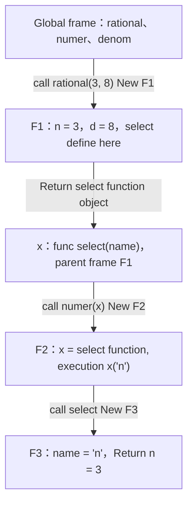
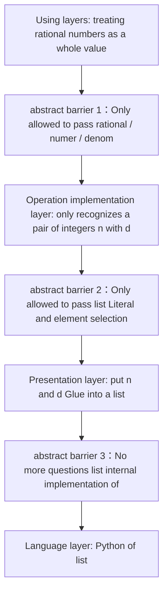
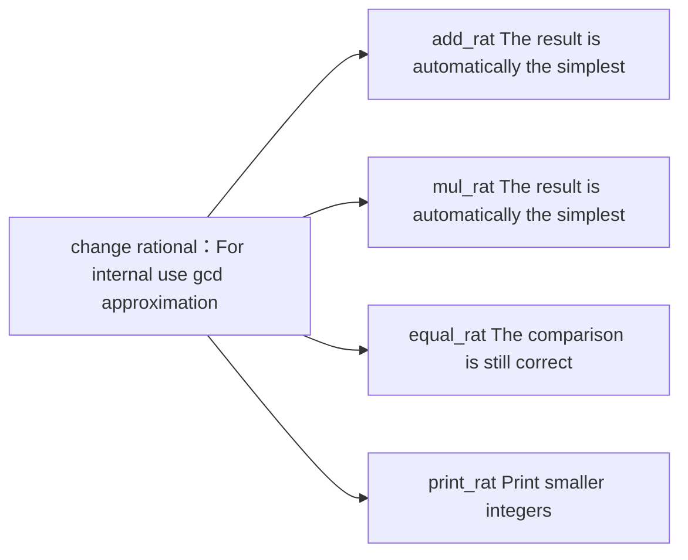

> **courses**: UC Berkeley CS61A · Structure and Interpretation of Computer Programs(Fall 2024)
> **This lecture**: Lecture 13 ｜ 29:08 ｜ Station B P 13 ｜ [Original video](https://www.bilibili.com/video/BV1sy411z7nA?p=13)
> **courseware**: `12-Data_Abstraction_1pp.pdf` (17 pages, official PDF, page-by-page renderings see text illustrations)
> **subtitles**: Original English subtitles from Station B; the film source is an edited version at 29:08. The 13 pages of the list and dictionary part of the courseware do not appear in the film source and are included in the appendix at the end of the article.
> **Copyright**: The copyright of the course and courseware belongs to the UC Berkeley CS61A teaching team; this article is a secondary arrangement for learning purposes

## Quick overview of this lecture

- **Mastered**: `list`  Literals, subscript elements and slices; functions can be taken out of the outer scope as return values; how global frames, local frames and parent frames in the environment graph are strung together into a search chain.
- **Main line of this lecture**:
    - Rational numbers cannot rely on floating point fidelity: `1 / 3`  Only a limited approximation of the binary expansion can be given. To be precise, the numerator and denominator can only be **in pairs** Save.
    - A pair of functions forms an abstract data type: `rational`  Responsible for the combination, `numer`  with  `denom`  Responsible for dismantling, use one for the three **behavioral conditions** interlocking.
    - Indicates that you can change it at will: the same set  `add_rat`, `mul_rat`, `equal_rat`, used below  `[n, d]`  Okay, use one to carry  `n`, `d`  Closures of
    - The abstract barrier separates "how to represent" and "how to use". Each layer is only allowed to call the interface of its own layer.
    - Out-of-bounds code "can run", but will silently fail on the day the representation is changed - this is a failure mode repeatedly emphasized in this lecture.
    - Proceeds are finally cashed out: change only  `rational`  A constructor (use greatest common divisor reduction instead), the upper layer does not move, and all results automatically become the simplest form.
- **Key conclusions**: **The criterion is not "what it looks like", but "whether its behavior is right or not"**. As long as the behavioral conditions are met, the underlying representation can be replaced.

*(Reference time: 00:00:01 – 00:00:33｜Lecture 13)*


## 1. Behavioral conditions: What counts as a rational number

*(Reference time: 00:00:34 – 00:01:39｜Lecture 13)*

"Data" is often regarded as "something out there" in programs. At the beginning of this lecture, we replace it with a checkable proposition: the reason why a value is a rational number is not because it looks a certain way, but because it **performance** Gotta be like rational numbers.

The specific writing method is one **behavioral condition**:If  $x$  by molecules  $n$  with denominator  $d$  constructed, then use two selectors to disassemble it and then perform division, it must be restored  $n/d$:


$$
x = rational(n, d) \quad \Longrightarrow \quad \frac{numer(x)}{denom(x)} = \frac{n}{d}
$$


This equation is the fulcrum of the entire lecture. It ties three things together: constructor  `rational`, two selectors  `numer`  with  `denom`, and an operation (division) between the selector results. Looking at the constructor alone, we can only know "it accepts two integers"; looking at the selector alone, we can only know "it spits out two numbers"; only by putting the two into the same equation can a verifiable definition be formed. The lecturer’s statement was very simple: **Unless something behaves like a rational number, you don't have a representation of a rational number**.

In turn, this equation is also a source of freedom: as long as it holds, it doesn't matter how the underlying numbers are placed. In the second half of this lecture, the reason why we can first change the representation into a function, then change it back to a list, and finally add the reduction is all based on this - the criterion only concerns the behavior, not the implementation.

| parts | The name of this lecture | Responsibilities | position in behavioral conditions |
| :--- | :--- | :--- | :--- |
| constructor | `rational(n, d)` | Combine two integers into a rational number | The left side of the equal sign is called |
| selector | `numer(x)`, `denom(x)` | Retrieve numerator and denominator from rational numbers | Position of numerator and denominator of equal sign |
| Operation | Division  `/` | Restore the results of two selectors to a ratio | left side of equal sign |
| behavioral conditions | `numer(x) / denom(x) == n / d` | Determine whether the representation is legitimate | entire equation |

So the word "data abstraction" has an executable meaning in this lecture: **Use constructors and selectors to define behavior**. If the behavioral conditions are met, the representation is valid; if it is violated, it is not a rational number, but just two integers that happen to be placed together.

## 2. Usage layer: only recognizes constructors and selectors

*(Reference time: 00:01:41 – 00:02:37｜Lecture 13)*

The code that actually uses rational numbers—addition, multiplication, equality judgment, and printing—makes up the core of the program. **Use layers**. The lecturer's statement in this paragraph is very straightforward: these functions "make no assumptions about the representation itself, only require the existence of constructors and selectors."

The implementation below the barrier is to use a list to glue the numerator and denominator into one item. The code above does not know, nor does it need to know. It is this kind of "it doesn't matter" that is demonstrated in class:

```text
>>> x = rational(1, 2)
>>> y = rational(3, 8)
>>> print_rat(mul_rat(x, y))
3/16
```

$x = 1/2$, $y = 3/8$, multiplied by the two, we get  $3/16$, it’s on the screen  `3/16`. This line of output itself is nothing strange, but what is strange is the sentence below it: **I can swap out the representation and the code above still works**. This is the specific form of the opening sentence "The purpose of maintaining abstract barriers is to allow you to change the data representation without having to rewrite the entire program."

> **Editor's note**: The code for rational numbers is typed in the editor in the video. There is no corresponding code on the courseware page. The implementation of this section and section 6 is organized according to the classroom description. Constructors and selectors are explicitly called in the description  `rational`, `numer`, `denom`, `add`, `mul`, equality judgment respectively corresponds to  `add_rat`, `mul_rat`, `equal_rat`;The subtitle of the function "Print Rational Numbers" does not give a name. This article is written uniformly.  `print_rat`, the output format is written in "numerator/denominator".

## 3. Change the representation: let the function carry data

*(Reference time: 00:02:39 – 00:05:49｜Lecture 13)*

The first step in changing the representation is to throw away the list. Constructor no longer returns  `[n, d]`, but define a function called  `select`  small function, put  `n`  with  `d`  Lock it inside and hand over this function:

```python
def rational(n, d):
    def select(name):
        if name == 'n':
            return n
        elif name == 'd':
            return d
    return select


def numer(x):
    return x('n')


def denom(x):
    return x('d')
```

`select`  Receive a name: Yes  `'n'`  Just return the numerator, which is  `'d'`  Just return the denominator, and other situations will not be considered. The constructor sends it as the return value, so "a rational number" becomes a **function**. The way the selector is written changes accordingly——`numer(x)`  Instead of picking up bids, **call** `x`, put  `'n'`  When the actual parameters are passed in.

Run the same example again:

```text
>>> x = rational(1, 2)
>>> y = rational(3, 8)
>>> print_rat(mul_rat(x, y))
3/16
```

Still  `3/16`. Has it really been changed? The lecturer himself answered the question: of course, because  `x`  Now it's a function. This is a representation change, replacing it with another legal representation that works just as well as the old code, but uses a completely different mechanism to remember the numerator and denominator - and **Just using functions is enough, not even the built-in list type is needed**.

### 3.1 Environment graph: data is hidden in the parent frame

Why a function can "remember" `n`  with  `d`? The answer lies in the environment model. The lecturer's explanation is: define another function inside a function, so the inner function can refer to the outer scope.  `n`  with  `d`;returned  `select`  Just take these two values **as part of its own parent frame** Take it with you.



`x = rational(3, 8)`  Create a new frame  `F1`, `n`  tie 3. `d`  tied 8, `select`  in  `F1`  is defined inside, so its parent frame is  `F1`;This function object is returned and bound to  `x`. after  `numer(x)`  The first thing to do is to find out  `x`  value - that  `select`  function - again  `'n'`  Call it for the actual parameters, so a new frame is created, and the parent frame points to  `F1`, in  `select`  Evaluate in the body  `name == 'n'`, returns after hit  `n`, which is 3.

What is worth remembering about this picture is its **shape**: The data is not in any statement, but in the parent frame of a function object. name  `n`, `d`  Already followed  `rational`  The call ends and "leaves" the active environment, but  `F1`  because of being  `select`  The parent pointer is pointed at, so it does not disappear. This is the first time that the closure learned earlier is used as **data representation** Come and use.

| criterion | List representation | function representation |
| :--- | :--- | :--- |
| structure | Return  `[n, d]` | Return closure  `select` |
| Take the numerator | `x[0]` | `x('n')` |
| Take the denominator | `x[1]` | `x('d')` |
| Do you want to change the usage layer? | No need | No need |
| Dependent built-in types | `list` | only functions |
| What does it print out? | `[1, 2]` | a function object (shows only the address) |

The last line is the price of this replacement: once a rational number becomes a function, it is no longer possible to "take a look at what it is". There is only the address of a function object on the screen. Visibility is sacrificed in exchange for the ability to create composite data without any built-in composite types.

## 4. Data abstraction: establishing a barrier between representation and use

*(Reference time: 00:06:23 – 00:07:55｜Lecture 13)*


At this point, the lecturer started again: "A new abstraction method. Let's get started." The starting point is **compound value**: Most values in a program are composites, which put different objects together to create an object with several parts.

The examples given in the courseware are very common: a date is made up of three parts: year, month and day; a geographical location is made up of two parts: latitude and longitude. To "operate this kind of thing as a whole" is an abstraction in itself - otherwise, every time you use a date, you have to take care of three variables at the same time, and any time you pass a parameter, you may mess up the year, month and day.

Data abstraction goes one step further than "packaging". what it does is **Cut any program that uses data in half**:

1. data **How to express** (how data are represented) - several integers, a list, a dictionary, or several closures;
2. data **How to be used/operated** (how data are manipulated) - treat it as a whole value and use named components to manipulate it.

After cutting, the two parts can be modified separately. The lecturer's wording is "separate the concerns in the program", so the definition of data abstraction falls on functions: **Data abstraction is a methodology in which functions enforce an abstraction barrier between the representation of data and its use.**.

There is another widely circulated saying in this paragraph that is worth leaving intact: sooner or later all programmers will have to deal with composite data, but **Only excellent programmers will actively embrace data abstraction and make their programs more modular.**——"And you will soon become an excellent programmer." This is not rhetoric, it corresponds to the result of "only changing one constructor" at the end of this lecture: modularity can be verified, not a slogan.

## 5. The abstract data type of rational numbers

*(Reference time: 00:07:57 – 00:09:34｜Lecture 13)*

Why use rational numbers as an example? Because it puts a real trade-off on the table. A rational number is "an integer divided by an integer". The numerator and denominator are both integers; integers can be represented accurately in Python, so a pair of integers can accurately tell you which fraction you have, such as  $1/3$.

But once **Really do division**, `1 / 3`  What you get is  `0.3333333333333333`——This is a truncated finite approximation of the binary expansion, which should have infinitely many 3s. The lecturer sets a strategy based on this: **Not removed**. Save the numerator and denominator separately, let them form a composite value, and then process it according to the rules when comparison or operation is required.

So there are three functions in this lecture, which are the foundation of all subsequent codes:

| function | signature | Return | role |
| :--- | :--- | :--- | :--- |
| `rational` | `rational(n, d)` | a rational number  $x$ | Constructor, creates an instance of an abstract data type |
| `numer` | `numer(x)` | molecule | Selector to retrieve a part of the whole |
| `denom` | `denom(x)` | Denominator | Selector to retrieve another part of the whole |

The three functions together define a **abstract data type**: a whole value, plus a set of selectors that extract its components. The constructor is responsible for "assembling two parts into a whole", and the selector is responsible for "taking the whole back into its parts". The two parts are inverse operations of each other - the lecturer's word is that they are "complements of each other".

> **Editor's note**: Some lecture notes of SICP and CS61A write the rational number constructor as  `make_rat`, both oral and blackboard writing in this lecture are used  `rational`, this article follows this lecture. Both ways of writing refer to the same role: the name of the constructor itself is not important, what is important is that it, together with the two selectors, satisfies the behavioral conditions of Section 1.

## 6. Write operations based on abstraction

*(Reference time: 00:09:38 – 00:12:51｜Lecture 13)*

With construction and selection, we can write functions that actually do arithmetic. Let’s lay out the formulas first in class: Multiplication is the numerator times the numerator and the denominator times the denominator, and addition requires the common denominator first.


$$
\frac{a}{b} \times \frac{c}{d} = \frac{a \times c}{b \times d} \qquad \frac{a}{b} + \frac{c}{d} = \frac{a \times d + c \times b}{b \times d}
$$


Substitute the specific numbers to check again: $\frac{3}{2} \times \frac{3}{5} = \frac{9}{10}$; $\frac{3}{2} + \frac{3}{5} = \frac{3 \times 5 + 3 \times 2}{2 \times 5} = \frac{21}{10}$. The two results are consistent with the results of oral calculation in class.

There is only one step to convert the formula into code - replace the "numerator" and "denominator" with  `numer`  with  `denom`:

```python
def mul_rat(x, y):
    return rational(numer(x) * numer(y),
                    denom(x) * denom(y))


def add_rat(x, y):
    nx, dx = numer(x), denom(x)
    ny, dy = numer(y), denom(y)
    return rational(nx * dy + ny * dx, dx * dy)


def equal_rat(x, y):
    return numer(x) * denom(y) == numer(y) * denom(x)
```

Three details are worth mentioning separately:

- **`add_rat`  Why name first?**. Because the numerator and denominator each appear twice in the expression, `nx, dx = numer(x), denom(x)`  This not only avoids calling the selector repeatedly, but also makes the formula and code match each other at a glance. `mul_rat`  Each selector appears only once, so there is no need to name it - this is a trade-off between readability and conciseness. The lecturer clearly said that the reason for naming is "they are used multiple times in the expression."
- **`equal_rat`  Why can’t we compare item by item?**.`rational(1, 2)`  with  `rational(2, 4)`  are the same number, but their parts are  `(1, 2)`  with  `(2, 4)`, item-by-item comparison will result in "not equal". The correct approach is to cross multiply: `numer(x) * denom(y) == numer(y) * denom(x)`. This is a direct application of behavioral conditions at the judgment level - what is compared is the value, not the writing method.
- **None of these three functions are implemented**.`rational`, `numer`, `denom`  The specific code does not exist at the moment, but the usage layer is complete: because we know that "these three functions are tools for accessing components and constructing new values", we can write the upper layer first and then implement it later. This is what top-down design looks like in practice.

So far, all methods of manipulating rational numbers have been written as calls to three functions. This sentence is more interesting when read in reverse: **There are only three functions that are "must know"**, the rest are all inferences.

## 7. Abstract barrier: one layer of use, three layers of representation

*(Reference time: 00:12:55 – 00:15:51｜Lecture 13)*

The role of the abstract barrier is condensed into one sentence: it separates different parts of the program so that each part **Just need to know so much**. Why separate? Because only after isolation can "change one part, the rest will benefit without being damaged."

The lecturer broke down the development of rational number systems into several layers, going from top to bottom:

- **Use layers**: That part of the program that performs calculations with rational numbers. The concern here is "What is one-half times one-third?" The rational number is **a whole data value**, it represents a certain number - as for how it represents, I don’t care.
- **Computational implementation layer**: The part of the program that creates rational numbers and implements rational number operations. Here a rational number is regarded as "a pair of a numerator and a denominator". They don't need to know about this pair of things **How exactly is it glued together?**, but you need to know two things: first, a rational number has a numerator and a denominator, and these two can be selected; second, by combining the numerator and denominator, you can create a new rational number. This layer is only allowed to be used  `rational`, `numer`, `denom`  three functions.
- **presentation layer**: The part of the program that actually implements these three functions. It treats rational numbers as lists of two elements, uses list literals to glue the numerator and denominator together, and uses subscripts to get elements.
- **language layer**: The list itself is implemented in Python. People who implement selectors and constructors should no longer worry about how lists are implemented; they only need to know that lists can be created using literals and elements can be selected to retrieve contents.



Each barrier in the picture above is drawn as a line in class. **very thick line** of. The meaning of the thick line is very hard: the part of the code that performs calculations with rational numbers is only allowed to use the functions provided above this line, and is not allowed to reach for functions on another level. The lecturer added a sentence about the basis for judgment - the program written in this way and the assumptions made about "which representation is used"**as little as possible**, it obeys the abstraction determined by the programmer in advance, rather than a specific implementation.

| layer | At this level, rational numbers are regarded as | The only allowed call | Consequences of crossing the line |
| :--- | :--- | :--- | :--- |
| Use layers | an overall value | `add_rat`, `mul_rat`, `equal_rat`, `print_rat` | It will be tied to a certain expression, and the entire section will be invalid when the expression is changed. |
| Computational implementation layer | Numerator + Denominator | `rational`, `numer`, `denom` | It will be assumed that the bottom layer is a list, and the calculation result will directly be wrong when changing the representation. |
| presentation layer | List of two elements | List literal, element selection (`[n, d]`, `x[0]`) | It will assume the internal structure of the list and will be affected when the language layer is changed. |
| language layer | language provided  `list` | Literals and subscript operators | Crossing the boundary is equivalent to rewriting a list yourself |

The barrier also explains "what can be done later." The lecturer here previewed a specific change: as long as you keep these three levels, you can make **Each fraction is expressed in its simplest form**, and you don’t need to change a single line of code using the layer. This prophecy will be fulfilled in verses 12 and 13.

## 8. All the way down: every thick line is a barrier

*(Reference time: 00:15:53 – 00:18:02｜Lecture 13)*

"Is that all?" The lecturer asked and answered himself: There are far more abstraction layers in the program than these three layers, and there are many lower details than what we just saw.

The list itself is something implemented by Python. We don't need to know how it is arranged internally or how to expand its capacity; there are only two things we need to know -**Lists can be created using list literals and can be split using element selection**. Therefore, any place that implements rational number selectors and constructors should not worry about the implementation of lists. This is exactly where the third thick line is.

This results in a rule that can be migrated: **Every thick line is a barrier; when writing a program, use the level of abstraction that matches the current task**. The higher the stop and the less it crosses the boundary, the easier it will be to change the program in the future; on the contrary, every place that crosses the boundary will become a hidden danger that needs manual troubleshooting on the day of changing the display.

## 9. The cost of breaching the barrier

*(Reference time: 00:18:04 – 00:20:33｜Lecture 13)*

The rule sounds abstract, but the instructor makes it concrete with a piece of code. Let’s look at the normal part first: `add_rat(rational(1, 2), rational(1, 4))`  deserve  $1/2 + 1/4 = 3/4$, everything works fine under the current implementation.

Then comes division. The conforming way of writing is isomorphic to other operations - use the selector to remove the component, and use the constructor to create a new value:

```python
def div_rat(x, y):
    return rational(numer(x) * denom(y), denom(x) * numer(y))


def div_rat(x, y):                                  # 违规版本
    return [x[0] * y[1], x[1] * y[0]]
```

The version below **No error reported**, even gives the correct answer under the current implementation. The lecturer's original words were: It works and won't throw exceptions, "but we did something extremely wrong" - we violated the abstraction barrier.

What's wrong can be split into two parts:

1. **It assumes that the representation**. write  `x[0]`  It is equivalent to declaring that "a rational number is a list of two integers." This assumption holds true under today's implementation, but may not hold true under yesterday's and tomorrow's implementation.
2. **it bypasses the constructor**. The return value is a handwritten list, not  `rational(...)`  created value. this means **Change in the future  `rational`  code, this part will not change accordingly**- It doesn't call that function at all.

The lecturer's reaction fully demonstrated the weight of this rule: once is not enough, it was violated twice in a row; "If I see such code on someone else's computer, I will set the computer on fire and watch it burn - because code that violates the abstraction barrier should be burned."

| criterion | Compliant  `div_rat` | Illegal  `div_rat` |
| :--- | :--- | :--- |
| How to get parts | `numer(x)`, `denom(y)` | `x[0]`, `y[1]` |
| way to create results | `rational(...)` | handwritten list |
| It is assumed that the underlying representation | No | Let's say "a list of two integers" |
| Can it be run through under the current implementation? | can | Can (this is where the danger lies) |
| After changing to function representation | still correct | Error immediately |
| change  `rational`  whether to follow | follow | do not follow |

The last three rows of the table are the key to this lecture: **The worst thing about crossing the line is not that it is wrong, but that it is temporarily right.**. The error was delayed until the day of the "representation change", which may have been a long time since the line of code was written.

> **Editor's note**: Python doesn’t guard this barrier for you—it allows anyone to write  `x[0]`, and will not give a warning when the constructor is replaced. barrier is **Agreement**, rely on naming, rely on code review, and rely on actually changing the expression every once in a while to test. This is also the reason why "changing representations" is repeatedly demonstrated in the course: Only by actually changing it can you know which codes follow the rules.

## 10. Paired values: pair and list

*(Reference time: 00:20:36 – 00:23:56｜Lecture 13)*

Before defining the representation as a list, we must first clarify what a "pair" is. \*\*pair\*\* consists of two values ​​that are tied together so that they can be used as a whole, a unit, even though it has two parts inside.

There are many ways to represent a pair of things. In this lesson, we will first use a built-in type: list.

```text
>>> pair = [1, 2]
>>> pair
[1, 2]
>>> x, y = pair
>>> x
1
>>> y
2
```

`[1, 2]`  is a **list literal**: Put comma-separated expressions in square brackets. It collects the two values ​​​​1 and 2 into the same list. Since there are only two elements, this pair is a pair. When this value is displayed, its content is printed on the screen as it is, and its shape is exactly the same as the literal value.

There are two ways to disassemble the whole body into its parts. The first one is called **unpacking**: `x, y = pair`  Bind the zeroth element to  `x`, the first element is bound to  `y`, so  `x`  Yes 1. `y`  Yes 2. The second article is **element selection operator**: `pair[0]`  got 1, `pair[1]`  Got 2.

The two square brackets look the same but have different meanings. The lecturer made a special distinction: square brackets in literals **nothing in front**, which is "making" a list; the square brackets of the selection operator **There is an expression in front of it**, it is "taking an element from the value on the left". The third way to write it is in functional form - every operator in Python has a corresponding function, and the function corresponding to element selection is called  `getitem`, written in all lowercase, located in  `operator`  Module:

```text
>>> from operator import getitem
>>> getitem(pair, 0)
1
>>> getitem(pair, 1)
2
```

| Writing method | form | result | Applicable occasions |
| :--- | :--- | :--- | :--- |
| `x, y = pair` | Unpack | `x`  is 1, `y`  for 2 | Get all the parts at once |
| `pair[0]` | element selection operator | `1` | As long as one of the components |
| `getitem(pair, 0)` | function call | `1` | When you need to pass "retrieve elements" as a function |

Among the three, unpacking is suitable for "getting all the parts at once", for example, as written below  `nx, dx = numer(x), denom(x)`  This type of paired assignment; subscript selection is implemented  `numer`  with  `denom`  means - Section 11 will see that it falls squarely on the presentation layer.

## 11. Use lists to implement rational numbers

*(Reference time: 00:23:57 – 00:25:12｜Lecture 13)*

With pair, the constructor has its place. A rational number is a pair of integers: a numerator and a denominator. So "create a representation  $n/d$ "rational number", you only need to return  $n$, $d$  Lists collected together:

```python
def rational(n, d):
    return [n, d]


def numer(x):
    return x[0]


def denom(x):
    return x[1]
```

`rational`  Return  `[n, d]`, `numer`  Take the zeroth element, `denom`  Remove the element marked 1. The three functions combined are the implementation of the signature table in Section 5 - pay attention to their positions: **These three functions fall exactly on the presentation layer**, located below the second barrier, the code using the layer cannot see that they use lists internally.

The lecturer added a boundary condition: lists can hold anything, including strings, functions, and even other lists; but here, `n`  with  `d` **All should be integers**, otherwise the abstraction of "rational numbers" would not be worthy of its name. Abstract data types never check this (Python won't do it for you), it's the user's responsibility.

## 12. Why 15/6 becomes 5/2

*(Reference time: 00:25:14 – 00:26:56｜Lecture 13)*

It means that once it is implemented, the first example of "what is the use of data abstraction" will come. Recall the implementation of multiplication and then calculate  $\frac{3}{2} \times \frac{5}{3}$: Multiplying the numerator is 15, and multiplying the denominator is 6. According to the literal translation of the code, we should get  $15/6$. But the answer in class is  $\frac{5}{2}$.

The reason is that 15 and 6 are not mutually prime, they are both divisible by 3. Multiply the numerator and denominator  $\frac{1}{3}$, we get the equivalent and simpler fraction  $\frac{5}{2}$. The same goes for addition: $\frac{2}{5} + \frac{1}{10}$  Cross multiply to get  $2 \times 10 + 1 \times 5 = 25$, the denominator is  $5 \times 10 = 50$, so we get  $25/50$;Multiply the numerator and denominator  $\frac{1}{25}$, get  $\frac{1}{2}$.

| expression | Cross multiply/multiply to get | Denominator | reduction factor | result |
| :--- | :--- | :--- | :--- | :--- |
| $\frac{3}{2} \times \frac{5}{3}$ | Molecule 15 | 6 | $\frac{1}{3}$ | $\frac{5}{2}$ |
| $\frac{2}{5} + \frac{1}{10}$ | Molecule 25 | 50 | $\frac{1}{25}$ | $\frac{1}{2}$ |

Why do we have to make an appointment? The lecturer’s answer was very pragmatic: **In order to make the integers as small as possible, easy to read and understand**.$15/6$  with  $5/2$  It is the same number, but the magnitude of the latter can be seen at a glance; once the numerator and denominator expand rapidly with continuous multiplication, people cannot check the results.

So there is a new requirement: rational numbers **forever** It should be expressed in its simplest form, that is, the numerator and denominator are two relatively prime integers. Pay attention to the wording of this sentence - not "the score should be reduced when printing", but "the representation itself should be in its simplest form".

## 13. Change a constructor and everyone will benefit

*(Reference time: 00:26:59 – 00:29:05｜Lecture 13)*

How to achieve "always the simplest"? The lecturer turned the question upside down: **Addition and multiplication are inherently correct**, wrong is  `rational`  definition. To reduce division, it should be completed at the moment when rational numbers are created - because all rational numbers are created by it.

So one change is enough: first import the function for calculating the greatest common divisor (written by hand in the previous lectures, and also built-in in Python. This article is written  `from math import gcd`), then in the constructor first find the common divisor, remove the numerator and denominator, and finally load it into the list.

```python
from math import gcd


def rational(n, d):
    g = gcd(n, d)
    return [n // g, d // g]
```

`gcd`  Both properties of are used here: it is  $n$  with  $d$  of **common divisor**, so it can divide both (the lecturer's original words are "evenly divides", evenly divides); it is also **maximum** The one, so the two numbers after division are relatively prime. Substituting the previous example: $15/6$  of  $g$  is 3, get  `[5, 2]`; $25/50$  of  $g$  is 25, get  `[1, 2]`.

What really matters is the next sentence: **`add_rat`, `mul_rat`, `print_rat`  No need to change a word**——Because every result of them is passed  `rational`  Made. Changing a constructor changes the behavior of all functions that depend on it.



The lecturer ended with one sentence: This is a good thing. And the whole reason why it can be established is that the previous codes never crossed the abstraction barrier - they only recognized three function names, not lists.


The courseware uses the last page to extend this principle to another type of data. **A small number of functions enforce an abstract barrier between "representation" and "use"**: means "list, dictionary or something else is used at the bottom layer", and usage means "treat the data as an overall value and operate according to named components". Take a straight line (affine function) `f`  For example - use  `slope(f)`  instead of  `f[0]`  or  `f['slope']`, use  `y_intercept(f)`  instead of  `f[1]`  or  `f['y_intercept']`. There are two reasons: the code is easier to read and change; and, in the future, the straight line can be expressed as two points instead of the pair of "slope + intercept". **You don’t need to change a single line of code using Straight Line.**.

> **Editor's note**: This page is the closing summary page of the courseware. The source of the film is after the lecture.  `gcd`  It ends after constructing the constructor. There is no corresponding oral explanation between the straight line example on the page and the "two points" statement. It is reproduced here according to the original text of the courseware. In the same way, the "classroom demonstration code" in the text of this lecture is based on the editor screen and dictation, and there is no corresponding code block in the courseware page.

## Summary

- **Define data with behavior, not shape**: The constructor, the selector, and the equation connecting the two, the three together are an abstract data type. The criterion is "does it behave like it", not "what does it look like".
- **Write the contract first, then the implementation**: `add_rat`, `mul_rat`, `equal_rat`  Can be found in  `rational`, `numer`, `denom`  Finished without writing a single line. Top-down is not a matter of style, it forces you to think clearly about "what operations are required".
- **The same set of usage can be used with multiple expressions**: Lists, closures, and dictionaries all work; the cost of changing the representation is equal to the "number of out-of-bounds codes", not the "total amount of code".
- **The out-of-bounds code is temporarily correct**: `x[0]`  If the subscript is legal, it will always be able to run through, and the price will be deferred until the day when the representation is changed. To determine whether a piece of code has crossed the line, what you look at is not the test results, but "what it assumes and who it calls."
- **Barriers must be erected layer by layer**: Usage layer → Computational implementation layer → Presentation layer → Language layer, each layer is only allowed to call the interface of its own layer; the higher the stop, the easier it is to change.
- **The income must be verified by a real change**: This lecture only changes the final  `rational`  a function (join  `gcd`  Reduction), the addition, multiplication, comparison, and printing of the upper layer all follow automatically - this is the reason why the abstract barrier exists.

*(Reference time: 00:29:04 – 00:29:05｜Lecture 13)*

## Appendix: Courseware pages not explained in this film (lists and dictionaries)

*(Reference time: 00:00:01 – 00:29:05｜Lecture 13)*

> **Editor's note**: The B station video source is an edited version at 29:08, starting directly from the middle of the data abstraction. The earlier 13 pages (pages 3–15) in the same courseware belong to list operations, discussion exercises, slicing exercises, string tree recursion and dictionaries. There are no corresponding explanations in the film source and subtitles, so they are included in this appendix according to the writing standards. Only page indexes are used, and non-existent classroom content is not repeated. The following paragraphs are compiled by the editor based on courseware images.

### List Manipulation and Discussion Topics (pages 3–7)


Page 4 squeezes “the most important operation on a list of numbers” into four lines of interaction: `s = [5, 7, 9, 11]`  Use list literals to create lists; `s[0]`  Use element selection to take the first element and get 5; `s[1:]`  Use slicing to get "all the rest", we get  `[7, 9, 11]`; `[3] + s`  Using addition to create a longer list, we get  `[3, 5, 7, 9, 11]`. These four lines are the same set of tools as the pair operation in Section 10, but the number of elements is different.


Page 6 is the first question of the discussion class: Given a list whose elements are all positive integers, find any **not adjacent** The maximum product that can be obtained by multiplying elements together. The courseware prompts split "How to find a recursive process" into three steps: first pick a specific example  `s = [5, 10, 5, 10, 5]`, then write down what each recursive call will return one by one, and finally ask "Which one can help you spell out the result?" The answer to the fill-in-the-blank question is  `max(s[0] * max_product(s[2:]), max_product(s[1:]))`: Either choose  `s[0]`  Just skip it  `s[1]`, or skip it entirely  `s[0]`, whichever is greater of the two. The base case is that an empty list returns 1, and a single-element list returns the element.


Page 7 of  `sums(n, m)`  It is required to list all lists that satisfy three conditions: the sum of the elements is  `n`, each element is no more than  `m`  is a positive integer, and no two adjacent elements are the same. The two counterexamples on the right side of the courseware are circled in red pen——`[1, 1, 3]`  with  `[1, 2, 2]`  All are illegal because of adjacent repetitions. Fill in the blanks and the answer is  `[k] + rest for rest in sums(n - k, m) if rest == [] or k != rest[0]`: Press the first element  `k`  classification, the remaining sums are solved recursively, and then  `k != rest[0]`  Filter out adjacent duplicate combinations.

### Two list exercises (pages 8–11)


Page 9 gives two lists of "same length and related positions": `xs = range(-10, 11)`, `ys = [x*x - 2*x + 1 for x in xs]`, required to write an expression to find the "corresponding  `y`  The smallest one  `x`. The answer is given in the courseware as 1: because  `x*x - 2*x + 1`  That’s it  $(x-1)^2$, the minimum value 0 appears in  $x = 1$, while  `ys`  Here 0 occurs exactly at the 11th position.


Page 11 is the original Spring 2023 Midterm 2 question: \*\*Prefix sum\*\* before exponent  `n`  The sum of terms is required to be realized  `prefix(s)`, returns the sum of all prefixes in order of increasing prefix length. `prefix([1, 2, 3, 0, 4, 5])`  deserve  `[1, 3, 6, 6, 10, 15]`. Fill in the blank (a) Yes  `sum(s[:k+1])`, (b) is  `range(len(s))`——Use slicing to hand over the "top k+1 items" as a whole  `sum`, exactly in the four lines of operations on page 4  `s[1:]`  direct application.

### String tree recursion and dictionaries (pages 12–15)


Page 13 is a tree recursion problem on strings: motorcycles occupy 1 parking space, cars occupy 2 adjacent parking spaces, `%`  Indicates motorcycle, `<>`  Indicates cars, `.`  Indicates vacancy, request  `park(n)`  return  `n`  All solution strings for adjacent parking spaces that are full (empty spaces are allowed). The three branches correspond to "what to put in the first parking space": if you put a motorcycle, then pick it up.  `park(n-1)`, even if there is a vacant position, it will be accepted.  `park(n-1)`, put the car in and then pick it up  `park(n-2)`;base case  `n < 0`  Return  `[]`, `n == 0`  Return  `['']`. Courseware calculation  `len(park(4))`  for 29.


The last two pages turn to the dictionary. Page 14 is a section page, and there is only one literal left on the page.  `{'Dem': 0}`, indicating the writing method of "key → value". The full syntax for dictionary comprehension is given on page 15: `{<key exp>: <value exp> for <name> in <iter exp> if <filter exp>}`, and the abbreviation for removing the filter clause  `{<key exp>: <value exp> for <name> in <iter exp>}`. It has the same structure as the list comprehension, the only difference is that a colon is used to separate the key expression and the value expression - and "using a dictionary to represent a composite value" is exactly another option in Section 4 "The underlying representation can be a list, dictionary, etc."

## Attached: Slide index for this lecture

*(Reference time: 00:00:01 – 00:29:05｜Lecture 13)*

| page | content | Appear location |
| :--- | :--- | :--- |
| 1 | Title page Data Abstraction | Quick overview of this lecture |
| 2 | Announcements announcement page | Quick overview of this lecture |
| 3 | Sectioned Pages Manipulating Lists | Appendix |
| 4 | Four basic operations on lists of numbers | Appendix |
| 5 | Section Page Discussion 4 | Appendix |
| 6 | Max Product: Maximum product of non-adjacent elements | Appendix |
| 7 | Sum Fun: The sum is n and there are no adjacent repeats | Appendix |
| 8 | Section Page Min Practice | Appendix |
| 9 | Two related lists: x for minimum y | Appendix |
| 10 | Section page Slicing Practice | Appendix |
| 11 | Spring 2023 Midterm 2: Prefix Sum | Appendix |
| 12 | Sectioned Page Tree Recursion with Strings | Appendix |
| 13 | Parking: parking solutions | Appendix |
| 14 | Section pages Dictionaries | Appendix |
| 15 | Dictionary comprehension grammar | Appendix |
| 16 | Sectioned Page Data Abstraction | §4 |
| 17 | Abstract Barrier Summary: Representation vs Usage | §13 |
