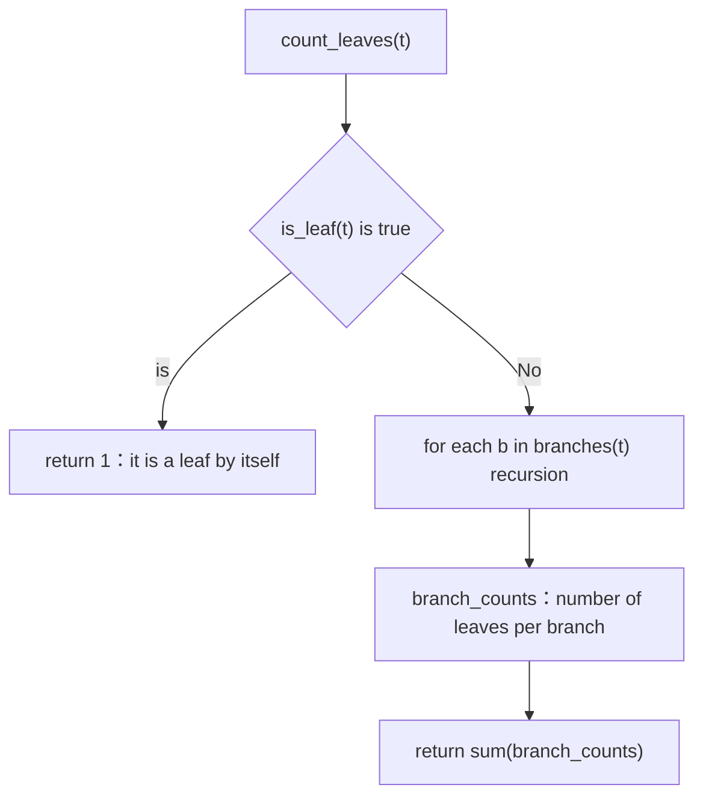
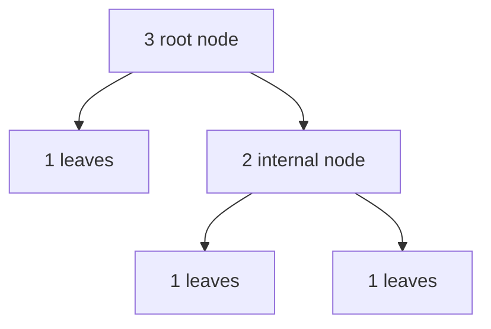
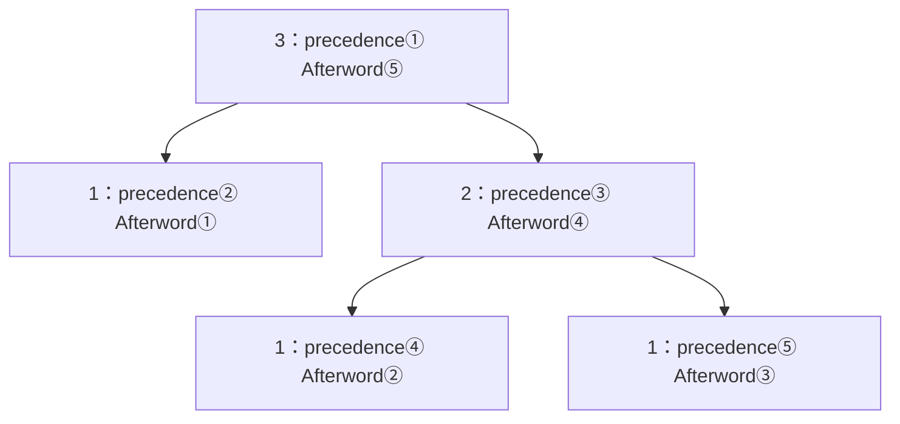
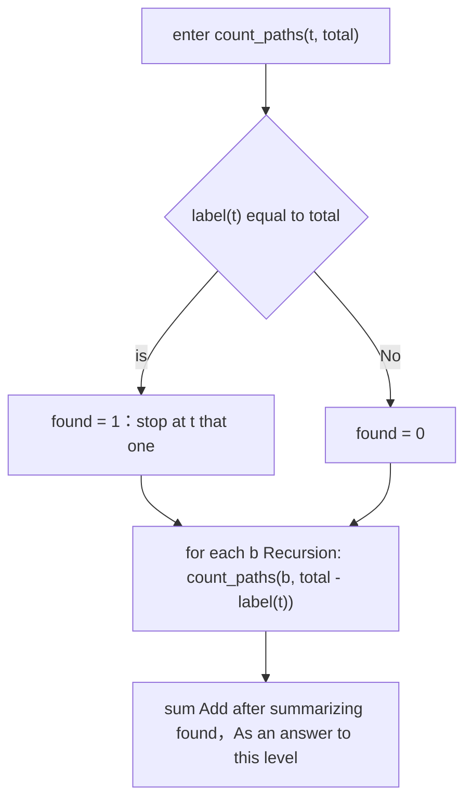

> **courses**: UC Berkeley CS61A · Structure and Interpretation of Computer Programs(Fall 2024)
> **This lecture**: Lecture 14 ｜ 34:32 ｜ Station B P 14 ｜ [Original video](https://www.bilibili.com/video/BV1sy411z7nA?p=14)
> **courseware**: `13-Trees_1pp.pdf` (14 pages, official PDF, page-by-page renderings see text illustrations)
> **subtitles**: Original English subtitles from Station B; this note is a reconstruction of Chinese writing, not a sentence-by-sentence translation.
> **Copyright**: The copyright of the course and courseware belongs to the UC Berkeley CS61A teaching team; this article is a secondary arrangement for learning purposes

## Quick overview of this lecture

*(Reference time: 00:00:00 – 00:01:23｜Lecture 14)*

- **Mastered**: Construction and access of lists and dictionaries, indexing and slicing of sequences, and two perspectives of data abstraction——**representation **with** use**.
- **Main line of this lecture**:
    - Trees describe themselves recursively: a tree = a root label + a list of branches, each branch being a tree.
    - Use a small set of functions to seal the tree into an abstract barrier: `tree`, `label`, `branches`, plus two for verification  `is_tree`  with  `is_leaf`.
    - Functions that deal with trees are almost always tree recursive: the leaves are the base case, the recursive case recurses once for each branch, and then aggregates the results.
    - There are two ways to write aggregation: processing the return value of the recursive call, or taking "so far" as a parameter.
    - Questions such as counting paths and printing trees all test "at which level to make decisions."
- **Key conclusions**: The power of trees comes from the fact that the structure itself is recursive - put  `branches(t)`  Treated as "several smaller similar problems", the code written has only one or two branches.


The announcement in this lecture focuses on the project: Project 2 (CATS) has been released. It is about the same length as HOG and is divided into several phases. Phase 1 and Phase 2A need to pass the checkpoint before Thursday; the entire project is due next Tuesday. If you submit it before next Monday, you can get early submission bonus points. The reason why it is recommended to finish the project this week is because there will be a long assignment on Friday, and the two tasks will be superimposed in the same week. The lecturer also previewed Wednesday's lecture on mutability: that lecture is equally basic and introduces a very widely used and very practical feature in Python. There is only one suggestion for the entire course: **Try not to fall behind and use your hands a little bit every day**. This sentence is especially true in this lecture - the tree is a structure that will be used repeatedly in subsequent courses. The shell that is stuck today will become a bigger shell next week.


## 1. Data abstraction and why trees deserve a separate lecture

*(Reference time: 00:01:23 – 00:02:36｜Lecture 14)*


The first half of the course covers functions: definition, calling, environment, higher-order functions, and recursion. The current position is the other half——**Built-in data structures**. Lists and dictionaries have already been used, and now we need to define new types ourselves. The tree is standing at this turning point: it is spelled out from a list, but it needs to be sealed into a new abstraction with a set of functions written by itself.


The courseware uses one page to abstract the data into one sentence: **A small set of functions that establishes an abstraction barrier between "representation" and "use"**. Each side of the barrier is responsible for one thing - data **How to express** (The bottom layer is a list, dictionary or something else), and data **How to be manipulated** (Used as a whole with named parts).

The example of the courseware is a straight line (affine function). If  `f`  To represent a straight line, the user writes  `slope(f)`  with  `y_intercept(f)`, instead of  `f[0]`, `f[1]`, nor  `f['slope']`, `f['y_intercept']`. The two ways of writing are completely equivalent now, and the difference lies in the future: write  `slope(f)`  The code doesn't know or care what the straight line is"`[斜率, 截距]`  for "," "a Python function" or "two dots"; as long as  `slope`  with  `y_intercept`  It still holds true, no matter what the bottom layer is replaced, the user's code does not need to change a single line. What the abstract barrier buys is two words: **Readable and changeable**.

> **Editor's note**: Pages 3-4 of the courseware are the conclusion and review of the previous lecture "Data Abstraction". The subtitles of this lecture jump directly from the announcement to "Tree is a data abstraction that represents hierarchical relationships". The oral content of these two pages is not in the subtitles; this section is restated according to the original text of the courseware, no examples other than the courseware are added, and there is no specific code demonstration of a straight line in the subtitles.

The tree deserves a separate lecture, and the courseware and dictation give three reasons:

- **it will appear repeatedly**: Trees will be used in many subsequent courses. Now that you learn how to operate them, you will continue to benefit from them when you continue to learn computer science.
- **It is a modeling method in itself**: Even if you don't continue to study computer science, trees are a universal way of "representing hierarchical things in the world."
- **It uses both sides of recursion**: Use recursion on page 6 of the courseware **Description** Tree (branch is also a tree), page 11 also says that recursion is used to process the tree - description and processing share the same set of shapes, which is the most economical part of the tree.

## 2. Two descriptions of trees: woody trees and family trees

*(Reference time: 00:02:36 – 00:04:59｜Lecture 14)*


tree is **Data abstraction representing hierarchical relationships**. I have already drawn the shape of a tree before, and I have also said that trees in computer science grow upside down - with roots at the top and branches and leaves extending downward. This section is supplemented by describing trees. **Vocabulary**: There are two sets of metaphors for the same tree, one recursive and one relative.


### 2.1 Woody trees: recursive description

The first set is **Recursive description (wooden trees, wooden trees)**, consisting of four rules:

- one tree **tree** There is one **root tag** and a **branch list**.
- Each branch is itself a tree.
- A tree without any branches is called **leaf**.
- The tree starts from the root.

The key lies in the second point: branches are trees. So "leaf" is not another type, but just a degenerate case of "the branch list is empty" - it still has its own root label, just without the underlying layer. The tree rooted at 3 in the courseware diagram has only two branches; the left branch is rooted at 1 and has two branches of its own, which are leaves labeled 0 and 1; the right branch is rooted at 2 and also has subtrees hanging on it.

### 2.2 Family tree: relative description

The second set is **Relative description (family trees, family tree)**. It does not describe "how to construct", but "where a certain position is":

- Every location in the tree is called **node**.
- Each node has one **label**, can be any value.
- A node can be of another node **Parent node (parent) **or** Child node (child)**.
- The top node is called **root node**.

Following the family relationship, we can also tell **ancestors**, **descendants**, **brothers**. The courseware circles the nodes one by one: 3 is the root node, 1 and 2 are its child nodes; the 1 on the left has two child nodes, 0 and 1; the 2 on the right also has two child nodes, of which the 1 on the left also has a child node 0 - a total of eight nodes.

The two sets of descriptions are two ways of saying the same tree. The comparison is as follows:

| criterion | Wooden tree (recursive description) | Family tree (relative description) |
| :--- | :--- | :--- |
| basic objects | The tree itself: root label + branch list | Location: node |
| Organization | Recursion: branches are also trees | Relative: father, son, ancestor, descendant, brother |
| end concept | leaves = branch list is empty | Positions without child nodes (referring to the same batch of nodes) |
| label status | The root tag is a component of the tree | The label is the value stored on the node |
| suitable answer | How **structure**, how **Recursive processing** | What is between the two positions? **relationship** |
| Implementation in code | `label(t)`  with  `branches(t)`  Go on recursively | while traversing  `t`, `branches(t)[i]` |

The two sets of statements are often used interchangeably. The comment at the end of the courseware points to this omission: **People are accustomed to using location to refer to tags**——"Each parent is the sum of its children." Strictly speaking, this sentence talks about the value of the label, but it talks about the "label of the parent node". The tree on the courseware diagram just satisfies it: 3 = 1 + 2, 1 = 0 + 1, 2 = 1 + 1, so it is **Fibonacci tree**——The value of each parent node is the sum of its two child nodes, and the entire tree is the graphical representation of Fibonacci recursion.

The courseware also marks an orange dotted line **path**: Starting from root 3, passing through 2 and 1, and falling to the leaf labeled 0. The path is the node sequence obtained by "starting from the root and going to a child node at each step". It can stop at a leaf or a node in the middle.

## 3. Tree interface: five things users are allowed to do

*(Reference time: 00:04:59 – 00:05:58｜Lecture 14)*


Establish the interface first, then write the implementation. This is the consistent order of data abstraction. **The tree's constructor receives two values**: a root tag, and a list of branches; **Each item in the list must be a tree**. Once these two constraints are fixed, the "tree" becomes a value that can be produced and consumed by functions.

The courseware writes down user permissions very strictly: to a tree  `t`, **can only** Do these things -

- Take the root tag: `label(t)`
- Get a list of branches: `branches(t)`
- Take the first place  `i`  branch, which is a tree: `branches(t)[i]`
- Determine whether it is a leaf: `is_leaf(t)`
- put  `t`  Treat it as ordinary **value**: `return t`, `f(t)`, `[t]`, `s = t`  Wait

Any action not on the list is considered out of bounds. Knowing that the inside of the tree is a list and subscripting directly to the second level is using "representation" rather than "abstraction".

So when constructing that small tree, you must first answer a question that will inevitably arise: Since a list is used in the constructor, doesn't this count as breaking the abstraction barrier? **Doesn’t count**. Because "a tree has a list of branches" is inherently part of the abstraction - the list belongs **abstraction**, does not belong to **express**. What really belongs to representation is the decision to "use the first element of the list to store labels and the remaining elements to store branches", which is what Section 4 is about.  `label`  with  `branches`. The user only needs to know that "the branch is a list and can be accessed by index", and does not need to know that "the label has subscript 0".

## 4. Implement tree abstraction

*(Reference time: 00:05:58 – 00:08:44｜Lecture 14)*


It means you can pick whatever you want, and what you pick determines how Python prints the value of the construction expression. Choose here **Nested lists**: A tree is a list, the first element is the label, and the remaining elements are branches; the branches are lists of the same shape, so they are nested layer by layer.

```python
def tree(label, branches=[]):
    return [label] + branches


def label(tree):
    return tree[0]


def branches(tree):
    return tree[1:]
```

Each of the three functions does one thing: `tree`  Put the label into a single-element list, and then splice it with the branch list (adding the lists is splicing); `label`  Remove table 0; `branches`  Use slices  `tree[1:]`  Take out "all the rest" and you still get a list.

> **Editor's note**: `branches=[]`  is the default parameter, as shown on the slide  `tree(label, branches=[])`  It is precisely through this that "give only one label" is interpreted as "a leaf". Python's default parameters are evaluated once when the function is defined and shared by all calls, with mutable values (such as  `[]`) should be used as default values; here  `tree`  Just put  `branches`  Read it out and spell it into a new list, never modify it in place, so you won't step into this trap.

The tree on the right side of the courseware and its construction expression:

```python
>>> tree(3, [tree(1),
...          tree(2, [tree(1),
...                    tree(1)])])
[3, [1], [2, [1], [1]]]
```

The way to read it is to follow the representation: root label 3; the first branch is a leaf containing only label 1, so it is in the list  `[1]`;The second branch is rooted at 2 and has two leaves labeled 1, so it is  `[2, [1], [1]]`. The representation of the whole tree is  `[3, [1], [2, [1], [1]]]`——**The printed look is just a by-product of the presentation**, is not something that users care about.


The above three functions can create trees, but there is no guarantee that "all trees are created": any list can be mixed in. Therefore, the constructor needs to add two checks:

```python
def tree(label, branches=[]):
    for branch in branches:
        assert is_tree(branch)
    return [label] + list(branches)
```

The first one is  `for branch in branches: assert is_tree(branch)`——Confirm that each branch is indeed a tree one by one. If you are not satisfied, throw it away on the spot.  `AssertionError`, instead of waiting for a selector to explode after a few hundred lines. The second way is  `list(branches)`: First pass the incoming stuff **Convert to list** Then splice it together, so that even if the caller gives a tuple or other sequence, no strange structure will be spelled out.

The decision rule requires the same set of definitions to be used in reverse:

```python
def is_tree(tree):
    if type(tree) != list or len(tree) < 1:
        return False
    for branch in branches(tree):
        if not is_tree(branch):
            return False
    return True
```

Three: The type must be  `list`;Length is at least 1 (must hold at least one tag); **All branches must be trees**. Article 3 gives  `is_tree`  It turns itself into a tree recursive function - it checks all the way down each branch, "As long as one branch is not a tree, the whole thing cannot be a tree." If all three are passed, it is a tree: it has a label and a bunch of branches that are themselves trees.

`assert`  Not decoration here. It turns the abstract convention "every branch is a tree" into **Executable checks**: Once the caller violates the contract, the error will immediately appear on the line where the error was made.

Finally, add a function to determine leaves:

```python
def is_leaf(tree):
    return not branches(tree)
```

`branches(t)`  When an empty list is returned, the empty list is false, `not`  Make it true - this function only asks one thing: does this tree have branches.

> **Editor's note**: `is_leaf`  Completely relies on the "empty list is false" convention, so it only works for **Legal format** The tree is reliable. If you don't run first  `is_tree`, like  `[[]]`  Such deformed values will also be treated as leaves. This is the price of abstract barriers: the default input of functions inside the barrier is already inside the barrier.

## 5. Use abstraction: a complete construction and access

*(Reference time: 00:08:45 – 00:10:34｜Lecture 14)*

With selectors, you can just use them to work with the tree, without having to look back at the representation. First make a leaf, and then ask if it is a leaf:

```python
>>> t = tree(1)
>>> is_leaf(t)
True
```

To add branches to the tree, put the branches into a list and pass it in——**Every tree should have a list of branches**, the default is empty; if you just put a normal value in, it will hit  `assert`:

```python
>>> tree(1, [5])
AssertionError
```

`5`  Not a tree, `is_tree(5)`  See the type is not  `list`  Just return  `False`, the assertion fails on the spot. This error message is the barrier in action: it catches the violation at the moment of construction, rather than leaving it later.

Stack another larger tree: root label 1, the first branch is a subtree rooted at 5 and has a leaf of its own, and the second branch is a leaf rooted at 6.

```python
>>> t = tree(1, [tree(5, [tree(7)]), tree(6)])
>>> label(t)
1
>>> branches(t)
[[5, [7]], [6]]
>>> label(branches(t)[0])
5
>>> is_leaf(branches(t)[1])
True
```

> **Editor's note**: This REPL demonstration in Section 5 only has fragments left in the subtitles - you can hear that the root label is 1, the first branch "Put another leaf in the subtree rooted at 5", the second branch "A leaf rooted at 6", the specific value of the leaf in the middle is not read out, and 7 is used here as a placeholder. The structure and conclusion are based on subtitles.

This demonstration illustrates the value of abstraction: `t`  Inside is a bunch of nested lists, but doesn't appear at all when accessing it  `[0]`  with  `[1:]`. Ask for labels  `label`, ask the branch to use  `branches`, fetch a branch according to the index, and then fetch it  `label`——You can go to any level by stacking two calls. put  `branches(t)`  When used as a list, it does not cross the boundary, because the abstraction says "a tree has a branch list".

Looking at it the other way around, if a piece of code is written  `t[0]`  To get the label, it welds the "label at subscript 0" detail into the user code. When will the representation be replaced by a dictionary?  `{'label': ..., 'branches': [...]}`, just rewrite  `tree`, `label`, `branches`, `is_tree`  With four functions, you don’t need to change a single line of code to process the tree; and that sentence  `t[0]`  Will be the first to break.

## 6. Tree recursion: Use a function to generate a tree

*(Reference time: 00:10:35 – 00:12:23｜Lecture 14)*


A function whose input is a tree or whose output is a tree is often tree recursive. Let’s look at the “tree-making” side first: **In practice, constructors are rarely used to build trees one by one. Instead, the program is mostly used to generate trees according to rules.**. The standard example is a Fibonacci tree, where each parent node is equal to the sum of its two child nodes.

```python
def fib_tree(n):
    if n <= 1:
        return tree(n)
    else:
        left, right = fib_tree(n - 2), fib_tree(n - 1)
        return tree(label(left) + label(right), [left, right])
```

> **Editor's note**: `fib_tree`  The source code is not in this lecture (the lecturer wrote it live in the editor), and it can be restored sentence by sentence according to the subtitles: `n <= 1`  return when  `tree(n)`  A leaf; otherwise, two recursive calls are used to create two left and right branches; the label is given by "the label of the left tree + the label of the right tree", and the two branches are loaded into the list and handed to the constructor. Branch order takes left  `n-2`, right  `n-1`; If the two are exchanged, the subtree of each node will be mirrored left and right as a whole, with the label unchanged and the shape changed - this is the only place where you can choose freely in this code.

The three-paragraph structure corresponds to three oral statements:

- **Base case**: `n <= 1`  At that time, this Fibonacci tree was just a leaf, created directly with a constructor.
- **recursive call**: Otherwise, two branches are required. The left branch and the right branch are each generated by a recursive call.
- **Assemble**: Apply Fibonacci recursion to the label - take the label of the left tree and add the label of the right tree; put the branch into a list; hand both to the constructor together.

thus  `fib_tree(0)`  with  `fib_tree(1)`  are all leaves; `fib_tree(2)`  Both branches of are leaves and the root label is 0 + 1 = 1, we get  `tree(1, [tree(0), tree(1)])`; `fib_tree(4)`  The two sub-tree labels are 1 and 2 respectively, the root label is 3, count the leaves, there are exactly five.

The size of the tree grows very quickly: `fib_tree(10)`  The 10th Fibonacci number hangs on the top, but the leaves have  **89**  slices, and 89 is exactly the next Fibonacci number. This is no coincidence.

> **Editor's note**: `fib_tree(n)`  The number of leaves satisfies L(n) = L(n-1) + L(n-2), and L(0) = L(1) = 1, so L(n) is equal to fib(n+1) (according to the fib(0)=0, fib(1)=1 convention used in this lecture), `fib_tree(4)`  of 5 leaves with  `fib_tree(10)`  All 89 leaves match. The total number of nodes is also exponential: `fib_tree`  Each layer makes two recursive calls, and the entire tree is drawn using simple Fibonacci recursion. **call tree**. This incidentally explains two things - why Fibonacci trees "grow very fast", and why the naive recursive fib(40) is unacceptably slow: it is constructing the same subtree repeatedly.

## 7. Count leaves: count\_leaves

*(Reference time: 00:12:24 – 00:14:37｜Lecture 14)*


The tree processing function has an almost fixed skeleton, and the courseware is written in two sentences:

- **Processing the leaves** Usually the tree processing function **Base case**.
- **recursive case** usually for **Recurse once for each branch**, and then put the result **aggregation** Get up.

`count_leaves`  is the minimum sample:

```python
def count_leaves(t):
    """Count the leaves of a tree."""
    if is_leaf(t):
        return 1
    else:
        branch_counts = [count_leaves(b) for b in branches(t)]
        return sum(branch_counts)
```

Both ends are worth a closer look. Base case answer "If  `t`  It's just a leaf and it has several leaves" - the answer is 1, not 0. In the recursive case, first count each branch to get a list of numbers, and then add up these numbers; the total number of leaves in a tree is equal to the sum of the number of leaves in all its branches.

Follow the instructions of the instructor again: `t`  Come in, you don’t know whether it is a big tree or a small tree; if it is just leaves, then the answer is definitely 1; otherwise, count the leaves recursively for each branch and sum the results; finally **Don't forget to return**. This set of reasoning of "first looking at the smallest case, then assuming that the recursive call is correct, and finally only doing aggregation" is the specific form of the "recursive leap of faith" in the previous lecture on the tree.

```python
>>> count_leaves(fib_tree(4))
5
```

Consistent with the five leaves counted earlier. Replace the 4 parameter with 10 and you get 89.



> **Editor's note**: `count_leaves`  The cost of the tree **Number of nodes** Proportional - each subtree is visited exactly once, list comprehension is  `sum`  All are completed on this layer without changing the total amount. Compare this to verse 6  `fib_tree`  It's interesting to look at them together: "generating a tree" is exponential, "counting leaves on a tree" is linear, and the difference between the two is the size of the tree itself.

### 7.1 Access sequence: first order and last order

`count_leaves`  The return value of depends on the child, so **All branches must be calculated before the answer to this node can be obtained**; Section 10 of  `print_tree`  Just the opposite: **Process this node first, then go down**. These two scan orders have fixed names in the context of the tree.

> **Editor's note**: The subtitles of this lecture do not use the terms "pre-order traversal" and "post-order traversal". The lecturer uses descriptions such as "print labels first, and then recurse for each branch". The following uses the standard terminology and uses the tree on page 8 of the courseware to clearly describe the two orders, so that it is easier to recognize the concept of the same name in the algorithm course in the future.

First align the "tree" with the "list representation". The courseware tree  `tree(3, [tree(1), tree(2, [tree(1), tree(1)])])`  The drawing looks like this:



Since the children of each node have an order, there are two access orders:



**precedence** (Process this node first, then branch): "Process" 3 first, and then enter the two branches in sequence; enter the leaf rooted at 1, process 1, which has no branches, return; enter the subtree rooted at 2, process 2, and then process the two leaves in sequence. Got 3,1,2,1,1.

**Afterword** (Process all children first, then process this node): After entering 3, do not rush to process it, first process the leaf of the left branch, and then proceed to the right branch; in the right branch, process its left leaf first, then process the right leaf, and then it is the turn of 2; finally return to 3. Got 1, 1, 1, 2, 3.

| criterion | Pre-order: process this node first | Postorder: process all child nodes first |
| :--- | :--- | :--- |
| The timing of processing this node | The moment you enter the node | After returning from all branches |
| flow of status | Pass down: `indent`, `so_far` | Upload: sub-results are aggregated into current-level results |
| Examples in this lecture | `print_tree`, with indentation  `print_tree` | `count_leaves`, `increment_leaves` |
| Intuition | Announce first, dive later | Collect evidence first, then report |

The order is not a matter of style; **Dependency issues**: If the answer of this layer wants to use the child's answer, it can only be in the last order; if the information of this layer is to be passed to the child, it can only be in the first order.

## 8. Labeling of leaves: Splicing skills of leaves and sum

*(Reference time: 00:14:38 – 00:17:15｜Lecture 14)*

Discussion Topic: Implementation  `leaves`, returns a tree **All leaf labels** list. Note the root tag 3  **Not here** In the results, only the leaves are harvested.

```python
>>> leaves(tree(3, [tree(1), tree(2, [tree(1), tree(1)])]))
[1, 1, 1]
```

To use a about  `sum`  Facts: **Summing "lists of lists" results in a list concatenating all the elements**, assuming an empty list is given as a starting point.

```python
>>> sum([[1, 2, 3], [4]], [])
[1, 2, 3, 4]
>>> sum([[1]], [])
[1]
>>> sum([[[1], 2], [3]], [])
[[1], 2, 3]
```

The first two lines explain why "the starting point is an empty list" cannot be omitted: when the starting point is not given  `sum`  Start adding from the number 0, `0 + [1, 2, 3]`  A type error will be reported directly. The third line says something else: `sum` **Only remove one layer**. The one in the input  `[1]`  Leave it unchanged in the output because  `sum(..., [])`  What it does is "connect each element of the outer list together", and it doesn't care how deep it is.

Therefore, "sum the entire tree" cannot get all the labels: if the tree has several levels of nesting, it will have to be recursed several times; `sum(..., [])`  It is only responsible for connecting the "list returned by each branch" into a long list at each level.

```python
def leaves(t):
    """Return a list of the leaf labels of a tree."""
    if is_leaf(t):
        return [label(t)]
    else:
        return sum([leaves(b) for b in branches(t)], [])
```

with  `count_leaves`  There are only two differences: **What does the base case return?**(`[label(t)]`  instead of  `1`), and **How to aggregate return values**(`sum(..., [])`  instead of  `sum`). The skeleton is exactly the same.

> **Editor's note**: `leaves`  The function body of is not in the PDF of this lecture (the lecturer explained it on the spot, and the interactive page with the subtitle mentioning "Here are eight options, 321 revealed" is not in this version of the courseware). The above is restored as dictated: return "a list with only one label" at the leaf, otherwise do the recursive results of all branches  `sum(..., [])`.`sum(..., [])`  The price is a new list at each level, which is not cheap on deep and wide trees; this is a common trade-off between readability and efficiency.

## 9. Four questions before writing a tree recursive function

*(Reference time: 00:17:16 – 00:19:27｜Lecture 14)*


Before you start writing code, answer the following four questions first - the courseware puts this list before the exercise page:

- **What recursive calls will be made?**
- **What type of values do they return?**
- **What might these return values mean?**
- **How to use these return values to complete the implementation of the current layer?**

The four questions correspond to the four muscles of the recursive function: determining the shape (who to call), determining the type (what is returned), determining semantics (what does the return value mean), and determining aggregation (how to spell out the answer at this level). If you can't answer it, it means you haven't thought it through yet; if you can answer it, there are usually only three or four lines of code left.

to  `increment_leaves`  For example. Goal: Return a tree **The structure is exactly the same, but the leaf labels are added with 1**  of new trees.

```python
def increment_leaves(t):
    """Return a tree like t but with leaf labels incremented."""
    if is_leaf(t):
        return tree(label(t) + 1)
    else:
        bs = [increment_leaves(b) for b in branches(t)]
        return tree(label(t), bs)
```

Answer to question 4: Recursive calls are "once for each branch"; they return **tree**;The meaning of the returned tree is "what that branch will look like after it has been modified"; hand the new tree to the constructor as it is, with **unchanged** The label of this node will get the transformation result of the current tree. Note  `else`  in the branch  `label(t)`  There is no addition of 1 - this function only moves the leaves.

> **Editor's note**: `increment_leaves`  The source code is also not in the PDF of this lecture. The subtitle mentions "adding 1 returns a tree because  `increment_leaves`  What is returned is the tree" and "non-leaf labels remain intact", and the function body is restored accordingly.

Then there is the "lazy" way of writing: if **Every node is treated the same**, there is no need for a separate leaf benchmark case.

```python
def increment(t):
    """Return a tree like t but with all labels incremented."""
    return tree(label(t) + 1, [increment(b) for b in branches(t)])
```

One line, no  `if`, still tree recursion. Where did the baseline case go? **Hidden in a list comprehension**: When  `t`  When it is a leaf, `branches(t)`  is an empty list. List derivation evaluates the empty list to obtain an empty list. A recursive call will not occur, so directly  `return tree(label(t) + 1, [])`——A new leaf.

The reason why the recursion stops is because each level descends one level into the tree, and the leaves have no next level. This experience is worth remembering: **The base case does not necessarily have to be written as  `if`, as long as the input of the recursion is actually structurally smaller**.

## 10. Print tree: from flat output to indented structure

*(Reference time: 00:19:28 – 00:21:29｜Lecture 14)*

The next type of function does not return a value, but only prints - in order to avoid nested lists and look directly at the value in the tree.

```python
def print_tree(t):
    print(label(t))
    for b in branches(t):
        print_tree(b)
```

Print the label of this node first, and then call itself on each branch; no  `return`, because the results are all on the screen. `print_tree(fib_tree(4))`  will print out all tags, but **Can't see the structure**: Each line has a number, and you have to guess who is whose father.

Then let it be indented:

```python
def print_tree(t, indent=0):
    print('  ' * indent + str(label(t)))
    for b in branches(t):
        print_tree(b, indent + 1)
```

`'  ' * indent`  is "two spaces times the number of indent levels", and then combined with  `str(label(t))`  Addition (string concatenation). of root node  `indent`  is 0, so the top line is not indented; when recursing each branch, put  `indent + 1`  Passed down, the "branch of branches" will be indented twice. For each line printed, the number of indentation levels is exactly equal to the number of the tag in the tree. **Depth**.

```text
3
  1
    0
    1
  2
    1
    1
      0
      1
```

> **Editor's note**:Two versions  `print_tree`  They are all written by the lecturer on the spot in the editor, not in the courseware. The function body is restored orally (print the label of this node first, and then recurse for each branch; indent the version.  `indent + 1`  pass on). The above output is restored from Section 6  `fib_tree`  with here  `print_tree`  Launched, used to illustrate the corresponding relationship between indentation and depth; the subtitles only have "Print  `fib_tree(4)`  The sentence description "can clearly see the structure" does not read out the output line by line.

This "tree across" is more useful than the graph: get a bigger tree (e.g.  `fib_tree(5)`), you can still tell at a glance that one of them is  `fib_tree(4)`, the other branch is its other half. The printed version is the cheapest checking tool when debugging recursive functions - see if the values are correct  `print_tree`, check whether the structure is indented correctly.

## 11. Two recursive strategies: change the return value, or go down with the accumulator

*(Reference time: 00:21:30 – 00:24:35｜Lecture 14)*

This main line is worth picking out separately: some recursive functions pass **Processing return values from recursive calls** to construct the results; some put the information **Passed as argument into recursive call**. Both strategies are useful when dealing with trees. The lecturer first returns to his old friend factorial to demonstrate.

```python
def fact(n):
    if n == 0:
        return 1
    else:
        return n * fact(n - 1)
```

`fact(4)`  We get 4 × 3 × 2 × 1 = 24. Note the shape: recursive call  `fact(n - 1)`  Returns a value and this layer puts it **multiply by n**  Return again - the return value has been processed.

Another way to write it is to take "how much has been multiplied" as the second parameter:

```python
def fact_times(n, k):
    if n == 0:
        return k
    else:
        return fact_times(n - 1, k * n)
```

`k`  is the "product so far". Base case return  `k`  itself, because at this time the multipliers from 1 to n have all been merged  `k`. The recursive call is written as  `fact_times(n - 1, k * n)`, pay attention to its return value **not processed**, directly as it is  `return`  Get out. This way of writing brings a strong constraint: **The result of the recursive call must be the result of the current call**; Pushing this constraint all the way to the end, the return value of the base case must also be equal to the answer of the original call. It does hold true here:

```text
fact_times(n, k) = k × n × (n - 1)!
```

Among them  `k * n`  It's the new accumulator brought down from this layer, `(n - 1)!`  The remaining recursion is responsible for completing it. The multiplication of the two sections is exactly  `k * n!`.

The most essential difference between the two is **When multiplication occurs**.`fact`  Here, when reaching the base case, not a single multiplication has been done, and all multiplications occur in **on the way back**——Explore to the bottom first, and then ride back layer by layer. `fact_times` , multiplication is in **On the way down** That's it. When we reach the baseline situation, there is nothing to do but hand back the results as they are.

Got it  `fact_times`, `fact`  You can also write down to just one line:

```python
def fact(n):
    return fact_times(n, 1)
```

`fact(4)`  Still 24.

| criterion | Processing return value (`fact`) | Descent with the accumulator (`fact_times`) |
| :--- | :--- | :--- |
| What does a recursive call return? | A "semi-finished product", this layer still needs to be modified. | That's the final answer, as is  `return` |
| The calculation takes place in | On the way back (bottom up) | On the way down (from top to bottom) |
| Base case return | The smallest quantity in the definition (`1`) | The answers accumulated up to this moment (`k`) |
| additional parameters | No need | Requires: `k`, `so_far`, `total` |
| tree counterpart | `count_leaves`, `leaves`, `increment_leaves` | `print_sums`, `count_paths`  the remaining sum of |
| Common mistakes | Intermediate results are layered, and it’s easy to get them wrong. | The initial value of the accumulator is written incorrectly, and the results are all wrong. |

Two strategies are often used interchangeably in tree recursion: `count_paths`  While passing down the remaining sum as a parameter, aggregate the counts of the subtrees. Recognizing "which part is the status of the downward transmission and which part is the result of the upload" is a shortcut to understanding the tree function.

> **Editor's note**: The function body of this section and the following two sections (`fact`, `fact_times`, `print_sums`, `count_paths`) are all written by the lecturer on the spot in the editor. This courseware only retains the title and key points, so these pieces of code are restored sentence by sentence according to the subtitle dictation, and the variable names are those mentioned in the dictation (`k`, `so_far`, `total`, `found`).

## 12. print\_sums: pass "so far"

*(Reference time: 00:24:36 – 00:28:39｜Lecture 14)*

Task: To the tree **Every path from root to leaf**, print the sum of all tags on this path. Build the tree first. `tree.py`  It is the auxiliary file of this lecture. The constructor and all selectors are installed in it.  `import`  You can access:

```python
from tree import tree, label, branches, is_leaf

numbers = tree(3, [tree(4), tree(5, [tree(6)])])
```

The root is 3, one branch is a leaf labeled 4, and the other branch is not a leaf and has 5 and 6 in it. It only takes three lines to implement:

```python
def print_sums(t, so_far):
    so_far = so_far + label(t)
    if is_leaf(t):
        print(so_far)
    else:
        for b in branches(t):
            print_sums(b, so_far)
```

Reading method: When entering the door, first merge the label of this node  `so_far` (Do it for both leaves and non-leaves); if it is a leaf, the path is finished and the accumulated value is printed; otherwise, with the new  `so_far`  Go into each branch.

```python
>>> print_sums(numbers, 0)
7
14
```

7 is 3 + 4: the root goes directly to leaf 4. 14 is 3 + 5 + 6: 5 is not a leaf, so it does not print when it reaches it, and it continues to 6 before outputting.

Change to a string tree, replace "and" with "splicing", and the same function will still work:

```python
>>> haste = tree('H', [tree('A', [tree('S'), tree('T')]), tree('E')])
>>> print_sums(haste, '')
has
hat
he
```

`has`  from H, A, S, to the leaves; `hat`  from H, A, T; `he`  From H and the E leaf under the root. The initial value starts from  `0`  Replace with empty string  `''`, because  `'' + 'H'`  It makes sense, `0 + 'H'`  An error will be reported. **This is where the accumulator strategy can be reused**: As long as the "combination" operation exists (numbers are added, strings are spliced), the shape of the function remains completely unchanged.

The lecturer mentioned a detail by the way: that sentence  `so_far = so_far + label(t)`  You can also just write it without writing it.  `so_far + label(t)`  inline to  `print`  The effect is the same as in the recursive call; it is written to update first and then use it, but the "new value" is only counted once, and it reads more like "the sum so far".

> **Editor's note**: `print_sums`  Output is only generated at the leaves, so its output order is neither pure node first order nor node post order, but "along each root-to-leaf path, reporting once at the end point"; accumulation occurs on the way down (the "State Pass Down" column of the table in Section 7.1).

## 13. Discussion question: Count the paths and the paths whose sum is equal to total

*(Reference time: 00:28:40 – 00:31:30｜Lecture 14)*

Topic: Given a tree  `t`  with a number  `total`, return **Starting from the root and ending at any node in the tree**, the sum of labels along the way is exactly equal to  `total`  the number of paths.

Two words must be pronounced correctly:

- **any node**, does not have to be a leaf. Stopping halfway also counts as a path.
- **start from root**. There is only one type of path: "root to a certain node", not "a certain section in the middle".

As usual, draw the example as a tree first. The tree in question has three branches extending from root 3. One of the branches has two children, and one of the children has another child. Asked "How to add to 7", there are two: 3 + 1 + 2 + 1, and 3 + 1 + 3 next to it. When asked "How to add to 4", there are two, and **Neither of these two have gone all the way.**- They stop somewhere in the middle and still count. Asked "How to add to 3", one answer is **Root oneself**: A path containing only one node, with length one, is also considered a path; the other is 3 + 1 + (-1).

This example exposes two things:

- **It is possible to figure out the total just by looking at the root tags.**: The root itself is a path, so you must check out the account at this layer before "looking down".
- **After you find a path, you have to keep looking.**: There may be other paths under the same node that are also equal to total.

The second point determines the overall shape of the code. **Can't** Written as "As soon as you find it" `return 1`, otherwise count the ones below - then find one and call it a day, and all subsequent paths will be swallowed up. The correct shape is "how many paths are found on this layer + how many paths are found on all branches below", that is  `return found + sum(...)`. The lecturer described this reasoning as a step that must be taken to solve this kind of problem: first think about the structure, then think about the strategy, and finally write the code.

## 14. Solution to count\_paths

*(Reference time: 00:31:31 – 00:34:29｜Lecture 14)*

Divide paths into two categories: **Stop at current node  `t`**  path, with **stop at  `t`  under a branch of** path. The two categories do not overlap and add up to the total.

```python
def count_paths(t, total):
    """Return the number of paths from the root to any node in t
    with labels summing to total."""
    if label(t) == total:
        found = 1
    else:
        found = 0
    return found + sum([count_paths(b, total - label(t)) for b in branches(t)])
```

Paragraph by paragraph correspondence:

- The first category has only one candidate - "only contains  `t`  The path of this node" is exactly from the root to  `t`  That one. it is equal to  `total`  if and only if  `label(t) == total`, so  `found`  Takes 1 or 0.
- `found`  Must be on both branch paths **valuable**:If  `if`  It is not established and there is no  `else`, `found`  It doesn't exist at all, the next line  `return`  Will throw it directly  `UnboundLocalError`. So  `else: found = 0`  It’s not verbose, it’s necessary.
- The second type of paths are **passed  `t`** (Because they all start from the root), they can gather  `total`  The premise is that "the paragraph below" can make up the rest. So the second argument of the recursion is  `total - label(t)`, the sum of the answers of each branch is the number of all paths below.

The instructor explained this step using the original example: to find 7, you had to first subtract 3 from the root, and then go down to find a path that adds up to 4. **Subtraction is the argument of recursion, addition is the aggregation on return.**



Check the calculation using the tree in section 13  `total = 7`: root tag 3 is not equal to 7, `found`  is 0, for three branch recursions, the actual parameters are all 7 − 3 = 4. Enter branch at label 1: 1 is not equal to 4, `found`  is 0, and the actual argument further down is 4 − 1 = 3; the one with the label 2 among its children continues to reduce 3 to 1, and finally ends up on the node with the label 1  `label(t) == total`  If established, count 1; the node labeled 3 on the sibling branch will count 1 on the spot. Each of the two contributes 1, `sum`  Going back to the root we get 2, which corresponds to the two paths 3 + 1 + 2 + 1 and 3 + 1 + 3.

> **Editor's note**: `count_paths`  The source code is not in the PDF of this lecture (the instructor wrote it on the spot, and the last two pages of the courseware are two other exercises). The function body is reproduced sentence by sentence according to the subtitles: `found`  Take 1 or 0, subtract the label of this layer from the second actual parameter, and finally use  `sum`  aggregate and add  `found`. The subtitles end at 00:34:29, and the last sentence stops at "a path along the root node, and then a path in a branch."

There is another point that is easily overlooked: this algorithm **No pruning**. Because labels can be negative (3 + 1 + (-1) appears in the example), "the remaining total becomes 0 or a negative number" does not mean that there is no need to go down - the path requires **node sequence**, is not a monotonically increasing sum.

> **Editor's note**: `count_paths`  Each node is visited exactly once, the cost is proportional to the number of nodes, and  `count_leaves`  Same level. It uses two strategies at the same time: `total - label(t)`  It is in the state of being passed down. `found + sum(...)`  It's an upward aggregation - this is the mix in the right column of the comparison table in Section 11.

## Summary

*(Reference time: 00:34:23 – 00:34:29｜Lecture 14)*

- **The definition of tree determines the shape of writing**:Tree = root label + branch list, branches are also trees, and trees with zero branches are leaves. This recursive definition makes "processing a tree" always equal to "processing a label + processing several smaller trees".
- **The abstract barrier is erected by a small set of functions**: `tree`, `label`, `branches`, `is_tree`, `is_leaf`. The list appears in **abstraction** where("branch is a list") is legal and appears in **express** ("Tag at subscript 0") needs to be sealed.
- **There are only two sentences in the skeleton of tree processing**: The leaves write the base case, and the recursive case adjusts each branch once and then aggregates. Before writing, answer four questions: what to call, what type to return, what does the return value mean, and how to use it to spell out the answer at this level.
- **The baseline situation does not need to be written  `if`**: When each node is treated equally (`increment`  One-line version), the empty branch list allows list comprehension to naturally not produce recursive calls - provided that each level is going deeper into the tree.
- **Two strategies need to be distinguished**:Change the recursive return value (`count_leaves`, `leaves`, `fact`) calculation occurs on the way back; go down with the accumulator (`print_sums`, `fact_times`, `count_paths`  The calculation of the remaining sum) occurs when hitting the road.
- **This node is also an answer**: `count_paths`  of  `found + ...`  with practice  `largest_label`  of  `+ [label(t)]`  It's the same lesson - if you only look for children, you will definitely miss the root level.
- **Debug tree printing**: `print_tree`  gives the value, `print_tree(t, indent)`  Given a structure, the number of indent levels is the node depth.
- **sense of scale**: `fib_tree(n)`  It is exponential (it draws a simple recursive call tree), while traversals such as counting leaves and paths are linear. When writing a tree function, first determine whether you are writing "generation" or "traversal".

## Appendix: Slides not shown in class

*(Reference time: 00:33:39 – 00:34:29｜Lecture 14)*

The last two pages of the courseware are blank exercises, and there is no corresponding explanation paragraph in the video subtitles (the subtitles are at 00:34:29  `count_paths`  The solution ends together), so it is included in this appendix according to the specifications, and the results of filling in the blanks are given.


Question 1: Return the largest label in the tree. It is still the same skeleton - the leaves write the base case, and the rest recursively aggregates each branch, but the aggregation is replaced by  `max`:

```python
def largest_label(t):
    """Return the largest label in tree t."""
    if is_leaf(t):
        return label(t)
    else:
        return max([largest_label(b) for b in branches(t)] + [label(t)])
```

The key is the one at the end  `+ [label(t)]`: Only taken from branches  `max`  will be missed **root itself** label. Insert the label of this node as well  `max`  The candidate list is truly "the largest in the tree". This is consistent with verse 14  `found + ...`  It's the same lesson.


Question 2: Print all the items in the tree **Strictly greater than the root tag** label. It needs to always read the "label of the root" when traversing, and  `process`  will be called recursively and cannot get the original  `t`——So let it be an inner function and read it from the outer scope  `label(t)`:

```python
def above_root(t):
    """Print all the labels of t that are larger than the root label."""
    def process(u):
        if label(u) > label(t):
            print(label(u))
        for b in branches(u):
            process(b)
    process(t)
```

`process`  The parameter is "the subtree currently to be processed" `u`, while the comparison baseline  `label(t)`  From the layer that surrounds it - this is the inner function written  `t`  instead of writing  `u`  The reason is also **closure **Typical usage in tree traversal. In addition, `process`  Judgment first and then enter the cycle, naturally** precedence**: Each node is checked once upon entry, and there is no need to distinguish between leaves and non-leaves.

> **Editor's note**: These two answers are written by the editor according to the blank spaces in the courseware, and there is no explanation in the video. Fill in the blanks in order: `largest_label`  for  `label(t)`, `max`, `largest_label(b)`, `[label(t)]`; `above_root`  for  `label(u) > label(t)`, `label(u)`, `u`, consistent with the underlined position on the courseware.

## Attached: Slide index for this lecture

*(Reference time: 00:00:00 – 00:34:29｜Lecture 14)*

| page | content | Appear location |
| :--- | :--- | :--- |
| 1 | Title page Trees | Quick overview of this lecture |
| 2 | Announcements announcement page | Quick overview of this lecture |
| 3 | Data Abstraction Sectioned Page | §1 |
| 4 | Data Abstraction: Examples of Abstract Barriers and Straight Lines | §1 |
| 5 | Trees section page | §2 |
| 6 | Two descriptions of trees and terminology annotation diagrams | §2 |
| 7 | Using the tree abstraction: five actions allowed | §3 |
| 8 | Implementation of tree: constructor and two selectors | §4 |
| 9 | Adding verification implementation: is\_tree and is\_leaf | §4 |
| 10 | Tree Processing section page | §6 |
| 11 | Tree processing template: count\_leaves | §7 |
| 12 | Four questions before writing recursive functions | §9 |
| 13 | Exercise: largest\_label (not shown in class) | Appendix |
| 14 | Exercise: above\_root (not shown in class) | Appendix |
