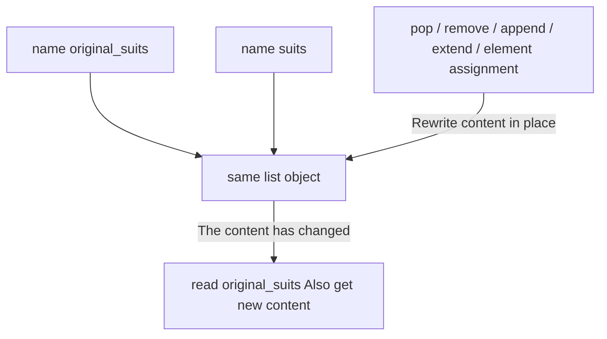
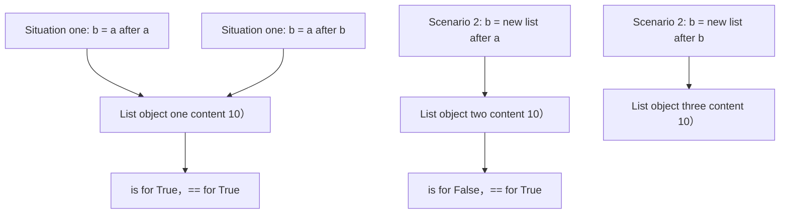
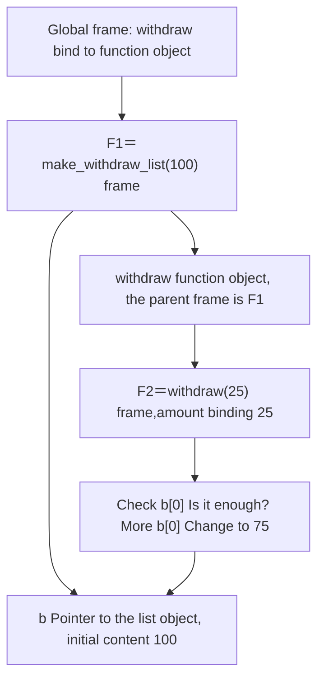

> **courses**: UC Berkeley CS61A · Structure and Interpretation of Computer Programs(Fall 2024)
> **This lecture**: Lecture 15 ｜ 37:58 ｜ Station B P 15 ｜ [Original video](https://www.bilibili.com/video/BV1sy411z7nA?p=15)
> **courseware**: `14-Mutability_1pp.pdf` (11 pages, official PDF, page-by-page renderings see text illustrations)
> **subtitles**: Original English subtitles from Station B; this note is a reconstruction of Chinese writing, not a sentence-by-sentence translation.
> **Copyright**: The copyright of the course and courseware belongs to the UC Berkeley CS61A teaching team; this article is a secondary arrangement for learning purposes

## Quick overview of this lecture

- **Mastered**: The object is a package of "data + behavior" (`date`  of  `.year`, `.strftime`); the string method returns a new string; the arrow rules of "name → value" in the environment graph; the literals and elements of lists, dictionaries, and tuples.
- **Main line of this lecture**:
    - Objects can change their values: the same list object holds different contents at different times;
    - An object can have multiple names (aliasing), and any change is visible to all names;
    - In addition to "what parts it is composed of", a composite object also has "which part it is"——`is`  judge identity, `==`  Judgment content;
    - The parameter passed is the object itself, and the mutations within the function will penetrate to the caller;
    - Tuples, numbers, and strings are immutable, so they can be used as dictionary keys, but they are not immune to "mutable elements inside";
    - The default parameter values are in  `def`  Created only once, mutable default values accumulate between calls;
    - Putting the balance into a list allows the function to have state that survives across calls - a mutable function.
- **Key conclusions**: Once "mutable objects" appear in the language, "the same thing" no longer equals "the same content", but just "itself"; the side effects of operating an object will spread along all aliases.

*(Reference time: 00:00:01 – 00:37:55｜Lecture 15)*

> **Editor's note**: 00:00–00:12 of the video is about objects, properties, methods, strings and character encoding, which is the final review of the previous lecture on Object; the new concept titled Mutability officially begins at 12:44 with "Objects can change their own values". This review retains this review because it is the prerequisite knowledge of "why objects can carry state", but the focus is placed after 12:44.

## 1. Object Review: Properties, Methods and "Behave Like the Thing It Represents"

*(Reference time: 00:00:01 – 00:05:46｜Lecture 15)*


### 1.1 A value that behaves like a date

The course starts with a standard library module: `datetime`  represents date and time, where  `date`  Is a class. The class itself is a value, and calling it gets an instance: `date(2015, 2, 20)`  It's a certain day, `date(2015, 5, 12)`  is the date of the final exam for this semester.

```python
from datetime import date

today = date(2015, 2, 20)
freedom = date(2015, 5, 12)
freedom - today        # datetime.timedelta(days=81)
```

When two dates are subtracted, the result is not the result of subtracting two integers, but an "interval": 81 days. This detail is the original intention of the object——**An object should behave like the thing it represents**. Date does what dates do: tell you what day of the week it is, what month it is, and how far away it is from another day, without the caller needing to know how this information is stored.

The main carrier of behavior is attributes, accessed using dot expressions:

```python
today.year     # 2015
today.month    # 2
today.strftime('%A, %B %d')    # 'Friday, February 20'
```

`strftime`  It is a function bound to the date object, that is, a method: pass a format string as a parameter, and it spits out the text according to the format. `%A`  What day of the week is it? `%B`  is the name of the month, `%d`  What's the number?

### 1.2 What is an object: Data and behavior are bundled together

The instructor highlights an easily overlooked fact here: when creating the date, you never enter "This day is Friday", nor do you tell the program that February is F-E-B-R-U-A-R-Y. **Knowing this is part of the matter of "being a date"**. The object bundles data (which year, month, and day) and behavior (how to format, how to subtract) to form an abstraction.

From this, the definition of an object can be given: an object represents information, which is composed of data and behavior; it can represent specific things, or it can represent the nature of things, an interaction, or a process. As long as properties can be accessed, they can be modeled as objects. The "type" of an object is called a class; a class is a first-class value in Python and can be passed to a function as a parameter. And the programming method around objects—Object-Oriented Programming—provides a central metaphor for large programs: **A large program is not a whole thing, but a bunch of independent objects that collaborate by sending messages to each other.**. Dot expressions are a special syntax for this metaphor, which allows "who is doing what" to be read at the surface of the code.

In Python, every value is an object, and every value has attributes, including numbers and strings; a large number of data operations are actually completed through object methods.

### 1.3 A function does one thing, and an object does a set of related things.

The design principle of a function is a single responsibility: pass in parameters, get a return value, and end it after doing one thing. The objects are different, and one object has many related behaviors bundled with it. Dates don't just do one thing, they are used in countless situations, so there are multiple methods, each method is like a function in itself, but they only make sense for things like dates.

Page 2 of the courseware is an announcement page with only a title, arranged in this chapter in the order of the courseware:


> **Editor's note**: There is no announcement clip in this video. After the title page, it goes directly to the object review. Therefore, this page only marks the course structure in the text and does not include any announcements that have not happened.

## 2. String objects and character encoding: from methods to code points

*(Reference time: 00:05:49 – 00:12:44｜Lecture 15)*

### 2.1 The string method returns a new string

Strings are also objects and have properties. Called on a string  `upper`, `lower`, `swapcase`, you will get a version with uppercase, lowercase, and uppercase and lowercase swaps:

```python
s = 'hello'
s.upper()      # 'HELLO'
s.lower()      # 'hello'
s.swapcase()   # 'HELLO'
s              # 'hello'
```

The key is the last line: no changes after three calls  `s`. Each method is based on the old string **Return a new string**, `s`  still  `'hello'`. These methods are also not general functions, but have string-specific behavior - which is why they are made as methods rather than built-in functions. This "call does not change the original value" clue will turn into two clear criteria tables in Sections 4 and 5: strings and numbers are immutable values, lists are not.

### 2.2 ASCII: a table with 8 rows and 16 columns

String is an abstraction of text, but it has a layer of numeric encoding in the machine, and this layer of encoding does not belong to Python. It is a convention shared by many languages. One of the earliest established standards was ASCII (American Standard Code for Information Interchange): it was a table that specified which numbers corresponded to which letters or symbols.

The shape of the table is 8 rows × 16 columns. The number 8 is important because three binary digits can represent exactly 8 rows; 16 columns are represented by four digits. The rows and columns combined are 7 bits and can cover 128 code points.

The layout is not arranged casually, it is designed to "sort by character code to get the order people want":

- Uppercase letters come before lowercase letters, so when sorting by code point  `A`  in  `a`  front;
- Symbols such as the exclamation point are listed first, and the tilde is listed last, so the punctuation will be placed in a predictable order;
- The middle section of the table (spaces, numbers, punctuation, uppercase letters) forms a self-sufficient subset of usable: if the machine bit width is not enough, you can still write a complete English sentence by taking only this section, at the cost of not being able to type lowercase letters - only all uppercase, but it is better than writing nothing at all.

At the top of the table are control characters, which are designed for transmission and information exchange and are not displayed themselves. `LF` (line feed) tells the peer printer to wrap the line; `BEL`  It makes the peer's printer beep once to attract attention after information is exchanged. Most of the meanings of these characters have become obsolete, but a few have survived to this day.

It’s straightforward to use: capital letters  `A`  Corresponds to 65, written in hexadecimal  `41`. These two hexadecimal digits are exactly its coordinates in the table - row 4, column 1. put  `BEL`  If you print many times in a row, the terminal will beep.

> **Editor's note**: In the video, a terminal was used to check the code position on the spot and the ringing characters were printed repeatedly. The scene is not suitable as a static illustration, so it is reproduced in text. The specific range of the "available subset of the middle section" is 0x20–0x5F. These 64 code points (spaces, punctuation points, numbers, capital letters) can be expressed in exactly 6 bits. This is the editor's precise interpretation of the lecturer's statement, and the lecturer only gave a verbal description.

### 2.3 Unicode: code points for all languages

ASCII only serves English. The goal of Unicode is that every character in every language and every script in the world has a code point, which is a number that can be used to refer to it, so that information can be exchanged between computers and languages. The data at that time was about 109,000 characters, spread across 93 scripts.

It does not simply enumerate all symbols, but organizes them according to the text system, and marks capitalization, language and other information. It also supports bidirectional display order: English is written from left to right, Arabic is written from right to left, and the same string can be mixed. Each character also has a name, letter  `X`  The official name is  `Latin capital letter X`.

Python directly exposes this structure:

```python
from unicodedata import name, lookup

name('A')                          # 'LATIN CAPITAL LETTER A'
name('a')                          # 'LATIN SMALL LETTER A'
lookup('LATIN SMALL LETTER A')     # 'a'
lookup('BABY')                     # 那个婴儿字符
```

`name`  Search names by characters, `lookup`  Search characters by name. In this system, emoticons are just "letters" in a certain writing system: smiley faces, snowmen, footballs, and babies all have code points. What it looks like depends on the font on the machine - the same baby character may have a certain hairstyle on a Mac, but it will look different on another machine. **Font shape is variable, code point remains unchanged**: Coding is universal across languages and platforms.

The encoding can also look directly at the bytes: the baby character occupies four bytes in UTF-8, and the letters  `A`  It only occupies one byte and the value is 65.

| criterion | ASCII | Unicode |
| --- | --- | --- |
| design goals | Service English and Telegraphic Information Exchange | Serves all languages and writing systems in the world |
| table shape | 8 rows × 16 columns, 3 rows, 4 columns | One-dimensional code point space, partitioned by text system |
| Coverage | 128 code points: control characters, numbers, punctuation, letters | About 109,000 characters and 93 writing systems at that time |
| Sorting convention | Sort by code point to get the readable order, uppercase before lowercase | No ordering is agreed upon, only a number and name are given to each character |
| writing direction | Only consider left to right | Supports bidirectional display, can mix left to right and right to left |
| Character naming | No unified name | Each character has a name and can be queried in both directions. |

## 3. Objects change their own values: List mutation and aliasing

*(Reference time: 00:12:44 – 00:16:13｜Lecture 15)*

### 3.1 Today’s new idea: Values can change over time

All the previous content is based on an implicit premise: a value will not change after it is calculated. This section dismantles this premise——**Objects can change their values during calculations**. The simplest example is a list: the same list can contain different things over time.


The courseware page only has the title and a Python Tutor link. The program in the link rewrites a list in place:

```python
s = [3, 5, 7, 9, 11]
for i in range(len(s)):
    s[i] = s[-(i+1)]
```

> **Editor's note**: This code comes from the courseware link, and there is no line-by-line explanation in the video. If you run it frame by frame, you will find that it does not reverse the list: in the first half of the loop, the original value in the right half is read and written into the left half; in the second half, the original value in the right half has been overwritten by the new value in the left half, and the overwritten value is copied back to the right. The final result is symmetrical  `[11, 9, 7, 9, 11]`. This "failed reversal" illustrates the main point of this section: assignment is overwritten in place, and the expression on the right reads a list. **at this moment** content.

### 3.2 A brief history of suits: two names, one list

The instructor uses the spread history of playing card suits to demonstrate list variation. It is generally believed that playing cards originated in Asia. They originally had three suits: coin, string, and myriad, which represent different denominations of currency. After all, the most classic use of playing cards is gambling.

```python
original_suits = ['coin', 'string', 'myriad']
suits = original_suits
```

This code uses an assignment statement to "remember" the original suit. The story that followed was a series of mutations: playing cards were spread to Europe via Egypt, and Wan Guan was lost on the way; the rope was also lost, leaving only the money. When it was introduced to Spain, the cards needed new suits, so there were cups, swords, and clubs, which became money, cups, swords, and clubs. In Italy, the sword was called spada, hence the word spade. In France, money and cups were replaced by hearts and diamonds, eventually becoming the four suits of modern American poker: hearts, diamonds, spades, and clubs.

The above description corresponds to the following series of operations. Among them  `pop`  Always delete and return the last element, `remove`  You can delete the value anywhere in the list, `append`  Add an element, `extend`  Add a string of elements at a time:

```python
suits.pop()                # 万贯丢失
suits.remove('string')     # 索子丢失，只剩钱
suits.append('cup')        # 西班牙牌加入杯
suits.append('sword')      # 与剑
suits.append('club')       # 与棒
suits[2] = 'spade'         # 意大利语把剑叫 spada
suits[0] = 'heart'         # 法国人用红桃替换钱
suits[1] = 'diamond'       # 用方块替换杯
```

> **Editor's note**: Page 3 of the courseware only gives section titles and demonstration links, without the complete code of the pattern demonstration; the above code is based on the name read in the video (`original_suits`, `suits`) and operation (`pop`, `remove`, `append`, `extend`, element assignment) retelling, after execution  `suits`  for  `['heart', 'diamond', 'spade', 'club']`.

After telling the story, the lecturer looked back at the original name:

```python
original_suits    # ['heart', 'diamond', 'spade', 'club']
original_suits == suits    # True
```

`original_suits`  It was bound at the beginning, and the changes in the middle were always  `suits`, but its current content has also changed. The reason is simple: **They are two names for the same object from the beginning**, any change is reflected on both sides at the same time. The instructor called this the first time he saw "object changing state" in this course - the same thing changed its content during the calculation process, but the binding relationship of the name was not changed once.

The analogy given by the lecturer is "person": put the name  `same_person`  Bound to a baby character, the baby grows up, `same_person`  Still points to the same person, the change occurs on this object, not on the binding relationship.

In computer science, **Any change to an object is called mutation**. Only objects of mutable type can be mutated. Lists and dictionaries are the two types we have already seen.



### 3.3 Courseware supplement: Use append to build a list instead of rewriting it

> **Editor's note**: The next four pages of the courseware (pages 4-7) talk about "building a list with append" and "using a list as a branch container". The video does not talk about them in this paragraph, but directly enters the variable type in Section 4. These four pages are adjacent to this section but in the opposite direction: previously we were using mutation to rewrite an existing list, here we are **Keep creating new lists**, `append`  Only add the newly created ones in this call  `result`  on. The following is a supplementary lecture based on the courseware screen and doctest.


`sums(n, m)`  Requires return of all "sums" for  `n`, each number is from 1 to  `m`  A list of positive integers, and adjacent elements do not repeat. doctest writes the contract to death: `sums(5, 1)`  is  `[]` (5 can only be split into 5, but 5 exceeds the upper limit of 1), `sums(5, 2)`  only  `[[2, 1, 2]]`, `sums(6, 3)`  There are 8 solutions.

```python
def sums(n, m):
    """Return lists that sum to n containing positive numbers up to m that
    have no adjacent repeats, for n > 0 and m > 0.

    >>> sums(5, 1)
    []
    >>> sums(5, 2)
    [[2, 1, 2]]
    >>> sums(5, 3)
    [[1, 3, 1], [2, 1, 2], [2, 3], [3, 2]]
    >>> sums(5, 5)
    [[1, 3, 1], [1, 4], [2, 1, 2], [2, 3], [3, 2], [4, 1], [5]]
    >>> sums(6, 3)
    [[1, 2, 1, 2], [1, 2, 3], [1, 3, 2], [2, 1, 2, 1], [2, 1, 3], [2, 3, 1], [3, 1, 2], [3, 2, 1]]
    """
    result = []
    for k in range(1, min(m + 1, n)):  # k is the first number of a list
        for rest in sums(n-k, m):
            if rest[0] != k:
                result.append([k] + rest)  # build a list out of k and rest
    if n <= m:
        result.append([n])
    return result
```

The answer to the three blanks is  `min(m + 1, n)`, `sums(n-k, m)`  with  `[k] + rest`, there are reasons if you look at them one by one:

- `k`  is the first term of a solution, taking values from 1 to  `m`; and must be less than  `n`, otherwise  `n-k`  will be less than or equal to 0, and there is no lower bound for recursion. Take the smaller of the two upper bounds, which is exactly  `min(m + 1, n)`(`range`  The right end of is not included).
- First item settled  `k`  After that, all that's left to do is  `n-k`, the upper limit is still  `m`, so for each legal "remainder list" `rest`  recursive call  `sums(n-k, m)`.
- Used when splicing  `[k] + rest`, instead of  `rest.insert(0, k)`  or to  `rest`  inside  `append`: `[k] + rest`  put  `k`  Put it at the front and create a new list, `rest`  Itself is not modified. The two writing methods here have the same result (each recursion creates a new  `result`), but modifying a value from another frame in place is an implicit side effect that this lecture reminds repeatedly. `+`  Separate "build" and "mutation" cleanly.
- `n <= m`  when this  `n`  It is a legal solution by itself, so I will make it up separately.  `[n]`;This branch corresponds to doctest  `sums(5, 5)`  The one at the end  `[5]`.

### 3.4 Courseware supplement: Make a path on a tree


From "loading numbers in a list" to "loading branches in a list", the problem becomes an operation on the tree: if the elements in the list are several trees, recurse for each element, and you will get a new tree.


The topic is  `make_path(t, p)`: `t`  is a tree with different labels, `p`  is a path starting from the root tag (a tag list); it is required to return a tree with  `t`  isomorphic, but contains  `p`  tree with as few nodes as possible. The courseware gives three sets of goals: `make_path(t1, [3, 8, 9, 1])`  Open a new branch under the root 8→9→1; `make_path(t1, [3, 4, 8, 9])`  Continue 8→9 under the existing branch 4; `make_path(t1, [3, 5, 6, 8])`  Add another 8 after 5→6. In all three groups, new nodes only grow after "the square where the path goes", and the rest are kept as they are, so the return value is the tree with the fewest nodes. The courseware then uses two sentences to describe the recursive structure:

- Recursive idea: `make_path(b, p[1:])`  should be  `make_path(t, p)`  A branch in the return value;
- Special case: If no branch ends with  `p[1]`  At the beginning, you need to create a new label as  `p[1]`  leaves.


```python
def make_path(t, p):
    "Return a tree like t also containing path p."
    assert p[0] == label(t), 'Impossible'
    if len(p) == 1:
        return t
    new_branches = []
    found_p1 = False
    for b in branches(t):
        if label(b) == p[1]:
            new_branches.append(make_path(b, p[1:]))
            found_p1 = True
        else:
            new_branches.append(b)
    if not found_p1:
        new_branches.append(make_path(tree(p[1]), p[1:]))
    return tree(label(t), new_branches)
```

`assert`  put"`p`  Must start from the root tag" This premise is written as an executable check; `len(p) == 1`  It is a recursive exit, when there is only one label left in the path  `t`  It already contains it. Loop processing existing branch: matching  `p[1]`  recursively, and leave the rest as they are. `found_p1`  Remember whether there is a match. If there is no match, it means that the road is broken at the second layer, so use  `tree(p[1])`  Create a leaf with only labels, and then fill in the rest recursively. Use return value  `tree(label(t), new_branches)`  reassemble, therefore **The entire function has not been modified  `t`**, just creating a new tree - this is exactly the opposite of the suit demonstration in Section 3.2: there the same object was modified many times, here a new object is generated at each layer.

## 4. Where mutation occurs: dictionary, function parameters and global frame

*(Reference time: 00:16:09 – 00:20:26｜Lecture 15)*

### 4.1 Addition, deletion and modification of dictionary

Dictionaries can also be mutated. To create a dictionary that maps Roman numerals to numerical values, you can look at the whole first and then the values of individual keys:

```python
numerals = {'i': 1, 'v': 5, 'x': 10}
numerals['x']    # 10
numerals['x'] = 11
numerals         # {'i': 1, 'v': 5, 'x': 11}
```

Use element assignment to change an existing key. It turns out that  `x`  with  `10`  The binding between them completely disappears and is replaced by  `x`  with  `11`; Check the key again and get the new value. Element assignment can also be used to add new entries: assign a value to a key that does not exist, and there will be an additional pair of key values in the dictionary; conversely  `pop`  Receive a key, delete the entire key-value pair, and then check the key again and there will be nothing.

### 4.2 Variations within function calls

Mutations don't just happen at the top: **A function can change the value of any mutable object within its scope**. Let’s first look at a function that rewrites a list:

```python
def mystery(s):
    s.pop()
    s.pop()
```

```python
four = [1, 2, 3, 4]
len(four)      # 4
mystery(four)
len(four)      # 2
```

Define functions, create lists, call  `mystery`. The call will create a new frame, and the name in this frame will be  `s`  bound to  `four` **same one** list object; `s.pop()`  What is deleted is the last element of that object, so  `four`  The world you see is also missing an element. `four`  The binding itself has not changed, what has changed is the content of the list it points to; the second time  `pop`  After that it was shorter.

The same effect can also be written using slice assignment: replacing the section from index 2 to the end with an empty list is equivalent to deleting them.

```python
def mystery(s):
    s[2:] = []
```

### 4.3 Zero-parameter functions can also be modified

If the function does not accept parameters, can it still be changed to an external list? Yes - as long as the name is visible in its scope. like  `four`  In this way, any function can check the name bound in the global frame, so functions with zero parameters can also  `pop`  Go down:

```python
def mystery():
    four.pop()
```

The global frame is open to everyone. This rule has always been true in environment graphs; this section is just the first time it is used to explain "side effects".

| Writing method | Whether to change the original object | return value | Description |
| --- | --- | --- | --- |
| `s.append(5)` | change | No new value | Add an element to the end |
| `s.extend([5, 7])` | change | No new value | Add a string of elements at the end |
| `s.pop()` | change | deleted element | Always delete the last one |
| `s.remove(5)` | change | No new value | Delete the first element equal to 5 |
| `s[0] = 9` | change | No new value | Element assignment, overwriting the original position |
| `s[2:] = []` | change | No new value | Slice assignment can be used to delete a section |
| `s + [5]` | Do not change | new list | Splicing creates new objects |
| `s.upper()` | Do not change | new string | String methods always return new strings |
| `d['x'] = 11` | change | No new value | If the key already exists, change the value, otherwise add it |
| `d.pop('x')` | change | deleted value | Delete the entire key-value pair |

> **Editor's note**: "No new value" in the table means that these methods return  `None`, is a rule of Python; the video does not read out the return values one by one, but in the demonstration these calls only leave side effects and are not assigned other names.

## 5. Tuples: benefits and costs of immutable sequences

*(Reference time: 00:20:30 – 00:25:56｜Lecture 15)*

### 5.1 Literals and the required comma

Tuples are sequences, but immutable sequences: the content cannot be changed after creation. There are two schools of thought on its pronunciation in the English-speaking world, one is pronounced like "too-ple" and the other is pronounced like "tup-ple"; the lecturer said that there is no generally accepted standard on this matter, and the only consensus between the two groups is that the other party has pronounced it wrong. This note is uniformly pronounced as "tuple".

```python
(3, 4, 5, 6)     # 元组字面量
3, 4, 5, 6       # 不加括号也是元组
()               # 空元组
tuple()          # 空元组
tuple([1, 2, 3]) # (1, 2, 3)，任何序列都能转
(2,)             # 只有一个元素的元组
```

There are two things that are easy to ignore: **Parentheses are not required**, it is the comma that determines whether an expression is a tuple - a string of values separated by commas is a tuple. Many people add parentheses just to make it clearer; **Single-element tuples must leave a comma**, `(2,)`  is "a tuple holding 2", `(2)`  Just the number 2 has parentheses added. The way to write single-element tuples relies on this comma, which is not pretty, but there is no other way to write it.

### 5.2 Operations that can and cannot be done

Tuples support splicing, member judgment and slicing:

```python
(1, 2) + (3,)        # (1, 2, 3)
3 in (1, 2, 3)       # True
(1, 2, 3, 4)[1:3]    # (2, 3)
```

These operations are **Return new tuple**, will not modify any existing tuples.

Because they are immutable, tuples are hashable and can be used as dictionary keys. List does not work:

```python
{(1, 2): 'ok'}       # 合法
{[1]: 'no'}          # TypeError: unhashable type: 'list'
```

And this restriction will spread further: as long as there is a list hidden in the tuple, the entire tuple will no longer be hashable, and the same error will occur.  `unhashable type: 'list'`.

### 5.3 The "protection" brought by immutability and its boundaries

Immutable values have practical benefits: they are protected to a certain extent from being changed by other functions.

```python
def ooze(s):
    ...

turtle = (1, 2, 3)
ooze(turtle)
turtle        # 仍然是 (1, 2, 3)
```

Numbers and strings are also immutable. What the lecturer said here is "the only variable values ​​are lists", and the context of this sentence is the string of basic values ​​just compared: numbers, strings, tuples, lists; dictionaries have been listed as variable types in Section 4.1, so this sentence should be understood as "in this string of basic sequence values, only the list will change."

But this protection is not complete. The lecturer clearly reminded: the function cannot change this value, but we will see in the next lecture that the function can change **name  `turtle`  what to bind to**. The language only protects the "object content", not the "current environment".

### 5.4 The same expression, two sources of change

The value of an expression can change from two sources: the name changes, or the object changes.

```python
x + x
```

`x = 2`  when it is 4, `x = 3`  when it is 6 - this is the name being re-bound and has been in use since the beginning of the course. Object mutation is another way: `x`  was  `[1, 2]`, `x + x`  is  `[1, 2, 1, 2]`;Change the list to  `[1, 2, 3]`  Afterwards, the same expression gives  `[1, 2, 3, 1, 2, 3]`. For immutable values, the second path does not exist; but the first path always exists because the name can be re-bound at any time.

### 5.5 Mutable elements in immutable containers

"Immutable" only constrains the container itself. When a tuple contains a list, the tuple cannot be replaced, but the list inside can be changed:

```python
t = ([1, 2], 3)
t[0].append(4)
t        # ([1, 2, 4], 3)
```

The tuple contains the same two elements, and their identities have not changed; what has changed is the content of one of the elements. So to judge "whether this thing will change", you can't just look at the outermost type, you have to see what's inside.

| criterion | `list` | `tuple` |
| --- | --- | --- |
| literal | `[1, 2, 3]` | `(1, 2, 3)`  or  `1, 2, 3` |
| Can the content be changed? | Can: `append`, `pop`, element assignment, slice assignment | No, we can only make new ones |
| Hashable, dictionary keyable | No, `TypeError: unhashable type: 'list'` | Yes, but the tuple cannot contain a list |
| Null values and single elements | `[]`, `[1]` | `()`, `(1,)`, the comma cannot be omitted |
| The product of splicing and slicing | new list | new tuple |
| Suitable scene | Need to add and delete in place and act as an accumulator | Fixed-length records, sequences that need to be keyed |

## 6. Identity and equality: `is`  with  `==`

*(Reference time: 00:25:57 – 00:29:34｜Lecture 15)*


### 6.1 The whole is more than the sum of its parts

In the days when objects were never modified, a composite object was the sum of its parts: a rational number had nothing to say but a numerator and a denominator. The lecturer put this view into a philosophical statement - the whole is just the sum of its parts.

Once change is allowed, this statement breaks down. In addition to "what parts it consists of", a composite data object also has a **identity**. Even if the contents of the same list are replaced, it is still the "same" list; conversely, two lists with exactly the same contents may also be two different things. The former said "it is it", while the latter only said "it looks the same".


### 6.2 Two experiments

Left: `a = [10]`, then  `b = a`. Both names point to the same list, `a == b`  for  `True`. to  `a`  After appending 20, `a`  with  `b`  Show all  `[10, 20]`, `a == b`  still  `True`.

Right: `a = [10]`, then  `b = [10]`. The contents of both lists are the same, `a == b`  At the beginning, too  `True`. But now  `b`  Append 20: `a`  Still  `[10]`, `b`  become  `[10, 20]`, `a == b`  become  `False`. Never appeared during the whole process  `a = ...`  or  `b = ...`  Such reassignment statements - they only once had the same content, and were never the same thing, so if one changes, the other does not change.

### 6.3 Two sets of criteria


There is a special operator to judge "whether they are the same", written as  `is`, its negation is  `is not`:

- `<exp0> is <exp1>`: Two expressions are evaluated to obtain **same object** time is  `True`;
- `<exp0> == <exp1>`: Two expressions are evaluated to obtain **equal values** time is  `True`.

This leads to an asymmetric rule: **Identical objects must be equal, but equal values may not necessarily be the same.**. any outfit  `10`  The list is equal to another loaded with  `10`  lists, but they may be two lists at all. `10 is 10`  is always true because both  `10`  Literal evaluation returns the same integer object.

```python
a = [10]
b = [10]
a == b        # True
a is b        # False

c = b
c is b        # True
c.pop()
b             # []，c 删的就是 b 的元素
a             # [10]，与 b、c 无关
```

`c = b`  let  `c`  really become  `b`: Two names refer to the same object, from  `c`  on  `pop`  Things that fell, that is, from  `b`  on  `pop`  dropped; and  `a`  Nothing.



> **Editor's note**: If you want to see the identity directly in an interactive environment, you can use  `id(a)`  with  `id(b)`  Compare two integers to see if they are the same——`id`  Returns the identifier of the object in a run. The video does not mention this function. In addition, CPython will cache small integers and partial strings, so  `a = 10; b = 10; a is b`  for  `True`; This is an implementation detail and cannot be used as a language guarantee. It should always be used to determine whether the contents are equal.  `==`.

## 7. Variable default parameters: a pitfall to remember

*(Reference time: 00:29:39 – 00:31:41｜Lecture 15)*

### 7.1 Let’s look at an alias puzzle first

Page 11 of the courseware writes the rules of aliases into one sentence: **If multiple names refer (directly or indirectly) to the same mutable object, changes to the object will be reflected in the values of all those names.**. This is followed by a reading question:


```python
s = [2, 7, [1, 8]]
t = s[2]
t.append([2])
e = s + t
t[2].append(8)
print(e)
```

Question: What numbers are printed and how many are there in total?

> **Editor's note**: The video did not run this question live. The following is the result of the editor's step-by-step deduction based on the environment map. All the rules are from this lecture: `t = s[2]`  let  `t`  with  `s`  The third element of becomes the same list; `t.append([2])`  Change it on the spot; `s + t`  create a new list  `e`, but  `e`  The elements in still share the original lists, `t`  I am  `e`  The 3rd element of , while  `t`  The one at the end  `[2]`  at the same time  `e`  the last element of . So  `t[2].append(8)`  put  `[2]`  Change to  `[2, 8]`, the two positions change simultaneously. eventually  `e`  is  `[2, 7, [1, 8, [2, 8]], 1, 8, [2, 8]]`, print out 10 numbers: 2, 7, 1, 8, 2, 8, 1, 8, 2, 8.

The value of this question is that it uses three layers at the same time: press the mark to select the element (directly generate an alias), `+`  Splicing (shallow copy, elements are still shared), and in-place modification of shared elements.

### 7.2 Default value only in  `def`  Time counts once

Once you learn to mutate, you must also learn its risks. The first one is the variable default parameters:

```python
def f(s=[]):
    s.append(5)
    return len(s)
```

```python
f()    # 1
f()    # 2
f()    # 3
```

It seems like each call should get an empty list and return 1; the actual result is all the way up to 3. The reason is that the values of the default parameters are calculated when the function is defined, **It belongs to the function value itself, rather than being regenerated on each call**. The first call uses the empty list, `append`  After that it becomes  `[5]`;When called for the second time  `s`  It is still bound to the same list, so it becomes  `[5, 5]`, length 2; the same applies to the third time.

The lecturer made this matter very straightforward: changes to the default value in the middle of the function body will also be retained until the next call, so "something that looks very simple" will give different results every time. In the first call  `s`  was an empty list and was changed to contain 5; next time  `s`  It’s the same list, but another one has been added. **It is because this variable is shared between calls that the return values are 1, 2, 3.**

> **Editor's note**: When the lecturer repeated it for the second time, he said the added constant was 3, and the phenomenon was exactly the same as above. To avoid this trap, the idiom is to write  `None`  As a sentinel, create a new list inside the function: `def f(s=None):`  then  `if s is None: s = []`——This is exactly what Section 6 is used for.  `is`.

## 8. Variable function: seal the state into the function

*(Reference time: 00:31:44 – 00:37:55｜Lecture 15)*

### 8.1 A stateful function

Mutable values can also be used to define **variadic function**: a function of behavior over time. The same parameters are called at different times, and different results are obtained.

Imagine a bank account with an initial balance of 100 yuan. The withdrawal action is written as a function: the parameter is the money to be withdrawn, and the return value is the balance. Let’s first see how to use it (the implementation code is placed in Section 8.2).

```python
withdraw = make_withdraw_list(100)
withdraw(25)    # 75
withdraw(25)    # 50
withdraw(60)    # 提示余额不足
withdraw(15)    # 35
```

Same function, same argument 25, two calls giving 75 and 50. This is no longer a pure function: calling it will produce side effects, and this side effect changes its own behavior.

The "account" here is  `withdraw`  the function itself. It represents a message - a **state**, that is, the account balance. The lecturer calls this "local" state: the balance is not written anywhere else, it only exists inside this function and therefore determines its behavior. If you take 60 and only have 50 left, the function will say there's not enough money; if you take 15, it will deduct as usual.

### 8.2 Where does the state exist?

The balance is deposited in  `withdraw`  inside, and  `withdraw`  by higher-order functions  `make_withdraw_list`  Create:

```python
def make_withdraw_list(balance):
    b = [balance]
    def withdraw(amount):
        if amount > b[0]:
            return 'Insufficient funds'
        b[0] = b[0] - amount
        return b[0]
    return withdraw
```

`make_withdraw_list`  To receive the initial balance, the first thing is to put it into a single-element list  `b`. This list is key: it is referenced in  `withdraw`  In the parent frame of  `make_withdraw_list`  of that frame; because it is a mutable list, each call  `withdraw`  You can change the value in it.

> **Editor's note**: When the balance in the video is insufficient, the lecturer returns a verbal prompt ("There is not enough money in the account"), and the subtitles do not give a precise return string; the above code uses  `'Insufficient funds'`  Instead, the judgment logic is consistent with the courseware demonstration.

`withdraw`  Checked is  `b[0]`, not a parameter  `balance`——`balance`  It is the original balance passed in when it was created, and it never changes after that. If you don’t have enough money, just return it; if you have enough money, just rewrite it.  `b[0]`, giving the balance after deduction as the return value.



### 8.3 Why assignment cannot be used here

Walk through the environment map: `make_withdraw_list`  received 100, defined  `b` (a list of 100), and defines  `withdraw`, its parent frame is F1, so it can be found in the function body  `b`, can also be changed  `b`. The function is returned, bound to  `withdraw`, and then call it with 25: first confirm that 25 does not exceed 100 in the list, and then change the list content to 75.

Pay attention to  `withdraw` **No** Rebind any names in the parent frame. Python's assignment statements always create bindings in the current frame; the language does have  `nonlocal`  with  `global`  Statements can be written to outer frames, but this code does nothing. It does another thing: by name  `b`  Find that list and change it **the contents of this list**.`b`  always the same  `b`, the same list, only the contents of the list change.

So the lecturer concluded: `withdraw`  What changes is not "what these names are bound to";  `b`  The value of the object itself; using a mutable value built into the language creates a function with mutable behavior.

### 8.4 The position of this lecture in the main line of the course

At this point, for the first time, the structure "function owns data, and the data will change" appears in the program. The trouble it brings is exactly that it is incompatible with all the previous tools:

- The environment diagram originally only drew the "name → value" arrow; as long as there is no mutation, a composite value is equal to its parts. After drawing the parts, the whole is completed. With mutation, "which object is this" becomes a node on the graph that must be marked separately, otherwise the person reading the graph cannot tell whether the two modifications are on the same thing.
- In the world of pure functions, the same expression will always get the same value, functions can be replaced at will, and the order of evaluation can be adjusted at will; after having the state, the call **history** start to affect the results, `withdraw(25)`  The value of depends on what happened before.
- And once the program gets used to "many objects each holding changing internal states and sending messages to each other", you get the object-oriented metaphor in Section 1. This lecture just lays out the basics: variable values, aliases, identities, and local states.

> **Editor's note**: The above three points are the editor's summary of the position of this lecture in the main line of the course. In the video, the lecturer only talked about "using variable values to create variable functions"; the next lecture will add that there is no need for lists and direct use  `nonlocal`  The practice of rewriting the outer name.

## Summary

*(Reference time: 00:37:42 – 00:37:55｜Lecture 15)*

- To determine "whether it will change", first look at the type: lists and dictionaries are mutable, numbers, strings, and tuples are immutable; when an immutable container contains mutable elements, the whole will still change.
- An object can have multiple names; changes apply to objects, not names, so all aliases see the same new content.
- `is`  Ask "Is it the same object?"`==`  Ask "Are the contents equal?"; if the former is true, the latter must be true, but not vice versa.
- Parameter passing is an object, not a copy: within the function  `pop`, element assignment, and slice assignment will penetrate into the caller's object.
- Whether you need to "modify a copy" or "create a copy", you must choose explicitly: `append`/`pop`  Change the original object, `+`/slice/`tuple`  Create new objects.
- The default parameters are in  `def`  Evaluated once, the variable default value will be accumulated across calls; it needs to be used each time it is created.  `None`  Serve as a sentinel.
- Using a mutable value as a container allows the function to have local state that survives across calls, thereby obtaining a mutable function whose behavior changes with history.
- When reading code with mutations, first draw an environment diagram and mark which names point to the same object, and then gradually simulate each in-place rewrite.

## Attached: Slide index for this lecture

*(Reference time: 00:00:01 – 00:37:55｜Lecture 15)*

| page | content | Appear location |
| --- | --- | --- |
| 1 | Title Page Mutability | §1 |
| 2 | Announcements page (the video has no announcement content) | §1.3 |
| 3 | List Mutation sectioned page and in-place rewriting demonstration | §3.1 |
| 4 | Building Lists Using Append: `sums`  Fill in the blanks with doctest | §3.3 |
| 5 | Building Lists of Branches section page | §3.4 |
| 6 | make\_path question and three sets of target trees | §3.4 |
| 7 | Recursive implementation and environment diagram of make\_path | §3.4 |
| 8 | Mutation and Identity section page | §6 |
| 9 | Sameness and Change: Two groups  `a`/`b`  interaction | §6.2 |
| 10 | Identity Operators: `is`  with  `==` | §6.3 |
| 11 | Mutation and Names: Multi-level alias reading questions | §7.1 |

The audio sequence of the video is "Objects and Strings Review → List Mutation and Colorful Stories → Variable Types and Intra-Function Mutation → Tuples → Identity → Variable Default Parameters → Variable Functions". Courseware pages 4–7 (use  `append`  Build a list, `make_path`) and the alias reading questions on page 11 are not mentioned in this video. The text places them in the given positions in the courseware, completes them according to the pictures and course materials, and marks what content is supplemented by the editor in the corresponding positions.
