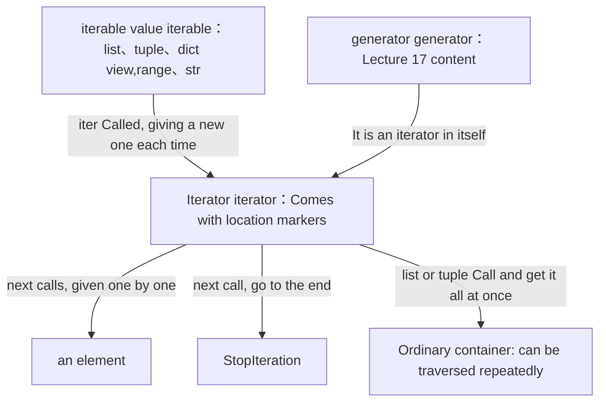
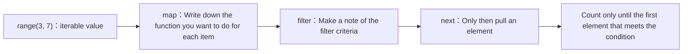
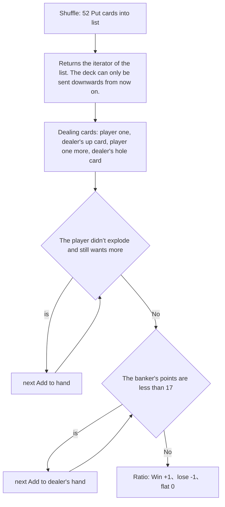

> **courses**: UC Berkeley CS61A · Structure and Interpretation of Computer Programs(Fall 2024)
> **This lecture**: Lecture 16 ｜ 00:29:29 ｜ Station B P 16 ｜ [Original video](https://www.bilibili.com/video/BV1sy411z7nA?p=16)
> **courseware**: `15-Iterators_1pp.pdf` (12 pages, official PDF, page-by-page renderings see text illustrations)
> **subtitles**: Original English subtitles from Station B; this note is a reconstruction of Chinese writing, not a sentence-by-sentence translation.
> **Copyright**: The copyright of the course and courseware belongs to the UC Berkeley CS61A teaching team; this article is a secondary arrangement for learning purposes

## Quick overview of this lecture

*(Reference time: 00:00:00 – 00:29:27｜Lecture 16)*

- **Mastered**: Subscripting, slicing, and splicing of lists and tuples; `list.pop()`  Delete and return the last element in place; dictionary value by key; `for`  Loops can be performed on a list or  `range`  Run on; functions are values, which can be used as parameters and return values.
- **Main line of this lecture**:
    - The container does not hand over elements directly; **iterator**; `iter`  make it, `next`  push it;
    - The iterator is equal to "a sequence + a position mark". The mark only goes forward and is thrown away when it is needed.  `StopIteration`;
    - The same container can have several iterators that do not interfere with each other, but the iterator itself is a mutable object, and aliases will share locations;
    - `for`  Iterable values can be walked from the beginning every time, but iterators can only be walked once;
    - `map`, `filter`, `zip`, `reversed`  All returned are iterators, calculated **lazy**: It doesn’t count if it’s not requested;
    - Treating "just the next one" as an interface is data abstraction: changing the container behind it, the caller's code does not need to be changed.
- **Key conclusions**: The iterator packages "a sequence" and "the position read" into a variable object; this packaging allows each element to be processed only once naturally, and also makes "can only be consumed once" a price that must be remembered.


## 1. Review block at the beginning of the courseware: lists, tuples and sequences in the real world

*(Reference time: 00:00:00 – 00:00:06｜Lecture 16)*

The first sentence at the beginning of this lecture states the conclusion: *Sequential data can be represented implicitly using an iterator* (Sequential data can be represented implicitly using iterators). This conclusion will not be developed until Chapter 2; before it, the courseware first uses six pages to review the matter of "sequence" - list exercises, division of labor between tuples and lists, and three forms of sequences in real programs. These pages are the prerequisite for understanding iterators: Only by first seeing "how many different ways do containers give elements" can we understand why a unified interface is worth designing.

> **Editor's note**: Pages 2–7 of the courseware are the review block at the beginning of this lecture, where the tuple part has been covered in the previous lecture (Lecture 15, Variability). The audio track of this video starts from the iterator section page on page 8. There are no corresponding explanation recordings on these pages. The following is organized according to the courseware screen, and any reasoning outside the screen will be marked.

### 1.1 Announcement page

Page 2 has only one line of title  `Announcements`, is the announcement section page in the courseware. By convention, this page deals with the timing of assignments, projects, and exams, and has nothing to do with the iterator itself. There is no corresponding announcement content for this video, so it is only for layout record.


### 1.2 List exercises and a midterm question

Page 3 is  `List Practice`  Section page, which is followed by a real question: the first question of the second session of the Spring 2023 mid-term. The question gives a two-line auxiliary function and a four-line assignment statement, requiring the deduction  `silver`, `gold`, `platinum`  The last bound value of the three names.


```python
def chain(s):
    return [s[0], s[1:]]

silver = [2, chain([3, 4, 5])]
gold = [silver[0], silver[1].pop()]
silver[0] = 1
platinum = chain(chain([6, 7, 8]))
```

There is also a line of reminder printed in the lower left corner of the question: `s.pop()`  Delete and return  `s`  The last element of - it is the key to this question, because  `pop`  Will **Modify in place** lists, while slices  `s[1:]`  Just **Create a new list**.

Calculate first  `chain([3, 4, 5])`:return  `[3, [4, 5]]`. So  `silver`  binding  `[2, [3, [4, 5]]]`——Note that the first element of the outer list is a number  `2`, the second element is  `chain`  Created list.

Calculate again  `gold = [silver[0], silver[1].pop()]`. The order of evaluation is from left to right: `silver[0]`  get  `2`; then  `silver[1]`  Take out the inner list  `[3, [4, 5]]`, call it  `pop()`, pop up and return  `[4, 5]`. So  `gold`  is  `[2, [4, 5]]`, at the same time  `silver`  become  `[2, [3]]`. finally  `silver[0] = 1`  put the beginning  `2`  Change it, `silver`  That’s it  `[1, [3]]`.

`platinum`  It is a nested call: inner layer  `chain([6, 7, 8])`  get  `[6, [7, 8]]`, the outer layer calls it again and gets  `[6, [[7, 8]]]`——The first item is removed from the bid  `0`, the second item is its slice, so there is one more layer.


The courseware draws the entire question into an environment diagram. left side  `Global frame`  There are four names in it: `chain`  Function object pointing to the upper right corner  `func chain(s) [parent=Global]`; `silver`, `gold`, `platinum`  Each points to a list. There are three standing in the middle  `chain`  frames, each frame has formal parameters  `s`  and return value  `ret val`, marked in the upper right corner of the frame  `[p=G]`, indicating that the parent frame is a global frame. There are also two blue boxes on the screen, pointed out by leading lines.  **`silver[1]`  Which list does the value get?**, **`silver[1].pop()`  Which list is returned**——The two inner lists framed by dotted lines, one with  `[4, 5]`, the other one is in  `pop`  After that only  `[3]`.

What this picture wants to illustrate is not the answer, but "where the arrow points": `pop()`  There is no new list, it changes exactly  `silver[1]`  The object pointed by the arrow, so  `silver`  and  `gold`  This modification will be reflected at the same time. Three interaction results confirm this:

```python
>>> silver
[1, [3]]
>>> gold
[2, [4, 5]]
>>> platinum
[6, [[7, 8]]]
```

> **Editor's note**: This question is not explained in this video. The above derivation is based on the courseware screen and  `pop`  semantic completion. One detail that the courseware did not expand on is the order of evaluation - if it is written as  `[silver[1].pop(), silver[0]]`, the result of this example remains unchanged, but as long as  `pop`  What is changed is the subscript that will be used later, and the order will determine whether it is right or wrong. Splitting the expression first and then evaluating it from left to right is the only safe way to solve this type of problem.

### 1.3 Division of labor between tuples and lists

Page 5 is  `Tuples`  Section page, page 6 is a pros and cons comparison chart: left  `t = (1, 2, 3)`, right  `l = [1, 2, 3]`.


The comparison criteria are listed in the courseware in two columns, which can be organized into a table:

| criterion | `tuple` | `list` |
| --- | --- | --- |
| Can I change the elements? | immutable | Mutable, the subscript can be reassigned |
| Volume and speed | Smaller and faster | Bigger and slower |
| Can it be used as a dictionary key? | OK | No |
| Number of methods | less | Many, for example  `pop()`, `append()` |
| Take down the bid | OK | OK |
| slice | Yes, generate new tuples | Yes, create a new list |
| Add like | Yes, generate new tuples | Yes, create a new list |

The first four are the differences between the two - whether it can be changed, size and speed, whether it can be used as a key, and whether there are many methods; the last three are the abilities shared by the two. Why can immutable tuples be used as dictionary keys but not lists? Because the dictionary relies on the "fingerprint of the value" to quickly locate an object that can be modified at any time, the fingerprint will change and the key will become invalid. The previous lecture emphasized this connection: **Mutability determines whether the value can be put into another structure as an identifier**.


It should be noted that "both slicing and addition produce new objects" are true for both, but the meaning is different: for lists, slicing gives a copy that can continue to be modified; for tuples, slicing still gives an immutable new tuple. The same parts between the two are the basis for "traversing them using the same writing method" later.

### 1.4 Sequences in the real world

Page 7 changes perspective and is titled  `Sequences (lists, tuples, dictionaries, and more) in the Real World`, put the three types of containers onto a real thing.


An image is a sequence of pixel data. A small color picture is shown on the screen, with three coordinate values listed next to it:

```text
Pixel at (16, 38): (0, 128, 224)
Pixel at (17, 38): (0, 0, 0)
Pixel at (18, 38): (128, 128, 128)
```

Each pixel is a triplet, and the entire picture is a two-dimensional structure composed of these triplets; the so-called "displaying a picture" means reading this sequence in order.

Data that needs to be "checked back later" is stored in a dictionary. Two examples are listed on the right side of the page:

```python
grades = {"george": 82, "Belinda": 78}
temp = {"high": 82, "low": 62, "humidity": 75}
```

The first one is "Check the score by person", and the second one is "Check the weather value by indicator". They have no sequential meaning, only "key-value" correspondence.

A file is a sequence of text. The most direct way to read a file is to read it into a line-by-line list:

```python
>>> open("textfile.txt").readlines()
['first line in text file', 'second line in file', 'etc']
```

The three forms put together point to the same problem: to read pixels, press the key, to read the file, press the line number, and to read the dictionary, press the key——**Every time you change a kind of data, you have to change the way of writing the traversal.**. Write a function that "processes each element once", if it is written hard  `s[i]`, then it can only eat lists and tuples; change to dictionary view or  `range`  It collapsed. This is what iterators are for: as long as the container can give you the "next element", the processing logic doesn't care what it is.

## 2. Iterator protocol: `iter`  with  `next`

*(Reference time: 00:00:08 – 00:03:39｜Lecture 16)*

### 2.1 A location, not a copy

Page 8 of the courseware is  `Iterators`  Sectional pages, definitions given on page 9: **A container can provide an iterator that provides access to the elements of the container in some order**. There are two roles in this sentence, which is easy to confuse: the container is where the data is, and the iterator is "the hand that reads the data." The container does not hand over the elements, it hands over a hand that can continuously take off one thing.


The analogy given by the lecturer is position rather than copy: understand the iterator as **a position in a sequence**- It gives the element at this position and all elements after this position. take  `[3, 4, 5]`  For example, `iter`  The created iterator initially stands at the front, `next`  Take the current element and push the position forward one space, so if you take the same iterator three times in a row, you will get  `3`, `4`, `5`, the fourth time there is nothing left to take away.

### 2.2 `iter`  with  `next`

The two built-in functions have a clear division of labor, and the courseware prints the signature directly on the page:

- `iter(iterable)`: Returns an iterator covering the elements of this iterable value.
- `next(iterator)`: Returns the next element in the iterator.


The illustration on this page is exactly the analogy of "position": a little stick figure standing  `s = [3, 4, 5]`  On the front, above the head is marked  `i`, the arrow at the foot marks  `next(i)`. Every time the villain takes a step, the arrow points to the next element.

Note that the parameter types of the two are different: `iter`  What I received was **Iterable value (iterable)**, container, `range`, dictionary view, or something created by yourself; `next`  What is collected must be **iterator**. This distinction will become an actual error in the next section.

On the right side of the page is a live interaction:

```python
>>> s = [3, 4, 5]
>>> i = iter(s)
>>> next(i)
3
>>> next(i)
4
>>> u = iter(s)
>>> next(u)
3
>>> next(i)
5
>>> next(u)
4
```

Read line by line: `i`  is  `s`  The first iterator of is taken twice and stops at  `5`  on; `u`  yes **same list** Create another iterator with its own position starting from the beginning, so  `next(u)`  get  `3`. Next alternate values: `next(i)`  get  `5`(`i`  is located at  `5`), `next(u)`  get  `4`(`u`  is located at  `4`). The two iterators cover the same batch of values, but their positions are independent - the lecturer's original words are: `i`  Not because I made another one  `u`, I forgot where I was.

### 2.3 Throw it away after walking  `StopIteration`

`next`  There is an agreement: **Crossing the boundary does not return null, but throws an exception.**. After fetching the last element for the first time, you will get  `StopIteration`. This is the official signal for "reaching the end", `for`  The loop ends by capturing it.

Take a slightly more complex example: a nested list. There is another pitfall that is easy to step on -`next`  Cannot be applied directly to lists:

```python
>>> next([1, 2])
Traceback (most recent call last):
  ...
TypeError: 'list' object is not an iterator
```

`next`  What you want is an iterator, not a container; you must first  `iter`  Once. After conversion everything works fine:

```python
>>> t = iter([[1, 2], 3, 4, 5])
>>> next(t)
[1, 2]
>>> next(t)
3
>>> list(t)
[4, 5]
>>> next(t)
Traceback (most recent call last):
  ...
StopIteration
```

Note  `next(t)`  given  `[1, 2]`  when, it gives **The element at index 0**, rather than spreading out the sublists. The iterator is only responsible for "handing over an element in order". It doesn't care whether the element itself is a list or a number.

`list(t)`  That line is the key: it puts the iterator inside **the rest** Take out all the elements and put them into a list, so you only get  `[4, 5]`——`[1, 2]`  and  `3`  Has been used twice before  `next`  Consumed. After taking it  `t`  Just stop at the end and then  `next`  Just once  `StopIteration`. The lecturer said something here that was used again and again: **Iterators can only be consumed once**.

### 2.4 Alias will share location

The iterator is **mutable object**: `next`  Instead of returning a "next value", it also changes the internal position mark. So when two names are bound to the same iterator, they share the same position.

There is a discussion question on page 10 of the courseware, which tests this point:


```python
a = [1, 2, 3]
b = [a, 4]
c = iter(a)
d = c
print(next(c))
print(next(d))
print(b)
```

First look at the arrows between the names: `b`  The first element of is  `a`  itself (not a copy), `d = c`  Let the two names point to **the same iterator object**. So  `next(c)`  Print  `1`, and push that unique position to  `2`  on; `next(d)`  The same position is read and printed.  `2`. list  `a`  It has not been modified from beginning to end. The traversal only moves the markers, so the last line prints  `[[1, 2, 3], 4]`.

```text
1
2
[[1, 2, 3], 4]
```

> **Editor's note**: The discussion questions on this page are not expanded in this video. The above reasoning is completed based on the courseware screen. The question contains two traps at the same time: First, mistaking "iterator variable" for "list variable" (`a`  In fact, it has not changed), and the second is to  `d = c`  Mistakenly regarded as "creating another iterator" (if you want to create another iterator, you must call it again.  `iter(a)`, as in Section 2.2  `u`).

### 2.5 The other half of the protocol: write an iterator yourself

So far, iterators have been created using built-in functions. The other half of the protocol is: any object, as long as it implements  `__iter__`  and  `__next__`  Two methods are an iterator; `iter`  with  `next`  The two built-in functions just adjust these two methods for you.

> **Editor's note**: The content of this section is a supplement to the Python language layer. The subtitles and courseware are not covered in this lecture. Put here to close the protocol: know  `iter`/`next`  Which two methods are agreed upon behind the scenes can help you understand why Chapter 9 says "iterators limit the operations that can be done".

```python
class Countdown:
    def __init__(self, n):
        self.n = n
    def __iter__(self):
        return self
    def __next__(self):
        if self.n <= 0:
            raise StopIteration
        self.n -= 1
        return self.n + 1
```

`__next__`  when there is nothing to take away **Take the initiative  `raise StopIteration`**, this is how the agreement requires it to be written; put  `self.n`  Minus one is stored in the object and is the "position mark". Note  `__iter__`  Return  `self`:The iterator is handed to  `iter`  Returns itself because it already has the position.

## 3. One dictionary, three views

*(Reference time: 00:03:40 – 00:08:02｜Lecture 16)*

### 3.1 Views are iterable values, not iterators

What makes a dictionary more complicated than a list is that it has three sets of contents: keys, values, and key-value pairs. Python's approach is not to give three copies, but to give three **view**——Three windows staring at the same dictionary:

```python
>>> d = {1: 1, 2: 2, 3: 3}
>>> d[0] = 0
>>> k = iter(d.keys())
>>> next(k)
1
>>> next(k)
2
>>> next(k)
3
>>> next(k)
0
```

`d.keys()`  itself **No** iterator, which is an iterable value; to give it to  `next`, first served  `iter`  Once. This is exactly the same as the list: the container gives the qualification of "can be iterated", not the status of "iterating". `d.values()`  with  `d.items()`  In the same way, among  `items`  Given a tuple at a time, key first, value last:

```python
>>> it = iter(d.items())
>>> next(it)
(1, 1)
>>> next(it)
(2, 2)
```

There is one more detail: `iter(d)`  and  `iter(d.keys())`  The effect is the same. Don't write  `.keys()`, directly iterate the dictionary and still use the keys. The instructor specifically pointed out that Python is designed to **There is only one dictionary**, keys, values, and pairs are just different readings of the same dictionary, not three pieces of data - this explains why changing the dictionary will affect all views.

### 3.2 Where does the order come from?

The top four  `next`  get  `1, 2, 3, 0`, rather than some hash order. The reason is that the dictionary remembers the order of insertion: build first  `{1: 1, 2: 2, 3: 3}`, then insert  `d[0] = 0`, so  `0`  Coming in last.

The lecturer added a version history here: **Since Python 3.6**, the order of the dictionary is insertion order; in earlier versions, the order of the keys was arbitrary, so the dictionary was defined as an "unordered collection of key-value pairs". Now it's in order.

This history has led to an engineering habit: people who write libraries cannot assume that other people's interpreters will maintain order. The lecturer said that although the examples are all based on the behavior of the new version of Python, you should keep a note in mind when actually releasing the code - sequential dependencies have version risks.

### 3.3 Changing the dictionary during iteration

Neither views nor iterators freeze dictionaries, and that's a problem. If you iterate over keys and add things to the dictionary at the same time:

```python
>>> k = iter(d.keys())
>>> next(k)
1
>>> d[4] = 4
>>> next(k)
Traceback (most recent call last):
  ...
RuntimeError: dictionary changed size during iteration
```

The error message is very straightforward: the dictionary size changed during the iteration. The iterator is invalid and can no longer be used to read this dictionary. There is only one fix - rebuild the iterator; `keys`, `values`, `items`  All the same.

but if only **Change the value corresponding to a key**, the iteration can continue:

```python
>>> k = iter(d.keys())
>>> next(k)
1
>>> next(k)
2
>>> d[0] = 5
>>> next(k)
3
```

The basis for distinction is whether the "shape" has changed. The set of keys is not moved, and the position mark is still valid; once a key is inserted or deleted, the position loses its meaning, and Python chooses to report an error directly instead of giving a potentially wrong result. This is the typical trade-off of "explicit failure is better than silent error".

## 4. `for`  Statement: Iterable values can be traversed repeatedly, while iterators can only be traversed once.

*(Reference time: 00:08:05 – 00:10:16｜Lecture 16)*

`for`  The statement can iterate over iterable values or iterate over the iterator itself, but its behavior is different in the two cases. This section uses a  `range`  Show the difference.

`range(3, 6)`  The content is  `3, 4, 5`. Loop it twice, and you can see all the elements both times - because  `range`  I have no place, and every cycle starts over.

Iterators are different:

```python
>>> r = range(3, 6)
>>> ri = iter(r)
>>> next(ri)
3
>>> for x in ri:
...     print(x)
...
4
5
```

`ri`  Comes with a place, `next(ri)`  Already put  `3`  used, so the loop only prints  `4`  and  `5`. and  `for`  will push the marker all the way to the end: when the loop ends  `ri`  Already exhausted, looping over it again will print nothing.

| criterion | Iterable value (`range(3, 6)`) | iterator(`iter(range(3, 6))`) |
| --- | --- | --- |
| Is there a location? | No, just a range description | Yes, the mark only goes forward |
| first time  `for` | Get 3, 4, 5 in sequence | Go to the end from the current position |
| second time  `for` | Do it again 3, 4, 5 | get nothing |
| who pushed the mark | no one needs pushing | `for`  every call  `next`  Push them all |
| After the loop ends | The object itself remains unchanged | stopped at the end, exhausted |

The lecturer condensed the conclusion into one sentence: **Do it with iterator  `for`, can complete all elements, but they cannot be used again; use  `range`  Such iterable values, each time  `for`  You can go through it from beginning to end without worrying about someone changing the status.**

### 4.1 `for`  expand into  `while`

`for`  What exactly was done? It is actually a layer of syntax sugar: first call it once on the object on the right  `iter`, and then repeatedly call  `next`, captured  `StopIteration`  Just quit.

> **Editor's note**: The following equivalent expansion is common sense in the Python language specification. The subtitles of this lecture only use text to describe it."`for` "will push the mark" and no equivalent code is written. The expansion is written to make "why there is nothing in the second loop" a conclusion that can be verified step by step.

```python
it = iter(s)
while True:
    try:
        x = next(it)
    except StopIteration:
        break
    print(x)
```

The three-section structure corresponds to three things: `iter(s)`  Create an iterator (this step is true for both iterable values and iterators, for an iterator it is to get itself back); `next(it)`  Get value, throw when exhausted  `StopIteration`; `except`  Catch the exception and break out of the loop.

This development simultaneously explains three things seen previously. First, `for`  The iterator must be exhausted after the loop ends - the exit condition is  `StopIteration`. Second, `for`  There is no way to "restart" because it does not save any information that can be rolled back. Third, `for`  After it's over  `next`  Can throw  `StopIteration`, rather than going back to the beginning.

### 4.2 Comparison of the three: iterable values, iterators, generators

Putting the nouns that appear in this lecture together, the relationship is as follows:



The corresponding criteria can be listed in a table:

| criterion | Iterable value (iterable) | iterator | generator |
| --- | --- | --- | --- |
| Can it be traversed repeatedly? | can | No, it can only be consumed once | No, it can only be consumed once |
| Is there a location? | No | Yes, follow  `next`  move forward | Yes, saved by the pause point of the function body |
| Can you hand it over?  `next` | No, first  `iter` | can | can |
| Can you hand it over?  `for` | Yes, start from the beginning every time | Yes, from current location | Yes, from current location |
| Examples from this lecture | list, `range`, `keys()` | `map`, `filter`, `zip`, `reversed`  object | This lecture does not cover |

> **Editor's note**: The generator column in the table is taken from the next lecture (Lecture 17, Generators), and is not covered by the subtitles or courseware of this lecture. I write it here just to let readers know that there is a third thing in the position of "iterator"; in the table, "hand over" `iter` "Return to yourself" is not mentioned in this lecture, but it belongs to protocol common sense.

## 5. Lazy evaluation: `map`, `filter`, `zip`, `reversed`

*(Reference time: 00:10:20 – 00:12:07｜Lecture 16)*

For batch processing of sequences, Python provides several built-in functions: they receive one (or several) iterable values and return an **iterator**. This section first looks at their common evaluation strategies, and then looks at the live demonstration in the next section.

### 5.1 What does inertia mean?

The courseware says: Many built-in sequence operations return iterators **lazily **Calculate the result. The so-called inertia refers to** Results are only calculated when requested**. The interpreter will prepare "how to calculate", but as long as the value has not been used, it will not actually calculate it.

This sentence needs to be compared with "immediate evaluation" to make it clear. List comprehensions are immediate: `[double(x) for x in l]`  Count each item the moment you write it down and put the results into a new list. `map(double, l)`  is lazy: it returns an object containing the  `l`  every call to  `double`"This thing, but none of them have been called yet. When to call? wait until someone  `next`  it.

### 5.2 Four built-in functions

| function | what to receive | What does the iterator produce? | when to stop |
| --- | --- | --- | --- |
| `map(func, iterable)` | a function + an iterable value | Each element passes through  `func`  value after | Input exhausted |
| `filter(func, iterable)` | A decision function + an iterable value | such that  `func`  those elements that return a true value | Input exhausted |
| `zip(a, b, ...)` | two or more iterable values | A tuple consisting of elements with the same subscript | The shortest input is exhausted |
| `reversed(seq)` | a sequence | elements in reverse order | The sequence comes to an end |

What all four have in common is that they return iterators, not lists. `map`  with  `filter`  What is collected is a function, so they are higher-order functions; `zip`  Collect multiple iterable values and output a tuple; `reversed`  Only sequential sequences are accepted.

### 5.3 Transform the iterator back into a container

If you really need "the whole result", the solution is to give it to a container constructor: `list`, `tuple`, `sorted`. Among them  `sorted`  All elements will be taken out first, then sorted, and a new one will be returned. **list**——It must look at all elements, so it cannot be lazy.

The cost of this step should be remembered: hand the iterator to  `list`  means **run it dry**. The original iterator is empty after construction, and subsequent use of it will only result in an empty container.

### 5.4 A lazy pipeline

The value of inertia only becomes apparent on the assembly line. The three links are strung together, and each link is just "note down what to do", not a single element is counted:



### 5.5 The uses and boundaries of inertia

The most practical benefit of inertia is **Pay as you go**: You can first write down "how to calculate a large number of values" clearly. The amount that is really needed will be counted, and the unnecessary part will not be counted at all. The scenario mentioned by the lecturer is "only the first few results are needed" - in this case, immediate evaluation will calculate all the following results in vain, but lazy evaluation will not.

> **Editor's note**: Lazy evaluation also has another use not mentioned in this lecture: processing **Unable to fit sequence**. Because the elements are calculated one by one, it can theoretically represent an infinite sequence (such as "all natural numbers"), as long as the caller does not require it to be completed. This usage will be truly expanded in the generator in the next lecture. In this lecture  `map`/`filter`  Can only be applied to existing iterable values.

## 6. Demonstration: `map`  What is returned is an object, not a list

*(Reference time: 00:12:08 – 00:16:05｜Lecture 16)*

Page 11 of the courseware is  `Map Function`  Demo page, the screen is  `l = [2, 4, 6, 8]`, `doubler = map(double, l)`, `doubler`  The row of boxes above reads  `4`, `8`, `12`, `16`, a simple figure standing  `l`  In front, under the arrow marked  `next(doubler)`, the right side is  `double`  Definition:

```python
def double(x):
    print(f"*** doubling {x} ***")
    return x*2
```


That row of boxes is the "uncomputed results" - they are drawn above the iterator, and the meaning is clear: the value exists, but it has not been calculated yet.

### 6.1 Let’s look at an example without printing first.

The first demonstration in class was to turn a string of lowercase letters into uppercase letters. Using a list comprehension is immediate:

```python
>>> [x.upper() for x in ['b', 'c', 'd']]
['B', 'C', 'D']
```

Replace with  `map`  add one  `lambda`, the effect looks the same, but what you get is completely different:

```python
>>> m = map(lambda x: x.upper(), ['b', 'c', 'd'])
>>> next(m)
'B'
>>> next(m)
'C'
>>> next(m)
'D'
```

The lecturer specifically stopped to emphasize: What we get here is **No** list  `['B', 'C', 'D']`, but a  `map`  Object, which is an iterator. three times  `next`  Give three capital letters in sequence, the fourth time is  `StopIteration`. In other words, the list comprehension calculates the result and puts it there. `map`  He just promised, "Whenever you want it, you'll figure it out later."

### 6.2 Visible inertia

The second demo  `double`  Written in a printable version, inertia becomes visible to the naked eye. The courseware is  `[2, 4, 6, 8]`, in class it was replaced by  `[3, 5, 7]`:

```python
>>> m = map(double, [3, 5, 7])
>>> next(m)
*** doubling 3 ***
6
>>> next(m)
*** doubling 5 ***
10
>>> next(m)
*** doubling 7 ***
14
```

The key is between the first and second lines: **`map`  After the call is completed, not a single line is printed.**.`double`  Not called once, just written down. first time  `next`  Print at the moment  `*** doubling 3 ***`  and return  `6`; to the second time  `next`  It's just my turn  `5`;It’s the third time  `7`.

The instructor used this demonstration to illustrate the contrast: `double`  Not right first  `3`, right again  `5`, right again  `7`  Executed sequentially, it executes one each time it is requested. This is the definition of lazy evaluation -**The point in time when the function is applied, from "call  `map` "It's postponed"`next`  time"**.

### 6.3 Two-stage assembly line: only count what needs to be counted

The third step of the demonstration  `map`  and  `filter`  Pick it up: Yes  `range(3, 7)`  Double each number in it and filter out the ones that are "at least 10".

```python
>>> m = map(double, range(3, 7))
>>> t = filter(lambda y: y >= 10, m)
>>> next(t)
*** doubling 3 ***
*** doubling 4 ***
*** doubling 5 ***
10
```

make  `filter`  When , there is also not a single line of printing - both levels just write down what to do. first time  `next(t)`  Just started to pull: `3`  Get twice as much  `6`, not satisfied  `>= 10`, throw away; `4`  Get twice as much  `8`, also throw away; `5`  Get twice as much  `10`, satisfied, return. This results in three lines of print and a result on the screen  `10`.

The lecturer's interpretation of these three prints is the core of this section: it does **Just the amount of work you have to do to get the next element, not much at all**. Continue to the next one:

```python
>>> next(t)
*** doubling 6 ***
12
```

I only worked overtime once this time——`6`  Get twice as much  `12`, meet the conditions. If you want another one, you won’t have it:

```python
>>> list(t)
[]
```

`range(3, 7)`  only arrive  `6`, `6`  Already the last one.

If you want all the results at the beginning, the way to write it is to give it to  `list`:

```python
>>> list(filter(lambda y: y >= 10, map(double, range(3, 7))))
*** doubling 3 ***
*** doubling 4 ***
*** doubling 5 ***
*** doubling 6 ***
[10, 12]
```

The same assembly line, printing four times is quite a lot - because  `list`  Must run until the iterator is exhausted. The lecturer calls this "running the process to exhaustion": the answer is obtained and all the work is done.

## 7. Lazy gains and two pitfalls

*(Reference time: 00:16:12 – 00:17:11｜Lecture 16)*

### 7.1 Freedom bought by laziness

The most direct benefit of laziness is in terms of expression: you can first write down "how to calculate a large number of values", and leave it to the caller to decide whether to calculate and how much to calculate. None of the unnecessary parts will be counted. This is a two-way cost structure with "calculate all the results first and put them there for someone to pick them up" - the former pays based on usage, and the latter pays based on defined amounts.

### 7.2 Trap 1: Iterator is not equal to container

The price also comes. The most common mistake is to compare iterators and lists directly:

```python
>>> t = [1, 2, 3, 2, 1]
>>> t == reversed(t)
False
```

`reversed(t)`  What is returned is a "list reverse iterator object", not a list. `==`  What is being compared is two objects, a list and an iterator. The answer is of course  `False`——Even if  `t`  It's the same for both forward and reverse readings. The lecturer's statement is: put  `==`  Used between a list and an iterator, you always get  `False`, if you want to compare, you have to **Become the same thing first**.

```python
>>> list(reversed(t)) == t
True
```

But there's a catch: `reversed`  The returned iterator can only be used once.

```python
>>> r = reversed(t)
>>> list(r) == t
True
>>> list(r)
[]
```

second time  `list(r)`  get an empty list because the first time already put  `r`  Consumption is clean. If you want to retrieve it again, you must call it again.  `reversed(t)`. This is the same rule as Chapter 2 "Iterators can only be consumed once", except this time the cost is hidden in an invisible  `list`  In the call.

### 7.3 Trap 2: `all`  Only took the first step

There is a discussion question on page 12 of the courseware, which stacks "lazy" and "short circuit" together:


```python
x = all(map(print, range(-3, 3)))
```

There is a definition at the top of the page: `all(s)`  Will traverse  `s`, until a false value is encountered, or the end is reached. Then ask: What will be printed when this expression is evaluated.

The answer is only one line:

```text
-3
```

`x`  The value is  `False`. The courseware itself lists four steps of reasons: first, `print(-3)`  show  `-3`  return after  `None`; Second, `None`  is a false value; third, `all([None, ...])`  for any subsequent content  `False`;Fourth, `map`  Iterator **No need to walk at all  `-3`  after**.

It will be clearer if we arrange this chain in chronological order: `map(print, range(-3, 3))`  When created, not a single line is printed; `all`  Start with the first element, `map`  Just call  `print(-3)`, appears on the screen  `-3`, at the same time  `map`  The output value is  `None`; `all`  see  `None`  If it is a false value, it will be returned immediately.  `False`, no longer want the next element. So  `map`  The iterator stops after the first element, followed by  `-2`, `-1`, `0`, `1`, `2`  Never counted.

> **Editor's note**: The discussion questions on this page are not expanded in this video. The step-by-step progress above is completed based on the courseware screen. It deserves its own note: **Lazy + short circuit is a pair of amplifiers**——`all`  Take one less step, `map`  Just one less step; conversely, if the caller requires "all results", laziness cannot save it, `list`  Will push it to the bottom.

## 8. `zip`  and palindrome judgment

*(Reference time: 00:17:13 – 00:20:54｜Lecture 16)*

### 8.1 `zip`  three rules of

`zip`  Returns an iterator of "tuples with the same subscript". There are three rules in total, the last two are the easiest to remember incorrectly:

```python
>>> list(zip([1, 2], [3, 4]))
[(1, 3), (2, 4)]
```

Pair elements with the same subscript, this is the first one. The second article is the treatment of unequal lengths of time:

```python
>>> list(zip([1, 2], [3, 4, 5]))
[(1, 3), (2, 4)]
```

extra  `5`  was thrown away. The lecturer said: `zip`  Iterate only **The part that can match**, the redundant ones are skipped. The third one is that it can receive more than two inputs:

```python
>>> list(zip([1, 2], [3, 4], [5, 6, 7]))
[(1, 3, 5), (2, 4, 6)]
```

The three inputs give triples, each position is taken from its respective sequence, and the length is determined by the shortest one.

### 8.2 Palindrome: a failed attempt

Got it  `reversed`, it is a matter of judging whether the palindrome looks like a line: reading it forward and backward are the same. `31413`  It's a palindrome, `31415`  No - because the first and last  `3`  and  `5`  Not right. The question also requires that it can be used on any sequence, not just lists; the lecturer mentioned a book title he liked, which happened to be a palindrome (with spaces, it would not be the case).

The most intuitive way to write it is:

```python
def palindrome(s):
    return s == reversed(s)
```

it **always return  `False`**, and couldn’t pass any of the tests. The reason is exactly the same as in Section 7.2: the right side is a list reverse iterator object, the left side is a list, and the two are not equal. The instructor demonstrated this live: `[1, 2, 3]`  The result in turn is a "list reverse iterator object", which contains  `3`, `2`, `1`, but it is not that list per se.

If you want to get out the value inside, you have to  `list`  Once. But be careful here: **`list`  You will get an empty list twice**, because the iterator is used up the first time.

### 8.3 Two possible ways of writing

The first is to turn both sides into lists and then compare:

```python
def palindrome(s):
    return list(s) == list(reversed(s))
```

`list(s)`  and  `list(reversed(s))`  They are all newly created lists, the content is compared, and the test passes. here  `reversed(s)`  It only appears once; even if it is written twice, the result is correct (a new iterator will be created every time it is called), but it is just an extra step.

The second way of writing is to use  `zip`  Pair the sequence with its reverse, and then check whether they are equal pair by pair:

```python
def palindrome(s):
    return all([a == b for a, b in zip(s, reversed(s))])
```

`zip(s, reversed(s))`  given  `(1, 3)`, `(2, 2)`, `(3, 1)`  Such pairs of subscripts (with  `[1, 2, 3]`  (for example), the list comprehension turns each pair into  `True`  or  `False`, `all`  Then ask "Is it all true?" All pairs here are equal, so it's a palindrome.

Both passed the test. The instructor's question is: Which one is better? His own answer is **Both are fine**, but the second one has a scalability advantage: it exposes "compare two elements" as a replaceable action. What is used now is equality. If you want to change it to "the difference does not exceed a certain tolerance" or "equality after ignoring case", you only need to change the comparison operator in the list derivation - the first way of writing cannot do this, because it leaves the comparison of the entire sequence to  `==`.

> **Editor's note**: The third common way to write is slice inversion  `s == s[::-1]`, not mentioned in this lecture. It is shorter but requires  `s`  Supports slicing (lists, tuples, and strings are acceptable) and will make a copy; `zip`  version is more tolerant of "arbitrary sequences". In addition, it should be noted that `zip`  board meeting  `n`  Compare all elements, even if there is a mismatch in the first half; if it is changed to a generator expression, it will match  `all`, and can also obtain the short-circuit effect incidentally - this is the content of the next lecture.

## 9. When to use iterators

*(Reference time: 00:20:56 – 00:22:38｜Lecture 16)*

There is no new syntax in this section of the courseware. It only answers one question: Why do we need to use an iterator when there is a list? The lecturer's answer has three levels, and the last level comes with a price.

### 9.1 Make few assumptions about data representation

Code that handles iterators - via  `next`  take, pass  `for`  Walk, use occasionally  `iter`  Made - Make few assumptions about "what the data looks like". This means changing the data behind from lists to tuples, to  `map`  object, replace  `d.keys()`  Views and callers don’t need to change a single line of code.

The lecturer calls this directly **data abstraction** The idea of ​​(data abstraction): As long as you use something as an "iterable value" or "iterator" and don't care what it is, then the data representation changes and the code still works. The side benefit is social - no matter how weird other people's data formats are, as long as it can be iterated, your function will work.

### 9.2 Two things brought about by packaging

Iterators package "a sequence" and "a position in the sequence" into the same object. This is especially convenient when passing it around: no matter which function is passed to it, the position will follow.

Two properties are obtained from this. First, **Each element will only be  `next`  return once**: A certain function pushes the iterator forward, and any subsequent functions will  `next`  They all go on and will not get the same value repeatedly - this naturally guarantees that "each element is processed only once". Second, **The operations that can be performed are limited to "remove next"**: The function that gets the iterator cannot randomly change the sequence on the subscript, all it can do is go forward. The lecturer said that this was a good thing in his opinion: you don't have to worry about a function secretly changing the sequence, the only change is to move the position forward.

### 9.3 Price

| Dimensions | Use iterator | use specific container |
| --- | --- | --- |
| Assumptions about data representation | Only "can take down one" | To know if it is a list, tuple or dictionary |
| Change means whether to change the code | No need | Want to change |
| Who saved the location? | iterator itself | The caller passes the subscript himself |
| How many times each element is processed | natural once | possible duplicate |
| Operations that can be done | Just take down one | All, including modifications |
| Can you turn back? | Can't | can |
| Can it be traversed repeatedly? | Can't | can |

The price is all on the opposite side of the right column: cannot be indexed, cannot  `len`, cannot go back, cannot traverse repeatedly, and cannot directly change the content. Which one to choose depends on whether this code "just wants to go through the elements once" or "needs to read repeatedly, randomly, and change while reading." There are far more scenarios for the former than for the latter, which is why iterators deserve their own talk.

## 10. Case: Blackjack and a deck of cards that only get smaller

*(Reference time: 00:22:39 – 00:29:02｜Lecture 16)*

### 10.1 Rules and Dealing

The goal of Blackjack is **Get as close to 21 as possible without blowing up**, asking for cards one by one. The point rules are: Number cards are counted according to face value, J, Q, K count as 10, A can count as 1 or 11, according to the needs of the card holder.

The order in which cards are dealt is fixed: first one is given to each player, then one is given to the dealer **up card**, face up; then each player takes another one, and the dealer takes another one **trump card**, butt it up so no one can see it. After that, the player decides to continue to ask for cards (hit) or to stop (hold), and the dealer acts according to a fixed formula-usually "if the points are less than 17, you must continue to ask for cards." The specific details are slightly different in each casino, but the rules are public, so the dealer is not making decisions, but just implementing policies.

The hand I walked through in class was: the player had 16 points, and thought the dealer might have 20 points, so he asked for another hand and got 21 points - no explosion, and the highest score. The player stops. The dealer turns over his hole card, which is 13 points; according to the policy, he must continue and get an A, so there are two calculations: 24 or 14. If 24 bursts, it can only be counted as 1, which is 14; if it is less than 17, another card will become 24. If it bursts, the dealer loses and the player wins one dollar.

### 10.2 The deck is an iterator

Where did the cards come from? Make a list of 52 cards using the built-in  `random.shuffle`  shuffle the cards, then **Returns an iterator over this list**.

```python
def make_deck():
    cards = new_deck()            # 52 张牌，具体的构造略去
    random.shuffle(cards)
    return iter(cards)
```

This step is the key design of the entire case. After the deck is given to the iterator, the caller can only  `next`  Take one, **It is impossible to get duplicate cards**——The list itself does not have the concept of "sent", but the iterator does. To get cards, you have to keep drawing from the top until all the cards are drawn; and a deck of cards cannot be drawn in one game of blackjack.

The deal therefore became four times  `next`: The player's hand card list starts with "next card", then takes the dealer's up card, adds one to the player, and finally gives the dealer a hole card - this card is not included in the "information that players can see". The lecturer specifically emphasized this asymmetry: when it is the player's turn, the player can only see the dealer's up card, not the bottom card; the up card and the bottom card are the "exposed one" and "hidden one" in the dealer's hand.

### 10.3 Player’s Strategy and Banker’s Policy

The skeleton of dealing cards and rounds is written like this: first four cards, then a cycle of "want it or not".

```python
player_cards = [next(deck)]
up_card = next(deck)
player_cards.append(next(deck))
dealer_cards = [up_card, next(deck)]

while score(player_cards) <= 21 and strategy(up_card, player_cards):
    player_cards.append(next(deck))
```

The strategy is a function: based on the dealer's open card and your own hand, return  `True`  Express that you still want it and return  `False`  Indicates to stop. The instructor designed it as a parameter in order to separate "strategy" and "game rules" - changing a play style does not require changing the game logic.

The dealer's turn does not require strategy, only policy: if the points are less than 17, cards are required.

```python
while score(dealer_cards) < 17:
    dealer_cards.append(next(deck))
```

`score`  Responsible for dealing with three types of cards: J, Q, K. Look up a dictionary and get 10; if the number card is not in the dictionary, use the card itself as a number; if the final sum **Less than or equal to 11**, indicating that there is an Ace in your hand and you haven't counted it by 11 yet, so change it from 1 to 11 (so that 11 can become 21).

The final comparison: the player loses one dollar if he busts, and the banker wins one dollar if he busts. If there is no bust, the points are compared - if they are equal, they will be tied (0), if they are less, they will lose (-1), if they are more, they will win (+1).

> **Editor's note**: There is no blackjack flow chart in the courseware, and there is no corresponding source code page; the Mermaid diagram below is organized according to the rules and order dictated by the instructor. The code in this section is also copied according to the dictate. The function name and criterion writing method belong to the editor, not the original teaching code. There is another detail in the original implementation: in order to run a thousand games in batches without refreshing the screen, the lecturer replaced it with a non-printing function.  `print`  This name allows the same set of code to run in two modes.



### 10.4 After a thousand decks of cards

The lecturer wrote a set of "basic strategies" for himself: continue to ask for cards before 11 o'clock; wait and see if the dealer's up card is small; and if the dealer's up card is high (7, 8, 9, 10), first confirm whether you have reached 17.

We played several hands on the spot, with some wins and losses: 15 vs. the dealer's 17, losing one dollar; 18 vs. 21, losing another dollar; once the dealer's open card was 3, he didn't ask for a card, and the dealer blew it himself, winning one dollar. Luck looks good.

Then he ran this strategy for a thousand rounds, only adding the  `+1`, `-1`, `0`  Add it up. The result is: the number of losses is more than sixty times more than the number of wins. The number of runs is seventy-five times, and the number of runs is nine or ten times. Occasionally, there are more wins than losses in a thousand games.

The lecturer’s summary of this result is the last serious sentence of this lecture: Under the rules of the casino, there are indeed times when you win more and lose less, but it does not happen often——**Casinos make money from this infrequent occurrence.**, even if the gambler thinks he is winning.

## Summary

*(Reference time: 00:29:15 – 00:29:27｜Lecture 16)*

- Containers give elements, iterators give positions: `iter`  Turn iterable values into iterators, `next`  Push it forward one space and throw it after moving  `StopIteration`.
- The same container can have several independently located iterators; two names of the same iterator share a location because iterators are mutable objects.
- Iterators can only be consumed once, `list(iterator)`  What you get is the "remaining" element; if you want to get it again, try again  `iter`.
- `for`  is  `iter` + Repeat  `next` + capture  `StopIteration`  Syntactic sugar; for iterable values, you can go through it from the beginning every time, but for iterators, you can only go through it once.
- The dictionary has three views: keys, values, and key-value pairs, all of which are iterable values; the order is insertion order (from Python 3.6). Changing the dictionary size during iteration will invalidate the iterator.
- `map`, `filter`, `zip`, `reversed`  All returned are iterators, which are considered lazy; if you want all the results, just give them to  `list`, `tuple`, `sorted`, the price is to run dry the iterator.
- Inertia + short circuit amplify each other: `all(map(print, range(-3, 3)))`  print only  `-3`, because the first  `None`  Just let  `all`  Stopped.
- Don’t compare iterators to lists  `==`: That's in comparison to two different objects, the answer is always  `False`; Unify into a list first and then compare.
- Treating "only ask for the next" as an interface is data abstraction; the price is the loss of index, length, rollback and repeated traversal.

## Attached: Slide index for this lecture

*(Reference time: 00:00:00 – 00:29:27｜Lecture 16)*

| page | content | Appear location |
| --- | --- | --- |
| 1 | Title page Iterators | Quick overview of this lecture |
| 2 | Announcements announcement page | §1.1 |
| 3 | List Practice (section page) | §1.2 |
| 4 | Spring 2023 Midterm 2 Question 1: `chain`  and environment diagram | §1.2 |
| 5 | Tuples (sectioned pages) | §1.3 |
| 6 | Tuples vs. Lists comparison | §1.3 |
| 7 | Sequences in the Real World | §1.4 |
| 8 | Iterators (sectioned pages) | §2.1 |
| 9 | `iter`  with  `next`, two independent positions | §2.2 |
| 10 | Discussion Question: Aliases and Locations | §2.4 |
| 11 | Map Function Demo: `doubler` | §6 |
| 12 | Discussion Question: `all`  with  `map` | §7.3 |

Pages 2–7 of the courseware are the review blocks of this lecture (announcements, list exercises and a mid-term question, tuple comparison, real-world sequences), and iterators are not entered until page 8. The audio track of this video begins on page 8, so the first six pages and the two discussion questions (pages 10 and 12) do not have explanation recordings. The text is completed based on the courseware screen and the content of the previous lecture, and the inferences that are added by the editor are marked in the corresponding positions.
