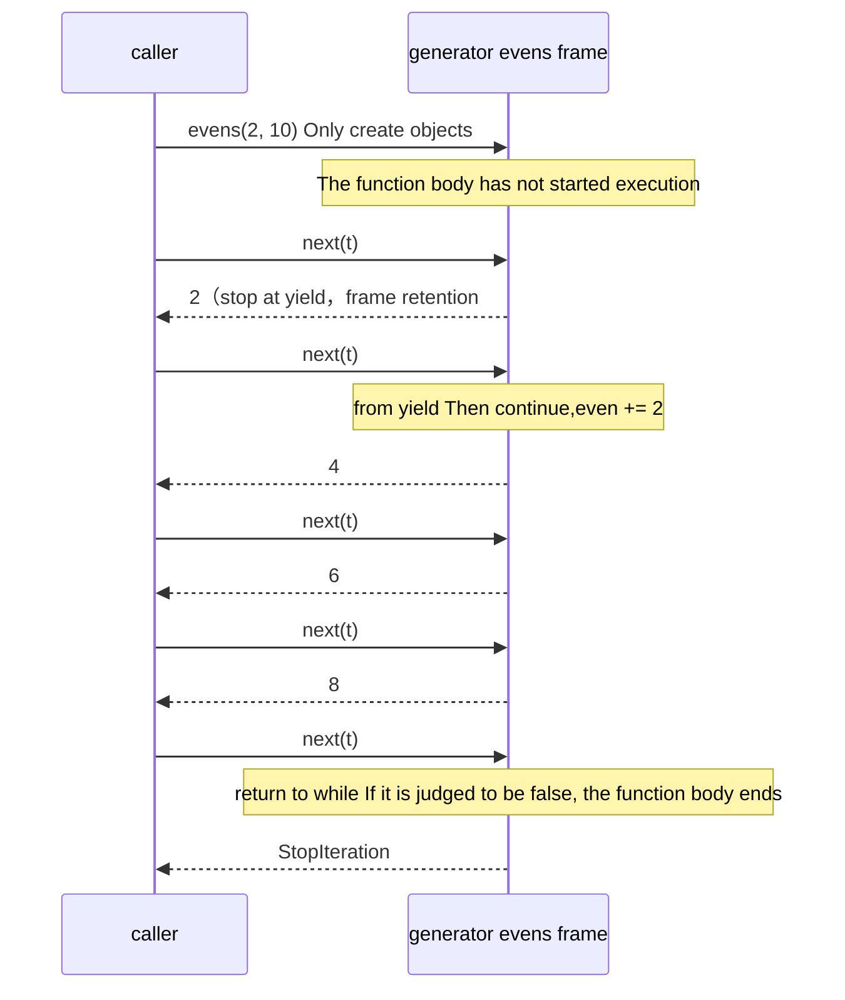
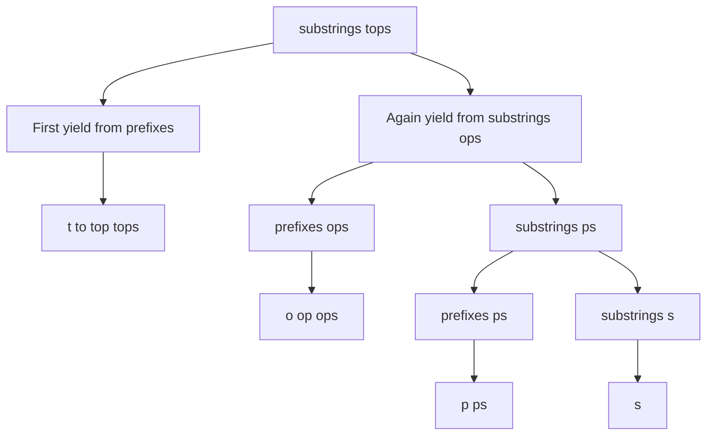

> **courses**: UC Berkeley CS61A · Structure and Interpretation of Computer Programs(Fall 2024)
> **This lecture**: Lecture 17 ｜ 17:13 ｜ Station B P 17 ｜ [Original video](https://www.bilibili.com/video/BV1sy411z7nA?p=17)
> **courseware**: `16-Generators_1pp.pdf` (11 pages, official PDF, page-by-page renderings see text illustrations)
> **subtitles**: Original English subtitles from Station B; this note is a reconstruction of Chinese writing, not a sentence-by-sentence translation.
> **Copyright**: The copyright of the course and courseware belongs to the UC Berkeley CS61A teaching team; this article is a secondary arrangement for learning purposes

## Quick overview of this lecture

- **Mastered**: The difference between iterable and iterator, `iter`  with  `next`  usage, `map`, `filter`, `zip`, `enumerate`  These built-in iterators; handle recursively with trees  `tree`/`label`/`branches`; `partitions`  Counting version of recursion.
- **Main line of this lecture**:
    - For generator functions  `yield`  Hand over the value and call it to get a generator object, not the result of a single call;
    - `next`  Push generator execution to the next  `yield`, and then put it **Continuous frames with local variables** hang together;
    - Because only one value is counted at a time, generators are naturally lazy: values that no one wants are never counted;
    - `yield from`  Delegating the entire output of another iterator is the connector of the recursive generator;
    - same one  `partitions`  Recursion, the difference between writing using "spelling list" and writing using "intersecting elements" is not only the shortness, but also whether it can stop early.
- **Key conclusions**: `yield`  It is not "return a value and then end", but "hand over a value and stop in place"; the value of the generator lies in decoupling the time of "production" and "consumption", so that the two requirements of infinite sequence and "only the first few" are established at the same time.

*(Reference time: 00:00:01 – 00:00:24｜Lecture 17)*

## 1. The first half of the courseware: iterator review, map object and tree exercises

*(Reference time: 00:00:01 – 00:00:23｜Lecture 17)*

`16-Generators_1pp.pdf`  There are 11 pages in total, but the structure is uneven: pages 3 to 7 are review blocks for the previous lecture on iterators and trees, page 8 is the real new content node of this lecture, and the last two pages are an exercise and a demonstration of an infinite sequence. There are only 23 seconds at the beginning of the video, all of which are used to talk about projects and assignments, and then go directly to the generator; that is, pages 3 to 7 are not verbally expanded in this recording.


Three things to remember: Project 2 is due on Tuesday, but if you submit it on Monday, you can get an early submission point; Q&A time is arranged on Monday and Tuesday to deal with problems in the project; Homework 4 is very short, covering the mutations and trees of the previous week, and is due on Thursday. The lecturer specifically emphasized that Homework 4 is "pretty short", and the meaning is very clear - it should not take up the main time of the week, the project is the focus.


> **Editor's note**: The content on pages 3 to 7 of this section has no corresponding speech in this recording. They belong to the review and practice blocks retained in the courseware. The following is filled out according to the original text of the page, and the codes on the page are transcribed verbatim; any additional reasoning that is outside the page and is added to clarify the ins and outs is marked separately.

### 1.1 Iterables and iterators: the two halves of a traversal

The courseware defines the two concepts side by side. An iterable is "any sequence that can be traversed" - the criterion is that it can be called  `iter()`  and get back an iterator; an iterator is "something that allows traversing any iterable sequence" - the criterion is that it can be called  `next()`  and get back the next item in the sequence. These two sentences are mirror images of each other, and actually capture two halves of the same thing: the iterable is responsible for "what is there", and the iterator is responsible for "where is it".


The three sets of examples on the page have changed three types of containers:

```python
t = (1,2,3)
i = iter(t)
next(i)

l = ["John", "Jedi", "Shm"]
e = enumerate(l)
next(e)

d = {"apples": 1, "pears": 2}
m = map(lambda x: "yummy " + x, d)
next(m)
```

`i = iter(t)`  Turn tuples into iterators, `next(i)`  get  `1`; `e = enumerate(l)`  What is obtained is the iterator of the "subscript-element" pairing, `next(e)`  get  `(0, 'John')`; `m = map(lambda x: "yummy " + x, d)`  Acting on the dictionary, what is traversed is **key**, so  `next(m)`  get  `"yummy apples"`. There is also a small box left on the right side of the page to list  `zip()`, `filter()`, `reversed()`——Them and  `map`, `enumerate`  The same thing is "after calling, it does not give you the results, but gives you a machine that can spit out the results one by one."

| criterion | iterable | iterator |
|---|---|---|
| `iter()`  can it act on it | Yes, returns an iterator | Can, usually returns itself |
| Can it be directly  `next()` | No, `list`, `tuple`  No  `__next__` | Yes, advance one space at a time |
| Where does the progress exist? | No progress, just a bunch of elements | Exists inside the object and cannot be seen |
| The result of the second traversal | Just like the first time, start with the initial element | Empty, progress has been used up |

The last line of this table is the real foreshadowing of this lesson: iterators have a private state called "progress", and once the progress is stored in the object, the writer has to maintain it himself. What the generator wants to solve is the problem of "who will maintain the progress?"

### 1.2 map object: an iterator that remembers progress

For courseware  `map`  Draw the matter "Iterator has progress" into a picture: four boxes say  `4 8 12 16`, a little blue man below marked  `doubler`, arrow  `next(doubler)`  Point to the left, the input is a list  `[2, 4, 6, 8]`.


```python
def double(x):
    print(f"*** doubling {x} ***")
    return x*2

l = [2, 4, 6, 8]
doubler = map(double, l)
```

The key is  `doubler = map(double, l)`  this line **won't print anything**.`map`  Just write down the function and list and wait until  `next(doubler)`  When called, only take one element and adjust it once.  `double`, print a line  `*** doubling 2 ***`, return  `4`. The four boxes are the four values ​​​​that have been calculated and are waiting for you to get them; the blue man is the progress saved in the object.

put  `double`  written as tape  `print`  function is to make laziness **visible**: if  `map`  is evaluated immediately, then create  `doubler`  In an instant, four lines of printing should appear. The fact that a line only appears when you ask for it is live evidence of laziness.

> **Editor's note**: `map`  Returning iterators in Python 3 and lists in Python 2 is the premise on which all the discussion in this lecture is based. The courseware and courses are all taught in Python 3.

### 1.3 map() exercise: add triples item by item

Page 5 is a small question: Given a list of triples  `p`  and a triplet  `edit = (a, b, c)`, returns a  `map`  object such that the first item of each element is added  `a`, the second item plus  `b`, the third item plus  `c`.


```python
def add_to_each(p, edit):
    """
    Given a list, p, of 3-element tuples: [(x1, y1, z1), (x2, y2, z2), ...]
    And an edit tuple (also 3 elements) = (a, b, c),
    return a map object where
    a is added to each x-value,
    b to each y-value, and
    c to each z-value.

    >>> list(add_to_each([(0, 0, 0), (1, 1, 1)], (10, 10, 10)))
        [(10, 10, 10), (11, 11, 11)]
    >>> list(add_to_each([(1, 2, 3), (1, 1, 1)], (10, 20, 30)))
        [(11, 22, 33), (11, 21, 31)]
    """
    return map(lambda x: ( x[0] + edit[0], x[1] + edit[1], x[2] + edit[2] ), p)
```

on page  `x[0] + edit[0]`, `x[1] + edit[1]`, `x[2] + edit[2]`  Three expressions are underlined because they are the only parts of the problem that require thinking. `lambda x:`  of  `x`  is  `p`  A triplet in `edit`  Not written in the parameter list but taken directly from the outer layer - this is the closure at work: `lambda`  The parent frame is  `add_to_each`  frame, `edit`  Just lying there in that frame.

What is returned is a  `map`  object instead of a list, so  `list(...)`  Must be put on by the caller; `p`  Add as many times as the length is, one at a time. The "progress is stored in the object" in Section 1.2 here becomes an engineering benefit: the intermediate results are not implemented.

### 1.4 Section Page: Tree Practice

Page 6 is a sectioned page with only the centered  `Tree Practice`  Two words. It switches the courseware from the topic of "iterators" to "recursion of trees" to make room for the real questions on the next page.


The section page itself has no content, but it reminds one thing: the next question uses tree recursion, not iterators. The real connection is after the next page - the writing method of tree recursion and the writing method of generator. This lecture will be in  `partitions`  There was a head-on collision.

### 1.5 exclude: Connect the children of the excluded node to the grandfather

Page 7 is Question 4(a) of Spring 2023 Issue 2. The question requirements are realized  `exclude(t, x)`: Returns a tree, retained  `t`  The root node of , and all labels are not equal to  `x`  non-root node; the parent node of a node in the result is its nearest, not excluded ancestor in the original tree.


```python
def exclude(t, x):
    """Return a tree with the non-root nodes of tree t labeled anything but x.

    >>> t = tree(1, [tree(2, [tree(2), tree(3), tree(4)]), tree(5, [tree(1)])])
    >>> exclude(t, 2)
    [1, [3], [4], [5, [1]]]
    >>> exclude(t, 1)  # The root node cannot be excluded
    [1, [2, [2], [3], [4]], [5]]
    """
    filtered_branches = map(lambda y: exclude(y, x), branches(t))
    bs = []
    for b in filtered_branches:
        if label(b) == x:
            bs.extend(branches(b))
        else:
            bs.append(b)
    return tree(label(t), bs)
```

Three small trees are drawn on the right side of the page. The process from the original tree to the fruiting tree is clear at a glance: the roots of the original tree are  `1`, the two branches are  `2` (Download  `2`, `3`, `4`) and  `5` (Download  `1`). call  `exclude(t, 2)`  when, the label is  `2`  The node of is removed, and the tree labeled below it  `2`  leaves disappeared together, and  `3`, `4`  After being promoted one level and directly attached to the root, we get  `[1, [3], [4], [5, [1]]]`. The second example ranks  `1`: The root node cannot be excluded, so the root is left, but it is not the root.  `1`(`5`  children) were removed.

The three underscores are  `exclude(y, x)`, `label(b) == x`, `bs.extend(branches(b))`. They correspond to three judgments:

1. `map(lambda y: exclude(y, x), branches(t))`——First sort out each branch and get the iterator of the "candidate children";
2. `if label(b) == x`——The candidate child itself is the number to be eliminated;
3. So can't  `append`  it, but to  `extend`  Its children: `extend`  Connect the elements of a sequence one by one, and  `append`  It is to insert the entire sequence as one element.

The scoring rate for that year is still on the page: `exclude(y, x)`  37% of people wrote a line correctly, `label(b) == x`  30% per line (choose one of four), `extend`  with  `branches(b)`  Only 24% of people got that combination right, compared with 20% for the entire question. The hardest part happens to be step 3: `append`  with  `extend`  There is only one word difference, but one is "hang a tree" and the other is "break off the branches of a tree and hang them up", and the question is about the latter.

## 2. Generator function: yield is "hand over" rather than "return"

*(Reference time: 00:00:24 – 00:02:00｜Lecture 17)*

Page 8 is another section page, centered  `Generators`  Mark the beginning of the main topic of this lecture. From here to page 11, four pages are crammed into the definition of a generator, a real question, and a demonstration of an infinite sequence.


The first positioning given by the lecturer is: a generator is a special iterator, just like  `map`  Objects are also a special kind of iterator. What's special is that it consists of **generator function** produces; while the generator function looks the same as an ordinary function, the only structural difference is that it uses  `yield`  instead of  `return`  To give value. The criterion is also very simple: **As long as there is in the function body  `yield`, which is the generator function.**

### 2.1 plus\_minus: two yields, two return values

The smallest example has only a two-line function body:


```python
>>> def plus_minus(x):
...     yield x
...     yield -x

>>> t = plus_minus(3)
>>> next(t)
3
>>> next(t)
-3
>>> t
<generator object plus_minus ...>
```

`t = plus_minus(3)`  What you get is  `<generator object plus_minus ...>`, a generator object, not a number. `next(t)`  first time get  `3`, the second time we get  `-3`——Two  `yield`  The statements are all executed, and there are two returns in one function body, which is impossible in ordinary functions. third time  `next(t)`  There is no third  `yield`  Can wait, the function body is executed and thrown  `StopIteration`, the iteration ends.

The bottom half of the page breaks the definition into four sentences, each of which is worth remembering separately:

1. The generator function is **use  `yield`  hand over the value instead of using  `return`  Return** function;
2. Ordinary functions only return once, generator functions can  `yield`  multiple times;
3. The generator is **Automatically created when a generator function is called** iterator;
4. When the generator function is called, it returns a generator that iterates through the function each time  `yield`.

The "automatic" in sentence 3 is the key point. If you want to write an iterator yourself, you have to define a class and implement it  `__iter__`  and  `__next__`, save the progress by yourself, throw it by yourself  `StopIteration`; When writing a generator function, all these tasks are done by Python, and the writer only needs to write where "a value should be handed over" `yield`.

| criterion | Ordinary function | generator function | generator object |
|---|---|---|---|
| What do you get when calling | return value | a generator object | —— |
| Execution timing of function body | Completed immediately when called | No line is executed when called | every time  `next`  Advance a section |
| How many values can you hand over? | at most one | as many as you want | Take out one by one |
| end signal | `return`  Or carry it out to the end | Carry it out to the end | `StopIteration` |
| whose iterator is | No | No | Yes, it can be given directly to  `for` |

"No row will be executed when called" in this table is the most counter-intuitive one, and it is also the entire content to be expanded on in Chapter 3.

## 3. Execution model: yield stops the function in place

*(Reference time: 00:02:02 – 00:04:21｜Lecture 17)*

Got it  `plus_minus`  The definition of , the next question is: `next`  What exactly was done? The courseware does not draw the execution process. It is for lecturers to use  `evens`  This example makes it clear. The task is: given an integer starting point  `start`  and end point  `end`, returns an iterator that only traverses even numbers, and the first even number must be no less than  `start`  That even number.

> **Editor's note**: Demonstration code starting from this section (`evens`, `a_then_b`, `countdown`, `prefixes`, `substrings`, `partitions`) is from the lecturer's live demonstration, and there is no corresponding courseware page, so it is organized into a runnable form according to the subtitle dictation, and the correspondence between it and the dictation is explained everywhere.

### 3.1 evens: an iterator that only produces even numbers

```python
def evens(start, end):
    even = start + (start % 2)
    while even < end:
        yield even
        even += 2
```

first line  `even = start + (start % 2)`  The calculation is "not less than  `start`  The smallest even number": `start`  When it is an even number  `start % 2`  for  `0`, plus 0 is itself; `start`  If it is an odd number, the remainder is 1. Add 1 to get to the next even number. The second to fourth lines are one  `while`  Loop, first in the loop body  `yield even`  Hand over this even number, and then  `even += 2`  Advance to the next even number.

call  `evens(2, 10)`  get  `2`, `4`, `6`, `8`, then  `StopIteration`;call  `evens(1, 10)`  also from  `2`  start, go all the way  `8`, does not include  `10`. Note  `end`  is an open interval, which is similar to  `range`  habits are consistent.

### 3.2 Alternation of caller and generator: sequence diagram

The instructor split the execution process into three steps: when creating a generator, the function body **Didn't start execution at all**; until  `next`  is called, the function body starts running and runs until it encounters  `yield`  so far, that value is handed over as the next element of the iterator; at this time **Execution is paused at  `yield`  on, but remember the entire environment of this function execution**, so that next time  `next`  Can continue to run down. next time  `next`  The first thing to do is to give  `even`  Add 2 and go back to  `while`  Judge and hand over the next even number.



In this timing diagram, the left and right columns will not be active at the same time: `next`  It was a "handover", and the generator ran to  `yield`  He handed the stick back and stopped where he was and waited for the next time. The call of an ordinary function is a round trip of "entering and exiting", and there is no need for an external call in the middle; the calling of a generator is a cycle of "calling once - running for a while - stopping - calling again".

| How many times  `next` | Where does the generator execute? | value handed over | frame  `even` |
|---|---|---|---|
| 1 | First start: count  `even = 2`, stop at the first  `yield` | `2` | 2 |
| 2 | from  `yield`  Continue after: `even += 2`, judge  `while`, stop at  `yield` | `4` | 4 |
| 3 | Same as above | `6` | 6 |
| 4 | Same as above | `8` | 8 |
| 5 | `even += 2`  Got 10, `while`  False judgment, the function body is completed | Throw  `StopIteration` | 10 |

### 3.3 Why local variables survive yield

`yield even`  After handing over the value, go to  `even += 2`  There is a gap between actual execution  `next`  call, but  `even`  The value is not lost, which is the direct consequence of "the environment is retained". In the language of environment diagrams: call  `evens(2, 10)`  Created a generator frame with  `start`, `end`, `even`  Three local names; when the function body is paused, this frame is not destroyed, it is hung on the generator object; next time  `next`  Resume execution and still read and write in this frame  `even`.

This is fundamentally different from the module-level "loop + global variable" writing method. Suppose  `evens`  Write it as an ordinary function and use global variables to remember  `even`, then two  `evens`  The calls step on each other's progress; the generator frame is **One copy per generator object** of:

```python
def evens(start, end):
    even = start + (start % 2)
    while even < end:
        yield even
        even += 2

a = evens(2, 10)
b = evens(2, 10)
next(a)      # 2
next(a)      # 4
next(b)      # 2，b 有自己的帧，不受 a 影响
```

Both generators each hold a frame, each with a  `even`, do not interfere with each other. This property is behind  `partitions`  The technical prerequisite for being able to write in recursive form: each layer of recursive calls will create a new generator frame, and the local variables of each layer are naturally isolated.

### 3.4 Another way to write the same iterator: iterator class

To see clearly what the generator has omitted, the best way is to use the iterator class from the previous lecture.  `evens`  Rewrite it.

> **Editor's note**: The following class is written according to the iterator protocol of the previous lecture. It is used for comparison and does not belong to the courseware content of this lecture.

```python
class Evens:
    def __init__(self, start, end):
        self.even = start + (start % 2)
        self.end = end

    def __iter__(self):
        return self

    def __next__(self):
        if self.even >= self.end:
            raise StopIteration
        value = self.even
        self.even += 2
        return value
```

Both pieces of code do exactly the same thing, but have different knowledge burdens:

| criterion | Iterator class  `Evens` | generator function  `evens` |
|---|---|---|
| Where does the progress exist? | Instance properties  `self.even` | Local variables in generator frames  `even` |
| Who will remember "where to execute" | The person who wrote it must break the loop into "take one - save the state - continue next time" | Python, save the code position in the frame together |
| How to express the end | handwriting  `raise StopIteration` | The function body is automatically thrown after completion |
| Amount of code | About 12 lines, still more to write  `__init__`  with  `__iter__` | 5 lines |
| What to do with nested loops | Each level of loop must be flattened into a state machine | Directly write nested  `while`/`for` |

The last line is the key. When using a class to write an iterator, the state must be expressed by several fields; once the algorithm is "an outer loop with an inner recursion", people have to manually flatten the call stack into a bunch of fields. Generator allows **Pause at any statement position**, so the code for the nested structure can be left intact. This is not a code style issue, but the difference between "can be written" and "cannot be written".

### 3.5 Inertia: It doesn’t matter if no one wants it

The lecturer gave a summary of the value of generators: any calculation can be arranged, and this calculation is **lazy execution**; if someone wants the next element, continue counting to the next one  `yield`  So far; if no one wants to move all the elements, there is no need to count everything and stop there until the next time it is needed.

This sentence elevates the generator from "syntactic sugar" to a means of control. Ordinary functions are "you give me parameters, and I will give you all the answers"; generators are "you give me parameters, and I will give you a delivery note." It is up to the caller to decide when each box on the bill of lading will be cashed. Chapter 8 can be used  `partitions`  Explain how much time this thing is worth on a real scale.

## 4. yield from: delegate an entire section of output

*(Reference time: 00:04:22 – 00:07:19｜Lecture 17)*

Generator functions return generators, but during execution they often also **Handling iterators**- This is the norm rather than the exception. Python 3.3 (released in 2012) added a statement for this  `yield from`: Let the current generator hand over all elements in another iterator one by one.

### 4.1 a\_then\_b: two fors and two lines of yield from

Task: Implement  `a_then_b(a, b)`, receive two iterable objects, hand them over first  `a`  all elements of , and then hand over  `b`  all elements. The straightforward way to write it is two  `for`:

```python
def a_then_b(a, b):
    for x in a:
        yield x
    for x in b:
        yield x
```

A shorter way to write it is two lines  `yield from`:

```python
def a_then_b(a, b):
    yield from a
    yield from b
```

The lecturer said that these two ways of writing are "completely equivalent" and can be  `yield from`  directly understood as  `for`  Abbreviation for statement: traverse  `A`  all elements in and put them  `yield`  Get out. The only thing it gives more is **omitted a name**——`for x in a`  inside  `x`  in  `yield from a`  does not need to exist in, and the name has no use other than as a temporary variable. By eliminating a meaningless name, the code becomes less noisy.

### 4.2 countdown: recursive generators and a typical error

The second example requires writing a sequence from  `k`  Generator that counts down to 1. Since the reciprocal structure is naturally recursive, we can write it recursively:

```python
def countdown(k):
    if k > 0:
        yield k
        yield from countdown(k - 1)
```

`k`  When it is greater than 0, hand it over first  `k`, then use  `yield from`  put  `countdown(k - 1)`  All outputs are connected. `list(countdown(3))`  get  `[3, 2, 1]`.

The lecturer specifically demonstrated here what it would look like to write incorrectly: If you write  `yield from countdown(k - 1)`  written as  `yield countdown(k - 1)`, completely legal in syntax, but completely different in semantics——`yield`  will convert the expression on the right **As is** hand it over, and  `countdown(k - 1)`  The value is a generator object. So  `list(countdown(3))`  What you get is  `[3, <generator object countdown ...>]`:pair of first element, second element is a generator object, and expected is a number  `2`.

To fix it, you have to take out the elements of that subgenerator one by one and hand them over:

```python
def countdown(k):
    if k > 0:
        yield k
        for x in countdown(k - 1):
            yield x
```

And this paragraph  `for`  add  `yield`  cycle, exactly  `yield from`  expansion form. That is to say, `yield from`  Not only does it "save a name", it is responsible for the recursive structure **flatten**: Connect the subgenerator's stream to the current generator's stream, instead of treating the subgenerator itself as an element.

The lecturer then added a "what if" question to this example: Would it be more fun if he said "blast off" at the end? So in  `else`  Add a sentence to the branch  `yield`:

```python
def countdown(k):
    if k > 0:
        yield k
        yield from countdown(k - 1)
    else:
        yield 'Blast off!'
```

`for k in countdown(3): print(k)`  So print  `3`, `2`, `1`, the last line is  `Blast off!`. This change is small, but it illustrates one thing incidentally: generator functions can be used in **multiple exits** Each hand over a value, while ordinary functions can only return once at an exit.

### 4.3 Division of labor between yield and yield from

| criterion | `yield` | `yield from` |
|---|---|---|
| hand over what | right-hand expression **itself**, a value | in the right iterator **each element**, hand over one by one |
| How many do you hand over at one time? | Exactly one | 0, 1 or more, depending on the other party |
| The effect of recursion | What is handed over is the child generator object, forming a nested | Connect the output of the subgenerator to the current stream to form a stream |
| Equivalent writing | —— | `for x in it: yield x` |
| Typical errors | `yield countdown(k - 1)` | —— |

Remember line 3: `yield`  It's "point", `yield from`  It's "line". Almost all errors in recursive generators that hand over subgenerators as values ​​are caused by treating lines as points.

## 5. Recursive generators: prefixes, substrings and parking spaces

*(Reference time: 00:07:20 – 00:08:47｜Lecture 17)*

`countdown`  Demonstrates "recursion + `yield from`" skeleton, the next two examples apply this skeleton to strings and give a non-trivial output order.

### 5.1 prefixes: hand over the short one first, then the full length

Task: hand over the string  `s`  all prefixes. The definition is recursive -`s`  When non-empty, its prefix is equal to "`s`  Remove all prefixes " after the last character and add  `s`  Self:

```python
def prefixes(s):
    if s:
        yield from prefixes(s[:-1])
        yield s
```

Note the order: `yield from prefixes(s[:-1])`  written in  `yield s` **before**. Therefore  `list(prefixes('both'))`  get  `['b', 'bo', 'bot', 'both']`——Short ones come out first, long ones come out last. If we swap these two lines, we get  `['both', 'bot', 'bo', 'b']`, also legal, but not the order required by the question. The output order of the generator is entirely determined by  `yield`  Determined by the writing position, this is the same thing as "print first or print last" in a recursive function.

Take another look  `if s`  This condition: the empty string has no prefix, so  `prefixes('')`  Delivers nothing and returns an empty generator. Recursion thus terminates naturally at the empty string, no additional  `return`.

### 5.2 substrings: prefixes are staggered by position

With the prefix, the substring is easy to write: `s`  All substrings of are equal to "`s`  All prefixes "plus"`s[1:]`  All substrings of ". Because any substring either starts from the first character (that's the prefix), or starts somewhere later (that's the prefix)  `s[1:]`  ri).

```python
def substrings(s):
    if s:
        yield from prefixes(s)
        yield from substrings(s[1:])
```

`list(substrings('tops'))`  get  `['t', 'to', 'top', 'tops', 'o', 'op', 'ops', 'p', 'ps', 's']`. The lecturer read it paragraph by paragraph: First  `tops`  All prefixes of  `t, to, top, tops`, then  `ops`  All prefixes of  `o, op, ops`, then  `ps`  prefix  `p, ps`, and finally  `s`; These together are exactly all substrings.



The division of labor in each layer in this picture is the same: on the left hand over the substrings "starting from the first character of this layer", on the right hand over the problem by narrowing it down to one character and continuing. The height of the tree is the length of the string. In the worst case, the time is of the same order as "the number of substrings multiplied by the average length" - using the generator method will not make the complexity better, but it can make it better. **Only take the first few** The call ends early.

### 5.3 park: practice page for a real question

Page 10 of the courseware is Question 5(b) of Spring 2023 Issue 2. The question itself is very beautiful: a row  `n`  parking spaces, motorcycles occupy 1 space, use  `%`  means; the car occupies 2 adjacent squares, use  `<>`  means; use the empty space  `.`  expressed. Requires implementation of generator function  `park(n)`, handing over all possible parking options.


```python
def park(n):
    """Yield the ways to park cars and motorcycles in n adjacent spots.

    >>> sorted(park(1))
    ['%', '.']
    >>> sorted(park(2))
    ['%%', '%.', '.%', '..', '<>']
    >>> len(list(park(4)))  # some examples: '<><>', '.%%.', '%<>%', '%.<>'
    29
    """
```

> **Editor's note**: This page is not mentioned in this recording. It belongs to the practice page of the courseware. The following discussion gives an implementation based on the classification of "how to place the first cell", and explains its relationship with the mechanism of this lecture in the text; the code is a supplement by the editor, not a classroom demonstration.

To write this question using a generator, the key is to think clearly about "what are the ways to deal with the first position": either leave it empty, park a motorcycle, or park a car. The first two consume 1 grid, and the third consumes 2 grids:

```python
def park(n):
    if n == 0:
        yield ''
    if n >= 1:
        for rest in park(n - 1):
            yield '.' + rest
            yield '%' + rest
    if n >= 2:
        for rest in park(n - 2):
            yield '<>' + rest
```

`n == 0`  When handing over an empty string, it means "the queue is full"; `n >= 1`  When placing the first grid into  `.`  with  `%`, and then leave the rest  `n - 1`  All the plans of the grid are followed; `n >= 2`  When placing the first two cells into  `<>`, then add the remaining  `n - 2`  grid plan. `sorted(park(2))`  get  `['%%', '%.', '.%', '..', '<>']`  five items, `len(list(park(4)))`  Got 29, consistent with the page's doctest.

This example is worthy of  `countdown`  Contrast: `countdown`  There is only one recursive branch, `park`  There are three, and in each branch, the "current choice" must be pasted in front of the "remaining plan". Of course, it is possible to write the list version - each layer returns a list of strings and does three concatenations - but that is the way to be dismantled in Chapter 6. In the generator version, "paste to the front" means  `yield '.' + rest`  In this line, no container is needed.

## 6. partitions: three shells of the same recursion

*(Reference time: 00:08:56 – 00:13:27｜Lecture 17)*

`partitions`  This is the most important example in this lecture: list all the partitions of an integer. The lecturer first reviewed the count version, then wrote the list version, string version, and finally used  `yield`  Rewrite it again - the four pieces of code solve the same recursion, the only difference is "what to use to store the result".

### 6.1 The shape of the problem

Definition: positive integer  `n`  Do not use more than  `m`  Splitting the parts is to separate  `n`  Written in a number not exceeding  `m`  The sum of positive integers, arranged in increasing order. For example  `6`  Split in no more than 4 parts, can be  `2 + 4`, can be  `3 + 3`, or it can be  `1 + 2 + 3`; `1 + 1 + 4`, `2 + 2 + 2`  It all counts, but since the maximum number of parts is 4, there will be no disassembly method containing 5 parts.

The classic recursion for splitting a number has three branches: if  `n`  exactly equal to  `m`, that is a disassembly method; if  `n < 0`  or  `m == 0`, then there is no splitting method; otherwise a splitting method includes  `m`, one does not include  `m`, add the two. The lecturer merged the first two branches: `n < 0`  with  `m == 0`  Both return "none", and the case of "exactly equal to" can be determined by  `n - m`  An "empty split" occurs naturally when it becomes 0. After merging, there are only two exits from the recursion.

### 6.2 From "counting numbers" to "listing them"

The lecturer’s statement is: In the past, counting was divided **values**, now we need to construct the split **itself**, "which sounds more interesting". The target output is a list of lists, such as  `[[2, 4], [3, 3], ...]`; If it cannot be removed, the list will be empty.

To change the counting version to the list version, the only thing that needs to be changed is the "return value": the counting version returns an integer, and the list version returns a list. So "a splitting method" becomes "a list containing only one element", "no splitting method" becomes an empty list, and "contains  `m`  The "disassembly method" requires affixing one by one on a batch of existing splits.  `m`.

### 6.3 List version: what to install

```python
def partitions(n, m):
    if n == 0:
        return [[]]
    if n < 0 or m == 0:
        return []
    with_m = [p + [m] for p in partitions(n - m, m)]
    without_m = partitions(n, m - 1)
    return with_m + without_m
```

Five lines of effective code, five things: `n == 0`  returns an "empty split" which is posted  `m`  seeds; `n < 0`  or  `m == 0`  Returns an empty list; contains  `m`  The batch split of is constructed using a list comprehension, `p + [m]`  put  `m`  Received at the end of each existing split, ensuring increasing order; excluding  `m`  The batch of  `n`  with  `m - 1`  Recurse; finally use  `+`  Join the two lists into one long list.

`list(partitions(6, 4))`  Got 9 splits, the first three are  `[2, 4]`, `[1, 1, 4]`, `[3, 3]`. This order is not written casually: recursion goes first  `with_m`  branch (because the derivation is written first), so all splits containing 4 are ranked first; inside each branch, again according to  `m`  Arrange from largest to smallest.

The lecturer paused here and asked an experiential question: If what you want is not  `[2, 4]`  Such a list, but  `'2 + 4'`  What about such a string? So there is a string version.

### 6.4 String version: The installation has changed, but the shape of the operation has not.

```python
def partitions(n, m):
    if n == 0:
        return ['']
    if n < 0 or m == 0:
        return []
    with_m = [p + ' + ' + str(m) if p else str(m)
              for p in partitions(n - m, m)]
    without_m = partitions(n, m - 1)
    return with_m + without_m
```

The logic has not changed a word, but there are two more awkwardnesses in the code: the seed is from  `[]`  became  `''`;splicing from  `p + [m]`  became  `p + ' + ' + str(m)`, and when  `p`  If it is an empty string, there will be an extra leader.  ` + `, had to make up one  `if p else str(m)`  branch.

These two awkwardnesses are not accidental. **The splicing of the list version is naturally "pasting an element", and the splicing of the string version is "inserting a separator"**——The latter is not wrong in itself, but it requires the person who writes the code to always think about "whether the currently loaded thing is empty" and "where the separator should be placed." The details of "how to install" have nothing to do with the real question of "what kinds of splits are there?"

The lecturer's evaluation of the entire paragraph is: all of this is possible using lists, but a lot of list manipulation. Each of the three list operations—construction of a single-element list, list comprehension, and addition of two lists—is dealing with containers, not splitting.

## 7. Rewrite with yield: only hand over elements

*(Reference time: 00:13:29 – 00:15:28｜Lecture 17)*

The same recursion written with a generator will look different.

### 7.1 Rewrite line by line

```python
def partitions(n, m):
    if n > 0 and m > 0:
        if n == m:
            yield str(m)
        for p in partitions(n - m, m):
            yield p + ' + ' + str(m)
        yield from partitions(n, m - 1)
```

Read line by line. The outermost layer is  `if n > 0 and m > 0`: only if  `n`  Still correct, `m`  It has not been reduced to 0, that is, when there is still hope to go down, continue; otherwise, the function body will not deliver anything, and it will end naturally - this is the exit with "no splitting method", and there is no need to write a separate line  `return []`.

The second paragraph is the "exactly balanced" situation: `n == m`  when, `m`  I am  `n`  a split of , so  `yield str(m)`. Note that what is handed over here is **string itself**, not "a list of strings"; compare the list version  `[[m]]`, the container layer was completely removed.

The third paragraph is "includes  `m`": Yes  `n - m`  Do not use more than  `m`  dismantling each of the parts  `p`, put  `m`  Receive it and hand it over later. The list version writes a list comprehension here, and the generator version writes an ordinary  `for`  add  `yield`——The lecturer's original words are "no list comprehension necessary", because in the generator function, "doing something with each element" is itself a loop, and there is no need to wrap it with a derivation.

The fourth paragraph is "Does not include  `m`": `n`  Do not use more than  `m - 1`  All the disassembly of the parts are all  `n`  Do not use more than  `m`  The components are disassembled and disassembled, so the sentence  `yield from`  Connect directly.

Finally, there is the processing of the return value: this function does not  `return`, `return`  It doesn't play any role here either. The lecturer said it very directly - "what do I return? Nothing at all. I'm finished." The outermost sentence  `if n > 0 and m > 0`  The function is just "don't hand over anything when you can't continue", and "don't hand over anything" is a "natural end" for a generator.

`list(partitions(60, 50))`  You'll get about 966,000 splits, which matches the "almost a million" the instructor said.

### 7.2 Comparison of two writing methods

| criterion | List version | yield version |
|---|---|---|
| What does each layer return? | a list of lists | No return, hand over the element directly |
| "Post a  `m`"How to write | `p + [m]`, build the container first and then splice it together | `yield p + ' + ' + str(m)`, hand it over directly |
| How to express empty result | `return []` | Don't pay a line |
| Is there any intermediate container? | There is a new list at each level, and the deeper the recursion, the more lists there are. | No lists, just generator frames |
| Can it be stopped early? | No, `return`  Previously, the entire tree had to be walked | Yes, the caller is no longer  `next`  Just stop |
| Lines of code | 8 lines, 3 of which handle containers | 7 lines, all processing splits |

The last line is not a play on words. There are 3 rows out of 8 in the list version (`[[]]`, `[]`, `p + [m]`) is answering "What will the result look like?"; all 7 lines of the yield version are answering "How long will the split be?" The lecturer put this point more politely: "I just think about the elements as opposed to how to put them into lists and combine lists."

## 8. Benefits and Boundaries: On-Demand Computing, Unlimited Sequences and Overheads

*(Reference time: 00:15:30 – 00:17:10｜Lecture 17)*

### 8.1 Sixty and fifty: 960,000 answers only ten

The lecturer ends with a set of scale comparisons. `partitions(60, 50)`  There were almost a million possibilities to consider (the instructor quoted a figure of 966,000), and it would take a while to list the full results. But if you just want to "give me a few examples", the caller  `next`  Get ten in ten times, extremely fast - because the generator only counts up to the tenth  `yield`  It stopped, and the remaining more than 900,000 have never been constructed.

This income only belongs to  `yield`  version of implementation. The list version must split 966,000 **All** Only after the construction is completed will you be able to see the first one——`return`  Nothing has been handed over before, so the requirement of "only looking at the first ten" does not exist in the list version, and the caller can only pay the full amount first.

The judgment criteria given by the lecturer are therefore very practical: if a problem has many possibilities and you only need a few of them, the generator writing method is not only easier to write and read, but also **Could run much faster**. The word "possible" here is accurate - the speed depends on where in the enumeration sequence the ones you want appear; if you want the last few, both sides have to go through the entire process, and the generator's only advantage is memory.

### 8.2 Infinite sequence: laziness changes from optimization to premise

When the sequence itself is infinitely long, laziness is no longer an optimization, but the only possibility. The last page of the courseware  `while True`  and  `yield`  Put together, this gives the Fibonacci generator.


```python
def fib_generator():
    """
    A generator that yields the Fibonacci sequence indefinitely.
    (The Fibonacci sequence starts with 0 and 1, and each subsequent number
    is the sum of the previous two.)

    >>> fib = fib_generator()
    >>> next(fib)
    0
    >>> next(fib)
    1
    >>> next(fib)
    1
    >>> next(fib)
    2
    >>> list(next(fib) for i in range(0,10)) # list the next 10 fibonacci numbers
    [3, 5, 8, 13, 21, 34, 55, 89, 144, 233]
    """
    a, b = 0, 1
    while True:
        yield a            # Yield the current Fibonacci number
        a, b = b, a + b    # Prepare the next Fibonacci numbers
```

`a, b = 0, 1`  are two adjacent Fibonacci numbers; `while True`  It is a loop that never ends; the loop body first  `yield a`  Hand over the current number and use it again  `a, b = b, a + b`  Move the window forward one space. `next(fib)`  Call four times in a row and get the  `0`, `1`, `1`, `2`; get the next ten times  `3`  Arrive  `233`.

There is no "termination condition" in this code, because it should not terminate in the first place——`while True`  There will be no infinite loop. The only reason is that there is a  `yield`, returning control to the caller once every round. **No  `yield`  of  `while True`  It's an infinite loop, yes  `yield`  of  `while True`  is the definition of an infinite sequence**, this is the most memorable pair of comparisons in this lecture.

> **Editor's note**: In addition to courseware and recordings, there are two commonly cited examples of infinite generators: standard library  `itertools.count`  Starting from a certain number and increasing infinitely, `itertools.cycle`  Repeat a sequence infinitely; there is another one in the CS61A textbook  `primes()`, use  `while True`  Repeatedly try the next integer and  `yield`  Find the prime numbers among them. They are related to  `fib_generator`  It's the same pattern: the loop has no end point, `yield`  Responsible for returning control to the caller. These contents are not part of the classroom materials of this lecture. They are listed here to illustrate that "infinite sequence" is not a special case of Fibonacci.

### 8.3 The cost of generators

Generators are not free. There are at least three costs. Only by understanding them can you know when not to use them.

> **Editor's note**: The following three points are an extension of the content of this lecture. Neither the classroom nor the courseware will expand on them one by one. They are engineering notes added by the editor.

The first is **Disposable**. The generator is an iterator, and the iterator has only one progress, and it will be empty after iteration; the second time  `for`  The loop will do nothing. When multiple rounds of traversal are needed, either call the generator function again to get a new object, or first  `list(...)`  Landing - and the latter erased the advantage of inertia. This is why  `add_to_each`, `evens`  These functions return iterators rather than lists: the caller must decide whether to do it all at once.

The second is **No random access**. The generator can only be taken one by one from the beginning. It has no subscript, cannot be sliced, and cannot  `len`. Whenever it is necessary to "take the first place" `k`  The generator is not suitable for "traversing backwards" or "grouping by length".

The third is **every time  `next`  There are additional expenses**. Restore a generator frame, in  `yield`  Context switching on both sides is slower than directly executing a loop; writing a very short calculation as a generator may only result in slower execution. The real benefit of laziness occurs when "only part of the entire batch of calculations is used", not when "every element will definitely be used".

Putting these three items together with the previous benefits, the order of judgment becomes clear: **First ask "Do you only need part of the result?" Then ask "Is it infinite?" and finally ask "Is the writing method shorter?"**. The answer to all three questions is "yes", generators are the right tool.

## Summary

*(Reference time: 00:16:36 – 00:17:10｜Lecture 17)*

- **`yield`  It's a pause, not a return**. Execution stops at  `yield`  On, the frame (including all local variables) is retained; next time  `next`  from  `yield`  That line continues after that. All the difficulty in understanding generators centers around the fact that the frame is alive and the code stops in the middle.
- **To determine whether a function is a generator function, just look at whether there is  `yield`**. What you get when you call it is the generator object, and not a single line of the function body is executed; `next`  Just start, automatically throw after running  `StopIteration`.
- **`yield`  Hand over a point, `yield from`  connect a line**. Put the subgenerator directly in the recursive generator  `yield`  Exiting is the most typical mistake in this section: what is handed over is the generator object, not its elements.
- **Generator and iterator classes are two ways of writing the same thing. The difference is "who can pause at any statement position"**. Nested loops and recursive structures need to be manually flattened when written in classes, but generators can be used to retain them as they are.
- **The output sequence is given by  `yield`  The writing position determines**.`prefixes`  inside  `yield from`  with  `yield`  Who comes first determines whether the short prefix comes first or the long prefix comes first; for the same recursion, changing the order will result in a new function.
- **Laziness is both a benefit and a constraint**. When there are only ten answers out of 966,000, the generator only counts as ten; but it is a one-time, non-randomly accessible, every-time  `next`  There is a switching cost, and lists should be used instead when multiple traversals or random access are required.

## Attached: Slide index for this lecture

*(Reference time: 00:00:01 – 00:17:10｜Lecture 17)*

| page | content | Appear location |
|---|---|---|
| 1 | Title page Generators | §1 |
| 2 | Announcements: Project 2 and Homework 4 | §1 |
| 3 | Review: Iterables vs. Iterators | §1.1 |
| 4 | map objects and next advancement | §1.2 |
| 5 | map() exercise add\_to\_each | §1.3 |
| 6 | Sectioned Page Tree Practice | §1.4 |
| 7 | Midterm 2 real questions exclude | §1.5 |
| 8 | Section page Generators | §2 |
| 9 | Generator functions and generator objects | §2.1 |
| 10 | Midterm 2 real test questions park | §5.3 |
| 11 | Infinite Fibonacci Generator | §8.2 |
