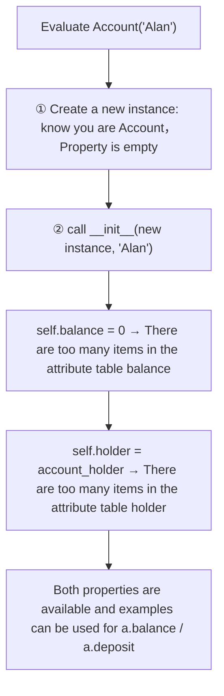
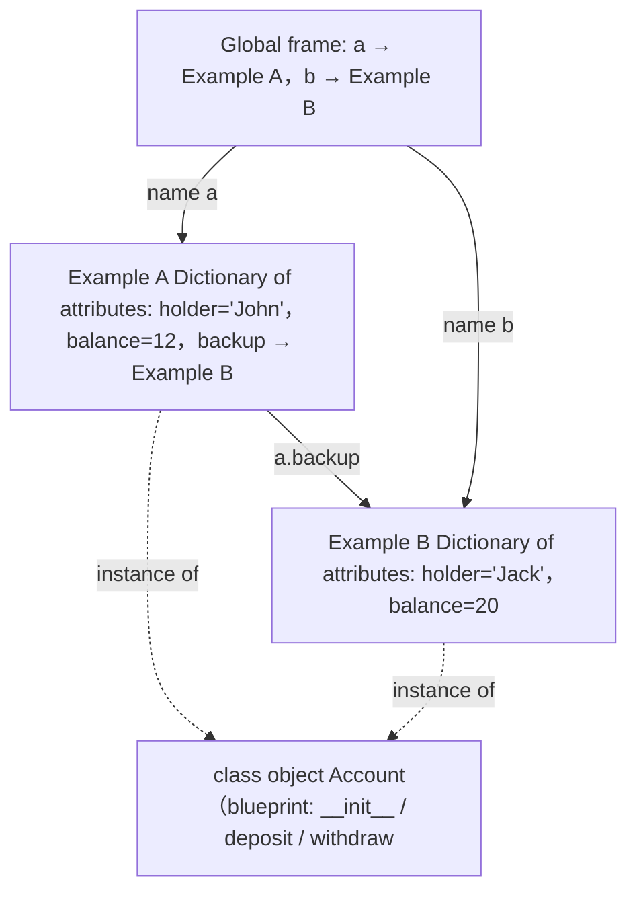
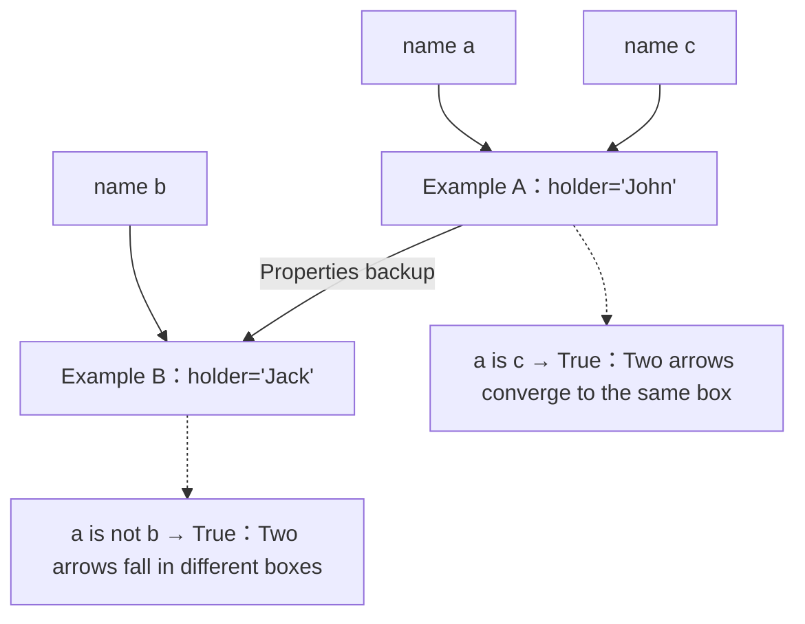
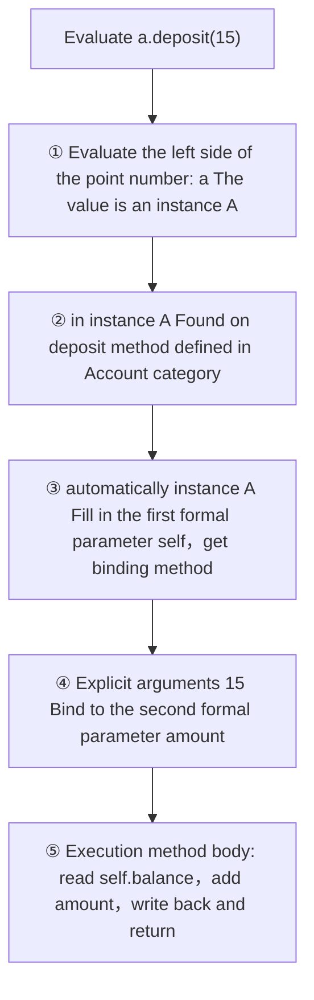

> **courses**: UC Berkeley CS61A · Structure and Interpretation of Computer Programs(Fall 2024)
> **This lecture**: Lecture 18 ｜ 17:15 ｜ Station B P 18 ｜ [Original video](https://www.bilibili.com/video/BV1sy411z7nA?p=18)
> **courseware**: `17-Objects.pdf` (7 pages, official PDF, page-by-page renderings see text illustrations)
> **subtitles**: Original English subtitles from Station B; this note is a reconstruction of Chinese writing, not a sentence-by-sentence translation.
> **Copyright**: The copyright of the course and courseware belongs to the UC Berkeley CS61A teaching team; this article is a secondary arrangement for learning purposes

## Quick overview of this lecture

- **Mastered**: The "constructor + selector" convention of data abstraction, mutability and object identity (`is` / `is not`), and the binding relationship of "name → value" in the environment graph. In this lecture, these three things are used together once.
- **Main line of this lecture**:
    - Large programs must be broken down into modules that people can think clearly at a time; data abstraction **information** Bundled together, object-oriented goes one step further and puts **behavior** Also tied in.
    - A class is a blueprint, and an instance is an object created according to the blueprint: `Account('John')`  create an instance, `type(a)`  Answer "Which category are you in?"
    - one piece  `class`  The statement consists of three paragraphs: class name, `__init__` (Installing attributes to new instances), several methods (giving behaviors).
    - Methods are just functions defined in the class; the dot expression will automatically fill in the receiver as the first parameter  `self`, so define two parameters and call only one.
    - Attributes can be read at any time, modified at any time, and added out of thin air at any time; the attribute value can be another object, so "same object, two names" appears.
- **Key conclusions**: **Functions can be called on any value, methods can only be called on objects that "know it"**——`a.deposit(15)`  The 15 in is just an explicit argument, `a`  Itself is the implicit first argument.

*(Reference time: 00:00:00 – 00:00:11｜Lecture 18)*


## 1. Object-oriented: Bundle information and behavior into a whole

*(Reference time: 00:00:11 – 00:02:19｜Lecture 18)*


Object-Oriented Programming (OOP) is today's dominant paradigm for organizing programs when developing large software. It has a huge impact on the design of programming languages: Python and many other languages ​​have built-in syntax and vocabulary to support this set of metaphors. But it didn’t appear out of nowhere—it’s built on two ideas that have been used time and time again: **data abstraction** with **mutation**. The courseware marks this page as "Review: Mutability" to remind readers that all the parts used in this lecture have been built previously.

The lecturer's narrative begins with a "story." Complex large programs must be organized into small modular components. Each component can be written separately, tested separately, and thought through in the mind at one time; the reason is that human mental capacity is limited and can only handle limited complexity at a time. **data abstraction** This is exactly what it does: Bundle multiple pieces of information describing the same thing into a whole, and only expose the way to construct it and the way to take it out. The internal representation can be changed at will.

**Object-oriented takes this one step further. **It not only bundles multiple pieces of information (data abstraction already does this), but also** behavior** Also bundled into the same whole. So an "object" represents something in the world, such as a date: it not only stores all the information needed to represent the date, but can also do what dates do, such as figuring out what day of the week the date is. To put it more simply, a date object both remembers "what day it is" and knows "how to answer questions about itself."

What this idea really changes is the way you imagine what a program is doing. A program is no longer a long list of information, plus a bunch of functions that act on this list of information; it is a bunch of interacting objects, each object responsible for remembering its own information. Human attention can then fall on only one object at a time - this is exactly the desired effect of "modularity".

This leads to three settings that run through the entire lecture:

- **Each object has its own local state**, this status can change over time. So object-oriented often involves mutation, although mutation is not necessary.
- \*\*When a mutation occurs, it does not occur on some global list that records information about the entire program. \*\*The changed part of the information belongs to a specific object; the lecturer specifically emphasized this point because it determines whether "changing one place will affect other places."
- **Each object should know how to manage its own local state**, that is to say, it is up to the object itself to control which changes are allowed and what invariants should be maintained after the changes.

The entrance for people to interact with objects is called **method**: It is a function specific to this type of object. The word “exclusive” in this definition is key—it will be used again in the next section.

| criterion | Data Abstraction | Object Oriented (OOP) |
| :--- | :--- | :--- |
| What is tied up is | only **information**: Put the year, month and day of a date together | information **plus behavior**: The date also needs to be able to answer "what day of the week am I?" |
| Who will do the calculations? | The external function takes out the components and then calculates them in the function | The object uses its own method to calculate, and the caller only writes a dot expression |
| where is the status | Often scattered among several global names or containers | Each object has its own local state |
| An agreed upon set of reuse units | Interface convention between functions and "constructor/selector" | Classes and instances created from them |
| Scope of changes | Whoever shares that container will be modified together. | Only the named object is changed |

> **Editor's note**: The division of labor between data abstraction and objects is often summarized as the difference between "data + operation" and "data + operation + encapsulation". This lecture does not discuss terms such as information hiding, private attributes, and message passing. `Account`  The attributes of can always be directly read and written in Python; comparing the two in a table is to illustrate the boundary of the sentence "object-oriented = data abstraction + behavior", but it does not mean that the encapsulation mechanism is taught in the class.

## 2. Class, instance, method: the precise meaning of these three words

*(Reference time: 00:02:20 – 00:03:35｜Lecture 18)*

Several objects may be the same **class **of** instance**. You can have many different lists, and they all behave the same because they belong to the same class; and different classes can be related to each other. To support this set of metaphors, Python has built-in specialized syntax and vocabulary.

The definitions of the three words can be written down one by one:

1. **class** Define a certain type of object **how to behave**——It is a description of “what can be done and how to do it”.
2. **object** is one of a certain class **Example**.
3. That is, every object has a **Type**, that type is its class; and once an object is created, it always belongs to this class.

The third point is a hard constraint that is easily overlooked: a class is not a "label" for an object that can be torn off and replaced midway, but a part of the object's identity.

followed by **method**. The method is **Functions called with dot expressions on objects**. The example given by the lecturer is a list  `s`  and call  `s.append(5)`: `append`  is the method, it is applied to the list  `s`  Above, it is called with the actual parameter 5, and the result is 5 entered.  `s`  the end of.

```python
s = [0, 1, 2]
s.append(5)          # append 是方法；这个调用把 5 追加进 s
```

The dividing line between methods and functions is here: \*\* Functions are usually defined in the global frame and can act on any value; methods are exclusive to an object. \*\*Cannot be called on anything  `append`——It has no meaning for numbers or strings——but it can be used in  `s`  It is called on  `s`  Know how to append. The word "know" here is not a figure of speech: this knowledge is preserved in  `s`  in the category it belongs to.

| criterion | function | method |
| :--- | :--- | :--- |
| where is the definition | At the top level of the module, the name is tied to the global frame | `class`  Inside the statement, it becomes part of the class |
| Where does the first formal parameter come from? | It is the first actual parameter, and match it one by one. | `self`, automatically filled in by the object to the left of the dot |
| Who can it affect? | Any value, as long as the type requirements match | Only objects that "belong to this class" |
| Call writing method | `f(x)` | `obj.m(x)`, it seems that one less parameter is passed |
| Examples from this lecture | `list`, `print`  Such global names | `s.append`, `a.deposit` |

> **Editor's note**: `s.append(5)`  The value is  `None`, adding 5 to the list is a side effect - this is exactly the same as the criterion of "Return value vs side effect" in Lecture 3. There is no discussion on courseware or subtitles  `append`  The return value is added here to illustrate that the identity of "method" does not change the fact that "functions may only have side effects".

## 3. Built-in classes  `list`: Behaviors are written in classes

*(Reference time: 00:03:36 – 00:04:46｜Lecture 18)*

Let’s look at a built-in class first: `list`. Previously it had been called like a function  `list`, in fact it is a **class**. Called on an iterable object  `list`, will create a new list object. This is a general rule in Python: \*\*When you call a class like a function, you are creating a new instance of that class. \*\*An example of a list is of course a list, such as a list containing 0, 1, and 2.

```python
>>> s = list(range(3))
>>> s
[0, 1, 2]
>>> type(s)
<class 'list'>
>>> list
<class 'list'>
```

ask  `s`  type, what you see is  `list`  This class; this is the same as directly typing a  `list`  The result is the same thing. This is worth stopping to take a look at: `type(s)`  What is given is not a specific list; **The class that describes all list behavior**.

So there is a unified answer to "Why can lists be used in this way?" Everything about the list is provided by  `list`  Class specifications: what methods does it have? `+`  with  `*`  What does it mean to act on a list, how do subscript assignment and subscript reading work, and the most basic one——**The starting element is the 0th one, not the 1st one**. This last one may seem like a matter of language designer's taste, but it's actually a convention that must be fixed somewhere, and that fixed place is a class.

This also explains the precise meaning of the metaphor of "blueprint": a single list only remembers its own elements; and there is only one set of knowledge of "what the list can do and where the subscript starts", which is placed in the class and shared by all instances.

> **Editor's note**: The specific echo of the above interactive session (`[0, 1, 2]`  with  `<class 'list'>`) is completed by the actual output of CPython; the subtitles only describe the phenomenon seen by the lecturer - "It is  `list`  class, and knock directly  `list`  The results are the same." The courseware did not provide this echo. The echo is written so that readers can type it again.

## 4. Define your own class: `Account`  information and behavior

*(Reference time: 00:04:46 – 00:07:43｜Lecture 18)*


In addition to using built-in classes, you can also **Define your own class**, and then create an instance of it to create a new object type. A class describes the behavior of its instances - this sentence is fulfilled here for the first time.

The example is a bank account. To bundle information related to an account: account balance  `balance`  with the account holder  `holder`; Also bundle the actions related to the account: deposit money into it  `deposit`, withdraw money from it  `withdraw`. According to the comparison in Section 1, these two sets of things should have been divided into "a data recording the balance and the account holder" plus "two functions that act on it"; now they are included in the same object.

The division of labor is clear: **All bank accounts must have a balance and holder**, so the matter of "installing these two attributes on each newly created account instance" must be done by  `Account`  The class is responsible. This is not a matter of style, but a direct consequence of the fact that a new instance is created as a blank slate—section 5 will complete this line of reasoning.


This page of the courseware puts the above two sentences of "Idea" directly into the interactive conversation. The first line is used  `Account`  class (assuming it is already defined), create a new account instance:

```python
>>> a = Account('John')
>>> a.holder
'John'
>>> a.balance
0
>>> a.deposit(15)
15
>>> a.withdraw(10)
5
>>> a.balance
5
>>> a.withdraw(10)
'Insufficient funds'
```

The owner of this instance is John: check it  `holder`  Properties, what you see is  `'John'`. So the answer to the question "Why is this name called holder" is not at the call site, but in the class definition - the name is part of the class definition, as you will see on the next page. Here we accept the abstraction first: **Any account can access its  `holder`  with  `balance`**, these two names are **attribute**, they belong to objects  `a`, while  `a`  is  `Account`  An instance of the class.

The second sentence Idea talks about behavior: **All bank accounts share one  `withdraw`  method and a  `deposit`  method**. They can have different balances and different account holders, but "depositing money into a bank account" is the same thing for any account. So in the conversation above  `a.deposit(15)`  gets 15 (originally 0), `a.withdraw(10)`  Got 5, again  `a.withdraw(10)`  then get the string  `'Insufficient funds'`. Both access methods will modify the balance and return the modified balance (or a reminder of insufficient balance).

Here for the first time the full meaning of "local state" appears. \*\*Local means: this balance is exclusive to the object  `a`. \*\*You can't refer to it without writing a dot expression; precisely because it hangs on the object and is usually changed by the object's method, there is a clear answer to the question "who changed this value when?"

The courseware then adds a very important relaxation: **Methods can have arbitrarily complex behavior, and you can write it as any function you want. **For example, when withdrawing money, you can first check whether the balance is sufficient. If it is not enough, a string will be returned.  `'Insufficient funds'`, and** Fixed balance**. This sentence is given in advance to verse 5  `withdraw`  Say hello - there  `if`  It is this "check".

## 5. `class`  Statement: `__init__`, methods and structures

*(Reference time: 00:07:44 – 00:12:31｜Lecture 18)*

`deposit`  with  `withdraw`  They are all methods, and **The method is defined in the object's class**, here is  `Account`  class. To get the above behaviors, you need to write a considerable amount of code; the instructor's approach is to go through the entire code first, and then go back and explain why it looks like this.


```python
class Account:
    def __init__(self, account_holder):
        self.balance = 0
        self.holder = account_holder
    def deposit(self, amount):
        self.balance = self.balance + amount
        return self.balance
    def withdraw(self, amount):
        if amount > self.balance:
            return 'Insufficient funds'
        self.balance = self.balance - amount
        return self.balance
```

one piece  `class`  statement with keyword  `class`  Begins, followed by the class name; then it must be stated **What happens when a new instance of this class is created**, this is done by the first method; the rest are ordinary method definitions.

**First paragraph: `__init__`.**Special method name  `__init__`  It must be written like this, including two underscores before and after it - because it will create a new one every time  `Account`  is automatically called. In the method body, the new account is called  `self`, and then assign attributes to it: `balance`  Always 0, `holder`  is assigned to the value passed in, and the name of that value (`account_holder`) from the function definition. Note** The attribute name can be the same as  `__init__`  Internal parameter names are different**:The parameter is called  `account_holder`, the attribute is called  `holder`. This asymmetry is intentional and was specifically mentioned in class.

**Second paragraph: method. **Methods look like functions, but are defined in the class. `deposit`  Take two parameters: the first is  `self`, it is** call  `deposit`  the one  `Account`  Example**——That is  `a.deposit(10)`  The one to the left of the dot  `a`;The second one is  `amount`.

So there is a seemingly awkward fact: \*\* only gives one actual parameter when calling, but two formal parameters are written when defining. \*\*The result of this arrangement is that the instance can be obtained inside the method and all its properties can be accessed. The lecturer’s exact words were “It’s like  `a`  was given  `self`”.

`deposit`  The method body is very short, but each step is worth reading: change  `balance`  properties by checking out  `balance`  attributes, plus  `amount`, then assign it back; finally return  `balance`  properties. \*\*`return`  statement explains why  `a.deposit(15)`  15 will be displayed. \*\*No  `return`  There is no problem at all: the method still changes the balance, but the return value is  `None`——Back to the two channels of "return value" and "side effects" again, the identity of the method is not exempt from this distinction.

`withdraw`  A little more complicated: it receives an account (`self`) and a number (`amount`), check first  `amount`  Is it greater than  `self.balance`. Note **Every time you mention balance, you must use a dot expression**, because it is an attribute; then it returns if the balance is not enough  `'Insufficient funds'`  Exit directly (the balance remains unchanged), and then the balance will be reduced and returned to the new balance. Methods can return anything and can also be updated  `self`  attribute, or return the attribute.

\*\*Paragraph 3: What a call does. \*\*After defining a class and then calling it, two things will happen. The courseware marks these two steps as 1 and 2:

- First, a **A new instance is created**. it knows it is  `Account`, but in terms of attributes it is a **blank paper**——There is nothing except "I am this kind".
- Then, `__init__`  is called, the first actual parameter is this new object (the formal parameters are always named  `self`), followed by other actual parameters given in the calling expression, such as the account holder  `'Alan'`.

Spread these two steps into a frame-by-frame table, `a = Account('Alan')`  The process is like this:

| moment | Instance properties | what happened |
| :--- | :--- | :--- |
| After creation | blank paper | The instance has been created, but the balance and account holder are not yet known. |
| enter  `__init__` | blank paper | `self`  Point to this instance, `account_holder`  is  `'Alan'` |
| execute  `self.balance = 0` | `balance = 0` | `self`  This is the instance, so attach a balance attribute bound to 0 to it. |
| execute  `self.holder = account_holder` | `balance = 0`, `holder = 'Alan'` | Then attach the holder attribute |
| Return | Both attributes are complete | This instance can now be used as an account |



`__init__`  sometimes called **constructor method**, this term is also commonly used in other programming languages. The entire sequence of actions above all occurred in **one** In the calling expression; you can reference it after you have finished  `a`  properties.

> **Editor's note**: In Python implementation, instances of user-defined classes put attributes in a dictionary (`a.__dict__`), and the method is saved on the class, so the judgment "one copy of the instance, all methods shared" is literally true at the implementation level. Both courseware and subtitles are described by "attributes" instead of "dictionaries". The dictionary term here is just to make the "attribute dictionary" in the structure diagram have a foothold; the order in which attribute names are searched between instances and classes is the content of the next lecture (Lecture 19 Attributes) and is not covered in this lecture.

## 6. Reading, writing and "adding out of thin air" properties

*(Reference time: 00:12:33 – 00:14:02｜Lecture 18)*

Object properties use **dot expression** Access and modification. After you have created an account, you can check it  `balance`, or you can change it with an attribute assignment statement:

```python
>>> a.balance
5
>>> a.balance = 12
>>> a.balance
12
```

**The value of an existing property can be changed at any time. **After the change, there are 12 in this account. No method is called here, the dot assignment falls directly on the property itself; in other words, the method is just** A more convenient way to modify**, rather than the only way. This is very important in Python: a class cannot force the outside world to change its state only through methods, so "objects manage their own local state" is a rule in this course. **design convention**, maintained by people who write code.

Then there’s an even easier to ignore rule: **A property can be assigned a value even if it does not originally exist.**

The lecturer gave a more complex example. `b`  is another account, belonging to a different account holder, with a balance that was initially 0 and subsequently set to 20. Then give the previously created  `a`  Account **Create a new one called  `backup`  properties**, the value is  `b`  this account.

```python
>>> b = Account('Jack')      # 字幕未给出第二位开户人的名字，此处取占位
>>> b.balance
0
>>> b.balance = 20
>>> a.backup = b
>>> a.backup.balance
20
```

There are two new facts here. First, **The value of a property can be another object**, such as an account, does not have to be a number. Second, **In Python, new properties can be added at any time**——There is no need to declare it in the class in advance, and no error will be reported just because the name is not written in the class.

So the last expression  `a.backup.balance`  That’s interesting: `a.backup`  refers to  `b`, and its  `balance`  Yes 20. \*\*The same account then has two ways of referring to it: `b`, or  `a.backup`. \*\*These two names refer to the same object, not two copies - Section 7 will talk about this "alias" relationship as a criterion.



This picture shows two devices on the same piece of paper: one end is **environment map** notation - name  `a`, `b`  Each points to a value; the other end is the dotted line that is not originally in the environment diagram——**Which class does a value belong to?**.`a`  with  `b`  They are two instances created from the same class, so they each have their own attributes, but share the behavior definition in the class.

| criterion | attribute | method |
| :--- | :--- | :--- |
| What do you get after the dot? | a value: a number, a string, or even another object | A method with a receiver bound to it |
| Do you want to call again? | No need, just get the value | Add parentheses and give actual parameters |
| Where does it exist | One copy for each instance | Defined in a class, all instances share the same code |
| Can it be added midway? | Yes, add new instances to any instance at any time | No, the method is fixed with the class definition |
| Examples from this lecture | `a.balance`, `a.holder`, `a.backup` | `a.deposit`, `a.withdraw` |

## 7. Object identity: `is`, `is not`  with aliases

*(Reference time: 00:14:03 – 00:15:17｜Lecture 18)*

why talk **object identity**? Because the properties of objects will change and objects will mutate, we must be able to distinguish between two situations: **Two objects happen to have the same properties**, or **They are originally the same object**. Changing one in the former does not affect the other, while changing one in the latter is equivalent to changing both.

The rules are simple: **Each instance of a user-defined class has a unique identity.**`a`  Account and  `b`  accounts are two different accounts because  `Account`  Called twice; **every call  `Account`  Both create a new instance**. only one  `Account`  Class, but can have an infinite number of instances. `a`  There are balance and holder, `b`  There are also balance and holder - the attribute names are the same, but the objects are different.

Two operators are used to determine identity: `is`  with  `is not`, they test two **expression** The evaluation result of is the same object.

```python
>>> a is a
True
>>> a is not b
True
>>> c = a
>>> c is a
True
```

`a is a`  is true because both sides are expressions that evaluate to "John's account". `a is not b`  is true: even if both balances are the same, **Even if they even have the same account holder**, they are still different accounts because  `Account`  was called twice. These two sentences combined explain: `is`  The question is not "do they look alike", but "are they the same".

The last one is the most practical: **Binding an object to a new name using assignment does not create a new object. **write  `c = a`  After that, `c is a`  Still true - they're just two names for the same account. this is** Aliasing**;it and section 6  `a.backup`  Those are the same thing, except one is caused by assignment and the other is caused by attribute assignment.



| criterion | The same object (alias) | Different objects with the same properties |
| :--- | :--- | :--- |
| How to make it | `c = a`, or  `a.backup = b` | `Account('John')`  Called twice |
| `is`  the result | `True` | `False` |
| If you change one attribute, will the other one see it? | See, because there is only one attribute | Can't see, each one has one |
| Number of objects | 1, 2 names | 2, 2 names |
| Examples from this lecture | `a`  with  `c`, `b`  with  `a.backup` | `a`  with  `b` |

> **Editor's note**: To determine "whether the attributes are the same", it is usually necessary to write additional comparison logic and let the class define what "equal" is; when there is no definition, `==`  will fall back to identity comparison, so with  `is`  The same result is obtained, but this is the exception rather than the rule. This lecture only talks about  `is` / `is not`, not involved  `==`, I deliberately do not expand here to avoid describing the following content as classroom content in advance.

## 8. `self`  Implicit binding: why the method is written with two parameters

*(Reference time: 00:15:17 – 00:17:13｜Lecture 18)*

`class`  The last part of the sentence to discuss is **method definition**. Calling a method is to use a dot expression to call a method defined in the class. And **All called methods pass  `self`  The formal parameter accesses that object**, so they can all access and operate the object's properties.

This is exactly the mechanism by which "objects manage their own local state": **The object's class describes how the state changes**, such as how the balance is updated. The state is not changed casually by external functions, but by the code written in the class - although as mentioned in Section 6, Python does not enforce this.

return to  `Account`  inside  `deposit`: It takes two actual parameters, adds them together to calculate the new balance, and assigns it to  `self.balance`. it **There are two formal parameters when defined, but the dot syntax will automatically provide the first actual parameter.**. So, create an account for Tom and call  `deposit`, although there are two parameters written in the definition, only one is given when calling - the other parameter is Tom's account, which is bound to  `self`  on.

```python
t = Account('Tom')
t.deposit(20)        # 定义两个形参，调用只给一个：20
                     # 另一个实参是 t 本身，绑到 self
```

> **Editor's note**: The subtitle simply states “Create an account for Tom and call  `deposit`, the definition is two parameters, only one is given in the call, and the other parameter is Tom's account." The variable name and specific amount are not given; the above  `t`  with  `20`  This is the editor's supplementary indication, and the behavior is consistent with the description in the class.

put  `a.deposit(15)`  The evaluation process of this expression is spread out, and you can see that  `self`  At which step is it filled in:



Step ③ in the picture is the entire content of "implicit binding": \*\*The dot expression is not only responsible for "finding the method", but also responsible for "putting the receiver into the first parameter". \*\*This also explains the asymmetry in the row in the table in Section 2: two are defined, one is called, and the missing one is filled in by the grammar.

Finally, there is the rhetorical question raised by the lecturer himself: \*\*Then why not simply define a  `deposit`  function? \*\*The answer lies in the type: **Different types of objects may have different storage methods. **this  `deposit`  exclusive to  `Account`  class; if there is another class, such as an investment fund, "depositing money" into it may have different behavior and different code, then write another class for that class  `deposit`  method. Which one to use depends on the** what type of object** call on  `deposit`.

> **Editor's note**: This passage points out the mechanism of "methods with the same name have different implementations in different classes", which is the starting point of what is commonly known as dynamic dispatch and polymorphism. This lecture only lays out the mechanism, without giving terminology, and does not discuss inheritance; inheritance is the content of Lecture 20. The terminology is pointed out here to let readers know where this clue leads.

## Summary

- **Read it in three paragraphs first  `class`**: class name, `__init__` (install attributes), methods (give behavior). saw one  `class`  statement, first ask "What properties does the new instance have?" and then "What methods does it have?"
- **see  `obj.m(x)`  Just add a parameter in your mind**: `m(obj, x)`. Define two formal parameters and only give one actual parameter in the call. This is not omission, but the dot syntax fills in the receiver for you.  `self`.
- **Write one copy for behavior and multiple copies for status**: The method is defined in the class and shared by all instances; the attributes are hung on each instance, each with its own copy. To judge whether "changing one place will affect other places" depends on whether it changes a class or an instance.
- **The attribute is the private ledger of the instance, but this ledger is open**: You can read it at any time, change it at any time, and add a name that you didn’t have before at any time. There is no limit on the type of the value (it can be another object). Openness brings flexibility, but the price is that "who changes the status" can only be guaranteed by design conventions.
- **`is`  The question is about identity, not similarity.**: `c = a`  What is created is an alias rather than a copy, so  `c is a`  is true; called twice  `Account('John')`  Two objects are created, even if their properties are identical, `is`  Also false.
- **The real use of methods is "dispatch by type"**: Same  `deposit`  Calls can have different implementations on objects of different classes; this is the answer to "why not use a global function".

*(Reference time: 00:16:34 – 00:17:13｜Lecture 18)*

## Attached: Slide index for this lecture

*(Reference time: 00:00:00 – 00:17:13｜Lecture 18)*

| page | content | Appear location |
| :--- | :--- | :--- |
| 1 | Title page Objects | Quick overview of this lecture |
| 2 | Announcements | Quick overview of this lecture |
| 3 | Review: Mutability Sectioned Page | §1 |
| 4 | Class Statements section page | §4 |
| 5 | Dot access to Account instances and properties/methods | §4 |
| 6 | `Account`  Complete class definition and interactive demonstration | §5 |
| 7 | Animation Demos by Hany Farid (signature page) | Appendix |

## Appendix: Slides not shown in class

*(Reference time: 00:00:00 – 00:17:13｜Lecture 18)*


The last page of the courseware is the signature page of the animation demonstration ("Animation Demos by Hany Farid"). The subtitles of this lecture do not correspond to the narration on this page: There is a mark at the bottom of page 6 of the courseware  `(Demo)`, refers to the interactive demonstration played in class, and this recording only contains a retelling of the results of the demonstration (`a.deposit(15)`  Got 15, `a.withdraw(10)`  Get 5. Take it again and get  `'Insufficient funds'`), no sound from the demo itself. This page is included here as it is in the courseware, and the demonstration content is not fictitious.

- If you want to reproduce this demonstration, you can directly replace the  `class Account`  Paste the definition into the interpreter and enter it in sequence  `a = Account('John')`, `a.holder`, `a.balance`, `a.deposit(15)`, `a.withdraw(10)`, `a.balance`, `a.withdraw(10)`, the results on the courseware should be obtained item by item.
- If there is any discrepancy between the demonstration and the description in this note, the pictures on pages 5 and 6 of the courseware shall prevail (the conversation content on the two pages is consistent, and there is an extra mark on page 6  `(Demo)`).
