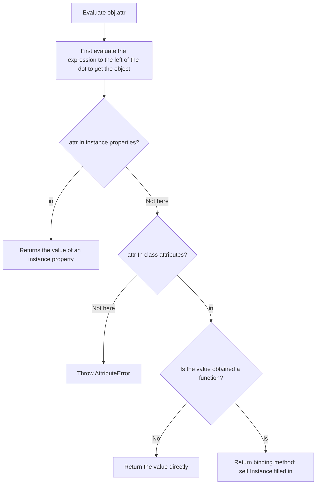
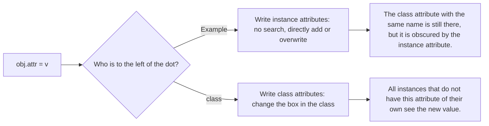
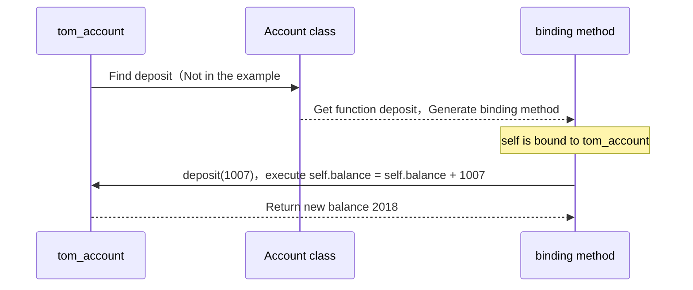

> **courses**: UC Berkeley CS61A · Structure and Interpretation of Computer Programs(Fall 2024)
> **This lecture**: Lecture 19 ｜ 17:47 ｜ Station B P 19 ｜ [Original video](https://www.bilibili.com/video/BV1sy411z7nA?p=19)
> **courseware**: `18-Attributes.pdf` (15 pages, official PDF, page-by-page renderings see text illustrations)
> **subtitles**: Original English subtitles from Station B; this note is a reconstruction of Chinese writing, not a sentence-by-sentence translation.
> **Copyright**: The copyright of the course and courseware belongs to the UC Berkeley CS61A teaching team; this article is a secondary arrangement for learning purposes

## Quick overview of this lecture

*(Reference time: 00:00:00 – 00:01:20｜Lecture 19)*

- **Mastered**: `class`  Statements and instantiation (from the previous lecture)  `Account`: `__init__`, `balance`, `holder`); usage of dot expressions (`lst.append`, `s.pop`); functions are first-class values that can be passed and returned as parameters.
- **Main line of this lecture**:
    - Execute one  `class`  statement, the class object is created, the class name is bound to the current frame, and the  `=`  with  `def`  Instead of creating names in the frame, they become attributes of the class;
    - Class attributes are shared by all instances, `tom_account.interest`  It looks like an instance attribute, but only one copy of the value is stored;
    - Dot expression evaluation is divided into four steps: first evaluate the left side, then check the instance, then check the class, and if the function is hit, the bound method is returned;
    - Property assignment is never looked up: `obj.attr = v`  Write an example, `Cls.attr = v`  Write classes, the two do not cover each other;
    - Method calling is to put the dot expression in the operator position of the calling expression; binding method = function + already filled in  `self`, which can be passed to  `map`.
- **Key conclusions**: To read attributes, go up "Instance → Class", and to write attributes, just look at who is on the left side of the dot. Two rules go in opposite directions, and conflating them is a common source of bugs in this area.


This video is only 17 minutes and 47 seconds long. There is no announcement at the beginning. The first sentence is "Class attributes are attributes of classes." Page 2 of the courseware is a conventional announcement page, but it is not within the scope of this recording. The specific announcement content is unknown and is only retained here as part of the courseware structure.


## 1. Class statement: Where do class attributes come from?

*(Reference time: 00:00:00 – 00:02:26｜Lecture 19)*

Used in previous lecture  `class Account:`  Created the account object, but did not stop to ask: execute an  `class`  statement, what exactly does the interpreter do? This lecture begins with this question. The answer is in two halves: the statement creates a **class object** (class object), and bind the class name to the frame in which the statement is executed; and every assignment statement and every assignment in the class body (suite)  `def`, all become one on this class object **class attribute** (class attribute), will not leave any name in the current frame.


### 1.1 A class statement does three things

Three pieces in order. First, create a new class. Second, put  `<name>`  Binds to "the first frame of the current environment" - that is, the first frame when this statement is executed, which is Global in an interactive session. Third, execute the class body. The execution method of the class body is no different from that of the ordinary suite, except that the place of the name has changed: usually  `=`  with  `def`  Names will be created in the frame, and they will all enter the class in the class body and become attributes of the class. The lecturer put this sentence very directly: *"Normally, assignment and def would create names in frames, but that's not the case here. Instead, they all go in the class as class attributes."*


The example on the courseware is just a demonstrator:

```python
class Clown:
    nose = 'big and red'
    def dance():
        return 'No thanks'
```

```python
>>> Clown.nose
'big and red'
>>> Clown.dance()
'No thanks'
>>> Clown
<class '__main__.Clown'>
```

`nose`  with  `dance`  None of them are in the Global frame: `>>> nose`  will report that the name is undefined, while  `Clown.nose`  There is value. `Clown.dance()`  The reason why I can run is because  `dance`  It is a class attribute that "stores a function". If you use the class to get it, what you get is the function itself. Adding a pair of parentheses after it is an ordinary call and the return value  `'No thanks'`. last line  `>>> Clown`  print out  `<class '__main__.Clown'>`: The class itself is also a value. It has a type, an address, can be bound, and can be passed.

The instructor specifically states that this code "does not serve any purpose" (*"this code is not helpful at all"*), its entire value lies in letting people see a  `class`  What's left after the statement is executed: a bunch of class attributes. He also warns that this type of writing can cause problems when instantiating - this is exactly the phenomenon that the search rule in Chapter 2 is intended to explain.

> **Editor's note**: `Clown().dance()`  Can throw  `TypeError: dance() takes 0 positional arguments but 1 was given`. The reason lies in step 4 of point expression evaluation: finding by instance  `dance`  When a function in the class is hit, the bound method is returned and the instance is used as the first actual parameter.  `self`  fill in; and  `dance`  Not a single formal parameter is declared, and there is nowhere to place the extra instances. `Clown.dance()`  The reason why it's okay is because the original function is obtained through class search and there is no binding step (Chapter 5).

> **Editor's note**: CPython's implementation is more detailed than "entering a class but not entering a frame": the class body is first executed in a temporary namespace dictionary. After execution, this dictionary is used to initialize the class object, and the names in the dictionary then become attributes of the class. So "assignment without creating a name" means that it is not created in the current frame, and the class body itself still has a temporary name space.

### 1.2 Class attributes are shared

The real use of class attributes is **Share**. If the interest rate is the same for all accounts, there is no need to deposit a copy in each instance; put the interest rate in the class and only deposit it once, and all instances will see the same value through lookup. The instructor's statement is: Instead of storing it in every instance that is created, it is better to only store it once in the class.


```python
class Account:
    interest = 0.02   # A class attribute

    def __init__(self, account_holder):
        self.balance = 0
        self.holder = account_holder

    # Additional methods would be defined here
```

```python
>>> tom_account = Account('Tom')
>>> jim_account = Account('Jim')
>>> tom_account.interest
0.02
>>> jim_account.interest
0.02
```

By comparing the writing method of the class body, we can distinguish two types of attributes: `interest`  It is assigned a value in the class body, so it is a class attribute; `balance`  with  `holder`  in  `__init__`  pass  `self.`  Assignment, so they are instance properties. twice  `>>> tom_account.interest`  with  `>>> jim_account.interest`  The output is the same 0.02, but the value comes from only one source: the class.

The first point the lecturer emphasized was that "the visiting office cannot tell": *"The fact that it's a class attribute is not really apparent when you access it. It just looks like it's an attribute of Tom account."*  Grammatically  `tom_account.interest`  with  `tom_account.balance`  They look exactly the same and follow the same evaluation rules; the only difference is which station is hit when the search stops.

The second point is "it's not in the instance": *"It's important that the interest attribute is not part of the instance, it's part of the class. It's just the lookup procedure that gave us access to it, even though it was part of the class."*  This sentence is the hinge of the entire lecture - it explains two phenomena in Chapter 3 at the same time: Why  `Account.interest = 0.05`  It is possible to change all the accounts that "do not have their own interest rates" at once, and why after setting the interest rate separately for Jim, Tom still sees the same one in the category.

The third point is the cost. Copying a shared value for each instance is a pure waste when there are many objects; class attributes reduce this cost to one time. On the other hand, once a class attribute is "written" by an instance, the instance has its own copy, and sharing and special cases can coexist, and this is the mechanism that Chapter 3 will expand on.

> **Editor's note**: `__dict__`  Can see this matter more directly. `tom_account.__dict__`  only  `{'balance': 0, 'holder': 'Tom'}`, `interest`  Appear in  `Account.__dict__`  Li; `vars(tom_account)`  with  `tom_account.__dict__`  Equivalent. This is the fastest way to determine "where a certain name exists."

## 2. Dot expression: a search needs to go through two stations

*(Reference time: 00:02:28 – 00:05:06｜Lecture 19)*

`tom_account.interest`  with  `tom_account.balance`  The writing is the same, but the results come from two places. To make this clear, we have to break down the action of "dot expression evaluation". The lecturer's opening was very simple: whenever a dot expression is evaluated, an attribute must be found for an object; the object is given on the left side of the dot, and the name to be looked up is given on the right side of the dot. "Looking for attributes by name" is actually a process that needs to be found in multiple places: instances have their own attributes, and classes also have their own attributes, both of which can be accessed through dot expressions.


### 2.1 Four-step rule


The courseware writes the evaluation process into four rules, and the order is the priority:

1. First evaluate the left side of the dot number  `<expression>`, its value is the object of the point expression.
2. put  `<name>`  with this object **instance attribute** Compare; if an attribute with the same name exists, return its value.
3. If it does not exist, go to the object's **class** Look up this name and get the value of a class attribute.
4. This value is the value of the entire expression; unless it is a function - then return **binding method** (bound method), and the object of the dot expression has been filled in  `self`.

Step 2 is "instance first". Taking account as an example, the instance attributes are only  `balance`  with  `holder`, other names will not get this stop. Step 3 shows that other names can also be written after the period: `interest`  That's it, `deposit`  The same is true, they all live in categories. Step 4 is the origin of the word "method". Let's keep accounts here first and then expand on Chapter 5.

The entire route is drawn like this:



The lecturer classified this rule as a "mechanical process that needs to be memorized" and gave an analogy to name search in the environment: to look up names, you have to go up layer by layer along the parent frame, and to look up attributes, you have to go up instance → class. Both are not conventions that can be played freely, but are fixed routes by the interpreter; only by remembering the route can you predict which value will be hit in a search.

An easily overlooked detail: step 4 only works when "starting from an instance". If the left side of the dot is the class itself, there is no comparable instance attribute in step 2, and if a direct hit is made in the class in step 3, the function will be returned instead of the binding method. This asymmetry will turn into two calling methods in Chapter 5.

### 2.2 Change the entrance: getattr and hasattr

Dot expressions are not the only entry point. built-in functions  `getattr`  Get attributes by name, the effect is the same as dot expression:

```python
>>> getattr(tom_account, 'balance')
0
```

The lecturer’s statement is: in addition to writing  `tom_account.balance`, you can also write "for  `tom_account`  named  `balance`  properties", both do the same thing. Also  `hasattr`, it answers "Does this name exist?" The judgment range includes the instance and its class——`interest`  Not in the instance, `hasattr`  Still returns true. The lecturer’s original words were  *"getattr and dot expressions look up a name in the same way"*: Which route in Section 2.1 is right?  `getattr`  Applies verbatim, the results of a search may fall on instance attributes or on class attributes.

There is an easy mistake hidden here: since there is no difference in the return value, you cannot "guess" whether a certain attribute is shared or exclusive by reading the code. To be sure, you can only look at which dictionary it exists in, or recall whether anyone has assigned a value to this instance individually.

> **Editor's note**: with  `getattr`  There is also symmetry  `setattr(obj, 'x', v)`  with  `delattr(obj, 'x')`, respectively equivalent to  `obj.x = v`  with  `del obj.x`. They are not mentioned in this lecture, but  `setattr`  It is accurate to understand that "the attribute name is a string assignment": it is also **Don't search**, directly write the object to the left of the dot.

### 2.3 A discussion question not covered in the video

Page 7 of the courseware is a discussion question  *Where's Waldo?*: For the following two classes, write one without quotation marks and one without  `+`  The expression of , evaluated, we get  `'Waldo'`.


This question is done in groups in class and is not covered in this video. The answer is given directly in the courseware. The following completes the reasoning based on the courseware answers; the reasoning itself is not in the subtitles and is added by the editor.

```python
class Town:
    def __init__(self, w, aldo):
        if aldo == 7:
            self.street = {self.f(w): 'Waldo'}

    def f(self, x):
        return x + 1
```

`Town(1, 7)`  put  `w = 1`, `aldo = 7`  hand over  `__init__`, the condition is established, then execute  `self.street = {self.f(w): 'Waldo'}`. dictionary keys  `self.f(w)`  It is just a dot expression plus a call: there is no such thing in the instance.  `f`, find the hit function in the class, return the binding method, and call it to get  `1 + 1 = 2`. So the instance gets the attributes  `street`, the value is  `{2: 'Waldo'}`. finally  `Town(1, 7).street[2]`  hit instance attribute  `street`, then press the key  `2`  Remove the bid and get  `'Waldo'`. The whole line has no quotes, nor does  `+`.

```python
class Beach:
    def __init__(self):
        sand = ['Wal', 'do']
        self.dig = sand.pop

    def walk(self, x):
        self.wave = lambda y: self.dig(x) + self.dig(y)
        return self
```

`Beach()`  inside  `sand`  Just a local name, `self.dig = sand.pop`  put **List binding method** Save as instance attribute. `walk(0)`  Created a closure  `lambda y: ...`  tied to  `self.wave`, then  `return self`——It is this return value that makes  `Beach().walk(0).wave(0)`  This chain writing method is established: the first time the expression is clicked, the instance itself is obtained, and the second time the expression is clicked, the newly saved value is hit in the instance.  `wave`. last call  `wave(0)`  time  `x`  with  `y`  are all 0, `self.dig(0)`  Bounced off for the first time  `'Wal'`, bounced off the second time  `'do'`, `+`  spell out  `'Waldo'`.

Two details are worth remembering. One, `self.dig`  It is the binding method, which binds the list; `__init__`  Return local name  `sand`  disappears, but the list is still alive because  `self.dig`  Keep pulling it. Secondly, the question limits "cannot write quotation marks, cannot write  `+`" refers to the line of expression in the REPL, not the class body: `walk`  inside  `+`  It is part of the class definition and is not a violation.

## 3. Attribute assignment: If it is written on the left, it will not be searched.

*(Reference time: 00:05:08 – 00:10:46｜Lecture 19)*

The first two chapters are about "reading". The rules are completely different when writing, and much simpler: when the left side of an assignment statement is a dot expression, it is a **attribute assignment statement** (attribute assignment statement), it only affects the attributes of the object pointed to by the dot expression - if the left side of the dot is an instance, write instance attributes; if the left side of the dot is a class, write class attributes. The lecturer’s original words were  *"Assignment statements with a dot expression on their left-hand side are attribute assignment statements."*


### 3.1 An assignment will not be searched first

Still based on section 1.2  `Account`  For example: `interest`  Defined in the class body, it is a class attribute; `holder`  with  `balance`  in  `__init__`  pass  `self.`  Write, is an instance attribute. Now write a line like this:

```python
>>> tom_account.interest = 0.08
```

The lecturer breaks this step down: the left side of the period is an instance, so this is a **Instance property assignment**. When evaluating, it will not be found in the class first.  `interest`, change the part in the category - that taken-for-granted interpretation is the source of misunderstanding. *"This whole thing doesn't look up interest on that object and go find it in the class. Instead, we just directly assign to the attribute of the object that's here."*  The instance originally did not  `interest`, after the endowment, you will have your own share; the share in the category will not move.

In reverse:

```python
>>> Account.interest = 0.04
```

The left side of the period is the class, so this statement changes the cell in the class: `interest`  It's already in the class, what's changed is its value.



The difference between reading and writing can be listed in a table:

| criterion | read  `obj.attr` | write  `obj.attr = v` |
|---|---|---|
| Whether to go up the class | Yes, check the instance in step 2 and the class in step 3 | No, only look to the left of the dot |
| Object of action | The hit (instance or class) | The object to the left of the dot |
| When attributes with the same name conflict | Instances take precedence, and the class part is covered. | Write the instance directly without touching the class |
| is it possible to fail | If you don’t have any at both stops, throw it away.  `AttributeError` | It always succeeds, and new attributes can be added to the instance at any time. |
| Impact on classes | Never change | only  `Cls.attr = v`  Just change the category |

### 3.2 Complete experiment: Tom and Jim’s interest rates

On page 15 of the courseware, spread out the entire timeline and look at the left half first:

```python
>>> jim_account = Account('Jim')
>>> tom_account = Account('Tom')
>>> tom_account.interest
0.02
>>> jim_account.interest
0.02
>>> Account.interest = 0.04
>>> tom_account.interest
0.04
>>> jim_account.interest
0.04
```


Look at the right half again:

```python
>>> jim_account.interest = 0.08
>>> jim_account.interest
0.08
>>> tom_account.interest
0.04
>>> Account.interest = 0.05
>>> tom_account.interest
0.05
>>> jim_account.interest
0.08
```

After four steps, the rules will be clear:

1. When the two instances were first created, they did not have their own  `interest`, both searches went to the class and both read 0.02.
2. `Account.interest = 0.04`  What changed was the category. Neither Tom nor Jim had their share, and when they checked again they both saw 0.04. The instructor uses this step to dispel a common misunderstanding: Example **No**"Lock" the class attributes during creation——*"it's not the case that an instance has its class attributes locked in when it's created."*  Class properties change over time, and instances reflect those changes.
3. `jim_account.interest = 0.08`  It is an instance assignment. Jim now has his own copy, and the search stops at the instance; Tom does not, and still reads 0.04 in the class. This is the mechanism of "a certain customer gets a higher interest rate" in the bank - the lecturer's original words are specialize a specific example.
4. `Account.interest = 0.05`  Change the category again. Tom reads 0.05 and Jim still reads 0.08: *"by assigning to the class, you don't erase all the special cases. They're still there."*

The two types of properties are compared together:

| criterion | instance attribute | class attribute |
|---|---|---|
| Where does it exist | Instance's own attribute dictionary | Class attribute dictionary |
| who can see | There is only one instance | All instances, found via step 3 |
| When did it occur? | `__init__`  inside  `self.x = ...`  This type of assignment | in class body  `=`  with  `def` |
| How to change | `instance.x = v` | `Cls.x = v` |
| storage cost | One copy per instance | Save only one copy |
| suitable for expression | different states for each object | Constants and behaviors (methods) shared by the entire class |

### 3.3 Pitfalls of mutable class attributes

The lecturer gave it  `interest`  It is a floating point number, and there will be no problem if you share a copy. Replace the same location with a mutable object, and sharing becomes a trap.

> **Editor's note**: The following paragraph is not in the subtitles of this lecture. It is the most common way of overturning the rule of "class attribute sharing" and is listed as a supplement.

```python
class Account:
    interest = 0.02
    tags = []            # 可变类属性：所有实例共用同一个列表

    def __init__(self, account_holder):
        self.balance = 0
        self.holder = account_holder
```

```python
>>> a = Account('A')
>>> b = Account('B')
>>> a.tags.append('vip')
>>> b.tags
['vip']
```

`b.tags`  also became  `['vip']`, because  `a.tags`  with  `b.tags`  What was found is **same list object**; `append`  It is modified in place (mutate), and no attribute assignment occurs, so it will not be given as in Section 3.2  `a`  Add one of your own. To break this connection, you must really write it once  `a.tags = ['vip']`, the instance properties are created at this time.

The judgment criterion is simple: if a "class attribute" will be modified in place, it is not suitable to be placed in a shared location; otherwise all instances will see the same changes. Immutable values ​​such as integers, strings, and tuples do not have this problem. They can only be reassigned, and reassignment means writing.

## 4. Method call: dot expression stands at the position of operator

*(Reference time: 00:10:49 – 00:13:00｜Lecture 19)*

What we have talked about so far is "accessing properties", and the main usage of objects is **call method**. The lecturer said that calling a method on an object is the main way to interact with the object; there is only one difference between method calling and ordinary function calling - the point in the middle. Methods are called using dot notation, in the form of "an expression, a dot, and a name".


### 4.1 Syntax and evaluation order

```text
<expression> . <name>
```

The courseware gives two restrictions: the one to the left of the dot  `<expression>`  It can be any legal Python expression - the lecturer added, so the left side of the dot may be a complex expression used to determine "on which object to find the method"; the right side of the dot  `<name>`  Must be a simple name, such as  `deposit`, `withdraw`, `append`, cannot be another expression. The value of the entire point expression is "the attribute value found by name on the object whose value is the expression on the left."

The order of evaluation is therefore fixed: first evaluate the expression to the left of the dot to get the object, and then look up the attributes by name on this object. What the courseware really wants to say is the next sentence: calling expressions  `tom_account.deposit(10)`  inside, **The operator position is a dot expression**.


The lecturer's original words are: This whole thing is an ordinary calling expression, except that the dot expression is evaluated first as an operator. It gives a method of "knowing that you are depositing money into Tom's account", and then 10 is passed in as an actual parameter. In other words, method calling has no special syntax. It is the result of a normal calling expression plus an attribute search rule; the reason why step 4 of Chapter 2 returns the bound method when "hitting the function" is to allow the operator position to get an already known  `self`  Whose value is it.

### 4.2 Account and two deposits in the previous lecture

The lecturer explained the previous lecture  `Account`  Recall the demonstration, it only has three methods. `__init__`  Usually it is not written directly, it is automatically executed when creating an instance; `deposit`  with  `withdraw`  It is used via a method call expression.

```python
class Account:
    interest = 0.02

    def __init__(self, account_holder):
        self.balance = 0
        self.holder = account_holder

    def deposit(self, amount):
        self.balance = self.balance + amount
        return self.balance

    def withdraw(self, amount):
        if amount > self.balance:
            return 'Insufficient funds'
        self.balance = self.balance - amount
        return self.balance
```

> **Editor's note**: This courseware only gives a list of attributes (`interest`, and  `withdraw`, `deposit`, `__init__`  three methods), no method body is printed. The above method body is transcribed verbatim according to the courseware of the previous lecture (Lecture 18). "`deposit`  Returning the new balance" This can be found on page 13 of this courseware  `Account.deposit(tom_account, 1001)`  get  `1011`  Reverse: The balance before deposit is 10.

The lecturer created an account for Alan on site, made two consecutive deposits, and the balance was accumulated. Then he introduced the key step: `a.deposit`  It is also an expression in itself. Let’s take it out separately and see what happens.

```python
>>> a = Account('Alan')     # 两笔存款之后，a.balance 为 10
>>> b = Account('B')        # 第二个账户，余额 0
>>> f = a.deposit
>>> f(10)
20
>>> f(10)
30
>>> a.balance
30
>>> b.balance
0
```

> **Editor's note**: The video does not read out the amount of the second deposit and the holder string of the second account. There is only a placeholder here. The fact that the balance changed from 10 to 30 is a fact stated by the lecturer, and the two sums of 10 each are deduced from this; `f(10)`  The return value of is the same as reverse inference (`deposit`  Return the new balance).

`f`  This name does not appear in  `a`, but both calls are depositing money into Alan's account: the balance goes from 10 to 20 to 30, and  `b`  The balance remains motionless. The reason is  `a.deposit`  What is evaluated is not a tool that "requires an instance to be called", but a **Already bound** `a`  method—this is the subject of Chapter 5.

## 5. Binding method: self filled in function

*(Reference time: 00:13:01 – 00:17:45｜Lecture 19)*

`a.deposit`  The value of this expression is a **binding method** (bound method). The definition is very short: a function in a class attribute, its first formal parameter  `self`  Already bound to an instance of the class. *"Bound methods are functions that are also class attributes where the self argument has already been filled in with an instance of the class."*


### 5.1 Use methods as functions

The most useful thing about the binding method is that it can be passed directly as a function. The lecturer wrote one on the spot  `map`: The mapped function is  `a.deposit`, the mapped sequence is 10 to 19.

```python
>>> m = map(a.deposit, range(10, 20))
>>> next(m)
40
```

> **Editor's note**: `next(m)`  of 40 by "at this time  `a.balance`  is 30, save 10" and launch; in the video, the instructor only dictated "The first time you will save 10, then 11, 12..." and did not read out the printed value.

Create  `m`  Nothing happened at that moment——`map`  Objects are iterators that are only evaluated when asked. first time  `next`  Only then did I actually deposit 10  `a`, save 11 the second time, then 12, 13, and so on. The binding method behaves like a normal function here, the only difference is  `self`  Already filled in, just pass the amount when calling: *"it behaves like a function, except we've already filled in the self, and so when we call it, we only have to pass in an amount."*

The complete path of a method call can be drawn as a sequence:



### 5.2 Terminology inventory

After explaining the mechanism, the lecturer went back and went over the terms, and the courseware used a Venn diagram to connect them.


The list is five sentences: All objects have attributes, which are the pairing of name and value; a class is the type (or category) of the object; the class itself is also an object, so the class also has attributes; **instance attribute** Is a property of an instance; **class attribute** Is a property of the class to which the instance belongs, but is still accessible from the instance. The second half of the fifth sentence is exactly the effect of the search route in Chapter 2.

The meaning of the diagram goes further than the list: the left circle is the class attribute, the right circle is the function, and the intersection says "method". In other words, "method" is not a third independent thing. It meets two conditions at the same time - it is a class attribute and it is a function. This also explains why the binding method does not need to be saved in the class: it is the lookup process in step 4 **On-site generation** product.

### 5.3 Functions and binding methods: two calling methods

The courseware puts the two methods side by side. `type`  The difference is clear at a glance:

```python
>>> type(Account.deposit)
<class 'function'>
>>> type(tom_account.deposit)
<class 'method'>
>>> Account.deposit(tom_account, 1001)
1011
>>> tom_account.deposit(1007)
2018
```


If you use the class to search for a method, you will get a function; if you use an instance to search for a method, you will get a bound method. Both can be called, but the actual parameters are written differently: `Account.deposit(tom_account, 1001)`  Put all actual parameters in parentheses; `tom_account.deposit(1007)`  Write only one, the other (example) is given to the left of the period. The two annotations on the courseware are exactly this sentence: the function is all arguments within parentheses, and the method is one object before the dot and other arguments within parentheses.

| criterion | function  `Account.deposit` | binding method  `tom_account.deposit` |
|---|---|---|
| `type`  The output of | `<class 'function'>` | `<class 'method'>` |
| How to get it | Check attributes using classes | Check attributes using examples |
| `self`  Has it been filled in? | Not filled in, it is a normal parameter | is bound to  `tom_account` |
| Several actual parameters need to be passed when calling | `self`  with  `amount`  two | Pass only  `amount` |
| Can it be handed over directly?  `map` | No, lack of examples | Can, `self`  Already inside |

The last line is the practical consequence of this distinction. put  `Account.deposit`  hand over  `map`, `map`  Only the elements in the sequence will be provided. There is no way to provide instances. We can only write  `lambda x: Account.deposit(a, x)`  go around; hand over  `a.deposit`  is available directly. The lecturer said that this difference is important, and the reason is here: one is a "function", and the other is a "function plus an object". The latter is a complete behavior that can be transmitted independently.

## Summary

*(Reference time: 00:15:26 – 00:17:45｜Lecture 19)*

- one piece  `class`  The statement does three things: creates a class object, binds the class name to the current frame, and executes the class body;  `=`  with  `def`  Enter the category, not the frame.
- Values common to all classes are placed in class attributes, and only one copy is stored; different states of each object are placed in instance attributes. To determine where a certain attribute is, see  `__dict__`  More reliable than reading code.
- Reading attributes is a fixed route: first instance attributes, then class attributes; if neither exists, throw it away.  `AttributeError`.`getattr`  with  `hasattr`  It's the same route.
- Step 4 of this route is the full mechanics of the method: if the function is hit, the bound method is returned and the instance is filled in  `self`. Use class search to get the original function without binding.
- Writing properties does not search: `obj.attr = v`  Be sure to write an example (if not, add a new one), `Cls.attr = v`  Be sure to write a class. The two do not cover each other, which is why "shared + special cases" can coexist.
- Instances will not lock class attributes when they are created; if the class attributes are changed, all instances that "do not have their own share" will immediately change, while instances with individually assigned values will remain unchanged.
- There is no special syntax for method invocation: it is an ordinary invocation expression, except that a dot expression is placed in the operator position, and the evaluation results in a bound method that knows which object it acts on.
- Binding methods can exist independently of dots and be passed (`f = a.deposit`, `map(a.deposit, ...)`), because it has tied the object and function together.

## Attached: Slide index for this lecture

*(Reference time: 00:00:00 – 00:17:45｜Lecture 19)*

| page | content | Appear location |
|---|---|---|
| 1 | Title page Attributes | Quick overview of this lecture |
| 2 | Announcements announcement page | Quick overview of this lecture |
| 3 | Method Calls (section pages) | §4 |
| 4 | Dot Expressions: `tom_account.deposit(10)`  structure | §4.1 |
| 5 | Attribute Lookup (section page) | §2 |
| 6 | Looking Up Attributes by Name: The four-step rule | §2.1 |
| 7 | Discussion Question: Where's Waldo? | §2.3 |
| 8 | Class Attributes (sectioned pages) | §1 |
| 9 | The Class Statement: `Clown`  with class attributes | §1.1 |
| 10 | Class Attributes: `interest`  being shared | §1.2 |
| 11 | Bound Methods (sectioned pages) | §5 |
| 12 | Terminology: the intersection of class attributes and functions | §5.2 |
| 13 | Methods and Functions: `type`  with two calls | §5.3 |
| 14 | Attribute Assignment (sectioned page) | §3 |
| 15 | Attribute Assignment Statements: Tom and Jim’s interest rates | §3.2 |

The order of the video is not consistent with the page order of the courseware: the instructor first talks about class statements and class attributes (pages 8–10), then goes back to talk about attribute search (pages 5–7), then talks about attribute assignment (pages 14–15), and finally talks about method calling and binding methods (pages 3–4, 11–13). The main text is organized in the order of telling, and the illustrations are also inserted in the order of telling, so the page numbers are not consecutive in the text. The discussion questions on page 7 are not expanded in the video. The text is completed according to the courseware answers and the editor's supplements are marked; the announcement page on page 2 is also not within the scope of this recording.
