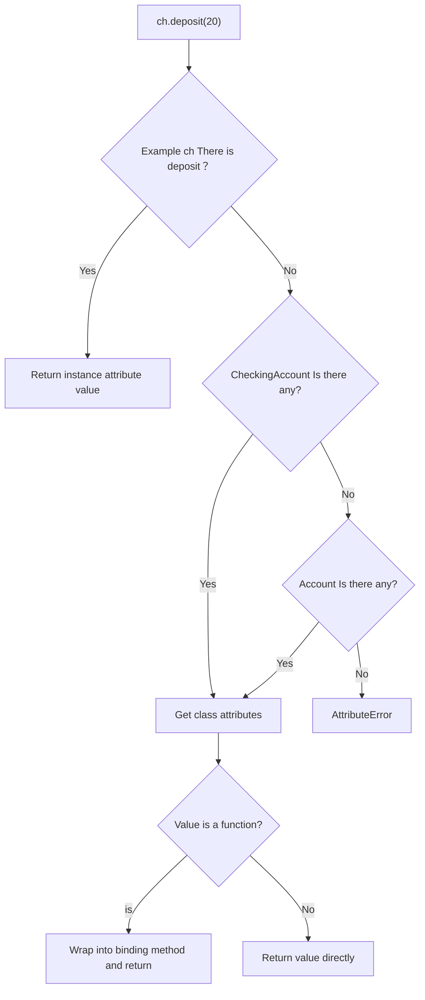
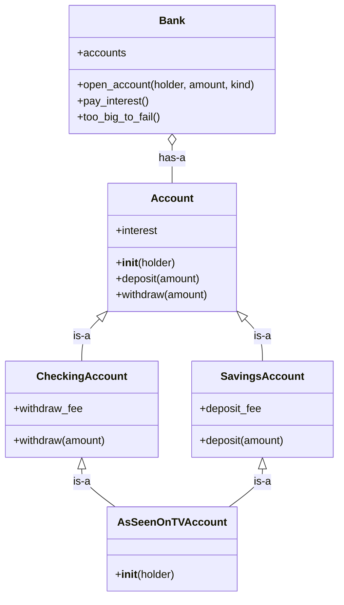

> **courses**: UC Berkeley CS61A · Structure and Interpretation of Computer Programs(Fall 2024)
> **This lecture**: Lecture 20 ｜ 31:35 ｜ Station B P 20 ｜ [Original video](https://www.bilibili.com/video/BV1sy411z7nA?p=20)
> **courseware**: `19-Inheritance.pdf` (24 pages, official PDF, page-by-page renderings see text illustrations)
> **subtitles**: Original English subtitles from Station B; this note is a reconstruction of Chinese writing, not a sentence-by-sentence translation.
> **Copyright**: The copyright of the course and courseware belongs to the UC Berkeley CS61A teaching team; this article is a secondary arrangement for learning purposes

## Quick overview of this lecture

*(Reference time: 00:00:02 – 00:01:43｜Lecture 20)*

- **Mastered**: The difference between classes and instances; where instance attributes and class attributes exist respectively; the two-level search of the dot expression "first instance, then class"; the difference in the calling form between binding methods and ordinary functions; `Class.attr = value`  with  `instance.attr = value`  fall on different objects.
- **Main line of this lecture**:
    - Inheritance only solves one thing: two classes are "similar, but one is more specialized", write out the differences, and leave the rest to the base class;
    - The attributes of the base class will not be copied into the subclass, and inheritance is reflected in the "name lookup" process;
    - After a subclass overrides a method with the same name, you can still use the class object to retrieve the overwritten version, so you can "reuse first and then make minor changes";
    - When designing, you must distinguish between is-a and has-a: a checking account "is" an account, and a bank "has" an account;
    - Under multiple inheritance, the same name may have multiple paths, and the order of resolution determines which one is found first.
- **Key conclusions**: Inheritance puts duplicate code in one place, at the expense of the behavior of the subclass depending on the implementation of the base class; judging whether the base class can be safely changed depends on whether anyone has copied its code.

## 1. Opening and courseware stacking: ten pages of attribute review

*(Reference time: 00:00:02 – 00:00:33｜Lecture 20)*

The first sentence of the video is "On to a new topic, inheritance" - this lecture starts directly from inheritance without any announcement. The courseware starts with a title page and an announcement page, followed by a stack of attribute review pages, and finally enters inheritance. Reading in the order of the courseware, readers will first get back all the tools for attributes, and then see how inheritance reuses these tools.


> **Editor's note**: The voice of this video starts from the sentence "Inherit". There is no corresponding oral explanation on page 2 of the courseware (Announcements); pages 3-12 are a stack of "Attributes" review pages - the pages of terminology, point expressions, and attribute assignment are the same as the previous lecture.  `18-Attributes.pdf`  Almost word for word identical, `Transaction`  The two pages with exercises are new in this volume (this example does not appear in the subtitles of the previous lecture). This video also does not retell the ten pages page by page. The following is given in sequence by screen. The explanation is based on the text on the screen and the rules established in the previous lecture; any reasoning beyond the screen is marked separately.

### 1.1 Terminology: properties, functions and methods


All the rules of inheritance finally fall on "checking the name", and to check the name, you must first distinguish three words: attributes, functions, and methods. They are not in a parallel relationship - the two circles on the right illustrate that the method is the intersection of "class attributes" and "functions".


- **attribute**: Name-value pairs on objects. All objects have attributes; classes are also objects, so classes also have attributes.
- **instance attribute**: The one that belongs to a certain instance. Each instance has one copy.
- **class attribute**: The part belonging to the class, no matter how many instances there are, has only one value.
- **method**: Those class attributes whose values are functions. This is the intersection in the diagram: it is both a class attribute and a function.

The column on the right is three facts about the Python object system: functions are objects; bound methods are also objects, which tie a function to an instance; the first parameter  `self`  Already filled in; do some expressions on the "value is a function" class attribute, and what you get is not a function but a binding method.

These three facts together explain something seemingly strange: the same function code, written  `ch.deposit`  What you get is the binding method (only one missing  `amount`), write  `Account.deposit`  What you get is an ordinary function (you have to add the instance yourself). later in §3  `Account.withdraw(self, ...)`  Just rely on this distinction to work.

### 1.2 Point expressions: four-step evaluation


dot expression  `<expression>.<name>`  The evaluation rule of has only four steps, among which the sequence of the second step and the third step is the key:

1. Find the left side of the dot  `<expression>`, which is the object that the point expression acts on.
2. take  `<name>`  Go to the instance attribute of this object to match; if found, return its value.
3. If not found, go to the class of this object to check and get the value of the class attribute.
4. The class property value is returned as is, unless it is a function - in which case the bound method is returned.

The second step precedes the third step, so **Instance properties shadow class properties with the same name**. This masking rule will appear repeatedly in this lecture: `CheckingAccount`  inside  `interest = 0.01`  covered  `Account`  0.02 in; §9 In the WWPD question, the example  `z`  Covers the class  `z`; In §6, the fee set individually for an account obscures the \$1 on the class.

### 1.3 Class attributes: one log, three transactions


There are two spaces on the page: one for accounting  `Transaction`  class, `log`  Is a class attribute (a list) that records itself when each transaction is created. The question requires filling in the following  `self.prior`  with  `balance`  The return formula of , and gives two sets of expected results: `ts[1].balance()`  is 17, `ts[2].balance()`  Yes 13.

```python
class Transaction:
    """A logged transaction.

    >>> s = [20, -3, -4]
    >>> ts = [Transaction(x) for x in s]
    >>> ts[1].balance()
    17
    >>> ts[2].balance()
    13
    """
    log = []

    def __init__(self, amount):
        self.amount = amount
        self.prior = ______________
        self.log.append(self)

    def balance(self):
        return self.amount + _________________
```


Fill in the answer on the next page, along with a key box diagram: class attributes  `log`  Points to a list object, three instances of  `prior`  Each points to a copy of this list **Snapshot**.

```python
    def __init__(self, amount):
        self.amount = amount
        self.prior = list(self.log)
        self.log.append(self)

    def balance(self):
        return self.amount + sum([t.amount for t in self.prior])
```

Check one by one: `Transaction(20)`  When built  `log`  Still empty, the snapshot is an empty list, `balance()`  Got 20; `Transaction(-3)`  The snapshot contains 20 from the previous transaction, so -3 + 20 = 17; `Transaction(-4)`  There are 20 and -3 in the snapshot, so -4 + 17 = 13. The numbers match up, indicating that the "snapshot" step is correct.

Two details are worth pausing to mention:

The first one is  `self.prior = list(self.log)`  inside  `list(...)`. It copies not the pointer but the content. If written as  `self.prior = self.log`, `prior`  with  `log`  It is the same list object. Every subsequent transaction will be added to this list, and the history of the previous transactions will change accordingly - the history of the first transaction  `balance()`  It will go from 20 to 17 to 13, and history will be rewritten by future events. Snapshots buy "points in time" at the cost of copying a list of length n every time they are created. A total of n transactions  $O(n^2)$  space.

The second one is  `self.log.append(self)`  Why doesn't it leave a  `log`. This is a method call, not an assignment: first check according to the rules of §1.2  `self.log` (Not on the instance, but on the class), get the shared list, and then call it  `append`. What is actually modified is the list object pointed to by the class attribute, which is still not in the instance dictionary.  `log`. If written as  `self.log = self.log + [self]`, then it becomes attribute assignment, and a new one will be created on the instance.  `log`, the part on the class will be obscured from now on - this is the most easily written wrong line in this lecture.

The picture also gives the equivalent way of writing: `list(type(self).log)`.`type(self)`  That's it"`self`  The class it belongs to", use  `type(self)`  Instead of writing it to death  `Transaction`, which means that instances of subclasses will also check their own class.  `log`, instead of always checking  `Transaction.log`. This is two sides of the same idea as the third rule in §6 "try to check attributes on instances".


On the next page, move the snapshot to the instance itself: First  `append`  Copy again  `self.lst`, so the snapshot contains itself, `balance`  directly to the entire  `self.lst`  Sum. The two writing methods have the same result, the difference is "whether the snapshot contains itself".

| criterion | How to write page 7 | How to write page 8 |
|---|---|---|
| Which instance attribute exists in the snapshot | `self.prior` | `self.lst` |
| The order of copying and appending | Copy the class log first, then append yourself | Append yourself first, then copy the class log |
| Does the snapshot include yourself? | Not included | contains |
| How to write sum | `self.amount + sum(...)` | `sum(...)` |
| Two sets of expected results | 17, 13 | 17, 13 |

### 1.4 Attribute assignment: Whose name falls on


When the left side of the assignment statement is a dot expression, the rules are completely different from the evaluation: the object is evaluated as usual on the left side of the dot, but the **The name is not searched**, but directly add or modify attributes on that object. If the object is an instance, you get instance attributes; if the object is a class, you get class attributes.

`tom_account.interest = 0.08`  with  `Account.interest = 0.04`  The difference lies in this sentence: the former only affects  `tom_account`  In this instance, the latter changes the share of the class, so all "it does not have  `interest`" instances will see the new value.


The two columns of doctest at the bottom of the screen act out this matter in five steps. `jim_account`  with  `tom_account`  After creation, both  `interest`  All  `0.02`——They don’t have their own values, what you see are class attributes. `Account.interest = 0.04`  Afterwards, both become  `0.04`, because the one in the class has been changed. Then  `jim_account.interest = 0.08`  in  `jim_account`  Create a new instance attribute on  `Account.interest = 0.05`, `tom_account`  Follow to become  `0.05`, while  `jim_account`  still  `0.08`: Once an instance has its own share, it cannot be accessed no matter how the class attributes are changed.

This is the corresponding phenomenon in assignment in §1.2 that "instance attributes shadow class attributes": **read** When searching along the two levels of "Instance → Class", **write** only falls on the object on the left. Later, I will use this article to understand "why subclasses can override base class methods without destroying the base class" and "why an account can set a separate handling fee."

### 1.5 Exercise: Three names compete for one attribute


This page only has a pythontutor link in the title and footer, and the exercise code is encoded in the link. It compresses the three things in this section into a program: `Foo`  First it is an integer, and then it becomes a class; class attributes are assigned in the class body, and then assigned in methods; instance attributes shadow class attributes.

```python
Foo = 1

class Foo:
    bar = 2

    def __init__(self, baz, qux):
        self.baz = baz
        Foo.bar = qux

    def a(self, x):
        self.bar = x

a = Foo(3, 4)
b = a.a
print(a.bar)
b(5)
print(a.bar)
Foo.bar = 6
print(a.bar)
```

> **Editor's note**: The exercise code only appears in the form of a pythontutor link in the courseware screen. The above link is  `code=`  The parameters are decoded and transcribed; the output is derived from the rules of §1.2 and §1.4, and is not the text on the screen.

The three outputs are  `4`, `5`, `5`, the reasons vary:

- execute  `class Foo`  When, in the class body  `bar = 2`  Becomes a class attribute; subsequently  `a = Foo(3, 4)`  call  `__init__`, `self.baz = 3`  falls on the instance, `Foo.bar = 4`  fall on **class** Above - note that the global name is used here  `Foo`, it points to this class after the class definition is executed, and the method body does not check this name until it is called.
- `a.bar`  First evaluation: None on the instance  `bar`, so take the category  `4`.
- `b = a.a`  is the binding method, `b(5)`  Equivalent to  `a.a(5)`, execute  `self.bar = 5`, from then on  `a`  Have your own  `bar`.
- `Foo.bar = 6`  After that, `a.bar`  still  `5`: The instance attribute obscures the class attribute that was just changed.

If the last line  `print(a.bar)`  Replace with  `print(b)`, what you see will be a bound method object instead of a number - this is also a direct consequence of the three facts in §1.1.

## 2. Inheritance: Write out the differences in "specialization"

*(Reference time: 00:00:33 – 00:01:43｜Lecture 20)*


Inheritance is a feature of Python's object system, and almost every language's object-oriented system has it. The problem it solves is simple: **Classes rarely exist in isolation**. Sometimes a class is just similar to another class, and we want to express this relationship instead of writing two almost identical codes each.


The most common usage is "two similar classes with different degrees of specialization": the specialized class has all the properties of the general class, plus some special behavior. There is only one more pair of parentheses in the syntax:

```python
class <Name>(<Base Class>):
    <suite>
```

The base class is written in parentheses, and the class following the class name is the subclass that inherits it. Conceptually, subclasses share all properties with the base class; subclasses can **Cover** (override) some inherited properties to slightly change the behavior, leaving the unchanged parts unchanged. So "implementing a subclass using inheritance" means: **Just write its differences from the base class**.

This sentence serves as a template for all examples in this lecture. `CheckingAccount`  with  `Account`  There are only three differences (interest rate, withdrawal fee, withdrawal method), and the rest are inherited; `AsSeenOnTVAccount`  There is only one difference from its two base classes (the balance at account opening is \$1). The shorter the class body of the subclass, the cleaner the differences are expressed - if a large section of the code of the base class is copied in the subclass, it is usually not that inheritance is used incorrectly, but that the base class should be dismantled.

## 3. The first example: CheckingAccount and withdrawal fees

*(Reference time: 00:01:47 – 00:05:01｜Lecture 20)*

A checking account is a type of account, but it has three differences: the same is paid to the holder when opening the account, but the interest rate is lower than that of a regular account (1% vs. 2%, so you get less money every month); the deposit behavior is exactly the same; there is a \$1 fee for withdrawals - the lecturer's original words are "the bank has to make some money from somewhere." So \$5 is withdrawn from the \$20 account, leaving \$14.


```python
class CheckingAccount(Account):
    """A bank account that charges for withdrawals."""
    withdraw_fee = 1
    interest = 0.01
    def withdraw(self, amount):
        return Account.withdraw(self, amount + self.withdraw_fee)
```

`withdraw_fee = 1`  with  `interest = 0.01`  Is a class attribute shared by all checking accounts. write only  `withdraw_fee`  Not enough - it's just a number, it's not used anywhere; also write a  `withdraw`  Method, put the matter of "1 dollar more deduction" into logic. That's why it's important to override  `withdraw`: The name is the same as the base class, so the checking account instance finds this copy, not the base class one.

### 3.1 Who is self?

appears repeatedly in the method body  `self`, the lecturer stopped and explained: `self`  Is "the object on which this method is called". write  `ch.withdraw(5)`  when, `self`  tied to  `ch`  On this checking account example, `amount`  is 5, `self.withdraw_fee`  gets 1, so the amount passed to the base class is 6.

`self.withdraw_fee`  I also went through the four steps of §1.2: `ch`  There is no instance attribute of  `withdraw_fee`, so I looked for it in the category, `CheckingAccount.withdraw_fee`  Yes 1. written as  `self.withdraw_fee`  Instead of writing 1, it is for the purpose of having "accounts with different handling fees" in the future - this will be expanded into a design rule in §6.

### 3.2 Why Account.withdraw(self, ...)

The real work is the withdrawal logic of the base class. In this example, the call is written as  `Account.withdraw(self, amount + self.withdraw_fee)`, two details are worth clarifying:

- taken from class  `withdraw`, what we get is **function** rather than the binding method, so you must put it yourself  `self`  Fill it in as the first parameter;
- behind  `amount + self.withdraw_fee`  This is the actual amount you want to withdraw this time.

If the same method is written as  `self.withdraw(...)`, will recur infinitely——`self`  It is a checking account instance, and this coverage version is still found. The base class version must be written explicitly, or using the method mentioned in the next section  `super()`.

Put it below  `Account`  Complete it so you can compare it line by line. Page 10 of the courseware only gives  `interest = 0.02`, `__init__`  and an ellipsis; the complete writing method is taken from the previous lecture, which is completely consistent with the lecturer's oral instructions of "Add first, then judge whether the balance is enough, then change the balance and return".

```python
class Account:
    """An account has a balance and a holder."""
    interest = 0.02

    def __init__(self, account_holder):
        self.balance = 0
        self.holder = account_holder

    def deposit(self, amount):
        self.balance = self.balance + amount
        return self.balance

    def withdraw(self, amount):
        if amount > self.balance:
            return 'Insufficient funds'
        self.balance = self.balance - amount
        return self.balance
```

> **Editor's note**: above  `Account`  The complete definition comes from the previous lecture and the excerpt on page 10 of the courseware. The subtitles in this lecture only dictate  `withdraw`  Three steps; the code is organized according to the consistent writing method of the course, and the behavior is not changed.

### 3.3 The unwritten part

Not in the class body  `deposit`, nor  `__init__`. This is not an omission: create  `CheckingAccount('Tom')`  Will look for it sometimes  `__init__`, not found in this class, found along the base class  `Account.__init__`, so  `balance`  Starting from 0, `holder`  It's Tom; the same thing happened when depositing money, what was found was  `Account.deposit`.**Inherited without writing**, which is exactly what inheritance saves.

### 3.4 The second way of writing in the courseware: super()

Another way of writing is given in the lower right corner of the same page (original text of the screen):

```python
    def withdraw(self, amount):
        return super().withdraw(amount + self.withdraw_fee)
```

> **Editor's note**: The lecturer’s oral explanation only uses  `Account.withdraw`, not expanded  `super()`;The following explanation is supplementary. `super()`  A proxy object is returned inside the method, which continues to look for properties starting from "the next position of the current class in the parsing order" and has already set the property for the caller.  `self`  Tie it up. So  `super().withdraw`  What you get is still the function of the base class, but you no longer have to write it by hand.  `self`. it is related to  `Account.withdraw(self, ...)`  The difference lies in "who is recognized as the base class": the former follows the parsing order, and the latter hard-codes the class name; in the case of multiple inheritance, this difference will become a difference in actual results (see §11).

## 4. Attribute lookup on class: Base class attributes are not copied

*(Reference time: 00:05:04 – 00:05:57｜Lecture 20)*


There is only one bold conclusion on this page, but it is the crux of the entire lecture: **Base class properties are not copied into subclasses**.`CheckingAccount`  There is no such thing in the class body of  `deposit`, but  `ch.deposit`  It works, the reason is not "copy", but "search".

There are only two rules for looking up a name on a class:

1. If the name is a property of the class, return its value;
2. Otherwise, if it has a base class, check it in the base class - and the base class is also a class, so the same rule goes up recursively.

The doctest at the bottom of the page writes comments directly next to the results: `CheckingAccount('Tom')`  The comment is "call  `Account.__init__`"; `ch.interest`  is "in  `CheckingAccount`  found "; `ch.deposit(20)`  is "in  `Account`  found "; `ch.withdraw(5)` "in" again  `CheckingAccount` "Found". The same instance, four names, and two placement points are all determined by search.

This rule has three direct consequences:

- **Change the base class, and the subclasses will follow.**.`Account.deposit`  Once the logic is modified, everything is not covered  `deposit`  The subclass immediately uses the new logic - this is the technical reason for "don't copy" mentioned in §5.
- **Overwrite without destroying the original version**.`CheckingAccount.withdraw`  Just put another attribute with the same name in the subclass, `Account.withdraw`  It still lies in the base class as it is, and can be retrieved using the class object.
- **Report an error if it cannot be found**. The name will be thrown only if there are no hits all the way up the base class chain.  `AttributeError`;The search is as deep as the chain is long.

## 5. Tracking: one creation, two deposits, one withdrawal

*(Reference time: 00:05:58 – 00:09:56｜Lecture 20)*

In this section, we run the code in §3 line by line, and then answer the question "Why not just copy the withdrawal code of the base class".

### 5.1 Create: Find first  __init__

`ch = CheckingAccount('Tom')`  The first step is to evaluate  `CheckingAccount('Tom')`  This call expression. `CheckingAccount`  It is a class object. Calling it will create a new instance and then automatically call  `__init__`——Check using the two rules of §4: `CheckingAccount`  Not in  `__init__`, to  `Account`  found it, so  `self.balance = 0`, `self.holder = 'Tom'`. The starting amount for a checking account is the same as a regular account, which is 0.

The next three expressions, three placement points:

- `ch.interest`: Not available on the instance, `CheckingAccount`  If yes, get 0.01;
- `ch.deposit(20)`: The dot expression is first found on the instance.  `deposit` (no), again  `CheckingAccount`  Search on (no), and finally on  `Account`  Find the function and wrap it into a binding method; the balance after calling is 20;
- `ch.withdraw(5)`: in  `CheckingAccount`  Find the overlay version on the website and forward it to  `Account.withdraw(self, 6)`, the balance is 20 - 6 = 14.



### 5.2 Copy or reuse

The lecturer asked a very practical question here: Since it is only "an extra \$1 deduction", how can the base class  `withdraw`  Wouldn't it be easier to copy in the subclass and change one line? The copied version is as follows: first  `amount`  Add 1, and then judge whether the balance is enough. If it is enough, change the balance and return.

> **Editor's note**: The specific code of the transcribed version is not in the courseware. The lecturer only dictated the four steps of "add one, judge, change balance, and return"; the above description is restored as dictated and does not constitute the original text of the courseware.

This version "will be correct for a while." The problem lies in the timeline: if in the future the base class  `withdraw`  Changes - such as throwing an exception instead of returning a string when the balance is insufficient, or adding a "single withdrawal limit" - these changes will not flow into the copied subclass code. If two versions of the same business rule appear, they will diverge sooner or later.

The correct approach is **Call a ready-made implementation**: `Account.withdraw(self, amount + self.withdraw_fee)`. It leaves the only logic of "withdrawal" in the base class, and the subclasses only add a shell outside. This is also the class-level version of "Don't Repeat Yourself".

| criterion | Copy base class code | explicit call  `Account.withdraw` | call  `super().withdraw` |
|---|---|---|---|
| The base class was later changed, and the subclasses did not follow suit. | No, the two logics are bifurcated. | Follow, change one place to take effect | Follow, change one place to take effect |
| Whether to hard-code the base class name | Not involved | Write to death  `Account` | Don’t write it down, just follow the parsing order. |
| Who to choose during multiple inheritance? | Not involved in analysis | Fixed in the written class | Determined by parsing order |
| main cost | Logical bifurcation and regression difficulties | Changing the base class requires changing the code | Need to understand parsing order |

### 5.3 Verification of two accounts

The instructor's verification is very simple: open two accounts, one ordinary and one checking, deposit 100 in both, and withdraw 10 from each.

```python
>>> a = Account('John')
>>> b = CheckingAccount('Jack')
>>> a.deposit(100)
100
>>> b.deposit(100)
100
>>> a.withdraw(10)
90
>>> b.withdraw(10)
89
```

The results of the two deposits are the same because they use the same  `Account.deposit`;The difference between the two withdrawal results is 1, because the checking account  `withdraw`  Too many deductions  `withdraw_fee`. One line of difference, one shared implementation, that's all inheritance buys in this example.

## 6. Design Inheritance: Three Rules

*(Reference time: 00:10:00 – 00:12:46｜Lecture 20)*


The courseware titles this section "Object-Oriented Design". What it gives is not grammar, but three judgments:

**First, don’t repeat yourself, try to use existing implementations.**  This is the conclusion of §5.2. The judgment method is very specific: if the same statement block as the base class appears in the subclass, stop and think "should this paragraph be kept in the base class?"

**Second, the overridden properties can still be accessed through the class object.** "Override" means that the subclass provides an attribute with the same name as the base class——`CheckingAccount.withdraw`  with  `Account.withdraw`  The same name, so the instance of the checking account calls the subclass. But the same name does not equal replacement: `Account.withdraw`  still exist, write  `Account.withdraw`  You can get the original version. It is this that makes it possible to "take back the old logic and change it just a little bit".

**Article 3: Try to check the attributes on the instance.**  This article is about  `amount + self.withdraw_fee`  What should be written. The courseware lists three options, and the difference lies in "who can change in the future."


| criterion | Writing method | Can it be changed? | Is there any special case? |
|---|---|---|---|
| literal | `amount + 1` | No, you need to change the code | Can't |
| Write the class name to death | `amount + CheckingAccount.withdraw_fee` | Can change class attributes | No, subclass or single account exceptions have no effect. |
| Check the example | `amount + self.withdraw_fee` | Can change class attributes | Yes, both instance attributes and deeper subclasses take effect |

The third way of writing is the best because it leaves the "name search" to the runtime rules: `self`  First check if there is any in the instance  `withdraw_fee` (An account can be set up separately), if not, search along the class chain (default 1). The second way of writing is to write the class name to death, which is equivalent to announcing "I will always be  `CheckingAccount`", once someone derives a "VIP account with free withdrawals" from it, this hard-coded place will not be able to select new values.

> **Editor's note**: The second rule also implies a price, the courseware is not expanded: as long as someone writes  `Account.withdraw(self, ...)`, the method signature of the base class (the number and meaning of parameters) becomes a dependency of the subclass. Give in the future  `withdraw`  Add parameters, and all subclasses written in this way must be changed together. This is a concrete form of the eternal tension between "reuse implementation" and "free evolution".

## 7. Inheritance or composition: is-a versus has-a

*(Reference time: 00:12:50 – 00:14:06｜Lecture 20)*


Object-oriented programming is useful largely because it allows you to think of objects as real things: a checking account is an account in a bank, and a bank is an institution that manages a bunch of accounts. **Following this metaphor, the structure of the class will emerge by itself.**

There is only one criterion: whether there is "yes" or "there" between two categories.

- **Inheritance means is-a**:Checking account **is** an account, so  `CheckingAccount`  inheritance  `Account`, thereby obtaining all attributes of the account.
- **Composition means has-a**: Bank **Yes** A set of accounts, so the bank puts a list of accounts as attributes. Accounts do not inherit banks - their relationship is "one holds the other", not "one is a special case of the other".

| criterion | inheritance(is-a) | combination (has-a) |
|---|---|---|
| relationship | A subclass is a specialization of a base class | One object holds another object |
| Judgment sentence pattern | "A checking account is an account" | "A bank has a set of accounts" |
| Examples of this lecture | `CheckingAccount(Account)` | `Bank`  inside  `self.accounts` |
| What is reused | Implementation of properties and methods | The behavior of the held object |
| Impact of changes | Changing the base class will affect all subclasses | Changing the held object does not affect the owner |
| Typical misuse | Inheriting for the purpose of reusing code is not "a" semantically | Inheritance should be used to express specialization, but a layer of wrapping is used instead. |

> **Editor's note**: The lecturer only gave is-a / has-a as a criterion on this page. There are two common experiences in practice: first, if the subclass just wants to borrow the implementation and is not semantically "a type of" base class, it should use combination instead; second, the deeper the inheritance chain, the greater the impact of base class changes. The industry calls it the "fragile base class problem". These two items are not included in the subtitles and courseware of this lecture.

## 8. Combination practice: Bank, interest and "too big to fail"

*(Reference time: 00:14:08 – 00:18:37｜Lecture 20)*

The courseware does not give the bank a separate page, this section is a whiteboard demonstration. What it wants to answer is "What does an object that manages accounts look like without inheritance?"

```python
class Bank:
    """A bank that manages a collection of accounts."""

    def __init__(self):
        self.accounts = []

    def open_account(self, holder, amount, kind=Account):
        account = kind(holder)
        account.deposit(amount)
        self.accounts.append(account)
        return account

    def pay_interest(self):
        for account in self.accounts:
            account.deposit(account.balance * account.interest)

    def too_big_to_fail(self):
        return len(self.accounts) >= 2
```

> **Editor's note**: The above code is restored according to the key points dictated by the lecturer (the courseware does not have a Bank page): The structure does not require parameters; `open_account`  Receive the holder, amount, and an optional account type, and open an ordinary account by default; deposit the principal into the account when opening the account; `pay_interest`  Traverse  `self.accounts`, interest is calculated based on the current balance and interest rate of each account. Naming and statement order are how this note is organized.

The four key points correspond to the lecturer’s demonstration:

- **structure**: `Bank()`  Takes no parameters. It has only one thing to do - remember which accounts it manages, so  `self.accounts`  Initialized to an empty list.
- **Open an account**: `open_account`  of  `self`  Tied to the bank, the parameters are the holder, the amount, and an optional account type. Used when creating an account  `kind(holder)`  Call that class, `kind`  pass  `Account`  Still  `CheckingAccount`, determines the interest rate and handling fee of the new account. This step is exactly the role of "combination": the bank does not need to know how to calculate interest inside the account, it only needs to know how to construct it.
- **Accounting**: New account needs to be added  `self.accounts` Only then can the bank recognize it and say, "This is our bank's account, not someone else's."
- **Pay interest**: `pay_interest`  Does not receive additional parameters, traverses all accounts, and saves one amount each.  `balance * interest`.

The narrative of the demonstration is this: John walked into the bank, stated his name, handed over \$10, and opened a regular account; his friend Jack only brought \$5, and the manager said it was OK, but he could only open a checking account. So John's account has an interest rate of 2% and Jack's interest rate is 1%. After paying interest, John's balance goes from 10 to 10.20 (the extra 20 cents is 2% interest), and Jack's \$5 becomes 5.05.

```python
>>> bank = Bank()
>>> john = bank.open_account('John', 10)
>>> jack = bank.open_account('Jack', 5, CheckingAccount)
>>> bank.pay_interest()
>>> john.balance
10.2
>>> bank.too_big_to_fail()
True
```

The last question was a joke made by the lecturer: Do banks need "too big to fail" protection? The criterion is "at least two accounts", and now it manages the money of John and Jack, so the answer is yes.

The real teaching value of this paragraph is: **There is no inherited account in the bank, the program still works**.`pay_interest`  only rely on  `balance`, `interest`, `deposit`  Three names, no matter whether you hold a regular account, a checking account, or some other subcategory. Composition gives "diversity" to the interface of the object, rather than the lineage of the class.

## 9. WWPD: Three classes and four levels of point expressions

*(Reference time: 00:18:44 – 00:28:33｜Lecture 20)*

At this point, the rules for attribute search are enough. The lecturer reduced it to a question: "A slightly more complicated example" and asked the students to pause the video and do the calculations themselves. There is a similar question in the courseware, and a more complicated one is shown in the video.

### 9.1 Version on the courseware: Three Attributes


```python
class A:
    x, y, z = 0, 1, 2

    def f(self):
        return [self.x, self.y, self.z]

class B(A):
    """What would Python Do?

    >>> A().f()
    [0, 1, 2]
    >>> B().f()
    [6, 1, 'A']
    _____________
    """
    x = 6
    def __init__(self):
        self.z = 'A'
```

Four boxes are drawn on the right side of the screen: `A`  There are in the category  `x: 0`, `y: 1`, `z: 2`; `B`  There are only  `x: 6`; `A`  The instance is empty; `B`  In the example there are only  `z: 'A'`. The four box pictures are all the clues to this question.

`A().f()`  Got  `[0, 1, 2]`: None of the three names exist on the instance, all come from  `A`  class. `B().f()`  Got  `[6, 1, 'A']`, three names and three origins——`self.x`  Not on the instance, `B`  There is 6 on the class, so we stop at  `B`; `self.y`  In the instance with  `B`  None of the above, continue to  `A`  Take 1; `self.z`  In the instance there is (`__init__`  set  `'A'`), it hit the target in the first step, and there was no chance to see the class at all.

> **Editor's note**: This page is a WWPD question in the courseware; the lecturer in the video actually showed the more complex question 9.2 below, and the courseware does not have a corresponding page. The two questions test the same set of rules. It is recommended to finish this page before proceeding to 9.2.

### 9.2 Version in the video: a, b and four-level point expressions

The question in the video has three categories and three assignment statements. Finally, it is necessary to determine which of the four expressions evaluates to an integer.

```python
class A:
    z = -1

    def f(self, x):
        return B(x - 1)

class B(A):
    n = 4

    def __init__(self, y):
        if y:
            self.z = self.f(y)
        else:
            self.z = C(y + 1)

class C(B):
    def f(self, x):
        return x

a = A()
b = B(1)
b.n = 5
```

> **Editor's note**: This question in the video only appears as the code from the lecturer's mouth, and the courseware does not have this page; the code above is restored sentence by sentence according to the subtitles (`A.z = -1`, `A.f`  Return  `B(x - 1)`, `B.n = 4`, `B.__init__`  in  `y`  Take when true  `self.f(y)`, taken when it is holiday  `C(y + 1)`, `C.f`  Return the parameters as they are), and all values have been checked with the interpreter.

The way to look at this type of question is to build the structure first and then calculate the value. execute three  `class`  statement, get three class objects, which are bound to the global name in turn  `A`, `B`, `C`.`A`  There are two class attributes: `z`  is -1, `f`  is a function; `B`  inheritance  `A`, additionally defined  `n = 4`  with  `__init__`; `C`  inheritance  `B`, only covers  `f`. All three functions use the global frame as the parent frame, so what they see in the method body  `A`, `B`, `C`  They are all global names - this is  `A.f`  That sentence  `return B(x - 1)`  It will come in handy.

Then there are three assignments:

- `a = A()`: `A`  No  `__init__`, so there are no attributes on the instance, it is a blank slate.
- `b = B(1)`: `B.__init__`  received  `y = 1`, is true, so execute  `self.z = self.f(1)`.`self`  is  `b`, `self.f`  First find it on the instance (there is none), and then  `B`  Search on (no), and finally on  `A`  Found on, get after calling  `B(1 - 1)`, that is  `B(0)`.`B(0)`  of  `y`  is 0, which is false, so take another branch: `self.z = C(0 + 1)`, that is  `C(1)`.`C`  No  `__init__`, used along the base class  `B.__init__`, `y`  is 1, is true, so  `self.z = self.f(1)`;this time  `self`  is  `C`  instance, `C.f`  Overwritten, the parameters are returned directly, so this  `self.z`  That's 1.
- `b.n = 5`: Attribute assignment only falls within  `b`  In this instance, `B.n`  Still 4, base classes are even less affected.

thus  `b`  The internal structure of can be drawn like a tree, with each layer peeling off  `z`:

- `b`: `B`  Instance, own properties  `n`  with  `z`
    - `n` → `5` (Instance properties, obscured  `B.n`  of 4)
    - `z` → `B(0)`  Example
        - `z` → `C(1)`  Example
            - `z` → `1`

The four expressions to be evaluated are evaluated one by one:

1. `C(2).n`: Build first  `C`  Example (go  `B.__init__`, `y = 2`, `self.z`  by  `C.f`  Got 2), check again  `n`: Not available on the instance, `C`  No, `B`  The above is 4, so we get 4. Pay attention here  `z`  Yes 2. `n`  is 4, both numbers are there, but only  `n`  was asked.
2. `A.z == C.z`: `a`  is a whiteboard instance with no attributes, `A.z`  Got -1; `C`  I haven’t defined it myself  `z`, `B`  Nor, along the chain to  `A`  Got -1. Both sides have the same class attribute, two completely different paths, and the results are equal.
3. `A.z == b.z`: On the left is -1, on the right is one  `B`  Instance objects, different types, not equal.
4. `b.z`, `b.z.z`, `b.z.z.z`, `b.z.z.z.z`: followed by  `B`  Example, `C`  Instance, integer 1, anything further goes wrong - 1 is  `int`, it does not  `z`  properties.

So among the four options, there are only  `b.z.z.z`  Evaluates to an integer and the answer is 1. On the surface, this question tests "how long a point expression can be connected", but in fact it tests the two rules in §4: each level  `.z`  Go through "Instance → Class → Base Class" all over again, and each layer may be intercepted in advance by an instance attribute.

## 10. Multiple inheritance: AsSeenOnTVAccount

*(Reference time: 00:28:33 – 00:30:54｜Lecture 20)*


Multiple inheritance refers to a subclass having multiple base classes. Python allows it to be written in this way, so that "two already suitable base classes" can be reused at the same time.

Start by adding a savings account: the only difference from a regular account is that there is a \$2 fee for depositing, so if you deposit \$10, you will only have \$8 more in the account.

```python
class SavingsAccount(Account):
    deposit_fee = 2
    def deposit(self, amount):
        return Account.deposit(self, amount - self.deposit_fee)
```


Then there is the bank executive’s idea compiled by the lecturer: the interest rate is only 1% (paying less to customers), charging \$1 for withdrawals and \$2 for deposits (overcharging customers), and giving \$1 for free when opening an account (so people flock to it). This product is called "As Seen on TV account". Its definition is surprisingly short, because the two base classes already have everything in place:

```python
class AsSeenOnTVAccount(CheckingAccount, SavingsAccount):
    def __init__(self, account_holder):
        self.holder = account_holder
        self.balance = 1                 # A free dollar!
```



The two relationships in the figure are worth comparing: In the inheritance tree on the left, `AsSeenOnTVAccount`  There are two roads leading to  `Account` (after  `CheckingAccount`, or through  `SavingsAccount`); right  `Bank`  with  `Account`  Between them is a combination, and what is drawn is "holding" rather than "being a kind of". same one  `Account`  In this lecture, two relationships are used at the same time, which just shows that they solve different problems.


Look at actual behavior. When created  `__init__`  It is its own, and the balance is directly 1 - this is the "free dollar". When I deposited \$20, I found  `SavingsAccount.deposit`, deducting the 2 USD handling fee, only 18 is added to the account, plus the original 1, the balance is 19. When you withdraw \$5, you find  `CheckingAccount.withdraw`, an extra US\$1 handling fee will be deducted, and the balance will be 13.

```python
>>> such_a_deal = AsSeenOnTVAccount('John')
>>> such_a_deal.balance
1
>>> such_a_deal.deposit(20)     # SavingsAccount method
19
>>> such_a_deal.withdraw(5)     # CheckingAccount method
13
```

The lecturer's comment here was "such a deal indeed" - the bank paid a complete loss. This sentence is also useful for understanding multiple inheritance: the behaviors of the two base classes are inherited at the same time, so the two sets of rules of "the most economical" and the "most expensive" are superimposed on the same object. The program faithfully executes what is written. As for whether it is commercially reasonable, the language does not care.

Worth noting is: `AsSeenOnTVAccount`  from  `Account`  The only thing directly inherited by that side is actually the interest rate, and the value of 1% comes from  `CheckingAccount`  The one I got (`SavingsAccount`  no definition  `interest`). Deposits come from savings accounts, withdrawals come from checking accounts, and the account opening balance comes from your own  `__init__`——Three sources are mixed into one category, which is exactly the problem to be dealt with in the next section.

## 11. The order of resolution of ambiguous names: subclass first, then base class

*(Reference time: 00:30:57 – 00:31:33｜Lecture 20)*


On this page, the problem finally becomes apparent: `Account`, `CheckingAccount`, `SavingsAccount`, `AsSeenOnTVAccount`  Four sides form a rhombus with the same name (e.g.  `withdraw`, `deposit`, `interest`) There may be two or even three ways to get there. Which one should I read first?

There is only one rule given by the instructor: **Look at subclasses first, then base classes**;When there are multiple base classes, the writing order is from left to right. This sentence is enough to explain the three results on the screen.

| name | parsed location | Basis | result |
|---|---|---|---|
| `withdraw` | `CheckingAccount` | in base class list  `CheckingAccount`  first in line | Take 5 and buckle 6, 19 → 13 |
| `deposit` | `SavingsAccount` | `AsSeenOnTVAccount`  with  `CheckingAccount`  None, `SavingsAccount`  in  `Account`  Was caught before | Deposit 20 and enter only 18, 1 → 19 |
| `interest` | `CheckingAccount` | `CheckingAccount.interest = 0.01`, `SavingsAccount`  no definition | 1% |
| `holder`, `balance` | instance itself | by one's own  `__init__`  Assignment | `'John'`, 1 |
| `__init__` | `AsSeenOnTVAccount` | This class is defined, no longer look up | Write holder and balance |

`deposit`  That line is the most inconspicuous and most easily misunderstood part of the entire page: `CheckingAccount`  Not myself  `deposit`, but its base class  `Account`  Yes. If the search is "one road to black" depth first, it will hit first  `Account.deposit`, the deposit should be worth 20 instead of 19. The number given on the screen is 19, indicating that the actual rule is not "when you encounter a base class, dig in".

> **Editor's note**: The lecturer only gave one rule: "subclass first, then base class". The actual rule of Python 3 is called  **C3 linearization** (C3 linearization), it calculates the resolution order (MRO, method resolution order) of each class into a list, and searches along this list from beginning to end. Calculate  `AsSeenOnTVAccount`  When , the three inputs are combined: `CheckingAccount`  MRO  `[CheckingAccount, Account, object]`, `SavingsAccount`  MRO  `[SavingsAccount, Account, object]`, and the writing order of direct base classes  `[CheckingAccount, SavingsAccount]`. The merging rule is "Look at the head of the first list every time, and take it as long as it does not appear in the tail of other lists": `CheckingAccount`  If qualified, take first; at this time, the header of the first list becomes  `Account`, which appears at the tail of the second list (ranked after  `SavingsAccount`  After), skip it and look at the header of the second list instead.  `SavingsAccount`, qualified, take; take again  `Account`, and finally  `object`. So the whole chain is  `AsSeenOnTVAccount → CheckingAccount → SavingsAccount → Account → object`.
>
> Follow this table, `deposit`  fall on  `SavingsAccount`  Up, `withdraw`  fall on  `CheckingAccount`  on, exactly the same as 19 and 13 on the screen. This also explains why the "depth-first, left-to-right" rules of early Python's old-style classes are inappropriate: it will make  `Account`  ranked  `SavingsAccount`  front, so that the methods defined by the subclass are lost to the ancestors. C3 guarantees two things - subclasses always come before their ancestors; and the writing order of base classes is respected as much as possible when there is no conflict. To verify the actual order of a class, you can print  `AsSeenOnTVAccount.__mro__`, or call  `AsSeenOnTVAccount.mro()`.

> **Editor's note**: From this, we can also connect to a concept that is not expanded on in this lecture but will be used shortly - polymorphism. `Bank.pay_interest`  That sentence  `account.deposit(account.balance * account.interest)`  Yes  `Account`, `CheckingAccount`, `AsSeenOnTVAccount`  Treat everyone equally because the caller only recognizes  `deposit`, `balance`, `interest`  Of these three names, which one to execute is dynamically determined by each. It can be used to determine "whether an object is of a certain type" `isinstance`: `isinstance(such_a_deal, Account)`  is true because  `Account`  appears in its MRO; `isinstance(such_a_deal, SavingsAccount)`  The same is true. This is the runtime version of the same thing as is-a in §7: the inheritance relationship written in the class definition determines  `isinstance`  The answer also determines the path of name resolution.

## Summary

*(Reference time: 00:00:02 – 00:31:33｜Lecture 20)*

- The expressive power of inheritance comes from "write-only differences": the class body of a subclass should only contain those parts of it that differ from the base class, leaving the rest to lookup.
- inheritance is **Find rules**, not copying: When looking up the name on a class, if this class does not recurse upward along the base class; "base class attributes are copied into subclasses" is an erroneous model that will cause people to miscalculate the results.
- Override just puts another property with the same name in the subclass, and the original version is still in the base class; so you can use it first  `Account.withdraw(self, ...)`  or  `super().withdraw(...)`  Take back the old logic and add another layer on top.
- Any difference such as "deduct more, save less" should be rewritten as a reference to an attribute (`self.withdraw_fee`) instead of literals or hard-coded class names, so that instance special cases and deeper subclasses can take effect.
- Copying the code of the base class "will be correct for a while", but the cost is that the two logics will diverge; to judge whether a piece of code should be copied, ask "after the base class is changed, should this part be changed accordingly?"
- When designing, first determine whether the relationship is is-a or has-a: if it is "a kind", it will be inherited, if it is "one", it will be combined; `Bank`  The accounts are managed using combinations. `CheckingAccount`  The account uses inheritance.
- The same name may have multiple paths under multiple inheritance. The parsing order is first subclass, then base class, and multiple base classes from left to right. When writing code, do not rely on "just selecting the one you want", but try to avoid overlapping responsibilities of each base class.
- If you want to change the behavior of a class a little bit, the most expensive option is to copy, and the cheapest option is to override and delegate; the difference between the two will not become apparent until the base class is modified for the first time.

## Attached: Slide index for this lecture

*(Reference time: 00:00:02 – 00:31:33｜Lecture 20)*

| page | content | Appear location |
|---|---|---|
| 1 | Title page Inheritance | §1 |
| 2 | Announcements announcement page | §1 |
| 3 | Section Page Attributes (Review Stack Start) | §1.1 |
| 4 | Terminology: properties, functions, and methods | §1.1 |
| 5 | Four steps for evaluating point expressions | §1.2 |
| 6 | Class attributes: to be completed  `Transaction` | §1.3 |
| 7 | Class attribute box plot with  `prior`  Snapshot | §1.3 |
| 8 | Another implementation of class attributes | §1.3 |
| 9 | Sectioned Page Attribute Assignment | §1.4 |
| 10 | Attribute assignment: instance or class | §1.4 |
| 11 | Object state after two assignments | §1.4 |
| 12 | Sectioned Pages Practice Attributes | §1.5 |
| 13 | Sectioned Page Inheritance | §2 |
| 14 | Definition, syntax and "write-only differences" of inheritance | §2 |
| 15 | Inheritance Example: `CheckingAccount` | §3 |
| 16 | Property lookup on class | §4 |
| 17 | Sectioned Page Object-Oriented Design | §6 |
| 18 | Designing for Inheritance | §6 |
| 19 | Inheritance and Composition | §7 |
| 20 | Three Attributes | §9.1 |
| 21 | Sectioned Page Multiple Inheritance | §10 |
| 22 | Savings Accounts and "TV Shopping" Accounts | §10 |
| 23 | The result of calling multiple inheritance | §10 |
| 24 | Diamond inheritance diagram and name resolution order | §11 |

The order of the courseware and the video is not consistent: the audio in the video starts directly from "Inheritance", but the courseware first uses ten pages to review attributes, class attributes and attribute assignments (several pages are repeated from the previous courseware); the WWPD question in the video (three classes, four-level point expressions) has no corresponding page in the courseware, but the question on page 20 of the courseware  `Three Attributes`  It's not mentioned in the video. The main text is organized according to the courseware number, and pages without explanations are placed in the knowledge positions where they belong, and "Editor's Note" is used to explain clearly which content comes from pictures, which comes from oral narration, and which is supplementary.
