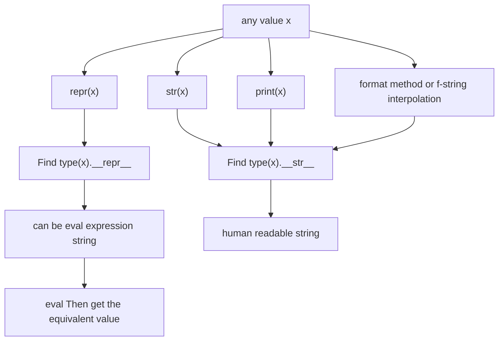
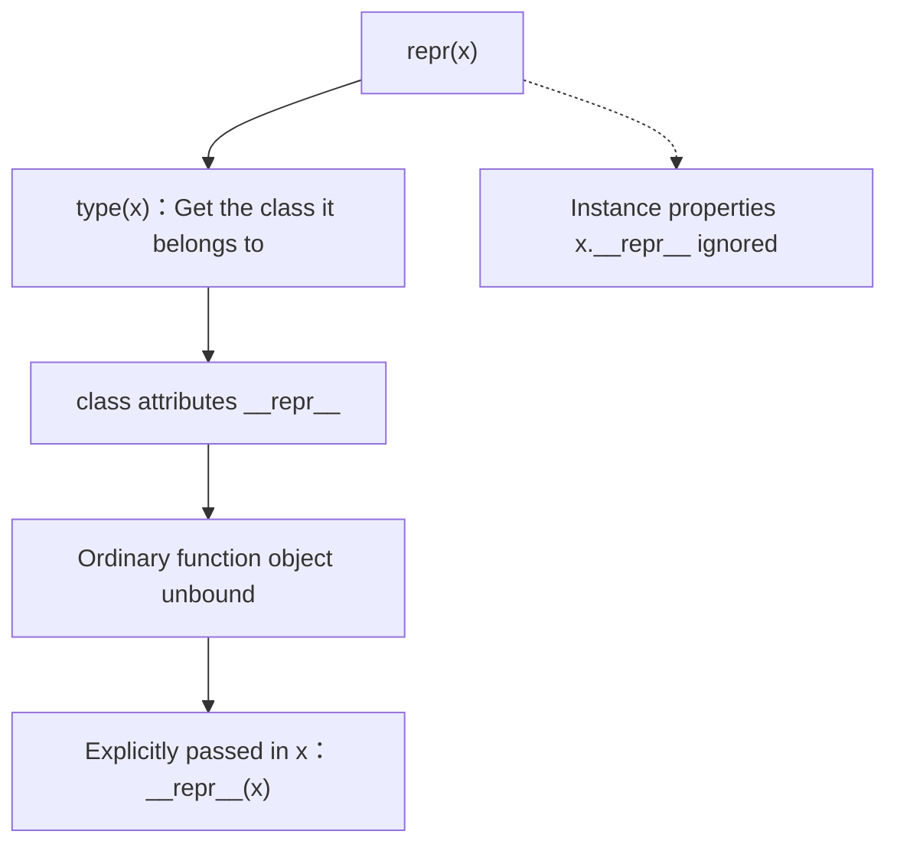
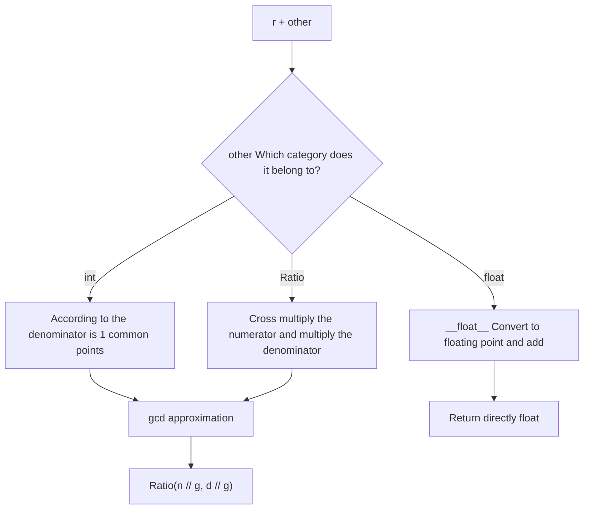

> **courses**: UC Berkeley CS61A · Structure and Interpretation of Computer Programs(Fall 2024)
> **This lecture**: Lecture 21 ｜ 30:31 ｜ Station B P 21 ｜ [Original video](https://www.bilibili.com/video/BV1sy411z7nA?p=21)
> **courseware**: `20-Representation_1pp.pdf` (11 pages, official PDF, page-by-page renderings see text illustrations)
> **subtitles**: Original English subtitles from Station B; this note is a reconstruction of Chinese writing, not a sentence-by-sentence translation.
> **Copyright**: The copyright of the course and courseware belongs to the UC Berkeley CS61A teaching team; this article is a secondary arrangement for learning purposes

## Quick overview of this lecture

- **Mastered**: Use classes to define new types, use  `__init__`  Bind attributes to instances, `obj.method()`  The calling syntax and attribute search look at the instance first and then the class, and  `isinstance`  Determine which class a value belongs to.
- **Main line of this lecture**:
    - Each object has two string representations: `str`  Read to others, `repr`  Read it to the interpreter; the latter's design goal is to "evaluate this string back and get an equivalent object."
    - `print`  What is printed is  `str`, the interactive session echoes  `repr`;Nothing in the class  `__str__`  time  `str`  degenerate into  `repr`, so the two are consistent by default.
    - Built-in  `repr`  With almost no logic, what it does is  `type(x).__repr__(x)`——**Ask the object how to display itself**, this is the interface.
    - Special method names attach syntax to the class: `+`  go  `__add__`  with  `__radd__`, `bool`  go  `__bool__`, `float`  go  `__float__`;The so-called operator overloading is just the meaning of overriding syntax with method definition.
    - There are two ways to allow different classes to operate on each other: type dispatching (type dispatching) selects branches based on the type, and type conversion (type coercion) first replaces one party with the type of the other party and then calculates.
- **Key conclusions**: A complete type not only contains data, but also answers two questions——**What should I be shown as?**, **How do I operate with other objects?**. This lecture incorporates these two issues into the concept of "interface".

*(Reference time: 00:00:01 – 00:00:13｜Lecture 21)*


## 1. Review and opening: the object should be like the data it represents

*(Reference time: 00:00:15 – 00:00:39｜Lecture 21)*


Pages 3 and 4 of the courseware are a pre-class review: first use the section page "Expressions, Values, & Types (Classes)" to draw attention back to the three-piece set of "expressions, values, and types", and then use the second question of Lab 6 to review the mutual calls between classes.

> **Editor's note**: The subtitles of this lecture go directly to "String Representation of Objects" from 00:00:01, and the dictation part on pages 3 and 4 is not in the subtitles. The contents of these two pages are organized according to the original text of the courseware. The comments are added by the editor and are not the original words of the class.


The scenario of this question is an email system: a  `Client`  put  `Email`  sent to it  `Server`, `Server`  and then deliver it to another  `Client` 's inbox. In order to achieve this, `Server`  holds a called  `clients`  A dictionary that maps customer names to  `Client`  Example.

```python
class Email:
    def __init__(self, msg, sender, recipient_name):
        self.msg = msg
        self.sender = sender
        self.recipient_name = recipient_name


class Server:
    def __init__(self):
        self.clients = {}

    def send(self, email):
        # Append the email to the inbox of the client it is addressed to.
        self.clients[email.recipient_name].inbox.append(email)


class Client:
    def __init__(self, server, name):
        self.inbox = []
        self.server = server
        self.name = name
```

courseware handle  `send`  The long attribute chain there is broken down piece by piece, and four boxes are arranged above the expression: `Server`, `dict`, `Client`, `list`. The function of the box is not to decorate, but to mark **What type does each subexpression have after evaluation?**: Get the server first, then get the dictionary, then use the recipient name to get the client from the dictionary, and finally get its inbox. The reason why a string of dots is understandable is that each paragraph outputs an object of a certain type, and the next paragraph continues to search on this object.

| subexpression | Evaluation result | Type |
| :--- | :--- | :--- |
| `self` | Executing  `send`  that server | `Server` |
| `self.clients` | Name to client mapping | `dict` |
| `email.recipient_name` | Recipient's name | `str` |
| `self.clients[email.recipient_name]` | The client corresponding to the recipient | `Client` |
| `self.clients[email.recipient_name].inbox` | This client's inbox | `list` |
| `…inbox.append(email)` | Put the letter in the inbox | `None` (side effects) |

This table explains one thing that was emphasized repeatedly in the previous lecture: **The type determines what operations you can do on the value**. The dictionary can take values by subscript, and the client has  `inbox`, the list can  `append`; If the type of any link in the chain is wrong, the following dots will not be clickable.

The review ends here, and this lecture starts with this metaphor: There is a saying in object-oriented programming——**An object should behave like the type of data it represents**. Mathematicians use fraction lines when writing fractions, and accountants use two decimal places when writing amounts. They never directly show "two whole numbers in the numerator and denominator" to others. The same goes for objects: how it is stored internally is one thing. **How to present it to the outside world** It's something else. This is exactly the first aspect of this lesson: the object should know how to present itself to the world, that is, generate a string representing itself.

The lecturer specifically explained why strings deserve a separate lecture: strings are descriptions, which appear both in natural language for human communication and in programming languages; and **Expressions can be stored in strings**. This sentence is the introduction to all the content that follows - if a string can hold an expression, then there is only one layer of evaluation between "generating a string" and "generating code".

## 2. Two string representations: `str`  to humans, `repr`  to interpreter

*(Reference time: 00:00:41 – 00:03:39｜Lecture 21)*


In Python, this distinction is not a convention, but built into the language: **All objects produce two string representations**. one called  `str`  string, the design goal is **legible to humans**; the other is called  `repr`  string, the design goal is **Legible to the Python interpreter**——In other words, it should be an expression, an expression in the Python language.

Many times the two strings look exactly the same, because Python has been designed as a "human-readable" language from the beginning: many expressions are written exactly as a person would write when they want to express the same meaning. Write the number 1, write 1 in both cases, there is no difference. What’s really interesting are the moments when they’re different.

`repr`  is a built-in function, its convention is: return a string in the form of a Python expression, **Evaluate this string and get an object equal to the original object.**. Lecturer calls out on site  `help(repr)`, the documentation is more straightforward: it returns the canonical string representation of the object, and adds that for most object types (including most built-in types), `eval(repr(obj))`  will give an object equivalent to the original object.

```text
>>> help(repr)
Help on built-in function repr in module builtins:

repr(obj, /)
    Return the canonical string representation of the object.

    For many object types, including most builtins, eval(repr(obj)) == obj.
```

`repr`  The result also has a directly observable identity: **It's what you see in an interactive session**. Evaluating an expression, the line Python prints out below is exactly  `repr`  return value. For example, write 12 times 10 raised to the 12th power as a floating point literal:

```text
>>> 12e12
12000000000000.0
>>> print(repr(12e12))
12000000000000.0
```

On the screen were 1s and 2s, followed by twelve 0s, then a decimal point and a 0. The lecturer emphasized that  `repr`  The results will be handed over to  `print`, the printed characters are exactly the same - because the result itself is a string. This is easily overlooked: `repr`  Not "another way of printing", it produces a value that is just right for being evaluated.

But some objects simply don't have a simple Python way of writing them. Composite objects such as functions and classes are typical examples: you cannot write an expression that can express "everything about this object", nor can you write an expression that can express "how to construct an object equal to it". built-in  `min`  cannot be written in a single expression, so  `repr(min)`  given is a **proxy**:

```text
>>> repr(min)
'<built-in function min>'
```

The angle brackets are the signal from this convention—**This is not a Python expression at all**, is just a human-readable description; the path of "generating evaluable expressions" does not work for this object, so we have to settle for the next best thing. This detail is worth remembering: `repr`  The goal of is "evaluable", but not a hard guarantee, and the angle brackets are how it admits failure.

`str`  As opposed to it: `str`  Is a built-in function that accepts any object and returns a human-readable representation of the object; **`print`  What is printed is exactly  `str`  the result**. Page 6 of the courseware lays out these two representations side by side, using examples from the standard library.  `fractions`  Module: A fraction is constructed from a numerator and a denominator, `repr`  is the call that constructs it, `str`  It is the customary way for humans to write fractions.

```text
>>> from fractions import Fraction
>>> half = Fraction(1, 2)
>>> str(half)
'1/2'
>>> repr(half)
'Fraction(1, 2)'
```


Comparing the two expressions one by one according to the criteria is the most worth copying table in this lecture:

| criterion | `str` | `repr` |
| :--- | :--- | :--- |
| design goals | human readable | Python interpreter readable |
| Should it be a legal expression? | Not required | should (as much as possible) |
| `eval`  get after | No guarantee | an object equivalent to the original object |
| Interactive session echo | No | Yes (it is echoed by default) |
| `print`  which one to use | is | No |
| f-string  `{x}`  which one to use | is | No (need to write explicitly  `repr(x)`) |
| `Fraction(1, 2)`  value | `'1/2'` | `'Fraction(1, 2)'` |
| `'Hello, world'`  value | `Hello, world` (no quotes) | `"'Hello, world'"` |

Draw the entire conversion chain of "value to string" as a diagram, `repr`, `str`, `print`, `format`  Their respective positions are very clear:



> **Editor's note**: `'...'.format(x)`  with f-string  `{x}`  Going is  `__format__`, whose default implementation returns when the format specifier is empty  `str(x)`;with specifier (e.g.  `{:.2f}`), the concrete type is responsible for interpretation. `__format__`  It is a language detail that has not been expanded upon in this lecture. Here we only mark its position in the chain without going into details. In addition, `repr`  Use angle brackets to proxy this on failure, `min`, `max`  This applies to built-in functions as well as instances without custom representation, and can be read as a sign that "this is not an evaluable expression" when reading the code.

## 3. `str`  Exit on one side: `print`  and truth-seeking experiments

*(Reference time: 00:03:39 – 00:06:08｜Lecture 21)*

Why is it still needed  `str`? Because programs often communicate with users, human-readable strings are useful; since they are useful, the programmer must be able to generate them themselves. courseware handle  `Fraction`  I took it into the interpreter and ran it again. This demonstration nailed the division of labor between the two functions:

```text
>>> from fractions import Fraction
>>> half = Fraction(1, 2)
>>> half
Fraction(1, 2)
>>> print(half)
1/2
>>> str(half)
'1/2'
```

Look first  `repr`  this side. `repr(half)`  given  `'Fraction(1, 2)'`- This is exactly how the call is written to construct this object, so evaluate it:

```text
>>> eval(repr(half))
Fraction(1, 2)
```

obtained **Not the same object**, but an equivalent new object: the same class, the same numerator and denominator, and the same values. This is exactly what an "evaluable representation" is supposed to do: the string is all the information needed to recreate an equivalent value, and nothing else.

Look again  `str`  this side. `str(half)`  is  `'1/2'`, people can understand it at a glance. Interestingly, `'1/2'`  It happens to be a legal Python expression, so:

```text
>>> eval(str(half))
0.5
```

The evaluation is successful, but the result is a floating point number, not a fraction. The lecturer’s original words were that this was just a coincidence: `1/2`  It can be evaluated because it happens to conform to Python's division syntax; its purpose has never been to be evaluated, but to be read. This comparison is better than ten definitions——**`repr`  The string is for the machine to walk back to the door, `str`  The string is a street sign for people to read**.

> **Editor's note**: `Fraction`  The two representations of just demonstrate two design principles. `repr`  Written as a constructor call  `Fraction(1, 2)`, guaranteed  `eval`  loop; `str`  written as  `1/2`, consistent with human notation. The reason why the standard library can take care of both is that the internal state of the fraction only has two integers, and the construction information is complete and writable. Conversely, if the internal state of an object cannot be reproduced using parameters (for example, it depends on the external state at the time of construction), `repr`  You can only return the angle bracket description.

## 4. Self-representation of strings: quotes and eval chains

*(Reference time: 00:06:10 – 00:08:15｜Lecture 21)*

To see clearly  `repr`  and  `str`  The cleanest experimental object is the string itself: it is already a string, so "displaying it" is forced to deal with an extra layer of quotation marks.

```text
>>> s = 'Hello, world'
>>> s
'Hello, world'
>>> print(s)
Hello, world
>>> str(s)
'Hello, world'
>>> repr(s)
'"Hello, world"'
```

Read line by line. Evaluate directly in the session  `s`, the screen is  `'Hello, world'`--in quotes because an interactive session displays  `repr`. Replace with  `print(s)`, the quotes disappear, leaving only the contents of the string. `str(s)`  The result is  `s`  Itself: Find a string  `str`, nothing will change. And  `repr(s)`  What is given is "quotation marks within quotation marks" - the outer pair of quotation marks are displayed, and the inner pair of quotation marks are part of the content, because  `repr`  What is to be given is a **Can be evaluated back to the original string** expression.

multi-layer  `repr`  It will get deeper and deeper. The lecturer connected three levels on the spot, and a bunch of backslashes appeared on the screen. Why? Because every layer  `repr`  You have to embed another layer of quotation marks in the string you give. Both single quotation marks and double quotation marks may appear in the string. Python must use backslashes to indicate **Which pair of quotes actually ends the string?**, which pair is just one character. The lecturer made it clear that these escaping details are not important, what is important is the property:

```text
>>> r3 = repr(repr(repr(s)))
>>> eval(eval(eval(r3))) == s
True
```

**Yes  `repr`  The result of evaluation is returned to the original object.**;It doesn’t matter how many layers it is applied to, as long as it is evaluated several times. Conversely, evaluate directly  `s`  will fail:

```text
>>> eval(s)
SyntaxError: invalid syntax
```

`Hello, world`  is not a legal Python expression, so  `eval(s)`  Report an error, `eval(str(s))`  The same error is reported because  `str(s)`  That’s it  `s`. Add quotation marks (that is, take  `repr`) everything works fine after that. This set of experiments illustrates: `repr`  It’s not about “adding quotes to make the string look better”; it’s about **Add the layer of syntax necessary to turn this text into a value again**.

> **Editor's note**: `eval(s)`  The specific error text differs slightly depending on the Python version. After 3.10, it often appears.  `SyntaxError`  Followed by a reminder such as "Perhaps you forgot a comma?", this does not affect the conclusion. In addition, `eval`  Only expressions are accepted, not statements; `x = 1`  Such an assignment is put into  `eval`  The same error is reported. To execute the statement, you need to use  `exec`.

## 5. f-string: Load expression into string literal

*(Reference time: 00:08:15 – 00:12:03｜Lecture 21)*

Since strings can hold expressions, Python provides syntax for writing such strings directly. **f-string**  It is a feature that allows expressions to be embedded in string literals. It is also the currently recommended way of writing string interpolation in Python.

Let's break down the term "string interpolation": it refers to the evaluation of a string literal - a piece of text enclosed in quotes - that also contains expressions; these expressions are evaluated and the result becomes part of the string. When is it needed? When you want to construct the string **There is both pre-written text and the calculation result of an expression.** when needed.

This can also be done using string concatenation. If you want to cram the first few digits of pi into a sentence, you can do this:

```text
>>> from math import pi
>>> 'pi starts with ' + str(pi) + '...'
'pi starts with 3.141592653589793...'
```

Add up three strings: a fixed text, a  `str(pi)`, an ellipsis. The result can of course continue to participate in larger expressions, such as directly handed to  `print`. Interpolation is another way of saying the same thing, **faster and shorter**:

```text
>>> f'pi starts with {pi}...'
'pi starts with 3.141592653589793...'
```

It’s called f-string because there’s a  `f`. What's special about it is that the content within the curly braces will be evaluated as a Python expression and then embedded in the resulting string. So you just write the text you want, and the expression you want to be evaluated and inserted. Note that the embedded **value of pi**, no  `pi`  these two characters.

`f`  Can't save. After omitting it, it becomes an ordinary string, and the curly braces are retained as they are:

```text
>>> '2 + 2 = {2 + 2}'
'2 + 2 = {2 + 2}'
>>> f'2 + 2 = {2 + 2}'
'2 + 2 = 4'
```

The expression in curly brackets is **current environment** evaluated inside, so it sees all names available at the moment. For lecturers  `abs`  Demonstrates this:

```text
>>> f'abs(-4) = {abs(-4)}'
'abs(-4) = 4'
>>> abs = float
>>> f'abs(-4) = {abs(-4)}'
'abs(-4) = -4.0'
```

The same line of literals, because the environment has changed, the result has changed: the second time  `abs`  has been bound to the built-in  `float`, so  `abs(-4)`  get  `-4.0`. Any legal Python expression can be enclosed in curly braces, including calls with parameters:

```text
>>> f'{(lambda x: x + 2)(2)}'
'4'
```

The lecturer said that if you really want to write it, you can put a complex lambda in it and get 4, which is completely fine, because the curly brackets are the positions of ordinary expressions. As for the usage of quotation marks and how to escape the curly braces themselves, these details are limited by the situation of "you are inside the string". The lecturer made it clear **Not required for this course**: They are low-level details unique to Python. If you are willing to learn, check them out yourself. What he really wants to leave behind is the general idea that the mechanism of embedding expressions in string literals is called string interpolation. **Many programming languages have**, not exclusive to Python.

> **Editor's note**: The lambda line above is to complete the "arbitrary expression" demonstration. The lecturer only said "you can write a complex lambda to get 4" without giving a specific expression. In addition, backslashes cannot appear directly within curly braces in f-string (before Python 3.12). This is also one of the "details" and will not be expanded upon in this lecture.

## 6. The interpolation is  `str`, subexpressions are evaluated sequentially

*(Reference time: 00:12:03 – 00:13:14｜Lecture 21)*

What kind of string is used to represent interpolation? The answer is  `str`: Evaluates an f-string literal, and the result contains **for each subexpression value  `str`  string**. Try it with fractions and you will see:

```text
>>> half = Fraction(1, 2)
>>> f'{half}'
'1/2'
```

No  `Fraction(1, 2)`. if really needed  `repr`, can only be called explicitly:

```text
>>> repr(half)
'Fraction(1, 2)'
```

The second thing is more subtle: subexpressions in curly braces are evaluated the same way as anywhere else in Python **exactly the same**, that is to say, they can have side effects and are **in order of appearance** Evaluated. The instructor demonstrates using a list:

```text
>>> s = [9, 8, 7]
>>> f'{s.pop()} {s.pop()} {s}'
'7 8 [9]'
>>> s
[9]
```

The first brace pops 7, the second pops 8, and the third brace evaluates  `s`  Only the time list remains  `[9]`. The string as expected becomes  `'7 8 [9]'`. This example serves as a reminder: an f-string is not "pure formatting", it is an expression that executes code, and side effects occur at the moment it is evaluated.

> **Editor's note**: Python’s f-string supports conversion tokens, `f'{x!r}'`  equivalent to putting  `repr(x)`  Insert it, `f'{x!s}'`  It's the default  `str(x)`. The subtitles of this lecture only mention "want  `repr`  Just call  `repr`", did not say  `!r`  This writing method is added here for reference only. For exams and assignments, you can write explicit calls according to the course requirements.

### 6.1 Courseware pages 7–8: two illustrations without explanation


Page 7 is a set of squares: decrease the side lengths by 21, 13, 8, and 5 to form a golden rectangle, and then use four quarter-circle arcs to connect the spiral. Page 8 superimposes the same spiral untouched on a photo of a bear, its outline framed within the same square matrix.

> **Editor's note**: These two pages are located after "String Representations" and before the "Class Practice" section page in the courseware; there is exactly an 11-second gap between the subtitles of this lecture between 00:12:16 and 00:12:27, and there is no corresponding explanation for them. Therefore, I only describe the picture here, without inferring the instructor’s intention, nor do I treat these two pages as knowledge points.

## 7. Polymorphic functions: `repr`  Just ask the object to show itself

*(Reference time: 00:13:17 – 00:15:24｜Lecture 21)*

**polymorphic function **are functions that can operate on many different types of data. `str`  and  `repr`  is the best example: you can pass them almost any object at hand, and they** should always do it right**. How is this possible? How can a function know the correct way to display thousands of types?

The answer is a reversal: `repr`  Don't think about it yourself, it **Request your own parameters to display yourself**. In Python, this is accomplished using a special method name:

```text
>>> repr(half)
'Fraction(1, 2)'
>>> half.__repr__()
'Fraction(1, 2)'
```

Both ways of writing give the same string. The difference is who is doing the work: when calling a method, the name  `__repr__`  is from **class** I found it in , so the one who really knows "how to write fractions into strings" is  `Fraction`  Class, not  `repr`  function. `str`  One side is completely symmetrical, just the method name  `__str__`:

```text
>>> half.__str__()
'1/2'
```

The lecturer paused here to emphasize a ratio  `repr`  More important ideas in their own right: **You can write a function with almost no logic**, the only thing it does is to call the method on the parameter according to a fixed name, and return the decision-making power to the parameter. This pattern is not limited to Python - any language that has a method for lookup can be written this way, and any design that "let the data answer its own questions about what to do with itself" is a relative of it.

> **Editor's note**: `half.__repr__()`  This way of writing is available in interactive sessions, but daily code does not need to be written like this - directly  `repr(half)`  More clearly. The former is used to observe mechanisms, and the latter is used to express intentions.

## 8. Built-in  `repr`  with  `str`  the real realization of

*(Reference time: 00:15:27 – 00:17:26｜Lecture 21)*

The real implementation is better than "call parameters on  `__repr__`"A little more complicated: **built-in  `repr`  Instance properties are ignored**. In other words, if you hang up an instance called  `__repr__`  properties, `repr`  The function won't look at it. The reason is not mysterious: special methods are searched by type, and instance attributes are naturally not involved.

So the question becomes: How to write a function that gets the parameters **class** inside  `__repr__`, and then apply it to this parameter? The instructor gave a five-choice quiz, and only one option matched the description. The shape of the correct answer is:

```python
def repr(x):
    return type(x).__repr__(x)
```

Take it apart and look at three steps. Use first  `type(x)`  Get the class to which the parameter belongs, **This bypasses the instance properties**——What is checked is the attributes on the class, and nothing hanging on the instance will be affected. Take this class again  `__repr__`  Attributes, because the query is a class, so the obtained attributes are guaranteed to be class attributes. Finally, this class attribute is a normal function object, **Not a binding method** (Bound methods are only generated when accessed through an instance), so you must explicitly  `x`  Pass it in so that it can act on the parameter passed in.

`str`  The implementation is a little more troublesome: instance attributes  `__str__`  are also ignored; furthermore, **If the class does not exist at all  `__str__`, `str`  Just return directly  `repr`  return something**. So by default both are the same - they are only different if you explicitly make them different.

```python
class NoStr:
    def __repr__(self):
        return 'NoStr()'
```

```text
>>> str(NoStr())
'NoStr()'
```

This class does not have  `__str__`, `str`  So return to  `repr`. This fallback rule explains why most handwriting classes only need to implement  `__repr__`  That's enough: interactive sessions want it, `print`  Also want it indirectly.



> **Editor's note**: The five options do not appear on the courseware page. The subtitles only describe the characteristics of the correct answer. The above  `def repr(x)`  is a structural demonstration restored as described, the actual implementation is inside the interpreter, and it obscures the built-in  `repr`, you can't really execute it first and then call it in an interactive session  `repr`. Additionally, if set on a custom instance  `t.__repr__ = lambda: 'x'`, `repr(t)`  Still using classes, this is the most direct experiment of "finding special methods by type".

## 9. Interface: shared messages

*(Reference time: 00:17:28 – 00:18:49｜Lecture 21)*

At this point we can give this mechanism a formal name: **interface**.

Back to the metaphor when I first talked about object-oriented: between objects **deliver message**, that's how they interact. The mechanisms at the language level are actually very simple - they just look up properties or methods. This is the implementation of "message passing". Metaphor and mechanism meet here: **Passing a message is a metaphor, checking attributes is an action**.

The attribute search rules are deliberately designed to look like this: **Different data types can respond to the same message as long as they have attributes with the same name.**. A message (a property name) exists on many different classes, and induces correct but semantically identical behavior on each class - this is a very powerful abstraction method. Such a set of shared messages, plus the specification of "what each of them should do", is called an interface.

`repr`  with  `str`  It is a ready-made interface: implementation  `__repr__`  The class promises to give a Python interpretable string, implementing  `__str__`  The class promises to give a human-readable string. The caller only needs to know the message name and contract, and does not need to know whether it is a score, a list, or a class written by itself.

Interfaces don't have to be built-in to the language (although this interface is). For any group of classes, as long as they have methods with the same name and these methods do similar things, you have created an interface - even if it is not written in any document and only exists in the agreement of several people.

## 10. `Ratio`: Equip your own classes with presentation interfaces

*(Reference time: 00:18:52 – 00:20:36｜Lecture 21)*

The best way to understand the interface is to implement it yourself. There is already a built-in  `Fraction`, then create a similar class with a different name called  `Ratio`, so that the two are not confused. The construction method is to pass in the numerator and denominator.

to let  `Ratio`  Can be displayed and needs to be defined  `__repr__`, which returns a string: `Ratio`  Followed by a pair of brackets, there are two "blank spaces" in the brackets, using string  `format`  Fill in the method. `self.numer`  Fill in the 0th blank, `self.denom`  Fill in number 1.

To have it also have a human-readable representation, just do  `Fraction`  Then write it like  `__str__`, written in the form of "numerator divided by denominator".

```python
class Ratio:
    def __init__(self, numer, denom):
        self.numer = numer
        self.denom = denom

    def __repr__(self):
        return 'Ratio({0}, {1})'.format(self.numer, self.denom)

    def __str__(self):
        return '{0}/{1}'.format(self.numer, self.denom)
```

> **Editor's note**: This lecture is not intended to  `Ratio`  When the courseware page comes out, the above code is organized according to the lecturer's dictation: he clearly stated the class name.  `Ratio`, the construction parameters are the numerator and denominator, `__repr__`  use  `format`  Fill in the two blanks respectively  `self.numer`  with  `self.denom`, `__str__`  take photos  `Fraction`  written as  `0/1`  shape. variable name  `numer`, `denom`  Follow course conventions.

After installing these two methods, the two representations are immediately separated:

```text
>>> half = Ratio(1, 2)
>>> half
Ratio(1, 2)
>>> print(half)
1/2
>>> eval(repr(half))
Ratio(1, 2)
```

display directly  `half`, what is obtained is an expression that can reconstruct it; `print`  It,gets the way a person writes a fraction. `eval`  That line is the return: as long as  `Ratio`  This name is available in the environment, `repr`  The object can be recreated using the given string.

## 11. Special method names and operator overloading

*(Reference time: 00:20:40 – 00:25:09｜Lecture 21)*

Names starting and ending with double underscores are a special kind of existence in Python: they are bound to built-in behaviors and have a fixed shape. **When you see the two underscores before and after, you know that this name interacts with the built-in object system.**. Such names are called special method names, which are unique to the Python language.

A few that have already been seen can be lined up. `__init__`  Special because it is automatically called when the object is constructed; otherwise it is a normal method. `__repr__`  Special because it is used to generate the string representing the object, and is the one used when interactive sessions display values. What's new is  `__add__`: A two-parameter method called to add one object to another object. There are also two single-parameter methods: `__bool__`  Converts an object to true or false, telling you its boolean value; `__float__`  Try converting the object to a real number.

The numbers demonstrate this very clearly. Bind 0, 1, and 2 to several names respectively, and then  `1 + 2`  Got 3; `bool(0)`  Got  `False`, `bool(1)`  Got  `True`. And  `bool`  The behavior given is to put these objects into **boolean context** (such as a conditional statement) - the same judgment, two ways of writing.

The entire code can be rewritten to explicitly call a special method:

```text
>>> (1).__add__(2)
3
>>> (0).__bool__()
False
>>> (1).__bool__()
True
```

Note  `1.__add__`  It's a syntax error: the integer before the period must be enclosed in parentheses, otherwise  `1.`  will be treated as part of a floating-point literal, and the entire expression cannot be parsed.

Here are two corresponding relationships that can be inferred from each other: **The built-in syntax and built-in functions correspond to these special method names one-to-one. What really does the work is the method.**.`+`  The reason why we can add two numbers is because it is related to  `__add__`  called behind the scenes; `bool(...)`  The reason why we can judge true and false is because  `__bool__`  is called behind the scenes. This is another interface: it allows user-defined objects to connect to Python's built-in system. **Python is therefore very extensible**——Create a new class, just overwrite  `__add__`, instances of this class can be added using the plus sign.

| Syntax or built-in call | Special method name | parameters | function |
| :--- | :--- | :--- | :--- |
| `C(...)`  Construct instance | `__init__` | `self, ...` | Initialize the properties of the new instance |
| `repr(x)`, interactive echo | `__repr__` | `self` | Returns an evaluable, identifiable string |
| `str(x)`, `print(x)` | `__str__` | `self` | Returns a human-readable string |
| `x + y` | `__add__` | `self, other` | Addition when the left operand is an instance of this class |
| `y + x` | `__radd__` | `self, other` | Addition when the right operand is an instance of this class |
| `bool(x)`, `if x:` | `__bool__` | `self` | truth judgment |
| `float(x)` | `__float__` | `self` | Convert to real number |

> **Editor's note**: This lecture has only expanded  `__add__`, `__radd__`, `__bool__`, `__float__`  Four special method names. The same mechanism covers all operators: `==`  Correspond  `__eq__`, `*`  Correspond  `__mul__`, `<`  Correspond  `__lt__`, subscript value  `x[k]`  Correspond  `__getitem__`. The instructor points the complete list to the official Python documentation and  *Dive into Python 3*;The above are common items added by the editor and do not belong to the content of this lecture.

So the question becomes: What exactly happens when two instances of a user-defined class are added? The answer is to call  `__add__`, or another one called  `__radd__`  method, which actually performs the addition. In the words of the lecturer, **This is still asking the object: How do you two add up to yourselves?**

to let  `Ratio`  If it can be added, add it  `__add__`. After the addition, add one-third to one-sixth to get one-half. You can either use the plus sign to write it, or you can directly call the method that actually performs the addition. The two writing methods are equivalent in Python:

```text
>>> third, sixth = Ratio(1, 3), Ratio(1, 6)
>>> third + sixth
Ratio(1, 2)
>>> third.__add__(sixth)
Ratio(1, 2)
```

People almost always use the one with the plus sign because it's much easier to read. This mechanism exists **purpose** Just one: allow class writers to use the syntax of defining methods to override the meaning of the plus sign between two objects - this is **Operator overloading**;Readability is not a bonus, it is the reason for its existence.

`__radd__`  The difference is small: the parameter is a plus sign **right** of that, and  `__add__`  The parameter is the one on the left. Addition is commutative for numbers. The two functions are written exactly the same. It doesn't matter which one comes first. But it is completely possible to imagine a non-commutative "addition". In this case  `__radd__`  It works. The lecturer did not explain the correspondence between each special method name and the built-in features one by one. He gave a reference: Python official documentation and online books.  *Dive into Python 3*.

## 12. let  `Ratio`  Can really add up: common components and gcd

*(Reference time: 00:25:11 – 00:26:44｜Lecture 21)*

Addition itself is a familiar fraction operation: two fractions are added, and the numerator is **Multiply the numerator of the first by the denominator of the second, plus multiply the denominator of the first by the numerator of the second**;The denominator is **product of two denominators**. This set of formulas is correct  `Ratio`  The same applies.

It’s not over yet. Without reduction, one-third plus one-sixth yields nine-eighteenths—a correct value, but not in its simplest form. To convert this ratio into two relatively prime integers, you have to find the greatest common divisor of the numerator and denominator, and then divide them separately.

```python
def gcd(n, d):
    while n != d:
        n, d = min(n, d), abs(n - d)
    return n


class Ratio:
    ...

    def __add__(self, other):
        n = self.numer * other.denom + self.denom * other.numer
        d = self.denom * other.denom
        g = gcd(n, d)
        return Ratio(n // g, d // g)
```

The greatest common denominator was discussed earlier in the course. The writing here is: as long as  `n`  with  `d`  If they are not equal, rebind them as "the smaller of the two" and "the absolute value of the difference between the two". The order does not matter, because the two values ​​are assigned at the same time; when they are equal, this common value is the answer.

| call | `n` | `d` | cycle process | result |
| :--- | :--- | :--- | :--- | :--- |
| `gcd(12, 8)` | 12 | 8 | 12≠8 → (8, 4) → 8≠4 → (4, 4) | 4 |
| `gcd(9, 18)` | 9 | 18 | 9≠18 → (9, 9) | 9 |

Substituting one-third plus one-sixth: the numerator is 1 × 6 + 3 × 1 = 9, and the denominator is 3 × 6 = 18; `gcd(9, 18)`  Got 9, so return  `Ratio(1, 2)`.

```text
>>> (Ratio(1, 3) + Ratio(1, 6))
Ratio(1, 2)
```

> **Editor's note**: the above  `...`  Indicates omission  `__init__`, `__repr__`, `__str__`, these three pieces of code are not on the courseware page, they are organized according to the lecturer's dictation. The reduction step also has a side effect: it allows equal rational numbers to be written in a unified way. `Ratio(2, 4)`  with  `Ratio(1, 2)`  At least they will no longer appear simultaneously in the operation results. The word canonical form is not used in this lecture, and is only used here as a supplementary explanation of "why reduction is necessary".

## 13. Type assignment and type conversion

*(Reference time: 00:26:48 – 00:30:15｜Lecture 21)*

So far, `__add__`  There is an implicit assumption: the right side of the plus sign is also a  `Ratio`. One-third plus one-third is fine, but one-third plus one? Should get three-fourths, but the code will read  `other.denom`, integers do not have this property.

One way is **Check  `other`  type, and decide what to do based on that**. if  `other`  is  `int` , then think of it as a fraction with a denominator of 1: the numerator is  `self.numer`  multiply by 1 plus  `self.denom`  multiply  `other`, the denominator is  `self.denom`. if  `other`  is  `Ratio`  For an example, use the general division formula from the previous section. The remaining appointments and returns are as usual.

```python
class Ratio:
    ...

    def __add__(self, other):
        if isinstance(other, int):
            n = self.numer * 1 + self.denom * other
            d = self.denom
        elif isinstance(other, Ratio):
            n = self.numer * other.denom + self.denom * other.numer
            d = self.denom * other.denom
        g = gcd(n, d)
        return Ratio(n // g, d // g)

    __radd__ = __add__
```

In this way, `Ratio(1, 3) + 1`  That's three-quarters. Add another line  `__radd__ = __add__`, in the opposite direction  `1 + Ratio(1, 3)`  It also makes sense - because  `__add__`  facing  `int`  with  `Ratio`  Both situations have been dealt with, and anyone on the right can count. At this point, the matter of "adding addition to a user-defined class" is completed in Python.

There is a third case: the right side of the plus sign is a floating point number, such as 0.345. The result at this time should not be a score——`self.numer`  with  `other`  What you get when you add it is no longer an integer, you have to forcibly create one  `Ratio`  Makes no sense. Another option is **Convert existing fractions to floating point numbers**, and then add the two floating point numbers. judge  `other`  Isn't it  `float`, if so, return "Put  `self`  After converting to floating point, add  `other`"The result.

"Put  `self`  What does "convert to floating point" mean? This needs to be defined by yourself, the method is still a special method name:

```python
class Ratio:
    ...

    def __add__(self, other):
        if isinstance(other, int):
            n = self.numer * 1 + self.denom * other
            d = self.denom
        elif isinstance(other, Ratio):
            n = self.numer * other.denom + self.denom * other.numer
            d = self.denom * other.denom
        elif isinstance(other, float):
            return float(self) + other
        g = gcd(n, d)
        return Ratio(n // g, d // g)

    __radd__ = __add__

    def __float__(self):
        return self.numer / self.denom
```

`__float__`  It only does one thing: divide the numerator by the denominator. So  `0.2 + Ratio(1, 3)`  You can also get a reasonable result instead of reporting an error.



One example uses two strategies, each with its own name. **type dispatching**: Check the type of the argument to decide what to do. **Type conversion (type coercion)**: Convert an object of one type to another type so that it can be combined with another value. These are two of the most common ways people make different classes interact with each other; note  `__add__`  It's still a two-parameter method, but now it has to handle two **different types** value.

| criterion | type assignment | type conversion |
| :--- | :--- | :--- |
| practice | Check  `other`  Type, choose different branches | Convert one party to the type of the other party and then perform the operation |
| result type | Usually same type as left operand (still  `Ratio`) | often become a "wider" type (here  `float`) |
| Examples of this lecture | `Ratio(1, 3) + Ratio(1, 6)`, `Ratio(1, 3) + 1` | `Ratio(1, 3) + 0.2` |
| Applicable premise | Each type has precise operation definitions | One party can embed the other party losslessly |
| cost | The number of branches increases with the number of types | Possible loss of precision (fraction becomes floating point) |

## 14. Class exercises: `Letter`  with  `Numbered`

*(Reference time: 00:30:17 – 00:30:28｜Lecture 21)*


The last three pages of the courseware are a set of in-class exercises taken from the second question of the 2023 spring semester midterm exam. The title just ties together the two things I’m talking about: `__repr__`  The object of decision is  `print`  What is displayed at the time, while inheritance allows a subclass to only change the presentation but not the behavior.

> **Editor's note**: The video of this lecture ends at 00:30:28, and there is no explanation of the classroom exercises in the subtitles. This chapter is organized based on pages 9-11 of the courseware. The code and doctest are taken verbatim from the courseware; the anchor point is the last paragraph of this lecture (concluding type assignment and type conversion) as a time reference, which does not mean that this content has appeared in the video.

(a) Implementation  `Letter`  class. A letter has two instance properties: `contents` (a string) with  `sent` (a boolean value). Each letter can only be sent once. `send`  The method prints whether this letter has been sent; if it has just been sent successfully, a reply letter is returned - a  `contents`  Same but new in all caps  `Letter`. Tips: `'hi'.upper()`  Evaluates as  `'HI'`.

```python
class Letter:
    def __init__(self, contents):
        self.contents = contents
        self.sent = False

    def send(self):
        """A letter receives an all-caps reply.

        >>> hi = Letter('Hello, World!')
        >>> hi.send()
        Hello, World! has been sent.
        HELLO, WORLD!
        >>> hi.send()
        Hello, World! was already sent.
        >>> Letter('Hey').send().send()
        Hey has been sent.
        HEY has been sent.
        HEY
        """
        if self.sent:
            print(self, 'was already sent.')
        else:
            print(self, 'has been sent.')
            self.sent = True
            return Letter(self.contents.upper())

    def __repr__(self):
        return self.contents
```


The key is  `print(self, 'has been sent.')`  This line. `print`  used is  `str`, while  `Letter`  no definition  `__str__`, so  `str`  Find it according to the rollback rules in the previous section  `repr`, `__repr__`  Return  `contents`, print out the text of the letter. **The representation method of a class also determines how it looks when printed**——This is what this lecture emphasizes repeatedly: "Ask the object how to show it."

Let’s go through the three calls of doctest one by one:

| call | `sent`  Status | Print | return value |
| :--- | :--- | :--- | :--- |
| `hi.send()` | `False` → `True` | `Hello, World! has been sent.` | `Letter('HELLO, WORLD!')`, the interactive session displays it as  `HELLO, WORLD!` |
| `hi.send()` | `True` | `Hello, World! was already sent.` | `None` |
| `Letter('Hey').send().send()` | Two new objects, each  `False` → `True` | `Hey has been sent.`  with  `HEY has been sent.` | Last letter shown  `HEY` |

(b) Implementation  `Numbered`  class. Numbered letters have a  `number`  Property equal to how many numbered letters have been constructed before it; this number should appear in its  `repr`  in the string. hypothesis  `Letter`  Correctly implemented.

```python
class Numbered(Letter):
    number = 0

    def __init__(self, contents):
        super().__init__(contents)
        self.number = Numbered.number
        Numbered.number += 1

    def __repr__(self):
        """A numbered letter has a different repr method that shows its number.

        >>> hey = Numbered('Hello, World!')
        >>> hey.send()
        #0 has been sent.
        HELLO, WORLD!
        >>> Numbered('Hi!').send()
        #1 has been sent.
        HI!
        >>> hey
        #0
        """
        return '#' + str(self.number)
```


Two details are worth pausing for. First, `number = 0`  Written in the class body, it is **class attribute**, all instances share the same counter; `self.number = Numbered.number`  Copy the current count into the instance properties, then  `Numbered.number += 1`  Advance counter. If written as  `self.number += 1`, what is changed is the instance attribute, the class attribute will never change, and the next letter will get the same number again - this is the intersection trap between the content of this lecture and "attribute search first instance, then class". Second, the subcategory has only been changed  `__repr__`, `send`, `__init__`  The behavior is fully inherited, `super().__init__(contents)`  Ensure that the attributes of the parent class are created as usual.

The shape is the same as before: `print`  go  `str`, `str`  fallback to subclass  `__repr__`, then the screen appears  `#0 has been sent.`; while an interactive session displays  `hey`  Time goes the same way  `__repr__`, there are only  `#0`——The echo is only responsible for displaying this value, not like  `print`  Then fill in the spaces and subsequent text.

> **Editor's note**: `Numbered.number`  This writing method of "class attributes as counters and instance attributes as snapshots" appears repeatedly in course projects and is worth remembering separately. In addition, `Letter.__repr__`  returned  `'Hello, World!'`  It is not a legal expression and violates the "try to be evaluable as much as possible" mentioned in Section 2; it can be seen that evaluability is a design goal rather than a grammatical constraint, and the output format required by the question takes precedence.

## Summary

- **Two representations are two contracts**: `repr`  Promise "Evaluate back and get the equivalent object", `str`  Promise that "people can read and understand". When writing a custom class, ask these two sentences first, and then decide what each method returns.
- **Default fallback is by design**: `print`  go  `str`, `str`  in no  `__str__`  return when  `repr`; therefore only implements  `__repr__`  Class, printing and echoing will be automatically consistent. If you want the two to be different, you must explicitly write  `__str__`.
- **Polymorphism relies on "asking the object" rather than "judging the object"**: `repr(x)`  The implementation is just  `type(x).__repr__(x)`, both syntax and built-in functions transfer the decision-making power to special methods, so new types can be integrated into the system without changing any built-in code.
- **The special method name is a lookup table**: `+`  Yes  `__add__`/`__radd__`, `bool`  Yes  `__bool__`, `float`  Yes  `__float__`, `print`  Yes  `__str__`. Remember this table and remember "who is working behind the syntactic sugar".
- **There are two strategies for cross-type operations**: Type assignment by  `other`  The type branch maintains precise fractional operations; the type conversion changes one side to floating point, sacrificing precision for versatility. Both can exist simultaneously in one  `__add__`  Here, the branch order is the priority.
- **The interface is the agreed name**: A group of classes that share methods with the same name and shared semantics constitutes an interface; the language only provides a search mechanism, and the semantics are guaranteed by the person who writes the class.

*(Reference time: 00:29:54 – 00:30:28｜Lecture 21)*

## Attached: Slide index for this lecture

*(Reference time: 00:00:01 – 00:30:28｜Lecture 21)*

| page | content | Appear location |
| :--- | :--- | :--- |
| 1 | Title page Representation | Quick overview of this lecture |
| 2 | Announcements announcement page | Quick overview of this lecture |
| 3 | Section pages: Expressions, Values, & Types (Classes) | §1 |
| 4 | Lab 6 Question 2: Email, Server, Client and attribute chain annotation | §1 |
| 5 | Section page: String Representations | §2 |
| 6 | Definition and Fraction examples of two string representations | §2 |
| 7 | Fibonacci Square and Golden Spiral | §6.1 |
| 8 | Golden spiral overlaid on photo of bear | §6.1 |
| 9 | Section page: Class Practice | §14 |
| 10 | Mid-term question 2 (a): Letter class | §14 |
| 11 | Mid-term question 2 (b): Numbered class | §14 |
