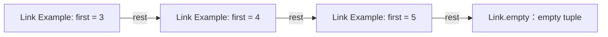
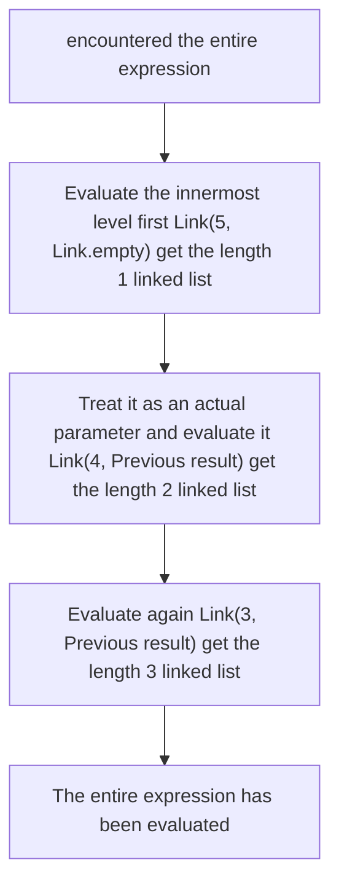
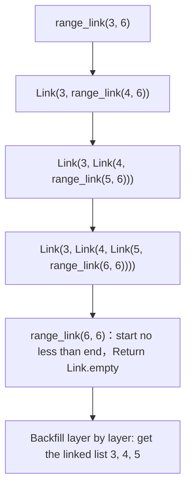
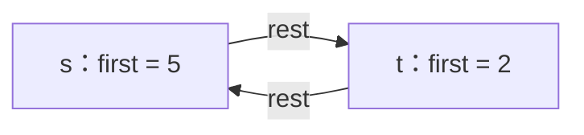
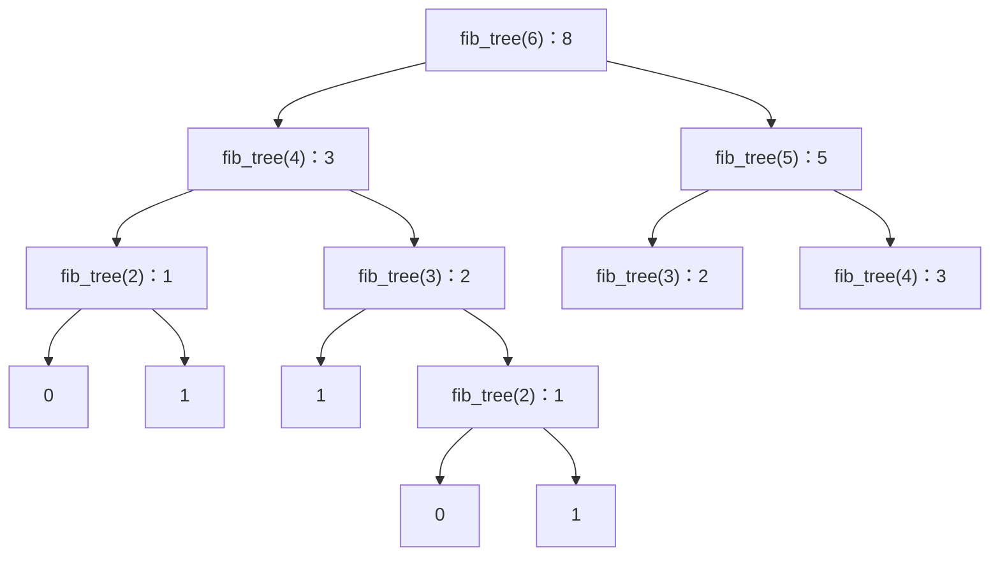

> **courses**: UC Berkeley CS61A · Structure and Interpretation of Computer Programs(Fall 2024)
> **This lecture**: Lecture 22 ｜ 33:16 ｜ Station B P 22 ｜ [Original video](https://www.bilibili.com/video/BV1sy411z7nA?p=22)
> **courseware**: `21-Composition_1pp.pdf` (16 pages, official PDF, page-by-page renderings see text illustrations)
> **subtitles**: Original English subtitles from Station B; this note is a reconstruction of Chinese writing, not a sentence-by-sentence translation.
> **Copyright**: The copyright of the course and courseware belongs to the UC Berkeley CS61A teaching team; this article is a secondary arrangement for learning purposes

## Quick overview of this lecture

- **Mastered**: use  `class`  Define new types, in  `__init__`  Li give  `self`  Bind attribute; `str`  with  `repr`  Division of labor between two representations; data abstraction of trees (`tree(label, branches)`  add  `label`, `branches`, `is_leaf`  Three selectors); the writing method of the recursive function "base case + recursive case".
- **Main line of this lecture**:
    - The linked list is **pair of values**: one  `first`  add one  `rest`, `rest`  Either another linked list, or empty; one object puts another object into its own properties, which is the composition in the title.
    - Use classes to implement linked lists: `__init__`  receive  `first`  with  `rest`, and use  `assert`  Put "`rest`  It can only be a linked list or empty." This invariant is nailed in the constructor, rather than left to the caller to realize.
    - Recursive data structures naturally pair with recursive functions: `range_link`, `map_link`, `filter_link`, `slice_link`  If both are "null, return null, otherwise process the first element and then process it recursively.  `rest`”.
    - Objects can be modified in place, so it is possible to write side-effect-only versions that do not return a new structure: `add`, `double_link`, `insert_link`, `prune`; `rest`  It can even point back to itself, allowing a three-element linked list to grow an arbitrarily long reference chain.
    - The tree is the other direction of the same combination: `label`  Add a bunch of subtrees. After switching to class implementation, there is no need to explicitly write the selector outside the constructor, the attribute name is the representation.
- **Key conclusions**: The shape of a data structure determines the shape of the functions that process it. Both linked lists and trees encode "scale" in references, so there are only two basic situations - empty and leaf; after writing the structure into the class, **The invariant is maintained by the constructor, the display is taken care of by the representation method, and the algorithm only needs to advance this step.**.

*(Reference time: 00:00:01 – 00:00:08｜Lecture 22)*


## 1. Accounting for built-in lists: why another sequence is needed

*(Reference time: 00:00:09 – 00:00:14｜Lecture 22)*


> **Editor's note**: The video of this lecture enters the linked list from the first second, and the "list efficiency" paragraph on pages 3 and 4 of the courseware does not appear in the subtitles. The content of the two pages is organized according to the original text of the courseware, and the comments and inferences are added by the editor; the anchor point of this section is the two sentences about "Why talk about linked lists" at the beginning. It only marks the position and does not mean that this paragraph has been taught.

The courseware divides the performance of the built-in list into two levels in one sentence: **Appending, subscript assignment, and list comprehensions are fast; inserting at the beginning or in the middle, slicing, and adding two lists are slow.**. The difference between speed and speed is not "what is done", but "whether existing elements should be moved".


The box drawn on the page is very telling: `3 5 2 9 4 2 6`  Followed by a blank space, indicating that there is room at the end. `append`  Write directly into the space; insert a cell, cut a section, or do it once  `+`, everything drawn is **Create another row of boxes**, copy the old element. The same task (creating a table containing square numbers) is implemented using five writing methods, and the difference between the fastest and the slowest is about 6,000 times.

```python
def using_list_comprehension(n):
    return [k * k for k in range(n)]

def using_append(n):
    s = []
    for k in range(n):
        s.append(k * k)
    return s

def using_assign(n):
    s = [0 for k in range(n)]
    for k in range(n):
        s[k] = k * k
    return s

def using_insert(n):
    s = []
    for k in range(n):
        s.insert(0, k * k)
    return s

def using_add(n):
    s = []
    for k in range(n):
        s = s + [k*k]
    return s
```

`n = 100,000`  Actual measured value at:

| Writing method | means of expansion | Time consuming |
| :--- | :--- | :--- |
| `using_list_comprehension` | Derive a new table at once | 1.58 ms |
| `using_append` | `s.append(k * k)`  Write a space at the end | 1.76 ms |
| `using_assign` | First occupy the space according to the length, and then assign the value according to the subscript | 2.58 ms |
| `using_insert` | `s.insert(0, k * k)`  Squeeze to the front every time | 1,470 ms |
| `using_add` | `s = s + [k*k]`  Copy the entire table every time | 9,210 ms |

The first three are all "put to the back", and the cost is proportional to the number of elements; `using_insert`  Every time **Beginning** Insertion, every time it is inserted, the existing elements behind it will be moved back one space as a whole, and the total cost becomes square; `using_add`  The entire table needs to be copied additionally, so it is more than six times slower. This table is the motivation for this lecture: **If a sequence is only allowed to grow on the head and is not allowed to be accessed by subscripts, its operation cost can completely change its face.**. The linked list is exactly such a sequence - it gives up the ability to "jump directly to the k-th item by pressing the index" in exchange for "just change a pointer when inserting at the head".

| criterion | Built-in  `list` | linked list  `Link` |
| :--- | :--- | :--- |
| Press to select the kth | Constant time, direct positioning based on offset | linear time, straight  `rest`  Take k steps |
| insert in head | Linear, all elements are moved back one space | Constant, create a node pointing to the old head |
| Insert in the middle | Linear, the second half moves backward as a whole | Linear, first take k steps to find the position, and then only change the pointer |
| Append to the end | Amortized constant (`append`) | Linear, if you don’t have a tail pointer, you have to go to the end. |
| slice | There is grammar, but you need to copy that paragraph | There is no subscript syntax, so you have to write the function yourself |
| splicing of two sequences | `+`, copy both sides | You can only rely on sharing tails, there is no built-in writing method |
| memory layout | A whole piece of continuous space with redundant capacity | Two fields per node, scattered on the heap |

This table explains why linked lists are worth learning on their own: it's not a "better list"; **Trading random access for insertion freedom** Another choice. It also explains why the following exercises in this lecture repeatedly focus on "head insertion" and "midway insertion" - that is the dividing line between the strengths and weaknesses of the linked list.

## 2. Recursive definition of linked list: a  `first`, one  `rest`

*(Reference time: 00:00:16 – 00:04:54｜Lecture 22)*


Linked lists are the basic data structure in computer science and are used almost everywhere. The definition is only one sentence: **A linked list is either empty (there is nothing in it), or it is a "first value" plus "the rest of the sequence"**. A non-empty linked list places the first element of the sequence in  `first`  inside, put the remaining elements into a **The same is a linked list** object, hanging on  `rest`  on.


Sequence for courseware  `3, 4, 5`  Demonstration: The outermost layer is a  `Link`  instance, `first`  is 3, `rest`  point to another  `Link`  Example; second level  `first`  is 4, `rest`  Then point to the third floor; the third floor  `first`  is 5, `rest`  There is no value left.



So each linked list starts with a **smaller linked list** as one's own  `rest`——There is one exception to this rule, which is the empty linked list at the end. Use a special value here  `Link.empty`  It means "nothing is left". `Link.empty`  No  `first`  Neither  `rest`, it does not represent a certain element, only the "end". The courseware lists it as a class attribute, because all empty linked lists are the same thing, and there is no need to create an instance for each empty linked list.

The key step in understanding linked lists is **Don't think of it as "a class plus some attribute names"**, and think of it as a pair of values: the first element of a sequence, and the remainder of the sequence. Because of this, the lecturer  `first`  The elements in are called **zeroth element**——It will correspond to subscript 0 in the future, and  `rest`  It contains all elements after subscript 1:

- `first`  is the 0th element of the sequence, which is an ordinary value (here an integer).
- `rest`  is the remainder of the sequence, itself a linked list, or  `Link.empty`.
- The only edge case is an empty linked list, which has no 0th element.

This step also explains the title of this lecture. **The property value of an object can be another object**; When this "another object" belongs to the same class as the outer object, a structure of arbitrary depth can be created using composition. The reason why a linked list can represent an arbitrarily long sequence does not rely on the container provided by the language, but on the action of "object within object".

Writing this structure as an expression means constructing functions layer by layer:

```python
Link(3, Link(4, Link(5, Link.empty)))
```

Note that it cannot be written as  `3, 4, 5`- That will get a tuple. Each layer must be created explicitly: the innermost layer is  `Link(5, Link.empty)`, the outer layer is  `Link(4, 刚才那个)`, the outermost layer is  `Link(3, ...)`. There is a Python evaluation rule at work here: **Calling an expression evaluates the operands before applying the function**. to figure out  `Link(3, ...)`, Python must first calculate its second operand, and that is a call, so the evaluation drills all the way inward and then outwards layer by layer.



every call  `Link`  A new instance is created; the outer instance cannot exist until the inner instance is created. This "inside first, then outside" order is not a detail—it's why the recursive constructor (Section 5) works: the recursive call builds the tail first and then uses it to build the head.


This structure is so common that the industry has a set of drawing conventions: draw each node into two grids, one for  `first`, an arrow pointing to the next node. **The arrow pointing to an empty linked list is usually not drawn and replaced with a slash.**. The lecturer specifically stated that this is not any official mark, but many people around the world draw it this way, so it is worth knowing. Page 7 of the courseware stacks three views together: attribute table (`first: 3` / `rest:`), two side-by-side construction expressions (`Link(3, Link(4, Link(5)))`  Use default parameters and omit them  `Link.empty`), and the row of slashed boxes below. given on the same page  `<3 4 5>`  is the print form, and  `Link(3, Link(4, ...))`  This structural form is two ways of writing the same thing, which corresponds exactly to what was said in the previous lecture.  `str`  with  `repr`  Two representations.

The last step is to "mirror" the structure into the implementation: since an empty linked list means "nothing left", let  `rest`  The default value is equal to  `Link.empty`, it can be omitted when constructing. So  `Link(3, Link(4, Link(5)))`  It is completely equivalent to the full expression above. **Default parameters are not trouble-free syntactic sugar. They write the induction rules of data structures directly into the function signature.**: The tail of each linked list can only be a linked list or empty, and empty is the default value.

## 3. `Link`  Class: Write invariants into the constructor

*(Reference time: 00:04:57 – 00:07:13｜Lecture 22)*


to let  `Link(3, Link(4, Link(5)))`  To really evaluate it into a linked list, you need a  `class`  statement. The entire class has only two statements: a class attribute and a  `__init__`.

```python
class Link:
    empty = ()      # Some zero-length sequence

    def __init__(self, first, rest=empty):
        assert rest is Link.empty or isinstance(rest, Link)
        self.first = first
        self.rest = rest
```

`__init__`  The first action of is not to store the value, but **Check**: `rest`  Either that  `Link.empty`, or a  `Link`  Examples, nothing else will be accepted. This assertion turns the inductive rule of Section 2 into an enforceable check—if by mistake one day  `Link(3, [4, 5])`  Passed in, the program will stop and report an error at the moment of construction, instead of throwing an inexplicable error after the third layer of calls and traversing to a certain depth.  `AttributeError`.**The earlier an error is exposed, the easier it is to locate it**, this is the main reason for placing assertions in the constructor.

For inspection  `is`  instead of  `==`: `rest is Link.empty`  The question is "whether it is an empty linked list object", not "whether it is equal to an empty sequence". The termination condition of the linked list is always the same object, and identity comparison is its original intention.

`isinstance`  with  `type`  The difference here is intentional. `isinstance(rest, Link)`  in  `rest`  Belong to  `Link`  of **Subclass** Time is also true; `help(isinstance)`  The description is "Returns whether an object is an instance of a certain class or a subclass of the class." If written as  `type(rest) == Link`, any inherited  `Link`  Any special linked lists created will be rejected by the constructor. use  `isinstance`  means **The system is scalable**:Write one in the future  `Link`  subclass to represent "ordered linked list" or "cached linked list", the same constructor can still be used, and this check still passes. This method of writing "the construction logic of the parent class matches the additional behavior of the child class" is repeatedly used when writing subclasses.

`empty = ()`  is a design choice. You can also specially invent an empty linked list class, but the lecturer chose **empty tuple** The reason for this zero-length sequence is very straightforward: the empty linked list is originally a zero-length sequence, and using ready-made zero-length values to represent it saves trouble and does not introduce redundant concepts. The price is that it doesn't  `Link`  Any properties and methods of (`first`, `rest`  does not exist), so any place where an empty linked list is used must first determine  `is Link.empty`, and cannot expect to call its methods.

Page 8 of the courseware only lists  `empty`  with  `__init__`  two, `<3 4 5>`  This printing form comes from an additional display method defined on the class (this lecture does not expand line by line). According to the rules in the previous lecture, `print`  go  `str`, interactive session echo  `repr`, so the same linked list has two legal appearances: `repr`  Give the construct  `Link(3, Link(4, Link(5)))`, `str`  given  `<3 4 5>`. Both writing methods appear in the doctests later in this lecture, precisely because one is the constructed formula under test and the other is the printed formula under test.

## 4. Demonstration: construction, value acquisition, and in-place modification

*(Reference time: 00:07:16 – 00:08:51｜Lecture 22)*

The bottom of page 8 of the courseware is marked  `(Demo)`, the next content is coding on the spot. put  `3, 4, 5`  tied to name  `s` , you can observe its properties layer by layer:

```python
>>> s = Link(3, Link(4, Link(5)))
>>> s.first
3
>>> s.rest.first
4
>>> s.rest.rest.first
5
>>> s.rest.rest.rest is Link.empty
True
```

The way to write the value is the second key to understanding the linked list. **No subscripts, only attribute chains**: To take the 0th element and write  `s.first`, take the first one and write  `s.rest.first`, take the second one and write  `s.rest.rest.first`. every paragraph  `.rest`  They are all "move back one position", but when you move to the 3rd paragraph, you get an empty linked list - it does not  `first`, only used to answer "any more".

Linked lists can be modified. `s.rest.first = 7`  Directly change the value of the middle node, and the entire sequence will change from  `3, 4, 5`  become  `3, 7, 5`. But the lecturer emphasized that the most common use of linked lists is precisely **No** Change the value in place; the scenario it is designed to mainly serve is "adding a different value to the head and creating a new linked list similar to the original linked list":

```python
>>> t = Link(0, s)      # 新链表共享了 s 的尾巴
```

This line does not copy any nodes. `t`  is the new head, its  `rest`  That’s it  `s`  itself. So the two linked lists share the entire structure behind, which is called **shared structure**, is the predecessor of the “ring” in verse 6: since  `rest`  is just a quote, then let the two  `rest`  Pointing to the same object is zero cost. Functional style programs rely heavily on this - leaving the old structure unchanged, just wrapping a new one on top of it.

## 5. Recursive processing of linked lists: implement it yourself  `range`, `map`, `filter`

*(Reference time: 00:08:54 – 00:14:49｜Lecture 22)*

`range`, `map`, `filter`  They are all built-in in Python, but they do not understand linked lists - linked lists are user-defined classes, and there is no reason for the language to prepare ready-made processing functions for them. If you want the same function, you have to write one yourself, usually called  `range_link`, `map_link`, `filter_link`.

Let’s first review what these three things do on built-in types. Assume there are two ready-made functions: `square`  Square the parameters, `odd`  Determine whether the parameter is an odd number. The following expression takes 1 to 5, filters out the odd numbers, and then squares them:

```python
>>> list(map(square, filter(odd, range(1, 6))))
[1, 9, 25]
```

> **Editor's note**: The subtitles only dictate the three steps of this expression near 00:09:55, and do not read the code word for word; the above writing method is reproduced according to the dictation. The third step is to wrap a layer  `list`  to see the results, because Python 3’s  `map`  with  `filter`  An iterator is returned instead of a list.

Changing to a linked list, the action is exactly the same, except that the function name has an extra suffix: use  `range_link`  Create a linked list, `filter_link`  Sieve odd numbers, `map_link`  squared, and finally get a loaded  `1, 9, 25`  linked list.

The three functions are all recursive functions and have exactly the same shape: **First ask if it is empty, then call it a day; if not, remove the first element and hand over the rest to the recursive call.**

```python
def range_link(start, end):
    """Return a Link containing consecutive integers from start to end.

    >>> range_link(3, 6)
    Link(3, Link(4, Link(5)))
    """
    if start >= end:
        return Link.empty
    else:
        return Link(start, range_link(start + 1, end))


def map_link(f, s):
    """Return a Link that contains f(x) for each x in Link s.

    >>> map_link(square, range_link(3, 6))
    Link(9, Link(16, Link(25)))
    """
    if s is Link.empty:
        return s
    else:
        return Link(f(s.first), map_link(f, s.rest))


def filter_link(f, s):
    """Return a Link that contains only the elements x of Link s for which f(x) is a true value.

    >>> filter_link(odd, range_link(3, 6))
    Link(3, Link(5))
    """
    if s is Link.empty:
        return s
    filtered_rest = filter_link(f, s.rest)
    if f(s.first):
        return Link(s.first, filtered_rest)
    else:
        return filtered_rest
```

> **Editor's note**: The codes of these three functions do not appear on the courseware page. The instructor wrote them on the spot in the editor. The above writing method is restored one by one according to the subtitle dictation (including return value and recursive call position). The docstring and doctest are added by the editor. The format is consistent with the doctest of the previous functions, making it easy to run directly.

`range_link`  The baseline situation is not "the linked list is empty", but "`start`  is no less than  `end`”——The “scale” here is characterized by two integers. The baseline cases for the other two functions are  `s is Link.empty`.`map_link`  You can return directly on an empty linked list  `s`  itself, can also return  `Link.empty`, both are two ways of writing the same thing. `filter_link`  Than  `map_link`  One more step: it first sifts the tail and stores it in  `filtered_rest`, and then decide whether to retain the current element; if it is retained, put it on the screened tail, if not, just hand over the tail. This order of "recurse first, decide later" is critical - if you decide first and then recurse, you have to write once in each of the two branches.  `filter_link(f, s.rest)`, the same recursive call appears repeatedly, and no error will be reported even if the error is corrected.



This picture flattens the recursive expansion process: the four calls are first piled up in the "downward" direction and do not stop until the base situation is encountered; then  `Link`  Starting from the innermost layer, build it layer by layer, and finally backfill it into a complete linked list. **The shape of the recursive function on the linked list is exactly the shape of the linked list itself**——A chain, one end is the baseline situation, the other end is the result.

Run doctest to confirm that the three can be strung together:

```python
>>> s = range_link(1, 6)
>>> print(s)
<1 2 3 4 5>
>>> print(map_link(square, filter_link(odd, s)))
<1 9 25>
```

> **Editor's note**: The sentence at 00:14:31 in the video pronounces the result as "1, 9, 16". By definition, `range_link(1, 6)`  is 1 to 5, sieve out the odd numbers 1, 3, 5, and square them to get 1, 9, 25; the same demonstration also clearly said "5 squared is 25" near 00:10:09. Notes are written based on calculation results  `<1 9 25>`.

The definition of a linked list is recursive, and the most natural way to deal with it is recursion. This is worth remembering: **When you see the data of "self-contained", first look for its baseline situation**——The linked list is empty and the tree is the leaves; after finding the basic situation, the skeleton of the recursive function is also available.

## 6. Modify and share: when  `rest`  Point back to yourself

*(Reference time: 00:14:51 – 00:17:15｜Lecture 22)*

Linked list instances are ordinary objects, while instances of user-defined classes can be modified. Using attribute assignment statements, you can change a  `Link`  instance  `first`  with  `rest`. This has an interesting consequence: **a linked list  `rest`  This linked list can be stored in it.**.

From a three-element linked list  `1, 2, 3`  Let’s start by doing only three assignments:

```python
>>> s = Link(1, Link(2, Link(3)))
>>> s.first = 5
>>> t = s.rest
>>> t.rest = s
```

After the first two steps, `s`  is  `5, 2, 3`, `t`  is  `2, 3`. The third step  `t.rest`  Change to  `s`, the structure is closed:



Ask at this time  `s.rest.rest.rest.rest.rest.first`  How much it is, you have to count it. `s.rest`  is  `t`, `t.rest`  is  `s`, so  `rest`  When the number of is an odd number, it falls  `t`  on, when it is an even number, it falls on  `s`  Above:

| expression | walked several times  `rest` | Which node does it fall on? | `.first`  value |
| :--- | :--- | :--- | :--- |
| `s.rest.first` | 1 | `t` | 2 |
| `s.rest.rest.first` | 2 | `s` | 5 |
| `s.rest.rest.rest.first` | 3 | `t` | 2 |
| `s.rest.rest.rest.rest.first` | 4 | `s` | 5 |
| `s.rest.rest.rest.rest.rest.first` | 5 | `t` | 2 |

The answer is 2. The reasonable reaction is: there are only three elements in total, how can there be so many?  `.rest`? The answer is **The structure has changed**- When it was created it had only three elements, but  `t`  is  `s`  part of it, change it  `t.rest`  Just changed it  `s`  structure. This is why Section 4 says "shared substructure" deserves a separate note: when two names point to the same memory, changing one is equivalent to changing two, and the size of the change is not limited to local - it can turn a chain into an arbitrary-shaped graph.

> **Editor's note**: The video reads this expression one more time at 00:17:08  `.rest`, inconsistent with the previous question at 00:16:23 (5 times); 6 times  `rest`  will fall back  `s`, the answer is 5. Record notes as "5 times, answer 2", and use the table above to clearly explain the odd and even rules.

This also prompts a "danger zone" of the linked list: **Being able to change properties means that you can create rings, and ring structures will make many recursive functions never terminate.**. All traversal functions later in this lecture start with  `is Link.empty`  As a base case, once there is a link in the chain, this condition will never wait. The reason why linked lists "usually do not change" is not only a style preference, but also a safety boundary.

## 7. Insertion into ordered list  `add`: Recursion only for side effects

*(Reference time: 00:17:18 – 00:21:44｜Lecture 22)*

Next is a classic example of linked list modification: maintaining a **Arrange from small to large without repeated elements** linked list, write a  `add(s, v)`  put  `v`  Insert it into the correct position. The agreement is: if  `v`  Already in  `s`  inside, don’t change it  `s` (To avoid duplication); the function returns regardless of whether it has been changed or not.  `s`.

Four situations explain all branches. hypothesis  `s`  is  `1, 3, 5`:

- Add 0:0 is smaller than the head, so create a new node to install the old 1 (its  `rest`  Point to the old 3, 5), and then  `s.first`  Change to 0, `s.rest`  Point to the new node. result  `0, 1, 3, 5`, only one more node is added, and the existing value is not overwritten.
- Gal 3:3 is already in the table, does nothing, returns as is.
- Add 4: Go between 3 and 5. Put the current node equipped with 5 **Change name** to 4, and then add a new node to 5. result  `0, 1, 3, 4, 5`.
- Plus 6: Go all the way to the end, `rest`  is empty, so put  `rest`  Replace with a new node equipped with 6.

```python
def add(s, v):
    """Add v to an ordered list s with no repeats, returning modified s.

    >>> s = Link(1, Link(3, Link(5)))
    >>> add(s, 0)
    Link(0, Link(1, Link(3, Link(5))))
    >>> add(s, 3)
    Link(0, Link(1, Link(3, Link(5))))
    >>> add(s, 4)
    Link(0, Link(1, Link(3, Link(4, Link(5)))))
    >>> add(s, 6)
    Link(0, Link(1, Link(3, Link(4, Link(5, Link(6))))))
    """
    assert s is not Link.empty
    if s.first > v:
        s.first, s.rest = v, Link(s.first, s.rest)
    elif s.first < v and s.rest is Link.empty:
        s.rest = Link(v)
    elif s.first < v:
        add(s.rest, v)
    return s
```

The three branches correspond to three "positional relationships": `v`  It is smaller than the current head and is inserted in front of the head; `v`  It is larger than the current head and the succeeding one is empty and is connected to the end; `v`  It is larger than the current head and there are nodes behind it, so go down. **`v`  When equal to the head, none of the three conditions are true.**, the function goes directly to the end  `return s`, this is the entire implementation of "non-repeated insertion" - it does not write any explicit equality judgment, and relies on the complementarity of three conditions.

> **Editor's note**: The subtitles dictate the third condition as “if  `s.rest`  less than  `v`”, and what really needs to be judged in the code is  `s.first < v` (The latter way of writing can guarantee  `s.first == v`  When the three branches are not established at the same time, no duplicate values are inserted). The code above is written with this semantics in mind and is not entirely consistent with the wording of the subtitle dictation.

The most memorable line of this function is the recursive call  `add(s.rest, v)`: **it doesn't  `return`**. The reason is in the last line  `return s`——Each layer returns itself. The recursive call does not calculate a value to be returned, but **Complete the task**. The lecturer's statement is: The purpose of this call is not to calculate a value to return, but to  `s`  Remove the addition from the remaining part.

This is the first time that "recursion is only for side effects" appears in this lecture. It is the same as  `map_link`  That kind of "recursively figuring out a new structure" is exactly complementary:

| criterion | `map_link`  formula recursion | `add`  formula recursion |
| :--- | :--- | :--- |
| Return value of recursive call | The structure of the next level must be used to spell out the result. | No one uses it, throw it away |
| Whether to change the actual parameters | Not moving at all, creating a new structure | Change on the spot  `first` / `rest` |
| The role of recursion | Calculate | advance to a position |
| Base case | `s is Link.empty` | Stop when you find the insertion point (it doesn’t have to be all the way) |
| space cost | The new linked list is the same length as the original linked list | Just one more new node |

`add`  The time cost is related to the insertion position: the worst is to go to the end, linear; but **Once in position, the insertion itself is constant time**—This is exactly the deal promised by the price list in Section 1.

## 8. Practice group: repeated insertion, slicing, bitwise insertion and mid-term questions

*(Reference time: 00:21:44 – 00:21:54｜Lecture 22)*


> **Editor's note**: Pages 9–16 of the courseware are practice pages for the linked list section. The video of this lecture switches directly to the tree after finishing the orderly insertion at 00:21:54. These eight pages do not appear in the subtitles. The following is organized according to the original text of the courseware. The code, doctest, and time-consuming figures are taken verbatim from the courseware; the derivation, comparison, and conclusion are written by the editor. The anchor point of this section only marks the end position of the teaching part of the linked list, and does not mean that these pages have been taught.

### 8.1 List version: in each  `v`  Then insert another one  `v`


The question requires a list  `s`  Each of them is equal to  `v`  elements of **Make a copy**, inserted behind it. The courseware gives five blanks, and the answers are all on the page: the loop condition is "the cursor has not gone through the entire list", and the judgment condition is whether the current position is equal to  `v`, the insertion position is  `i+1`, the cursor needs to be **Jump two spaces at a time**.

```python
def double(s, v):
    """Insert another v after each v in list s.

    >>> s = [2, 7, 1, 8, 2, 8]
    >>> double(s, 8)
    >>> s
    [2, 7, 1, 8, 8, 2, 8, 8]
    """
    i = 0
    while i < len(s):
        if s[i] == v:
            s.insert(i+1, v)
            i += 2
        else:
            i += 1
```

`i += 2`  This is the key to this question. The copy just inserted is itself equal to  `v`, if you only jump one space, another copy will be inserted after the copy in the next round, and again in the next round... thus doubling infinitely. Jumping two spaces at a time is equal to **Skip the copy you just created**, only raw elements are processed.

### 8.2 Linked list version: `double_link`

The same task is transferred to the linked list, and the code is shorter because no subscript is needed:

```python
def double_link(s, v):
    """Insert another v after each v in linked list s.

    >>> s = Link(2, Link(7, Link(1, Link(8, Link(2, Link(8))))))
    >>> double_link(s, 8)
    >>> print(s)
    <2 7 1 8 8 2 8 8>
    """
    while s is not Link.empty:
        if s.first == v:
            s.rest = Link(v, s.rest)
            s = s.rest.rest
        else:
            s = s.rest
```

The writing has changed in three places: the loop condition has changed from "the subscript is less than the length" to "it has not reached the empty linked list"; the value has changed from  `s[i]`  become  `s.first`;Promote from  `i += 2`  become  `s = s.rest.rest`. This last push has two meanings: first go to the copy just inserted (`s.rest`), and then cross it (another layer  `.rest`), which is equivalent to the list version of "jumping two spaces".


The schematic diagram on the right side of the courseware shows the same action: a new node is hung behind each of the two 8s in the original linked list, the arrow changes from the old 8 to the new 8, and the new 8 points back to the original successor. **All the work of inserting is to change two pointers**, no elements are moved.

### 8.3 Speed comparison: `cycle`  with  `cycle_link`

To see the difference, the courseware prepares a "cyclic sequence" of 100,000 elements: the element with subscript i is equal to  `i % k`, so the sequence rotates repeatedly between 0 and k-1.

```python
def cycle(k, n):
    """Build an n-element list that cycles among range(k).

    >>> cycle(3, 10)
    [0, 1, 2, 0, 1, 2, 0, 1, 2, 0]
    """
    s = []
    for i in range(n):
        s.append(i % k)
    return s


def cycle_link(k, n):
    """Build an n-element linked list that cycles among range(k).

    >>> print(cycle_link(3, 10))
    <0 1 2 0 1 2 0 1 2 0>
    """
    first = Link.empty
    for i in range(n):
        new_link = Link(i % k)
        if first is Link.empty:
            first, last = new_link, new_link
        else:
            last.rest, last = new_link, new_link
    return first
```

`cycle_link`  Use a tail pointer  `last`  Remember the end and hang a new node to it every time  `last.rest`  Update again  `last`, so the table creation is linear - this just confirms the statement in the table in Section 1 that "no tail pointer equals linear append": **If you want constant time appending to a linked list, you must maintain a reference to the end.**.


Performing the "copy" operations of 8.1 and 8.2 on this 100,000-element table, the result is:

| realize | structure | Time consuming |
| :--- | :--- | :--- |
| `double(cycle(5, 100000), 3)` | Built-in list, every time  `insert`  Translate the second half | 299 ms |
| `double_link(cycle_link(5, 100000), 3)` | Linked list, each insertion only changes the pointer | 14 ms |

The difference is about twenty times. The reason is not "recursion is slower than loops", but **cost of insertion**: in the list  `insert(i+1, v)`  To move all subsequent elements back one space, one-fifth of the elements in the table need to be copied. Each of the 20,000 insertions requires half of the table to be shifted; there are only two assignments in the linked list each time.

### 8.4 Slicing: `slice_link`


Linked lists don't have slices. `s[1:3]`  This writing method relies on random access by subscript, and the third element of the linked list can only be obtained by walking three steps from the head. So I have to write one myself  `slice_link(s, i, j)`, returns a new linked list "starting from subscript i and before getting to j".


```python
def slice_link(s, i, j):
    """Return a linked list containing elements from i:j.

    >>> evens = Link(4, Link(2, Link(6)))
    >>> slice_link(evens, 1, 100)
    Link(2, Link(6))
    >>> slice_link(evens, 1, 2)
    Link(2)
    >>> slice_link(evens, 0, 2)
    Link(4, Link(2))
    >>> slice_link(evens, 1, 1) is Link.empty
    True
    """
    assert i >= 0 and j >= 0
    if j == 0 or s is Link.empty:
        return Link.empty
    elif i == 0:
        return Link(s.first, slice_link(s.rest, i, j-1))
    else:
        return slice_link(s.rest, i-1, j-1)
```

The two integer parameters have a clear division of labor: `j`  It’s “a few more to take”, `i`  It’s “a few more to skip.” So three situations emerged:

- `j == 0`  Indicates that the quota is full, or  `s`  It is already empty and cannot be retrieved, so an empty linked list is returned.
- `i == 0`  It means that there is no need to jump anymore, the current position is what you want, so I put  `s.first`  Leave it, leave the tail to me  `slice_link(s.rest, 0, j-1)`——Attention  `i`  Keep it at 0 because it has entered the "only fetch, no jump" stage.
- `i > 0`  It means I want to skip it, so I throw it away.  `s.first`, decrement both counts by one and continue walking.

The right side of the courseware  `slice_link(evens, 1, 2)`  The expansion is written in three lines: This layer returns  `slice_link(evens.rest, 0, 1)`, which connects 2 to  `slice_link(evens.rest.rest, 0, 0)`  front, and the innermost layer because  `j == 0`  Return directly  `Link.empty`. So the result is that it only contains  `2`  of a node. This "jump first and then fetch" double counter structure is a common routine for simulating subscript operations on linked lists.

### 8.5 Insert by position: `insert_link`


```python
def insert_link(s, x, i):
    """Insert x into linked list s at index i.

    >>> evens = Link(4, Link(2, Link(6)))
    >>> insert_link(evens, 8, 1)
    >>> insert_link(evens, 10, 4)
    >>> insert_link(evens, 12, 0)
    >>> insert_link(evens, 14, 10)
    Index out of range
    >>> print(evens)
    <12 4 8 2 6 10>
    """
    if s is Link.empty:
        print('Index out of range')
    elif i == 0:
        second = Link(s.first, s.rest)
        s.first = x
        s.rest = second
    elif i == 1 and s.rest is Link.empty:
        s.rest = Link(x)
    else:
        insert_link(s.rest, x, i-1)
```

The four doctests cover four positions: inserted in the middle (subscript 1), inserted at the end (subscript 4, exactly equal to the length), inserted at the head (subscript 0), and subscript out of bounds (10). The last call goes to the empty linked list, so it prints  `Index out of range`, and don't change anything.

Those three lines in the head insert are the highlight of this section. Because the caller is holding  `s`  This object itself wants to change the position of "subscript 0" to  `x`”, there are only two ways: either copy the entire table (expensive), or **Transform the current node into a new head**——First package the old head value and the original successor into a new node  `second`, again  `s.first`  covered into  `x`, `s.rest`  point to  `second`. The order of the three lines cannot be reversed: if you write first  `s.first = x`, the old head value is lost, `second`  It means the wrong thing is installed.

`elif i == 1 and s.rest is Link.empty`  It is a special closing branch: when you reach the last node, you have to put one space down, indicating that it should be connected at the end. If not handled separately, the next recursion will fall on the empty linked list and be regarded as out of bounds.

### 8.6 Midterm question: Print the sum of prefixes as multiples of 10


The last page is taken from Question (b) of Volume 2 of the Spring Semester 2023 Midterm Examination. \*\*Prefix sum\*\* refers to the sum of the first n elements of the sequence (n is a positive length); the question requires printing  `s`  The sum of all prefixes that are "multiples of 10", in ascending order of prefix length.

```python
def tens(s):
    """Print all prefix sums of Link s that are multiples of ten.

    >>> tens(Link(3, Link(9, Link(8, Link(10, Link(0, Link(14, Link(6))))))))
    20
    30
    30
    50
    """
    def f(suffix, total):
        if total % 10 == 0:
            print(total)
        if suffix is not Link.empty:
            f(suffix.rest, total + suffix.first)
    f(s.rest, s.first)
```

The most noteworthy thing about the writing method is the internal function. `f(suffix, total)`  There are two parameters: `suffix`  It's "the paragraph that hasn't been added yet", `total`  It is "the sum that has been added". Each call first checks the current  `total`  Whether to divide by 10 and print it, and then judge  `suffix`  Whether it is empty - if not empty, just  `suffix.first`  add  `total`, put  `suffix`  Move back one space and continue recursively.

The outer layer is only adjusted once  `f(s.rest, s.first)`, "the first element has been counted" `total`” is written directly into the initial parameter, so the prefix of length 1 will not be missed or printed twice. Yes  `3, 9, 8, 10, 0, 14, 6`  Go through it: the sum of the prefixes is 3, 12, 20, 30, 30, 44, 50, and the four of them that are multiples of 10 are exactly 20, 30, 30, 50, consistent with the doctest.

This question combines three things in this lecture: recursive parameters carry state (`total`), `suffix`  The length is the recursion depth. Printing occurs on the way "downward" rather than during backfilling, so the output naturally increases by the prefix length——**The recursive access order is the output order.**.

### 8.7 Editor’s Supplement: Write these recursions as class methods

> **Editor's note**: The following content is not included in the subtitles and courseware of this lecture. The recursive function in this chapter is rewritten as  `Link`  Class method exercises are used to compare the differences in code organization before and after "data and behavior binding".

In the first six sections, all functions for processing linked lists are written outside the class and rely on attribute access to operate objects. If you move these functions into a class, the same algorithm becomes a method: `self`  replaced the parameter  `s`, calling from  `map_link(f, s)`  become  `s.map(f)`.

```python
class Link:
    # ... empty 与 __init__ 同前 ...

    def __len__(self):
        if self.rest is Link.empty:
            return 1
        return 1 + len(self.rest)

    def __getitem__(self, i):
        if i == 0:
            return self.first
        return self.rest[i - 1]

    def map(self, f):
        if self.rest is Link.empty:
            return Link(f(self.first))
        return Link(f(self.first), self.rest.map(f))
```

There is a "translation" that should be paid attention to in each of the three rewritings. `__len__`  let  `len(s)`  Available, the recursion degenerates into "1 plus the length of the tail"; `__getitem__`  let  `s[i]`  available, so  `s[2]`  internally becomes  `s.rest[1]`, and then become  `s.rest.rest[0]`--Section 4's handwritten attribute chain, replaced by a subscript call. `map`  After writing the method, the recursion point starts from  `map_link(f, s.rest)`  become  `self.rest.map(f)`, the function name no longer needs to be passed as a parameter, because it is already tied to the data structure.

This is exactly the second meaning of the title of this lecture: **Composition is not just "objects inside objects", but also "data inside behaviors"**. When the same recursive logic is written as an external function, the parameter list must explicitly contain the structure to be processed; when written as a method, the structure is  `self`, only the "changing part" remains in the parameter table (such as  `f`, `i`, `j`). The price is coupling: the algorithm will only serve this one class from now on, and if you want to change the structure, you have to rewrite it.

> **Editor's note**: the above  `__getitem__`  It is a simplified version and will be thrown when it crosses the boundary.  `TypeError`  instead of  `IndexError`. To make it support both  `for x in s`  This old iteration protocol (Python keeps calling  `s[0]`, `s[1]`...until thrown  `IndexError` ), out-of-bounds branches must be explicit  `raise IndexError`.

## 9. Tree: same combination, change direction

*(Reference time: 00:21:58 – 00:25:01｜Lecture 22)*

After finishing talking about linked lists, the topic turned to trees. Trees have appeared earlier in this course (implemented with data abstractions), but their importance deserves another mention. **Trees are very similar to linked lists**: A tree has a root label and a list of branches, each branch itself is a tree; a linked list has a first element and the remaining part, which itself is a linked list. **The only difference is the number of forks**: There can be many branches of the tree, but there is only one "remainder" of the linked list.

| criterion | linked list  `Link` | tree  `Tree` |
| :--- | :--- | :--- |
| recursive component | `first`  add  `rest` | `label`  add  `branches` |
| Number of successors | at most one | zero or more |
| Base case | Empty linked list  `Link.empty` | leaves (no branches) |
| Can it be bifurcated? | No, you can only connect one link | Yes, as many as you want |
| Traversal mode | There is only one kind from beginning to end | Root first, root last, layer by layer, all can be done |
| Typical uses | Sequence, stack, queue, adjacency list | Expressions, syntax trees, decision trees, file systems |

The courseware uses the analogy of "trees of wood": trees grow from the ground, and the trees in the data structure are **grow downward**- The roots are at the top and the branches extend downward. This metaphor is not strict, but it solidifies the position of "root".

According to the recursive definition: a tree has a root label and a list of branches, and each branch is a tree; **A tree with zero branches is called a leaf.**. The root label of the schematic diagram in the courseware is 3, there are two branches, and the whole tree has a total of five leaves. The leaves also have labels (0 and 1 in the picture), but no branches.

The tree vocabulary is worth going through, because all the algorithms that follow are described in these terms:

- **root**: The top node of the entire tree. Each branch also has its own root, so "root" is relative.
- **node**: a position in the tree. When talking about "node", the emphasis is on the position and its relationship with other nodes, rather than the value it holds.
- **parent/child**:3 is the parent node of 2, and 2 is the child node of 3. The lecturer deliberately corrected a speaking habit: people often say "2 is a child of 3". Strictly speaking, **There is a parent-child relationship between nodes, and labels are just numbers.**.
- **path**: A string of nodes, each of which is the parent or child of the previous one, that is, connected all the way on the graph. The most common path is from the root to a leaf, but other paths are possible.

It is worth noting the relationship between "node" and "tree": each node itself is a subtree (the one with it as the root). So in a recursive function, "recurse for each branch" and "recurse for each child node" are the same thing.

## 10. Writing trees with classes: constructors and implicit selectors

*(Reference time: 00:25:02 – 00:27:09｜Lecture 22)*

Trees can inherently be made using data abstraction. If you use classes, the code will be shorter. one  `Tree`  The class only needs one constructor (plus a method to identify leaves): receive a label and a branch table (empty by default), set the label, check one by one that the branches are indeed trees, and then add the branches **Copy to a new list** Deposit  `self.branches`.

```python
class Tree:
    def __init__(self, label, branches=[]):
        self.label = label
        for branch in branches:
            assert isinstance(branch, Tree)
        self.branches = list(branches)

    def is_leaf(self):
        return not self.branches
```

> **Editor's note**: The subtitles only describe these steps ("set the label, check whether the branches are trees one by one, copy the branches into a list"), without showing the code line by line; the above implementation is restored according to the oral description, `is_leaf`  The writing method is to complete the sentence "Return whether there are branches", which is not the original text of the courseware.

`self.branches = list(branches)`  That line has two functions, as the lecturer pointed out: **keep a copy**, and **Convert other sequences into lists**. If you write directly  `self.branches = branches`, the outside list and the tree share the same memory, and the caller goes to the list outside the tree.  `append`  For something that is not a tree, the invariants of trees are bypassed. Making a copy is equivalent to implementing "I have my own branch table" - this is used in Section 3  `assert`  keep  `rest`  It’s the same idea: **Defense at the border eliminates the need for internal inspections**.

Looking side by side with the data abstraction version, the difference focuses on "whether to explicitly write the selector":

```python
# 数据抽象版本
def tree(label, branches=[]):
    return [label] + list(branches)

def label(tree):
    return tree[0]

def branches(tree):
    return tree[1:]

# 类版本：构造函数之后，属性名就是选择器
t.label
t.branches
```

| criterion | Data abstraction version | class version |
| :--- | :--- | :--- |
| structure | `tree(label, branches)`  Return a whole block | `Tree(label, branches)`  Return instance |
| Get tags | selector function  `label(t)` | Properties  `t.label` |
| take branch | selector function  `branches(t)` | Properties  `t.branches` |
| Need to write several functions | Construct plus two selectors | Just construct |
| internal representation | Make it your own: a long list, a pair, or a dictionary will work | fixed as attribute |
| Indicates whether it is replaceable | Change means that only the selector is changed, and the usage remains unchanged. | Change means to change all access points |
| show | Write another printing function | You can write recursion in a class  `__str__` |

The lecturer put this difference very accurately: when using data abstraction, **A way must be invented to put the pieces together** (The courseware is selected  `[label] + branches`  This long list), and then you have to write a selector to take out the fragments; if you change it to a class, then **No need to make any decisions about "how to put the pieces together"**, because the answer is always the same - each part is a property, and all properties of an object are accessed by name. The matter of "spelling" is fixed by the language. Programmers have one less freedom and a bunch of error-prone choices.

The cost is also very clear: data abstraction hides the representation behind the selector, and only needs to change two functions to change the representation; classes expose the representation as attribute names, `t.label`  It appears in a hundred places, so if you change your name, you have to change it in a hundred places. **Abstraction brings replaceability, and classes saves trouble.**.

## 11. Use  `Tree`: `fib_tree`  Display with recursion

*(Reference time: 00:27:10 – 00:29:09｜Lecture 22)*

This section uses  `fib_tree`: The label of each node is the sum of its two branch labels, 0 and 1 are leaves. It is the same as the version written earlier using data abstraction, except that the constructors and selectors are replaced by classes.

```python
def fib_tree(n):
    if n == 0 or n == 1:
        return Tree(n)
    else:
        left, right = fib_tree(n - 2), fib_tree(n - 1)
        return Tree(left.label + right.label, [left, right])
```

> **Editor's note**: `fib_tree`  The code is not on the 16-page courseware of this lecture, but was written by the lecturer on the spot in the editor; the lecturer explained that there are only two differences between it and the earlier data abstraction version - the class name is capitalized, and the period is used instead of labeling. The above writing method is restored orally, and the docstring is omitted.

Compared with the data abstraction version, there are only two changes: function name  `tree`  Become a class name  `Tree`, `label(left)`  become  `left.label`.**The skeleton of the algorithm has not changed a word**——This is exactly what the lecturer wants to explain: the difference between object-oriented programming style and data abstraction programming style is not as big as imagined.

Once the class is written, using it is straightforward. Leaves only  `Tree(1)`;To add a branch to a tree, you cannot just pass the label value, you must pass **a string of trees**:

```python
>>> t = Tree(3, [Tree(1), Tree(2)])
>>> t
Tree(3, [Tree(1), Tree(2)])
>>> print(t)
3
  1
  2
```

`repr`  What is given is the expression of "constructing an equivalent tree", `str`  What is given is multi-line indented output: the root tag is at the top, and the remaining tags are indented layer by layer. The instructor suggested reading the code that generated these two strings - they are good examples of recursive writing: the amount of indentation is the depth of the recursion, level by level.  `+ 1`  That’s it.

> **Editor's note**: above  `print`  The indentation width in the example is expressed as two spaces layer by layer; the subtitle only says "root first, and the rest are indented layer by layer" without giving a specific width.

`fib_tree(6)`  of  `repr`  It will be very long, with parentheses and square brackets filling the screen; but  `print`  You can see the structure clearly when you come out: the root is 8, the roots of the two branches are 3 and 5 respectively, and 3 plus 5 is exactly 8.



This diagram only expands part of the branches, because the structure further down is repeated: each labeled  `fib_tree(n)`  node, the left branch is  `fib_tree(n-2)`, the right branch is  `fib_tree(n-1)`, the label is the sum of the two. **The recursive definition of the tree here becomes the recursive generation of data**——`fib_tree`  Each call creates a node and hangs the two recursive results into branches.

What are the leaves of the tree? are all 0s and 1s (since the base case only has  `n == 0`  with  `n == 1`), and the sum of the labels of these leaves is exactly equal to  `fib(6) = 8`. This observation immediately turns into the two algorithms of the next section.

## 12. Traverse: `leaves`  with  `height`

*(Reference time: 00:29:10 – 00:31:14｜Lecture 22)*

The first algorithm collects all leaf labels of a tree into a table:

```python
def leaves(t):
    """Return a list of all the labels of the leaf nodes of t."""
    if t.is_leaf():
        return [t.label]
    else:
        all_leaves = []
        for b in t.branches:
            all_leaves.extend(leaves(b))
        return all_leaves
```

The shape is exactly the same as the recursion of a linked list: the basic situation is "this tree is a leaf", in which case a list containing only one label is returned; otherwise, an empty list is opened, recursively for each branch, and the result is **Access**(`extend`) summary table.

`extend`  with  `append`  The difference is fatal here: `extend`  Add elements from another list one by one, `append`  The entire list will be inserted as one element, resulting in a nested list. What is returned recursively is a table, and what is required is "flattening and splicing", so it must be used  `extend`.

in  `fib_tree(6)`  Call it above and get 13 leaves, labeled 0, 1, 1, 0, 1, 1, 0, 1, 0, 1, 1, 0, 1, which adds up to 8 - the 6th term of the Fibonacci number. The order of traversal (first left, then right) determines the order of this table, and "what is the sum" has nothing to do with the order, so this verification only needs to add the tables.

> **Editor's note**: The video only said that the labels of these leaves are all 0 and 1, which add up to 8; the number of leaves (13) and the sequence above are in order  `fib_tree`  The recursive definition of expands the number.

The second algorithm calculates height: **The height of the leaves is 0. Generally, the height of the tree is the "number of turns" on the longest path.**. So "1 plus the height of the largest of all branches":

```python
def height(t):
    """Return the height of a tree."""
    if t.is_leaf():
        return 0
    else:
        return 1 + max([height(b) for b in t.branches])
```

in  `fib_tree(6)`  Count up: it takes five turns to get to the deepest leaf, so the height is 5. This value can also be deduced from the definition - for  `n >= 2`, `fib_tree(n)`  The height of is exactly  `n - 1`: `fib_tree(2)`  height 1, `fib_tree(3)`  Height 2, all the way up.

Traversal on a tree is naturally recursive, because when writing code, one does not know how many branches there are, nor how deep the tree is; while traversal on a linked list is naturally iterative, because there is only one direction. This is the trade-off that comes up again and again in this lecture:

| criterion | Recursive traversal | Iterative traversal (cursor/explicit stack) |
| :--- | :--- | :--- |
| suitable structure | Tree: The number of branches is uncertain and must be dealt with separately. | Linked list: single chain, `while`  Go all the way to empty |
| Code form | Base case + recurse for each branch | Loop + manually maintain cursor or stack |
| space cost | The call stack depth is equal to the tree height | A cursor; equivalent to recursion when using an explicit stack |
| When modifying in place | It is easy to miss or repeat visits when changing while traversing | Change first and then advance, the order is controllable |
| Risks in Python | Trees that are too deep will trigger the recursion limit | It will only loop endlessly and will not explode the stack. |
| Examples from this lecture | `map_link`, `leaves`, `height`, `prune` | `double_link`, `insert_link` |

The identification method can be simplified into one sentence: **If the structure has only one direction, use a cursor to iterate; if the structure will fork, let the call stack record the path for you.**. A linked list can be both recursive and iterative, because its "recursion" degenerates into a line; a tree can almost only be recursive, unless you manually use a stack to simulate it.

## 13. Pruning  `prune`: Prune first, then go down

*(Reference time: 00:31:26 – 00:33:14｜Lecture 22)*

The last example actually changes the structure of the tree: **pruning**——Delete some subtrees, or delete branches of certain branches. The question is to delete all root tags as  `n`  subtree.

There is an emphasis on the order. You can trim each branch first and then decide whether to delete it; but since the entire branch must be deleted, **Delete first, then trim the rest** More cost-effective - no needless work on parts that are about to be thrown away. The instructor said: You can prune before deleting, but since you want to delete the entire branch, why not delete it first and only prune the remaining branch?

```python
def prune(t, n):
    """Prune all subtrees whose root label is n."""
    t.branches = [b for b in t.branches if b.label != n]
    for b in t.branches:
        prune(b, n)
```

The first line is the core of the entire function: put  `t.branches`  Replace it with one **new list**, only the labels left in it are not equal to  `n`  branch. The second line traverses the "remaining branches", calling each recursively  `prune`.

This writing method of "first changing the list, then traversing the new list" is worth stopping for a moment. If you delete elements while traversing the original list, the cursor will be misaligned and some branches will be skipped - this is a classic pitfall when "traversal and deletion are mixed". Using list derivation to create a new table first is equivalent to dividing "filtering" and "traversing" into two steps. After the modification is completed, it is traversed again. The cursor and the list are always consistent.

Like other modifying functions, `prune` **returns nothing**: Its purpose is to delete the subtree, not to calculate a new value. This also explains why the final recursive call is also not needed  `return`——It is completing the task, not calculating the value. Section 7  `add`  The sentence "recursion is only for side effects" appears again here.

## Summary

- **Recursive structure with recursive function**: The definitions of linked lists and trees only use themselves (`rest`  is a linked list, `branches`  (are trees), so the functions that handle them only require two situations -**empty / leaf**. Writing down the base case is half the battle for the algorithm.
- **Induction rules are written into the constructor**: `Link.__init__`  assert  `rest`  It can only be a linked list or empty, `Tree.__init__`  Assert that the branches are trees one by one; check once at the boundary, so there is no need to guard everywhere inside. For assertion  `is`  To judge identity, use  `isinstance`  Leave room for extension of subclasses.
- **Combination makes the scale grow in the reference**: When an object loads another object of the same type into its attributes, it can obtain an arbitrarily long sequence or an arbitrarily deep tree. A linked list is a special case of a fork, and a tree is a general case of a fork - the only difference between the two is "how many successors there are."
- **Sharing substructures is zero cost and dangerous**: `Link(0, s)`  No nodes are copied, `t.rest = s`  Can make a three-section chain wind into a ring. Changing one place is equivalent to changing multiple places, so the traversal function must be  `is Link.empty`  Be careful, otherwise the loop will make the recursion never terminate.
- **Modify in place or build a new structure**: `map_link`  Create new linked lists incrementally, `add`, `double_link`, `insert_link`, `prune`  Change the pointer in place; the former is recursive and returns a new value, while the latter is iterative or "recursion is only a side effect" and returns the original object. The cost of insertion determines this choice - the strength of the linked list is to change the pointer, and the weakness is to find the position and access by pressing the subscript.
- **Classes replace selectors, but not abstractions**: Use classes to write trees, write two less selectors, and get a recursive one  `__str__`;The price is that the representation is nailed by the attribute name. If you want to change the representation, you have to change all access points. The replaceability of data abstraction and the convenience of classes are a long-term trade-off.

*(Reference time: 00:32:51 – 00:33:14｜Lecture 22)*

## Attached: Slide index for this lecture

*(Reference time: 00:00:01 – 00:33:14｜Lecture 22)*

| page | content | Appear location |
| :--- | :--- | :--- |
| 1 | Title page Composition | Quick overview of this lecture |
| 2 | Announcements announcement page | Quick overview of this lecture |
| 3 | Section page: List Efficiency | §1 |
| 4 | Comparison of five table writing methods and time-consuming for n = 100,000 | §1 |
| 5 | Section pages: Linked Lists | §2 |
| 6 | Linked list structure: `first` / `rest`  node chain with  `Link.empty` | §2 |
| 7 | Linked list structure: attribute table, constructor and node graph with slashes | §2 |
| 8 | `Link`  Class: `empty`, `__init__`, `isinstance`  Verify | §3 |
| 9 | Section page: Repeated Inserts | §8 |
| 10 | Repeated insertion in list version  `double`  fill in the blanks | §8.1 |
| 11 | Linked list version repeated insertion  `double_link`  Diagram with pointers | §8.2 |
| 12 | `cycle` / `cycle_link`  Time consumption with both insertions | §8.3 |
| 13 | Section page: Linked List Practice | §8.4 |
| 14 | Linked list slice  `slice_link`  Recursive fill-in-the-blank | §8.4 |
| 15 | Linked list bitwise insertion  `insert_link`  fill in the blanks | §8.5 |
| 16 | Midterm question: Print sums of prefixes that are multiples of 10 | §8.6 |
