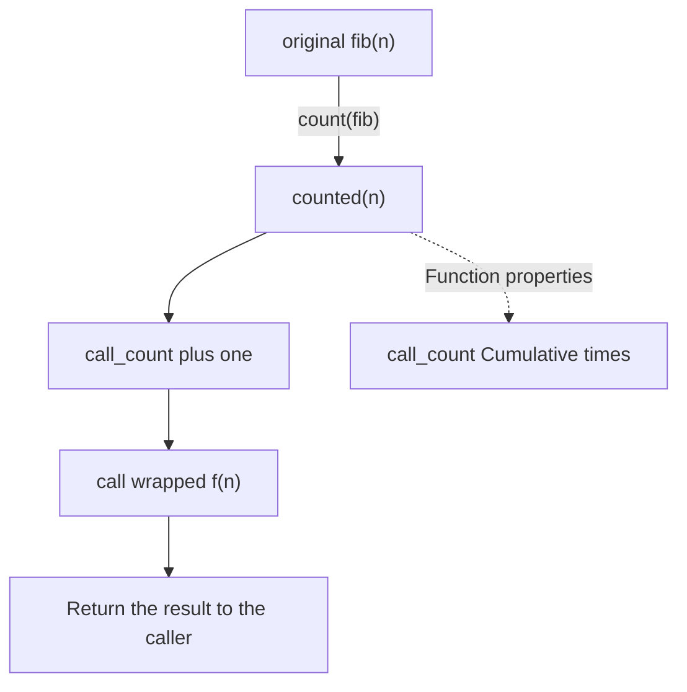
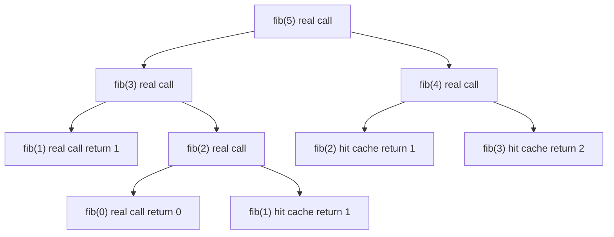
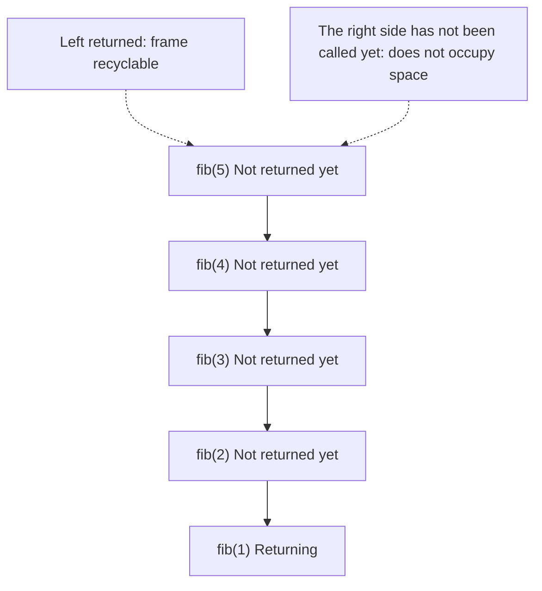

> **courses**: UC Berkeley CS61A · Structure and Interpretation of Computer Programs(Fall 2024)
> **This lecture**: Lecture 23 ｜ 36:37 ｜ Station B P 23 ｜ [Original video](https://www.bilibili.com/video/BV1sy411z7nA?p=23)
> **courseware**: `22-Efficiency_1pp.pdf` (15 pages, official PDF, page-by-page renderings see text illustrations)
> **subtitles**: Original English subtitles from Station B; this note is a reconstruction of Chinese writing, not a sentence-by-sentence translation.
> **Copyright**: The copyright of the course and courseware belongs to the UC Berkeley CS61A teaching team; this article is a secondary arrangement for learning purposes

## Quick overview of this lecture

*(Reference time: 00:00:01 – 00:00:13｜Lecture 23)*

- **Mastered**: How to write tree recursion (`fib`, `fib_tree`), passing functions as values, the closure structure of decorators, and using the environment graph to read out the frames left by a series of function calls.
- **Main line of this lecture**:
    - The stopwatch is unreliable, and the time it takes for the same piece of code to run is different every time; change a ruler and count the number of operations.
    - pure recursion  `fib`  The number of calls increases exponentially with n; `memo`  The decorator uses a dictionary to store the calculated results and reduce the number of calls to linearity.
    - Time can be classified according to the growth order: exponential Θ(bⁿ), quadratic Θ(n²), linear Θ(n), logarithmic Θ(log n), constant Θ(1); big Θ gives upper and lower bounds, and big O only cares about the upper bound.
    - The same mathematical function can be written in different algorithms: `exp`  is linear recursion, `exp_fast`  Halving the exponent at each level is logarithmic recursion.
    - Space is another resource: the frames in the active environment occupy memory. `fib(20)`  Only a maximum of 20 frames can be open at the same time.
- **Key conclusions**: To measure efficiency, you need to ask "how the workload changes when the input becomes larger", rather than "how many milliseconds it ran this time"; changing the growth order (exponential → linear, linear → logarithmic) is more valuable than any constant level optimization.


## 1. Let’s count first: how many things tree recursive fib has done

*(Reference time: 00:00:01 – 00:04:27｜Lecture 23)*

This lecture does not belong to the object section. It wants to answer a more general question: how to estimate how long a program will take to run. At the beginning, the lecturer brought the topic back to the original example of tree recursion - using recursion to calculate the nth term of the Fibonacci sequence, and said casually, "Thank you Fibonacci for making this sequence so famous." This joke points out the reason for choosing it: the recursion itself is already familiar to the reader, and all the attention can be focused on "how many steps does it take".


The definition has only three lines: term 0 is 0, term 1 is 1, and each remaining term is the sum of the previous two terms.

```python
def fib(n):
    if n == 0:
        return 0
    elif n == 1:
        return 1
    else:
        return fib(n-2) + fib(n-1)
```


to  `fib(5)`  For example, the calls are expanded into a tree: `fib(5)`  Sum  `fib(3)`  with  `fib(4)`; `fib(3)`  Calculate first  `fib(1)`, that is a real call, returning 1; then calculate  `fib(2)`, which expands into  `fib(0)`  with  `fib(1)`, return 0 and 1 respectively, so  `fib(2)`  Return 1. `fib(3)`  Return 2. The courseware marks the return value of the base case directly under the leaf, and then uses a dotted line to connect the entire tree in the order of actual occurrence: first all the way down to the left, then back to the bifurcation point layer by layer to calculate the uncalculated subtree on the right.

After walking through this tree, you will see something dazzling: `fib(3)`  Got counted twice - once for  `fib(5)`  The left child, once was  `fib(4)`  the right child; `fib(2)`  Counted three times; `fib(0)`  with  `fib(1)`  is called repeatedly. **The same subtree is pruned and recalculated**, which is why this code is expensive.

> **Editor's note**: `fib(5)`  A total of 15 calls were made, `fib(6)`  It is 25 times, and the ratio of adjacent two items quickly stabilizes around 1.618. This number is the source of "about 60% more work is done for each additional n" in §6.

When talking about "how long", the lecturer's first ruler is not a stopwatch, but "how many times the function has been called." In order to avoid counting by hand, write a decorator to automate counting:

```python
def count(f):
    def counted(n):
        counted.call_count += 1
        return f(n)
    counted.call_count = 0
    return counted

fib = count(fib)
```



> **Editor's note**: `count`  The code does not appear in the courseware of this lecture. It is reconstructed according to the lecturer's dictation and classroom demonstration. There are two main points: `call_count`  hang on  `counted`  on this function object instead of hiding it in the closure, so it is read from the outside  `fib.call_count`  you can get the count; put  `fib`  rebind to  `counted`  This is the key to making recursive calls also use wrappers——`fib`  What is written in the function body is the name  `fib`, this name points to the wrapper after rebinding.

The numbers from the class demonstration are straightforward: `fib(5)`  Returns 5, `fib.call_count`  Display 15; adjust again  `fib(5)`, the count becomes 30 because it is cumulative. Then count  `fib(30)`, the result is 832040, and the cost is  **2,692,537 calls** (approximately 2.69 million times). Instructor’s reminder: Many of these calls just return 0, some return 1, and some return larger and larger numbers until you finally get the desired result.

Counting calls is only the first step. The instructor explains that the purpose of this example is to "begin to understand what exactly happens when a function is called, and how this relates to the time it takes for the function to return"; the next two lectures will develop a more mature way to talk about running time.

> **Editor's note**:Write the number of calls as recursion  `C(n) = 1 + C(n−1) + C(n−2)`, the solution is  `C(n) = 2·F(n+1) − 1`. Check with it: n = 10 gets 177, n = 20 gets 21891, n = 30 gets 2692537, which is consistent with the demonstration results.

## 2. Memorize: keep the calculated results with you

*(Reference time: 00:04:29 – 00:10:47｜Lecture 23)*


The idea of memoization can be said in one sentence: **Remember the results of previous calculations**. When you need a certain value, first check whether it has been saved. If it has been saved, just take it directly without recalculation. Yes  `fib`  For this kind of function that will repeatedly walk into the same subtree, this sentence is enough to change the calculation amount by an order of magnitude.


```python
def memo(f):
    cache = {}
    def memoized(n):
        if n not in cache:
            cache[n] = f(n)
        return cache[n]
    return memoized
```

`cache`  is a dictionary in the closure, its keys are parameters and its values are  `f`  The return value on this parameter - the courseware uses a comment box to write this sentence in  `cache = {}`  next to. `memoized`  First do a member check: `n`  It only counts if it is not in the cache  `f(n)`  Store them together; then, regardless of whether they were calculated just now or what is to be released, they are unified  `return cache[n]`. This way of writing allows "first calculation" and "later fetch" to take the same return path. The only difference is whether to call  `f`.

The courseware is in  `return memoized`  A second comment hangs next to it: "Same behavior as f, if f is a pure function". This is the interface between this lecture and the previous module: **Only pure functions can be safely memoized**. A pure function always returns the same value for the same parameters and produces no side effects. Skipping repeated calls does not change any observable results; if  `f`  It can print, modify parameters, and read clocks or random numbers. By skipping the call, there is one less side effect or one less different value, and the behavior changes accordingly.

The effect of the demonstration is exaggerated: `fib(30)`  Return instantly after being memorized, `fib(50)`  Also, `fib(300)`  Again - although that's a huge number. The lecturer’s statement is: Calculate  `fib(300)`, only need  `fib(298)`  with  `fib(299)`, both of which are available almost immediately in the memoized version.

> **Editor's note**: Strictly speaking, `fib(300)`  The result has more than sixty decimal digits. The addition of large integers itself is no longer constant time, so the "instantaneous" has to be discounted. The amount the lecturer cares about is **Number of calls**, not the number of digits for large integer operations.

How many calls are saved by memoization? The lecturer answered in a two-layered version: `fib = memo(count(fib))`. The outer layer records "memorized  `fib`  How many times the "inner layer record" was requested to actually execute the original  `fib`  number of times". `fib(30)`  The result is 59 times for the outer layer and 31 times for the inner layer.

31 is easy to explain: there are only 31 parameters that really need to be calculated, 30, 29, 28 all the way to 0, and each value is only counted once. 59 Need to look at the call tree. On page 12 of the courseware, three kinds of marks are used to draw the memorized  `fib(5)`: The solid blue circle is the real call, the red circle is "found in the cache", and the open circle is "the pruning was skipped".




Walk along this tree: `fib(5)`  call  `fib(3)`, `fib(3)`  call  `fib(1)` (Real call, returns 1), then call  `fib(2)` (Real calls, calculated in turn  `fib(0)`  with  `fib(1)`); at this time  `fib(1)`  This is the second time it has been requested. It is fetched directly from the cache. Only one wrapper call is counted and no real calculation is triggered. `fib(3)`  It's your turn after returning  `fib(4)`, its left child  `fib(2)`  In the cache, hits are returned, so those  `fib(0)`, `fib(1)`  call **won't happen at all**;right child  `fib(3)`  Same hit. And  `fib(4)`  with  `fib(5)`  are never requested a second time, as they are the ancestors of the entire tree.

Use data to pin this difference:

| n | Number of purely recursive calls | Number of calls to the memoization wrapper | real execution  `fib`  times | Ratio of calls |
| :--- | ---: | ---: | ---: | ---: |
| 10 | 177 | 19 | 11 | about 9 times |
| 20 | 21,891 | 39 | 21 | About 560 times |
| 30 | 2,692,537 | 59 | 31 | About 46,000 times |

> **Editor's note**: The three count columns correspond in sequence  `2·F(n+1) − 1`, `2n − 1`, `n + 1`.`2n − 1`  Shape from tree: each k (2 ≤ k ≤ n) is requested twice, once from the first child of k+2, once from the second child of k+1, plus the top  `fib(n)`, which is exactly 1 + 2(n−1). The two numbers 59 and 31 are similar to those in class.  `fib(30)`  The presentation is consistent, and the remaining lines are actual calculations by the editor.

The shapes of the two curves are completely different. The purely recursive column goes from 177 to 21891 to 2.69 million, **Each additional n multiplies by about 1.6**, it is drawn as an upward-warping exponential curve; the memorized columns are 19, 39, 59, **Each additional n only adds 2**, it is drawn as a straight line. The same recursive definition falls from exponential to linear just because an external dictionary is added.

Of course the price is: `cache`  To save all calculated parameters, the space grows with n. This is the simplest example of "time for space", and it is also the foreshadowing of the discussion of space in §8.

## 3. Two types of exponential operations: linear recursion and logarithmic recursion

*(Reference time: 00:10:47 – 00:13:41｜Lecture 23)*

The previous section replaced the growth order with memoization, this section replaces it with something else: **algorithm itself**. The question is to find b raised to the nth power. Python already has built-in  `**`, but the lecturer has to write a recursive version by himself, because in the process of writing, "what can be gained by one more multiplication" will be clearly seen.

The goal is to make **One more multiplication doubles the exponent**. Let’s first look at a writing method that fails to achieve the goal:

```python
def exp(b, n):
    if n == 0:
        return 1
    else:
        return b * exp(b, n - 1)
```

It corresponds mathematically to bⁿ = b·bⁿ⁻¹ (when n \> 0; when n = 0 the result is 1). The definition is correct, but every addition of 1 to the exponent requires one more layer of recursion and one more multiplication; doubling n doubles the number of multiplications.

> **Editor's note**: The two pieces of code in this section do not appear in the courseware and are compiled according to the lecturer's dictation; `square`  is the helper function he uses in his demo.

But bⁿ doesn’t have just one mathematical definition. There is also a more complex version, which is divided into two cases according to the odd and even numbers of n:

- When n is an even number, bⁿ = (b^(n/2))², first calculate half of the exponent, and then square the result. When n = 16, calculate b⁸ first, then square it to get b¹⁶.
- When n is an odd number, return to the previous definition, bⁿ = b·bⁿ⁻¹, and change n to an even number.

The extra branches result in a change in the scale of the problem, which is implemented as follows:

```python
def square(x):
    return x * x

def exp_fast(b, n):
    if n == 0:
        return 1
    elif n % 2 == 0:
        return square(exp_fast(b, n // 2))
    else:
        return b * exp_fast(b, n - 1)
```

Used in even-numbered branches  `n // 2`. The lecturer specifically stated: It is already known here that n is an even number, so the floor division gives exactly half without losing bits. The odd branch only does one multiplication and decrements n by 1, and the next level must fall into the even branch.

of this function **recursive shape** It is worth emphasizing separately: it appears twice in the function body  `exp_fast`, looks like tree recursion, but any call can only take one of the branches, so it is **linear recursion**. This is the difference between "there are two recursive calls in the code" and "the calculation will unfold into a tree" - the shape is determined by the execution path, not by the writing form.

The cost comparison can be completely explained by the number of multiplications:

| criterion | `exp` | `exp_fast` |
| :--- | :--- | :--- |
| recursive basis | bⁿ = b·bⁿ⁻¹ | Square even numbers, take one step back for odd numbers |
| recursive shape | Linear recursion, subtracting n by 1 at each level | Linear recursion, n is halved at each level |
| n plus 1 | 1 more multiplication | Up to 2 multiplications |
| n doubled | Double the number of multiplications | 1 more square |
| Number of multiplications (n = 200 / 400 / 800 / 1600) | 200 / 400 / 800 / 1600 | 10 / 11 / 12 / 13 |
| growth stage | Θ(n) | Θ(log n) |

> **Editor's note**: Press " for the row with the number of multiplications in the table `square`  Remember 1 multiplication and odd branch  `b *`  Recording 1 multiplication "counts it step by step and does the actual calculation for the editor; the lecturer in class only said the quick version "one more multiplication can double the exponent".

`exp_fast`  At most, n is reduced by half every two levels (the odd-numbered level just changes n to an even number, and the next level is immediately halved), so the number of multiplications increases with log n. When n = 1024, the slow version requires 1024 multiplications, while the fast version requires only 11 times - the difference in exponentials is three orders of magnitude in specific numbers.

## 4. Use a stopwatch to verify: straight line and logarithmic curve

*(Reference time: 00:13:41 – 00:17:40｜Lecture 23)*

Theoretically, the number of multiplications is a kind of "step counting", and I actually ran a stopwatch once in class. The instructor uses Jupyter notebook: it is a common interactive environment, which is characterized by the ability to draw charts directly, so it is suitable for timed experiments. Timing uses the built-in  `timeit`  Module - Repeat the same line of code many times and take the median.

The lecturer first demonstrated the noise of a single timing: `2 ** 400`  The first time it displays 2 milliseconds, the second time only 100 microseconds, and it jumps between 100 and 200 microseconds several times. A single timing is unreliable and must be sampled repeatedly. This is  `timeit`  Reason for existence.

`exp`  Measurements: 2²⁰⁰ has a median time of just under half a millisecond, 2⁴⁰⁰ just under 1 millisecond, and 2¹⁶⁰⁰ about 4 milliseconds. Connecting these dots is a straight line - every time the input doubles, the time doubles, which is **linear**.

`exp_fast`  The same set of measurements for is of another shape: 2¹⁶⁰⁰ is only 0.04 milliseconds, two orders of magnitude faster than the slower version; and 200 to 400 is about 0.002 milliseconds more, 400 to 800 is about 0.002 milliseconds more, and 800 to 1600 is still about 0.002 milliseconds. **Each doubling only adds a small fixed amount**, this curve is **Logarithmic**.

| observe | `exp` (linear) | `exp_fast` (log) |
| :--- | :--- | :--- |
| Median time taken of 2²⁰⁰ | Just under 0.5 ms | Numbers were not reported separately in class |
| Median time taken of 2⁴⁰⁰ | Just under 1 ms | Numbers were not reported separately in class |
| Median time of 2¹⁶⁰⁰ | about 4 ms | About 0.04 ms |
| Double the input | time doubled | Only about 0.002 ms longer |
| curve shape | straight line | An increasingly flatter logarithmic curve |
| Input changes 1000 times | Time changes 1000 times | Only 10 more fixed increments |

The last row of the table is worth expanding: 1024 = 2¹⁰, so "input changes 1000 times" in logarithmic time only corresponds to "doing 10 more fixed jobs", while in linear time it is a real 1000 times. The lecturer's original words were: a thousand times the input, linear takes a thousand times the time, logarithm only requires ten times the constant.

The curve is not smooth and will have ups and downs because there are many details inside the computer interfering with timing. The lecturer specifically states: **linear and logarithmic describe the overall trend**, even if there are fluctuations, it is still called so. This is just the continuation of the next section - since we are looking at trends, we should write down "trend" into a precise mathematical definition.

> **Editor's note**: Single frame timing and  `timeit`  Taking the median is two different measurements, and the absolute value of the former (2⁴⁰⁰ about 100–200 microseconds) is not directly comparable to the absolute value of the latter (2⁴⁰⁰ just under 1 millisecond); what is comparable is the trend. Both sets of data appeared in class. Here, they are described separately as "single noise" and "repeated median", without mixing them into one curve.

## 5. Big Theta and Big O: Naming the Growth Order

*(Reference time: 00:17:40 – 00:21:19｜Lecture 23)*


The words linear, constant, and quadratic have precise mathematical definitions. The purpose of the definition is: **You can prove which growth order a function belongs to without actually running the program.**. This is standard content in computing theory and is not covered in CS61A (it will be used extensively in subsequent courses at Berkeley), but the symbols that go with it are so common that not covering it will cause reading difficulties.

The most commonly used notation is big Θ (big theta), and there is a way to write each of the five common growth orders:

- Exponential growth: Θ(bⁿ)
- Quadratic growth: Θ(n²)
- Linear growth: Θ(n)
- Logarithmic growth: Θ(log n)
- Constant growth: Θ(1)

The constant line is the most likely to give people pause: where did n go? The answer is that n is not there because the constant grows in **Increasing n does not affect time at all**, writing n is wrong. The lecturer also joked in passing: Computer scientists can really say "big theta" when they open their mouths.

Another set of notations is big O, written in the same way: Θ(bⁿ) corresponds to O(bⁿ), and Θ(n²) corresponds to O(n²). The difference is in the meaning: **Big O describes the upper bound**, just say "the worst does not exceed this magnitude"; **Large Θ gives both upper and lower bounds**, which means "It's this magnitude, no more, no less."

| growth stage | Big Θ writing | Big O writing | A word of intuition |
| :--- | :--- | :--- | :--- |
| Index | Θ(bⁿ) | O(bⁿ) | n plus 1, time multiplied by a constant |
| secondary | Θ(n²) | O(n²) | n plus 1, time plus n times the constant |
| Linear | Θ(n) | O(n) | n increases by 1, time increases by a constant |
| Logarithm | Θ(log n) | O(log n) | n is doubled, the time is added to the constant |
| constant | Θ(1) | O(1) | n No matter how you change it, it won’t affect time. |

> **Editor's note**: The standard definition of big Θ and big O uses a quantifier sentence pattern such as "there exist positive constants c and n₀ such that for all n \> n₀..."; there is no expansion in this lecture, and we do not pretend to expand it here. Just remember the directions: O is "no more than" and Θ is "just".

For the notation to be valid, it must also be clear what n is. Everything is simple when n is the number entered; but n may also be the length of the sequence, and there are many sequences of length n, so "how long to run" needs to be further specified. **Worst case, best case or average case**. The instructor said that these will become important in subsequent courses; what is really important to master in CS61A is "the ability to recognize several common growth patterns."

## 6. Quadratic and exponential: pairwise comparisons and repeated subproblems

*(Reference time: 00:21:19 – 00:24:52｜Lecture 23)*

The growth order describes a function **Which category does it belong to?**, rather than exactly how many microseconds it runs: two linear functions may take different times but expand in the same way; all logarithmic functions have the same curve shape.

\*\*Quadratic\*\* The typical form of time is "processing all pairs of elements". The following function counts equal pairs of elements in two sequences:

```python
def overlap(a, b):
    count = 0
    for x in a:
        for y in b:
            if x == y:
                count += 1
    return count
```

> **Editor's note**: `overlap`  The code is not on this courseware, it is organized according to the lecturer's dictation; the example in the class is  `overlap([3, 5, 7, 6], [4, 5, 6, 5])`, the result is 3.

Why 3: `a`  5 in it vs.  `b`  The two 5's in each form a pair, `a`  6 in it and  `b`  The 6's in them form a pair, making a total of three pairs. outer circulation  `a`  For each element of , the inner loop goes  `b`  for each element of , so the number of comparisons is  `len(a) × len(b)`;When both lengths are 4, it is 16 times. The details pointed out by the lecturer are: adding the length from 3 to 4, the extra result is not a comparison, but **a whole line**——This is the price of secondary growth.

The measured curve also confirms this: measuring the length from 20 to 200 one by one and taking the median time, the length of 75 is about 2 milliseconds, and the length of 150 is close to 8 milliseconds. The curve opens upward and is a parabola.

> **Editor's note**: The length doubles and the time quadruples, consistent with the shape of n² (150 vs. 75 is 2 times the length, about 4 times the time), the instructor used the "familiar parabola" to describe this curve.

\*\*Exponential\*\* times are worse. unmemorized  `fib`  Every time you find an n, you must  `fib(n−1)`  with  `fib(n−2)`  The entire tree is recalculated for each, so adding n to 1 requires about 60% more work. The courseware draws this matter into a layer-by-layer superimposed shape: Calculation  `fib(3)`  to be in  `fib(2)`  Make one more piece on top of that, count  `fib(4)`  to be in  `fib(3)`  On top of that, make one more piece.  `fib(5)`  Except  `fib(4)`  Still have to do another big movie. The more levels there are, the larger the extra piece is - this is the typical behavior of tree recursion without memoization.

> **Editor's note**: "About 60%" comes from the fact that the ratio of the number of calls between two adjacent items approaches φ ≈ 1.618. When converted into a multiple, each additional n is multiplied by about 1.6 times. What the lecturer gave in class was this order of magnitude, not a strict limit proof.

## 7. A comparison of five growth stages

*(Reference time: 00:24:52 – 00:29:34｜Lecture 23)*


The courseware arranges the five growth orders in a row, and each is paired with a sentence "What happens when n becomes larger": exponential growth is "n plus 1, time multiplies a constant"; quadratic growth is "n plus 1, time plus n times a constant"; linear growth is "n plus 1, time plus a constant"; logarithmic growth is "n doubles, time then adds a constant"; constant growth is "n does not affect time no matter how it changes." The lecturer said that these five are the most common ones when analyzing functions. Of course there are others, and there is a whole set of formal systems to determine which category a function belongs to - that belongs to the subsequent course.

Arrange the five sentences again by "speed": exponential growth is extremely slow; quadratic growth is slow but very common; linear growth is very common; logarithmic growth is good and can be extended to large inputs; constant growth is the best, and it doesn't matter if n becomes large. The constant-time example given by the lecturer is a Python dictionary: **The number of elements in the dictionary does not affect the time of key pressing.**. Why it can be done is a topic for subsequent courses (hash tables), but the property "key search is constant time" is an important feature of Python dictionaries, and it is also the purpose of §2  `memo`  The reason for choosing a dictionary for caching.

The lecturer also gave a device that puts the five growth stages on the same ruler: use  `T(n)`  represents the time it takes to process an input of size n, compare  `T(n+1)`  with  `T(n)`, masking all details with constants a and b.

- Index: $T(n+1) = a \cdot b^{n+1} = b \cdot T(n)$, the extra one is **Multiplication** factor.
- Second time: $T(n+1) = a(n+1)^2 = T(n) + a(2n+1)$, the extra one is **addition proportional to n** item.
- Linear: $T(n+1) = a(n+1) = T(n) + a$, the extra one is **constant**.
- Logarithm: $T(2n) = a \log(2n) = T(n) + a \log 2$, only **Double** Just one more constant.

> **Editor's note**: The above four equations are written in symbolic form by "multiplying a constant/adding a term that depends on n/adding a constant" dictated by the lecturer, where  $a(2n+1)$  This step of expansion is the algebra added by the editor.

These four items translate the "growth order" into actionable questions: **Is the bill you pay for each time the input gets larger a multiplication, an addition as n increases, or a constant?**  The multiplication ratio is horribly accelerated; the same is true for addition, and it is still bad if what is added depends on n. Only the addition constant is linear. The lecturer thus gave the practical conclusion of this lecture: turning exponential into linear (memoization), or linear into logarithmic (fast power), changes not only the speed, but **How big of a problem can the program handle?**——The upper limit of scale has changed.

| growth stage | n plus 1 | n when doubled | mark | Examples from this lecture |
| :--- | :--- | :--- | :--- | :--- |
| Index | time multiplied by a constant | Time is magnified squarely | Θ(bⁿ) | unmemorized  `fib` |
| secondary | time plus n times constant | Time changes approximately 4 times | Θ(n²) | `overlap`  double cycle |
| Linear | time plus constant | time doubled | Θ(n) | `exp` |
| Logarithm | time plus a smaller and smaller constant | time plus fixed constant | Θ(log n) | `exp_fast` |
| constant | unchanged | unchanged | Θ(1) | Dictionary key search |

The last page of the courseware is a midterm question, which can be used as a practice for this table.


> **Editor's note**: The video ends at 00:36:34 and the lecturer did not reach this page. The questions and codes are taken verbatim from the courseware, and the following analysis and answers are added by the editor.

The question defines prefix sum: the prefix sum of a sequence of numbers is the sum of the first n elements (n takes a certain positive length). to judge  `prefix(s)`  The running time of  `len(s)`  growth order of , and assume  `append`  It takes only one step (constant time) for any parameter.

```python
def prefix(s):
    "Return a list of all prefix sums of list s."
    t = 0
    result = []
    for x in s:
        t = t + x
        result.append(t)
    return result
```

There is only one in the function body  `for x in s`: Each element is added once, once  `append`, both are constant time, and the number of loops is equal to  `len(s)`. So the time is  **Θ(n), linear growth**. The value of this question is to remind you of one thing: judging the growth stage depends on "how many layers of loops are nested and how many times each layer is walked", rather than "whether the code looks long" - if the  `result.append(t)`  Replace it with "put the whole  `result`  Copy it once and add another item, and the same loop will become a quadratic one.

## 8. Space: active environment and simultaneously opened frames

*(Reference time: 00:29:37 – 00:36:34｜Lecture 23)*

Time is not the only resource, memory is too. In this section, the lecturer changes the question to: when the program is running, **Who is occupying the memory?**?

Occupancy comes from two places. The first is the value: long lists take up more space than short lists. The second place is the frame: there is a frame for every function call that is being executed. So what you need to figure out is - how many calls are there at a certain moment that have not yet returned, and which frames in their environment must be preserved.

The course thus introduces two new concepts: during the evaluation process **Which environment frames must be retained**, **What can be let go**. The rule is: at any time there is a set of **active environments**; The memory occupied by values and frames in the active environment; the memory occupied by values and frames not in the active environment can be recycled. The Python interpreter does this automatically - when it determines that certain information is no longer needed, it reclaims that space.

What environments count as "activities"?

- Function call being evaluated: The call occurs but has not yet returned, and its corresponding frame is active.
- Another situation is much rarer: the function of a function in the active environment **parent environment**. When a function is defined inside another function, its parent frame is not the global frame, but the frame of the outer function; as long as this function is needed, its parent frame and other frames in the parent environment are needed.

The good news is that it can be seen. Python Tutor has a "Don't display exited functions" switch. After it is turned on, the returned frames will be deleted directly, and the active frames will be left on the screen. Lecturer uses it to run  `fib(6)`: `fib(6)`  has not returned yet, the frame is still there; it calls  `fib(4)`, `fib(4)`  call again  `fib(2)`, `fib(2)`  call  `fib(0)`; `fib(0)`  After returning, its frame disappears from the graph and its position is  `fib(1)`  frame is replaced. The number of frames changes along the way: first there is F1, then F2, then F3, then F4 is created and disappears after returning, and then it is F5's turn. `fib(4)`  Finished  `fib(2)`  After that, `fib(2)`  frames are removed and replaced by  `fib(4)`  required by another part  `fib(3)`  frame. eventually  `fib(4)`  The entire frame disappears, leaving only the original F1 (`fib(6)`  The calculation is not over yet) and the calculation is  `fib(5)`  frame that was created; wait for them to be deleted as well, `fib(6)`  Return 8.

The number of frames can also be counted in the code. The lecturer wrote a higher-order function  `count_frames`, which adds one to the "number of open frames" each time it enters the wrapper, updates the historical maximum value, and decrements the number of open frames by one before returning:

```python
def count_frames(f):
    def counted(n):
        counted.open_count += 1
        counted.max_count = max(counted.max_count, counted.open_count)
        result = f(n)
        counted.open_count -= 1
        return result
    counted.open_count = 0
    counted.max_count = 0
    return counted
```

> **Editor's note**: `count_frames`  The code is reconstructed according to the lecturer's dictation and classroom demonstration. This courseware does not have this page. The main point is  `max_count`  Update on entry (before the frame exits), `open_count`  in  `f(n)`  Subtract one only after return - putting it before return will miss the deepest layer.

wrap it up  `fib`  call again  `fib(20)`: After calculation  `open_count`  is 0 (all calls returned), `max_count`  Yes 20. This 20 is "the maximum number of frames that can be opened at the same time", which is the space that this function really needs.

Why 20? The lecturer  `fib(5)`  The call tree is used as a schematic diagram: Assume that the branches on the left are finished, the branches on the right have not started, and we are about to start from a certain  `fib(1)`  Return, the active frame at this moment is "those calls on the current chain that have not yet returned". The longest chain is  `fib(5)` → `fib(4)` → `fib(3)` → `fib(2)` → `fib(1)`, length 5. Promotion step: `fib(n)`  The longest chain length of is n, so  `fib(20)`  Up to 20 frames can be open simultaneously.



Hidden here is the most memorable set of comparisons in this lecture: **`fib(20)`  The number of calls is more than 20,000, but there are only 20 frames at the same time.**. Time is determined by the number of nodes in the call tree, and space is determined by the longest chain of the call tree. The instructor's exact words were "It doesn't need to open six thousand frames at the same time, just a few."

> **Editor's note**: Collect this sentence into a criterion that can be memorized - recursive function **Time depends on the number of nodes, and space depends on the depth.**. pure recursion  `fib`  It is a specimen of "time index and space linearity": it is ridiculously slow, but it will not burst the memory. This article is the editor's summary. The lecturer only said "the maximum number of frames equals the longest chain".

## Summary

*(Reference time: 00:36:23 – 00:36:34｜Lecture 23)*

- **A stopwatch is not a ruler**: A single timing will be interfered by cache, scheduling, and machine status, and the same piece of code will be different every time; the reliable quantity is "how the number of operations changes with the input scale."
- **Counting calls is the cheapest place to start**: Give the function a  `count`  decorator, put  `call_count`  Hanging on a function object, recursive calls are automatically counted (provided the function name is re-bound to the wrapper).
- **Memorization is to exchange space for growth order**: `memo`  Use a dictionary to map parameters to return values and only call them on misses  `f`, returns directly on hit; it only guarantees unchanged behavior for pure functions.
- **The same mathematical function can have different algorithms**: `exp`  Decrease n by 1 (Θ(n)) at each level, `exp_fast`  Reduce n by half (Θ(log n)) at each level; two recursive calls in the function body are not equal to tree recursion, depending on the execution path.
- **The five growth stages are distinguished by "how does time change when n changes"**: Exponential multiplication by a constant, quadratic addition of n times a constant, linear addition of a constant, logarithm doubling before adding a constant, constant unchanged; Big O only talks about upper bounds, big Θ gives upper and lower bounds.
- **See the activity environment from space**: Only the frames that have been called but not returned (and the parent frame of the function in the active environment) must be retained, and the rest can be recycled; `fib(20)`  Up to 20 frames can be open simultaneously. Time depends on the number of nodes, and space depends on the depth.

## Appendix: Slides not shown in class (tree review on pages 3–7 of the courseware)

*(Reference time: 00:00:01 – 00:36:34｜Lecture 23)*

> **Editor's note**: Courseware for this lecture  `22-Efficiency_1pp.pdf`  Pages 3–7 of are review pages for tree content: page 3 is a section page, page 4 is a review  `Tree`  Class and functional tree interface, page 5 is an exercise section page, and pages 6 and 7 are two tree-related questions. The video begins with the "Measuring Efficiency" section on page 8. These five pages are not taught. The courseware is included here in the order of the original pages. The text only describes the content of the screen and does not backfill the classroom discussion.


Page 4 has two sets of tree abstractions side by side. On the left is a set implemented using classes:

```python
class Tree:
    def __init__(self, label, branches=[]):
        self.label = label
        for branch in branches:
            assert isinstance(branch, Tree)
        self.branches = list(branches)
```

On the right is a set implemented using lists: `tree(label, branches)`  Combine the tag and branch lists into one list, `label(tree)`  Take the 0th item, `branches(tree)`  Take the part after item 1.

```python
def tree(label, branches=[]):
    for branch in branches:
        assert is_tree(branch)
    return [label] + list(branches)

def label(tree):
    return tree[0]

def branches(tree):
    return tree[1:]
```


There are two more on the same page  `fib_tree`, using two sets of abstractions to write the same recursion:

```python
def fib_tree(n):
    if n == 0 or n == 1:
        return Tree(n)
    else:
        left = fib_tree(n-2)
        right = fib_tree(n-1)
        fib_n = left.label + right.label
        return Tree(fib_n, [left, right])
```

```python
def fib_tree(n):
    if n == 0 or n == 1:
        return tree(n)
    else:
        left = fib_tree(n-2)
        right = fib_tree(n-1)
        fib_n = label(left) + label(right)
        return tree(fib_n, [left, right])
```

The shapes of the two sets of implementations are exactly the same, but the writing method of the labels is changed from  `left.label`  replaced by  `label(left)`. The reason why this page appears in the courseware for efficiency is because  `fib_tree(n)`  The recursive structure of §1  `fib(n)`  Isomorphism - the only difference is that  `fib_tree`  The entire tree has to be built every time, which is more expensive.


The topic on page 6 is counting "twins": given a tree, count how many pairs of sibling nodes have the same label. The question gave three doctests: `t1`  Returns 2 (a pair of labels 4 and 5), the other tree returns 0, and the  `t1`  Copy three times and hang it in a tree under the root to return 9 (there are three pairs under the root, and two pairs in each branch). The answer after filling in the blanks is:

```python
def twins(t):
    """Count the pairs of sibling nodes with equal labels.

    >>> t1 = Tree(3, [Tree(4, [Tree(5), Tree(6)]), Tree(4, [Tree(5), Tree(5)])])
    >>> twins(t1)  # 4 and 5
    2
    >>> twins(Tree(1, [Tree(1, [Tree(2)]), Tree(2, [Tree(2)])]))
    0
    >>> twins(Tree(8, [t1, t1, t1]))  # 3 pairs of twins at the top, plus 2 in each branch
    9
    """
    count = 0
    n = len(t.branches)
    for i in range(n-1):
        for j in range(i+1, n):
            if t.branches[i].label == t.branches[j].label:
                count += 1
    return count + sum([twins(b) for b in t.branches])
```

The structure is divided into two halves: the double loop is responsible for the sibling pairs under the same parent node (`j`  from  `i+1`  To start, make sure each pair is counted only once), and the recursive part adds up the pairs within each branch. Incidentally, this double cycle is quadratic when there are many brothers—the same as in §6  `overlap`  It's the same shape.


Page 7 is question (b) of the second question in the 2023 spring midterm: `remove(t, x)`  Want to delete  `t`  All non-root and labels in are equal to  `x`  node, and then return  `t`, and allows calling already written  `exclude(t, x)`. The answer is only two lines:

```python
def remove(t, x):
    """Remove all non-root nodes labeled x from t.

    >>> u = Tree(1, [Tree(2, [Tree(2), Tree(3)]), Tree(4)])
    >>> remove(u, 2)
    Tree(1, [Tree(3), Tree(4)])
    >>> remove(u, 3)
    Tree(1, [Tree(4)])
    """
    t.branches = exclude(t, x).branches
    return t
```

The idea is "borrow an answer and just move the branch": `exclude(t, x)`  has returned a "remove all  `x` 's new tree", `remove`  Just need to receive the branch list of the new tree  `t` , the in-situ modification is completed; `t`  The label (root) remains unchanged, which meets the requirements of the topic "Only delete non-root nodes". Courseware box pin diagram  `u`  tags, `branches`  The list, the labels for each subtree, and the empty branch list are drawn to emphasize "`branches`  What is stored in it is the tree, not the label."


## Attached: Slide index for this lecture

*(Reference time: 00:00:01 – 00:36:34｜Lecture 23)*

| page | content | Appear location |
| :--- | :--- | :--- |
| 1 | Title page Efficiency | Quick overview of this lecture |
| 2 | Announcements announcement page | Quick overview of this lecture |
| 3 | Section page: Tree Class | Appendix |
| 4 | `Tree`  Class and functional tree interface, two  `fib_tree` | Appendix |
| 5 | Section page: Tree Practice | Appendix |
| 6 | Count Twins: Count pairs of brothers with the same label | Appendix |
| 7 | midterm questions  `remove`:Reuse  `exclude` | Appendix |
| 8 | Section page: Measuring Efficiency | §1 |
| 9 | Fibonacci tree recursive call graph | §1 |
| 10 | Section page: Memoization | §2 |
| 11 | `memo`  Decorator and two annotations | §2 |
| 12 | Memoized call tree: call/hit/skip | §2 |
| 13 | Section page: Orders of Growth | §5 |
| 14 | Five common growth stages | §7 |
| 15 | Midterm question: `prefix`  growth stage | §7 |
