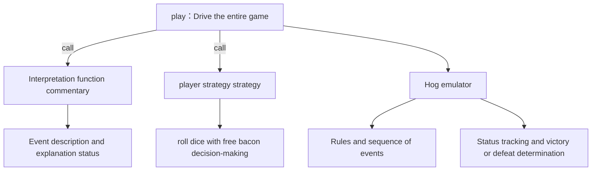
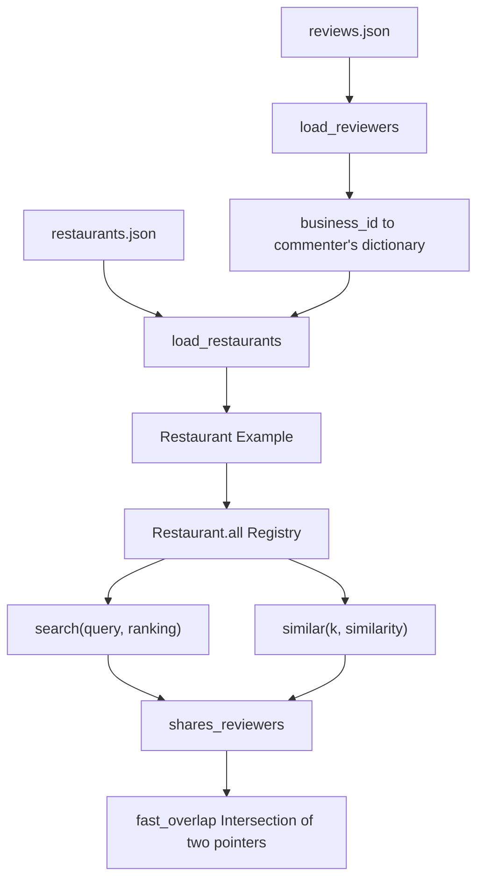
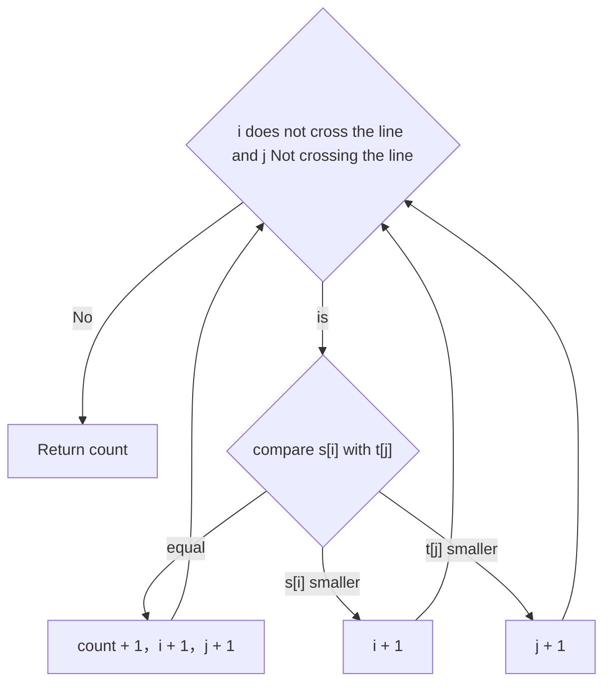

> **courses**: UC Berkeley CS61A · Structure and Interpretation of Computer Programs(Fall 2024)
> **This lecture**: Lecture 24 ｜ 27:16 ｜ Station B P 24 ｜ [Original video](https://www.bilibili.com/video/BV1sy411z7nA?p=24)
> **courseware**: `23-Decomposition_1pp.pdf` (14 pages, official PDF, page-by-page renderings see text illustrations)
> **subtitles**: Original English subtitles from Station B; this note is a reconstruction of Chinese writing, not a sentence-by-sentence translation.
> **Copyright**: The copyright of the course and courseware belongs to the UC Berkeley CS61A teaching team; this article is a secondary arrangement for learning purposes

## Quick overview of this lecture

- **Mastered**: Use classes to encapsulate state, use  `__init__`  Create instance properties using  `__repr__`  Determine how objects are displayed, `sorted`  with  `key`  Argument coordination, list comprehension filtering elements, and  `Link`  How to read this type of recursive data structure.
- **Main line of this lecture**:
    - The difficulty with large programs is that "you can't think about all the parts at the same time." Modular design uses abstract barriers to cut the program into parts that can be swapped in and out, with the goal of separation of concerns.
    - The division of labor is implemented by "passing functions as parameters": `play`  I don’t know how to write the explanation or how to determine the strategy, just call it; the simulator doesn’t know anything other than the rules.
    - Restaurant search makes two decision points into parameters -`ranking` (sorting rules) with  `similarity` (Definition of similarity), so "what is the top" and "what is the similarity" can be replaced at any time.
    - The source of the slowness is the linear superposition of three layers into a quadratic growth; the reviewer list is sorted in advance, and the intersection is calculated using the merge method of two pointers, and the overlap can be calculated by running side by side in one go.
    - Each module only answers its own questions: `similar`  Similarity is not defined, `shares_reviewers`  It doesn't matter how long the list is, `fast_overlap`  Didn't even know I was counting restaurants.
- **Key conclusions**: Whether the decomposition is successful, only one test is used - when changing a concern, whether the code that needs to be moved happens to fall only in the module responsible for it.

*(Reference time: 00:00:00 – 00:00:07｜Lecture 24)*


## 1. Modular design: why large programs need to be dismantled

*(Reference time: 00:00:08 – 00:01:16｜Lecture 24)*


The reason why large programs are complex is not because a single line is difficult to write, but because no one can think through all its parts at the same time. The approach given by modular design is to split the entire program into several **small but quite independent** parts.

"Quite independent" does not mean "completely independent" - different parts must cooperate to produce the overall behavior. What modularity really guarantees is that these parts can **swap in swap out**, separated from each other by various abstract barriers. The role of the barrier is very specific: as long as the code on one side abides by the name and semantic conventions of the other side, it does not need to know how the other side is implemented.

The goal of modular design is therefore **Separation of concerns**: Different parts of the program are only responsible for different aspects of the overall behavior. The instructor calls this a universal design principle—it encourages programmers to isolate code that handles different concerns in different places, so that they don't have to handle all the needs of the program at once.

The second benefit of isolation is **Can be independently developed and tested**. A modular component can be independently verified after knowing what it is responsible for, without having to get the entire program running first. This advantage will be used repeatedly in the second half of this lecture: from three manually constructed restaurants to real data files, every small step can be run immediately to see the results.

> **Editor's note**: Page 2 of the courseware is the announcement page. The screen only has the title "Announcements" and no content. The video starts from 00:00:00 and goes directly to the main topic. The announcement part is not in the subtitles, so this section will not be expanded.

## 2. Hog: Each of the three modules takes care of one thing of concern

*(Reference time: 00:01:19 – 00:02:39｜Lecture 24)*

The course project Hog is a dice scoring game that is cut into three modular components. The division of labor demonstrates the meaning of "focus".

The simulator (Hog game simulator) is concerned with the rules of the game, the sequence of events, and the state tracking required to determine victory or defeat. it **Don't know at all** How to write a commentary.

The commentary is concerned with describing each event that occurs in the game, and the state tracking required to generate these descriptions. It cares neither about how the rules are defined nor what the players actually do.

The player strategy function (player strategy) is concerned with decision-making rules and strategy parameters, such as "what is the score difference before it is worth changing to free bacon" and other experience values. It also doesn't care how the game is scored or how the commentary is worded.

The three are not unrelated: both the explanation function and the strategy function are passed as parameters  `play`, by  `play`  Called at the appropriate time. The key is  `play`  You only need to know "this thing can be called", you don't need to know how it works internally.



The direction of this dependency graph is worth remembering: the arrow is not "who contains whom", but "who knows whom". `play`  Pointing to three modules indicates that it depends on their existence; there are no arrows between the three modules, indicating that they are unaware of each other. When changing the explanation copy, only the explanation node on the graph will move.

| components | what to care about | Make it clear what you don't care about |
| :--- | :--- | :--- |
| Hog emulator | Rules, sequence of events, scores and outcomes | Commentary, player strategies |
| Interpretation function | How the event is described and the state required for interpretation | How the rules are defined and how players make decisions |
| player strategy | Decision rules, strategy parameters (such as the difference in points for free bacon) | Scoring rules and explanation format |

## 3. ANTS: an enlarged version of the same division of labor

*(Reference time: 00:02:39 – 00:04:37｜Lecture 24)*

The ANTS project uses the same design routine, but with more components. The game simulator is provided by the course and students do not have to write it themselves: it is responsible for the sequence of actions, statistics of the total amount of food in the ant colony, and whether the game ends. But it knows nothing about "what exactly the actions of the ants and bees do."

There is one action function for each animal, each describing what is special about this ant or this bee. When writing action functions, you don’t have to consider in what order the actions will occur, how much food is left in the ant colony, whether the game is over, or what the map looks like.

The third part of the map is responsible for: the structure of the tunnels, how many there are, how long each one is, where the entrances and exits are, and the current locations of all ants and bees. So these three parts can be advanced in parallel - one is responsible for rules and procedures, one is responsible for the personality of each animal, and the other is responsible for space.

> **Editor's note**: Pages 3-14 of the courseware are two in-class exercises (increasing stage matching, linked list review), which are not covered in the video; Chapter 11 of this lecture is completely organized in the order of the courseware pages. There are no other courseware pages between pages 2–3, so there are no illustrations in this section of the text.

At this point, the lecturer gave a stricter definition of "decomposition" than usual: **Decomposition is not just about splitting a long function into several small functions, it also means that different aspects and concerns of the program are isolated into different code locations.**. The judgment standard is also clear - that part of the code should know as little as possible about concerns that do not belong to it.

From this we get a rule that can be directly tested: the explanation function should not rely on the rules of the game; conversely, **If modifying the game rules only requires modifying the simulator, then the design is more modular**. The rules have been changed, but the explanation code does not need to change a word, which means that the barrier is effective; the rules have been changed, but the explanation has to be changed, which means that the barrier has been penetrated.

### 3.1 Criterion: When should a module be cut out?

| criterion | positive signal | Negative signal (wrong or not cut) |
| :--- | :--- | :--- |
| Will the changes cross modules? | A requirement change only falls on one module | When you change the rules, you need to easily change the explanation, and when you change the search, you need to easily change the display. |
| Can it be independently tested? | Verification without constructing the entire program | To test a search, you must first run the interactive interface |
| Can the name clearly describe the focus? | Each function name answers a specific question | "and" appears in the name, a function does two things at the same time |
| Will the change point really change? | Change points are made into parameters (`ranking`, `similarity`) | Hardcode the current only choice into the loop |
| Is the cost of the interface worth it? | One more layer of delivery in exchange for replaceability | Adding another layer of abstraction to a constant that never changes |

Sharding is not free: every additional module means one more call, one more interface to read, and one more place where things can go wrong. The function of the criterion is not to "dismantle it if it can be dismantled", but to determine whether the increased complexity can be compensated by replaceability and measurability.

> **Editor's note**: This criterion table is an expansion of the two test methods given by the lecturer at 00:02:39–00:04:37 ("Little knowledge of concerns that do not belong to you" and "Change the rules and only change the simulator") into a list. The expanded part is compiled by the editor and is not the original words of the class.

## 4. Case: Ask the question clearly on the data first

*(Reference time: 00:04:39 – 00:08:59｜Lecture 24)*

Put the above idea into a concrete example: restaurant search. The data is a batch of Yelp records. The goal is to make a program that can search for restaurants by words in their names and display related restaurants.

Each restaurant corresponds to a dictionary containing at least the name, Yelp star rating, price range and  `business_id`;The actual data also includes fields such as latitude and longitude, category, address, and neighborhood. The lecturer conveniently explained the value range: star rating 1 to 5, price range 1 to 3. `business_id`  It is a complex and unique string. It has no meaning to humans, but it is the only connection key between two data files.

Reviews is another dictionary, each containing: which restaurant this review is for (`business_id`), who wrote (`user_id`), the number of stars, text, and date. `user_id`  It does not contain personal information such as email address, but is enough to determine "whether the two comments were written by the same person."

Two authentic comments were presented in class. One article about Cafe 3: The lecturer said that when he first lived in the dormitory, the store was the "bomb diggity". Unfortunately, the quality has declined significantly over the years. Another article about La Cascada Taqueria, two stars, was very harsh: If you want to eat a room-temperature burrito, you can just buy it and put it in the refrigerator for a day and microwave it for 45 seconds before eating it. Why spend seven dollars to order one at a restaurant? The reviews were dated 2012 and 2009 respectively.

There is a reason for the old data: Yelp later stopped publishing academic data sets that included Berkeley restaurants. There are no restaurants around the campus in the new data set, so it is better to continue to use the old data and to have the coffee shops and restaurants that students actually go to appear in the examples. The dataset size is 133 restaurants with about a thousand reviews.

| Field | Appear in restaurant documents | appear in comment files | Purpose in this program |
| :--- | :--- | :--- | :--- |
| `business_id` | is | is | The only connection key: link the review to the restaurant |
| `name` | is | No | Do substring matching when searching |
| `stars` | Yes (average restaurant score) | Yes (single rating) | The restaurant side is used for default sorting, and the review side is not used yet. |
| `review_count` | is | No | This program does not use it, instead uses the reviewer list |
| `user_id` | No | is | Calculate the similarity of "common reviewers" |
| `categories` /address/latitude and longitude | is | No | It exists in the courseware data and is not included in the algorithm in this lecture. |

After seeing the data, the real work begins: there are a series of unanswered questions to complete the application. What exactly does it mean to search by name - prefix matching, substring matching, or ignoring case? What does it mean for two restaurants to be "related" - are they close together, have similar ratings, are in a similar price range, or are they reviewed by the same people? price, star rating, `business_id`  How should each be used? Finally, how should restaurants and reviews be represented in the program?

The lecturer's attitude is: instead of answering these questions all at once, write out the skeleton of the program first and leave undecided decisions as parameters. This is exactly the theme of this lecture - turning "the things that haven't been figured out yet" into interfaces.

## 5. Search, sorting parameters and Restaurant class

*(Reference time: 00:09:00 – 00:13:32｜Lecture 24)*

### 5.1 Write the call point first

The final target form is: Right  `search`  Pass in a word (such as  `Thai`), get back a list of all Thai restaurants; for each restaurant in the list, you can not only see itself, but also see who it is similar to.

The first step is to just write the skeleton of the calling relationship:

```python
def search(query, ranking=lambda r: -r.stars):
    """Return restaurants whose names contain query, ranked by ranking."""
    results = [r for r in Restaurant.all if query in r.name]
    return sorted(results, key=ranking)
```

Choose the simplest matching rule first: as long as  `query`  If it is a substring of the restaurant name, it counts as a hit, writing  `query in r.name`. This code cannot be run when I write it down——`Restaurant`  with  `Restaurant.all`  None of it is defined yet - but it already has the right shape. Writing the call point first and then filling in the callee is the natural order of top-down decomposition.

### 5.2 Sorting rules are the core focus of search engines

The instructor pointed out that one of the most important concerns of search engines is always **sort**:In what order are the results returned? Alphabetical order? distance? Most popular? Or the highest star rating? This decision itself is an opportunity for modularity - instead of hard-coding a certain sorting into a function, it is better to pass the sorting function as a parameter and return the results sorted by it.

Modularization is not free, and the lecturer made the cost very straightforward: After designing this way, every time you call  `search`  You have to prepare a sorting function yourself. So a default value is needed: the default is from high to low by star rating.

`sorted`  The return is by pressing  `key`  The function arranges the new list from small to large, so just use the star rating as  `key`, the one with the lowest star rating will be ranked first; after taking the negative value, the one with the highest star rating will have the smallest negative value, so it will be ranked first, and the order is exactly the opposite. `sorted`  Also  `reverse`  The parameter is available, but is not used in this example.

| Dimensions | Search ranking (ranking) | similarity |
| :--- | :--- | :--- |
| Answered questions | Who ranks first? | How similar are the two restaurants? |
| function signature | One parameter: a certain restaurant | Two parameters: two restaurants |
| Default implementation | `lambda r: -r.stars` (star rating descending order) | Number of common commenters |
| who decides | search engine designer | business/user |
| consequences of substitution | Only affects the order of results | Will affect the entire meaning of "related recommendations" |

### 5.3 Restaurant class: use class attributes as a registration form

Representing a restaurant is a natural class. In addition to the name and star rating, you also need a place to record "all restaurants" - the instructor chose to use **class attribute** Instead of global variables:

```python
class Restaurant:
    all = []

    def __init__(self, name, stars):
        self.name = name
        self.stars = stars
        Restaurant.all.append(self)

    def __repr__(self):
        return '<' + self.name + '>'
```

class attributes  `all`  Initialized to an empty table in the class body, in  `__init__`  is populated: every time a restaurant instance is created, it is automatically registered in  `Restaurant.all`. So  `search`  inside  `Restaurant.all`  Always up to date, no extra "loading complete" step required.

Two bugs were encountered while writing this code, both of which are of teaching value. First one: `__init__`  It says  `all.append(self)`, among which  `all`  Parsed into Python built-in functions  `all`, while built-in functions do not  `append`  properties. The error report points to  `all`, but the real reason is that the name was snatched away by the closer scope - the class attribute must be written in full  `Restaurant.all.append(self)`  to be found.

The second one: Print a restaurant directly, and what appears on the screen is the default, uninformative representation. The fix is to add one  `__repr__`, wrap the name in angle brackets, and get  `<Thai Delight>`  Such a display. After making the changes, the search results will be readable at a glance.

### 5.4 It can be measured using three restaurants

Before reading any files, you can test it first:

```python
thai_delight = Restaurant('Thai Delight', 2)
thai_basil = Restaurant('Thai Basil', 3)
top_dog = Restaurant('Top Dog', 5)
```

The lecturer gave Top Dog five stars and complimented it casually. At this time  `search('Thai')`  Return  `[<Thai Delight>, <Thai Basil>]`: Two Thai restaurants appear in descending order of star rating, with Top Dog correctly excluded. This is exactly what Section 1 said about being independently testable - no data files, no interface, a module can be verified.

The third hole to be filled is  `r.similar`. The instructor starts by just writing the docstring—"Return the k restaurants most similar to self"—and leaving the implementation blank. When you can't write anymore, write the interface first, which is a micro version of the same set of decomposition ideas.

> **Editor's note**: There is no code page for restaurant search in this courseware (pages 3-14 of the courseware are all exercises). The codes in chapters 5-10 are compiled sentence by sentence according to the lecturer's on-site writing and dictation; among them  `search`  The default parameters of `Restaurant.__init__`  parameter table, and  `sorted`  The output formats are based on the subtitle description and are not aligned verbatim on a certain page of slides. The full runnable version also requires the course project  `Link`, data files and other external materials.

## 6. `similar`: Similarity is an alternative strategy

*(Reference time: 00:13:34 – 00:16:57｜Lecture 24)*

write  `similar`  Before that, we need to answer the meaning of the word "similar". The lecturer listed several criteria that all make sense: close distance, close ratings, close price range, or - being reviewed by the same group of people, which means the same group of people will go to these two stores. The last one is the most interesting because it treats "human behavior" as a measure of similarity.

The answer is not to choose one for the user, but to make it a parameter: pass in a **similarity function**, which receives two restaurants and returns a number. So  `similar`  has been thoroughly clarified - it is not responsible for judging similarities, only for **Find the k most similar families according to the given similarity.**.

This is where the requirement for practice comes from: Implementation  `similar`, accepting positive integers  `k`  and a similarity function  `similarity`;returns a list containing the k most similar restaurants, **And does not include the restaurant itself**. The reason given by the lecturer is very straightforward: saying "Thai Delight is most like Thai Delight" is a silly statement.

Reference answer:

```python
def similar(self, k, similarity):
    """Return the k most similar restaurants to self."""
    others = list(Restaurant.all)
    others.remove(self)
    ranked = sorted(others, key=lambda r: -similarity(self, r))
    return ranked[:k]
```

There are four details that can be expanded on in four lines of code.

`others = list(Restaurant.all)`  It's copying. The lecturer only said "others is a copy of the entire list of restaurants" because the next line  `remove`  will modify the list itself - if it is just an alias, the registry will be silently destroyed and then called  `search`  There would be one less restaurant.

`remove`  What is received is the element rather than the subscript, so pass it directly  `self`. There is no definition here  `__eq__`, objects are compared by identity by default, passed in  `self`  It just hits "the current one" accurately.

`sorted`  of  `key`  must be **unary function**——This and  `max`, `min`  of  `key`  Exactly the same, because it is called individually for each element in the list. So it was written  `lambda r: -similarity(self, r)`: put  `self`  Bind the closure in advance so that the function only has one parameter. The reason for taking the negative sign is the same as the sorting rules -`sorted`  Arrange from smallest to largest, with the negative sign placing the most similar ones first.

final  `ranked[:k]`  It's a slice. Now that it has been sorted, the first k items are the answers, and there is no need to write a loop; when k is greater than the number of remaining restaurants, the slices are automatically truncated. The instructor explained this opportunity to "manipulate a sorted list" in class: the work left after sorting is often just slicing at a time.

## 7. Loading data: JSON vs.  `business_id`  connection

*(Reference time: 00:16:58 – 00:21:07｜Lecture 24)*

With the class, you can replace the three manually created restaurants with real data. The restaurant file is line-by-line JSON—JavaScript Object Notation, a text format; Python only  `import json`, called for each row  `json.loads`, you will get a dictionary with keys including name, star rating, category, neighborhood, etc.

```python
import json

def load_reviewers(path='reviews.json'):
    """Return a dict mapping business ID to a list of reviewer user IDs."""
    reviewers = {}
    for line in open(path):
        review = json.loads(line)
        biz = review['business_id']
        if biz not in reviewers:
            reviewers[biz] = []
        reviewers[biz].append(review['user_id'])
    return reviewers
```

The logic of this loop is simple, but it's worth looking at its two branches. If this  `business_id`  If it appears for the first time, first put an empty list in the dictionary as its value, and then add the current commenter to it; if it has already appeared, just take out the ready-made list and append it. Finally get a mapping: `business_id` → All that have reviewed it  `user_id`.

The reason why this dictionary is specially built is because the structure  `Restaurant`  What is needed is **Commenter list**, instead of the number of comments - the number of comments data already contains (`review_count`), but the similarity of "co-reviewers" requires people. The comment file only contains  `business_id`, there is no restaurant name, so you must first use it to attribute the review to the restaurant, and then check back when constructing the restaurant.

```python
def load_restaurants(reviewers, path='restaurants.json'):
    for line in open(path):
        info = json.loads(line)
        biz = info['business_id']
        Restaurant(info['name'], info['stars'], sorted(reviewers.get(biz, [])))
```

`Restaurant.__init__`  So there is one more parameter  `reviewers`. Here's  `sorted(...)`  This is a foreshadowing of performance optimization in the next chapter: first sort the reviewer list, and then the subsequent intersection can be completed linearly. `reviewers.get(biz, [])`  Handle the situation of "a certain restaurant has no reviews" and avoid  `KeyError`.

The lecturer also had a small accident during the demonstration: he was too immersed in the lecture and forgot to assign the calculated reviewers to variables. As a result, the list of reviewers for all restaurants was empty, and there were no similar items in the search results. After filling in the assignment, the program immediately starts outputting the actual results.

| observed facts | Interpretation given by the data |
| :--- | :--- |
| Related restaurants for Thai Basil Cuisine are Gypsy's Trattoria Italiano and Top Dog | Are they really alike? Students all go to these restaurants and share customers. |
| Thai Noodle 2 related restaurants include La Cascada Taqueria | The same people eat both Thai and burritos |
| The related restaurants of Jasmine Thai (used to be in the north, now closed) are all in the north. | Shared reviewer implicitly encodes geolocation |

The results of the first run made the lecturer change the wording: change "similar" to "**Share reviewer**"(shares reviewers with). This is not just a matter of copywriting, it shows that the definition of similarity determines the meaning of the results - put  `similarity`  This is the value of making parameters: if you want to change the "relevance", you only need to change a function, and the rest of the code will not change.



This picture is the module dependency diagram of the entire program. It also gives the direction of dependency: the arrow always points from "caller" to "callee". Data files are only read by the load function; `Restaurant`  Not aware that the file exists; `search`  with  `similar`  only know  `Restaurant.all`; `shares_reviewers`  I only know two restaurants; `fast_overlap`  Only two ordered lists are known. Changing the internal implementation of any layer will not adversely affect the upper layer.

> **Editor's note**: The lecturer called the analytic function when dictating  `JSON.loadString`, the actual name in the Python standard library is  `json.loads` (parsed from string) with  `json.load` (parsed from file object). In addition, `load_restaurants`  with  `reviewers.get(...)`  The way of writing is the concretization of the subtitle description into runnable code. The original way of writing the class demonstration may be slightly different.

## 8. Why is it slow: three layers of linear stacking become quadratic

*(Reference time: 00:21:09 – 00:23:18｜Lecture 24)*

The program works, but is too slow: search for one  `Thai`, and list similar restaurants for each result, it takes 0.7 seconds; replace  `cafe`  Worse, 1.7 seconds - because there are many more cafes than Thai restaurants.

The instructor did not time the code step by step, but directly read the code structure. First level: In order to determine whether it matches the query, each restaurant must be traversed, which is linear. Second level: Called for each hit restaurant  `similar`, while  `similar`  To traverse all the remaining restaurants for it, again this is linear. The third layer is hidden in the similarity itself:

```python
def reviewed_both(r, s):
    return len([x for x in r.reviewers if x in s.reviewers])
```

Iterate through each commenter of R and do it again for each person in the commenter list of S  `in`  Find - and list  `in`  It is a linear scan in itself. So the third level is the comparison of "number of reviewers × number of reviewers", that is **secondary**. The lecturer's original words are: This is comparing each reviewer of R with each reviewer of S. Pairing the two to see if they are the same, slow down here.

| layer | what do you do every time | scale | growth stage |
| :--- | :--- | :--- | :--- |
| first floor | Traverse the restaurants and determine whether the name contains query | Number of restaurants n | Linear |
| second floor | For each hit result, traverse the remaining restaurants and calculate the similarity | Number of restaurants n | Linear |
| third floor | For each pair of restaurants, compare the reviewers pairwise | Number of commenters m | secondary |
| total | Three levels of nested multiplication | Dominated by reviewer length | Quadratic (relative to m) |

The key question therefore becomes: can the **linear time** How to calculate "the number of people who commented on both R and S"?

The answer is yes, the trick is just one sentence: Don't just keep a list of reviewers; **sorted** Reviewer list, and then write a linear process to count the overlap between the two ordered lists.

## 9. Combined intersection: calculate overlap as linear

*(Reference time: 00:23:19 – 00:26:44｜Lecture 24)*

### 9.1 Two pointers move side by side

Given two ordered, non-duplicate lists, it is required to return the number of elements that appear in both lists. The method is to put a pointer from the beginning of the two lists and advance them together; at each step, the two current elements are compared, and then only one of them is advanced - or both are advanced at the same time.

There are only three rules: equality, indicating that a common element is found, the count is increased by one, and both sides advance; the current element on the left is smaller, and since the list on the right is ordered, the remaining elements on the right are not less than its current value, so it will never appear on the right again, and can be safely discarded and only advance the left; otherwise, do the same thing to the right.

Go through the two lists demonstrated in class: `s = [3, 4, 6, 7, 9, 10]`, `t = [1, 3, 5, 7, 8]`.

| step | i / `s[i]` | j / `t[j]` | judgment and action | count |
| :--- | :--- | :--- | :--- | :--- |
| 1 | 0 / 3 | 0 / 1 | 1 \< 3, advance t | 0 |
| 2 | 0 / 3 | 1 / 3 | Equal, both sides advance at the same time | 1 |
| 3 | 1 / 4 | 2 / 5 | 4 \< 5 (also smaller than 7, 8), advance s | 1 |
| 4 | 2 / 6 | 2 / 5 | 5 \< 6 (also smaller than 7, 9, 10), advance t | 1 |
| 5 | 2 / 6 | 3 / 7 | 6 \< 7, advance s | 1 |
| 6 | 3 / 7 | 3 / 7 | Equal, both sides advance at the same time | 2 |
| 7 | 4 / 9 | 4 / 8 | 8 \< 9, advance t | 2 |
| 8 | 4 / 9 | 5 / Crossing the line | t finish walking, end | 2 |

The result is 2 and the common elements are 3 and 7. Each element in the entire process is viewed at most once, and the total number of steps does not exceed the sum of the lengths of the two lists.

### 9.2 Implementation

```python
def fast_overlap(s, t):
    """Return the number of elements in common between sorted lists s and t.

    >>> fast_overlap([3, 4, 6, 7, 9, 10], [1, 3, 5, 7, 8])
    2
    """
    i, j, count = 0, 0, 0
    while i < len(s) and j < len(t):
        if s[i] == t[j]:
            count, i, j = count + 1, i + 1, j + 1
        elif s[i] < t[j]:
            i = i + 1
        else:
            j = j + 1
    return count
```

`i`  Index  `s`, `j`  Index  `t`;The loop condition is "both sides have not been completed", because as long as one side is completed, there cannot be new public elements. The three branches correspond to the three rules above. `count, i, j = count + 1, i + 1, j + 1`  This line uses simultaneous assignment of tuples to advance the count along with both pointers.



The two pointers only move forward and not backward, so each loop consumes at least one element, and the number of loops is linear. The complexity is reduced from "the square of the number of reviewers" to "the sum of the lengths of the two lists".

### 9.3 Lesson 2 of Modularization: Take "Ask for Friendship" out of "Commentator"

After the implementation was completed, the lecturer did not stop here, but asked: What is the process of this process? **Universal**- It doesn't care whether the two lists contain reviewers or something else. So it should be defined as an independent, general function, `fast_overlap(s, t)`, is only called where reviewer overlap needs to be counted.

```python
def shares_reviewers(r, s):
    return fast_overlap(r.reviewers, s.reviewers)
```

With this change, the business concept  `reviewed_both`  shrink into one line, and  `fast_overlap`  Have no idea what a "restaurant" or "reviewer" is. This is exactly the recurrence of the criterion in Section 3: the algorithm focuses on "how to intersect in linear time", and the business focuses on "which two lists need to be intersected", and the two are separated by a clear interface. In the future, if you want to compare restaurants that two users like together, the same  `fast_overlap`  Can be reused directly.

The effect was immediately visible: the cafe group dropped from 1.5 seconds to 0.7 seconds, which was about twice as fast - the instructor added "at least in that one run", reminding that this was only a single measurement. The Thai restaurant group dropped from 0.7 seconds to 0.5 seconds.

> **Editor's note**: 0.7 / 1.5 / 0.5 seconds. These numbers are the readings on the screen during the lecturer's live demonstration. The machine and data will change. What is worth remembering is the order of magnitude and structural change (quadratic → linear), not the specific milliseconds. In addition, "presort + double pointer" is only available when **The same list is intersected repeatedly** Only cost-effective: if each list only needs one intersection, the sorting itself  $O(n \log n)$  Will eat up all the gains. This point is not discussed in the courseware, so it is added here by the editor.

## 10. Finishing: Make the program fast enough to be interactive

*(Reference time: 00:26:45 – 00:27:01｜Lecture 24)*

0.5 seconds means the program is responsive enough to be interactive: it repeatedly reads user input, searches, and then prints the results.

```python
while True:
    query = input('Search: ')
    for r in search(query):
        print(r, 'shares reviewers with', r.similar(3, shares_reviewers))
```

There is no exit condition in the loop, rely on the prompt  `Search: `  Tell the user "It's time to type now". Each row of results first prints the restaurant itself (`__repr__`  given the name in angle brackets), and then print its three most similar restaurants -`similar(3, shares_reviewers)`  This call connects the two designs in Chapter 6 and Chapter 9 on the same line: parameters  `3`  determine quantity, function  `shares_reviewers`  Decide what "similar" means.

Searched in sequence during the demonstration  `Thai`, `cafe`, `coffee`, a real list of restaurants around Berkeley appears on the screen.

The starting point of the whole lecture is here: starting from "It is difficult to think clearly about a large program at the same time", through module division, parameterization decision-making, and performance analysis, we finally get a small program that can answer questions and answers. Each step can be modified and tested independently - sorting rules, similarity definitions, data structures, intersection algorithms, one part of each is automated, and the rest remains unchanged. This is the verifiable benefit of decomposition.

## 11. Courseware exercise page: Growth order pairing and linked list review

*(Reference time: 00:27:02 – 00:27:14｜Lecture 24)*

This courseware has a total of 14 pages: the title on page 1, the announcement on page 2, "Growth Stage Exercises" on pages 3-5 (including one section page), and "Linked List Exercise" (including one section page) on pages 6-14. The 27-minute video only covers the main topic — the restaurant search — and doesn’t go through the exercises page after page. The following is organized according to the order of the courseware pages. The codes are transcribed verbatim according to the screen. The answers already filled in the courseware are given in the fill-in-the-blank spaces.

> **Editor's note**: All the questions, codes and fill-in-the-blank answers in this chapter are from the scenes on pages 3-14 of the courseware; the explanations, reasons and complexity comments are not in the subtitles and are added by the editor.

### 11.1 Criteria for five growth stages


The courseware first uses a section page to divide the exercises into two groups. The first group requires pairing a function with its growth order. The criteria are written in the left column, and the wording emphasizes "how does time change when n changes" than in common textbooks:

- **exponential growth**: n plus one multiplies time by a constant. An example is naive recursion  `fib`.
- **quadratic growth**: n plus one, time increases by n times constant.
- **linear growth**: n plus one, time increases by a constant.
- **logarithmic growth**:n doubles, time only increases by a constant.
- **constant growth**:n increasing does not affect time.


The first question is  `search_sorted`: in a **orderly** Determine whether a certain value exists in the list. It uses the midpoint to chop the search range in half each time, keeping only the half that may contain the target, and then recurses.

```python
def search_sorted(s, v):
    """Return whether v is in the sorted list s.

    >>> evens = [2*x for x in range(50)]
    >>> search_sorted(evens, 22)
    True
    >>> search_sorted(evens, 23)
    False
    """
    if len(s) == 0:
        return False
    center = len(s) // 2
    if s[center] == v:
        return True
    if s[center] > v:
        rest = s[:center]
    else:
        rest = s[center + 1:]
    return search_sorted(rest, v)
```

Check the criteria according to the left column: the size of each recursion problem is halved, that is to say, "n doubling only adds one more level of recursion", so the answer is **Logarithmic growth**.

> **Editor's note**: Strictly speaking, this version also carries a linear cost: `s[:center]`  with  `s[center + 1:]`  The slice will be copied, and the total cost is  $O(n \log n)$. to really do it  $O(\log n)$, the subscript range should be passed instead of the subscript list. The courseware only requires identifying the growth stage according to "halving the scale" and does not involve copying costs. This is the editor's addition.

### 11.2 near\_pairs and max\_sum


The second question page gives two functions, still paired according to the same set of criteria.

```python
def near_pairs(s):
    """Return the length of the longest contiguous sequence of repeated elements in s.

    >>> near_pairs([3, 5, 2, 2, 4, 4, 4, 2, 2])
    3
    """
    count, max_count, last = 0, 0, None
    for i in range(len(s)):
        if count == 0 or s[i] == last:
            count += 1
            max_count = max(count, max_count)
        else:
            count = 1
        last = s[i]
    return max_count
```

`near_pairs`  There is only one loop: use  `count`  Remember the length of the current continuous repeat segment, `max_count`  The longest recorded history, `last`  Note an element. If it is the same as the previous one, extend it, otherwise start again from 1 and update after each comparison.  `last`. Adding one to n is one more constant job, so **linear growth**. Note  `count == 0`  This condition handles the first element without  `last`  Comparable boundaries.

```python
def max_sum(s):
    """Return the largest sum of a contiguous subsequence of s.

    >>> max_sum([3, 5, -12, 2, -4, 4, -1, 4, 2, 2])
    11
    """
    largest = 0
    for i in range(len(s)):
        total = 0
        for j in range(i, len(s)):
            total += s[j]
            largest = max(largest, total)
    return largest
```

`max_sum`  It is a double-layer cycle: the outer layer has a fixed starting point  `i`, the inner layer starts from  `i`  Accumulating all the way to the end, the accumulation process only takes constant time (no re-summing), so each starting point does n times of constant work. The total number of steps is approx.  $n + (n-1) + \cdots + 1 \approx n^2/2$, n plus one increases the time by about n times a constant, the answer is **secondary growth**.

| function | growth stage | One sentence reason |
| :--- | :--- | :--- |
| `search_sorted` | Logarithm | Cut the interval in half at each level, and double n to only have one more level. |
| `near_pairs` | Linear | Single level loop, constant work per element |
| `max_sum` | secondary | The outer layer determines the starting point and the inner layer accumulates. The total number of steps is approximately  $n^2/2$ |

### 11.3 Linked list notation: boxes and arrows


The second set of exercises is about linked lists. The courseware begins with  `s = Link(3, Link(4, Link(5)))`  Take an example to illustrate the notation: each  `Link`  The example is a two-cell box, `first`  Store value, `rest`  Save the arrow pointing to the next paragraph; the last paragraph  `rest`  point to  `Link.empty`, that is, an empty table drawn with a slash. The same chain is usually also drawn on paper in a one-dimensional form with a box and an arrow: `3 → 4 → 5`.

This box-and-pointer notation is important because it separates "where the data is" from "what it points to": `Link(3, ...)`  This object itself only cares about its own  `first`  with  `rest`, the rest of the linked list consists entirely of  `rest`  That grid indicates. All code for recursively processing linked lists is built on this view.

> **Editor's note**: `Link`  class with  `Link.empty`  The module definition is provided by the course project. The courseware only draws the structure and does not provide class definitions. According to the course agreement, `Link.empty`  It is a shared empty linked list object, used to determine whether it is empty.  `s is Link.empty` (identity comparison) instead of using  `len(s) == 0`  Writing like that.

### 11.4 Nested linked list: the element itself can also be a linked list


Linked lists do not require elements to be numbers. The two chains below look almost the same, but the printed results are different:

```python
>>> s = Link(2, Link(3, Link(4, Link(5))))
>>> t = Link(2, Link(3, Link(Link(4), Link(5))))
>>> print(s)
<2 3 4 5>
>>> print(t)
<2 3 <4> 5>
```

The difference is only in the third paragraph: `s`  The third element of is a number  `4`, `t`  The third element of is a line containing  `4`  linked list. When printing  `Link`  of  `__repr__`  Recursively write itself as a sequence of elements in angle brackets, so the nested one is written as  `<4>`. Draw it into a picture to see it more clearly: `t`  of the third box  `first`  Instead of 4, it points to another box containing 4.


Go deeper:

```python
>>> s = Link(Link(8), Link(Link(4, Link(6, Link(Link(7)))), Link(5)))
>>> print(s)
<<8> <4 6 <7>> 5>
>>> s.first.first
8
>>> s.rest.first.rest.rest.first
Link(7)
>>> s.rest.first.rest.rest.first.first
7
```

The way to read this kind of property chain is to evaluate it piece by piece from left to right: `s.first.first`  First take the first element (itself a chain), and then take its  `first`, get  `8`.`s.rest.first.rest.rest.first`  It's all the way  `rest → first → rest → rest → first`, the one parked on the inner layer only contains  `7`  on the chain - notice that what is returned here is **linked list object** instead of numbers, so it appears as  `Link(7)`;Add another one  `.first`  just got  `7`. Each segment of the property chain may return to the "next level". This is where the nested structure is confusing and where it's flexible.

### 11.5 length: comparison between recursion and iteration


Many linked list processing functions can be written both recursively and iteratively. The courseware provides a set of three questions and three steps as a comparison template for the two ideas.

Recursive thinking asks three things: Which recursive call should I make? What does this call do and what does it return? How can its results be used to solve current problems? The iterative idea is three steps: first describe a process that can solve the problem; figure out what additional names are needed to execute this process; and use these names to implement the process.

same one  `length`, two ways of writing:

```python
def length(s):
    """The number of elements in s.

    >>> length(Link(3, Link(4, Link(5))))
    3
    """
    if s is Link.empty:
        return 0
    else:
        return 1 + length(s.rest)
```

```python
def length(s):
    """The number of elements in s.

    >>> length(Link(3, Link(4, Link(5))))
    3
    """
    k = 0
    while s is not Link.empty:
        s, k = s.rest, k + 1
    return k
```

The recursive version splits "length" into "the first element is counted as 1, plus the length of the remaining parts", and returns 0 if the boundary is an empty list. Iteration needs an additional name  `k`  Acting as a counter, the loop condition corresponds exactly to the recursive version of the branch condition: as long as the list is not empty, go one step forward. `s, k = s.rest, k + 1`  Advancing the chain pointer and counting at the same time is a common method of simultaneous assignment in courses.

### 11.6 Constructing a linked list: building from the end to the front


The idea of constructing a linked list is opposite to that of traversal: first build the next section, and then connect it after the current element. Three lines are used to demonstrate this process in the upper right corner of the courseware - starting from an empty table, and then "applying" 5, 4, and 3 to the front:

```python
s = Link.empty
s = Link(5, s)
s = Link(4, s)
s = Link(3, s)
```

`range_link`  Request to return a message containing  `start`  Arrive  `end` (excluding  `end`) is a chain of consecutive integers. The recursive version uses the idea of ​​"build the last one first" to first construct a chain with the first element removed, and then  `start`  Put on:

```python
def range_link(start, end):
    """Return a Link containing consecutive integers from start up to end.

    >>> range_link(3, 6)
    Link(3, Link(4, Link(5)))
    """
    if start >= end:
        return Link.empty
    else:
        return Link(start, range_link(start + 1, end))
```

The iterative version is built backwards from the tail: from  `end - 1`  Start by putting the current integer in front of the existing chain each time until  `k`  less than  `start`.

```python
def range_link(start, end):
    """Return a Link containing consecutive integers from start to end.

    >>> range_link(3, 6)
    Link(3, Link(4, Link(5)))
    """
    s = Link.empty
    k = end - 1
    while k >= start:
        s = Link(k, s)
        k -= 1
    return s
```

The two versions of the docstring are slightly different (one version says "up to end", the other version says "to end"), but the semantics are the same: the right end is not included. The iterative version must be done backwards, because every time a new  `Link`  Can only be connected to existing links **front**; When walking forward, you can only constantly modify the tail.  `rest`, then it becomes the variable operation in the next section.

### 11.7 Variations: append and pop


want **change** If the content of a linked list already exists, it must be given  `first`  or  `rest`  Assignment - This is a mutable operation on a linked list. The courseware starts with " `x`  Add to non-empty chain  `s` " at the end" for example:

```python
>>> t = Link(3, Link(4, Link(5)))
>>> append(t, 6)
>>> t
Link(3, Link(4, Link(5, Link(6))))
```

The environment diagram illustrates why after calling  `t`  Will change: in global frame  `t`  Point to the first paragraph; newly opened  `f1: append`  frame  `s`  At first it also pointed to the first paragraph, `x`  Yes 6. Repeatedly executed in a loop  `s = s.rest`, `s`  go along the chain; go to the last section (its  `rest`  is  `Link.empty`) is executed when  `s.rest = Link(x)`, attach a new box containing 6 to the end. due to  `t`  Always point to the original head, `t`  Naturally, I "saw" the new end. The function has no return value, so nothing is printed in the interactive session.


Two versions side by side:

```python
def append(s, x):
    """Append x to the end of non-empty s.
    >>> append(s, 6)  # returns None!
    >>> print(s)
    <3 4 5 6>
    """
    if s.rest is not Link.empty:
        append(s.rest, x)
    else:
        s.rest = Link(x)
```

```python
def append(s, x):
    """Append x to the end of non-empty s.
    >>> append(s, 6)  # returns None!
    >>> print(s)
    <3 4 5 6>
    """
    while s.rest is not Link.empty:
        s = s.rest
    s.rest = Link(x)
```

The recursive version of the branch condition is written in  `if`  Above: As long as there is something behind, leave the question to  `s.rest`; At the last section, connect the new box in place. The iterative version writes the same condition as  `while`: Go forward as long as there is something behind, when exiting the loop  `s`  That's the last paragraph. Both versions are modified in place and do not return a new chain - although the recursive version calls itself, it does not combine the return values. This is why it is different from the previous one.  `length`, `range_link`  key differences.


The last example is  `pop`:Receives a chain and a positive integer  `i`, delete and return the subscript as  `i`  elements (convention  `s.first`  The subscript is 0). Since it only supports positive numbers, it cannot delete the header element - deleting the header requires changing the external reference to the chain, which is a problem of another interface.

```python
def pop(s, i):
    """Remove and return element i from linked list s for positive i.

    >>> t = Link(3, Link(4, Link(5, Link(6))))
    >>> pop(t, 2)
    5
    >>> pop(t, 2)
    6
    >>> pop(t, 1)
    4
    >>> t
    Link(3)
    """
    assert i > 0 and i < length(s)
    for x in range(i - 1):
        s = s.rest
    result = s.rest.first
    s.rest = s.rest.rest
    return result
```

`assert`  Put the premise into code: `i`  Must be positive and smaller than the chain length. `for`  The cycle is gone  `i - 1`  step, so  `s`  Stop at No.  `i`  elements **previous paragraph**——What needs to be deleted is  `s.rest`. The next two lines are the classic double pointer rewrite: first store the value to be returned into  `result`, let again  `s.rest`  Skip the deleted segment, so the deleted object is removed from the chain, but is still  `result`  It is referenced and can be returned safely.

This set of doctest also explains by the way "the subscript will move": after deleting subscript 2, the original subscript 3 becomes the new subscript 2, so the second time  `pop(t, 2)`  What I got was 6; again  `pop(t, 1)`  Get 4, only the remaining on the chain  `Link(3)`.

## Summary

- **The unit of decomposition is "point of concern", not "number of rows"**: Cutting long functions into small functions is just a formality; the real decomposition requires different aspects (rules, explanations, strategies, maps, performance) to be sealed in independent codes and communicate through interfaces.
- **Parameterization is the most economical means of decomposition**: `ranking`  with  `similarity`  Each is a function parameter, but it makes the sorting rules and the definition of "similar" replaceable; the cost is that the caller has to provide a function, so it is equipped with a default value.
- **Dependence direction should be single**: `fast_overlap`  Only knows ordered lists, `shares_reviewers`  I only know two restaurants. `Restaurant`  Only recognize your own attributes; the arrow only points in one direction, so changes will not be chained.
- **Independently testable is a direct benefit of decomposition**: Three hand-created restaurants can verify  `search`, there is no need to wait for the data file to be in place; writing the docstring first and running it first to see the error report are all the same habits.
- **Performance problems should be identified first before taking action**: Three-layer linear stacking into a quadratic is the real bottleneck; after switching to "pre-sorting + dual pointers", the cafe search dropped from 1.5 seconds to 0.7 seconds, and the Thai restaurant dropped to 0.5 seconds. The program is fast enough to interact.
- **The value of abstraction lies in reusability and replaceability**:same  `fast_overlap`  Any two ordered lists can be compared; the same  `similar`  Can match any degree of similarity. The criterion is always the old saying - whether the change only falls in one module.

*(Reference time: 00:26:28 – 00:27:14｜Lecture 24)*

## Attached: Slide index for this lecture

*(Reference time: 00:00:00 – 00:27:14｜Lecture 24)*

| page | content | Appear location |
| :--- | :--- | :--- |
| 1 | Title Page Decomposition (Order of Growth & Linked List Practice) | Quick overview of this lecture |
| 2 | Announcements announcement page | §1 |
| 3 | Section page: Order of Growth Practice | §11.1 |
| 4 | growth stage criterion and  `search_sorted` | §11.1 |
| 5 | growth stage criterion and  `near_pairs`, `max_sum` | §11.2 |
| 6 | Section Pages: Linked Lists Practice | §11.3 |
| 7 | Linked list notation and box-and-pointer diagram | §11.3 |
| 8 | Nested linked list: `s`  with  `t`  printing differences | §11.4 |
| 9 | Deeply nested linked list and attribute chain annotation | §11.4 |
| 10 | `length`  Recursive and iterative writing methods of | §11.5 |
| 11 | `range_link`  Recursive and iterative construction of | §11.6 |
| 12 | Linked list mutation: `append`  environment map | §11.7 |
| 13 | `append`  Recursive and iterative implementation of | §11.7 |
| 14 | `pop`: Press the cursor to delete and return | §11.7 |
