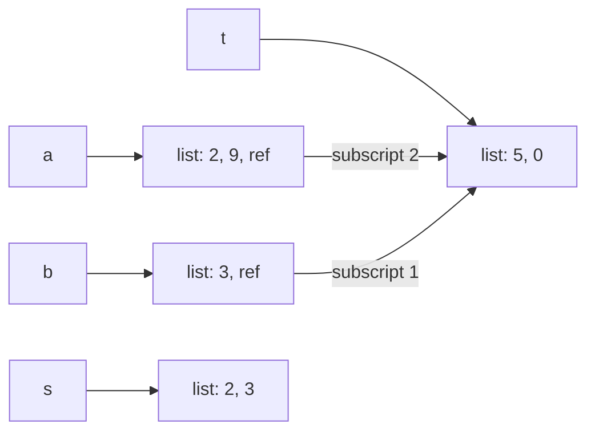
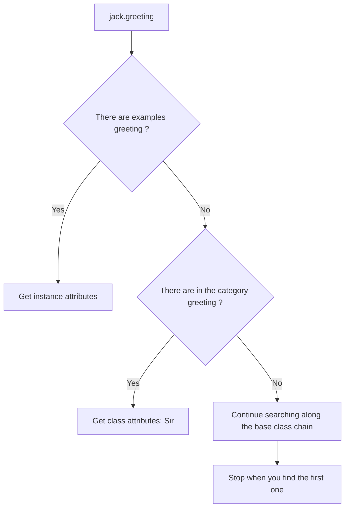
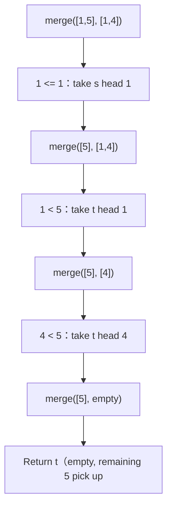

> **courses**: UC Berkeley CS61A · Structure and Interpretation of Computer Programs(Fall 2024)
> **This lecture**: Lecture 25 ｜ 38:37 ｜ Station B P 25 ｜ [Original video](https://www.bilibili.com/video/BV1sy411z7nA?p=25)
> **courseware**: `24-Data_Examples_1pp.pdf` (14 pages, official PDF, page-by-page renderings see text illustrations)
> **subtitles**: Original English subtitles from Station B; this note is a reconstruction of Chinese writing, not a sentence-by-sentence translation.
> **Copyright**: The copyright of the course and courseware belongs to the UC Berkeley CS61A teaching team; this article is a secondary arrangement for learning purposes

## Quick overview of this lecture

- **Mastered**: The list is a variable reference value, and the assignment statement changes "who the name points to"; the environment diagram and the box needle diagram can record changes in the name and content at the same time. I also learned about classes, attribute search, inheritance, iterators and derivation, as well as using  `Link`  represents a recursive linked list.
- **Main line of this lecture**:
    - List operations are divided into two categories: `append`, `extend`, slice assignment changes the same list object; `+`, slice, `list()`, the square bracket literal creates a new list - but the elements in the new list are still references to the old elements.
    - Aliasing means that a deep modification will appear simultaneously in all places pointing to it, and the box needle diagram is the only reliable way to record it.
    - Object: Attribute search first instance, then class, then base class; and attribute assignment **forever** Falling on the object to the left of the dot, this is the mechanism of "specializing attributes for an instance".
    - Data processing four-piece set: `map`, `filter`, derivation, aggregate function (`min`/`max`/`any`/`all`/`count`); it can be written clearly in one line, but first you need to figure out whether you are traversing the index or the value.
    - Recursive data structure: `ordered`  use  `key`  Parameters externalize comparison rules; `merge`  Create a new linked list, `merge_in_place`  To change the old linked list, the only difference between the two is "return to new node or change  `rest`".
- **Key conclusions**: There is no new syntax in this lecture. What it practices is "define the representation and interface first, then write the implementation", and an action: **Draw arrows between values and then write the code by hand**.

*(Reference time: 00:00:01 – 00:00:32｜Lecture 25)*


## 1. The beginning of the courseware: Discussion 8 and two-page overlap counting

*(Reference time: 00:00:32 – 00:00:47｜Lecture 25)*

The first few pages of the courseware clearly mark the location of this lecture: Page 3 is the section page.  **Discussion 8**, indicating that the previous period was reserved for discussion classes and exercises; pages 4 and 5 are the complete version of a linked list problem (one page each for fast and slow solutions); the list only starts on page 6. The video starts directly from "Review List Variation", and the dictation portion of these pages is not in the subtitles.

> **Editor's note**: The subtitles of this lecture are list review starting from 00:00:01, and there is no corresponding oral explanation on pages 3, 4, and 5 of the courseware. The contents of these three pages are organized according to the original text and pictures of the courseware, and the comments are added by the editor; the anchor point of this chapter is the beginning of the video, which is only for time reference, and does not mean that this content has appeared in the video.


The title on page 4 is **Linear time intersection of ordered linked lists**: Given two ordered linked lists with no duplicate elements, return the number of elements that appear in both linked lists at the same time. The courseware draws two chains: 3→4→6→7→9→10 and 1→3→5→7→8. The answer is 2 because only 3 and 7 occur together.

```python
def fast_overlap(s, t):
    if s is Link.empty or t is Link.empty:
        return 0
    if s.first == t.first:
        return 1 + fast_overlap(s.rest, t.rest)
    elif s.first < t.first:
        return fast_overlap(s.rest, t)
    elif s.first > t.first:
        return fast_overlap(s, t.rest)
```

The recursive version and the iterative version are the same algorithm, but the loop is written as a recursive call. Since both sides are in order, you can make the two cursors move forward in one direction: if they are equal, the two cursors will take one step together and score one point; whichever side has a smaller element, move that side forward, because it can no longer be equal to any element on the other side (the other side will only be larger). When any linked list is empty, matching will no longer occur and it will return directly.

```python
def fast_overlap(s, t):
    k = 0
    while s and t:
        if s.first == t.first:
            k, s, t = k + 1, s.rest, t.rest
        elif s.first < t.first:
            s = s.rest
        elif s.first > t.first:
            t = t.rest
    return k
```

The upper bound on the number of steps is the sum of the lengths of the two chains: each step consumes at least one node, and a node is consumed only once. This is the meaning of "linear time" in the title, and also explains why the question requires **orderly**: An unordered linked list has no criteria for "who should be discarded", and any comparison is not enough to exclude any element.


On page 5, the slow writing method is displayed for comparison. The overall idea is still that of higher-order functions: `count_if`  Receive a judgment function and externalize "whether to count"; `contained_in`  It is a way of writing currying. First remember the beginning of the linked list and return a judgment function that only waits for elements; `overlap`  Then put the two together.

```python
def count_if(f, s):
    if s is Link.empty:
        return 0
    else:
        if f(s.first):
            return 1+count_if(f, s.rest)
        else:
            return count_if(f, s.rest)

def contained_in(s):
    def f(s, x):
        if s is Link.empty:
            return False
        else:
            return s.first == x or f(s.rest, x)
    return lambda x: f(s, x)

def overlap(s, t):
    "For s and t with no repeats, count the numbers that appear in both."
    return count_if(contained_in(t), s)
```

The price is visible at a glance: Yes  `s`  for each element of `contained_in(t)`  All have to  `t`  Sweep from beginning to end, so the total number of steps is approximately equal to the product of the lengths of both sides. It's short to write but expensive to run - this is exactly what the growth stage comparison table in the right column of the courseware wants to remind you.


| growth stage | Criterion: when n increases by 1 | Typical example |
| :--- | :--- | :--- |
| Exponential growth | time **multiply by** a constant | recursive version  `fib` |
| Quadratic growth | time **increase**  n times constant | Scan the entire chain for each element |
| Linear growth | time **increase** a constant | Both cursors advance in the same direction |

This table is the first ruler to judge "whether you can pass the test": the same question, `overlap`  with  `fast_overlap`  The output is the same, but the magnitude differs by n. In the later chapter on linked lists, the same trade-off will appear again in the form of "create a new linked list or modify it in place".

## 2. Lists are mutable: `append`  with  `extend`  box pin diagram

*(Reference time: 00:00:47 – 00:02:23｜Lecture 25)*


Lists are the first object in this course that allows multiple names for the same piece of data. The name can be changed to refer to another list, and the contents of the list can be longer or shorter - these two things are independent of each other, and the environment diagram separates them exactly: the name and arrow in the global frame, and the subscripted box in the heap.

The benchmark examples given in the courseware are always the same: execute first  `s = [2, 3]`  with  `t = [5, 6]`, and then only perform one operation at a time.

`append`  Add an element to the end of the list. execute  `s.append(t)`  After that, `s`  Becomes a list of three elements: the first two are the numbers 2 and 3, and the third grid contains **arrow**, pointing to  `t`  The one originally pointed to  `[5, 6]`.

```text
>>> s = [2, 3]
>>> t = [5, 6]
>>> s.append(t)
>>> s
[2, 3, [5, 6]]
```

There is a detail that must be made clear here: the arrow in the third grid points to **value**, not a name  `t`. The reason why the line in the box needle diagram is not drawn to the global frame  `t`  on, because  `s.append(t)`  When evaluating, first put the name  `t`  Evaluate into the list it is bound to, and then put that list into it. Lists always store values, and names are just one stop in the evaluation process.

So the next step is easy to understand: `t = 0`  just put the name  `t`  Re-tied to 0, `[5, 6]`  The list itself has not disappeared; `s`  The arrow in the third grid is still pointing to it. `s`  Still  `[2, 3, [5, 6]]`, `t`  becomes 0. **Changing the name will not change the content.**

`extend`  Then move the elements in the parameters one by one. `s.extend(t)`  after  `s`  become  `[2, 3, 5, 6]`——Four grids, four numbers, no nesting. Execute again at this time  `t[1] = 0`, `s`  Not affected at all: `s`  It contains the two numbers 5 and 6 themselves, and the numbers are immutable. `t`  If the value of the grid inside is changed, it will not be affected.  `s`  any grid in it.

| criterion | `s.append(t)` | `s.extend(t)` |
| :--- | :--- | :--- |
| What is added | an object (a reference) | `t`  every element of |
| `s`  length change | add 1 | add  `len(t)` |
| Modify later  `t`  content | will be reflected in  `s`  inside | No (numbers are immutable) |
| shape of structure | Nesting (list within list) | Flatten (one layer) |
| Typical uses | Build trees and nested structures | splicing homogeneous sequences |

One sentence to remember: `append`  What is stored is "this object", `extend`  What is stored are "its elements". Choose the wrong day, and it will immediately show up on the box pin diagram - there will be one more layer of nesting, or the place that should be shared will become a copy.

## 3. Addition and slicing: new lists, shared elements

*(Reference time: 00:02:24 – 00:05:32｜Lecture 25)*

`+`  and slices both **Create new list**, but they only copy the "grid", not the contents of the grid. The courseware breaks this sentence down with a longer example: `a = s + [t]`, `b = a[1:]`, and then change respectively  `a`  and  `b`.

The first step is  `[t]`: The square bracket literal is first evaluated into a list with only one element, and that element is  `t`  Evaluated  `[5, 6]`. The second step is  `s + [t]`: Add two lists, copy them cell by cell, and get a new list  `[2, 3, [5, 6]]`, then tie it to  `a`.

```python
s = [2, 3]
t = [5, 6]
a = s + [t]
b = a[1:]
```

The temporary single-element list has no name. After it is evaluated, it loses all references, becomes unreachable, and can be regarded as being recycled - the courseware specifically stopped to mention this "floating list" because it is an exercise in understanding "who is still pointing at whom": not all created objects are worth recording.

`b = a[1:]`  Cutting from index 1 to the end results in a new list with two elements: the number 3, and  `a`  Which direction  `[5, 6]`  The reference - still points to the same list object, no copying.


Then make two modifications. `a[1] = 9`  put  `a`  The second grid is changed from 3 to 9. This is a pure "changing grid". `b[1][1] = 0`  To read in three steps: take first  `b`  The first grid (the one pointing to  `[5, 6]`  reference), then take the list it points to, and then change the cell with subscript 1 to 0. This move is **the shared list**, so three places change at the same time:

| name | Before changing | After the change | Description |
| :--- | :--- | :--- | :--- |
| `s` | `[2, 3]` | `[2, 3]` | never touched |
| `t` | `[5, 6]` | `[5, 0]` | Be  `b[1][1] = 0`  Change to |
| `a` | `[2, 9, [5, 6]]` | `[2, 9, [5, 0]]` | The third grid is related to  `t`  Share |
| `b` | `[3, [5, 6]]` | `[3, [5, 0]]` | The second grid is related to  `t`  Share |

The courseware summarizes the results into "three zeros": `t`  0, `a`  0, in a deeper layer `b`  0 in one layer deeper. The three 0s are actually the same grid, but there are three entrances to it. once  `+`, every slice carries this reference, so the changes will appear in three places at the same time.



This picture is worth comparing again and again: **The new list is new, and the references in the elements are old.**. The so-called "copy" refers to the entrance, not the people inside.

## 4. Shallow copy, square bracket literal and slice assignment

*(Reference time: 00:05:33 – 00:06:27｜Lecture 25)*

`list()`  It is also a new list. execute  `t = list(s)`  After that, `t`  Get a new list containing 2 and 3, `t`  It turned out to be pointing  `[5, 6]`  Replaced; executed again  `s[1] = 0`, `s`  become  `[2, 0]`, `t`  Still  `[2, 3]`. This is exactly where the conclusion of the previous section comes in: **If you copy a layer, the elements will still be shared; but because the elements are numbers, changing the name/modification will not penetrate it.**

The three ways of writing "copy a list" are completely equivalent. The courseware juxtaposes them in the comments on page 11:

```text
list(t)       # 调用构造器，逐元素复制到新列表
t[:]          # 整段切片，得到新列表
t + []        # 与空列表相加，得到新列表
```

Note that they are all **shallow** Copy (shallow copy): The outer layer is new, but the inner list is still the original objects. from the previous section  `b = a[1:]`  It’s a shallow copy, so  `b[1][1] = 0`  to change to  `a`.


Slice assignment is another thing in the same syntax: it replaces the entire "slice selected grid" with the elements of another list. **Lengths do not have to be equal**.

```text
>>> s = [2, 3]
>>> t = [5, 6]
>>> s[0:0] = t
>>> s
[5, 6, 2, 3]
```

`0:0`  It is a slice of zero length, which is a "slit". Two elements are inserted into the gap, and the following elements are moved to the right as a whole - this step is "insertion". If the lengths are not equal, no error will be reported. The implementation of the list is only responsible for moving the grid.

The second step is to replace  `s[3:] = t`. At this time  `s`  is  `[5, 6, 2, 3]`, `s[3:]`  Select the last cell 3 and replace it with a list of length 2 to get  `[5, 6, 2, 5, 6]`. Execute again  `t[1] = 0`, `t`  become  `[5, 0]`, while  `s`  The last cell of is still the number 6: it originally moved in the numbers 5 and 6, not quotes.

| Writing method | What was selected | Effect | Length requirement |
| :--- | :--- | :--- | :--- |
| `s[0:0] = t` | Seam of length 0 | Insert  `t`  All elements of | arbitrary |
| `s[3:] = t` | tail of length 1 | Replace 1 with 2 elements | arbitrary |
| `s[1] = 9` | single subscript | Change a grid without changing the length | Not applicable |
| `s[0:2] = []` | Head length 2 | Delete these two elements | arbitrary |

Square bracket literals themselves are also a rule for "creating new lists": `u = [s, t]`  Calculate first when evaluating  `s`, `t`  two values, and then load them into a new list, so  `u`  Contained are two quotes.

![Square bracket literal: u = \[s, t\] stores two references](</attachments/cs61a-48d208956fe5d075349c6d7d.png>)

## 5. Make the list shorter: `pop`, `remove`  with deleting slices

*(Reference time: 00:06:30 – 00:08:06｜Lecture 25)*

If it lengthens, it will shorten. The courseware says that these operations are "too straightforward to be worth drawing an environment diagram", so I just list them:

- `pop`  delete and return **the last one** element. `t = s.pop()`  after  `s`  only  `[2]`, `t`  Tied to the ejected 3; the original one  `[5, 6]`  There is no longer any name pointing to it, and it has been lost.
- `remove`  delete **The first one is equal to the parameter** elements. `t.extend(t)`  let  `t`  become  `[5, 6, 5, 6]`, `t.remove(5)`  Only delete the first 5, leaving  `[6, 5, 6]`;whole journey  `s`  is  `[2, 3]`, motionless.
- Slice assignment can be deleted: assigning an empty list to a slice is equivalent to removing the entire section of the grid. `s[0:1] = []`  put  `s`  become  `[3]`; `t[0:2] = []`  put  `t`  Empty into  `[]`.

```text
>>> s = [2, 3]
>>> s[0:1] = []
>>> s
[3]
>>> t = [5, 6]
>>> t[0:2] = []
>>> t
[]
```


`pop`  with  `remove`  The difference is not only "from where to delete", but also "by what to delete": `pop`  Delete one by location, `remove`  Find the first one by value and delete it. When there are duplicate values in the list, `remove`  Only touch the front one - this is where the two are most easily confused.

## 6. List within list and self-reference: `[[...]]`  How was it printed?

*(Reference time: 00:08:08 – 00:10:02｜Lecture 25)*

By stacking the previous rules, you can create increasingly weird shapes. The courseware will first give a mild version:

```python
t = [[1, 2], [3, 4]]
list(t)
t[0].append(t[1:2])
print(t)
```

Each of the three lines does three things. `list(t)`  A new outer list is created, but no one catches it - just like the floating single-element list in the previous chapter, it is immediately unreachable. `t[1:2]`  It is a slice, creating a new list with only one element in it: pointing to  `[3, 4]`  citation. write here  `1:2`  instead of  `1`  is the key: `t[1]`  That’s it  `[3, 4]`  itself, `append`  There is only one more level to go in;  `t[1:2]`  The result is still a list, again  `append`  Just two more layers - the one in the result  `[[3, 4]]`  That's how it came about. `t[0].append(...)`  Put this package in  `t[0]`  the end of.

```text
>>> t = [[1, 2], [3, 4]]
>>> list(t)
[[1, 2], [3, 4]]
>>> t[0].append(t[1:2])
>>> t
[[1, 2, [[3, 4]]], [3, 4]]
```

The one in the result  `[[3, 4]]`  A bit convoluted: `t[1:2]`  is a list that "holds a reference" and is  `append`  enter  `t[0]`  After that, it becomes  `t[0]`  the third element of ; so  `t[0]`  is  `[1, 2, [[3, 4]]]`——The innermost layer  `[3, 4]`  It is the original sublist, and the outer layer is the packaging created by slicing.

![List within list: result of t\[0\].append(t\[1:2\])](</attachments/cs61a-a1fa7b31d8c9760aa0b4a120.png>)

Finally, there are self-references. `t = [1, 2, 3]`  Afterwards, use slice assignment to replace the "entire element" with an element containing  `t`  own list:

```text
>>> t = [1, 2, 3]
>>> t[1:3] = [t]
>>> t
[1, [...]]
>>> t.extend(t)
>>> t
[1, [...], 1, [...]]
```

`t[1:3] = [t]`  Replace the grids with subscripts 1 and 2 with "a pointing  `t`  reference", so  `t`  became  `[1, t]`: It contains itself. The courseware says a key word here: **This won't make Python explode**——The reference is circular, but there is only one object, and no one needs infinite copying.

`t.extend(t)`  again  `t`  All elements are moved to their end. at this moment  `t`  The elements are "number 1" and "a pointer to  `t`  reference", so after moving it is  `[1, 引用, 1, 引用]`, a total of four elements. Python cannot expand references layer by layer when printing (that would cause infinite recursion), so use  `[...]`  It means "the already printed list is wrapped here".

> **Editor's note**: The above two paragraphs of interactive output are standard  `repr`  Behavior; In the video, the lecturer only shows the results on the screen and says "it looks like this", and the subtitles do not give this line of text verbatim. `[...]`  Not ellipsis syntax, but a protective display of circular references by the interpreter.

This chapter ends with a reminder from the lecturer: **It’s difficult to jump directly from code to the final result**, it’s almost impossible to get it right without drawing a box pin diagram. This is not a question of technique, but the only reliable solution to this type of problem.

## 7. Object system review: instances first, then classes, then base classes

*(Reference time: 00:10:04 – 00:17:46｜Lecture 25)*

After the list comes the object's turn. This section reviews the second question set in the Fall 2014 midterm.  `Worker` / `Bourgeoisie`  The code, this page is not included in the courseware, it was drawn live in class.

> **Editor's note**: `Worker` / `Bourgeoisie`  It is not included in the 14 pages of the PDF of this lecture. In the video, the lecture is explained by writing and drawing environmental pictures on the spot. The code below is transcribed according to the subtitle description and the popular version of this mid-term question, for comparison with the environment map; the results and lines in the table below are taken from the subtitles. Punctuation (such as commas in the lines) is not given in the subtitles one by one. Please complete it according to the original writing method.

```python
class Worker:
    greeting = 'Sir'

    def __init__(self):
        self.elf = Worker

    def work(self):
        return self.greeting + ', I work'

    def __repr__(self):
        return Bourgeoisie.greeting


class Bourgeoisie(Worker):
    greeting = 'Peon'

    def work(self):
        print(Worker.work(self))
        return 'I gather wealth'
```

The courseware analogy is the skeleton of this scene: `Worker`  He is a worker and is called "Sir" when meeting; `Bourgeoisie`  They are the bourgeoisie - according to the lecturer, they own the means of production, do not work themselves, and rely on hired workers to gain wealth, so their  `work`  Just "direct the workers to work" and then say "I gather wealth". In order for this metaphor to seep into the code, `Bourgeoisie.work`  call  `Worker.work(self)`  Print the worker's line and then return your own line.

The first rule is **The order in which properties are looked up**: To find attributes by name on an instance, first find the instance attributes, then the class attributes, and then the base class attributes. This is how class attributes are "inherited".



The second rule is **The direction of attribute assignment**: `jack.greeting = "Ma'am"`  Always assign it to the object to the left of the dot, that is  `jack`  myself. It will not change the class attributes, nor will it create anything new on the class.

Go through the initialization:

- `class`  The statement body of the statement is executed immediately, so there is a class  `Worker`, with a class attribute  `greeting = 'Sir'`.
- `Bourgeoisie`  inheritance  `Worker`, I have  `greeting = 'Peon'`, nothing else is covered.
- `jack = Worker()`  Create the instance first and then give it to  `__init__`; `self.elf = Worker`  let  `jack.elf`  point to **class itself**.
- `john = Bourgeoisie()`  in  `Bourgeoisie`  Not found on  `__init__`, so we find along the base class  `Worker.__init__`  and apply, `john.elf`  Same thing  `Worker`  class.
- `jack.greeting = "Ma'am"`  in  `jack`  Create a new instance attribute on; from now on  `jack`  Calls himself "Ma'am", nothing else  `Worker`  Still called "Sir".

So a series of expressions can be calculated. The second column of the table is the result, and the third column is the reason:

| expression | result | why |
| :--- | :--- | :--- |
| `Worker().work()` | `'Sir, I work'` | Instance no  `greeting`, check the category  `'Sir'` |
| `jack` | show  `Peon` | `__repr__`  Return  `Bourgeoisie.greeting`, with  `self`  irrelevant |
| `jack.work()` | `"Ma'am, I work"` | `self.greeting`  First find the instance attributes |
| `john.work()` | Print  `Peon, I work`, return  `'I gather wealth'` | Use the base class method to calculate the lines, and then return to your own sentence |
| `john.elf.work(john)` | `'Peon, I work'` | `elf`  is a class, take the function from the class, `john`  make  `self` |

`jack`  The result in that line is the most frightening: it is displayed as  `Peon`. The reason is  `__repr__` - it doesn't look at it at all  `self`, return directly  `Bourgeoisie.greeting`. this is a **Deliberately written badly** Representation method is used to test "what is displayed in the interactive session": to evaluate an expression, the interpreter needs to turn it into a line of text, so it calls its  `__repr__`.

`john.work()`  There are two layers of output in that line, which must be distinguished. `Worker.work(self)`  Returns a string  `'Peon, I work'`, but  `Bourgeoisie.work`  use  `print`  Send it to the screen; `print`  Print the string without quotes, just the content. subsequently  `Bourgeoisie.work`  Return  `'I gather wealth'`, this value is the return value of the interactive session, so when displayed **with quotes**.

A rule: the presence or absence of quotes on the screen depends on whether the string is printed or echoed as a value. The echo needs to give an expression that "evaluates back to get the same string", so it must be quoted; `print`  Just pour the contents out.

## 8. Four questions on data processing: write it in one line, but first think clearly about what to traverse

*(Reference time: 00:17:49 – 00:32:21｜Lecture 25)*

This section is the practice ground for the entire lecture. The four questions are not big, but each one can be compressed into one or two lines using built-in functions and derivation. The courseware is first laid out at once, allowing people to try it out by themselves, and then teach them one by one.

Question 1: List  `s`  The elements with the smallest absolute value in **subscript**. to  `s = [-4, -3, -2, 3, 2, 4]`  For example, the smallest absolute value is 2, corresponding to elements -2 and 2, and the subscripts are 2 and 4.

Here is a trap that must be broken: `min(s, key=abs)`  given **No** Minimum absolute value, but "the element with the smallest absolute value" (-2 or 2). What we want is the number 2, so we have to first take the absolute value of each element, and then take the minimum value:

```python
min_abs = min(map(abs, s))
[i for i in range(len(s)) if abs(s[i]) == min_abs]
```

The second line could easily be written as "find all elements with an absolute value of 2", but the purpose is different: `[x for x in s if abs(x) == min_abs]`  What is given is elements (2 and -2), and the question requires subscripts, so the traversed objects must start from  `s`  Replace with  `range(len(s))`, the judgment condition also follows  `abs(x)`  Replace with  `abs(s[i])`.

The same thing can be used  `filter`  write. Define the judgment function first, and then filter out the subscript sequence; `filter`  What is returned is the filter object (a lazy iterator). If you want a list, you have to add another layer.  `list`:

```python
def keep(i):
    return abs(s[i]) == min_abs

list(filter(keep, range(len(s))))
```

Question 2: Maximum value of the sum of two adjacent elements (guaranteed  `len(s) > 1`). Yes  `s = [-4, -3, -2, 3, 2, 4]`, the five adjacent sums are -7, -5, 1, 5, 6, and the answer is 6.

The idea is to stare at the subscript: `range(len(s) - 1)`  Give all the subscripts of "the one on the left", the last subscript is not counted because it has no right neighbor; put the sum of each pair into a list, and then take the list  `max`.

```python
max([s[i] + s[i + 1] for i in range(len(s) - 1)])
```

Change of ideas  `zip`: Put "except the last element  `s`"AND" except the first element  `s`"Match into pairs, each pair being exactly adjacent elements. direct  `zip(s, s)`  It's useless - it matches "the same element as itself". After pairing, sum each pair and take the maximum:

```python
max([a + b for a, b in zip(s[:-1], s[1:])])
```

Question 3: Construct a dictionary and put each number  `d`  mapped to  `s`  All "with" in  `d` "End" element. to  `1`, `3`, `4`, `5`, `8`, `9`  All the ending numbers are present, two of them end in 5 (5 and 55), and none end in 2 - so the resulting dictionary cannot have key 2.

```python
{d: [x for x in s if x % 10 == d]
 for d in range(10)
 if any(x % 10 == d for x in s)}
```

The three-level structure should be read separately: the value is a list comprehension (pick out  `d`  elements at the end), the outer layer is a dictionary comprehension (for each number  `d`  create a key), the last  `if`  Is a filter clause (retaining only those where the ending number actually appears  `d`).`any(...)`  Answer "Is there any element starting with  `d` "End", on the empty collection  `any`  is false, so key 2 is skipped.

If you think the expression is too long, you can first calculate "all ending digits" and then let the filter clause look up the table:

```python
last_digits = [x % 10 for x in s]
{d: [x for x in s if x % 10 == d] for d in range(10) if d in last_digits}
```

The lecturer's evaluation of this step is "It's only a little shorter, but at least it splits a large expression into two" - this in itself is a gain in readability.

Question 4: `s`  Whether each element in is equal to **another** element. In the first example, -4 appears only once, and the answer is false; in the second example, 4, 3, and 2 each appear twice, and the answer is true.

The first idea is to stare at the subscript: for each  `i`, construct a "remove subscript  `i`  That element" list, see  `s[i]`  Is it still inside. `s[:i] + s[i + 1:]`  That's the list.

```python
all(s[i] in s[:i] + s[i + 1:] for i in range(len(s)))
```

There is an easily overlooked detail here: this expression only removes **The element at subscript i**, and does not delete all equal to  `s[i]`  value. If you can still find one after removing one, it means that there is another one that is equal - this is exactly what the question is asking.

The second idea is to check the value: directly count how many times each value appears, and it is required that it is greater than 1 every time. Calculate a series of counts first, then take the minimum value and compare it with 1; or directly calculate the  `s.count(x)`, see if they are all greater than 1.

```python
min([s.count(x) for x in s]) > 1
```

`count`  It is a method that comes with the list, so this last version is the shortest and closest to the intuition of "counting."

| question | What to traverse | key tools | One sentence trap |
| :--- | :--- | :--- | :--- |
| subscript of minimum absolute value | `range(len(s))` | `map`, `min`, derivation | `min(s, key=abs)`  What is given is the element, not the absolute value |
| Maximum sum of adjacent elements | `range(len(s) - 1)`  or  `zip` | slice, `zip`, `max` | `zip(s, s)`  What is worthy of you is yourself and yourself |
| Group by last digit | value  `d in range(10)`  with  `x in s` | Dictionary derivation, `any` | The last bit that has never appeared before cannot be left as a key. |
| Every element is repeated | subscript or value | `all`, `count`, slice and splice | Only removing one subscript does not mean that all equivalent values are removed. |

## 9. Linked list processing: `ordered`, `key`  with two kinds  `merge`

*(Reference time: 00:32:22 – 00:38:29｜Lecture 25)*

The last paragraph goes back to recursive data structures. Used in class  `Link`  The class has only two fields: `first`  Save an element, `rest`  Save the "remaining linked list", which is empty by default.

> **Editor's note**:The following paragraph  `Link`  The definition is not in the 14 pages of the PDF of this lecture; the video follows "Class Definition Already on Screen", and the subtitles only say that it "accepts  `first`  with default value empty  `rest`". The code is transcribed according to the common definition of the course for alignment  `Link.empty`  way of writing.

```python
class Link:
    empty = ()
    def __init__(self, first, rest=empty):
        self.first = first
        self.rest = rest
```

Question 1: Determine whether a linked list is ordered from small to large. The skeleton of recursion is "look at the first two, then worry about the rest":

```python
def ordered(s):
    if s is Link.empty or s.rest is Link.empty:
        return True
    if s.first > s.rest.first:
        return False
    return ordered(s.rest)
```

The three branches correspond to the three knowns. Zero or one element: There is only this little thing, which cannot rule out chaos and is directly true. The first two are in reverse order: immediately false. The first two are in order, but the whole is not known yet: then leave the judgment to  `s.rest`——This is both a recursive leap of faith and a labor-saving way of writing "only look when necessary."

The second question requires pressing  `key`  Function sorting: For example, when the absolute values of elements 1, 3, and 4 are ordered, `[-1, 3, -4]`  It's also orderly. The lecturer compared the writing method with  `sorted`, `min`, `max`  of  `key`  Parameter alignment: The unit function is passed by default. If you want to arrange by absolute value, just pass it.  `abs`.

```python
def ordered(s, key=lambda x: x):
    if s is Link.empty or s.rest is Link.empty:
        return True
    if key(s.first) > key(s.rest.first):
        return False
    return ordered(s.rest, key)
```

Why should we write it as a parameter instead of directly  `abs`  Include in comparison? Because of writing to death  `abs`  It can only solve the requirement of absolute value, but by extracting the comparison rules into parameters, the same piece of code can serve any order of "mapping first and then comparing" - this is exactly the interface thinking of high-order functions that has been repeatedly trained in the previous lectures. Got it  `key`, `ordered(s, abs)`  It’s the absolute value version. `ordered(s)`  It's the original version.

Question 3: Merger. Given two ordered linked lists, return an ordered linked list containing all elements of both.

```python
def merge(s, t):
    if s is Link.empty:
        return t
    elif t is Link.empty:
        return s
    elif s.first <= t.first:
        return Link(s.first, merge(s.rest, t))
    else:
        return Link(t.first, merge(s, t.rest))
```

Both baseline situations are "one is empty, the answer is the other"; otherwise, the two heads are compared, whoever is smaller will be the head of the new linked list, and the remaining problems are left to recursion. Used when judging  `<=`  Still  `<`  Either way: when the two chains are equal, which side is taken first does not affect the correctness of the result; courseware selection  `<=`, just convenient.



The fourth question changes "not allowed to call  `Link`"As a constraint: the same merge, but the original two linked lists must be modified. The baseline situation is exactly the same, the difference is only in the last two steps - no longer create new nodes, but  `s.rest`  or  `t.rest`  Change the result of recursion and return the node itself.

```python
def merge_in_place(s, t):
    if s is Link.empty:
        return t
    elif t is Link.empty:
        return s
    elif s.first <= t.first:
        s.rest = merge_in_place(s.rest, t)
        return s
    else:
        t.rest = merge_in_place(s, t.rest)
        return t
```

Looking at it side by side, the difference between the two versions is only three lines:

| criterion | `merge` | `merge_in_place` |
| :--- | :--- | :--- |
| Base case | Return another linked list | Return another linked list |
| selected  `s.first`  time | `Link(s.first, merge(...))` | `s.rest = merge_in_place(...)`, return  `s` |
| The source of new nodes | every time  `Link`  make one | Reuse original nodes |
| The fate of the original linked list | No change, still accessible | was reconnected and the structure was damaged |
| space cost | Same order as the number of elements being merged | Just spend the recursion stack |

A difference in one line of code corresponds to a design decision: `merge`  The input is preserved and can be reused; `merge_in_place`  Memory is saved, but the cost is that the original linked list is no longer complete after the call. Which one to choose depends on "whether this linked list will be used later".

## 10. The last three pages of the courseware: midterm questions and Hydra (not covered in the video)

*(Reference time: 00:38:31 – 00:38:35｜Lecture 25)*

The video ends when the linked list doctest is passed. There are still three pages left behind the courseware: a page of environmental map comprehensive questions, a page of Trees section pages, and a page of Hydra's beheading questions. There is no oral explanation in the three pages. This chapter is organized according to the original text of the courseware and serves as an extension of the previous clues.

> **Editor's note**: The recording duration of this lecture is 38 minutes and 37 seconds. The last paragraph of the subtitles says "doctest passed." Pages 12, 13, and 14 are not in the video. The following codes are transcribed verbatim from the courseware. The explanations are added by the editor and do not represent the original words of the class.

### 10.1 Comprehensive questions on environmental diagrams: `of`  with  `surround`


Page 12 is taken from the second question in the Fall 2022 issue: a piece of code with a closure, accompanied by an environment diagram with the answer already filled in.

```python
def of(us):
    def last(k):
        "The last k items of us"
        while k > 0:
            result.append(us.pop())
            k = k - 1
        return result
    return last

def surround(n, f):
    "n is the first and last item of f(2)"
    result = [n]
    result = f(2)
    result[0] = [n]
    return result.append(n)

result = [1]
surround(3, of([4, 5, 6]))
print(result)
```

The output given by the courseware is  `[[3], 6, 5, 3]`, there are four frames in the environment graph: Global, `f1: of`, `f2: surround`, `f3: last`. The three easy places to step on are all related to "which frame the name falls on":

- `last`  inside  `result`  Neither a parameter nor in  `last`  is assigned internally, so what it finds along the parent chain is  **Global  `result`**, instead of  `surround`  part of  `result`. Once this chain is drawn incorrectly, the output of the entire question will be incorrect.
- `surround`  inside  `result = f(2)`  is **Re-tied**: local name  `result`  from  `[3]`  Change the name  `f(2)`  The return value of  `f(2)`  It is the Global list that is returned.
- `return result.append(n)`  What is returned is  `append`  return value  `None`, so  `surround`  The Return value of this frame is  `None`;The row of results on the screen are all from Global  `result`  was changed to  `[[3], 6, 5, 3]`.

in the title  `k = k - 1`  with  `us.pop()`  are two different modifications: the former is just rebinding  `last`  The local name in this frame, which is used to call methods and modify object content. Confusing the two, `k`  and  `us`  The status will be calculated incorrectly.

### 10.2 Sectioned Pages Trees: From Hydra to Trees


Page 13 is a section page from Trees, with an ancient Greek vase: Heracles, Iolaus and the Hydra (Paestan black-figure hydra, 6th century B.C., Getty Museum). Using a hydra to introduce a tree is very appropriate: cut off one head and two will grow, so each internal node has exactly two branches, and the leaves are the "heads".

### 10.3 Hydra beheading problem: use labels as indexes


Page 14 turns the legend into a title: Hydra is a special tree with 0 or 2 children per node; all leaves are heads labeled 1; and each internal node (body) has a label equal to the number of leaves in its descendants. Requirements to be realized  `chop_head(hydra, n)`, cut off the first one from the left  `n`  head, and add two adjacent new heads in place, and update the labels of all ancestors at the same time.

```python
def chop_head(hydra, n):
    assert n > 0 and n <= hydra.label

    if hydra.is_leaf():
        hydra.label = 2
        hydra.branches = [Tree(1), Tree(1)]
    else:
        hydra.label += 1
        left, right = hydra.branches
        if n > left.label:
            chop_head(right, n - left.label)
        else:
            chop_head(left, n)
```

The two key points of the answer are hidden in the sentence "The label is the number of leaves". First, after the leaf is beheaded, the label changes from 1 to 2, and two new heads grow, so the label of each node on the ancestor chain must be increased by 1——`hydra.label += 1`  This sentence is "update the ancestors". Secondly, in the Zuozi tree there is  `left.label`  tall, so the first  `n`  Whether the size falls on the left or the right, just compare  `n`  with  `left.label`;When it falls to the right, `n`  To subtract the number on the left, convert it into "the number on the right." This is a typical way of writing "use the fields that come with the data structure instead of traversing": `label`  It is both external information and internal index.

## Summary

- **Which should be distinguished first: "Change the object" or "Change the name"**: `append`/`extend`/Slice assignment moves the same list; `+`, slice, `list()`, square brackets create a new list. Determining which category an operation belongs to is the first step in reading list code.
- **Shallow copy only copies one layer**: The elements in the new list are still old references, so deep modifications will penetrate all copies. To truly isolate, one must replicate layer by layer - this will appear again and again when dealing with nested structures later.
- **Attribute search faces up, and attribute assignment faces to the left.**: Search "Instance → Class → Base Class", and the assignment will always fall on the object to the left of the dot. The two rules taken together explain why an instance can be "specialized" without affecting similar types.
- **The representation method determines the echo**: An interactive session shows  `__repr__`  The return value of `print`  What is printed is the string content, so the former has quotes and the latter does not. When you see a line of output, ask "Is this printed or echoed?"
- **Think clearly whether you are traversing the index or the value**: The difficulty of the four small exercises all lies in this sentence. The position can only be obtained by traversing the subscript, and the traversed value can be used directly; `range(len(s))`  with  `s`  Interchange is often the difference between right and wrong answers.
- **List comprehensions and  `map`/`filter`  Equivalent**: Anything that can be written as a derivation can be written as a high-order function plus aggregation; the choice only looks at readability, not ability.
- **Two-piece set of recursive structures**: The base case is responsible for "empty and one", and the recursive step is responsible for "looking at the beginning and managing the tail". `ordered`  of  `key`  Parameters and  `merge`  of  `Link`  The calls are all made at the interface level, rather than patching in the comparison logic.
- **Pictures before code**: Boxes, arrows, frames, the answers often emerge by themselves after drawing them. This suggestion appears twice in this lecture: in the list chapter it is a box needle diagram, and in the environment diagram it is a question about frames and arrows.

*(Reference time: 00:38:28 – 00:38:35｜Lecture 25)*

## Attached: Slide index for this lecture

*(Reference time: 00:00:01 – 00:38:35｜Lecture 25)*

| page | content | Appear location |
| :--- | :--- | :--- |
| 1 | Title Page Data Examples | Quick overview of this lecture |
| 2 | Announcements announcement page | Quick overview of this lecture |
| 3 | Section Page Discussion 8 | §1 |
| 4 | Linear time intersection of ordered linked lists (recursive version and while version) | §1 |
| 5 | Slow Overlap: `count_if`, `contained_in`  and three growth stages | §1 |
| 6 | Sectioned Page Lists | §2 |
| 7 | Box needle plot of append, extend, addition and slicing | §3 |
| 8 | Table continued: `list()`  Create new list | §4 |
| 9 | Table continued: `[...]`  Create a new list, `u = [s, t]` | §4 |
| 10 | Table continued: `pop`  with  `remove` | §5 |
| 11 | List within list: `t[0].append(t[1:2])`  and environment diagram | §6 |
| 12 | The second question of Fall 2022 midterm: `of`  with  `surround`  environment map | §10.1 |
| 13 | Sectioned Pages Trees: Hydra Vase Paintings | §10.2 |
| 14 | Hydra beheading question: `chop_head` | §10.3 |
