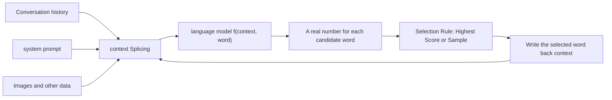
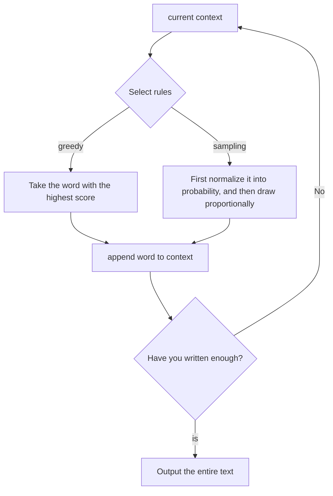
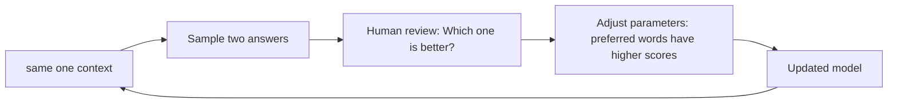

> **courses**: UC Berkeley CS61A · Structure and Interpretation of Computer Programs(Fall 2024)
> **Lecture times**: Lecture 26 \| This lecture has no video and no subtitles \| No B station points P
> **courseware**: `25-Language_Models_1pp.pdf` (10 pages, official PDF, page-by-page renderings see text illustrations)
> **Description**: There is no video, so there is no time anchor. The content is based on official courseware; this article does not repeat the lecturer’s original words.
> **Copyright**: The copyright of the course and courseware belongs to the UC Berkeley CS61A teaching team; this article is a secondary arrangement for learning purposes

## Quick overview of this lecture

- **Mastered**: I have written a large number of Python functions and can distinguish between pure functions and impure functions. I am used to using  `doctest`  Do acceptance with assertions; I have also seen the abstraction method of "defining behavior with data" - high-order functions pass behaviors as values, and data abstraction hides representation behind constructors and selectors.
- **Main line of this lecture**:
    - The language model is first of all a **Scoring function**: Given the context (context) and the candidate word (word), return a real number; "can write articles" is a by-product of repeatedly calling it.
    - The most effective approach before neural networks was  **n-gram count**: The score is "how many times does this pair of words appear in the corpus". It is simple and can be looked up in the table, but it will return to zero when it encounters unseen combinations.
    - There are two ways to go from score to text: pick the highest score every time (greedy), or proportional to probability **sampling**. The former is deterministic, rigid, and prone to self-circulation; the latter is diverse, but also makes "same input but different output" a normal phenomenon.
    - The neural language model leaves "what representation of context should be used" to the training process to learn by itself, so it can **capture similarities**: Contexts where subsequent words are similar are considered similar; this just makes up for the literal matching shortcomings of n-grams.
    - If you want it to be like a chat assistant, you still need two steps: Use prompt-response to do it **Instruction fine-tuning**, and then use human preferences for paired answers to do **Alignment**(RLHF).
- **Key conclusions**: The capability boundary of a language model comes from its training goal - it is only trained to "make the next word look reasonable", so **Its output must be accepted by an external criterion**, rather than acceptance by its own statement.


## 1. What can be recovered from the ten pages of courseware?

The official courseware for this lecture is  `25-Language_Models_1pp.pdf`, 10 pages in total. The number in the file name is 1 smaller than the lecture number. This is the sorting number of the courseware itself, not the lecture number - used for lecture 27 of the same course.  `26-Midterm_Examples_1pp.pdf`, Lecture 25 uses  `24-Data_Examples_1pp.pdf`, all follow the same convention. Judging from the layout of this PDF, the suffix  `1pp`  It refers to "one page per screen": 10 pages or 10 screens of slides.

The division of labor across ten pages is clean. Page 1 is the title page; Page 2 is only  `Announcements`  A one-line announcement page; Page 3 is a section page with only one line of title; Pages 4 to 9 are the entire text of this lecture; Page 10 only has one title plus one  `(Demo)`. Page numbers 4 to 9 only appear in the lower right corner of the screen starting from page 4. The first three pages and the last page have no page numbers. This also indicates that the previous pages are skeleton pages rather than content pages.

There is one more detail that determines what I can and cannot write: pages 4, 5, 6, 7, and 10 each have a centered  `(Demo)`. It is labeled "Live demonstration here", and the demonstration process only exists in the classroom. There is no video recording or subtitles in this lecture, so what was actually typed in the demonstration and what was output by the model cannot be restored. The processing principles of this article are: **Only make judgments where there are words in the picture**, all reasoning, terminology and examples that go beyond the picture will be marked as editor's explanation and will not pretend to be courseware content.

> **Editor's note**: The announcement page on page 2 has only one title, and the specific items (assignments, exams, deadlines) of the announcement for that week are unknown. This article will not make any guesses; the section page on page 3 is the same, it only means "Let's enter the topic of Large Language Models" without any outline text.

## 2. The language model is a scoring function


Section pages set the topic in  **Large Language Models**. The first sentence of the courseware text is the skeleton of the entire lecture and is worth reading word for word:

> Language models (including large language models like ChatGPT, Gemini, Claude, etc.) are real-valued functions f(**context**, **word**) that return a real number (often from 0.0 to 1.0).


This sentence rewrites the "language model" from "a program that can write things" to "a binary function that can be looked up": the input is context and word, and the output is a real number. Three details cannot be missed:

- **real-valued**:The output is **numbers**, not a string, nor a sentence. All "generate text" behaviors are obtained by overlaying a layer of selection rules on top of this number (see §4 for selection rules).
- **f(context, word)**:Two inputs. Without word, the function does not know "which candidate word" is being scored; without context, there is no way to judge whether it is reasonable or not.
- **often from 0.0 to 1.0**: For courseware  `often`  instead of  `must`. A value between 0 and 1 is useful because it is easy to read as a probability; but the definition itself only promises "to be a real number".

Why should we split the context into "context plus a word"? Because text is a sequence, and generation can only proceed word by word: to write the next paragraph, you have to repeatedly answer "Who should be the next word behind this context?" This "position-by-position scoring" skeleton is shared by n-gram and neural models - the difference between the two is not in the interface, but in how the scores are calculated.

> **Editor's note**: Split the probability of a sentence into "the product of the conditional probabilities of each position given the previous sentence", which is called the chain rule in probability theory. The courseware does not mention this rule. It is only used as a reminder and is not included in the courseware content.

Both examples of courseware are in Berkeley's own context. First one:

```text
Oski the Bear (Oski) is the official ...
```

For such a context, `mascot`  It should be a high-scoring word. The second is a longer sentence with specific year context:

```text
Oski was suspended for two weeks in January 1990, for throwing a cake towards ...
```

These two sentences test two different abilities: the first sentence tests "common sense matching" - the bear is the mascot; the second sentence tests "specific facts" - the suspension in January 1990 was due to throwing cakes. The courseware puts them side by side, explaining that the same scoring function should cover both "common word order rules" and "rare proprietary facts".

> **Editor's note**: Oski is the official mascot of UC Berkeley; the second sentence corresponds to an anecdote in school history. The courseware only provides the original English text of these two sentences without explaining the background. The background is provided by the editor to explain why these two sentences were chosen as examples.

The second sentence appears twice in the courseware, and the cutoff positions are different. Page 4 Treat it as an example of context and write it all  `... throwing a cake towards ...`; page 8 truncate it to  `... for throwing a`, and clearly write the expected results: the model should give  `cake`  Score close to 1. The two pages should be read together——**The word to be predicted is  `cake`, no  `towards`**.

The last entry on page 4 brings the concept of context to what it is today:

> Recent language models have expanded the notion of context to include other data (e.g., images) as well as multiple text sources (e.g., system prompts).

This has two meanings. First, context is no longer just "text": images can also come in, so the same scoring function has to process the input of mixed images and text, and the output is still just "the possibility of the next word" - this also explains why the image model and the language model can share a set of interfaces. Second, context can be **Multiple sources** To put it all together, the example given in the courseware is system prompt, which is the instruction text provided by the system (not the user).

| criterion | context in early context | The modern context mentioned in the courseware |
| :--- | :--- | :--- |
| Content type | only text | Text + other data (such as images) |
| Number of sources | a continuous text | Multiple source splicing (such as system prompt) |
| length | Usually a short paragraph from the previous text | Multiple rounds of conversations and attachments visible at once |
| Who will organize | Previous article written by user | The entire input composed by the system and the user |
| meaning to readers | "above" | "Everything the model sees this time" |

The last line is worth remembering: **context is not "what the user said", but all the input that the model can see this time**. This explains why the same sentence gets different answers in different systems - it is not necessarily the model that changes, but the paragraphs that are spelled into the context.



> **Editor's note**: The specific format of the "splicing" step in the figure (separators, templates, who comes first) varies from system to system. The courseware does not give any format. Here it only expresses the structural relationship of "multiple inputs are combined into one context".

## 3. Before neural networks: n-gram counting model


The courseware only summarizes the history in one sentence: before the rise of neural networks, the most effective language model was based on **The number of occurrences of a word sequence in a text** Above, this type of model is called n-grams.

The line of text in the center of the page is the opening chapter of Shakespeare's "Romeo and Juliet". Below it are five blue horizontal lines, which are five sets of windows:

```text
Two households , both alike in dignity ,
```

cover the first line  `Two households`, the second article covers  `households ,`, the third article covers  `, both`, Article 4 covers  `both alike`——Every item is **two adjacent words** The entire window moves one space to the right. The fifth line is the longest, stretching from the beginning of the line to near the end of the line, indicating that the entire line is treated as a window.

This row of windows combines n-gram  `n`  Make it clear: `n`  It's the window length. window once covered  `n`  word, before  `n−1`  The first word is "visible history" and the last one is "word to predict". If the window is short, history will be squashed; if the window is long, more history will be seen, but the number of samples that can be counted will quickly decrease.

There is another detail on the screen that is easy to slide past: **There is a space between each word and punctuation**, the comma is an independent item, with a space before and after it. This is more like evidence that "words have been separated" rather than a typographical error - in this set of counts, punctuation has the same status as words, and they are both positions in the sequence, so  `households ,`  with  `, both`  They are all legal windows.

> **Editor's note**: Cut the text into such basic units, usually called tokenization. The courseware uses the picture after participle, but does not introduce this term. This article only uses it when explaining the picture.

The line of formula on the page is the only specific algorithm in this lecture:

> The simplest score for a **context** and a **word** is just the count of **(context[-1], word)**.

Written mathematically it is:


$$
\mathrm{score}(c, w) = \mathrm{count}\big((c[-1], w)\big)
$$


`context[-1]`  It is the way to write "get the last element" in Python, which refers to "the word in the context next to the position to be predicted". So this simplest scorer only looks at one step of history and discards all the rest of the history - it is **binary model** (bigram): All judgments are determined by the number of occurrences of word pairs.

It only takes three lines to put this sentence into code. The courseware does not provide code. The following paragraph is a runnable diagram written according to the same rules:

```python
from collections import Counter

words = open("corpus.txt", encoding="utf-8").read().split()
bigrams = Counter(zip(words, words[1:]))     # 每一对相邻词的出现次数

def score(context, word):
    return bigrams[context[-1], word]        # 未出现过的组合计为 0
```

`Counter`  Returning 0 for non-existent keys without throwing an exception coincides with the semantics of "counting is a score": for word pairs that have not been seen in the corpus, the score is 0.

The cost becomes apparent here. There are far more legal word pairs in real language than those that appear in the corpus, and the count of most combinations is 0; once the generation process reaches the point where "the next step is all 0 points", the model has no words to choose from. This is data sparsity.

> **Editor's note**: The standard means of dealing with sparseness in engineering are smoothing (evening out a part of the probability to unseen combinations) and backoff (returning to the short window if the long window cannot be found). Neither of these words appear in the courseware; the courseware only treats n-gram as a historical background, and then uses the neural model on the next page to solve the problem of "return to zero if you haven't seen it".

The second cost is combinatorial explosion: `n`  Increasing one grid, the number of possible windows increases by the power of the size of the candidate words, but the corpus is fixed, so the proportion of "seen windows" drops sharply. This is the tension between "easiest scoring" and "more useful scoring" - counting methods rely on **literal hit** Winning is also limited by literal hits.

## 4. From scores to text: greedy and sampling


With the scoring function, the simplest way to generate text is only two steps, and the courseware is very straightforward:

> - Pick the word with the highest score for that context
> - Add that word to the context

The first step is to select the word, and the second step is to put the selected word back into context - so the same process can be run again, and the text will grow word by word. The combination of these two steps is a cycle. In each round, "who is the next word" is asked once, and "who" is always answered by the person with the highest score.

This approach of "getting the highest score at every step" is usually called greedy decoding. Its properties are determined by the rule itself: given the same model and the same starting context, the output **completely sure**, run twice to get the same text.

Greedy's failure method is also mechanical and does not require the model to be "broken": the highest-scoring words are often the most common and general words, so the text tends to become bland; once a phrase is written into the context, it will increase its score for recurrence, so the same sentence appears repeatedly, forming a self-circulation; sentences may also become shorter as they are written, because the closing punctuation is often statistically the "safest" choice.

> **Editor's note**: Neither the term "greedy decoding" nor the above failure mode analysis appear in the courseware. The courseware only writes those two steps, and then uses a  `(Demo)`  Let students see the effect on the spot; the analysis here is based on the properties of the scoring function.


Replace the rules of step 2 on the next page:

> Sampling from a probability distribution over words means selecting each word **in proportion to its probability**.

The key is  `in proportion to`——**Proportionately**. A word with a probability of 0.5 has a half chance of being picked, rather than "certainly picked"; a word with a probability of 0.1 still has a one-tenth chance of being picked. Therefore, the next path taken by the same context may be different each time, and the output changes from "a certain result" to "a family of possible results".

Strictly speaking, "drawing in proportion to probability" requires that these numbers first form a probability distribution, that is, they are non-negative and sum to 1. And what is written on page 4 is that fractions "often" fall between 0 and 1 - this only guarantees that each number is within the interval, and does not guarantee that the sum of the entire table is 1. So before sampling, we must first normalize: scale the scores of all candidate words by the sum, so that they add up to 1.

> **Editor's note**: The courseware does not cover the specific method of normalization (as well as parameters such as "temperature" that adjust the steepness of the distribution). Here we only point out the difference in the step of "scores are not equal to probability". To implement the last sampling, you can use the cumulative distribution plus a uniform random number, or directly use  `random.choices(words, weights)`.



| criterion | Greedy (argmax) | Sampling |
| :--- | :--- | :--- |
| word selection rules | Take the one with the highest score | Randomly selected according to probability |
| Same input and same output | Yes, absolutely sure | No, it may be different every time |
| text form | Smooth, conservative, easy to repeat | Diverse, occasionally off track |
| major failure | Self-circulation, the sentences become shorter as they are written | Facts drift, answers are wrong |
| Suitable for use | Need reproducible results | Need diversity and create candidates |
| Verification method | Result can be reviewed once | You must sample multiple times to see the distribution |

The last line is the real engineering conclusion of this section: **Sampling turns "answering the same question differently twice" from a flaw into a normative behavior**. Since the output itself is uncertain, "I tried it once and it worked" does not constitute evidence; acceptance must be carried out under multiple samplings, or external criteria (tests, assertions, manual checks) unrelated to the generation process must be used instead.

The courseware uses sampling again on page 9, with a completely different purpose - not to generate text for people to read, but to **Create two candidates for comparison**. This point is left to §6.

## 5. Neural language model: parameters and "learned representations"


The title of this page is followed by brackets: `(No Math Version)`. In other words, the courseware deliberately only gives structures and not formulas. Three sentences sum up this structure:

- The neural network defines a function: from **Large structured input** (such as context) to **a fixed-size set of numbers** (such as the score of each word), the behavior of the function is given by **parameters** decision.
- These parameters can be **training**, making this function approximate the relationship between any specified "input context and output score".
- The first step in training is to let it "recognize" the text in a large text collection - the courseware conveniently adds a bracket: this type of collection **Always prefer to include wikipedia**.

The "fixed size" restriction is important: no matter how long the context is, the output is always a list of scores, the length of which is equal to the number of candidate words. The input can vary in length and complexity, and the output must be of fixed length - this is so that the scores can be compared word by word. The cost is that the more candidate words, the more points each position needs to be assigned. The cost of this step increases linearly with the size of the candidates.

The courseware then concretizes the training objectives into two examples, using the same two sentences from Oski:

- for context  `Oski the Bear (Oski) is the official`, the model should give  `mascot`  Score close to 1.
- for context  `Oski was suspended for two weeks in January 1990, for throwing a`, the model should give  `cake`  Score close to 1.

"Close to 1" is the supervision signal: for the next word that actually appears in the corpus, the model must give it a high score. The first step of training can therefore be completed in one sentence: **Treat the real text in the large collection as the answer, and adjust the parameters to make the answer score higher**. The courseware does not involve the optimization algorithm itself (the title states No Math Version), but only promises that "the parameters can be adjusted to make the score meet expectations."

Make the courseware truly useful  `amazing`  This word is in the next paragraph:

> The amazing part: the people who build these systems don't choose how the text context is represented. It's up to the training process to invent a representation of the context that scores words correctly.

A comparison shows how far this step has jumped. The "representation" of n-gram is **candidates**: Take the previous word, the first two words, or the whole sentence, it is up to the modeler to decide, `context[-1]`  This way of writing is a decision made by a person. The neural model goes the other way: the interface remains unchanged (still "give context and word, return score"), but "how the context becomes a number internally" is left to the training process.

> **Editor's note**: These are two ends of the same problem as the data abstraction discussed repeatedly in this course. Data abstraction says: The representation can be changed at will, as long as the constructor and selector (interface) remain unchanged. What is replaced here is the representation, and the interface  `f(context, word)`  Not a word has been changed. The courseware does not make this analogy, the analogy was added by the editor.

The price follows closely: it means that since it was not designed by humans, humans cannot understand it and cannot change it. If something goes wrong, they can only go back to the data and training targets to find the cause.

The last sentence gives "similarity" an operational definition:

> An important property of neural networks is that they capture similarity: two contexts are similar if they are followed by similar words.

In other words, "similarity" is not based on literal overlap, but on the **Distribution of subsequent words**. Even if two contexts do not have the same word, as long as they are often followed by the same batch of words, they are similar in the representation of this model.

This item just makes up for the shortcomings of §3. n-gram can only give 0 points when encountering unseen word pairs; and contexts with "similar subsequent distributions" can share statistical strength, so unseen combinations can also get reasonable scores.

> **Editor's note**: In order to put this sentence into practice, you can imagine two contexts-one is the official identity of the bear, and the other is a question like "What is the official mascot of a certain university?" They are not literally the same, but they may both be followed by  `mascot`, according to the definition of courseware, it is similar. This example was given by the editor, and the courseware only gave a definition.

| criterion | n-gram counting model | neural language model |
| :--- | :--- | :--- |
| Where do scores come from | Count the number of occurrences in the corpus | Function value calculated from parameters |
| contextual representation | window for selection (e.g.  `context[-1]`) | Learn it by yourself during the training process |
| Unseen combination | Count is 0, there may be no words available | Can still give points |
| similarity | Just look at whether the literals are the same | Check whether the distribution of subsequent words is similar |
| context length | The longer the window, the sparser it becomes. | Variable length input, fixed length output |
| Interpretability | High, raw count can be found | Low means unreadable |
| Required corpus | Moderate, but highly dependent on coverage | Very large (example of courseware: often includes wikipedia) |

## 6. Instruction fine-tuning and human feedback: three-step alignment


At this point, the model has been able to "continue the text like that", but the courseware immediately poured cold water on it, and only used half a sentence:

> The language model that results from matching a large text corpus is not a good chat bot.

Why does "good continuation writing" not mean "good at chatting"? The courseware has not been expanded, but it can be deduced from the training goal in §5: pre-training only requires that "the next word is like the next word in the corpus". And most of the texts in the corpus **No** Answers to a question - they are novels, entries, descriptions, discussions. So the default behavior of the model is "continue writing" instead of "answer you". You ask it a question, and its most natural reaction is to treat the question as a text to be continued.

> **Editor's note**: The above causal analysis was derived by the editor based on the training objectives. On this page, the courseware only gives the judgment that "it is not a good chatbot" without giving a reason.

The next step of the courseware is very simple: use a batch of good prompt-response pairs to continue training **helpful**. This is instruction fine-tuning. It does not change the structure, only the data - turning the "question → answer" format into a "text continuation", so that the model tends to enter the "answer" mode when it sees a question.

Next comes the courseware called **key** The next step is to incorporate human ratings of answers into training, that is, alignment. The courseware also gave it another name - reinforcement learning from human feedback, RLHF. There are only three steps in the process:

- Use sampling to generate two responses for the same context.
- Let people judge which one is better.
- Adjust the model parameters so that, given context, words with high scores tend to be those words that humans prefer.

The word "sampling" in the first step is the hidden thread of the whole talk: if both are generated using greed, the results will be exactly the same, and people will have no way to compare them. **The role of sampling here is not to produce good-looking text, but to create differences**, making it possible for the "preference" signal to be expressed.

> **Editor's note**: This step of reasoning uses the conclusion of §4 (greedy determination, diverse sampling). The courseware does not clearly state the cause and effect between the two lines, but the connection can be read.

The second step of choosing "choose one" rather than "give an absolute score" is not arbitrary: people's judgment of "which one is better" is usually more stable than "whether this is worth 7 points or 8 points", and pairwise comparison saves the trouble of calibration.

> **Editor's note**: The courseware does not explain this point. In addition, the known costs of this process are that rater preferences will be hardened into the parameters, the model may learn to cater to raters rather than give correct answers (often called reward hacking), and the diversity of responses may decrease. These are not in the courseware.



| stage | Data form | What is optimized | acquired ability | Typical defects |
| :--- | :--- | :--- | :--- | :--- |
| pre-training | Continuous text in a large collection | The score of the real next word is higher. | Continuation, completion, word matching | I will only continue to write, but will not answer |
| Instruction fine-tuning | prompt-response pair | Score for each word in the answer text | Question and answer format | The quality of the answers varies, and I can edit |
| Human feedback alignment | Two answers in the same context + human preference | The score of the word in the preferred item | A more human-friendly answer | Pandering to raters, diversity decreases |

The last row of the table is the most useful part of this table: the three stages of optimization are **three different things**, and they share an interface. Therefore, "the model made a mistake" must first determine which layer the error lies in - whether it is not known at all (the pre-training data is not covered), whether it cannot answer according to the format (insufficient fine-tuning of the instructions), or whether the answer is not to your taste (the alignment is off). The practices of the three are completely different.

## 7. Language model and code: one page of courseware with only title


There are only two things on page 10: the title  `Large Language Models and Code`, and the middle one  `(Demo)`. There are no written bullet points and no code. Since there is no video recording of this lecture, the demonstration content of this page cannot be restored, so this section only does two things that are tenable: clarifying the location of this page in the courseware, and giving the discipline of writing code using language models in the context of CS61A.

The location is very clear: it is the last page of the lecture, and there is an extra one in the title.  `and Code`, the topic shifts from "how the model works" to "the relationship between the model and the code". All the properties established in the first nine pages—scoring, greedy, sampling, similarity, alignment—are turned into usage suggestions here.

> **Editor's note**: The following four disciplines are compiled by the editor based on the nature of this lecture and do not belong to the courseware content. This page of the courseware only has the title and demonstration mark.

- **Specifications are written by people, code can be written by models**. Function name, parameters, return value, boundary conditions, error behavior, these are  `def`  The contract above; the model gives a candidate implementation that satisfies the contract. Reversing the order (letting the model be written first, and then going back to summarize what it did) is equivalent to handing over the right to acceptance.
- **Use executable things for acceptance without explanation.**.`doctest`, assertions, and test cases written by yourself are all acceptable; the natural language interpretation of the model's own code often does not match the code, and the test does not lie.
- **treat it as an impure function**. Two calls to the same prompt may be different (the sampling in §4 and the alignment in §6 all promote diversity), so the critical path must fix the output, and the exploration phase must allow retries. The test should be stable in the sense of "sampling multiple times" rather than "I ran through it once".
- **When an error occurs, position it hierarchically first**. According to the three-stage table in §6, determine whether it is "don't know", "can't answer" or "not to your taste", and then decide whether to supplement the context, change the prompt format, or change the model.

```python
def count_partitions(n, m):
    """Count the ways to partition n using parts up to m.

    >>> count_partitions(6, 4)
    9
    >>> count_partitions(5, 5)
    7
    >>> count_partitions(0, 0)
    1
    """
```

this paragraph  `docstring`  It's a human job: it turns "what does this function do" into executable sentences. The model should be returned to a person who can  `python -m doctest`  All green body. The three use cases respectively pinned three boundaries-normal situations, `m`  with  `n`  equal, and the most easily missed  `n = 0`.

| criterion | functions written by humans | Model "write" function |
| :--- | :--- | :--- |
| Where do the specifications come from? | People read the question and write it down | person writes in prompt with  `docstring`  inside |
| Reproducibility | Completely reproducible | Relies on sampling and may not be reproducible |
| Acceptance method | Just pass the test | It also needs to pass the test and be reviewed multiple times. |
| Typical errors | Logical omissions and missing boundaries | Seemingly reasonable but with wrong boundaries and made-up non-existent APIs |
| Parts suitable for handing over to the model | — | Sample code, rename and refactor, supplement test cases, explain error reports |
| The part that must never be handed over | Specifications and acceptance criteria | Specifications and acceptance criteria |

The last line is the highlight of this table: no matter who typed the code, **Specifications and acceptance criteria must remain in human hands**. This is consistent with the approach from beginning to end of this course - first write the contract, then write the implementation, and finally test it with examples.

## Summary

- **Ask "what is the interface" first, then "how smart is it"**: The interface of the language model is only  `f(context, word) → 实数`. Keep it in mind, all the previous phenomena (greedy loops, diverse sampling, need for alignment) can be derived from this interface plus selection rules.
- **Fractions are not probabilities**: Real numbers between 0 and 1 are just "conveniently read as probabilities" and must be normalized before sampling. Whenever the original output of the model is used directly as a probability, it is worth stopping and checking.
- **Selection rules determine text character**: For the same set of scores, the maximum value is taken to obtain a certain and rigid text, and a proportional extraction is used to obtain a diverse and easily deviated text. If you want to be reproducible, take the maximum value, and if you want candidates, take samples.
- **"Unseen combinations" are the Achilles heel of the counting method**: n-gram relies on literal hits, and 0 is given if it fails to hit; "The distribution of subsequent words is similar, that is, similar" is a symptomatic solution, and it is also the fundamental advantage of neural models over counting models.
- **It means it can be changed, but the interface does not need to be changed.**: From the candidate window to the representation learned through training, `f(context, word)`  Not a word has been changed. This is the same thing data abstraction says in machine learning.
- **Ability boundaries come from training goals**: The pre-training only teaches "the next word must be like", the instruction fine-tuning teaches "it must follow the question and answer format", and the human feedback teaches "it must be in line with people's taste". It is much more useful to determine which layer an error belongs to than to generally say "the model is not good".
- **Uncertain output must be accepted using external criteria**: One success does not count as evidence, only testing, assertions, and manual verification do. Specifications and criteria will always remain in human hands.

## Attached: Slide index for this lecture

| page | content | Appear location |
| :--- | :--- | :--- |
| 1 | Title page Large Language Models | Quick overview of this lecture |
| 2 | Announcements page Announcements (only one line of title) | Quick overview of this lecture |
| 3 | Sectioned Pages Large Language Models | §2 |
| 4 | Definition of language model: `f(context, word)`, two Oski examples, context expansion | §2 |
| 5 | n-gram counting model and window diagram before neural network | §3 |
| 6 | Greedy generation: take the highest score and append to context | §4 |
| 7 | Sampling: Select words according to probability ratio | §4 |
| 8 | Neural language model: parameters, training corpus, learned representations and similarities | §5 |
| 9 | Instruction fine-tuning and human feedback: three-step alignment | §6 |
| 10 | Large Language Models and Code (title and demo markup only) | §7 |
