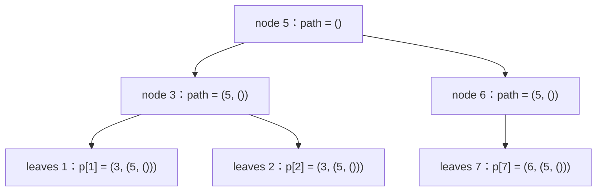
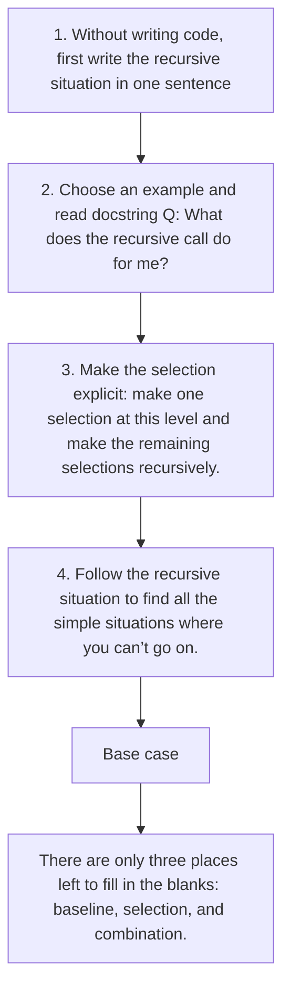
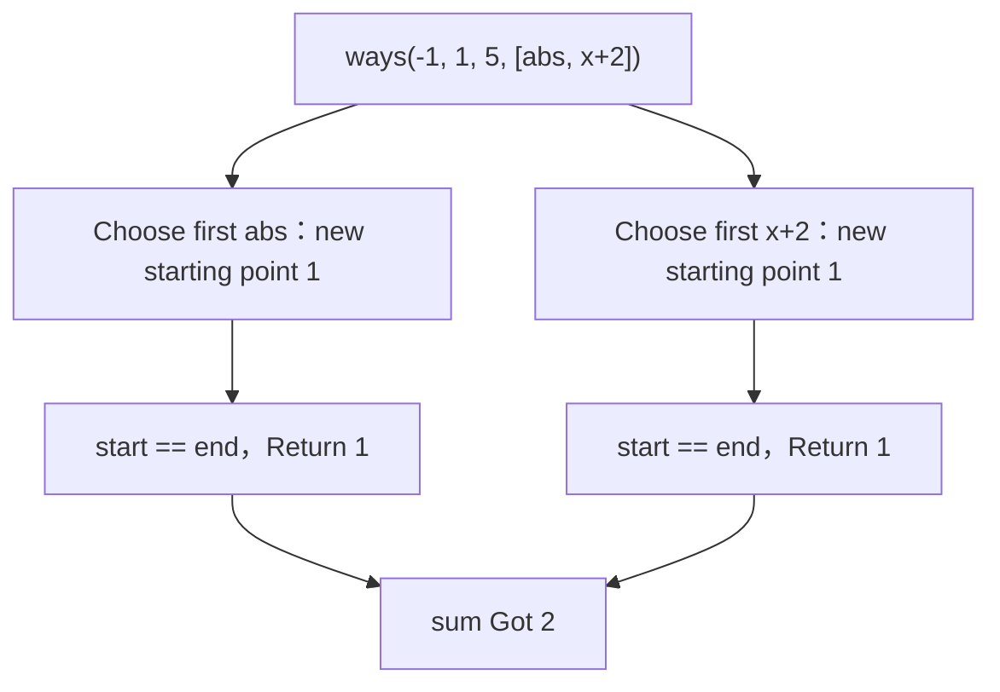
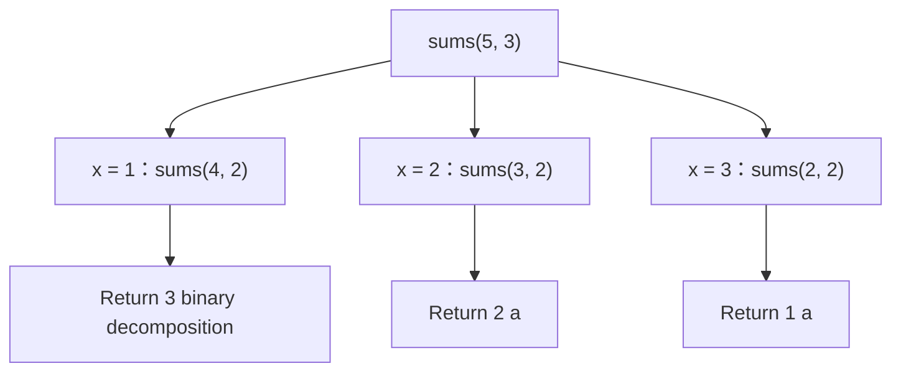

> **courses**: UC Berkeley CS61A · Structure and Interpretation of Computer Programs(Fall 2024)
> **This lecture**: Lecture 27 · Midterm Examples ｜ **No video** (The official class video is not provided, and there is no corresponding score P at Station B)
> **courseware**: `26-Midterm_Examples_1pp.pdf` (12 pages, official PDF, page-by-page renderings see text illustrations)
> **Content basis**: There is no video, so there is no time anchor. The content is organized according to the official courseware; the original text of the questions, fill-in-the-blanks and marginal notes on the courseware are explained page by page.
> **subtitles**: None (This lecture does not have original sound and subtitles, and no classroom spoken language is quoted in the text)
> **Copyright**: The copyright of the course and courseware belongs to the UC Berkeley CS61A teaching team; this article is a secondary arrangement for learning purposes

## Quick overview of this lecture

- **Mastered**: Tree as the interface of Data Abstraction, how to write Tree Recursion, using dictionaries and tuples to represent accumulated values such as "path", classes and  `__str__`, and use  `sum`  A basic routine for counting using list comprehensions.
- **Main line of this lecture**:
    - Use one page for the first half (Trees)  `Tree`  The interface is re-pinned: what can be read, what can be changed, and what writing methods (`t[0]`, `x in t`, `list(t)`) is not the language of trees at all;
    - Then break down the two Fall 2017 midterm questions one by one: `pile`  Fold each leaf-to-root path into a dictionary, `Path`  Then wrap this dictionary into a printable object;
    - `pile`  The second version of "Changed the path representation from nested tuples to lists, conveniently exposing the variability trap of "sharing the same list when going downstream". This is the most valuable comparison in the whole lecture;
    - The second half (Recursion) gives a page of methodology: first write the recursive situation in natural language, and then let the recursion handle the "remaining choices";
    - The last three questions put the method into code: `ways`  use  `sum`  number selection sequence, `sums`  Use a loop to construct the k-ary decomposition, and use two lambdas to rewrite the same thing as "post-generation filtering".
- **Key conclusions**: The fill-in-the-blank positions for these five questions almost all fall in the same place——**What is the "state" to be passed in a recursive call?**. If you think clearly about "which level am I on, what is I holding in my hand, and what should I get on the next level?", you can fill in the blanks; if you don't think clearly, the code will break at the same position no matter how long it is written.

## 1. The skeleton of the twelve-page courseware: two pages of concepts and six pages of questions

Lecture 27 is not videotaped. Official courseware  `26-Midterm_Examples_1pp.pdf`  There are only 12 pages, there is no original classroom sound, and there are no subtitles, so this lecture does not have a time anchor: every explanation below is based solely on the courseware screen; any supplements beyond the screen will be separately marked in the form of "Editor's Note".

Divide these 12 pages into four categories according to function, and the structure will be clear at a glance: one page each for the title page and announcement page, which are the starting point of the course; `Trees`  with  `Recursion`  Two section pages cut the courseware into left and right halves; pages 4 and 9 are each a page of "Interface/Methodology Review"; the remaining six pages are five questions plus one re-do.


The title page has only two words, no subtitle, no lecturer's name, and no date. These two words make the nature of this lecture clear: it does not teach new grammar or build new abstractions, but re-lays out the questions from previous years' midterm papers on the projection and fills in the blanks line by line.


The second page is the announcement page, and the entire page is blank except for the title—the text of the announcement is not included in the PDF and leaves no trace on the courseware. This page only plays one role in this article: marking the position of "course rhythm", the short period of time before entering the main topic.

The same set of statistics are hung on the pages of the five questions: the average score for this question, and what proportion of students **completely** Get it right.

| title | Source | average scoring rate | The proportion of students who got it absolutely right |
| :--- | :--- | :--- | :--- |
| Q5(a) `pile` | Fall 2017 CS 61A Midterm 2 | 49% | 26% |
| Q5(b) `Path` | Fall 2017 CS 61A Midterm 2 | 53% | 24% |
| Q4(c) `ways` | Fall 2017 CS 61A Midterm 2 | 71% | 41% |
| Q7(a) `sums` | Fall 2016 CS 61A Midterm 2 | 39% | 4% |
| Q7(b) `sums` (lambda version) | Fall 2016 CS 61A Midterm 2 | 17% | 1% |

Looking at the two columns of numbers together provides more information than looking at either column alone. Q5(a) got an average of 49% of the points, but only 26% of the people got it all right: the average score is close to "half", which means that most people got the first few empty points, and the all-right rate is only a quarter, which means that the last one was inadvertently empty (the starting point)  `gather(t, ())`) is enough to keep most people out. Q7(a) has an average of 39%, with an all-correct rate of 4%, and Q7(b) has an average of 17%, with a complete correct rate of 1% - these two questions are almost in the shape of "either all right or all wrong", indicating that they are not questions that can be saved by giving points in sections, and the entire recursive chain must be solved at once.

The three questions in the recursion part are also ranked by difficulty in page order: 71%, 39%, 17%. Each question is more difficult than the last, and only one percent of people get the last question right. The courseware even added a special note on this page: This question would be marked as an A+ question today, worth 0 points.

> **Editor's note**: These percentages are the original data for the second semester of Fall 2017 and Fall 2016, which will be re-displayed as a "difficulty scale" in the review class of Fall 2024, not the grades of this semester.

## 2. Tree’s interface contract: what can be read and what can be changed


Section pages only  `Trees`  One word. The scope it delimits is very narrow: the next half of the courseware only talks about trees, and only about "using  `Tree` "Tree written in the class".

### 2.1 Six read-only agreements


The title of page 4 reads "From Discussion 5 (Updated to be about the Tree class)". This half-sentence bracket is the key to understanding the entire page: these conventions originally appeared in the 5th discussion class, talking about the Abstract Data Type (Abstract Data Type) version of the tree - the tree is a string of "tags + Nested structures of "branch lists"; now they are rewritten as "tree-like versions", so that the tree is no longer a list that can be easily opened with a subscript, but an instance that exposes only a few operations.

The page first gives six read-only agreements. Reading them one by one is actually declaring the "citizenship" of an object:

- The root tag can be any value, `t.label`  Ask for it. Pay attention to the wording "any value": the tree does not require the label to be a number. Strings, tuples and even lists can be used as labels. The judgment only depends on the number.  `==`.
- The branches themselves are trees, `t.branches`  Ask for value and get one **list**, the list contains the subtrees of this tree.
- Without branches, there are leaves. `t.is_leaf()`  Return  `True`.
- An identical tree can be used  `Tree(t.label, t.branches)`  Constructed.
- You can pass the tree as a parameter to the function, for example  `height(t)`.
- That's all there is to manipulating trees: nothing  `t == x`, no  `t[0]`, no  `x in t`, nor  `list(t)`.

The last one is the centerpiece of the entire page, and it's worth expanding on: it's not a list of grammatical taboos, it's saying "Trees are not sequences." one  `Tree`  Instances have no subscripts, so  `t[0]`  Report an error directly; it is not iterable, so  `list(t)`  with  `x in t`  None of them work; it also doesn't define structural equality, so  `t == x`  You can only fall back to Python's default semantics - determine whether both sides are the same object.

> **Editor's note**: `t[0]`, `x in t`, `list(t)`  Respectively rely on the subscript protocol in Python (`__getitem__`), member check (`__contains__`  or iteration protocol), iteration protocol (`__iter__`); `Tree`  None are provided, so the three writing methods are  `TypeError`, rather than "the result is wrong". Another common accident is  `t.is_leaf`  Without parentheses: you get the binding method object, in  `if`  The condition is always true, and leaves and non-leaves will be judged to be the same.

So "what do you want to do to the tree" should be translated into "which interface to use to do it". This comparison table can be memorized directly:

| Criterion (what you want to do) | Writing methods allowed by courseware | How to write courseware roll call prohibition and reasons for failure |
| :--- | :--- | :--- |
| Read root tag | `t.label` | `t[0]`: The tree is not a sequence and has no subscripts. |
| Read all branches | `t.branches`, get a list | `list(t)`:Tree is not iterable |
| Determine if it is a leaf | `t.is_leaf()` | `t.is_leaf`:The method object is always true |
| Determine whether a certain label appears | Write your own recursion, or call a ready-made function | `x in t`:Tree has no member checking |
| Determine whether the contents of two trees are the same | Write your own recursive comparison | `t == x`: By default, it only determines "whether they are the same object" |
| Calculate derived quantities (such as depth) | hand over  `height(t)`  This type of function | Take the tree apart on the outside and build the structure yourself |

`height(t)`  The examples that appear on this page are not random. It's boilerplate for "function consumption abstraction": trees only provide  `label`, `branches`, `is_leaf`  Three things, but the quantity depth is not among these three things, so it must be calculated recursively by the external function. Once you understand this, you can understand why the question is full of  `Tree(...)`  Structure, everywhere  `t.branches`  Traversing, but no subscript appears once.

### 2.2 Three Modification Agreements

In addition to reading only, the courseware also provides three items **Modify** As agreed, the three items all revolve around "the object to the left of the dot":

- Change root tag: `t.label = ...`.
- Replace the entire list of branches: `t.branches = ...`; Or add a branch to the list: `t.branches.append(...)`.
- Change a branch: `t.branches[0].label = ...`——take first  `t.branches` (list), then take  `[0]` (a subtree), and finally assign a value to it  `label`.

Please note the difference between the first two: `t.branches = ...`  Yes  `t`  of  `branches`  The attributes are replaced with a new list; `t.branches.append(...)`  It is to insert the branch into the original list in place. The latter modifies a list that may be shared elsewhere - if another tree's branch list happens to be the same list object, it is also changed.

> **Editor's note**: `Tree(t.label, t.branches)`  What is copied is the top level: the new tree is a new instance, but its branches are still the original subtree objects. Therefore, "same tree" refers to the same structure, and the two trees do not share the same instance; if you change the root label of one of them, the other will not change, but if you change the label of a certain branch, both trees will see it.

### 2.3 Why it’s worth spending a whole page talking about interfaces

Because every question that follows is based on the premise of "only using the interface". `pile`  There is not a single subscript operation from beginning to end, only  `u.is_leaf()`, `u.label`, `u.branches`  Three things; `Path`  The class doesn't even look at the tree, it just handles  `pile`  Return the dictionary. The benefits of data abstraction are most straightforward here: once the code only relies on interfaces, "how to implement the tree" has nothing to do with solving the problem, and there is no need to guess during the exam.  `Tree`  What does it look like inside.

## 3. Q5(a) `pile`: Fold the path from leaf to root into the dictionary


### 3.1 The question and the recursive definition

This is question 5 (a) in the second semester of Fall 2017. The average scoring rate is 49% and the all-right rate is 26%. The question first gives a definition, which itself is recursive:

> For a tree with different leaf labels  `t`, whose pile is a dictionary: `t`  Each leaf label of is a key and the value is the path from that leaf to the root. The "path from a node to the root" is either an empty tuple (when the node is the root), or a tuple, the first element is the label of the parent node, and the second element is "the path from the parent node to the root".

If you read this definition twice, you will find two counterintuitive things. First, the path is **Nested** of, `(3, (5, ()))`  To read it like this: "Parent node 3, the rest is the path from 3 to the root (5, ()), where 5 is the root." Second, the path **Does not include the starting point itself**:The value of leaf 1 is  `(3, (5, ()))`, there is no 1 in it. 1 only appears as a dictionary key.

These two properties together explain the three lines of results from doctest:

```python
>>> pile(Tree(5, [Tree(3, [Tree(1), Tree(2)]), Tree(6, [Tree(7)])]))
{1: (3, (5, ())), 2: (3, (5, ())), 7: (6, (5, ()))}
```

Leaf 1 and leaf 2 are brothers, sharing the same path of "father 3, grandfather 5", so the values are exactly the same; the father of leaf 7 is 6, and the grandfather is 5, so the value is  `(6, (5, ()))`. The tails of all three paths are  `()`, because the path from root to root is by definition an empty tuple.

### 3.2 What are the four Kongs asking?

The courseware gives the function skeleton, leaves four spaces, and writes marginal notes in bubbles at the edge of the page. Read them together with the code:

```python
def pile(t):
    """Return a dict that contains every path from a leaf to the root of tree t.

    >>> pile(Tree(5, [Tree(3, [Tree(1), Tree(2)]), Tree(6, [Tree(7)])]))
    {1: (3, (5, ())), 2: (3, (5, ())), 7: (6, (5, ()))}
    """
    p = {}
    def gather(u, path):
        if u.is_leaf():
            p[u.label] = path
        for b in u.branches:
            gather(b, (u.label, path))
    gather(t, ())
    return p
```

The first one is empty in the base case: `p[u.label] = path`. The bubble says "Base case: Put a leaf label in p". The reason why it can be stored directly  `path`, because  `gather`  The second parameter is agreed to be "**The path from the current node u to the root**"; When you reach the leaf, the path on your hand is exactly the value you want to define, so there is no need to spell it again.

The second void is in the recursive call: `gather(b, (u.label, path))`. The bubble says "u has a label that can be added to the path" - to go down to the son  `b`, and "from  `b`  The path to the root is by definition the parent node  `u`  tags + from  `u`  path to the root", that is, put  `u.label`  pressed to  `path`  front. Tuple splicing is a natural "create new value" operation here: `(u.label, path)`  Get a new binary group, and the sibling branches do not affect each other.

The third space is at the entrance: `gather(t, ())`. The bubble says "all paths have ()", which means that the tails of all paths are empty tuples; and on the root node, the path from root to root is by definition  `()`. This call is the starting point of the entire recursion.

The fourth space is at the end: `return p`.`p`  is a local variable of the outer function, and the inner function  `gather`  The same dictionary is seen through the closure, and the leaves are written in one by one along the way; the outer layer finally hands it over. The whole question is therefore "**The inner layer is responsible for traversing, and the outer layer is responsible for collecting**"structure.

Spread out the calling process, and each node holds  `path`  At a glance:



By the way, pay attention to a detail that "it's okay if you omit it": `if u.is_leaf(): ...`  Follow directly  `for b in u.branches:`, no  `else`. This is not an omission - Ye Zi's  `branches`  It is an empty list and the loop is not executed once, so the two branches are naturally mutually exclusive. On the other hand, if for "insurance" it is written as  `else:`, the code is also correct, just with an extra layer of indentation.

### 3.3 Error-prone points

- The starting point is written as  `gather(t, [])`, `gather(t, 0)`, `gather(t, None)`: `path`  The type must be a tuple, because the value of the entire tree is represented by a tuple, and doctest cannot change a word.
- The base case is written as  `p[u.label] = path + (u.label,)`: The leaf itself is saved too much, and the value conflicts with the definition. In the definition, the "path from node to root" is from **parent node** Started to remember.
- The order of parameters for recursive calls is written in reverse order as  `(path, u.label)`: The type is immediately misaligned, and the next layer  `path`  becomes a label, `p`  will appear in  `(3, 5)`  This is neither a tuple nor a path.
- `u.is_leaf`  Write fewer parentheses: the condition is always true, each visited node (including internal nodes) is written into the dictionary as a leaf, and finally  `p`  There are seven keys in it, and there are twice as many values on the scratch paper.
- Forgot  `return p`: function return  `None`, doctest fails directly. This type of "forgot to write the last line" is the most unfortunate point loss, because you can't get back the first three lines if they are all correct.
- put  `gather`  Written in return value style (`return gather(...)`): This question relies on the closure  `p`  Accumulation, no return value can be transmitted, and the two-layer structure cannot be modified at the same time.

## 4. Q5(b) `Path`: Wrap a table into a printable object


### 4.1 Why not find the path again?

Page 6 is question (b) of the same question, with an average score of 53% and a correct rate of 24%. The requirement is: implement  `Path`  class, `__init__`  receive a tree  `t`  with a  `leaf_label`, assuming all leaf labels are unique; print a  `Path`  When , connect the labels from the root to the leaf with short horizontal lines to display.

```python
>>> a = Tree(5, [Tree(3, [Tree(1), Tree(2)]), Tree(6, [Tree(7)])])
>>> print(Path(a, 7), Path(a, 2))
5-6-7 5-3-2
```

Direction is key: `pile`  The path is "from the leaf up" (parent first), while printing requires "from the root down". Therefore, question (b) is not to directly print out the dictionary in question (a), but to print it **spell in reverse**.

The solution to the courseware is very straightforward: `__init__`  It only does two things -

```python
def __init__(self, t, leaf_label):
    self.pile, self.end = pile(t), leaf_label
```

call once  `pile(t)`, store the path table of the entire tree into  `self.pile`;Save the leaf tag you are looking for into  `self.end` ("the end of this path"). So one  `Path`  The object is actually "a table + a key", and all work is pushed to  `__str__`.

This choice is worth pausing for a moment: you could just write it down  `t`  with  `leaf_label`, wait until printing and then go to the tree to find the path. Why do we need to calculate the entire table during construction? Because "finding a path" is a tree operation, and "string string spelling" is a string operation, mixing the two in one method will cause  `while`  If the loop processes trees and strings at the same time, the accuracy will inevitably decrease. Complete the tree operation at once, `__str__`  It degenerates into pure "table reading + splicing".

> **Editor's note**: The cost is each  `Path`  It requires a complete traversal of the entire tree, the time and space are O (the number of nodes in the tree), and there is only one path to the information that is really needed. This is a typical "using space and one-time preprocessing to change code simplicity"; if a tree needs to be built with many  `Path`, a more cost-effective approach would be to  `pile(t)`  When it is mentioned outside, it is counted as one time and then passed in.

### 4.2 `while`  Loop invariants

`__str__`  There are only three lines, but each line is dealing with "nested tuples":

```python
def __str__(self):
    path, s = self.pile[self.end], str(self.end)
    while path:
        path, s = path[1], str(path[0]) + '-' + s
    return s
```

The initial value line has two actions: `self.pile[self.end]`  Take out this path (bubble mark "path is a nested tuple"), `str(self.end)`  Convert leaf labels to strings (bubble mark "s is a string"). Both are important: `path`  It is a tuple, so it can be used later  `path[0]`, `path[1]`  dismantle it; `s`  It is a string from the beginning, so it can be spelled directly later.

The body of the loop is a parallel assignment, and the two expressions on the right are "take part of the current state":

- new  `path`  is  `path[1]`, that is, the remaining path "from the parent node to the root". The courseware uses small green characters to spread out the nesting of Ye 7 into three layers——`{..., 7: (6, (5, ()))}`, `(5, ())`, `()`——It exactly corresponds to the process of cyclically peeling off the outer layer layer by layer.
- new  `s`  is  `str(path[0]) + '-' + s`: `path[0]`  is the parent node label, convert it into a string, add a dash, **Connect to the left of the existing string**. The bubble is marked "Build s from this" in this column, because the string grows from the leaves to the root, and the output requires the root to be in front, so it must be inserted before each time.

The loop condition is  `while path:`, relying on "empty tuple is false": when  `path`  stripped to  `()`, the condition is false, the loop stops, at this time  `s`  Already contains the root. use  `Path(a, 2)`  Go through:

| rounds | `path` | `s` | Description |
| :--- | :--- | :--- | :--- |
| initial value | `(3, (5, ()))` | `'2'` | The parent of leaf is 3 |
| Round 1 | `(5, ())` | `'3-2'` | Insert 3 forward |
| Round 2 | `()` | `'5-3-2'` | Insert 5 forward and the loop ends |

`print(Path(a, 7), Path(a, 2))`  print out  `5-6-7 5-3-2`: `print`  Separate multiple parameters with spaces, each parameter calls its own  `__str__`. The line of output in doctest is therefore the result of "two objects, one space", not a space printed by an object.

### 4.3 Error-prone points

- Reverse both sides: write the parallel assignment as  `path, s = path[0], str(path[1]) + '-' + s`.`path[0]`  is a label, `path[1]`  It is the remaining path, and the type is completely different. In the next round, the string will be used to remove the subscript, or the tuple will be used to splice the string.
- Spell to the right: `s = s + '-' + str(path[0])`  get  `2-3-5`, the direction is opposite to the title. The way to determine the direction is simple - the first character of the output must be the root label, and the root label is stripped out last, so it must be **finally** Forward insertion.
- Forgot  `str()`: `str(path[0]) + '-' + s`  If it is written as  `path[0] + '-' + s`, adding integers and strings directly  `TypeError`.
- in  `__str__`  Recall in  `pile(self.t)`: The entire tree is recalculated for each round of the cycle, which is slow and shows lack of understanding."`__init__`  The table has been calculated."
- The attribute names do not match: `self.pile[self.end]`  written as  `self.pile[self.leaf_label]`, while  `__init__`  Li Cun's name is  `self.end`.

> **Editor's note**: `print`  go  `__str__`, and directly evaluate in the interactive environment  `Path(a, 7)`  Going is  `__repr__`. This question only defines  `__str__`, so direct evaluation will see the default  `<__main__.Path object at 0x...>`;doctest uses  `print`, precisely to bypass this layer.

## 5. Q5(a) redone: paths are represented as lists instead


### 5.1 Two writing methods and the same table

Page 7 redoes the questions on page 5. The key sentence in the definition has been crossed out and replaced with a green sentence: **Represent the path as a list of labels.**  So the path is no longer a nested tuple, but a flat list, and doctest also changes:

```python
>>> pile(Tree(5, [Tree(3, [Tree(1), Tree(2)]), Tree(6, [Tree(7)])]))
{1: [5, 3, 1], 2: [5, 3, 2], 7: [5, 6, 7]}
```

The direction is flipped: the value of the tuple version is "from leaf to top" (parent first, tail  `()`), the value of the list version is "from the root down" (the root is in front, and the last element is the leaf). This is not an arbitrary choice - the list version carves the entire path in one go, and it reads like a downward movement from root to leaf.

The courseware provides two sets of writing methods that can fill in the same table. Plan A maintains "press the label of the current node into the path when going down", and only adds the leaf itself when it reaches the leaf:

```python
def pile(t):
    """Return a dict that contains every path from a leaf to the root of tree t.

    >>> pile(Tree(5, [Tree(3, [Tree(1), Tree(2)]), Tree(6, [Tree(7)])]))
    {1: [5, 3, 1], 2: [5, 3, 2], 7: [5, 6, 7]}
    """
    p = {}
    def gather(u, path):
        if u.is_leaf():
            p[u.label] = path + [u.label]
        for b in u.branches:
            gather(b, path + [u.label])
    gather(t, [])
    return p
```

Plan B is the opposite: put the root label at the starting point, and put it when going down **son** The label is appended and stored directly in the leaf:

```python
def pile(t):
    """Return a dict that contains every path from a leaf to the root of tree t.

    >>> pile(Tree(5, [Tree(3, [Tree(1), Tree(2)]), Tree(6, [Tree(7)])]))
    {1: [5, 3, 1], 2: [5, 3, 2], 7: [5, 6, 7]}
    """
    p = {}
    def gather(u, path):
        if u.is_leaf():
            p[u.label] = path
        for b in u.branches:
            gather(b, path + [b.label])
    gather(t, [t.label])
    return p
```

The invariants of the two sets of writing methods are different and must be unified throughout the question:

- Option A: `gather(u, path)`  inside  `path`  is "from root to  `u`  of **parent node**"The path, **Does not contain  `u`**;So the leaves need to be replenished  `[u.label]`, the starting point is  `[]`.
- Option B: `gather(u, path)`  inside  `path`  is "from root to  `u`"The path, **Contains  `u`  and starts with root**; Therefore, it is stored directly at the leaf, and the starting point is  `[t.label]`.

Mixing them will immediately go wrong: the starting point of A  `[]`  With the appending method of B (the leaves are also directly stored according to the writing method of B), the root label will be missed, and we get  `[3, 1]`  This path without a root; the starting point of B  `[t.label]`  With the leaf writing method of A, the leaves will appear repeatedly, and we get  `[5, 3, 1, 1]`.

### 5.2 Why it is necessary to use  `path + [x]`

What this page really wants to teach is the addition sign. `path + [u.label]`  with  `path + [b.label]`  All **Create a new list**, the old list does not change; if the plus sign is changed to append in place, it is written as  `path.append(...)`  Pass it on and the code will quietly go wrong:

```python
# 错误示范：在 gather 的循环里就地追加共享的 path
for b in u.branches:
    path.append(b.label)
    gather(b, path)
```

There are two wounds in this change. First, all sibling branches on the same layer share the same  `path`  Object (which is only created once in the outer layer), after the first brother is appended, the path seen by the second brother has one more section, and the third one has one more section. Second, the leaves  `p[u.label] = path`  What is saved is **Reference to the same list object**, so after the entire tree is walked, all the values in the dictionary point to the list that has been appended repeatedly, and each path printed out is exactly the same and ridiculously long. The program will not report any errors, it will only return an incorrect dictionary - this is the most typical way mutability bites people in recursion.

The reason why the tuple version does not have this problem is that tuples are immutable: `(u.label, path)`  A new tuple is bound to be generated and is safe to share. This also explains why the courseware has to do the same question twice - the change in representation will change "which operations are safe", and this is one of the core test points of the data structure question, not a matter of style.

| criterion | Tuple version (page 5) | List version (page 7) |
| :--- | :--- | :--- |
| value shape | `(3, (5, ()))`, nested tuples | `[5, 3, 1]`, flat list |
| direction | From the leaves upward, the father is in front, and the tail is always  `()` | From the root down, the root is in front, and the last element is the leaf. |
| How to extend when going down | `(u.label, path)`, naturally create new tuples | `path + [x]`, a new list must be created |
| How to write leaves | `p[u.label] = path` | Plan A supplement  `[u.label]`;Plan B direct storage |
| starting point | `gather(t, ())` | Plan A  `[]`;Plan B  `[t.label]` |
| shared risks | None, the tuple is immutable | Yes, `append`  Will pollute sibling branches |
| Debugging friendliness | Number of levels of nested brackets | See the path directly |

## 6. Recursive methodology: first describe the recursive situation


`Recursion`  After the section pages, the courseware did not immediately introduce the questions, but inserted a page of methods. The title reads "From Discussion 4 (With Some Extra Tips)", which also indicates that the content on this page comes from the discussion class.

### 6.1 Put the recursive situation into one sentence first


The first sentence on the page is the most useful sentence: **Don’t write code right away**, first describe the recursive situation in words. The courseware gives two demonstrations, both from the previous lessons:

- `fib`: The recursive case is "add the first two Fibonacci numbers".
- `count_partitions`: The recursive situation is "divide n-m with parts up to no more than m, **and** Divide n" by parts up to m-1.

The two descriptions share a common grammatical feature: in a sentence **two** Recursive call. `fib`  Two antecedents are required, `count_partitions`  There are two situations: "using one m" and "not using m at all". Therefore, the "recursive situation" is never "call yourself once", but "break this problem into several smaller similar problems and explain how to put them together."

Then there are two specific methods.

The first one is called **use abstraction** (Use abstraction): Pick an example and ask "What will recursive calls do for me on this example"; and the answer is to  **Read in docstring**, don't read the code. This article moves the principle of data abstraction to recursion: believe in the contract of the function rather than its implementation. do  `pile`  if you believe first  `gather(u, path)`  contract - "give it a node and a path to the root and it will  `u`  The paths of all leaves in the root subtree are recorded  `p`"——Then how to write the recursive call is just a matter of one sentence, and there is no need to expand the entire tree.

The second one is called **realize a choice** (Implement a choice): Most tree recursion problems involve a series of choices (such as "should I use a part of size m"). The recursive case only implements **one of them** Select, and leave the rest of the selection to recursion. This tip directly corresponds to the next two counting questions: `ways`  The choice is "Which one should I choose for the first action?" `f`", `sums`  The choice is "which number should be placed in the last digit".

As for the base case, the page says it short: Once a recursive case is identified, look for all the simple cases to which it naturally leads. In other words, the base case is not the "minimum example", but "the situation where the recursion cannot go on"——`k == 1`  can no longer be disassembled. `start == end`  has reached the end point, `u.is_leaf()`  There are no branches to go down.



### 6.2 The sentence in each of the three questions

Apply the methodology to the three recursion questions in this lecture. The "those sentences" are:

| question | A word about recursive situations | Base case |
| :--- | :--- | :--- |
| `ways` | Choose an action  `f`, from  `f(start)`  Let's go again  `k - 1`  step | `start == end` (Success, counts as 1); `k == 0` (It doesn’t work, so it counts as 0) |
| `sums`(Q7a) | Put the last one  `x`, the remaining  `k - 1`  Let’s get some seats together  `n - x` | `k == 1` (There is only one left, and it can only be  `n`) |
| `sums`(Q7b) | prefix  `x`, the remaining positions continue to be used no more than  `x`  Fill in the numbers | `x == 0`  There are no candidates; `w == 0`  There is only an empty list |

Written down in three lines, you can see the practicality of this methodology: **The number of base cases is determined by the recursive cases**.`ways`  The recursive situation is subject to two conditions: "whether the end point is reached" and "whether there are still steps", so it has two benchmarks; `sums`  The recursive case is only constrained by "how many are left", so it has only one basis. The "seemingly redundant" blanks in the fill-in-the-blank questions are probably the second benchmark.

## 7. Q4(c) `ways`: number selection sequence


### 7.1 The constraint on the question

Question 4 (c) of Fall 2017 Midterm 2 has an average scoring rate of 71% and a correct rate of 41%. It is the question with the highest scoring rate in this lecture. The requirement is: implement  `ways(start, end, k, actions)`, from  `actions`  Pick a list of functions  `f1, f2, ..., fj` (You can pick the same one repeatedly), so that  `f1(f2(...(fj(start))))`  equal to  `end`, and  `j ≤ k`, returns the number of such ways.

The last sentence of the question is the soul of this question: **If an action sequence arrives  `end`, then no further action can be applied**. This sentence turns "path counting" into "sequence counting": once an intermediate state equals  `end`, the sequence ends here, and stacking several functions later does not constitute a new method.

The first example of doctest writes this sentence in the comments:

```python
>>> ways(-1, 1, 5, [abs, lambda x: x+2])   # abs(-1) or -1+2, but not abs(abs(-1))
2
```

`abs(-1)`  Get 1, reach the end point, stop; `-1+2`  Get 1, reach the end, stop. And  `abs(abs(-1))`  Although the result is also 1, it is in the first step  `abs(-1)`  By then we have reached the end point - according to the title, the following  `abs`  No further imposition is allowed, so it does not constitute "another way". If you miss this constraint, the number of solutions for the same starting point will be significantly larger, and the doctest will change from 2 to more than 2.

### 7.2 Three voids and two benchmarks

```python
def ways(start, end, k, actions):
    """Return the number of ways of reaching end from start by taking up to k actions.

    >>> ways(-1, 1, 5, [abs, lambda x: x+2])   # abs(-1) or -1+2, but not abs(abs(-1))
    2
    >>> ways(1, 10, 5, [lambda x: x+1, lambda x: x+4])  # 1+1+4+4, 1+4+4+1, or 1+4+1+4
    3
    >>> ways(1, 20, 5, [lambda x: x+1, lambda x: x+4])
    0
    >>> ways([3], [2, 3, 2, 3], 4, [lambda x: [2]+x, lambda x: 2*x, lambda x: x[:-1]])
    3
    """
    if start == end:
        return 1
    elif k == 0:
        return 0
    return sum([ways(f(start), end, k - 1, actions) for f in actions])
```

The first one is empty  `start == end`, returns 1. Why 1 instead of "1 plus the number of subsequent moves"? Because according to the constraints of the title, reaching the end point means that the sequence ends here, which itself constitutes **a kind** way; `j = 0`  It is also considered a type (no action is taken when the starting point is the end point), so returning 1 here also covers the "zero step" situation.

The second one is empty  `k == 0`, returns 0. If you run out of steps and still haven't reached the end, the path is dead and you contribute 0 ways.

The third empty  `sum(...)`  Add a list comprehension. The annotation of bubbles makes the structure very clear: `for f in actions`  It says "Choose an action" next to it. **one** selection), `ways(f(start), end, k - 1, actions)`  Next to it is written "\# of ways starting with that action" (the number of ways starting with that action). Add up the number of all possible first moves, and you get the total number - this is exactly the "recursive situation realizes one choice, and the recursive situation realizes the remaining choices."

The order of the two benchmarks cannot be swapped. If judged first  `k == 0`, then "the starting point is exactly equal to the end point, and  `k`  Already 0" will be evaluated as 0, and "do nothing" should be a legal method (`j = 0 ≤ k`). The order itself carries the semantics: **Judge success first, then judge failure**.

Draw the two calls of the first doctest, `sum`  It’s clear what you’re doing:



### 7.3 How to read the four doctests

The second example best illustrates "numbers are sequences, not sums":

```python
>>> ways(1, 10, 5, [lambda x: x+1, lambda x: x+4])
3
```

To go from 1 to 10, add 9, and you can only add 1 or 4 at a time. Set up  `x`  Times 1. `y`  times 4, then  `x + 4y = 9`  and  `x + y ≤ 5`.`y = 1`  time  `x = 5`, the total number of steps 6 exceeds 5; `y = 2`  time  `x = 1`, exactly 3 steps; `y = 0`  It takes 9 steps. So the only feasible combination is "once +1, twice +4", and each of the three permutations (144, 414, 441) counts as one way, the answer is 3 - in the comments  `1+1+4+4`, `1+4+4+1`, `1+4+1+4`  The reason why they are all written down is to illustrate that "different orders mean different methods."

third example  `ways(1, 20, 5, [lambda x: x+1, lambda x: x+4])`  Return 0: 5 steps can push 1 to 21 at most, but the value 20 cannot be made up with 1 and 4 within 5 steps (`x + 4y = 19`, `x + y ≤ 5`  no solution), so there is no way.

The fourth example is  `start`  with  `end`  replaced by **list**, this is the second test point of this question: `ways`  Doesn't care about the type of the value, only requires that it can be used between two values  `==`  compare, and can be  `actions`  function transformation in. The three actions are to add a 2 in front, repeat the list twice, and remove the last element:

```python
>>> ways([3], [2, 3, 2, 3], 4, [lambda x: [2]+x, lambda x: 2*x, lambda x: x[:-1]])
3
```

> **Editor's note**: The following three paths are derived manually based on the doctest and code. The courseware only gives the answer 3. `[2]+x`  Add a 2 to the head of the list, `2*x`  means "repeat twice" on a list (`2*[3]`  equal to  `[3, 3]`), `x[:-1]`  Cut off the last element.

| way | Action sequence (from first to last) | status change |
| :--- | :--- | :--- |
| one | `[2]+x`, `2*x` | `[3] → [2, 3] → [2, 3, 2, 3]` |
| two | `2*x`, `[2]+x`, `x[:-1]`, `2*x` | `[3] → [3, 3] → [2, 3, 3] → [2, 3] → [2, 3, 2, 3]` |
| three | `2*x`, `x[:-1]`, `[2]+x`, `2*x` | `[3] → [3, 3] → [3] → [2, 3] → [2, 3, 2, 3]` |

In the third path  `x[:-1]`  put  `[3, 3]`  cut back  `[3]`, which is equivalent to "wasting" a step; but because  `k = 4`  With margin, this detour is still legal. This once again confirms the counting caliber: as long as the sequence is **first time** hit  `end`  Stopping at the right time, taking a few steps, and whether there are detours only affect "whether it is the same way", but not "whether to count".

The common mistakes focus on this question:

- Write the benchmark order in reverse, judge first  `k == 0`: All "start point is the end point" calls are misjudged to be 0.
- Miss the reading "stop when reaching the end point" and allow it to be  `start == end`  Then continue to expand: `abs(abs(-1))`, `abs(abs(abs(-1)))`  This kind of "reaching the end and continuing on" sequence will be regarded as a new method, and the answer to the first doctest will be obviously larger.
- use  `len([...])`  instead of  `sum([...])`: `len`  What counts is the "number of candidate actions", not the "total number of moves", and the result is always equal to  `len(actions)`.
- Forgot to call  `f`: written as  `ways(f, end, k - 1, actions)`, using the function object as the starting point, the next round  `start == end`  Always false.
- Reduce in recursion  `k`: `k - 1`  written as  `k`, infinite recursion until the stack explodes.
- put  `actions`  The subscript of is used as an element: `for f in actions`  written as  `for f in range(len(actions))`, and then call  `f(start)`.

## 8. Q7(a) `sums`: Constructed enumeration


### 8.1 Question and skeleton

Fall 2016 Midterm 2, Question 7 (a), the average scoring rate is 39%, and the all-correct rate is only 4% - the second most difficult question in this lecture. Requirements: Implementation  `sums(n, k)`, receives two positive integers and returns a list containing "split n into the sum of k positive integers"**all** method (different orders count as different methods).

```python
>>> sums(2, 2)
[[1, 1]]
>>> sums(2, 3)
[]
>>> sums(4, 2)
[[3, 1], [2, 2], [1, 3]]
>>> sums(5, 3)
[[3, 1, 1], [2, 2, 1], [1, 3, 1], [2, 1, 2], [1, 2, 2], [1, 1, 3]]
```

The last line best illustrates "different orders count in different ways": (3,1,1), (2,2,1), (1,3,1), (2,1,2), (1,2,2), (1,1,3) All six permutations are listed. Also pay attention to the output **order**:Group from 1 to 3 according to the last digit, and each group is arranged in the order of recursive return. The order of answers is determined by the code structure. The doctest compares verbatim, so the order is also a test point.

```python
def sums(n, k):
    """Return the ways in which K positive integers can sum to N.

    >>> sums(2, 2)
    [[1, 1]]
    >>> sums(2, 3)
    []
    >>> sums(4, 2)
    [[3, 1], [2, 2], [1, 3]]
    >>> sums(5, 3)
    [[3, 1, 1], [2, 2, 1], [1, 3, 1], [2, 1, 2], [1, 2, 2], [1, 1, 3]]
    """
    if k == 1:
        return [[n]]
    y = []
    for x in range(1, n):
        y.extend([s + [x] for s in sums(n - x, k - 1)])
    return y
```

The four spaces are  `k == 1`, `[[n]]`, `range(1, n)`, and  `s + [x]`  with  `sums(n - x, k - 1)`. The three bubbles at the bottom of the page break this line into three paragraphs to read: `s + [x]`  It's "Build the list" (fill in the last digit of the decomposition on the handle), `for s in ...`  It's "Choose a way" (choose a complement one by one), `sums(n - x, k - 1)`  It is "Ways of completing the list" (how many ways are there to complete the previous k-1 digits).

The sentence for the recursive case is therefore: **Put the last one  `x`, front  `k - 1`  Let’s get some seats together  `n - x`**. Note  `x`  is being **Continue at the end** of (`s + [x]`), so the entire table is grouped by "last digit" - the grouping method is determined by the writing method, not by the question.

### 8.2 Why  `range(1, n)`

`x`  The value range of only needs two reasons to determine it:

- The lower bound is 1: The question requires a positive integer, and the smallest last digit is 1.
- Unable to get from upper bound  `n`: Stay ahead  `k - 1`  positive integers, each at least 1, so  `x ≤ n - 1`; `range(1, n)`  The right end of is not included and is just stuck.

`x`  It is "the choice made at this level", so the loop traverses "all possible values of the last digit"; for each value, recursively count out the previous  `k - 1`  How many ways are there to put a bit together? How many ways can we put it together?  `s`  supplement  `s + [x]`, use  `extend`  All at once  `y`.

`k == 1`  The baseline situation also has only one sentence: when there is only one bit left, the only way is "this bit is equal to  `n`", so return  `[[n]]`——Note that the return value must be a **list of loaded lists**, because the contract of a function is "a list of lists".

So "unsolvable" situations (such as  `sums(2, 3)`) is handled by whom? by empty  `range`  processing. `sums(2, 3)`  inside  `n = 2`, `range(1, 2)`  only given  `x = 1`, recursive call  `sums(1, 2)`; and  `sums(1, 2)`  of  `range(1, 1)`  is empty, and the loop does not advance once. `y`  keep  `[]`  Return directly. `extend([])`  Add nothing, outer layer  `y`  So it is also  `[]`.**There is no dedicated "no solution" baseline case**, because "cannot be dismantled" naturally manifests as "no candidate" in this structure.

`sums(5, 3)`  The three rounds of cycles are spread out as follows:

| `x` (last one) | recursive call | Recursive return | spelled out decomposition |
| :--- | :--- | :--- | :--- |
| 1 | `sums(4, 2)` | `[[3, 1], [2, 2], [1, 3]]` | `[3, 1, 1]`, `[2, 2, 1]`, `[1, 3, 1]` |
| 2 | `sums(3, 2)` | `[[2, 1], [1, 2]]` | `[2, 1, 2]`, `[1, 2, 2]` |
| 3 | `sums(2, 2)` | `[[1, 1]]` | `[1, 1, 3]` |

The three lines put together exactly the six items of doctest, and the order is the same (press first  `x`  Incremental grouping, keeping the order returned by recursion within the group). This tree is drawn with only three layers:



### 8.3 Error-prone points

- `y.append(...)`  with  `y.extend(...)`  Mix it up. `append`  Will insert "an entire list" as one element, `sums(4, 2)`  will become  `[[[3, 1]], [[2, 2]], [[1, 3]]]`——One more set, the doctest is all wrong. To merge "several lists", you can only use  `extend`.
- `s + [x]`  written as  `s.append(x)`: `append`  Change on the spot  `s`  and return  `None`, we get a bunch of  `None`; Even if it is changed to "Append first and then return  `s`", also because multiple branches share the same  `s`  And contaminate each other (the same pit as the list version pile on page 5).
- `range(1, n)`  written as  `range(1, n + 1)`: `x = n`  time  `n - x = 0`, recursion needs to split "the sum of 0 positive integers". `k - 1 > 1`  At that time, it happened to return an empty table, and it seemed fine; but  `k - 1 == 1`  time base case will return  `[[0]]`, treat 0 as a positive integer and mix it into the answer, `sums(4, 2)`  So there are more  `[0, 4]`  This one.
- miss  `k == 1`  The benchmark: `sums(n, 1)`  will put the only one  `[[n]]`  Missed. Recursion will not explode the stack (each level  `n - x`  Everything is getting smaller, and eventually we will encounter space.  `range`), but  `k`  When reduced to 1 and below, the result is always  `[]`, all four doctests failed.
- `sums(n - x, k - 1)`  Swap the two parameters: `sums(k - 1, n - x)`  It will not report an error, it will just quietly return a batch of lists (sometimes empty lists) that have nothing to do with the question, which is the type of error that "the run works but the answer is wrong".
- forget  `return y`, or put  `y = []`  Written in a loop: the former returns  `None`, the latter is cleared every round.

## 9. Q7(b) `sums`:Generation-filtering of two lambdas


### 9.1 `f`  with  `g`  What do each do?

For question (b) of the same question, the average score was 17% and the correct rate was 1%. The courseware added a note above the question: This question would be marked as an A+ question today, worth 0 points. In other words, what it examines is not "whether you can write recursion", but "whether you can read recursion written by others using expressions."

```python
f = lambda x, y: (x and [[x] + z for z in y] + f(x - 1, y)) or []

def sums(n, k):
    """Return the ways in which K positive integers can sum to N."""

    g = lambda w: (w and f(n, g(w-1))) or [[]]

    return [v for v in g(k) if sum(v) == n]
```

Look first  `f(x, y)`. It receives a "maximum available number" `x`  with "batch list" `y`, does two things and then adds them: `[[x] + z for z in y]`  put  `x`  Add to  `y`  inside **each** front of list; `f(x - 1, y)`  Take the prefix " `x-1`, `x-2`,...,1" all results follow. So  `f(x, y)`  What is returned is "in  `y`  Each list is preceded by any number between 1 and x". The box on the left side of the page says exactly this: `x`  is the "maximum number", `y`  is a batch of lists, "Put each number up to x at the front of each list in y".

Look again  `g(w)`.`g(0)`  is  `[[]]`——A list of empty lists, meaning "There is only one candidate of length 0: the empty list". `g(w)`  equal to  `f(n, g(w-1))`: put  `g(w-1)`  The length of each here is  `w-1`  candidate, preceded by 1 to  `n`  any number in between. To sum it up, `g(w)`  That is "all lengths are  `w`, each element ranges from 1 to  `n`  list between".

last line  `[v for v in g(k) if sum(v) == n]`  Do filtering: the length is  `k`  Among the candidates, and is  `n`  Those are the answers. "The sum of k positive integers is n" is the same thing as "a list of length k, with no more than n elements, and a sum of n" - because the sum of the positive integers is exactly  `n`  When , each item must not exceed  `n`.

### 9.2 `and/or`  Idiom

Use both lambdas  `(条件 and 结果) or 兜底`  This pattern can be read as "three lines of if":

- `x and A or B`: `x`  Ask for truth  `A`, otherwise find  `B`.
- `f`  The bottom line is  `[]`: `x == 0`  When "there are no more numbers to put at the front", an empty table is returned.
- `g`  The bottom line is  `[[]]`: `w == 0`  When there is exactly one "length 0 candidate" (empty list), so return  `[[]]`  instead of  `[]`.

There is an asymmetry in the value of the two places. This is the most common misreading of this question: `f`  of  `or []`  is the true baseline case (`x`  decreases to 0 and stops), and  `g`  of  `or [[]]`  both  `w == 0`  The baseline situation is also a safety net when "the previous layer is calculated to be empty". `g`  The recursive call writing  `f(n, g(w-1))`——Recursive call  `g(w-1)`  Appear in **Actual parameter position**, you must calculate it first when reading the code, and then proceed  `f`.

> **Editor's note**: `or [[]]`  This bottom line can be guaranteed to be correct, provided that  `f(n, g(w-1))`  in  `w > 0`  Time is never empty. This can be proved inductively: `g(0)`  Not empty; if  `g(w-1)`  is not empty, then  `f`  the first item of  `[[x] + z for z in y]`  in  `x ≥ 1`  Time is not empty. So  `or [[]]`  in  `w > 0`  will not be triggered on the branch, it will just catch the "empty result" situation. If you delete it, `g(0)`  will return  `0`(`w`  itself), the subsequent derivation will report an error immediately.

Take a look at the price: `g(k)`  Will put it first  `n^k`  All candidates are created, and then the sum is  `n`  of those. In contrast, every step of Q7(a) is on the "make do" branch, and the number of candidates is of the same order as the number of answers. This is the difference between "generate and test" (generate and test) and "constructed enumeration" - correctness is not difficult, but the cost is completely different; the note in the courseware, "A+ question, worth 0 points", is probably talking about this level.

use  `n = 2, k = 2`  Go through:

| steps | result | Description |
| :--- | :--- | :--- |
| `g(0)` | `[[]]` | Candidates of length 0 only have an empty list |
| `g(1)` | `[[2], [1]]` | `f(2, [[]])`: The prefix takes 2, then 1 |
| `g(2)` | `[[2, 2], [2, 1], [1, 2], [1, 1]]` | Each candidate of length 1 is preceded by 2 or 1 |
| Filter  `sum(v) == 2` | `[[1, 1]]` | with  `sums(2, 2)`  The doctest is consistent with |

### 9.3 Comparison of two versions

| criterion | Q7(a) Structural formula | Q7(b) Generate-filter formula |
| :--- | :--- | :--- |
| Main tools | Loops, list comprehensions, `extend` | Two lambdas with  `and/or` |
| intermediate results | Only keep "can make it" `n`"decomposition | First create the entire length of  `k`  list of integers |
| How to control the length | The number of recursion levels is the remaining number of digits | `g`  number of layers  `w`  Determining digits |
| When to prune | by  `range(1, n)`  Implicit pruning, it will become empty if it cannot be removed. | Do not prune, use last  `sum(v) == n`  sieve |
| Candidate size | Same magnitude as the number of answers | every location  `n`  a possibility, `n^k`  magnitude |
| Result order | Group by last digit starting from 1 | Sort by first place from largest to smallest |
| Readability | Can be understood at a glance | Recognize first  `and/or`  You can only read it using idioms |

Both versions are correct and have the same set of answers; (b) has a different order than (a) because it is generated from largest to smallest first. The only difference lies in "when to exclude the impossible": Q7(a) is constructed and eliminated at the same time, while Q7(b) is generated first and then eliminated; the former saves time, and the latter saves code. This kind of expression writing method is almost never actively selected in actual code. Its value lies in "readability" - most of the strange codes that appear in midterms, finals, and interviews are variations of this family.

## 10. A set of criteria shared by the five questions

Arranging the fill-in-the-blank positions of the five questions in a table, you will find that their structures are highly similar:

| question | Test points | Invariant during recursion (what is in hand) | Base case | high frequency loss point |
| :--- | :--- | :--- | :--- | :--- |
| `pile` (tuple version) | Recursive traversal of trees, accumulation of parameters | `path` = from  `u`  path to root | `u.is_leaf()` | The starting point is written as  `[]`;There are extra leaves in the path |
| `Path` | class, `__init__`  cache intermediate representation, `__str__`  Splicing | `path` = nested tuple from leaf to root; `s` = The second half has been assembled | `path`  is an empty tuple | `path[0]`  with  `path[1]`  Use the opposite; spell the string to the right |
| `pile` (list version) | Mutability and shared references | `path` = from root to  `u` (or to parent) list | Make up for yourself at the leaves | use  `append`  Modify in place and pollute brother branches |
| `ways` | Higher-order functions + counting recursion | new starting point  `f(start)`, remaining steps  `k - 1` | `start == end` / `k == 0` | The order of the two benchmarks is reversed; "Stop when reaching the end point" is missed. |
| `sums`(a) | Combining enum + loop | Number to be collected  `n - x`, remaining digits  `k - 1` | `k == 1` | `append`  replace  `extend`; `range(1, n)`  written as  `n + 1` |
| `sums`(b) | lambda, `and/or`  Idiom | Upper bound of prefix value  `x`, candidate length  `w` | `x == 0` / `w == 0` | Can't recognize  `and/or`;think  `or [[]]`  redundant |

From this table, four criteria can be extracted that can be memorized directly:

- **Recursion parameters = all states needed for the next level.**  Filling in the blanks is actually asking "What does the son need to know?"`pile`  The son needs to know the "parent to root path", `sums`  My son needs to know "how much is left and how many are left", `ways`  My son needs to know "the starting point now and how many steps are left." The parameters are fully written, and the function body is almost automatic.
- **Base case = the situation where the recursion cannot go any further.**  Not the "minimum input", but "the recursive situation fails here": there are no branches to take, no digits to split, no steps to take. In turn, use this criterion to check, `ways`  Why two benchmarks are needed is easy to explain - its recursion depends on both "value" and "number of steps".
- **The accumulated value must be used to create new ones and cannot be used to change old ones.** `(u.label, path)`, `path + [x]`, `s + '-' + ...`  Everything is creating new value; once replaced  `append`  Or assign values in place, sibling branches on the same layer will see each other's modifications, and the program will not report an error. In recursion, "sharing" is the default state, and "isolation" needs to be done proactively.
- **The return values 1 and 0 are semantic.**  1 means "this road itself is a way", 0 means "this road is not feasible". `ways`  The two benchmarks return 1 and 0 respectively, which correspond to "reaching the end" and "exhausting the number of steps"; `sums`  base return  `[[n]]` (a list) instead of  `[n]`, same thing: the shape of the return value must align with the "several ways" contract.

There is another criterion that is only valid during the question reading stage: **Those sentences in the question that look like supplementary explanations are often where the difficulty lies.**.`ways` "If a sequence of actions reaches end, then no further actions can be applied", `sums` "in any order", `pile` "no repeated leaf labels", each sentence quietly changes the counting caliber of the answer. The distance between 49% and 26% is likely to be due to this kind of "missing a sentence".

## Summary

- **Interface first, implementation later**: The tree can only pass  `label`, `branches`, `is_leaf`  touch, `t[0]`, `x in t`, `list(t)`, `t == x`  Neither is the language of trees. To judge whether a piece of tree code is qualified, first check whether it secretly uses sequence to tear down the tree.
- **Understand the direction and endpoints of the path**: The tuple version is "the leaves go up, the parent is in front, and the tail is an empty tuple", and the list version is "the root goes down, the root is in front, and the tail is a leaf"; the same  `pile`  Semantics, if you change the expression, change the direction. The doctest compares word for word and cannot be mixed.
- **Accumulated parameters are either immutable or created new**: Tuples are naturally safe, lists must be written  `path + [x]`. use  `append`  If you modify it in place, the sibling branches will contaminate each other, and no error will be reported - this is the most difficult type of error to find by yourself in recursive problems.
- **The recursive situation is first written in one sentence**: A sentence usually contains two recursive calls or a "selection". If you can't write this sentence, it means you haven't figured out how to split it. Base cases then emerge naturally, the number of which is determined by the dependencies of the recursive cases.
- **The benchmark order of counting questions carries semantics**: `start == end`  must precede  `k == 0`, otherwise "zero step arrival" will be judged as failure; the return value 1/0 means "count one way" and "no way" respectively.
- **Construction and screening are two strategies with different costs**: Q7(a) Prune while constructing, the candidates are of the same magnitude as the answer; Q7(b) Create first  `n^k`  Candidates are screened again, the code is short but slow. If you can understand the latter, you can understand it too  `and/or`  Idiom and order of evaluation of "recursive calls occur in argument position".
- **The value of the example lesson is in the fill-in-the-blank position**: The difficulties of the five questions are all focused on "what to pass in the recursive call" and "how to write the benchmark", rather than loops, strings or classes. Training these two points into conditioned reflexes is more effective than answering more questions.

## Attached: Slide index for this lecture

| page | content | Appear location |
| :--- | :--- | :--- |
| 1 | Title Page Midterm Examples | §1 |
| 2 | Announcements page Announcements (blank) | §1 |
| 3 | Sectioned Page Trees | §2 |
| 4 | `Tree`  Class reading and modification conventions | §2 |
| 5 | Q5(a) `pile`: Nested tuple path with four empty | §3 |
| 6 | Q5(b) `Path`: `__init__`  with  `__str__` | §4 |
| 7 | Q5(a) redo: two ways of writing list representation | §5 |
| 8 | Sectioned page Recursion | §6 |
| 9 | Recursive method for Discussion 4 | §6 |
| 10 | Q4(c) `ways`:Select sequence count | §7 |
| 11 | Q7(a) `sums`: Loop constructs k-element decomposition | §8 |
| 12 | Q7(b) `sums`: Two versions of lambda | §9 |
