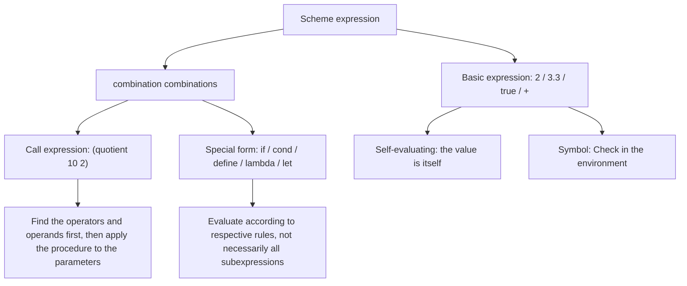
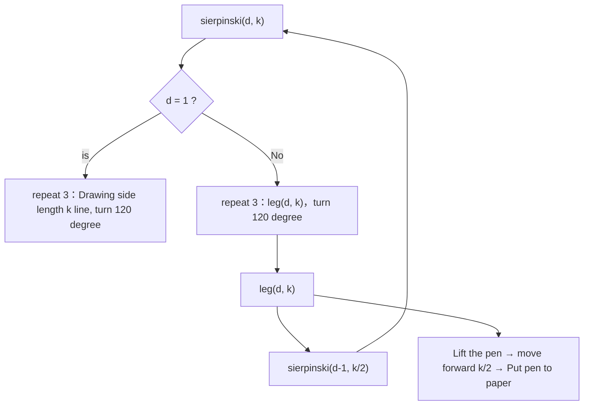

> **courses**: UC Berkeley CS61A · Structure and Interpretation of Computer Programs(Fall 2024)
> **This lecture**: Lecture 28 ｜ 31:14 ｜ Station B P 26 ｜ [Original video](https://www.bilibili.com/video/BV1sy411z7nA?p=26)
> **courseware**: `27-Scheme_1pp.pdf` (15 pages, official PDF, page-by-page renderings see text illustrations)
> **subtitles**: Original English subtitles from Station B; this note is a reconstruction of Chinese writing, not a sentence-by-sentence translation.
> **Copyright**: The copyright of the course and courseware belongs to the UC Berkeley CS61A teaching team; this article is a secondary arrangement for learning purposes

## Quick overview of this lecture

- **Mastered**: use  `def`  Define functions, use environment models to explain name lookups, use recursion instead of loops, and treat functions as values that can be passed and returned; be able to understand the relationship between "name-value-parent environment" in the box needle diagram.
- **Main line of this lecture**:
    - Scheme is a dialect of Lisp, older than Python, but it does "expression evaluation" more purely: the program is an expression tree.
    - There are only two types of Scheme expressions - basic expressions (self-evaluating numbers and symbols) and combinations; combinations are further divided into call expressions and special forms.
    - Prefix notation is not a writing quirk: operators, operands, and nesting levels all fall within parentheses, indentation is only for the benefit of the reader, and the interpreter doesn't see a single space.
    - `define`  Bind name, `if`/`cond`/`and`/`or`/`begin`/`let`  is a special form, `lambda`  Create an anonymous process; no  `for`/`while`, iteration can only rely on recursion.
    - The Scheme demonstrated in class is executed by the evaluator handwritten by the students in Project 4 - learning a language is to learn to build the language in the next step.
- **Key conclusions**: The language has been changed, but the evaluation rules, environment model, and recursive thinking have not been changed; what has been changed is only "where to put the brackets" and "which value can be written directly". The reason why Scheme's brackets are so secretive is that they explicitly write out all the structures (priority, statement blocks, binding ranges) hidden in the grammar of other languages.

*(Reference time: 00:00:02 – 00:00:23｜Lecture 28)*


Page 2 is the announcement page. There is no corresponding oral content in the subtitles. The class announcements do not belong to the knowledge content. They are only retained here as part of the courseware sequence.

## 1. Why learn Scheme: a dialect older than Python

*(Reference time: 00:00:24 – 00:01:53｜Lecture 28)*

So far, the course has finished explaining the essence of programming, functions and data, and the basic skills of Python have been passed. Next, I changed the language, not because Python is not enough, but to verify a more important thing: **How many of the ideas you learn in a language are transferable?**. The lecturer's judgment is very straightforward - there are many parts that can be moved away, and this is the reason why it is worth spending a lecture to learn Scheme.

Scheme is a dialect of Lisp. Lisp is one of the two oldest programming languages ​​still in use today, and it is also the only one that is still growing rapidly: a new generation of engineers is constantly using Lisp in new scenarios. The lecturer quoted three comments as a footnote: Alan Kay, the inventor of object-oriented programming, called it "the greatest single programming language ever designed"; one of the lecturer's favorite science fiction writers said it was "the only computer language that can be called beautiful"; Brian Harvey gave it an even more unkind compliment - "the language God used to write programs". Even the online comic xkcd has drawn it: Lisp is over fifty years old, but still has a perfect temperament that is not affected by time; the line in the comic says that this is "your father's bracket, an elegant weapon belonging to a more civilized era."

> **Editor's note**: Lisp was designed by John McCarthy around 1958, and is often called "the oldest language still in use" along with Fortran in 1957. Scheme was born in the 1970s as a minimalist dialect of Lisp. "These are your father's parentheses" is a parody of Obi-Wan's line "These are elegant weapons for a more civilized age" in "Star Wars". The "brackets" are the iconic appearance of Lisp.

The beauty of Lisp is its simplicity: the entire language can be learned in a day, but it can produce programs that are as complex or more complex than anything you'll see in the course. This sentence may sound like a sales pitch, but it is actually the design goal of this language -**Compress the syntax to almost non-existence, leaving all the complexity to the problem itself**. You will see this consequence again and again later: No  `for`, no  `while`, no  `return`, there is no boundary between statements and expressions, and the remaining things are small enough to be written on one page.

## 2. Expressions: self-evaluating, bound, and combined

*(Reference time: 00:01:54 – 00:05:14｜Lecture 28)*


Scheme programs are composed of expressions. An expression is evaluated in an environment to obtain a value; the role of the environment is to give meaning to symbols. The courseware uses three lines of small text to review this model, which is exactly the same as in Python: in the local frame, "the instructor of this course" has a specific reference; in the global frame, "multiplication" is an operation that everyone understands; when searching, first local and then global, so in a specific context, "multiplication" can be redefined as something else.

Expressions are divided into two major categories and four subcategories according to courseware:

- **primitive expressions**: Self-evaluating expression (self-evaluating), for example  `2`, `3.3`, `true`, written out is its value; and symbols (symbols), for example  `+`, `-`, `quotient`, `not`, they are names, and the values must be checked in the environment.
- **combinations**: call expressions, for example  `(quotient 10 2)`, `(f x)`; and special forms, such as  `(if a b c)`, `(let ((x 2)) (+ x 1))`.

This classification diagram is worth drawing because it is the map for all subsequent discussions:



The way to write call expressions is the first habit that must be broken in this lecture: **The parentheses are outside, and the operator is first in the parentheses.**, followed by zero or more operands. Python written  `quotient(10, 2)`, the operator is outside the brackets; Scheme writes  `(quotient 10 2)`, the operator is also in parentheses, just ranked first. `quotient`  It is a built-in integer division process - called a function in Python and a procedure in Scheme. It is essentially the same thing: it accepts parameters and returns a value.

thus  `(quotient 10 2)`  Evaluates as  `5`, `(not true)`  Evaluates to false. Numbers evaluate themselves and symbols are bound to values ​​- these two sentences are the entire basis of Scheme's evaluation rules.

## 3. Evaluation and parentheses: the structural meaning of prefix expressions

*(Reference time: 00:05:15 – 00:06:42｜Lecture 28)*


On page 4 of the courseware, drop the tree just now on the paper and mark it  `(Demo)`: After this page, you will enter the interactive demonstration. The demonstration starts with the simplest, `2`  Evaluates as  `2`; `(+ 1 2 3 4)`  Evaluates as  `10`. Then the lecturer asked a question: Add up nothing, what is the result? The answer is  `0`. Multiplying nothing, the result is  `1`. This is not a quirk of the interpreter; **unit yuan** (identity element) is a direct reflection: the identity element of addition is 0, the identity element of multiplication is 1, and the empty combination just writes "do nothing".

`(* 2 2 2 2 2 3 3 3)`  Evaluates as  `864`——The lecturer made an extra tap with his hand during the demonstration.  `2`, shouting "Oops" first and then confirming the result. This episode just shows that prefix notation has zero tolerance for the number of operands: one more and one less, the value changes. Nesting is also natural: to "reduce this whole thing by one", just enclose it entirely and put a new operator at the front:

```scheme
scm> (- (* 2 2 2 2 2 3 3 3) 1)
863
```

Put it in the same position  `+`, `/`, `*`  It doesn’t matter, any process can be applied like this. This is where prefix notation is most troublesome: **New combinations always only add a symbol at the front and a parenthesis at the end. There is no need to remember the priority, and there is no need to add additional parentheses to override the priority.**.

The combination can span any number of lines, and the interpreter doesn't care about how to break lines or indent; it only cares about one thing - opening parentheses must be closed. The following expression is a classic indentation example in the course. Read its structure paragraph by paragraph:

> **Editor's note**: The subtitle dictates the order of evaluation of each subexpression (evaluated first  `2 * 4 + (3 + 5)`  We get 16, multiply by 3 to get 48; do the math again  `10 - 7`  to get 3, add 6 to get 9, and finally add to get 57) without pronouncing the complete expression. The following code is restored according to the verbal numerical relationship and the "same-layer indentation alignment" typesetting rules.

```scheme
(+ (* 3
      (+ (* 2 4)
         (+ 3 5)))
   (+ (- 10 7)
      6))
```

The way to read it is to look at the operators from top to bottom: the outermost level is addition, and two things need to be added. The first is the multiplicand  `3`  multiplied by a subexpression, that subexpression is  `(* 2 4)`  with  `(+ 3 5)`  The sum of  `8 + 8 = 16`, so the first term is  `16 * 3 = 48`. The second item is  `(- 10 7)`  with  `6`  The sum of  `3 + 6 = 9`. Add the two items to get  `57`. The reason why the two operands of the second item are indented to the same level is because they have the same status and are both addends of this addition——**Indentation is to mark the height of the syntax tree for the reader, not for the interpreter to see.**. Write it in one line  `(+ (* 3 (+ (* 2 4) (+ 3 5))) (+ (- 10 7) 6))`, the value is exactly the same, just hard to read.

This also answers the question "Are Scheme's parentheses noise?": parentheses are not decoration, they are direct encoding of the syntax tree. Python uses indentation to express block structure, priority to express combination order, and commas and parentheses to express calls. Each of the three symbols does one thing; Scheme puts all these into a pair of parentheses, so it looks dense, but **no hidden information**——The nesting depth you see is the nesting depth of the evaluation.

The evaluation rules themselves are identical to Python: the operators are evaluated first, then the operands, and the procedure is applied to those arguments. The only difference is where the parentheses are placed.

## 4. Built-in procedures: The question mark is a naming convention

*(Reference time: 00:06:43 – 00:07:48｜Lecture 28)*

Except  `+`, `-`  For this type of arithmetic process, Scheme also comes with a number of processes for judgment. `(number? 3)`  is true, `(number? +)`  is false - the latter means that "it is a number" has nothing to do with "it is a name". `+`  It is a process object, not a number. `(zero? 2)`  is false, `(zero? 0)`  is true, `(zero? (- 2 2))`  is also true because  `(- 2 2)`  Evaluate to 0 first and then judge. `(integer? 2.2)`  is false, `(integer? 2)`  is true.

The question mark at the end of the name is not a grammatical symbol; **part of name**: This name is  `integer?`. The purpose of naming this is very simple - let people see at a glance that "this is a process of returning true or false." Any language encourages the use of names that remind readers of the purpose. Scheme has just solidified this advice into a community convention: a question mark at the end indicates a predicate, that is, a process that returns true or false.

> **Editor's note**: The Scheme community also has a common origin convention - names ending with an exclamation mark (e.g.  `set!`) represents a process that modifies the state. The distributed version of Scheme for this course does not emphasize this distinction, and it does not appear in this lecture. It is only used as a background reminder and is not part of the class content.

```scheme
scm> (number? 3)
#t
scm> (number? +)
#f
scm> (integer? 2.2)
#f
scm> (zero? (- 2 2))
#t
```

The courseware writes self-evaluated truth  `true`, used when the interpreter echoes  `#t`  with  `#f`. The two have the same meaning, the former is a writable literal, and the latter is a printable form.

## 5. Where does the interpreter come from: Project 4

*(Reference time: 00:07:52 – 00:08:49｜Lecture 28)*

At this point in the demonstration, the lecturer himself asked a question: What exactly are these codes running on? Did you download anything? The answer is "You can download an interpreter, or you can use an online version embedded in the web page, and we will show you the way for both" - but the class demonstration uses neither of these, but **Implementation of Project 4 of this course**.

Project 4 requires you to write a program in Python that implements a Scheme interpreter; once written, you can evaluate Scheme expressions on it. The way to do this is to hand-write the code required to perform various processes - code to read in expressions, code to determine which category an expression belongs to, code to evaluate according to rules. Such a program has a special name called **evaluator**.

This also clarifies the purpose of this module: to learn this new language, part of the reason is to build an interpreter for it next. Be a user first, then an implementer - the user perspective lets you know how a language "should" behave, and the implementer perspective lets you know which lines of code those behaviors come from. In the following lectures, this evaluator will be transformed from "can calculate  `(+ 1 2)`"Be able to run recursive processes all the way".

## 6. Special forms: if and and/or

*(Reference time: 00:08:53 – 00:10:26｜Lecture 28)*

So far, we have only learned about calling expressions, but Scheme also has other expression types called **special form**. The definition is very simple: **A special form is any combination that is not a call expression**. This definition seems negative ("not"), but it is actually very precise - it circles all things that "look like combinations but do not evaluate according to the rules of calling expressions".

The first one is  `if`  expression. Its appearance is still a combination, but the first subexpression is always a keyword  `if`, followed by predicate, consequent and alternative, all three are expressions. The order of evaluation is: first evaluate the predicate, and then determine whether it is true or false. **Just want one branch**.

| `if`  components of | location | Corresponding Python structure |
| :--- | :--- | :--- |
| predicate | second subexpression | `if`  conditional expression of statement |
| result consequent | third subexpression | `if`  Branched statement block (suite) |
| alternative alternative | The fourth subexpression | `else`  branch statement block |

`and`  with  `or`  are also special forms, for a more subtle reason: they want to logically combine a sequence of expressions, but **Not necessarily all evaluated**. Whether the "AND" of a string of conditions is true or false, sometimes it is enough to look at the first few - there is no need to count the following ones at all. This is a short-circuit: `(and a b)`  Liruo  `a`  is false, `b`  Whether it is evaluated or not does not affect the result, so it is not evaluated. This cannot be done with a calling expression, because the rule for calling an expression is to evaluate all operands first; `and`/`or`  The reason why it must be implemented in a special form is to circumvent this rule. The specific details will be expanded upon when writing the evaluator in Project 4.

## 7. define: bind the value to the symbol

*(Reference time: 00:10:28 – 00:12:19｜Lecture 28)*


Bind new value by  `define`. The simplest form is "define a symbol to be the value of some expression": first evaluate that expression, and then bind the result to the symbol. `(define pi 3.14)`  After that, the symbol  `pi`  can be used in subsequent expressions; it is bound to the global frame. The lecturer specifically emphasized: **Scheme uses the same environment model**, no different from what Python said - the name, value, frame, parent frame, nothing has changed.

The definition process uses a slightly different syntax, and the judgment method is very simple: `define`  Followed by a pair of parentheses, it is the definition process. This combination is not a call expression. The first position in the brackets is the name of the new procedure, followed by the formal parameters, and finally the procedure body:

```scheme
(define (abs x)
  (if (< x 0)
      (- x)
      x))
```

`abs`  Each time it is called, its procedure body is evaluated: if  `x`  less than 0, return  `x`  The opposite number of , otherwise return  `x`. The predicate, consequent, and alternative here are exactly the same as in the previous section  `if`  of three parts. Evaluate  `(abs 3)`  Got  `3`, evaluate  `(abs -3)`  Also have to  `3`.

this  `define`  Do two things: create a procedure object, and then put the symbol  `abs`  Bind to it, the binding position is **The first frame of the current environment**; Because it is executed in the global environment, it falls in the global frame.

Page 5 of the courseware points out the most essential difference between Scheme and Python: **Not in Scheme  `return`**. The value of the calling expression is the value of the last expression in the procedure body. There is no "early return", and there is no concept of "return statement" - the body of the procedure is the expression, and the value of the expression is naturally the value of the procedure. So Python relies on multiple  `return`  The bifurcation method must be rewritten as a nested conditional expression in Scheme:

```python
def sum_squares(x, y):
    return x * x + y * y
```

```scheme
(define (sum-squares x y)
  (+ (* x x) (* y y)))
```

```python
def fib(n):
    if n == 0 or n == 1:
        return n
    else:
        return fib(n - 2) + fib(n - 1)
```

```scheme
(define (fib n)
  (if (or (= n 0) (= n 1))
      n
      (+ (fib (- n 2)) (fib (- n 1)))))
```

Note  `fib`  This pair: The Python version has two  `return`, there is only one Scheme version left  `if`, each of the two branches is an expression, `if`  The value of is the value of the selected branch. two  `return`  became a  `if`, this is the translation rule of "statement → expression".

> **Editor's note**: This page of the courseware does not have a corresponding oral paragraph in the subtitles, and the lecturer directly entered the interactive demonstration in class. `sum_squares`/`sum-squares`  with  `fib`  The two sets of codes are transcribed verbatim from the original text of the courseware.

## 8. Definition process: from square to average

*(Reference time: 00:12:22 – 00:13:21｜Lecture 28)*


Define several processes yourself. Square is simply times itself:

```scheme
(define (square x) (* x x))
(square 16)
```

Evaluate  `(square 16)`  Got  `256`. The average is  `x`  with  `y`  Add up and divide by 2:

```scheme
(define (average x y)
  (/ (+ x y) 2))
(average 3 7)
```

Got  `5`. write  `average`  The lecturer reminded two things: first, crossing lines is absolutely fine, and how to indent and wrap lines is decided by the person who writes the code; second, **The brackets must be closed**, because only if the brackets are paired, the combination is well-formed. Scheme leaves indentation to humans and pairing to grammar. The two have a clear division of labor. The cost is that if the number of brackets is wrong, an error will be reported.

Page 6 of the courseware lists the calling expressions of Python and Scheme side by side. The focus is on the sentence "Are the brackets outside or inside?":

```python
def sum_squares(x, y):
    return x * x + y * y

sum_squares(3, 4)
# 25
```

```scheme
(define (sum-squares x y)
  (+ (* x x) (* y y)))
(sum-squares 3 4)
; 25
```

The lower part of the same page demonstrates  `and`  For short-circuiting behavior, this example is worth reading line by line:

```python
def f(x):
    print(x)
    return False

f(3) and f(4)
# 3
# False
```

```scheme
(define (f x) (print x) False)
(and (f 3) (f 4))
; 3
; #f
```

The output on both sides is only printed.  `3`. Same reason: `f(3)`  return false, `and`  It has been determined that the whole is false, and the second operand will not be called at all; if  `and`  is an ordinary calling expression, and the rules require that all operands be found first, then  `4`  will be printed. **The reason for the existence of the special form is that some combinations cannot be operated according to the rule of "find all operands first"**.

> **Editor's note**: This page also does not have a corresponding oral paragraph, and the code is transcribed according to the original text of the courseware. `(define (f x) (print x) False)`  There are two expressions in the procedure body (`print`  with  `False`), Scheme takes the value of the last one as the value of the process, and the previous one is evaluated only for side effects - this is consistent with the next section  `begin`  semantically consistent.

## 9. Recursion: Babylonian method for finding square roots

*(Reference time: 00:13:25 – 00:15:49｜Lecture 28)*

There are no obstacles to defining recursive procedures in Scheme, and recursion is everywhere. The class used "finding square roots" to connect all the previous parts - this is the same case taught in the Python part of the course, but the language was changed.

The idea is to continuously improve the guess value, and the method used is called **Babylonian method** (Babylonian method), which existed thousands of years ago: if the current guess value  `guess`  Already satisfied  `guess² = x`, then don't change it and return it directly; otherwise, use "the current guess value and  `x / guess` "average" as a better guess. Written as Scheme it is:

```scheme
(define (sqrt x)
  (define (update guess)
    (if (= (square guess) x)
        guess
        (update (average guess (/ x guess)))))
  (update 1))

(sqrt 256)
; 16
```

from  `1`  Start and update repeatedly until the square of the guess value is really equal to  `x`. Ask for  `(sqrt 256)`  Got  `16`.

There are three structures nested in this code, which are worth taking apart and looking at:

- `sqrt`  There is another one in the process body of  `define`, which defines **local process** `update`, only visible within this process body. Scheme allows procedures to be defined in the procedure body, written exactly the same as global definitions.
- `update`  The process body is a  `if`, while  `if`  The alternative is called again  `update`  Self - recursion here is "guess again", not "smaller problem". The stopping condition is that the numerical equation holds.
- closing  `(update 1)`  That's it  `sqrt`  True value: previous  `define`  Only the binding is established, its value is meaningless, and the last expression in the procedure body determines the return value.

The lecturer here asks the audience to pay attention to a detail: `update`  used in the process body of  `x`, while  `x`  is an outer process  `sqrt`  formal parameters. This is no coincidence: **Scheme, like Python, is lexically scoped**, the inner procedure can reference the formal parameters of the outer procedure, depending on the environment in which it is defined, not the environment in which it is called. This rule becomes a very specific implementation detail when writing evaluators: procedural objects must remember the environment in which they were created.

Parentheses can also be used in this example. The lecturer read while writing "Turn off division, turn off average, turn off update, turn off if, turn off define"——`(update (average guess (/ x guess)))`  There are three right brackets next to each other, which correspond to  `/`, `average`, `update`  The finishing touch to the three-tier combination. The ability to read Scheme code largely depends on the ability to count these layers of brackets.

> **Editor's note**: `(= (square guess) x)`  Using exact equality as the stopping condition is a writing method used in class for simplicity; it will hit the target quickly for most integers, but for some  `x`, floating point iteration may always be a little off. In engineering, it is usually changed to the criterion of "the difference between the two guess values ​​is less than a certain tolerance". This rewriting is not part of this lecture.

Scheme no  `for`  and  `while`, so **Loops must also be written using recursion**. Page 7 of the courseware uses a comparison of three writing methods in Python against one writing method in Scheme to explain this matter thoroughly:


```python
def sum_first_n(n):
    return sum(range(1, n + 1))
```

```python
def sum_first_n(n):
    total = 0
    for k in range(1, n + 1):
        total += k
    return total
```

```python
def sum_first_n(n):
    k = 1
    total = 0
    while k <= n:
        k, total = k + 1, total + k
    return total
```

```scheme
(define (sum-first-n n)
  (define (f k total)
    (if (> k n)
        total
        (f (+ k 1) (+ total k))))
  (f 1 0))
```

The three ways of writing Python are three types of layouts with the same meaning: `range`  Sum, `for`  Accumulate, `while`  Add up. There is only one Scheme - changing the state (`k`  with  `total`) as a parameter, and "next round" as a pair  `f`  Recursive call, write the termination condition as  `if`.`(sum-first-n 5)`  Got  `15`.**The absence of a loop statement does not mean that it cannot be looped; it means that the loop must be expressed recursively.**, and this expression looks exactly the same as a recursive function.

> **Editor's note**: `(f (+ k 1) (+ total k))`  located in  `if`  The branch position is the tail call. Standard Scheme requires that tail calls do not increase the call stack, so this writing method is a constant space in the real Scheme; CS61A's evaluator will not introduce tail call optimization until the next few lectures, and before that it will still consume the stack depth. This difference does not affect semantics, only how large it can be counted  `n`.

## 10. Writing Scheme: a-plus-abs-b, lambda and procedural values

*(Reference time: 00:15:49 – 00:17:11｜Lecture 28)*


The courseware enters the "Writing Scheme" section from here; this section only has one page of content, which is a fill-in-the-blank question. The question itself clearly states the requirements: `a-plus-abs-b`  accept two numbers  `a`  and  `b`, return  `a + |b|`, but **Not allowed to call  `abs`**.


The Python version of the answer is to let  `f`  becomes the function name and then calls  `f(a, b)`:

```python
def a_plus_abs_b(a, b):
    """Return a+abs(b), but without calling abs.

    >>> a_plus_abs_b(2, 3)
    5
    >>> a_plus_abs_b(2, -3)
    5
    >>> a_plus_abs_b(-1, 4)
    3
    >>> a_plus_abs_b(-1, -4)
    3
    """
    if b < 0:
        f = sub
    else:
        f = add
    return f(a, b)
```

The Scheme version of the fill-in-the-blank position is at the operator position, and the answer is a whole  `if`:

```scheme
(define (a-plus-abs-b a b)
  ((if (< b 0) - +) a b))
```

The key to understanding this line is to recognize the outermost combination: the thing in the operator position is  `(if (< b 0) - +)`, it first evaluates and obtains either a subtraction process or an addition process; then this newly obtained process is applied to  `a`  with  `b`  on. **Any expression can be placed in operator position as long as it evaluates to a procedure**. Python can also be written  `(sub if b < 0 else add)(a, b)`, but it is rarely written this way; this is the daily way of writing in Scheme.

> **Editor's note**: This page and the section page on the previous page do not have corresponding oral paragraphs in the subtitles. They are materials at the level of classroom exercises/after-class exercises. The codes are transcribed according to the original text of the courseware.


`lambda`  An expression is used to create a new procedure: it evaluates to a **Anonymous process**. Grammar is the keyword  `lambda`, a pair of formal parameter lists in parentheses, and then the procedure body:

```scheme
(lambda (<formal-parameters>) <body>)
```

Got it  `lambda`, there are two ways of writing "defining process", and they are equivalent:

```scheme
(define (plus4 x) (+ x 4))
(define plus4 (lambda (x) (+ x 4)))
```

The former is  `define`  procedure definition syntax, which is "using a  `define`  tie symbols to a  `lambda`  On the process of evaluation". Both ways of writing get the same thing: named  `plus4`  process. This equivalence relationship is important because it illustrates **Procedure definition syntax is just a layer of sugar**——The real mechanism is  `lambda`  manufacturing process, `define`  Tie names. When writing an evaluator, `define`  The procedural form of will be translated into  `lambda`  This is exactly the reason for reprocessing the form.

Since the operator position can contain any expression that evaluates to a procedure, place it as  `lambda`  It is logical:

```scheme
((lambda (x y z) (+ x y (square z))) 1 2 3)
; 12
```

The operator for this combination is  `(lambda (x y z) (+ x y (square z)))`, evaluate to get an "Accept  `x y z`, return  `x + y + z²`" process; it is applied to  `1 2 3`  Go up, get  `1 + 2 + 9 = 12`. The lecturer's statement is that "these can be combined at will, Scheme is completely flexible" - the source of flexibility is the "process is a value": a process can be used as a parameter, a return value, an operator, and can be written directly.


The last page of the courseware is two questions "Guess what Scheme will do":

```scheme
((lambda (g y) (g (g y))) (lambda (x) (+ x 1)) 3)
```

```scheme
(define (f g)
  (lambda (y) (g (g y))))
((f (lambda (x) (* x x))) 3)
```

Question 1: The operator is  `(lambda (g y) (g (g y)))`, the parameters are  `(lambda (x) (+ x 1))`  with  `3`. So  `g`  Tied to the "plus one" process, `y`  tied to  `3`, process body  `(g (g y))`  First  `3`  Add a change  `4`, add another change  `5`. Second question: `(f (lambda (x) (* x x)))`  put  `g`  Tie to square procedure, return  `(lambda (y) (g (g y)))`, that is, the process of "squared twice"; and then applied to  `3`  Up, `3² = 9`, `9² = 81`.

> **Editor's note**: The answers to these two questions (`5`  with  `81`) is deduced by the editor based on lexical scope and evaluation rules. Only the questions are given in the courseware, but no answers are given. The value of the second question is that it tests two things at the same time: the process can be passed in as a parameter, and the process can be passed out as a return value; `g`  on return  `lambda`  It is still visible inside, still relying on lexical scope.

## 11. cond and begin: conditional branching and sequential execution

*(Reference time: 00:17:11 – 00:21:19｜Lecture 28)*


The next three special forms (`cond`, `begin`, `let`) will appear repeatedly in Lab, Discussion, homework and next project, and will only be previewed in class.


`cond`  is the abbreviation of condition, corresponding to Python's  `if`/`elif`/`elif`/`else`: There can be multiple branches in one statement, `elif`  Write as many as you want, but you must start with  `if`  Begins and ends with an optional  `else`.

use  `if`  It can also express the same meaning - let another consequent be embedded in the last consequent  `if`, and another one is embedded in its consequent. So  `cond`  Not required; but when  `elif`  More than one, this kind of nesting  `if`  It becomes difficult to read, `cond`  exists to level this ladder.

`cond`  The syntax is: keyword  `cond`  followed by a string **paired things**, the first of each pair is the condition, and the second is what to do when the condition is true.

```scheme
(cond ((> x 10) (print 'big))
      ((> x 5) (print 'medium))
      (else (print 'small)))
```

The reading is: `x`  Print if it is greater than 10  `big`; Otherwise, if it is greater than 5, print  `medium`;otherwise print  `small`. Like Python, `else`  Branches are optional, but there can only be one and it must be last.

The common property of the two writing methods is: regardless of  `x`  How much is it? **Only one thing will be printed**. If  `x`  is 12, which is greater than both 10 and 5, but only prints  `big`, because  `x > 5`  Which one is behind the previous one, and the previous one hits first; once it hits, no longer look down.

`cond`  expression **valuable in itself**. If instead of printing, "you want a value of  `big`, `medium`  or  `small`  expression", the writing becomes:

```scheme
(cond ((> x 10) 'big)
      ((> x 5) 'medium)
      (else 'small))
```

You can then do other things with this value, such as printing it:

```scheme
(print (cond ((> x 10) 'big)
             ((> x 5) 'medium)
             (else 'small)))
```

These two writing methods are equivalent and both only print  `big`, `medium`, `small`  one; but the latter is shorter because it has only one  `print`  instead of three. this is  `cond`  Direct benefits of being an expression (rather than a statement): **The result of the branch can continue to participate in the calculation**.

In practice the choice is simple: just choose between two options, using  `if`; For more than two, use  `cond`.

`begin`  The special form combines multiple expressions into one expression, and its value is **the value of the last subexpression**. It is needed because many locations (e.g.  `if`  branches, `cond`  Each branch of () can only hold one expression, and the actual work often requires doing several things in sequence - printing for a while, or defining several symbols to specific values first, and then calculating the desired result.

In Python, `if`  You can write two branch statement blocks in a row.  `print`;There is only one empty space for an expression at that position in Scheme, so we need  `begin`  Put multiple items into one:

```python
if x > 10:
    print('big')
    print('guy')
else:
    print('small')
    print('fry')
```

```scheme
(cond ((> x 10) (begin (print 'big)   (print 'guy)))
      (else     (begin (print 'small) (print 'fry))))
```

`begin`  Any number of subexpressions are allowed, and they will all be evaluated, with the last one taking the value. The lecturer reminds me by the way: There are only two branches here. Use  `if`  More natural; and you can indent and wrap as you please:

```scheme
(if (> x 10) (begin (print 'big) (print 'guy))
             (begin (print 'small) (print 'fry)))
```

The semantics are exactly the same: `x`  Print if it is greater than 10  `big`  and  `guy`, otherwise print  `small`  and  `fry`.

## 12. let: bind only one expression

*(Reference time: 00:21:22 – 00:24:32｜Lecture 28)*


`let`  a bit like  `define`, the difference is that the symbol it binds is **temporary**: Only valid in one expression. After that expression is evaluated, the binding disappears.

There is no real equivalent in Python, so the best way is to write the same calculation in both languages and see how their behavior differs. An example is a right triangle: the two right sides are 3 and  `2 + 2`, the hypotenuse length is 5, this is a 3-4-5 triangle.

```python
a = 3
b = 2 + 2
c = math.sqrt(a * a + b * b)
```

```scheme
(define c (let ((a 3)
                (b (+ 2 2)))
            (sqrt (+ (* a a) (* b b)))))
```

Can get both sides  `c`  is 5. The difference is  `c`  After figuring it out: Python version  `a`  and  `b`  after that **still bound**——This may be good, if you need it later; it may be bad, if  `a`  It has been used for something else, is now overwritten by you, or you just want to keep the name to a minimum. In Scheme version, `c`  After defining, `a`  and  `b`  no longer bound: they are just for calculation  `c`  The value exists temporarily and is gone after calculation.

`let`  The structure of an expression has only two parts:

- **binding list**: `((a 3) (b (+ 2 2)))`, each binding is a pair, the first one must be a symbol, the second one can be any expression, it is evaluated first and then bound.
- **value expression**: `(sqrt (+ (* a a) (* b b)))`, evaluated after the binding takes effect, its value is the entire  `let`  value.

The lecturer's statement is very vivid: It's like putting a bunch of small  `define`, just  `a`  and  `b`  The binding is finished  `c`  disappeared at that moment.

In Scheme code of a certain size, `let`  Used very much. `define`  Usually only reserved for things that are truly permanent: a new procedure that will be called over and over again, or something like  `pi`  Such constants. Other than that, Scheme code doesn't do many definitions; when you need to remember a bit of temporary information, use  `let`. This is mostly a stylistic convention, but it has valid reasons -**Don’t worry about naming things you won’t need in the future**. Just say it clearly: `c`  To stay, `a`  and  `b`  Just to count  `c`  And the temporary presence is no longer needed.

## 13. Stage Overview: Structural Isomorphism between Python and Scheme

*(Reference time: 00:23:43 – 00:24:32｜Lecture 28)*

`define`  with  `let`  After explaining the division of labor, all the parts that will appear in this language are ready. It's worth stopping at this point to do a side-by-side inventory: take the already familiar structures in Python and find their Scheme counterparts one by one. This is not done to memorize grammar, but to see clearly **Which differences are expression methods and which differences are worldview differences?**.

Make a list of the structures you've seen in this lesson side by side. The first column is the criterion. Using it to find corresponding relationships is less laborious than memorizing grammar.

| criterion | Python | Scheme |
| :--- | :--- | :--- |
| What is the function called? | function | procedure |
| How to write call | `f(3, 4)`, the operator is outside the brackets | `(f 3 4)`, the operator is first in the brackets |
| define function | `def f(x, y):`  add  `return` | `(define (f x y) <body>)`, none  `return` |
| Where does the return value come from? | `return`  Statement, can have multiple places | The value of the last expression in the procedure body |
| Multiple branch selection | `if` / `elif` / `else` | `if`  or  `cond` |
| Execute multiple items in sequence | Statement blocks are indented | `begin`  or process body |
| loop | `for`, `while` | No, use recursion to express |
| anonymous function | `lambda x: x + 1` | `(lambda (x) (+ x 1))` |
| temporary binding | There is no real equivalent, the assignment will remain in scope | `let`, only one expression exists |
| true and false | `True` / `False` | `#t` / `#f` (Writing is available  `true`) |
| Division | `/`  Really eliminated, `//`  Divisible | `/`  Really eliminated, `quotient`  Divisible |
| Equality comparison | `==` | `=` (used for numbers) |
| Prefix or infix? | infix  `x * x + y * y` | prefix  `(+ (* x x) (* y y))` |

The most informative lines in the table are the lines "Where does the return value come from" and "Loop": they are not syntax differences; **What does a language regard as its basic building blocks?** difference. The basic building blocks of Python are statements, so you need  `return`  and  `while`  To string statements into processes; the basic component of Scheme is expression, so "value" naturally comes from the last expression, and "repetition" naturally comes from recursive calls. Once you accept this premise, you will find that  `cond`, `begin`, `let`  The existence of is no accident: they are all solving the same problem——**How to fill a space that can only hold an expression into something that requires several more steps to calculate?**.

On the other hand, those things that have not changed should be remembered: expressions are evaluated in the environment, names are looked up locally first and then globally, procedures can be used as parameters and return values, and recursive stop conditions must be written by someone. These rules are word for word in both languages, indicating that they describe **Evaluation itself**, rather than some kind of syntax. When writing the evaluator later in this module, it is these items that fall on the code.

## 14. Case: Drawing Sierpinski Triangle with Turtle

*(Reference time: 00:24:34 – 00:31:11｜Lecture 28)*

The final example puts all the pieces of this lecture together: using the drawing process to draw Sierpinski's triangle. The Scheme version distributed in the course comes with its own drawing facilities: after it is started, it can not only calculate addition, but also direct a small turtle to walk on the canvas.

`(forward 100)`  Let the turtle advance 100 units; `backward`  make it recede; `right`  with  `left`  Let it turn. These drawing processes are no different from the processes we define ourselves, so they can be combined with each other: define a process of "drawing a 50 unit line segment", then draw two in a row, and then turn right; you can also define a process of "doing something twice":

```scheme
(define (line) (forward 50))

(define (twice f)
  (f)
  (f))
```

`(twice line)`  Just draw two line segments. Since "do it twice" can be written as a process, then "do it k times" can also be written - this is  `repeat`:

```scheme
(define (repeat k f)
  (f)
  (if (> k 1)
      (repeat (- k 1) f)))
```

`repeat`  Takes a k and a procedure and calls the procedure at least once; if  `k`  is greater than 1, continue to repeat the same process  `k - 1`  times. This shape is the same as the one in the previous section  `sum-first-n`  Exactly the same: **Write the count as a parameter and "next round" as recursion**. The only difference is that instead of sums, what is accumulated here is lines on the canvas.

Got it  `repeat`, drawings become building blocks. Draw three equal-length line segments and turn right 120 degrees each time to form an equilateral triangle; draw five line segments and turn right 144 degrees each time to form a five-pointed star:

```scheme
scm> (repeat 3 line)
scm> (repeat 5 (lambda () (forward 50) (right 144)))
```

In the second call, `repeat`  What is needed is a "zero parameter procedure", so what is passed in is a  `lambda`: It does not accept parameters. Each time it is called, it advances 50 and then turns right 144 degrees. `repeat`  The second parameter of is the process, `lambda`  It happens to be able to create a process on the spot - this lecture ends up using these two features in the same place.

The triangle itself is also spelled out this way. The lecturer first abstracted the "side of the triangle" into a parameter instead of writing a hard line: the method of drawing a triangle is always "repeat three times: first draw a side, and then turn 120 degrees". The only thing that changes is how to draw this side.

```scheme
(define (triangle edge)
  (repeat 3 (lambda () (edge) (right 120))))
```

use  `line`  When the side is used, an ordinary line triangle is obtained; when a more complex side is used, a more complex figure is obtained. This level of abstraction is what we will use to draw the Sierpinski triangle next: each of its sides is itself a smaller Sierpinski triangle.

The Sierpinski triangle has two parameters: recursion depth  `d`  with side length  `k`. It itself is a triangle, but to draw it **side** Make a choice: if  `d`  If it is 1, just draw a long  `k`  line - this is the base case of the recursion; otherwise, this edge would be made of a smaller, shallower Sierpinski triangle. So "drawing triangles" and "drawing edges" call each other, forming a set of mutually recursive processes.

> **Editor's note**: This code in class is from the file  `load`  When executed in the interpreter, there is no code for this page in the courseware, and the subtitles only describe the structure verbally. The following paragraph is reconstructed according to the oral structure: `sierpinski`  in  `d = 1`  When drawing a line triangle, otherwise repeat three times "draw a leg (leg) and turn right 120 degrees"; `leg`  Draw a half-size sub-triangle with a depth minus one, then lift the pen, advance, and put the pen down to send the turtle to the end of the leg. The subtitle says "advance K", and according to the geometric relationship, the remaining half should be advanced (`k / 2`), written here according to geometry; the previous  `line`  Only a fixed 50 units are drawn, and the file version is changed to receive side length parameters, so it is written as  `(define (line k) (forward k))`.

```scheme
(define (line k) (forward k))

(define (sierpinski d k)
  (if (= d 1)
      (repeat 3 (lambda () (line k) (right 120)))
      (repeat 3 (lambda () (leg d k) (right 120)))))

(define (leg d k)
  (sierpinski (- d 1) (/ k 2))
  (penup)
  (forward (/ k 2))
  (pendown))
```

Recursive shapes can be drawn:



First clear the canvas, turn right 90 degrees so that the shape faces down, set the turtle speed to 0 (fastest), and then draw a shape with a depth of 5 and a side length of 200:

```scheme
scm> (sierpinski 5 200)
```

Every small triangle that appears on the screen is a base case: `d`  When equal to 1, it is just a triangle drawn with a line; otherwise, it is composed of three Sierpinski triangles. Expanding layer by layer is the tongue-twisting description: a Sierpinski triangle consists of three Sierpinski triangles, each of which is composed of three Sierpinski triangles, each of which is composed of three Sierpinski triangles, each of which is composed of three ordinary triangles - finally encountering the basis situation.

There are two details worth remembering during the drawing process. First, turtles will **Duplication of work**: It will go over the place it just painted, because it does not record what it has painted, and it does not know that it is doing redundant work - a process only has "execution" and no "memory", and this is its price. Second, after drawing the last smallest triangle, the turtle has to return to the starting point step by step along the "pen lift, advance, and pen down" left by all recursive calls; it looks like it is tracing on the screen, but it is actually **Finishing**: Each level of recursion must complete the last movement without drawing a line before it can be returned to the previous level.

## Summary

- **Expression trees are programs**:Scheme uses parentheses to explicitly write out the syntax tree. The operator is first in the parentheses, and the nesting depth is equal to the evaluation depth; the indentation is only meaningful to the reader. To understand a language, first look at where it hides its structure and where it exposes its structure.
- **"Special form" is a dividing line**: Any combination that is not a calling expression is a special form. The fundamental reason for its existence is **Evaluation order**——`if`  Just want one branch, `and`/`or`  The operands may not be calculated completely, `define`/`lambda`/`let`  Some subexpressions are not evaluated at all, and the "operator and operand first" rule cannot apply to them.
- **process is value**: `lambda`  Evaluate the process, `define`  Just tie the name to it; so the two ways of writing "define procedure" are equivalent. Procedures can be used as parameters, return values, and operators. This property has been learned once in Python, and it has become a grammatical fact in Scheme.
- **No  `return`, nor  `while`**: The value comes from the last expression in the procedure body, and the repetition comes from recursion. All translations of "statement → expression" mean the same thing: leave sequential execution to  `begin`  or process body, hand over the fork to  `if`/`cond`.
- **Binding has lifespan**: `define`  is permanent (global or current frame), `let`  Exists only for one calculation. Which one to choose is equivalent to answering "should this temporary information leave a name?" - this lecture refers to it as style, but behind the style is the trade-off between readability and naming conflicts.
- **Recursion is language independent**: `sqrt`  of Babylonian methods, `sum-first-n`  Parameterized loops and Sierpinski's mutual recursion all have the same shape in Python. The benefit of changing languages ​​is not to memorize another set of grammar, but to recognize which ideas are problems and which are just expression habits of a certain language.
- **The next step is to create language**: The Scheme demonstrated in class is executed by Project 4's evaluator. Writing all the rules in this lecture into a program that can run is what we will do in the next few lectures.

*(Reference time: 00:30:56 – 00:31:11｜Lecture 28)*

## Attached: Slide index for this lecture

*(Reference time: 00:00:02 – 00:31:11｜Lecture 28)*

| page | content | Appear location |
| :--- | :--- | :--- |
| 1 | Title page Scheme | Quick overview of this lecture |
| 2 | Announcements page Announcements | Quick overview of this lecture |
| 3 | Section page: The Scheme Programming Language | §2 |
| 4 | Expression classification: basic expressions and combinations, standard  `(Demo)` | §3 |
| 5 | Definition process: none  `return`, `sum-squares`  with  `fib`  control | §7 |
| 6 | Python vs Scheme calling expressions vs.  `and`  short circuit | §8 |
| 7 | Python’s three iterative writing methods and Scheme’s recursive writing method | §9 |
| 8 | Section page: Writing Scheme | §10 |
| 9 | Exercise: `a-plus-abs-b`  Fill in the blanks at the operator position | §10 |
| 10 | Sectioned pages: Lambda Expressions | §10 |
| 11 | `lambda`  Syntax, two equivalent definitions, operators can be combined | §10 |
| 12 | What Would Scheme Do: Two ways  `lambda`  Application questions | §10 |
| 13 | Section page: More Special Forms | §11 |
| 14 | `cond`  with  `begin`: `if-elif-else`  Two ways of writing | §11 |
| 15 | `let`: Behavioral differences between temporary binding and Python assignment | §12 |
