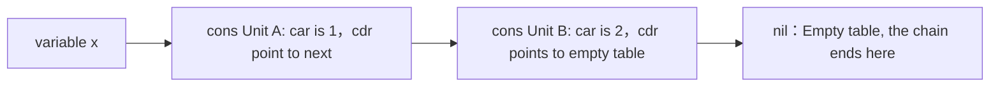
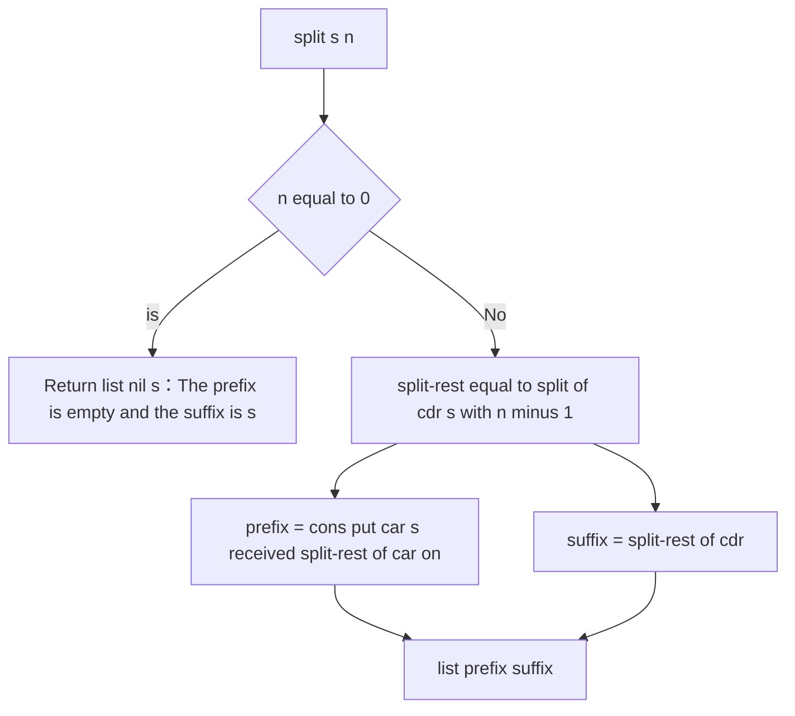
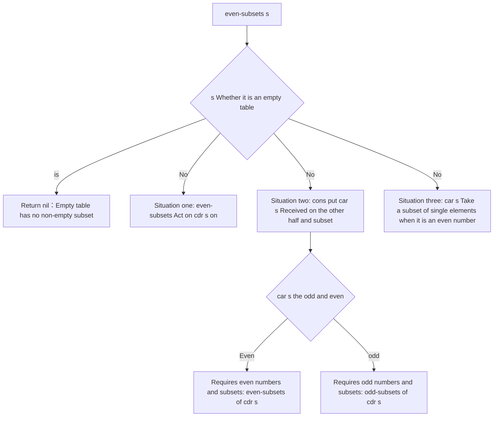

> **courses**: UC Berkeley CS61A · Structure and Interpretation of Computer Programs(Fall 2024)
> **This lecture**: Lecture 29 ｜ 24:44 ｜ Station B P 27 ｜ [Original video](https://www.bilibili.com/video/BV1sy411z7nA?p=27)
> **courseware**: `28-Scheme_Lists_1pp.pdf` (13 pages, official PDF, page-by-page renderings see text illustrations)
> **subtitles**: Original English subtitles from Station B; this note is a reconstruction of Chinese writing, not a sentence-by-sentence translation.
> **Copyright**: The copyright of the course and courseware belongs to the UC Berkeley CS61A teaching team; this article is a secondary arrangement for learning purposes

## Quick overview of this lecture

- **Mastered**:Python  `list`, `tuple`, `dict`, `set`  These built-in containers; the hand-written linked list class in Python (a value plus a "next node" reference); Scheme's expression evaluation, `define`, `if`, `let`, `lambda` (Previous lecture).
- **Main line of this lecture**:
    - Scheme’s list is a linked list: `cons`  Build a two-compartment box, `car`  Take the first cell, `cdr`  Take the second grid, `nil`  It is an empty watch and the end of the chain.
    - seen on screen  `(1 2)`  is a list **Printed form**, not its internal structure; the internal structure can only be seen by drawing a box-and-pin diagram. The gap between the two is the source of all the "misunderstandings" in this lecture.
    - `cons`  Only one element is added at a time, and the second parameter is regarded as the "remaining part", so the table can only be built from right to left, ending at  `nil`; `list`  with  `append`  are two shortcuts, corresponding to "known elements" and "known entire table" respectively.
    - A symbol will by default evaluate to the value it is bound to. `quote`(`'`) Let the symbols themselves become values - this is the switch that allowed Lisp to do symbolic computation and become the standard language for early artificial intelligence.
    - `map`, `filter`, `apply`  By solidifying the three modes of "doing the same thing for each element", "retaining only elements that meet the conditions" and "treating the entire table as a parameter table", you can write a lot less when writing recursion.
- **Key conclusions**: There are only two forms of a table - empty table, or "one element + one table". All list procedures (`split`, `even-subsets`, `non-empty-subsets`) are direct translations of these two items; write the three-line skeleton, and the rest is just "this step should be used  `cons`, `list`  Still  `append`".

*(Reference time: 00:00:00 – 00:00:09｜Lecture 29)*


## 1. Opening: the first two pages of the courseware and the position of the lecture

*(Reference time: 00:00:00 – 00:00:40｜Lecture 29)*

> **Editor's note**: The first two pages of this courseware are Turtle Graphics section pages and examples of drawing stars, which are materials for the Scheme drawing section. The subtitles of this video recording start at 00:00:00 and are "Python has many types of built-in data structures". There is no dictation on these two pages. The following code is organized according to the courseware screen. The comments are added by the editor and are not the original words of the class.


Turtle drawing uses a "brush" to move on a flat surface: the brush has a position and an orientation. `(forward 100)` (abbreviation  `(fd 100)`) advances the brush 100 units in the current direction and leaves a line; `(right 90)` (abbreviation  `(rt 90)`) turns the brush 90 degrees clockwise, drawing no lines by itself. With these two primitives, "draw a regular polygon" and "draw a star" become "repeatedly take one step and turn an angle."


on courseware  `star`  The procedure has two parameters: `n`  is the number of sides (marked as Number of sides on the diagram), `m`  It is the number of vertices to jump each time an edge is drawn (labeled Where to go next). corner  `a`  by  `let`  Calculated, it is equal to  `360 * m / n`. call  `(star 5 2)`  time  `a = 360 * 2 / 5 = 144`  Degree - jump directly from one vertex of the regular pentagon to the next vertex "every other", which is exactly this angle; each of the five sides turns 144 degrees, accumulating 720 degrees, exactly two circles, so the figure is closed, and the five-pointed star on the right side of the courseware is obtained.

```scheme
(define (star n m)
  (let ((a (/ (* 360 m) n)))
    (define (side k)
      (if (< k n) (begin (fd 100) (rt a) (side (+ k 1)))))
    (side 0)))
```

This code stacks the three tools from the previous lesson together: `let`  Turn the calculated corner  `a`  Tie it into a local name to avoid repeated calculations in recursion; internal  `define`  Create something that is only visible during this process  `side`, which uses a counter  `k`  Count how many sides have been drawn; `begin`  String the two side effects of "take a step" and "turn around" into an expression. `if`  I only wrote about establishing a branch. `k`  Count to  `n`  When the condition is false, the recursion stops naturally. This is also Scheme's style: no  `for`, `while`, loops are always expressed by "counter + recursion + termination condition".

> **Editor's note**: These two pages have the same source as the turtle drawing fragment in the previous lecture (Lecture 28), where the 144-degree corner also appeared. The recording of this lecture starts from the Lists section, so this code has no oral counterpart in this lecture. Readers can regard it as "the end of the previous lecture".

Return to the main text of this lecture. The instructor's opening line was just this: Python has many built-in data structures—lists, tuples, dictionaries, sets, and more; and Scheme has lists. What follows is the most important analogy of this lecture: **Scheme’s list is a linked list**, is the same thing as the linked list class written by hand in Python class - each node stores a value, plus a reference to the "rest of the list". Grasp this point, and all subsequent processes (`cons`, `car`, `cdr`, `append`, `map`) are just operating this reference chain.

The lecturer also joked about the history of naming: Lisp was born in the late 1950s. Computer scientists of that era "really liked confusing names and abbreviations," so there was  `CONS`  This two-parameter process - its function is to create a linked list node.

## 2. Minimum vocabulary of linked lists: `cons`, `car`, `cdr`  with  `nil`

*(Reference time: 00:00:41 – 00:02:11｜Lecture 29)*


The lecturer's statement is very straightforward: creating a linked list only makes sense if "the first element can be obtained" and "the rest of the list can be obtained", so in addition to  `cons`, two access procedures must also be configured. The courseware lists the four names side by side:

- **`cons`**: Two-parameter process, create a linked list node (the first cell contains the value, the second cell contains the "rest of the list").
- **`car`**: Returns the first element of the list, which is the value in the first cell.
- **`cdr`**: Returns the remaining part except the first element, which is the table pointed to by the pointer in the second cell.
- **`nil`**: Empty table, a table with nothing.

> **Editor's note**: `car`  with  `cdr`  The name comes from two register fields on the IBM 704 machine in the 1950s - the address part (address) and the decrement part (decrement), namely "Contents of Address Register" and "Contents of Decrement Register". The lecturer only said in class that "people of that era liked confusing names", and the etymology was supplemented by the editor.


`nil`  The result of this built-in symbolic evaluation is an empty list. To create a table of length 1 and containing 2, write  `(cons 2 nil)`: It creates a cons, the first cell is 2, and the second cell points to  `nil`. In box-pin diagrams, there is often no arrow drawn in the second cell, only a diagonal line.  `/`——The slash is not "no value", but "here is the empty list", which means the chain ends here.

```text
  (cons 2 nil)

     +----+----+
     | 2  | /  |
     +----+----+
      car   cdr = nil
```

The key difference is between "display" and "structure". Scheme's default way of displaying a list is to enclose the elements in parentheses and separate them with spaces: `(1 2)`. The bottom layer is of course a linked list structure, but **The standard display mode does not display this structure, only the elements.**. So  `(cons 1 (cons 2 nil))`  The created thing, after evaluation, only  `(1 2)`- The structure is hidden.

```text
  (cons 1 (cons 2 nil))

     +----+----+        +----+----+
     | 1  |  *-+------->| 2  | /  |
     +----+----+        +----+----+
      car  cdr           car  cdr = nil
```

It will be clearer if you tie this table to names and look at it: `(define x (cons 1 (cons 2 nil)))`  After that, `x`  displayed as  `(1 2)`; `(car x)`  is  `1`; `(cdr x)`  is  `(2)`. Note  `(cdr x)`  displayed as  `(2)`  instead of  `2`: The remaining part is still a table, but this table only has one element. This is the most common confusion among beginners, and it is also the reason why recursion can go all the way——`cdr`  Each time it is handed over to the next step, it is still a table with the same shape, but one element shorter.

A little longer: `(cons 1 (cons 2 (cons 3 (cons 4 nil))))`  displayed as  `(1 2 3 4)`, the structure is four cons strung into a chain, the last cons  `cdr`  is  `nil`.

```text
  +---+---+   +---+---+   +---+---+   +---+---+
  | 1 | *-+-->| 2 | *-+-->| 3 | *-+-->| 4 | / |
  +---+---+   +---+---+   +---+---+   +---+---+
```



### 2.1 Why recursion must terminate at  `nil`

The way to write a recursive list is always the same: first ask "Is this table empty?" (`(null? s)`), if empty, return the base value; if not empty, "take the first element" (`(car s)`) do something, and then leave the problem to the "remaining table" (`(cdr s)`).`cdr`  Each step makes the table shorter by one element, and the length of the table is limited, so as long as it moves towards  `cdr`  If you go, you will definitely end up after a finite number of steps.  `nil`.

What's more: `nil`  is a **Must be checked explicitly** the end point. There is no "first cell" in an empty table. `(car nil)`  It is not a legal value (an error will be reported in the Scheme interpreter of this course), so you cannot expect to stop by saying "the thing obtained is empty", you must ask first  `(null? s)`. This is why in the list process  `if`  The first condition is almost always  `null?`, rather than any other judgment.

```scheme
(define (list-length s)
  (if (null? s) 0 (+ 1 (list-length (cdr s)))))
```

> **Editor's note**: the one above  `list-length`  It is the smallest skeleton added by the editor, used to put together the three things of "base value + reduction problem + combined result"; the same skeleton in this lecture appears in  `even-subsets`  with courseware  `split`  inside (see verses 4, 8, 9).

### 2.2 proper list and point pair: `cons`  What on earth was made?

The courseware and subtitles discuss proper list: the last one in the chain  `cdr`  is  `nil`. But  `cons`  It does not check whether the second parameter is a table, it just puts the two pointers into a pair. If the second parameter is not a table, the resulting value is called a dotted pair and will be displayed as  `(1 . 2)`.

| criterion | proper list (true list) | dotted pair |
| :--- | :--- | :--- |
| internal structure | cons chain, last  `cdr`  point to  `nil` | Both cells have values, the last one  `cdr`  Not a watch |
| Construction method | `(cons 1 (cons 2 nil))` | `(cons 1 2)` |
| Display form | `(1 2)` | `(1 . 2)` |
| `list?`  judgment | true | false |
| Can it be used  `cdr`  Go to the end | Yes, go  `nil`  stop | No, I bumped into a non-table value halfway. |

> **Editor's note**: The two lines about the correct points in the above table are the editor’s additions. The courseware and subtitles only talk about the proper list. It is enough to remember the rule emphasized by the lecturer in Section 3: `cons`  The first parameter can be anything, the second parameter should be another table or  `nil`——Otherwise, the end of the chain will not form a watch, and the back will  `car`/`cdr`  The recursion will cause trouble at the end.

## 3. Reading box needle diagrams in the interpreter: four examples that require guessing first

*(Reference time: 00:02:57 – 00:05:44｜Lecture 29)*

Next, the lecturer switched to the web version of the interpreter used in the course. The reason was very clear: it will **draw** Output the linked list structure of each table (`draw`  this operation). The lecturer specially added: `draw`  Not every Scheme has it built-in, only the interpreter of this course has it built-in, so that people can see what is happening.

This statement deserves a pause. The language standards stipulate that **behavior**——`cons`  watch making, `car`  Take the head, `cdr`  Take the tail off; visualization is just a learning tool. Therefore, in all subsequent examples, you must be able to draw box pin diagrams on paper by yourself, and cannot rely on  `draw`.

First example: `(define s (cons 1 (cons 2 nil)))`.`s`  displayed as  `(1 2)`, `draw`  Coming out is the two-square chain in section 2. Next are four examples that need to be thought about first. Each of the lecturers asked the audience to pause and come up with their own answers, and then revealed "3, 2, 1".

```scheme
scm> (define s (cons 1 (cons 2 nil)))
s
scm> (cons 3 s)
(3 1 2)
scm> (cons 4 (cons 3 s))
(4 3 1 2)
scm> (cons (cons 4 (cons 3 nil)) s)
((4 3) 1 2)
scm> (cons s (cons s nil))
((1 2) (1 2))
```

**Example 1: `(cons 3 s)`  get  `(3 1 2)`.**  This is allowed, there are only two rules: `cons`  The first argument to can be anything; the second argument is either another cons or  `nil` (That is, it must be a table). Why is the second parameter so chosen? Because it will be directly regarded as the "remaining string" and hung behind the new node; if it is not a table, the end of the chain is not  `nil`, go  `cdr`  The recursion will hit a wall halfway (pair of points in Section 2.2).

**Example 2: `(cons 4 (cons 3 s))`  get  `(4 3 1 2)`.**  One layer per package  `cons`, just add an element at the front; the outermost  `cons`  Decide who the first element is. This is also the reason why "the watch can only be placed from right to left": `s`  It must exist first before it can be regarded as the innermost "remaining part".

**Example three: `(cons (cons 4 (cons 3 nil)) s)`.**  The lecturer's original words were: "If I cons a  `4`, one  `3`, `nil`  Arrive  `S`  What will the result be displayed? "He suggested a pause and then revealed: `cons`  The first element of the created table is its first parameter, and the rest are its second parameters; `s`  The length is 2, so the length of this new table is 3, and the three elements are "a table, a number, and a number", that is  `((4 3) 1 2)`. take it again  `car`  get  `(4 3)`, take it again  `car`  get  `4`.**The number of levels of brackets is the number of nesting levels**——`cons`  Always add just one layer.

**Example 4: `(cons s (cons s nil))`  get  `((1 2) (1 2))`.**  This is the easiest one to misunderstand. The lecturer said: If you draw it, you will find that it is actually "the same element appearing twice." two  `(1 2)`  Instead of two independent tables, the same table is referenced by two cons units; `cons`  It doesn't copy the data, it just points the pointer there. Sharing won't cause trouble here (the key is that there are no in-place modifications), but it reminds one thing: **The arrows in the box needle diagram can merge**, when you see the same content displayed in two locations, you need to distinguish whether it is "two equivalent tables copied" or "the same table was pointed to twice."

| expression | Show results | structural reading |
| :--- | :--- | :--- |
| `(cons 3 s)` | `(3 1 2)` | A new layer of cons + the original table |
| `(cons 4 (cons 3 s))` | `(4 3 1 2)` | Two floors of new cons, both at the front |
| `(cons (cons 4 (cons 3 nil)) s)` | `((4 3) 1 2)` | The first element itself is a table |
| `(cons s (cons s nil))` | `((1 2) (1 2))` | The same table is referenced twice |

## 4. Judgment and construction: `list?`, `null?`, `list`  with recursive construction  `split`

*(Reference time: 00:05:48 – 00:07:01｜Lecture 29)*

To determine whether a value is a table, use  `(list? s)`.`s`  is  `(1 2)`, so it is; `3`  Not a watch; `(car s)`  Nor is it a watch——`(car s)`  The number 1 is returned. And  `nil`  is a table because it is an empty table.

There is a detail buried here that must be remembered: **`nil`  It's also a watch**, so  `list?`  It cannot be used to judge "should you stop". If you want to know whether a table is empty or non-empty, use  `(null? s)`. The lecturer's original words were: "How do I distinguish between empty tables and non-empty tables? You can use the null question mark predicate."

`#t`  is Scheme's way of expressing "true" (corresponding to  `#f`). These predicates return  `#t` / `#f`, can be put into tables and passed to other procedures like numbers - Section 7  `filter`  Just rely on this.

Except  `cons`, can also be used  `list`  The procedure lists the elements directly: `(list 1 2 3 4)`  Create a costume  `1 2 3 4`  table. The bottom layer is still a linked list, so it can still be used  `car`/`cdr`  Dismantle: `(cdr (list 1 2 3 4))`  is  `(2 3 4)`;Give this again  `cdr`  front  `cons`  one  `0`, you get  `(0 2 3 4)`.


The courseware writes the differences between the three construction paths into three sentences, which are worth remembering word for word:

- **`cons`**  Always only accepts two parameters: a "value" and a "remaining table".
- **`list`**  Accept as many parameters as you like, and each parameter becomes an element in the new table.
- **`append`**  Receive as many as you want **table** Parameters, connect them end to end into a table.

Set  `s`  is  `(1 2)`, the six examples given in the courseware are arranged into a comparison table:

| expression | result | pronunciation |
| :--- | :--- | :--- |
| `(cons 3 s)` | `(3 1 2)` | 3 as an element, connected to  `s`  in front of the element |
| `(list 3 s)` | `(3 (1 2))` | 3 and  `s`  Each counts as one element, so  `s`  The entire table becomes one element |
| `(append 3 s)` | Error | `append`  What I want is a watch. `3`  Not a watch |
| `(cons s s)` | `((1 2) 1 2)` | The first frame is the whole sheet  `s`, the remaining part is still  `s`  elements of |
| `(list s s)` | `((1 2) (1 2))` | Two elements, each a table |
| `(append s s)` | `(1 2 1 2)` | The two tables are connected end to end, and the elements are flattened. |

`(append 3 s)`  The error line is the title of this table: `cons`  Treat the first parameter as **element**, `append`  Treat each parameter as **table**. want to  `3`  It also becomes "a table" to be connected, and you need to wrap it one layer first: `(append (list 3) s)`  Just get  `(3 1 2)`, and  `(cons 3 s)`  Same.

> **Editor's note**: The right side of this page also lists a series of candidate results with similar shapes (such as  `((3) 1 2)`, `(3 (1 (2)))`  etc.), it is  `3`  Replace with  `(list 3)`, or the interference term obtained by wrapping an element in another layer. The purpose is to force people to count the number of bracket layers according to the definition instead of guessing according to the shape. This note only takes six of them with definite semantics, and the interference items do not correspond to expressions one by one.

### 4.1 Recursive construction: `split`  Two versions of writing

> **Editor's note**: The next two pages (Recursive Construction and its second edition) are the content of this lecture, but the subtitles of the video of this lecture do not cover it from beginning to end.  `split`——The lecturer’s oral clues are linked lists all the way. `quote`, list processing and  `even-subsets`. The two versions of codes and box needle diagrams are organized below according to the courseware screen. The side notes are added by the editor.

The courseware first gives two tips: **To build a table element by element, use  `cons`;To build a table with a fixed length, use  `list`.** `split`  You have to do both, so both tools will be used.

The topic is: write  `(split s n)`, returns a table containing two tables——`s`  before  `n`  elements, and the remaining elements. The example given in the courseware is  `(split (list 3 4 5 6 7 8) 3)`  Got  `((3 4 5) (6 7 8))`.


The first version split it into two internal processes: `prefix`  Before taking charge  `n`  one, `suffix`  Take care of the rest. The courseware leaves key positions underlined, and the answers are written below (`nil`, `cons (car s)`, `(cdr s)`, `s`, `(suffix (cdr s) (- n 1))`, `list`). After filling it out it is:

```scheme
;;; Return a list of two lists; the first n elements of s and the rest
;;; scm> (split (list 3 4 5 6 7 8) 3)
;;; ((3 4 5) (6 7 8))
(define (split s n)
  ; The first n elements of s
  (define (prefix s n)
    (if (zero? n) nil (cons (car s) (prefix (cdr s) (- n 1)))))
  ; The elements after the first n
  (define (suffix s n)
    (if (zero? n) s (suffix (cdr s) (- n 1))))
  (list (prefix s n) (suffix s n)))
```

The two processes use the same set of skeletons, but the "merging results" step is different:

1. Termination conditions: `(zero? n)`, stop counting to 0. Note that the conditions for stopping here are not  `null? s`, but **Counter reset to zero**——Because the question only requires the first  `n`  one, `s`  There may be a lot left.
2. Narrow down the problem: `(cdr s)`  shorten the table, `(- n 1)`  Shorten the count and move the two parameters together towards the termination condition.
3. Combined results: `prefix`  use  `(cons (car s) ...)`  Leave the current element; `suffix`  Return directly  `s`——The remaining part is the answer itself, no need to spell it again.

`suffix`  That line is the most interesting thing about this page: it **Do not copy** any node, returned  `s`  It is a certain section of the original linked list. The box pin diagram on the right side of the courseware illustrates exactly this - the upper chain of 3, 4, 5, 6, 7, and 8 is the original table, and the lower chain is  `prefix`  The three newly created nodes are  `suffix`  Just move the pointer to the 4th node.


The second version combines two recursions into one: the recursion gets back a table with two segments, and then uses  `cons`  Put the current element before the first paragraph.

```scheme
(define (split s n)
  (if (= n 0)
      (list nil s)
      (let ((split-rest (split (cdr s) (- n 1))))
        (cons (cons (car s) (car split-rest))
              (cdr split-rest)))))
```

Here's  `let`  are necessities: `split-rest`  This name is used twice on the result of one level of recursion (once to retrieve  `car`  Prefix, taken once  `cdr`  When suffixed), if the name is not bound, it will be counted twice. Termination condition  `(= n 0)`  Return  `(list nil s)`: The prefix is an empty table, the suffix is the entire  `s`.



| criterion | First version (prefix + suffix) | Second version (let + split-rest) |
| :--- | :--- | :--- |
| How many times does each layer call itself recursively? | twice (`prefix`  once, `suffix`  once) | Once (get back two paragraphs at a time) |
| What to return | The two tables are made separately, and finally used  `list`  Put it on | Each layer returns the pair "prefix + suffix", use  `cons`  fight |
| Do you need a middle name? | No need | need  `let`, because the result is used twice |
| Termination condition | Write each process once  `(zero? n)` | one  `(if (= n 0) ...)`, return  `(list nil s)` |

> **Editor's note**: Both versions can get the same answer; the first version writes the two tasks separately and is more straightforward to read. The second version only goes through the linked list once per level, one less traversal. The price is to understand the packaging and unpacking method of "recursively returning a pair of tables". The comparison in complexity is the editor's analysis, and the courseware only provides code and box needle diagrams.

## 5. Symbols and references: let the name itself become the value

*(Reference time: 00:07:04 – 00:10:13｜Lecture 29)*


The lecturer takes the topic up a notch here: Lisp to introduce **symbolic programming** Symbolic programming is famous for the idea of manipulating "tables of symbols" that represent things in the world as structured objects. With Lisp, you can do much more than just "calculate a number": you can manipulate entire equations. Because of this, Lisp was the standard language for artificial intelligence for many years, as well as for any "automated manipulation of mathematical equations" work - symbolic differentiation, automatic verification of proofs, all fall into this category.

And there is only one feature that makes all this possible: **Quote**(quotation).


Let’s put the problem out first. The normal responsibility of a symbol is to "point to a value": `(define a 1)`  After that, `a`  is a symbol, `1`  is its value; `(define b 2)`  After that, there is another symbol with another value. At this time  `(list a b)`  Get the value  `(1 2)`—— does appear in the expression  `a`  and  `b`, but **There is nothing in the result  `a`, `b`  traces**, only  `1`  and  `2`. That is, once evaluated, the value loses the information about which symbols it is spelled out from. To do symbolic calculations, this information must be kept.

That's what quoting does: it lets **symbol itself** become a value. `(list 'a 'b)`  get  `(a b)`—a table containing two symbols; `(list 'a b)`  get  `(a 2)`——The first position is the symbol, and the second position is the value after the symbol is evaluated. The lecturer emphasized the writing method: **Always use only one single quote at the beginning, not one at the beginning and the end.**. Scheme's strings use a pair of double quotes, while symbols have only one leading single quote. The two are not the same thing.

`'`  In fact, it is a special form  `(quote ...)`  abbreviation. So  `(list 'a 'b)`  exactly equivalent to  `(list (quote a) (quote b))`——The only advantage of single quotes is that it eliminates a layer of parentheses. The meaning of the special form is: **The referenced expression itself is the value**, no need to evaluate it again.

References can also be used on combinations to create tables: `'(a b c)`  Get a table with three symbols  `(a b c)`;its  `car`  is a symbol  `a`, `cdr`  It's pretending  `b`, `c`  table  `(b c)`. The lecturer added a key property: when you quote a table, you get a table, and **Each expression in the table is also referenced together**——The reference is recursive, it works all the way to the innermost level.

| criterion | symbol symbol | string string |
| :--- | :--- | :--- |
| literal writing | `'a`, `'apple` (a leading single quote) | `"a"`, `"apple"` (a pair of double quotes) |
| Evaluation result | When referenced, it is the symbol itself; when not referenced, its value is looked up by the environment. | The string itself (self-evaluated) |
| Does it have to be defined first? | Not necessary; it can appear first and be defined later | No, literals are values |
| what does it represent | A name, which can be bound to a value or just a name | A piece of text data without the meaning of a name |
| Typical uses | Symbolic computation: formulas, algebraic expressions, the program itself | Text processing and output |

> **Editor's note**: This lecture does not specifically talk about strings. The "String" column in the above table was added by the editor for comparison. There is only one important point: single quotes are not "paired brackets", they refer to the expression that follows; there is no need to "end" after writing a symbol.

## 6. Three common mistakes in citations

*(Reference time: 00:10:13 – 00:12:01｜Lecture 29)*

**One, `'a`  and  `(quote a)`  They are equivalent, you can choose between the two writing methods.**  When the lecturer gives a live demonstration, write first  `'a`  Write again  `(quote a)`, the result is the same and can be put into the list and passed to other processes. Single quotes are just easier.

**Second, symbols can be quoted first and defined later.**  If you write directly  `(list 1 a)`  And  `a`  has never been defined, the interpreter will report an error to the effect of "a is not a known symbol" - because the evaluator looks for it according to the environment  `a`  If the value is not found, stop. But  `(list 1 'a)`  No problem at all, get  `(1 a)`. The lecturer put this sentence beautifully: **You can reference it before defining it because it is just a symbol**;What it might mean in the future is just not defined yet.

**Third, a single quote only refers to the expression that immediately follows it.** `(list 'a b)`  get  `(a 2)`  Here's the evidence: `'`  Just take care of it  `a`, `b`  Evaluate as usual. Single quotes are not "pairs of quotes" and cannot be written as  `'a'`  That kind of head-to-tail form.

References can also be nested. The lecturer gave a question that required four levels in a row:  `car`, `cdr`  Alternate on a reference list with a table inside, and ask what you get in the end, the answer is a number  `3`. He dismantled it step by step:

1. First get the entire reference list  `cdr`: Get a table whose **The first element itself is a table**.
2. Take this result  `car`: Get the inner table.
3. Get the inner table  `cdr`: Get a table with only one element.
4. Take again  `car`: get  `3`.

> **Editor's note**: The reference list used in the classroom did not appear in the courseware. There was only a description of the value chain in the video ("The first element of cdr is  `(2 3)`;its car is  `(2 3)`;its cdr is  `(3)`;its car is  `3`"). Use below  `'(1 (2 3))`  The reproduction of the same chain is an equivalent example of restoration dictated by the editor.

```scheme
scm> (define x '(1 (2 3)))
x
scm> (cdr x)
((2 3))
scm> (car (cdr x))
(2 3)
scm> (cdr (car (cdr x)))
(3)
scm> (car (cdr (car (cdr x))))
3
```

The lecturer finally added: If these positions were not numbers but symbols, the whole story would be exactly the same——`'(a (b c))`  Using the same value chain will get the symbol  `c`. This is exactly what symbolic computing can do with the same set of  `car`/`cdr`  Reasons for handling "data" and "expressions".

| expression | value | type of value |
| :--- | :--- | :--- |
| `(define a 1)`  after  `a` | `1` | numbers |
| `'a` | symbol  `a` | symbol |
| `'(a b)` | A table of two symbols | table |
| `(list 'a 2)` | `(a 2)` | Table, the elements are symbols and numbers respectively |
| `(car '(a b))` | symbol  `a` | symbol |

## 7. Four-piece list processing set: `append`, `map`, `filter`, `apply`

*(Reference time: 00:12:05 – 00:15:52｜Lecture 29)*


The courseware puts these four built-in processes on one page, with one sentence definition for each:

- `(append s t)`: put  `s`  and  `t`  The elements are listed in a list in sequence; `append`  More than two tables can be connected.
- `(map f s)`: pair table  `s`  Called for each element of  `f`, collect the results into a table.
- `(filter f s)`: pair table  `s`  Called for each element of  `f`, put "`f`  Those elements that return a true value are collected into a list.
- `(apply f s)`: watch  `s`  elements as parameters to call  `f`, that is, only call it once  `f`, hand over all the elements of the entire table at once.

Difference is best used"`f`  Remember how many times it has been called, whether the result is a table or a value, and where the elements in the result come from:

| criterion | `map` | `filter` | `apply` | `append` |
| :--- | :--- | :--- | :--- | :--- |
| `f`  How many times has it been called | once per element | once per element | The entire table is only called once | Not involved  `f` |
| what is the result | a table with the same length as the input | A table, no longer than input | a value (usually not a table) | a table |
| The elements in the result come from | `f`  return value | Enter the original elements in the table | `f`  return value | Original elements of each table |
| Typical uses | Transform one by one | Select by condition | Spread the table into parameters | Combining tables and flattening nested tables |

Use first  `s`  is  `(1 2)`  try  `append`.`(append s s)`  get  `(1 2 1 2)`——The two tables are connected end to end; connect them several times: `(append s s s s)`  get  `(1 2 1 2 1 2 1 2)`. This and  `(list s s s s)`  Not at all the same thing: the latter gets  `((1 2) (1 2) (1 2) (1 2))`, is a table containing four tables. **`append`  Spread out a layer, `list`  add a layer**——These two words will be used repeatedly later.

`map`  What is used is "each element goes through the same process":

```scheme
scm> (map even? s)
(#f #t)
scm> (map (lambda (x) (* 2 x)) s)
(2 4)
```

`(map even? s)`  inside, `1`  Not even, `2`  Even, so we get  `(#f #t)`; `(map (lambda (x) (* 2 x)) s)`  The one inside  `lambda`  It is an anonymous process created on the spot that multiplies each element by 2. Pay attention to the way the prefix of Scheme is written: `2 * x`  to be written as  `(* 2 x)`.

`filter`  The approach is to "leave only those elements that make the condition true":

```scheme
scm> (filter even? s)
(2)
scm> (filter even? '(5 6 7 8 9))
(6 8)
scm> (filter list? '(5 (6 7) 8 (9)))
((6 7) (9))
```

The third example best illustrates  `filter`  The value of: a table mixed with numbers and tables, `(filter list? ...)`  Directly pick out "those elements of the table" and get  `((6 7) (9))`- This process does not have any recursion because the picking pattern is  `filter`  absorbed. It can be easily processed next: I want to add a  `5`, just  `map`  one  `(lambda (t) (cons 5 t))`, get  `((5 6 7) (5 9))`.

`apply`  usage and  `map`  It’s easy to get confused, but the lecturer specifically pointed out the differences: `apply`  Treat the entire table as **a parameter table**, `f`  Only called once.

```scheme
scm> (apply quotient '(10 5))
2
scm> (map (lambda (x) (list '+ x)) '(1 2 3 4))
((+ 1) (+ 2) (+ 3) (+ 4))
scm> (apply + '(1 2 3 4))
10
```

The contrast between the second and third lines is the focus of this paragraph: `map`  put  `+`  and each element into a small table, resulting in four tables that "look like expressions" `((+ 1) (+ 2) (+ 3) (+ 4))`——**But this won't sum**, it is just four small tables with one element and two cells. To really sum up, you need to use  `(apply + '(1 2 3 4))`, its effect is equal to  `(+ 1 2 3 4)`, get  `10`. The lecturer drew a very practical conclusion from this: There is no need to write a separate one in Scheme  `sum`  process because  `+`  add  `apply`  Enough is enough.

Use a more beautiful example at the bottom of the courseware  `map`  with  `apply`  String together:

```scheme
(define count (list 1 2 3 4))
(define beats (map (lambda (x) (list 'and 'a x)) count))
(define rhythm (apply append beats))
```

`count`  is  `(1 2 3 4)`; `beats`  is  `((and a 1) (and a 2) (and a 3) (and a 4))`——Each shot is a small table of three elements, `'and`  and  `'a`  are cited as symbols; `rhythm`  is  `(and a 1 and a 2 and a 3 and a 4)`——**`(apply append ...)`  Flatten a "table with small tables" into one table**. this "`map`  building structure, `apply append`  The combination of "flatten" is one of the most commonly used routines in Scheme, and you will see it later when writing an interpreter (spreading a program into a sequence of tokens).

> **Editor's note**: The symbol for this example in the courseware is  `'and 'a`, the version used by the lecturer when dictating is  `+`  Wrap the elements into a small table and then use  `apply +`  Summing, the two places talk about the same routine (`map`  Only build structures, `apply`  before it is actually implemented). `rhythm`  The string of symbols and numbers that appears in is just a preview of "program is data".

## 8. Case: Even numbers and subsets (`even-subsets`) three-situation analysis

*(Reference time: 00:16:00 – 00:18:10｜Lecture 29)*

At this point, the tools are all in place. The lecturer uses an example to connect them together: Write a process  `even-subsets`, input a table of integers  `s`, return  `s`  of **The sum of all non-empty subsets is an even number** those subsets.

First, define "subset" clearly. The lecturer's statement is: table  `s`  A non-empty subset of is a card containing  `s`  A list of some elements; it can be all elements or just a part of it, but it cannot contain none; and **relative order of elements and in  `s`  appear in the same order**. This "sequential consistency" requirement is critical - it allows subsets to be naturally described by "taking or not taking a certain element", without having to consider the arrangement.

use  `(even-subsets (list 3 4 5 7))`  Try: It will appear in the results  `(4)`, `(3 5)`, `(5 7)`, `(4 5 7)`  The subset whose sum is even; `(4 5 7)`  The sum is 16, `(3 4 5)`, `(3 4 7)`  The and are also couples. And  `(3 4)`  Doesn't happen: its sum is 7, which is an odd number. The lecturer specifically pointed out this point, because "it looks like they are all elements, why is this missing?" This is the place to test whether you really judge by "and".

> **Editor's note**: `(3 4 5 7)`  Of the 15 non-empty subsets of , exactly 7 have an even sum: `(4)`, `(3 5)`, `(3 7)`, `(5 7)`, `(3 4 5)`, `(3 4 7)`, `(4 5 7)`. This list is compiled by the editor to check the program output, not for classroom writing on the blackboard.

Next is the most critical step: **Divide the question into three situations based on "should the first element be taken or not?"**. The lecturer broke down the reasons into three:

1. **Do not take  `s`  the first element of**: Then the subset that meets the conditions is "`s`  the even sum subset of the remainder", that is  `even-subsets`  Act on  `(cdr s)`  on.
2. **Take the first element and add another subset**: put  `(car s)`  Received in front of a certain subset. The parity requirement here is given by  `(car s)`  Decision - if  `(car s)`  is an even number, what is to be connected is "the even number and subset of the remaining parts" (even + even = even); if  `(car s)`  is an odd number, the answer must be "a subset of the sum of the odd numbers of the remaining parts" (odd + odd = even).
3. **Take only the first element**: There is also a subset that does not involve the remaining part at all, that is, "only contains  `(car s)`  an element" - but its sum must be even, so only in  `(car s)`  It is true when it is an even number.

These three situations combined are neither repeated nor omitted: any non-empty subset either does not take the first element or takes the first element; if it does, it either takes other elements (case two) or only takes it (case three).



Note that the picture appears  `odd-subsets`: `even-subsets`  In order to handle "odd + odd", you must be able to get "odd numbers and subsets", so its sibling process  `odd-subsets`  It must also exist that the two procedures call each other. This is not a coincidence, nor is it a detour - it is the inevitable result of the dichotomous structure of "take or not take" on odd and even.

## 9. Write the three situations into code

*(Reference time: 00:18:12 – 00:21:00｜Lecture 29)*

> **Editor's note**: The following code was written by the instructor on the spot in the interpreter, and this page is not included in the courseware. The version is restored section by section as dictated (`append`  The three parameters of `map`  inside  `cons`, the end of  `if`  (all correspond to the lecturer’s original words), and the brackets and indentation are organized according to Scheme conventions.

Write the termination condition first. The lecturer said: If  `s`  There are no elements in, then of course there is no non-empty subset - return  `nil`.

```scheme
(define (even-subsets s)
  (if (null? s)
      nil
```

Then there is "connecting the three tables": each of these three situations produces one **table holding subsets**, so use  `append` (instead of  `cons`) connect them into one big table. The lecturer first gives Situation 1 and Situation 2:

```scheme
      (append (even-subsets (cdr s))
              (map (lambda (t) (cons (car s) t))
                   (if (even? (car s))
                       (even-subsets (cdr s))
                       (odd-subsets (cdr s))))
```

The second case is used  `map`: `(even-subsets (cdr s))`  is a table containing subsets.  `(car s)` `cons`  Go to the front of each subset and get the family of subsets "all starting with the first element". This code expresses the second possibility of "take or not take" very cleanly——**No need to write a new recursion, just process the existing results as a whole**, which is exactly section 7  `map`  usefulness.

Situation three requires the most consideration. The lecturer's solution is: if  `(car s)`  If it is an even number, add a table containing only a subset of one element; if it is an odd number, add nothing.

```scheme
              (if (even? (car s))
                  (list (list (car s)))
                  nil)))
```

Why two layers?  `list`? Outer layer  `list`  is "pack this subset into a table containing only one item", because  `append`  What is to be connected is the "table of tables"; the inner layer  `(list (car s))`  It's the subset itself. And "add nothing" just write  `nil`: **Already in  `append`  There is no need to create another empty table to receive the empty table.**——Directly give an empty table, `append`  Connecting it means adding nothing. The lecturer was very satisfied with this way of writing and said, "Already in  `append`  It’s inside, so put it here  `nil`  It means there is nothing to pick up".

then  `odd-subsets`. The lecturer's approach was to "change all the even numbers in this code to odd numbers", but he immediately reminded that there is one point that cannot be copied: **When adding elements to the subset, the parity will be flipped.**  If you connect odd numbers to a subset, to get the sum of even numbers, the subset must be the sum of odd numbers; if you connect the even numbers, the subset must be the sum of even numbers.

If you look carefully, you will find that the two processes write in the same position in case 2: **same pair of branches** (First  `even-subsets`  Again  `odd-subsets`), the difference is only in the judgment condition: `even-subsets`  Ask"`(car s)`  Is it an even number?"`odd-subsets`  Ask"`(car s)`  Is it an odd number?". When the condition is true, the answer is always  `even-subsets`  The result of is always followed when it is not established.  `odd-subsets`  result. This also explains why the following pieces of code look "almost the same" but are both correct:

```scheme
(define (even-subsets s)
  (if (null? s)
      nil
      (append (even-subsets (cdr s))
              (map (lambda (t) (cons (car s) t))
                   (if (even? (car s))
                       (even-subsets (cdr s))
                       (odd-subsets (cdr s))))
              (if (even? (car s))
                  (list (list (car s)))
                  nil))))

(define (odd-subsets s)
  (if (null? s)
      nil
      (append (odd-subsets (cdr s))
              (map (lambda (t) (cons (car s) t))
                   (if (odd? (car s))
                       (even-subsets (cdr s))
                       (odd-subsets (cdr s))))
              (if (odd? (car s))
                  (list (list (car s)))
                  nil))))
```

`append`  The three parameters of are all "tables containing subsets": the recursive result of case one, the result of case two  `map`  Result, single-element subset of case three (or  `nil`).`append`  Allowing more than two parameters (the first item in Lesson 7) is fully used here - if  `append`  Only two tables are collected, so this paragraph must be written nested.

## 10. Verification and elimination of duplication: parameterize the predicate

*(Reference time: 00:21:02 – 00:22:56｜Lecture 29)*

Try after writing  `(even-subsets (list 3 4 5 7))`, the lecturer looked at the results one by one and thought "they all look like even numbers" and couldn't think of anything missing. So he tried again with a longer table and found an invariant that could be inspected with the naked eye: **In each result subset, the number of odd numbers is 0 or 2**, will never be 1 - because the sum of an odd number is odd, and the sum of two odd numbers is even. This invariant is much faster than summing them one by one.

If you want to be more strict, you can use Section 7  `apply`  Sum each subset and look at the odd and even numbers:

```scheme
(map (lambda (t) (apply + t)) (odd-subsets (list 3 4 5 7)))
```

The lecturer's statement is "put  `+`  Apply it to each table and see if the sums are indeed odd." This step is worth learning: turn "uncertain output" into "a quantity that can be checked in batches"——`apply +`  Divide the subset into parameters, `map`  By spreading the check on each subset and combining the two built-in processes, verification only requires a glance at the results.

The lecturer then pointed out the problem with the code: he copied and pasted too much. **This whole piece is exactly the same as that whole piece, except for one  `even`  and a  `odd`.**  He said: "I think a higher-order function can solve this problem."

The idea is to divide the common parts of the two processes into  `subset-helper`, taking "which predicate to use to determine" as a parameter  `f`  Pass in:

```scheme
(define (subset-helper f s)
  (if (null? s)
      nil
      (append (subset-helper f (cdr s))
              (map (lambda (t) (cons (car s) t))
                   (if (f (car s))
                       (even-subsets (cdr s))
                       (odd-subsets (cdr s))))
              (if (f (car s))
                  (list (list (car s)))
                  nil))))

(define (even-subsets s) (subset-helper even? s))
(define (odd-subsets s) (subset-helper odd? s))
```

`subset-helper`  Receive two parameters: predicate  `f`  and table  `s`. It combines the original two places  `even?` / `odd?`  The positions are changed to  `(f (car s))`——Exactly what the lecturer said "put it on  `odd`  Replace with  `f`"Two places. The branches in case one and case two do not need to be changed, because according to the analysis in the previous section, the branches of the two processes in those two places are originally the same. After making the changes, run it again and the results will be the same as before.

> **Editor's note**: in class  `subset-helper`  It was modified on the spot in the interpreter, and the subtitles only explained "use parameters" `f`  Replacing the predicate and passing its own predicate to each process" are two things that do not read out the modified code line by line. The above version is completed according to these two rewriting intentions, and is  `(3 4 5 7)`  The output has been proofread with the two pieces of code in Section 9; if there are any discrepancies in details with the original writing method in the classroom, the conclusion that "the results of the two versions are the same" shall prevail.

The methodology of this section is more important than the code itself: **When the only difference between two pieces of code is "which predicate to use", this predicate is the parameter that should be abstracted.**  Higher-order functions are not a show-off here, but a direct means of "eliminating copy-paste" - and Section 5  `quote`  Likewise, it allows things that would otherwise lose information (here, "what's the difference") to be written explicitly.

## 11. Another way of writing: first enumerate all non-empty subsets, and then  `filter`

*(Reference time: 00:22:57 – 00:24:42｜Lecture 29)*

The lecturer finally asked: Is there a simpler way to write a table of integers?  `s`  All even numbers and subsets of ?

His thinking changed direction: instead of worrying about odd and even numbers in the recursion, it is better to **First create all non-empty subsets, and then use  `filter`  Pick out those whose sum is an even number**. This is also verse 7  `filter`  The meaning of existence - "Select by condition" mode does not need to be written by hand.

```scheme
(define (non-empty-subsets s)
  (if (null? s)
      nil
      (append (non-empty-subsets (cdr s))
              (map (lambda (t) (cons (car s) t))
                   (non-empty-subsets (cdr s)))
              (list (list (car s))))))
```

The structure is almost the same as that of Section 9. It is still "used in three situations" `append`  pick it up", but each piece is simpler: case one is not to take  `(car s)`; The second situation is to put  `(car s)`  receive the remainder **every one** In front of the non-empty subset (no more picking odd and even numbers); case three is to only take  `(car s)`  The single-element subset of (no more conditions). The three situations are still neither serious nor omitted.

`filter`  That part is the new thing:

```scheme
(define (even-subsets s)
  (filter (lambda (t) (even? (apply + t)))
          (non-empty-subsets s)))
```

The lecturer explained it very straightforwardly: here we need to check "whether each element is the sum of even numbers", and **Each element is itself a table**, so you have to add it up first, and then determine the odd or even - so there is a process of on-the-spot definition:  `t`  first  `apply +`  Seek peace again  `even?`. He concluded by saying that the code was "a little simpler" this way.

The differences between the two routes are worth comparing:

| criterion | Section 9: Odd and even recursion together | Section 11: Enumerate first and then  `filter` |
| :--- | :--- | :--- |
| Things to consider in recursion | Parity of subsets, two procedures call each other | Only "take or not take the first element" |
| It takes several processes | At least two (`even-subsets`, `odd-subsets`) | Two, but each takes care of one thing (enumeration, filtering) |
| How many times each subset is counted | Count once when enumerating | Enumerate once, sum once |
| Readability | There are many branches, and it is easy to make mistakes on "cannot connect" | Each step has a single intention and is easy to verify |

> **Editor's note**: Both versions must be enumerated  $2^n - 1$  non-empty subsets (in Section 9, all subsets must be traversed to find the odd and even subsets), so the magnitudes are of the same order; the difference lies in the writing method and error probability, not in complexity. Also, the sum of the empty set is 0, and 0 is an even number—if  `non-empty-subsets`  If you forget to exclude "take nothing", there will be an empty table in the result. This trap is a reminder added by the editor, and the class has not started yet.

## Summary

- **There are only two forms of lists**: Empty list, or "one element + one list". Before writing any list procedures, write these two items as  `if`  of the two branches, the rest is to fill in the blanks.
- **Typographic form is not structure**: `(1 2)`  It shows the results, and the box-pin diagram is the truth. When you get stuck while reading code, first draw the cons chain and arrow, and then decide to use  `cons`  Still  `append`;The number of levels of brackets is the number of nesting levels.
- **`cons`  Only add one element, the second parameter must be a table**; `list`  Treat each parameter as an element; `append`  Flatten the elements of each table and connect them. If you choose these three words incorrectly, the result will definitely be one more or one less bracket.
- **The end point of the recursion is  `nil`, and must be checked explicitly**: `cdr`  Each step shortens the list, and the length is limited, so it will inevitably fall into the empty list; but the empty list does not  `car`, so the termination condition must be written  `(null? s)`, cannot be used  `list?`(`nil`  Also a table).
- **`quote`  Save name from value**: `(list a b)`  get  `(1 2)`, the symbol disappears; `(list 'a 'b)`  get  `(a b)`, the symbol becomes the value. Single quotes are just a layer of syntax sugar, `(quote a)`  is the original; it refers to the expression that follows it, and the reference is recursive.
- **Recognize the pattern first, then write  `lambda`**: `map`  It is "transformation one by one", `filter`  It is "selected according to conditions", `apply`  It is "the entire table is divided into parameters", `append`  It is "joined and flattened into one layer"; `map`  add  `apply append`  This is the standard way of flattening nested tables.
- **There is only one predicate difference between the two pieces of code, so the predicate should be extracted as a parameter.**: `subset-helper`  It is a model of this principle, and it is also the step from "being able to write recursion" to "being able to design interfaces" in this lecture.
- **Three questions about recursion**: What is the termination condition (`null?` / `zero?`), how to reduce the problem (`cdr s` / `(- n 1)`), how to merge the results (`cons` / `list` / `append`). After three questions and answers, the code is basically finished.

*(Reference time: 00:00:00 – 00:24:42｜Lecture 29)*

## Attached: Slide index for this lecture

| page | content | Appear location |
| :--- | :--- | :--- |
| 1 | Title Page Scheme Lists | Quick overview of this lecture |
| 2 | Announcements announcement page | Quick overview of this lecture |
| 3 | Sectioned Pages Turtle Graphics | §1 |
| 4 | Drawing Stars: `star`  Process and Pentagram | §1 |
| 5 | Sectioned Page Lists | §2 |
| 6 | Scheme Lists: `cons`/`car`/`cdr`/`nil`  Diagram with box stitch | §2 |
| 7 | List Construction: `cons`/`list`/`append`  Six sets of examples | §4 |
| 8 | Recursive Construction: `split`  first edition | §4.1 |
| 9 | Recursive Construction Version 2: Use  `let`  Return two paragraphs at a time | §4.1 |
| 10 | Sectioned Pages Symbolic Programming | §5 |
| 11 | Symbolic Programming: `quote`  References to combinations | §5 |
| 12 | Sectioned Page List Processing | §7 |
| 13 | Built-in List Processing Procedures: `append`/`map`/`filter`/`apply` | §7 |

*(Reference time: 00:00:00 – 00:24:42｜Lecture 29)*
