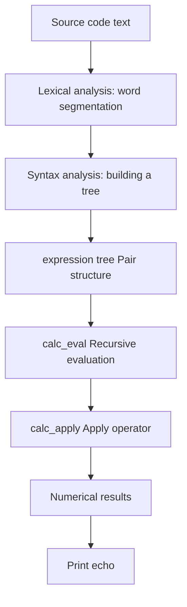
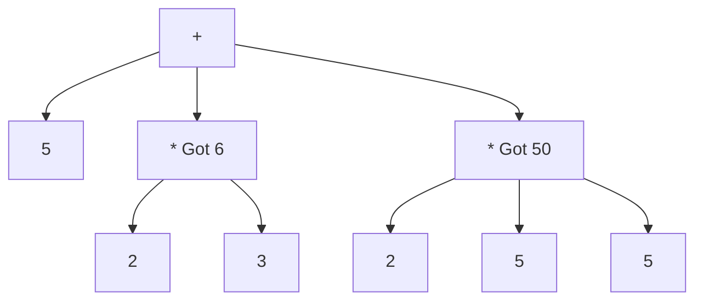
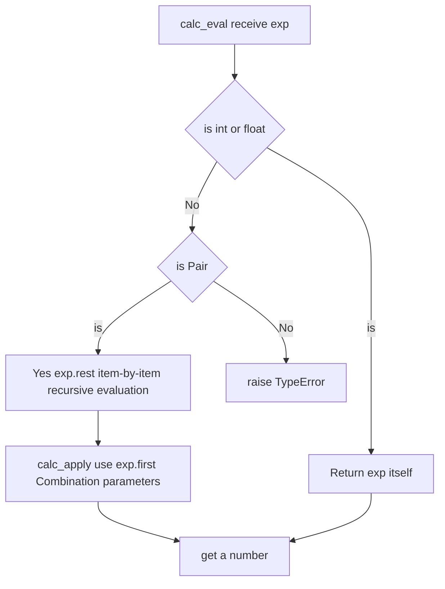
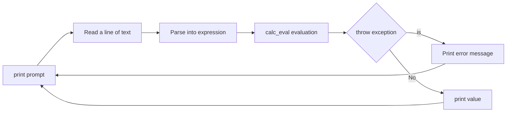
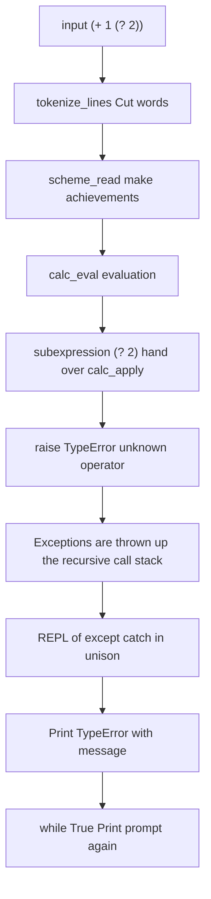

> **courses**: UC Berkeley CS61A · Structure and Interpretation of Computer Programs(Fall 2024)
> **This lecture**: Lecture 30 ｜ 47:54 ｜ Station B P 28 ｜ [Original video](https://www.bilibili.com/video/BV1sy411z7nA?p=28)
> **courseware**: `29-Calculator_1pp.pdf` (15 pages, official PDF, page-by-page renderings see text illustrations)
> **subtitles**: Original English subtitles from Station B; this note is a reconstruction of Chinese writing, not a sentence-by-sentence translation.
> **Copyright**: The copyright of the course and courseware belongs to the UC Berkeley CS61A teaching team; this article is a secondary arrangement for learning purposes

## Quick overview of this lecture

*(Reference time: 00:00:01 – 00:00:10｜Lecture 30)*


- **Mastered**:Scheme's list consists of  `Pair`  chain into, `first`  with  `rest`  It is the only access method; higher-order functions can extract "how to combine" and hand it over to the caller; functions in Python are first-class values and can be passed like numbers.
- **Main line of this lecture**:
    - When a program error occurs, there should not be only one outcome: "stop + traceback": `raise`  Notify exception, `try` / `except`  Decide what to do if something goes wrong.
    - Exception handling turns "who understands this matter, who is responsible" into a division of labor that can be written into the code: `reduce`  Just fold it, `divide_all`  Only division is performed, and division-by-zero errors are absorbed in-place by the latter.
    - An interpreter is a program that reads code and executes it to produce the behavior described by the program; its implementation ties together almost all the topics in this course: trees, tree recursion, higher-order functions, modularity.
    - There are only two expressions in the calculator language - numbers and "with  `+ - * /`  The initial call". Its syntax is a Pair tree, its semantics is a recursive definition, and its implementation is two functions  `calc_eval`  with  `calc_apply`.
    - The shell of the interactive interpreter is a Read-Eval-Print Loop (REPL): read a line, parse it into a tree, evaluate it, print it, report an error if it makes an error and then continue, never stopping automatically.
- **Key conclusions**: A language implementation = a tree traversal + a table mapping symbols to operations + a loop that collects all errors in one place.

## 1. Courseware pre-processing: four built-in procedures for list processing and cons counting

*(Reference time: 00:00:01 – 00:00:29｜Lecture 30)*


Pages 3–5 of this courseware follow the lecture on Scheme lists and summarize "How to perform batch operations on lists" into four built-in procedures. The reason why these four processes are placed here is because the later interpreter will use two of them: `map`  Responsible for applying a function to a list of subexpressions, `apply`  Responsible for applying a function to a list of parameters. The evaluation loop of the interpreter is essentially the alternation of these two actions.

> **Editor's note**: The video of this lecture enters into an unusual topic in the first second. `List Processing`  Section pages, built-in procedure pages and  `cons-count`  The exercise pages (pages 3–5) have no corresponding paragraphs in the subtitles and are most likely codas from the end of the previous lecture. This chapter is organized according to the text and pictures of the courseware. The comments and calculations are added by the editor and do not represent the original words of the class. The anchor point takes the starting point of the video as a time reference.


| process | Calling form | function |
| :--- | :--- | :--- |
| `append` | `(append s t)` | Concatenate the elements of s and t into a list; more than two lists can be concatenated |
| `map` | `(map f s)` | Call f on each element of s and collect the results into a list |
| `filter` | `(filter f s)` | calls f on each element of s, retaining those elements for which the result is true |
| `apply` | `(apply f s)` | calls f with elements of s as arguments |

The courseware is composed of three lines of code  `map`  with  `append`  String together: first create a counting list, use  `map`  Wrap each count into the beat of "and a number" and use  `apply append`  Flatten a list into a single list.

```scheme
(define count (list 1 2 3 4))
(define beats (map (lambda (x) (list 'and 'a x)) count))
(define rhythm (apply append beats))
```

The results of the three steps are: `count`  for  `(1 2 3 4)`; `beats`  for  `((and a 1) (and a 2) (and a 3) (and a 4))`; `rhythm`  for  `(and a 1 and a 2 and a 3 and a 4)`. The third line is worth pausing for: `apply`  put  `beats`  This "list of lists" is divided into parameters, `append`  Then connect these parameters into a tiled list. If written as  `(append beats)`  What you get is as is, because  `append`  The parameter of is the list itself rather than its elements; the division of labor between these two processes is "collecting results" and "expanding parameters".


The second exercise requires writing a procedure to count how many cons cells a value occupies in a box-and-pointer diagram. The box needle diagram is the standard way of describing the list structure in this course: the left half of a grid is  `first`, the right half is  `rest`, the arrow in the right half points to the next grid, and the arrow in the last grid  `rest`  point to  `nil`.

```scheme
(define (cons-count s)
  (if (list? s)
      (+ (length s)
         (apply + (map cons-count s)))
      0))
```

The reading is: if s is a list, then it occupies its own chain  `(length s)`  grid. In addition, each element may itself be a list, which needs to be counted recursively. Finally, use  `apply +`  Add these numbers together; if s is not a list (it is an atom such as a number or a symbol), it does not occupy any cons cells, and 0 is returned. The example given in the courseware is  `((c s) ((6)) 1 (a))`: Outer chain 4 cells, `(c s)`  Chain 2 cells, `((6))`  Yes 1 extra plus inside  `(6)`  1 grid of `1`  It's the atoms that don't occupy a grid, `(a)`  1 square, total 9 squares. This number also verifies the recursive writing method——`(length s)`  The number is **current layer** grid, `map`  The number is **Each element goes down** The grid must be added together so that there is no overlap or leakage.

## 2. Exceptions and raise: Give "error" a type

*(Reference time: 00:00:01 – 00:03:45｜Lecture 30)*


Programming languages usually have a mechanism for "notifying exception events" and a mechanism for "handling exceptions and explaining what to do next." In Python and many languages, these two mechanisms are collectively called **exception**: use  `raise`  To announce something that should not happen, use  `try`  Dispose of it.

`raise`  Followed by an expression that must evaluate to an exception class or an exception instance. Class must be a built-in base class  `BaseException`  A subclass of; the instance must be an instance of an exception class. Exception objects are constructed like ordinary objects: the so-called "making a  `TypeError`”, it just passes a string describing what happened to this class. There are usually two things written in the string - what kind of error occurred, and where exactly it was.

The built-in exception classes have their own division of labor, and they will **automatic** Throws:

| Exception class | When is it automatically thrown? | Demonstration of this lecture |
| :--- | :--- | :--- |
| `TypeError` | The function received an incorrect number or type of parameters. | `abs('hello')` |
| `NameError` | No binding found for a name | undefined name |
| `KeyError` | This key does not exist in the dictionary | missing key |
| `RecursionError` | Too many recursive call levels | One that only calls itself  `f` |

The first demonstration in class is to find the absolute value: `abs(3)`  Normally returns 3, whereas  `abs('hello')`  Throw one immediately  `TypeError`, the news is  `bad operand type for abs(): 'str'`——The type can only be calculated if the type is correct. This is a check done by the built-in function for the caller.

But exceptions are not mysterious, you can throw them yourself: `raise TypeError`  throws an undescribed  `TypeError`; `raise TypeError('very bad idea')`  The thrown object carries that description, and that's what you see on the screen. In this case, you can add constraints to your function:

```python
def double(x):
    if isinstance(x, str):
        raise TypeError('double takes only numbers')
    return 2 * x
```

Why write these three extra lines? because  `2 * 'hello'`  is legal in Python, the result is  `'hellohello'`. If a  `double`  The semantics only allow numbers, so "silently spelling out the string" is the worst way to fail: the program continues to run, and the error is delayed until far away. Take the initiative  `raise`  The point of failure is brought to the source of the error in advance, and the message is a diagnosis for the caller. The demonstration results also confirm this: `double(4)`  got 8, `double('hello')`  get  `TypeError: double takes only numbers`.

The trade-offs here are worth remembering: **Throwing an exception means writing "I refuse to handle this input" into the interface.**. The cost is that the caller must know what exceptions are possible; the gain is that failure is no longer disguised as success.

The default outcome of an exception is: the program terminates, an error message and traceback are printed, and then the programmer decides what to change and reruns. One that only calls itself  `f`  will hit near the default recursion limit  `RecursionError`, this is another form of "automatic throwing" - the language is reporting to the running environment that it can no longer continue.

Why should exceptions be classified? The lecturer gave two reasons. First, the type allows the error message to explain "what happened". When looking at the traceback, you can immediately tell whether the name is wrong, the type is wrong, or the key does not exist. Second, and more importantly: **Classification gives the language the ability to handle exceptions and continue running**. Only errors carry type tags, `try`  Only statements have something to match; without types, the program can only stop altogether.

## 3. try / except: allow the program to continue after an error

*(Reference time: 00:03:48 – 00:09:00｜Lecture 30)*

If you want your program to survive an error, use  `try`  statement. It consists of two parts: `try`  Followed by a code block (suite, suite), and one or more  `except`  OK. each  `except`  This statement is responsible for describing this type of exception. You can give the exception object a name, followed by a package describing "what to do when this error occurs."

```python
try:
    x = 1 / 0
except ZeroDivisionError as e:
    print('handling a zero division error:', e)
    x = 0
```

The execution rules can be divided into three:

| situation | try suite | except suite | program |
| :--- | :--- | :--- | :--- |
| No exception | All executed | skip | continue |
| The thrown exception class matches | Execution is interrupted when an error occurs | execute | Continue without printing traceback |
| The thrown exception class does not match | interrupt | skip | Abort and print traceback |

The key lies in the word "match": only when the class of the exception object inherits from  `except`  Only when the class written above is considered as this  `try`  catch. `as e`  The name in is to tie the exception object to a variable, so you can  `print`  Come out - exceptions are objects that can be printed, passed, and compared. This is the benefit of having types.

After the above code is finished running, there will only be that line on the screen  `handling a zero division error: division by zero`, there is no multi-line traceback, and  `x`  Tied to 0 - despite  `x = 0`  This line is written after the line that raised the exception. **The handled exception does not terminate the program, and the control flow jumps from the point of error to  `except`  kit**.

The second example explains this in more detail. First write an unprotected version:

```python
def invert(x):
    result = 1 / x
    print('Never printed if x is 0')
    return result
```

when  `x`  is 2, `invert(2)`  Returns 0.5, and the line prompt is printed; when  `x`  is 0, `1 / x`  Throw first  `ZeroDivisionError`, the function body is interrupted on that line, `print`  with  `return`  None will be executed, and exceptions will be thrown along the way until the program stops.

> **Editor's note**: `invert`  That's OK  `print`  The original line does not give a complete sentence, so here it is written as a self-explanatory prompt based on the description of "this line will never be seen when dividing by zero"; the division sign and return structure are based on the instructor's line-by-line description of the code.

This difference has an extreme manifestation in assignment statements. write  `a = invert(2)`, `a`  Bound to 0.5; write  `b = invert(0)`, `b`  is not bound to  `None`, but **Not bound at all**——The entire assignment statement is invalid. Many people encounter "undefined name" for the first time  `NameError`, the root cause is that the previous assignment statement was interrupted by an exception.

So there is a safe version:

```python
def invert_safe(x):
    try:
        return invert(x)
    except ZeroDivisionError as e:
        return str(e)
```

There are only two things it does: try  `invert`;If what is thrown is exactly  `ZeroDivisionError`, convert this exception object into a string and return it. So  `invert_safe(2)`  get 0.5, `invert_safe(0)`  get string  `'division by zero'`, and there is no error message on the screen - the error is digested in place into a normal return value. put  `return str(e)`  Replace with  `return 0`, the behavior changes accordingly: `b`  will be tied to the number 0. same one  `try`  structure, `except`  What the suite returns is the function's "attitude" toward failure.

The most valuable scenario for this type of structure is when the program is processing **Inputs beyond one's control** When: The user may type in the wrong format, and the other end of the network may send non-compliant data. At this time, I neither want the program to stop nor pretend that everything is normal, so "print an error, give a default value, and continue running" becomes the right choice.

## 4. reduce: collapse the sequence into a value

*(Reference time: 00:09:02 – 00:12:35｜Lecture 30)*


Before entering the interpreter, there is another higher-order function that must be explained: `reduce`. Its duty is **Reduce a sequence to a value**——Use a two-parameter function to "eat" the sequence elements one by one, starting from the initial value.

```python
def reduce(f, s, initial):
    """Combine elements of s pairwise using f, starting with initial.

    E.g., reduce(mul, [2, 4, 8], 1) is equivalent to mul(mul(mul(1, 2), 4), 8).

    >>> reduce(mul, [2, 4, 8], 1)
    64
    """
```

The courseware clearly states the constraints of each of the three parameters. These constraints are not style suggestions, but prerequisites for correctness:

| parameters | constraint |
| :--- | :--- |
| `f` | A two-argument function whose return value must still serve as its first argument |
| `s` | a sequence where each element can be used as  `f`  The second parameter of |
| `initial` | one who can act  `f`  the value of the first parameter |

The third constraint is easily overlooked: `f`  The results will be sent back immediately  `f`, so the result type must fall back to the "first parameter" position. `reduce(mul, [2, 4, 8], 1)`  So it is equivalent to  `mul(mul(mul(1, 2), 4), 8)`, get 64; similarly  `reduce(add, [1, 2, 3, 4], 0)`  Got 10.

`pow`  The example can better illustrate the meaning of "folding from left to right": `reduce(pow, [1, 2, 3, 4], 2)`  First, we calculate 2 raised to the power 1 to get 2, then we calculate 2 raised to the power 2, we get 4, then we calculate 4 raised to the power 3, we get 64, and finally we calculate 64 raised to the power 4, we get 16,777,216. Note that this is not 2 raised to the 1+2+3+4 power, but constantly **Last result** As the base - this is why the courseware draws it as a series of nested  `pow`, the innermost is  `pow(2, 1)`, one more for each floor outward. Once the folding direction is reversed (from right to left), the result will be completely different.

There are two versions of the implementation, both written in class. The iterative version only has three lines:

```python
def reduce(f, s, initial):
    for x in s:
        initial = f(initial, x)
    return initial
```

The recursive version leaves the "remaining work" to the recursive call:

```python
def reduce(f, s, initial):
    if not s:
        return initial
    first, rest = s[0], s[1:]
    return reduce(f, rest, f(initial, first))
```

The recursive version is worth looking at: the base case is that the sequence is empty and there is no work to do, and the cumulative value is returned directly; the recursive step is to first eat the current element into the cumulative value (`f(initial, first)`), and then hand over the "remaining sequence" and the "new cumulative value" to the next call. Both versions pass doctest and both embody the same invariant: **`initial`  Always represents "the collapsed value of those elements that have been processed"**.

So you can  `reduce`  Treat it as an abstraction: it only knows "two-by-two combinations" and has no idea of the specific meaning of the combination. This is why it can be reused in the interpreter.

> **Editor's note**: The lecturer mentioned that the standard library has built-in  `reduce`, the subtitle is recorded as "iter tools module"; this function is actually located in  `functools`, written as  `functools.reduce`.`itertools`  What is provided is an iterator tool and has nothing to do with this function.

## 5. divide\_all: Who should know about "divide by zero"?

*(Reference time: 00:12:37 – 00:14:29｜Lecture 30)*

`reduce`  The first application of was a divider: take a numerator and divide it by a series of denominators.

```python
def divide_all(n, ds):
    return reduce(truediv, ds, n)
```

`divide_all(1024, [2, 4, 8])`  We get 16: 1024 divided by 2 gives 512, divided by 4 gives 128, divided by 8 gives 16. But if it is  `divide_all(1024, [2, 0, 8])`, the 0 in the middle will make  `truediv`  Throw  `ZeroDivisionError`, the entire call fails.

What if this is not the desired behavior? Assuming that the business hopes to "treat it as infinity if it cannot be divided", then add a layer at the calling point  `try`:

```python
def divide_all(n, ds):
    try:
        return reduce(truediv, ds, n)
    except ZeroDivisionError:
        return float('inf')
```

This way  `divide_all(1024, [2, 0, 8])`  get  `inf`, while  `divide_all(1024, [2, 4, 8])`  Still got 16.

The design value of this code is **Separation of concerns**.`reduce`  There is not a single line in its implementation related to division by zero - it has no idea that the caller  `f`  Is it addition, multiplication or division? I don’t know which one.  `f`  What exceptions may be thrown; `divide_all`  In turn, it knows that what it is doing is division and that dividing by zero is a possible failure, so it decides the meaning of failure on the spot. Each of them only knows its own thing, and they are connected by the value of "function".

Put this into one sentence: **Errors should be handled at the level that knows what the error means**.`reduce`  Doesn't know what division by zero means, so it doesn't handle it; `divide_all`  It knows that "except for the infinity is infinity", so it handles it. This criterion will be used repeatedly when writing the interpreter later: lexical analysis knows what illegal numbers are, and syntax analysis knows what unmatched brackets are. `calc_apply`  Know which operator takes several parameters - each layer is only responsible for the errors it recognizes.

## 6. Interpreter and language levels

*(Reference time: 00:14:31 – 00:20:33｜Lecture 30)*

At this point the focus of the course turns to programming languages and interpreters. **An interpreter is a program that takes as input code written in a language and executes the code to produce the behavior described by the program.**  There is no mystery in this sentence - the interpreter itself is also an ordinary program written in a certain language, but the data it processes happens to be "code".



This picture is what we will implement step by step in this lecture: first cut the text into words, then form the words into a tree, then use two functions to evaluate the tree, and finally print the results. The following chapters will walk through each section of this assembly line in turn.

Why do you need to learn Scheme first for conversation? The lecturer gave two reasons. First, Scheme is a language that is easy to use and is still used in new projects today. It is concise and effective, and it is a dialect of Lisp. Lisp has a wider range of uses, and can be used as an independent development language or often as an embedded language to implement part of a program. The second reason is directly related to the course: Scheme is so powerful that **You can use a Python program to write down all its interpretation rules**, so "implementing a language" is feasible within the semester.

The reason why the interpreter is arranged at the end of the course is that it sews all the previous topics together: the program is a tree, and interpretation relies on tree recursion; expressions often have lists of subexpressions, so list processing is the infrastructure; the interpreter itself is like a higher-order function, receiving the value of "code" and generating behavior; and the interpreter can be modular and extensible - one part of the code describes "how the interpretation is generally performed", and the other part of the code encapsulates "how each component of the language is specifically executed."

To see the layers clearly, look at the bottom layer first. Computers execute programs written in many languages, one of which is called **machine language**: Statements are interpreted directly by the hardware. The CPU can execute a fixed set of instructions, has limited memory, and has access to larger memory (cache, main memory, disk). To extend a machine language, you have to change the circuit, which rarely happens. More importantly, it was difficult to program: operations directly referenced specific hardware addresses, there was almost no abstraction mechanism, no way to name things, and no way to implement procedures or functions.

High-level languages make up for this. Their statements and expressions are either interpreted by another program or compiled into another language. **Interpretation is the act of reading a program and executing it; compilation is the act of translating a program into another language (such as machine language) for later execution.**  Many modern languages use a mixture of the two, compiling part of the code just in time, and running it feels the same as interactive interpretation. High-level languages ​​provide means of abstraction: naming values, functions, objects, and classes. As for which language is "higher", is a topic for another class.

Here is an easily overlooked fact: **No piece of hardware in your computer is designed for Scheme or Python**. The machine language code is responsible for performing all the actions; between this high-level language and the machine language, there must be an interpreter or compiler that implements all those abstractions. And this layering is the norm: machine language can be used to implement C's compiler, and C is a high-level language used to implement Python's interpreter.

| level | who is executing | How to extend | Examples mentioned in this lecture |
| :--- | :--- | :--- | :--- |
| machine language | CPU hardware | Change circuit | fixed instruction set |
| Compiled high-level language | The compiled product runs directly on the hardware | Change the compiler | C |
| interpreted high-level language | Another program is executed step by step | Change the interpreter | Python, Scheme |
| domain specific language | Specialized interpreter or compiler | Change language and interpreter | Erlang, MediaWiki markup |

The other half of the reason why high-level languages are easy to write is that **portable**: The same program can run on hardware from different manufacturers and operating systems of different organizations because system details are abstracted away. The specific method of Python is: compile it into Python 3 bytecode (bytecode) before running, and then use an interpreter to execute this bytecode; bytecode is more abstract than machine language and lower-level than source code. You can use the built-in  `dis`  module view.

So the story of "how a program is executed" can be quite complicated, but one line is always clear: **What your machine can execute and what you as a human are willing to write are two different things.**. Everything you learn in this class happens in the high-level languages ​​used to build today's software.

## 7. Specialized language, syntax and semantics

*(Reference time: 00:20:40 – 00:23:46｜Lecture 30)*

Sometimes people invent new languages. A powerful abstraction that is **Tailoring a language to a specific application or problem domain**. Erlang is designed for concurrent programs: ATMs around the world can access the same account balance, and if you withdraw money from two machines in two cities at the same time, you can't cheat two copies of the money - this is a concurrent communication problem, and it would be much easier to express it in a language designed for this; Erlang has also been used to implement chat servers that carry a large number of connections at the same time. Another example is the MediaWiki markup language, which is designed for generating static web pages like Wikipedia, with built-in elements for text formatting, page interlinking, and combining multiple pages into one page. It may not be as complete as Python or Scheme, but it still requires an interpreter or compiler to produce the pages that readers see.

A programming language consists of two parts. **syntax**  Describe all legal statements and expressions in the language, and answer "how to write them formally to count"; **semantics**  Give the execution or evaluation rules for these statements and expressions, and answer "What does it mean to write them out?"

There are only two ways to nail down a language: write a formal specification document that accurately describes the syntax and semantics; or implement an interpreter or compiler and use the implementation itself as a reference. The latter path is established because **Canonical implementation is the standard**: Any input is considered legal as long as it does not crash; its behavior defines the semantics.

The historical order of the two roads can be reversed. Scheme has a specification first and then an interpreter implementation; Python has a specification implementation first, and the formal description is later made up based on this implementation. Languages ​​actually used in large communities usually have both: the specification ensures that multiple implementations can interoperate, and the reference implementation is responsible for nailing down boundary conditions.

The division of labor between interpretation and compilation can also be explained clearly with a table:

| criterion | explain | compilation |
| :--- | :--- | :--- |
| timing | Read and execute | Translate first, execute later |
| product | Behavior (value or side effect) | program in another language |
| When an error occurs | interrupt the current expression on the spot | An error may be reported during the translation stage |
| Typical scenario | interactive session | Generate machine code or bytecode |

## 8. From text to tree: two stages of parse

*(Reference time: 00:23:46 – 00:30:34｜Lecture 30)*

To execute a piece of text as a program, the first step is to parse it into a structure that is easy to execute. Scheme code is essentially a tree structure: expressions within expressions, layer by layer; but when it is typed, it is just a series of parentheses arranged together. In the end, it is just text.

Because a Scheme program looks like a Scheme list composed of brackets, symbols, and numbers, the most natural way is to write a program to read these texts into a list representation——**The first element and the remaining elements**. This class uses Python to do this, and the class that hosts it is  `Pair`: only  `first`  with  `rest`  Two attributes.

`Pair`  The class is so simple that there's almost nothing to say about it, but its string representation is interesting. Construct a nested Pair and print it, and you see how Scheme would write it:

```text
>>> p = Pair(1, Pair(2, Pair(3, nil)))
>>> print(p)
(1 2 3)
>>> p
Pair(1, Pair(2, Pair(3, nil)))
```

`str`  Give how to write Scheme  `(1 2 3)`, `repr`  gives the Python constructor  `Pair(1, Pair(2, Pair(3, nil)))`.`nil`  is also an object, is  `nil`  An instance of a class whose  `repr`  with  `str`  All  `nil`, and also defines some methods for slow use in the project. The end of the chain must be  `nil`  instead of  `None`, because the end of the list itself is a value in this language.

Scheme reader's job is to turn brackets and numbers into nested pairs, and it does so very tolerantly: it can read across lines, ignore as many spaces as you want, and can also  `4.5`  Such multi-character numbers are treated as a whole. For example, the following input spans three lines and has messy spaces. As long as the brackets are matched, it will be read as a nested pair:

```scheme
(+ 1
   (* 2
      4.5)
   (- 6 7 8))
```

its  `str`  will be standardized into  `(+ 1 (* 2 4.5) (- 6 7 8))`. So "what is typed and what is printed" are not always the same -`str`  It is a standard way of writing the structure, not a copy of the original text. This also means that the reader must distinguish two things: `4.5`  is a number (even though it consists of four characters), and the two adjacent parentheses are really constructing two different pairs.

The process from text to structure is called **parsing**, it takes two steps: first do **Lexical analysis**, turn the text into a string of tokens; then do **syntactic analysis**, turning tokens into expressions.

The products of lexical analysis are atomic units: symbols, numbers, parentheses. Several lines of original text will be scanned line by line into a token sequence. There are three details worth noting:

- `2`  with  `3`  If placed next to each other, they will be combined into numbers.  `23`, because they are inherently one number when not separated by spaces;
- The adjacent right bracket is an independent token, which does not belong to a number;
- Extraneous whitespace is discarded because it does not affect the meaning.

In addition, lexical analysis is also responsible for identifying malformed tokens (e.g.  `2.3.4`  This is not a legal number writing method), determine the type of each token, and process it iteratively line by line. The lecturer clearly stated that students do not need to write this step themselves - the course has already provided it; if you want to try it, you can directly call the tokenizer and see how it works.  `12 34`  Cut into two tokens, or  `((1.2 3))`  Each bracket in is cut individually, and the  `1.2`  Keep it as a number.

## 9. Syntax analysis: `scheme_read`  Read one expression at a time

*(Reference time: 00:30:36 – 00:32:39｜Lecture 30)*

The second step turns the token sequence into a tree. `scheme_read`  The agreement is: **Consumes exactly the tokens required by an expression and returns that tree**. It is a classic example of tree recursion.

It has only one base case and one recursion: when it encounters a symbol or number, it directly creates a leaf (this is the base case); when it encounters a left bracket, it calls each subexpression in the bracket recursively.  `scheme_read`, string the results into pairs (this is the recursive step). The terminating condition is to read the right parenthesis that matches the opening left parenthesis—the original call ends here.

Summarize in one sentence why it must be recursive: **The nesting depth of brackets is the depth of the tree, and the reading process must follow this depth.**. The first call reads  `(+ 1 (* 2 3))`  will not return immediately because it must first read  `(* 2 3)`  This subexpression; and the read subexpression will initiate another call. When the innermost layer reads a number and the outer layer reads the matching right parenthesis, the layers are gathered together.

This is why the parser works across lines: it pieces together multiple lines of input until it finds a closing bracket that matches the opening left bracket. The lecturer said that students should write this part by themselves. There is a long description in the textbook, and it is worth spending time to learn - because "writing a grammatical analysis for a language" is a rare exercise in this course that can fully use recursive thinking.

## 10. Calculator for Scheme syntax: syntax and semantics

*(Reference time: 00:32:41 – 00:35:37｜Lecture 30)*


It is now time to define the language to be implemented in this lecture. **Scheme-syntax calculator**  It is a Scheme interpreter that does not support most features of Scheme and only retains arithmetic operators.  `+`, `-`, `*`, `/`  and call expressions, calls can be nested arbitrarily. Its implementation is  `SchemeCalc.py`  Here, a prompt will appear after running, and you can enter expressions, do nested arithmetic, and also handle floating point numbers. The two inputs in the class are:

```text
scm> (+ 1 2 3)
6
scm> (+ 2 (* 4 6))
26
```

The lecturer also demonstrated the application function side separately: directly  `+`  with parameters  `1 2 3`  call  `calc_apply`, get 6. In other words, "evaluation" and "application" can be tested separately: the former goes down the tree, and the latter only recognizes operators and numbers.

Its syntax is so small that it can be said in two lines: **A primitive expression is a number**, for example  `2`, `-4`, `5.6`; **A call expression is an operator  `+`, `-`, `*`, `/`  A combination that begins with, is followed by zero or more expressions**, for example  `(+ 1 2 3)`, `(/ 3 (+ 4 5))`. That's all, no  `define`, no  `lambda`, no name.

Expressions are represented by Scheme lists in Python, that is  `Pair`  instance, which encodes a tree structure. to  `(* 3 (+ 4 5) (* 6 7 8))`  For example, three perspectives are the same thing:

| perspective | form |
| :--- | :--- |
| written expression | `(* 3 (+ 4 5) (* 6 7 8))` |
| expression tree | root is  `*`, the three children are  `3`, `(+ 4 5)`, `(* 6 7 8)` |
| Pair means | one piece  `first`  for  `*`  chain, the second element points to  `(+ 4 5)`  chain, the third element points to  `(* 6 7 8)`  chain |

This explains a fact that seems strange at first glance: **Code is data in the eyes of the interpreter**. same one  `Pair`  A structure can be regarded as either a "program to be evaluated" or "a list". The only difference lies in what you use it for. All subsequent evaluations are based on this structure.


The semantics are also short enough to be written. The value of a calculator expression is defined recursively: **A number evaluates to itself; a calling expression evaluates to the result of its argument values combined by operators**. The specific meanings of the four operators are:

| operator | Semantics |
| :--- | :--- |
| `+` | The sum of all parameters |
| `*` | product of all parameters |
| `-` | Negative if there is only one parameter; subtract the rest from the first one if there is more than one |
| `/` | If there is only one parameter, the reciprocal is taken; if there is more than one parameter, the first one is divided by the rest in sequence. |

`-`  with  `/`  The special rule for is not a decoration, but a tradition of Scheme: `(- 5)`  is -5, `(/ 3)`  It's 1/3. They also explain why the implementation of these two operators will be later compared to  `+`  with  `*`  There are two more branches - when there are zero parameters, neither negative nor reciprocal can be taken.

For courseware  `(+ 5 (* 2 3) (* 2 5 5))`  Run through the semantics: `(* 2 3)`  Evaluates to 6, `(* 2 5 5)`  Evaluates to 50, `+`  Adding 5, 6, and 50 together, the entire expression evaluates to 61. Draw it as a tree, with each internal node corresponding to one  `calc_apply`, the leaf corresponds to "number evaluates to itself":



There are two things worth seeing in the tree. First, the operators of internal nodes are different and correspond to  `calc_apply`  A branch of; root node  `+`  I got three **Already calculated numbers**, instead of three subtrees - which is exactly what the next section  `calc_eval`  Things that recursive structures want to guarantee. Second, the order of evaluation is from leaves to roots: first calculate 6 and 50, then calculate 61; any time  `calc_apply`  The premise is that the parameters have been reduced to numbers.

## 11. `calc_eval`: dispatched by expression type

*(Reference time: 00:35:39 – 00:38:36｜Lecture 30)*


The entire calculator has only two functions: one for evaluation and one for application. Let’s look at evaluation first. `calc_eval`  Calculate the value of an expression, and the value of the expression in the calculator **always a number**. it is a **generic function**: Dispatched by the type of expression, whether it is a number or a call.


```python
def calc_eval(exp):
    if isinstance(exp, (int, float)):
        return exp
    elif isinstance(exp, Pair):
        arguments = exp.rest.map(calc_eval)
        return calc_apply(exp.first, arguments)
    else:
        raise TypeError
```

The correspondence between the three branches and language semantics can be read line by line:

| realize | Semantics |
| :--- | :--- |
| `isinstance(exp, (int, float))`  time  `return exp` | Number evaluates to itself |
| `isinstance(exp, Pair)`  time  `exp.rest.map(calc_eval)` | The value of the calling expression is the value of its parameters |
| `calc_apply(exp.first, arguments)` | These parameter values are combined by operators |
| `else: raise TypeError` | An expression that is neither a number nor a call is illegal. |

`Pair`  The branching is all subtlety and worth reading line by line:

- `exp`  This must be a list starting with an operator, followed by a list of operand subexpressions, for example  `(+ 1 (* 2 3))`.
- `exp.rest`  It is "everything except the operators", which is the operand list; for it  `map`  on  `calc_eval`, each subexpression is evaluated recursively once.
- Recursive calling guarantees that "each operand is reduced to a number" - even if an operand itself is a very complex calling expression.
- `arguments`  So it is a **Scheme list of numbers**, rather than a list of expressions.
- `exp.first`  is the operator symbol (a string), handed to  `calc_apply`  to decide whether to add or multiply.



There are two things worth noting about this picture. First, **Except for the error reporting branch, each branch returns a number**, so the return value of the recursive call can be directly combined into the parameter list - this invariant is the fulcrum on which the entire recursion is established. Second, `else`  Branching is not a decoration of defensive programming, but part of the semantics: `()` (empty combination) and an isolated symbol are neither numbers nor "lists starting with operators". They have no value in this language and can only report errors.

> **Editor's note**: `exp.rest.map(...)`  inside  `map`  Not built into Python  `map`, but the course project gives  `Pair` / `SchemeList`  A method of the same name defined that takes a function and returns the result as a Scheme list. This method is not expanded on in this lecture, and the courseware uses it directly.

The version in the classroom is slightly different from the courseware. The instructor himself pointed out: the real code will call  `simplify`, put  `8.0`  Return to one  `8`, making the display of floating-point results cleaner; at the same time, giving  `TypeError`  Write a message string instead of throwing a naked class. After completing the description, it looks like this:

```python
def calc_eval(exp):
    if isinstance(exp, (int, float)):
        return exp
    elif isinstance(exp, Pair):
        arguments = exp.rest.map(calc_eval)
        return simplify(calc_apply(exp.first, arguments))
    else:
        raise TypeError(f'Unknown expression {exp}')
```

> **Editor's note**: The above paragraph is a schematic version based on the lecturer’s dictation. `simplify`  The original text of the behavior and error message is not given verbatim, and the message text may be different from the project source code; the version on page 12 of the courseware does not  `simplify`, and there is no news.

## 12. `calc_apply`: Put operators on numbers

*(Reference time: 00:38:37 – 00:42:01｜Lecture 30)*


`calc_apply`  Responsible for "application": get an operator and a Scheme list of numbers, and combine the parameters according to the meaning of the operator. In the calculator, all operations are built-in, and there are only four; the lecturer specifically said that in languages ​​that support more abstractions, user-defined operations and names must be processed, which will be discussed later.

Only the skeleton is left in the courseware. `-`, `*`, `/`  The three branches are replaced by ellipses; the complete implementation is released in class:

```python
def calc_apply(operator, args):
    if not isinstance(operator, str):
        raise TypeError(str(operator) + ' is not a symbol')
    if operator == '+':
        return reduce(add, args, 0)
    elif operator == '-':
        if len(args) == 0:
            raise TypeError(operator + ' requires at least 1 argument')
        elif len(args) == 1:
            return -args.first
        else:
            return reduce(sub, args.rest, args.first)
    elif operator == '*':
        return reduce(mul, args, 1)
    elif operator == '/':
        if len(args) == 0:
            raise TypeError(operator + ' requires at least 1 argument')
        elif len(args) == 1:
            return 1 / args.first
        else:
            return reduce(truediv, args.rest, args.first)
    else:
        raise TypeError(operator + ' is an unknown operator')
```

> **Editor's note**: `calc_apply`  The complete source code does not appear in the courseware. The above version is reconstructed based on the recorded demonstration (the message text seen, branch-by-branch explanation) and the project structure. The branch order and semantics are consistent with the class. The variable names and message text may be slightly different from the project source code.

Among the four branches, addition and multiplication are on one line each, because their semantics are once  `reduce`:

| operator | Implementation points | Class Demonstration |
| :--- | :--- | :--- |
| `+` | `reduce(add, args, 0)`, initial value 0 | `(+ 1 2 3)`  Got 6 |
| `-` | An error is reported for zero parameters; one parameter is negative; otherwise, the rest are subtracted from the first one. | `(- 2)`  get -2; `(- 10 1 2 3)`  Got 4 |
| `*` | `reduce(mul, args, 1)`, initial value 1 | Not demonstrated separately, only stated that it is a one-time  `reduce` |
| `/` | An error will be reported if there are zero parameters; if one parameter is used, the reciprocal will be taken; otherwise, the first one will be divided by the rest in sequence. | `(/ 3)`  Get 1/3; `(/ 1024 2 2 2 2 2)`  Got 32 |

The initial value is not written randomly: addition starts from 0, multiplication starts from 1, so "zero parameters" are also defined. `(+)`  By implementation we get 0 because  `reduce(add, args, 0)`  When there are no elements to eat, the initial value is returned directly; this is not demonstrated in class, but it is a direct corollary of the code.

`-`  with  `/`  The two branches of are the "complex" part of the semantics: meaningless when there are zero parameters, degenerating into a single operation when there are one parameters, and folding when there are multiple parameters. In the demo  `(- 10 1 2 3)`  Get 4 - first 10-1=9, then 9-2=7, then 7-3=4; `(/ 1024 2 2 2 2 2)`  Divide 2 five times in a row, leaving only 32.

The operator itself may also be illegal, so the first check is not a branch but a guard: if  `operator`  is not a string, indicating that the first element of this "calling expression" is not a symbol at all. Report  `TypeError`, the message is in the form of  `2 is not a symbol`. last line  `else`  Cover the situation of "it is a string but not one of the four operators" and demonstrate  `(? 2)`  get  `? is an unknown operator`.

The core of the language is here: `calc_eval`  Responsible for descending along the tree, `calc_apply`  Responsible for turning symbols into operations at the leaves. The two combined are less than twenty lines, but they already contain the semantics of a complete language.

## 13. REPL: Human-computer interface of the interpreter

*(Reference time: 00:42:06 – 00:43:47｜Lecture 30)*


There's one last thing left: the user interface. Interpreters usually have a **Read-Eval-Print Loop (Read-Eval-Print Loop)**: The user enters an expression, it is evaluated, the result is printed, and then the prompt appears again.


The courseware breaks the cycle into six steps:

1. Prints a prompt to tell the user that the computer is ready to accept input.
2. Read text from the user.
3. Parse text into an expression.
4. Evaluate this expression.
5. If errors occur, report them; otherwise
6. Print the value of the expression, then repeat - print the prompt again.

Corresponding to the code, the loop looks like this:

```python
@main
def read_eval_print_loop():
    """Run a read-eval-print loop for calculator."""
    while True:
        try:
            src = buffer_input()
            while src.more_on_line:
                expression = scheme_read(src)
                print(calc_eval(expression))
        except (SyntaxError, TypeError, ValueError, ZeroDivisionError) as err:
            print(type(err).__name__ + ':', err)
        except (KeyboardInterrupt, EOFError):
            print('Calculation complete.')
            return
```

> **Editor's note**: The source code of this loop also does not appear in the courseware. It is based on the lecturer’s explanation.  `while True` + `try` + `scheme_read` + `calc_eval` + `print`  A sentence-by-sentence description of the reconstruction; `buffer_input`, `more_on_line`  The auxiliary interfaces are from course projects, and the names may be slightly different from the source code.

There are two lines worth stopping to read. The first line is  `print(calc_eval(expression))`: **Printing will only be done on  `calc_eval`  Occurs on normal return**. If an exception is thrown during the evaluation process, this  `print`  The parameters of the call cannot be calculated at all, so nothing will be printed - the error message consists of the following  `except`  Be responsible, both will not appear on the screen at the same time. The second line is  `except (KeyboardInterrupt, EOFError)`: `while True`  An exit is needed, and the exit is the end of the file (press  `<Control>-D`, meaning "no more input") or the keyboard is interrupted; in which case it prints  `Calculation complete.`  And  `return`, the cycle really stops.

`@main`  It is a decorator. Its function is to wrap up chores such as "reading command line parameters and deciding whether to run tests or interactive runs", so that  `read_eval_print_loop`  It only cares about the cycle itself. This is also a separation of concerns: interaction logic is not mixed with startup logic.

> **Editor's note**: `@main`  The ins and outs are not in the subtitles of this lecture. It belongs to the scaffolding provided by the course project; here we only explain its role in the source code.



The reason why this loop is called "interactive" is because the arrow at the end returns to the prompt: **A failure does not clear the environment and does not end the session.**. The user can continue trying the next expression in the same environment without restarting the program.

## 14. Complete error handling chain: who raises, who echoes

*(Reference time: 00:43:48 – 00:47:51｜Lecture 30)*

Although the calculator is small, exceptions are scattered throughout the program: lexical analysis, syntax analysis, evaluation, and application, and may be thrown at every level. The lecturer’s summary is very accurate: **Throw out and scatter everywhere, catch in one place**.



to enter  `(? 2)`  For example, the complete chain is eight steps:

1. `buffer_input`  Read this line of text.
2. Lexical analysis cuts it into  `(`, `?`, `2`, `)`  Four tokens, no malformed token, no error reported.
3. Grammar analysis assembles tokens into a Pair tree: `first`  is a symbol  `?`, `rest`  It's number 2.
4. `calc_eval`  It is judged that it is not a number but a Pair, so the call branch is entered.
5. Right first  `exp.rest`  Recursively evaluate item by item to get a list of numbers  `(2)`; If an operand is illegal in this step, the exception will pop up here first.
6. `calc_apply`  get operator  `?`  with parameter list  `(2)`, after going through the branches of the four operators, none of them match, and it falls to the last  `else`, throw  `TypeError('? is an unknown operator')`.
7. abnormal edge  `calc_apply → calc_eval → read_eval_print_loop`  All the way up, nothing in the middle  `try`  intercept, so  `print(calc_eval(...))`  inside  `print`  Never executed.
8. top level loop  `except`  capture it, print  `TypeError: ? is an unknown operator`, then  `while True`  Entering the next round, the prompt appears again - the program does not stop.

The same chain also applies to failures at earlier levels. If the input is an isolated symbol  `abc`  or empty combination  `()`, the exception is in step 4  `else`  The branch is thrown, steps 5 and 6 are completely skipped, and the exception is thrown directly along the call stack; if the position of the operator is a number, for example  `(2 3)`, you have to wait until step 6 before being  `calc_apply`  The first guard blocked it. That is to say, **The location of the error depends on which layer recognizes "this is not something I can handle" first, and the location of the echo is always the REPL one.  `except`**. This is what brings all  `raise`  Put them all in the implementation layer and put all  `except`  The meaning of placing them all in the loop layer: Where the error comes from can be different, and the appearance seen by the user must be consistent.

Different layers are responsible for different error types. This division of labor can be listed in a table:

| Error class | thrown by who | Trigger mode | What you see in class |
| :--- | :--- | :--- | :--- |
| `ValueError` | Lexical analysis | Malformed numbers, such as  `2.3.4` | Value is illegal |
| `SyntaxError` | syntax analysis | Structural errors such as extra right brackets | The message contains  `unexpected token` |
| `TypeError` | `calc_eval` | empty combination  `()`, isolated symbol | Not a number or a call |
| `TypeError` | `calc_apply` | `(-)`  zero parameters, `(? 2)`  unknown operator, `(2 3)`  operator is not a symbol | `minus requires at least one argument`, `? is an unknown operator`, `2 is not a symbol` |
| `ZeroDivisionError` | Python built-in division | `(/ 1 0)` | by  `truediv`  Throw yourself |

The last line in the table deserves its own mention: `ZeroDivisionError`  It's not the calculator code that throws it, it's Python's division operator that throws it. `/`  The built-in division is directly used in the implementation, so the failure mode of the built-in division becomes the failure mode of the language unchanged. **This shows that the error semantics of the interpreter are often "inherited" from the host language.**: Whatever you use to implement a language will inherit part of its behavior.

Understanding this chain can answer a design question: Why  `except`  to make  `SyntaxError`, `TypeError`, `ValueError`, `ZeroDivisionError`  List all four? Because these four categories happen to cover the entire path from text to value, and any failure on this path means the same thing to the user——**I can't figure out what you just said.**. For users, the important thing is to know what is wrong and how to correct it, rather than looking at a traceback pointing to the internal source code of the interpreter.

This is also the design principle that the lecturer finally emphasized: **A well-designed interactive interpreter should never shut down**. It should stop evaluating the current expression, print an error message, and then give the programmer a chance to modify it before **current environment** Try again instead of crashing the entire program. The only ways to exit are end-of-file or keyboard abort.

## Summary

- **Exceptions are part of the interface**: `raise`  Write "I refuse to handle this input" into the function contract, and the exception class is responsible for allowing the caller to distinguish the type of failure. The two purposes of classification—diagnosis and treatment—are indispensable.
- **Errors are handled at the level that understands them**: `reduce`  I don’t know what dividing by zero means, so I don’t process it; `divide_all`  I know, so just turn it into  `inf`. put  `try`  Placing it near the source of the error is more informative than placing it at the top of the program.
- **One code, two perspectives**: The expression of the calculator is both "a program to be evaluated" and "a Pair list". The whole job of the interpreter is to distinguish between "this is a number" and "this is a call" in this tree.
- **The semantics are written as recursive, and the implementation is written as recursive.**: `calc_eval`  The three branches correspond to the semantics of the three sentences one-to-one; except the error reporting branch, each branch returns a number. This invariant lets  `exp.rest.map(calc_eval)`  The parameter list can be spelled out directly.
- **Dispatch and execute separately**: `calc_eval`  Just judge "what shape is this", `calc_apply`  Only determine "what this symbol should do." Each of them has a single responsibility, so to add an operator, you only need to change  `calc_apply`  a branch of.
- **The robustness of REPL comes from a  `try`**: Encapsulate parsing and evaluation as a whole, capture four types of known exceptions, and continue looping after printing; only EOF and keyboard interrupts will exit. The first quality of interactive tools is "Don't die because of a word from the user."

*(Reference time: 00:47:18 – 00:47:51｜Lecture 30)*

## Attached: Slide index for this lecture

*(Reference time: 00:00:01 – 00:47:51｜Lecture 30)*

| page | content | Appear location |
| :--- | :--- | :--- |
| 1 | Title page Calculator | Quick overview of this lecture |
| 2 | Announcements announcement page | Quick overview of this lecture |
| 3 | Section page: List Processing | §1 |
| 4 | Four built-in list procedures with count / beats / rhythm demo | §1 |
| 5 | cons-count exercise with box-needle plots | §1 |
| 6 | Section page: Exceptions | §2 |
| 7 | reduce's docstrings and nested pow evaluation graph | §4 |
| 8 | Sectioned Page: Scheme-Syntax Calculator | §10 |
| 9 | Calculator syntax: numbers, calling expressions, and pair representation | §10 |
| 10 | Calculator semantics: evaluation tree of four operators and 61 | §10 |
| 11 | Section page: Evaluation | §11 |
| 12 | Comparison of calc\_eval implementation and language semantics | §11 |
| 13 | calc\_apply implements the semantics of the four operators | §12 |
| 14 | Sectioned pages: Interactive Interpreters | §13 |
| 15 | Six Steps to the Read-Eval-Print Loop | §13 |
