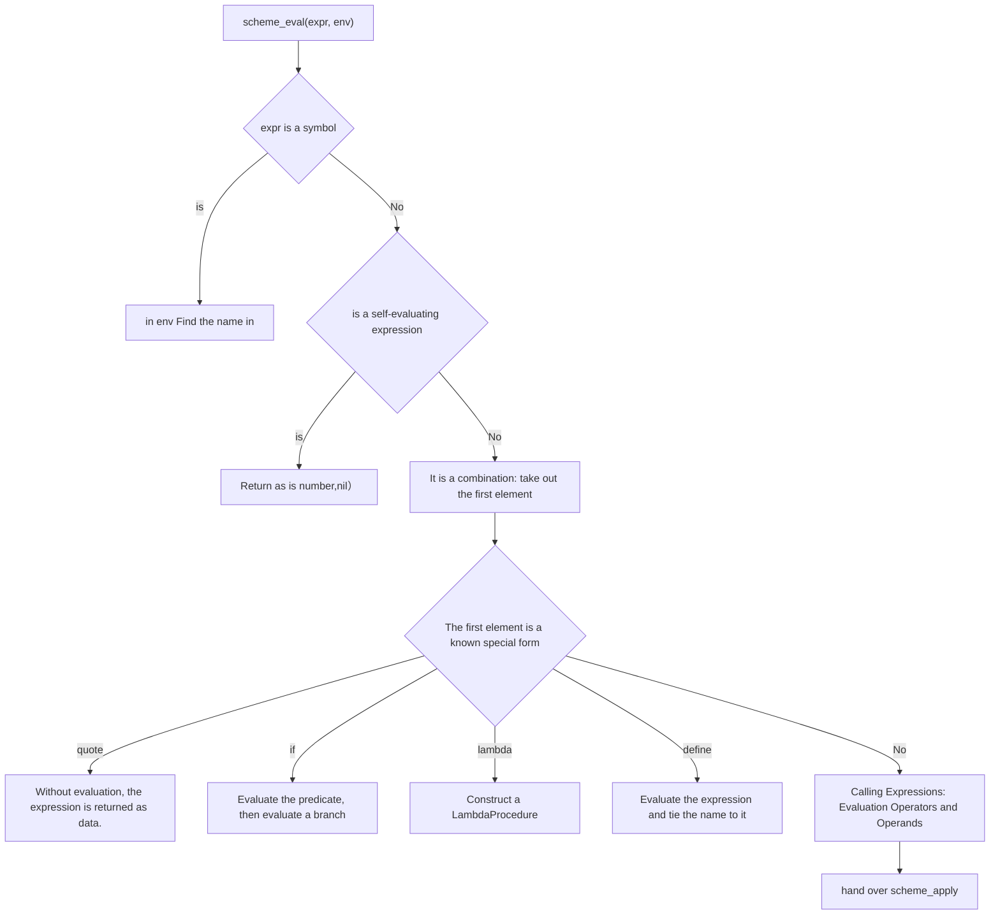
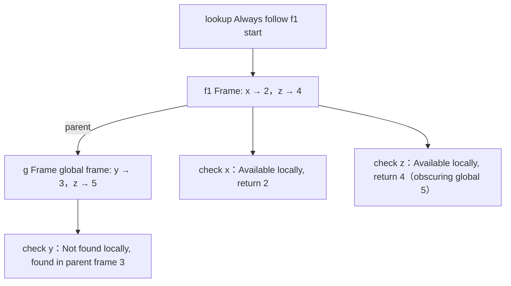
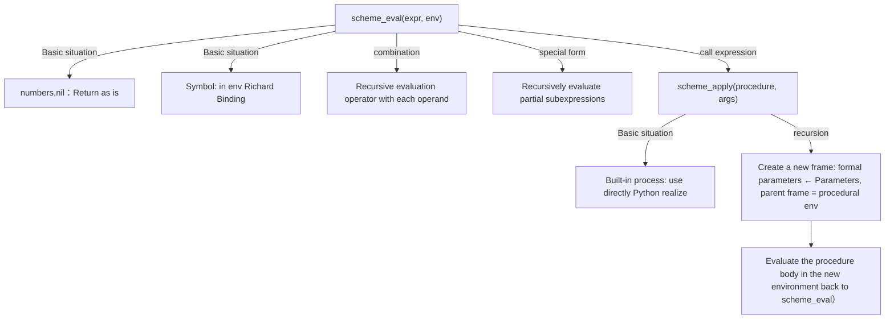

> **courses**: UC Berkeley CS61A · Structure and Interpretation of Computer Programs(Fall 2024)
> **This lecture**: Lecture 31 ｜ 29:48 ｜ Station B P 29 ｜ [Original video](https://www.bilibili.com/video/BV1sy411z7nA?p=29)
> **courseware**: `30-Interpreters_1pp.pdf` (14 pages, official PDF, page-by-page renderings see text illustrations)
> **subtitles**: Original English subtitles from Station B; this note is a reconstruction of Chinese writing, not a sentence-by-sentence translation.
> **Copyright**: The copyright of the course and courseware belongs to the UC Berkeley CS61A teaching team; this article is a secondary arrangement for learning purposes

## Quick overview of this lecture

*(Reference time: 00:00:02 – 00:00:12｜Lecture 31)*


> **Editor's note**: The video cuts directly into a section from "Let's talk about special forms" at 00:00:02, and ends with a concluding sentence. The final length of the video is only 29:48. From these two points, it should be a fragment of the classroom video. Pages 1–3 (title page, announcement page, Lab 10 review section page) fall before the start of the recording, and there is no corresponding subtitle paragraph. These three pages are placed in the quick reference area in order of courseware pages. In addition, pages 10-11 of the courseware (Special Forms section page and Scheme Evaluation page) are the pages corresponding to this paragraph, while page 4 (operand evaluation) is only discussed after this, so **The order of illustrations in the text is not equal to the page order of the courseware**;Each page is placed in the subtitles where it really goes.

- **Mastered**: The code of Scheme in Python is  `Pair`  chain——`first`  with  `rest`  is the only way to access; `scheme_read`  Read text as such a chain, and reading in does not mean evaluating; the calculator interpreter uses  `calc_eval`  with  `calc_apply`  Two functions cover all the semantics of a language.
- **Main line of this lecture**:
    - The interpreter's evaluation function is based on the expression's **shape** Dispatch: The symbol is checked in the environment, the self-evaluated expression is returned unchanged, everything else is "combined", and then divided into special forms and calling expressions according to the first element.
    - Special forms each have their own evaluation rules: `quote`  No evaluation, `if`  Only evaluate one branch, `define`  Evaluate first and then bind, `lambda`  Create a process value.
    - process value must remember it **at birth** environment, so the frame with a parent frame and the "frame chain" are introduced; this chain determines where to find the name, and also determines the distinction between lexical scope and dynamic scope.
    - `scheme_eval`  with  `scheme_apply`  Mutual recursion: `eval`  Damn  `apply`  application process, `apply`  Damn  `eval`  Evaluation process body; `apply`  A new frame is created each time the user-defined procedure is applied.
    - This skeleton is not a new invention. It has its prototype in the documentation of Lisp 1.5 and is still available more than sixty years later.
- **Key conclusions**: The semantics of a language = an evaluation function dispatched by shape + an application function dispatched by procedure type + a chain of frames mapping names to values. Understanding the interpreter means understanding how these three things call each other.

## 1. Shape of expression: first-level dispatch of scheme\_eval

*(Reference time: 00:00:02 – 00:01:28｜Lecture 31)*


The calculator in Lecture 30 only knows two things: numbers, and  `+ - * /`  The calling expression at the beginning. This dichotomy works well in calculators, because that language has no names, no procedures, no conditions, so there is no need for other shapes. This is not the case with Scheme. To determine how a Scheme expression is evaluated, the first step is not to look at what it says, but to ask "which category it belongs to" and then dispatch according to the category. The lecturer put this approach very straightforwardly: `scheme_eval`  The formal dispatch of an expression means that there are a bunch of options inside it, and whichever expression you get will take whichever path.

Three categories provide complete coverage of all legal expressions:

- **symbol**: It is a name bound to a value in the current environment, and the action of evaluating is to check the environment.
- **self-evaluating expression**: The evaluation result is itself, with only two representatives - numbers and empty lists  `nil`.
- **combination**: All other legal expressions are represented as a Scheme list in Python. The lecturer specifically explained the origin of the name: calling it a combination just means that it is a well-formed Scheme list and is part of a certain Scheme source code. It is not a word coined casually.

The combination is further divided into two categories, and the criterion is **first element of list**. The first element is  `if`, that is an if expression; yes  `lambda`, which is a lambda expression; yes  `define`, which is the define expression. Special forms are thus recognized by their first element. If the first element of a combination is not among the known special forms, then it is an ordinary calling expression: the first element is the operator, and the rest are operands.


This page arranges the above categories into a picture: in the middle is a four-line green template——`(if <predicate> <consequent> <alternative>)`, `(lambda (<formal-parameters>) <body>)`, `(define <name> <expression>)`, `(<operator> <operand 0> ... <operand k>)`;The gray bubble on the left faces the one framed by the dotted line  `if`, `lambda`, `define`  The three first elements say "Special forms are recognized by the first list element"; the gray bubble on the right points to the last line of the call template, which says "Any combination that is not a known special form is a call expression." The two criteria are actually two sides of the same thing: first, whether the first element is recognized or not, recognition is a special form, and failure to recognize it is invocation. The section used repeatedly in this lecture is given at the bottom of the page.  `demo`  Definition, leave it to the next section.

Draw it as a flow chart, which is a dispatch tree like the one below. Note that each leaf corresponds to an evaluation action, not a value:



Compared with Lecture 30, the difference lies in this picture:

| criterion | calculator  `calc_eval` | Scheme of  `scheme_eval` |
| :--- | :--- | :--- |
| Number of branches | 2: Number, `Pair` | 4 major categories, of which "combination" is subdivided by the first element |
| symbol | No such expression exists | A basic situation: Check the environment |
| self-evaluation | numbers | Numbers and empty lists  `nil` |
| special form | No | `quote`, `if`, `lambda`, `define`, `and`, `or`, `cond`  Each one has his own way |
| Reason for branching | There are two types of grammar | There are several types of grammar and several types of branches. |

This table is worth remembering: **There are as many branches of evaluation functions as there are expressions in the language's grammar.**. The calculator has only two expressions, so its evaluation function is short enough to be memorized; Scheme has more symbols and special forms, `scheme_eval`  The dispatch table grows longer - and each addition is just to implement a rule that has been written into the language specification.

## 2. Evaluation operands: from expression tree to parameter list

*(Reference time: 00:01:28 – 00:03:05｜Lecture 31)*


After dispatching to the "call expression", there are three things left to do: evaluate the operator, evaluate each operand, and pass both  `apply`. The result of operator evaluation may be a built-in name (`+`, `null?`) The original process of binding may also be a self-defined name binding process; the result of the operand evaluation is the parameter to be used in this call. The lecturer made a connection here: Now that we can evaluate the operands, we can finally do what the calculator cannot do - define a procedure and then call it.

This page of the courseware puts the "Old Rules of Lecture 2" back into the context of the interpreter. There is only one reminder at the bottom of the page: `... evaluate the operands to get the arguments ...`. The handle on the left  `(+ 2 (* 3 3) 5)`  The three operands of are evaluated separately: `2`  Got 2, `(* 3 3)`  Got 9, `5`  Got 5, so  `+`  The parameters obtained are  `( 2 9 5 )`. The picture on the right is "Representation is Pair": the entire expression is one in Python  `Pair`  chain, `first`  In order  `+`, `2`, `(* 3 3)`, `5`, the last cell  `rest`  is  `nil`;The third element does not point to a value, but it itself points to a value preceded by  `*`  Beginning of the chain. After evaluation is complete, the chain becomes  `2 → 9 → 5 → nil`: The shape has not changed, each position has been changed from "an expression" to "a value".

This step is a one-time implementation  `map`: Recursively evaluate the operand list item by item and collect it into a new list. writing on calculator  `exp.rest.map(calc_eval)`, it is the same action in Scheme, but the evaluation function called recursively has several more branches.

With operand evaluation, `demo`  It’s time to appear. The two lines at the bottom of the courseware page are:

```scheme
(define (demo s) (if (null? s) '(3) (cons (car s) (demo (cdr s))) ))
(demo (list 1 2))
```

The lecturer did not give the answer directly, but asked the class to think about it for a minute. The answer is divided into two levels: at a glance, `demo`  adds a 3 to the end of the passed-in list; to be precise, it **Construct a new list**. base case  `(null? s)`  Returns if true  `'(3)`——Note that this is a "list with an element 3", not the number 3; in other cases, it  `(car s)`  and "in  `(cdr s)`  recursive call  `demo`  the result" using  `cons`  Hang it up. The recursion goes all the way to the end, and the base case is handed back  `(3)`, and then hang them forward layer by layer: hang 2 first to get  `(2 3)`, and then hang 1 to get  `(1 2 3)`. So the result starts with the element passed in and ends with 3.

> **Editor's note**: Why does it have to be recursive? Because the Pair chain can only hang things from the front——`cons`  The second parameter is the "remaining chain", which does not have such a cheap operation as "append to the end". To put a 3 at the end, you can only create it by recursing to the end of the chain.  `(3)`, and then come back layer by layer  `cons`. This is right  `cons`  As for the direct inference of semantics, the lecturer only said "it constructs a brand new list" without elaborating on the reason.

## 3. Interpreting Scheme: Trace a call in scheme.py

*(Reference time: 00:03:05 – 00:07:27｜Lecture 31)*


Explain what you want to open before you demonstrate. The right window is the main file of Project 4  `scheme.py`, its core has only two functions: `scheme_eval`  with  `scheme_apply` (Instructors refer verbally to eval and apply). `scheme_eval`  Evaluates a Scheme expression, which may be of several types: it may be just a number, or it may be a combination. The entire demonstration consists of using these two sentences over and over again to explain what is happening on the screen.

The first trace is  `2`. The screen says "The number two involves a call to the scheme\_eval function": 2 is used as an expression, evaluated in the global frame, and the result is 2. This is a self-evaluating expression, explaining why "doing nothing" is also an evaluation.

The second trace is  `(- 2)`. The instructor uses angle brackets on the screen to distinguish Scheme expressions from Python expressions: `<(- 2)>`  Indicates that this is not a Python expression, but a Scheme expression. The evaluation is divided into three steps, which corresponds to the skeleton discussed in the previous two sections:

1. evaluation operator  `-`, and found that it was bound to negative value.
2. Evaluation operands  `2`, get 2.
3. Applying "negation" to 2 gives us -2.

The third tracking is the key point: put  `demo`  Type in the definition. The lecturer counts the numbers while typing, and turns off the right brackets one by one - turn off lambda, turn off demo, turn off cons, turn off if, turn off define, and then press Enter. Very little happens after entering: `scheme_eval`  There is no process body that evaluates this process. All it does is create a  `demo`  process. Evaluation of the procedure body is deferred to the procedure **be applied** that moment. This property of "only creating objects and not executing code" is the prerequisite for later understanding the relationship between lambda and the environment.

Then enter  `(demo (list 1 2))`. The lecturer's original words were "A lot of work happened", and then he started tracking:

- whole  `(demo (list 1 2))`  is a calling expression.
- evaluation operator  `demo`, it is bound to the process just created, with the written process body.
- Evaluation operands  `(list 1 2)`, and after some work it was determined that it was a list  `(1 2)`.
- So the process is applied to the parameters: in a **new environment** In the evaluation procedure body, the new environment changes the formal parameters to  `s`  bind to parameter  `(1 2)`, and the parent frame of this frame is the global frame.

There is no need to follow the intermediate name-checking steps step by step——`null`  What was found was the process of empty judgment. `s`  What was found is  `(1 2)`, the modes are the same. What’s really worth seeing is how the environment changes during recursion:

| track location | environment  `s`  binding | What is returned at this level? |
| :--- | :--- | :--- |
| first call | `(1 2)` | `(1 2 3)` |
| first recursion | `(2)` | `(2 3)` |
| Second recursion (base case) | `nil` | `(3)` |

The lecturer summed up this matter in one sentence: every recursive call calls **same process**, just the environment is different. Three lines of input, one process, and three environments are generated - this is exactly why  `scheme_eval`  The environment must be taken along as a parameter. Leave the environment, `s`  Just a string  `'s'`, nothing can be found.

## 4. quote: let the expression become data

*(Reference time: 00:07:27 – 00:10:24｜Lecture 31)*

`quote`  The special form of the rule can be said in one sentence: it evaluates to the referenced expression, and that expression **not evaluated**. So  `'(+ 1 2)`  What is evaluated is a Scheme list, which is the symbols in order.  `+`, number 1, number 2; it does not evaluate to 3 because it is quoted. This is the whole point of a reference: it turns "a piece of code that seems to be executed" into "a piece of data that can be passed around" - any expression becomes data as long as it is preceded by a reference.

single quote  `'`  Just  `(quote ...)`  abbreviation. written as  `'(1 2)`  and written as  `(quote (1 2))`  Exactly the same, except that the former lacks a pair of parentheses. The lecturer said that this is called "elliptical brackets", and this equivalence relationship is two-way, and the two writing methods can be interchanged at will.

> **Editor's note**: There is no quote page in this courseware. The lecturer repeatedly used it when dictating  `'(+ 1 2)`  This example, and "Single quotes are just  `(quote ...)`  The abbreviation of "can save a pair of parentheses" this equivalence relationship; in the text  `'(1 2)`  with  `(quote (1 2))`  This set of comparisons is an isomorphic example added by this article in order to make "normalization" visible. It only uses the equivalence relations given orally and does not introduce grammar outside the courseware.

Omitting parentheses has a side effect: `'`  is a kind of **Syntactic sugar**, it belongs to the writing convenience in the reading stage and does not belong to the core semantics of the language. According to the lecturer, this is "a small piece of syntactic information" that we hope to get rid of before the evaluator has to deal with quote. What killed it was the Scheme Reader file.

Scheme Reader has only one responsibility: reading expressions. It does not perform any evaluation, and runs both a syntactic analyzer and a lexical analyzer internally. It can do some beautiful things - read a text that spans multiple lines and has decimal points as a nested expression, and understand  `2.3`  is a complete number, and the third element of the list is itself a list. For references, it unifies the two writing methods:

| How to write input | Structure produced by Reader | What the evaluator sees |
| :--- | :--- | :--- |
| `'(1 2)` | `(quote (1 2))` | only  `quote`  a shape |
| `(quote (1 2))` | `(quote (1 2))` | Same as above |

So when the Scheme evaluator actually handles the reference, it never sees the single quote - it only sees the expanded form. This line of division is worth remembering: **Syntactic sugar is eliminated in the reading stage, and the core semantics only require knowing one shape**. This is the same idea as dividing tokenize, parse, and eval into three sections in Lecture 30, except that what is eliminated here is not a character, but a writing method.

## 5. Special form of logic: only evaluate that part of the evaluation

*(Reference time: 00:10:22 – 00:13:20｜Lecture 31)*

What logical special forms have in common are two things: they have to do with conditions; they **Evaluate only part of the subexpression**.`if`  It is the most typical one. Its evaluation process has only two steps-evaluate the predicate, and then choose one from the true branch (consequent) or the false branch (alternative). `and`  with  `or`  It is evaluated one by one from left to right until the true or false of the entire expression can be determined. There is another  `cond`, it not only has  `if`  with  `else`  clause, with a string  `elif`  clause, which reads more like a conditional statement in Python.

The common consequences of the three are: **Some subexpressions are never evaluated**. This is not an implementation optimization, but the semantics itself.

The evaluation can be broken down according to the lecturer: first evaluate the predicate; then decide which subexpression should be evaluated next, the true branch or the false branch; and finally evaluate it "at the position of that subexpression", and the value obtained is the value of the entire if expression. The implementation is divided into two parts: one is a Python function  `do_if_form`——The interpreter calls it every time it encounters an if expression. It is only responsible for evaluating the predicate and picking out the next subexpression that requires a value; the other part is ready-made  `scheme_eval`, responsible for actually finding out that subexpression. The lecturer said, "The rest of the work is left to  `scheme_eval`」.

> **Editor's note**: The lecturer verbally pronounces this function as "doIfForm". The writing method in the skeleton of Project 4 is  `do_if_form` (Snake name), this article uses the latter. The following Python paragraph is dictated by the instructor (evaluate the predicate → pick a branch → leave the rest of the work to  `scheme_eval`) rewritten schematic version, **Not courseware content**;The function names, truth value judgments and boundary checks in the skeleton may be different from the project source code.

```python
def do_if_form(exp, env):
    """两件事：求值谓词，挑出下一步要求值的那个子表达式。"""
    predicate = scheme_eval(exp.rest.first, env)
    if scheme_truep(predicate):
        return scheme_eval(exp.rest.rest.first, env)          # consequent
    return scheme_eval(exp.rest.rest.rest.first, env)         # alternative
```

The demonstration in class made "evaluating only one branch" a phenomenon that can be directly observed. input  `(if #t 1 2)`, the interpreter evaluates the predicate first, then evaluates the true branch, and 1 appears on the screen - and that 2 is not evaluated from beginning to end. The lecturer then replaces the false branch with an error-prone expression: everything still works fine when the predicate is true, because  `1 / 0`  The subexpression has not been touched at all; but once the predicate is false, the same expression immediately reports a divide-by-zero error because this time it is the false branch's turn to be evaluated.

> **Editor's note**: The three demonstrations (the predicate is true, the false branch is put in an error-prone expression, and the predicate is false) are reconstructed according to the lecturer's dictation; the courseware does not have a page for if. When the lecturer dictated it, he used the words "if this is true, then 1, otherwise 2" and "put something that will go wrong in alternative". This article writes them as  `(if #t 1 2)`  with  `(if #t 1 (/ 1 0))`  specific form.

Why can't both branches be evaluated? Because evaluation comes at a cost: `(/ 1 0)`  Exceptions will be thrown, calls with side effects will actually have side effects, and recursion will eat up stack space. If if evaluates both branches, `demo`  That sentence  `(if (null? s) '(3) (cons ...))`  It will recurse deeper every time it is called, and it will never stop. **Lazy evaluation is not a performance trick here, but a prerequisite for terminability.**

There is also a design choice hidden here that is not exposed in this lecture, but will be used later. `do_if_form`  After evaluating the selected branch, no post-processing is performed: no other branches are evaluated, the results are not combined, and no more layers are included. In the words of the lecturer, it is to "evaluate at the position of that subexpression", and then directly use its value as the value of the entire if. This means that the interpreter does not have to leave any unfinished work for the outer if when the branch itself is another if, or another recursive call.

> **Editor's note**: The above paragraph links it with tail call, which is the editor's supplement; this lecture only talks about "in the place of the whole expression" and  `do_if_form`  Leave the rest of the work to  `scheme_eval`. Complete handling of tail calls (including  `scheme_eval`  How to iterate without growing the stack) in Lecture 32.

## 6. lambda: process is a created value

*(Reference time: 00:13:16 – 00:14:34｜Lecture 31)*


The lecturer calls lambda "the most important of all special forms." The rules are clean: lambda expressions evaluate to one **user-defined procedure**. An integer expression starting with lambda evaluates to a new procedure that did not exist before; it has formal parameters and a body. `(lambda (x) (* x x))`  The procedure that evaluates to squares x.


The question becomes concrete here: How is this thing represented in Python? The answer is to introduce a class  `LambdaProcedure`, it has three things: formal parameter list, procedure body and environment, each corresponding to a field:

| Field | What are you pretending to be? | What is the application process used for? |
| :--- | :--- | :--- |
| `formals` | A string of symbols: the name of the parameter | Decide which names to bind to the new frame |
| `body` | A string of expressions: procedure body | It’s something that requires a value when applying |
| `env` | one  `Frame`  Example | Deciding where to find the name of freedom - it's the process **when first defined** the first frame of |

The courseware places the comments on these three fields on the right: `A scheme list of symbols`, `A scheme list of expressions`, `A Frame instance`. The third field is the focus of this lecture. A process is not just a piece of code; **A piece of code plus the environment in which it was born**. The formal parameter lists and procedure bodies of two lambdas can be exactly the same, but as long as  `env`  Different, the values found for variables with the same name will be different, and the behavior will be different. This also explains why the names at the definition can still be used after the procedure is defined: those names are not in the body of the procedure, but in the environment in which it is remembered.

## 7. Frame and environment: The parent frame determines where to find the name.

*(Reference time: 00:14:34 – 00:20:02｜Lecture 31)*


A frame is created by having a **parent frame **to represent an environment. So a frame is always the first frame of an environment; it has a parent frame, a parent frame, and a parent frame, and continues until it reaches the global frame. This entire chain is the "environment". Frames are Python instances with two important methods: `lookup`  with  `define`. In Project 4, frames** Do not save return value**- It only saves name-value bindings used for lookups.

The demonstration in class creates two frames by hand in Python. Create first  `g`, it has no parent frame, so it is the global frame. in  `g`  inner handle  `y`  Tied to 3. `z`  Tied to 5. Reengineering  `f1`, with  `g`  is the parent frame; `f1`  It is born with nothing in it, and is itself the first frame of an environment, followed by the global frame. then in  `f1`  inner handle  `x`  tied to 2. `z`  Tied to 4.

```python
g = Frame()          # 全局帧：没有父帧
g.define('y', 3)
g.define('z', 5)
f1 = Frame(g)        # f1 的父帧是 g
f1.define('x', 2)
f1.define('z', 4)
```

> **Editor's note**: In the demonstration, these statements were typed one by one in the Python interactive environment. The lecturer reported "Now there are x tied to 2 and z tied to 4 in F1, followed by the global frame." The above writing methods are organized in the order of description. The name of the constructor  `Frame`  with  `g = Frame()` / `f1 = Frame(g)`  The shape comes from the lecturer's dictation; the parameter position (the parent frame is the only parameter) is consistent with the skeleton of Project 4, but this article did not check the source code verbatim.

The results of the three searches explain all the rules:



- `f1.lookup('x')`  Get 2: It is available locally and returns directly.
- `f1.lookup('z')`  Get 4: There is 4 locally, so **No** Go to the global scene to find that 5. The lecturer specifically emphasized this "interesting" point - the same name is also bound globally, but the name lookup starts locally, just like Python.
- `f1.lookup('y')`  Get 3: Not available locally  `y`, so I followed the parent frame to the global frame and found it.

This is all the rules of lexical scope (also called static scope), summarized in one sentence: **The parent frame of a frame is the environment in which the process was defined.**. The implementation is very mechanical - when creating a new frame to apply a process, look at the process object, find out what the environment was when it was born, and use that environment as the parent frame of the new frame.

But the lecturer then reminded: It is not the only way to make the environment look like "extended definition environment". Both Lisp and Python do this, but there is another option called **dynamic scope**. Its rules are: **The parent frame of a frame is the environment in which the procedure is called.**. The difference between the two can be seen clearly with an example:

```scheme
(define (f x) (+ x y))
(define (g x y) (f (+ x x)))
(g 3 7)
```

> **Editor's note**: These two Scheme definitions are reconstructed according to the lecturer’s dictation——`f`  is a function of "take an x and add x and y", `g`  is "take x and y, add x to x to call f", and  `g`  myself **Not used**  y. The courseware does not have this page.

`(g 3 7)`  After calling, `g`  in the frame  `x`  Yes 3. `y`  Yes 7. It is called in the procedure body  `f`, the actual parameter is  `(+ x x)`, which is 6.

- Lexical scope: `f`  frame whose parent frame is  `f` **is defined** The environment where the time is, that is, the global frame. `x`  It is a formal parameter, which can be found in the local frame, and the value is 6; `y`  There is no one locally, and there is no one in the global frame, so an error is reported——`unknown identifier y`.
- Dynamic scope: `f`  frame whose parent frame is  `f` **called** The environment where the time is, that is,  `g`  frame - because the call occurs while the interpreter is evaluating  `g`  process body. So  `f`  The frame extension is  `g`  frame; `y`  A quick check revealed 7; `6 + 7`  Got 13.

| criterion | Lexical scope (lexical / static scope) | dynamic scope |
| :--- | :--- | :--- |
| Who is the parent frame of the new frame? | process **definition** environment at the time | process **call** environment at the time |
| one sentence notation | Wherever the name is written, look for it | Whoever calls you, look for him in his environment |
| `(g 3 7)`  in  `f`  inside  `y` | If you can't find it, report it.  `unknown identifier y` | found  `g`  of 7, the result is 13 |
| who is using | Scheme, Python, Lisp | This lecture is presented as a control plan without naming specific languages. |

The lecturer pointed out the difference with a sentence that looked like a slogan: **In dynamic scope, what matters is "who calls you", not "where you are defined"**.`f`  It is clearly defined globally, but it is called by the procedure body of a local function, so its  `y`  It just follows the caller's environment.

> **Editor's note**: Dynamic scope is not a paper solution. Early Lisp (the implementation of Lisp 1.5 generation) and today's Emacs Lisp (the default setting) both use dynamic binding; Common Lisp provides both bindings -`let`  is lexical, `defvar`  Declared special variables are dynamic. Lexical scoping later became mainstream, and the reason is straightforward: what a name refers to can only be determined by looking at the source code; under dynamic scoping, formal parameters with the same name can easily be accidentally captured by bindings closer in the call chain, and the behavior of a function will change depending on who calls it. These backgrounds are not included in the subtitles of this lecture and are added by the editor.

## 8. The skeleton of the interpreter: mutual recursion of eval and apply

*(Reference time: 00:20:07 – 00:24:10｜Lecture 31)*


At this point, you can do a bandana. Project 4 is to write an interpreter for the Scheme language, and this lecture is about the structure of this interpreter - how to put those important components together to get a program that can understand other programs. It shares a lot with the calculator from Lecture 30, since the skeleton of both is the same.


The courseware draws the structure as two boxes, upper and lower, connected by two arcs in the middle. The box above is  `Eval`:

- base cases: primitive values, which are numbers; and **Check the value of a symbol binding**.
- Recursive call: evaluate the operators and operands of the call expression; call  `Apply`  Apply procedures and parameters; evaluate special forms of subexpressions.

The box below is  `Apply`:

- Base case: built-in primitive process.
- Recursive call: **Evaluates the procedure body of a user-defined procedure**.

Two arcs, one up and one down: `Eval`  call  `Apply`, `Apply`  call again  `Eval`, so the two functions are recursive to each other. In addition, `eval`  It also calls itself directly in several places - evaluating operators, evaluating each operand, evaluating special forms of subexpressions, etc.  `eval`  tune  `eval`. Both sides have their own basic situations, so the recursion will not go on endlessly.

Stack "today's expansion" and "existing parts of the calculator" together and look at it. This comparison table is the core knowledge of this lecture:

| criterion | Calculator Explainer (Lecture 30) | Scheme interpreter (this lecture) |
| :--- | :--- | :--- |
| `eval`  basic situation | Number: returned as is | Numbers and  `nil`  Return as is; **Symbol: Check in the environment** |
| `eval`  recursive case | Combination: evaluation operands | Combination: evaluation operators and operands; **Special form: only evaluates some subexpressions** |
| `apply`  basic situation | `+ - * /`  Four built-in procedures | Built-in primitive process |
| `apply`  recursive case | No, it’s all basic information | **User-defined procedure: evaluates its procedure body** |
| Do you need an environment? | No need | **Must**: Use it to look up names and use it to create new frames. |
| mutual recursion | `calc_eval`  with  `calc_apply`  Intermodulation | `scheme_eval`  with  `scheme_apply`  intermodulation, and  `eval`  Also call yourself directly |

The lecturer made these two new requirements very specific. First, `eval`  In order to handle the new base case (check symbols), an environment must be obtained: **The environment remembers what each name means**. Second, `apply`  Part of its responsibility is to create an environment: every time a user-defined procedure is applied, it creates a new environment. This is the same in Python - every time a function is called, a new environment is created. The created environment will be passed to  `eval`, so that you can get the correct value when looking up the name.



The only line in this picture points back  `scheme_eval`  The sides are  `R3`——It is drawn as a leaf in the picture, but that call will re-enter the evaluation function. It is the edge where two functions are recursive to each other, and it is also the reason why the interpreter can absorb programs of any depth: there are expressions in a program, and the expression evaluation triggers the application, and the application needs to evaluate the procedure body, and there are expressions in the procedure body.

## 9. define: bind a name to a value

*(Reference time: 00:24:13 – 00:26:02｜Lecture 31)*

For a language to support abstraction, it must be able to bind symbols to values. Scheme uses  `define`  Expressions do this. The rules are short: `define`  Bind a symbol to the current environment **first frame** inside. As I just said, frames are like dictionaries, but they can be linked - when you look up a name, you may find it in the parent frame; while binding always falls on the current frame and will not be stuffed into the parent frame.

`define`  Grammatically, only two things are given: a name and an expression. The evaluation process is: first evaluate the expression, and then bind the name to the calculated value and bind it to the current frame. so  `(define x (+ 1 2))`  will first calculate 3, and then  `x`  Tied to the number 3 - it forgets about the expression that creates 3, it only remembers that the value is 3.

The process definition is  `define`  with  `lambda`  abbreviation relationship. When I write "define a procedure, it has a name, formal parameters, and a procedure body", what we are really talking about is two things: defining a name; the value of this name is a procedure evaluated by a lambda expression with a formal participation in the procedure body. These two expressions are in Scheme **Exactly equivalent**:

```scheme
(define (f x) (+ x 3))            ; 简写
(define f (lambda (x) (+ x 3)))   ; 展开后的等价形式
```

Since they are completely equivalent, the interpreter should process them in the same way: when encountering the writing method on the left, first **Convert** Write it like the one on the right, and then apply the normal process for processing lambda expressions—evaluate the lambda to get the procedure, and then tie the procedure value to the name. This way, the interpreter only needs to know one define.

The courseware arranges a discussion question at this location, asking exactly "How to extract the defined symbol from a define expression." The difficulty is that define has two formats: `(define x (+ 2 3))`  The symbol is in the second cell, and  `(define (f x) (+ x 3))`  The second cell is itself a list, with the symbol in its first cell.


```python
def symbol(exp):
    """Given a define expression exp, return the symbol defined.
    >>> def_x = read_line("(define x (+ 2 3))")
    >>> def_f = read_line("(define (f x) (+ x 3))")
    >>> symbol(def_x)
    'x'
    >>> symbol(def_f)
    'f'
    """
    assert exp.first == 'define' and exp.rest is not nil and exp.rest.rest is not nil
    signature = exp.rest.first
    if scheme_symbolp(signature):
        return signature
    else:
        return signature.first
```

`assert`  That line first confirms three things: the first element is really  `define`, followed by at least one item, and followed by at least one item. Then take the second cell  `exp.rest.first`, call it  `signature`——This name is very accurate, because it is either the symbol itself that is defined, or it is  `(f x)`  This kind of signature list of "name + formal parameter list". The dispatch has only two branches: `signature`  Itself is a symbol, that is the first way to write it, return it; otherwise it is a list, return its  `first`. Fill in the two blanks on the courseware respectively.  `exp.rest.first`  with  `signature.first`.

Although this code is short, it demonstrates one of the topics of this lecture very clearly: **Two syntaxes at the same level of semantics should be unified into a common shape first, and then a processing logic should be written.**. The two ways of writing define are unified into one  `define` + `lambda`, the two ways of writing quote are unified into one  `(quote ...)`, all the same craft.

## 10. Apply user-defined process: create new frame, evaluate process body

*(Reference time: 00:26:05 – 00:28:44｜Lecture 31)*

`apply`  The processing of the user-defined process can be described in one sentence: Create a new frame, bind the formal parameters to the parameter values, and the parent frame is **the environment of this process**;Then the procedure body is evaluated in the environment at the beginning of this new frame. The "process environment" here is  `LambdaProcedure`  of  `env`  Properties - This remembers the environment in which the process was originally defined. Therefore, the sentence in the previous chapter "The parent frame of a frame is the environment when the process is defined" falls within the code.  `procedure.env`  on this property.

The lecturer then returned to the beginning  `demo`, rewatch the entire process from a frame perspective:

- definition  `demo`  time, name  `demo`  Tie one  `LambdaProcedure`  On the instance, this instance's  `env`  is a global frame.
- call  `(demo (list 1 2))` , first create parameter values  `(1 2)`, which in Python is just a few nested  `Pair`;Then create a new frame and change the formal parameters  `s`  Tie to this value.
- With this new frame, `demo`  Is the parent frame a global frame? Yes - because  `LambdaProcedure`  of  `env`  It's the global frame. In this step, the instructor used a rhetorical question to point out that "the parent frame of the new frame is determined by the process object, not by the call point."
- Found when evaluating procedure body  `s`  No  `nil`, so in  `(cdr s)`  Adjust it again  `demo`;This introduces another frame and puts  `s`  tied to  `(cdr s)`, that is  `s`  All except the first element.
- Next time, `s`  tied to this chain  `cdr`, that is, an empty list  `nil`. In this environment, the evaluation process body is returned directly.  `(3)`.
- So I came back layer by layer: hand over this layer  `(2 3)`, return to the next level  `(1 2 3)`.

Here is a sentence that must be remembered: **In these frames, the interpreter does not record the return value**. The return value occurs elsewhere in the program.


The project page of Project 4 in the courseware explains exactly this sentence. It first explains the data representation: numbers are numbers, symbols are strings, and lists are  `Pair`  Instance of class. Then explain the evaluation: `scheme_eval(expr, env)`  Returns the value of an expression in an environment; `scheme_apply(procedure, args)`  Apply a procedure to its arguments; whereas  **Python functions  `scheme_apply`  Returns the return value of the procedure it is applied to**. Therefore, the frame only binds names and values (used to check names), and the return value is the host language Python.  `return`  Responsible things - the two levels of responsibilities are clearly divided. This also explains why  `apply`  The recursive branch must be  `scheme_eval`  The result is returned as is: that value is  `scheme_apply`  return value.

## 11. How old is this construct: Lisp 1.5’s eval and apply

*(Reference time: 00:28:48 – 00:29:45｜Lecture 31)*

At this point, the lecturer showed an unexpectedly old slide: Lisp 1.5 Documentation  `apply`  with  `eval`  original definition of. Lisp 1.5 is the predecessor of Scheme, and that document is much older than this course, but this code already has most of the structures we see today, but the syntax is completely different.

That code depends on only a few things: `car`, `cdr`, `cons`; a check for "is it an atom" (atoms are numbers); a built-in equality check; and quotations and conditionals. Everything else has to be built from these few things - except for the famous  `lambda`. In other words, a complete language can be defined by only eight things: "heading, tailing, pairing, atomic judgment, equality, reference, conditional, lambda".

And its skeleton is exactly the same as the two boxes drawn in this lecture: **`eval`  dispatch by the type of thing and then call  `apply`; `apply`  call again  `eval`**. The lecturer ended with this sentence, which is also the last sentence of this lecture.

> **Editor's note**: That function in the Lisp 1.5 documentation is often called a "universal function" or  `eval`, it uses  `atom`  To judge atoms, use  `eq`  Judgment of equality and cooperation  `cond`, `quote`, `lambda`  with  `cons`, `car`, `cdr`  Complete evaluation. The craft is officially named in SICP Chapter 4 **metacircular evaluator**——"Metacycle" means: the language used to write the interpreter is exactly the language being interpreted (or a subset of it that is isomorphic to it). The term "meta-loop" is not used in this lecture. This term and its meaning are the editor's supplements; Project 4 happens to be the practice of a meta-loop: writing a Scheme interpreter in Python, and the structure of "dispatch by shape + environment name search + mutual recursion" in Python is isomorphic to Scheme's own evaluation rules.

## Summary

*(Reference time: 00:29:41 – 00:29:45｜Lecture 31)*

- **Let’s break down shapes first, then talk about evaluation.**: The first action of any interpreter is dispatch. The calculator only has two shapes: numbers and calls. Scheme has more symbols and special forms, so  `scheme_eval`  The branch table becomes longer - the grammar has several expressions, and the evaluation function has several paths. This correspondence can be used to check whether the interpreter you wrote has missed a certain grammar.
- **The "specialness" of special forms is reflected in the order of evaluation.**: `quote`  No evaluation at all, `if`  with  `and`/`or`/`cond`  Only a portion of the subexpression is evaluated, `define`  Evaluate first and then bind. `lambda`  None of the subexpressions are evaluated. These are not implementation details, but semantics; an interpreter written as "all subexpressions are evaluated first", even  `(if (null? s) '(3) ...)`  They won't be able to stop.
- **Process = code + birth environment**: `LambdaProcedure`  of  `env`  Fields are the most important line of code in this lesson. It turns "process" from a pure syntax object into an object with memory, and also nails the scope rules to one sentence - the parent frame of a new frame is the environment when the process is defined.
- **The two scopes are two different rules, not two implementation styles.**: Lexical scope asks "where is this name written?" and dynamic scope asks "who called you." The same program can report an error and get 13 under two rules. This difference needs to be distinguished at a glance during debugging.
- **Mutual recursion is the engine of the interpreter**: `eval`  Damn  `apply`  application process, `apply`  Damn  `eval`  Evaluation process body; recursion will terminate only when both sides have basic conditions. When writing an interpreter, it is much faster to draw these two sides first and then fill in the branches in the box than to dive into the code.
- **The syntax that can be saved is omitted in the reading stage.**: `'`  expand into  `(quote ...)`, `(define (f x) ...)`  expand into  `(define f (lambda (x) ...))`. By normalizing to one shape, the core evaluator only needs to know one, which is a common way for interpreters to stay small.
- **Old code is worth reading**: Lisp 1.5's eval/apply vs. what's on today's screen  `scheme_eval`/`scheme_apply`  The skeleton is the same. A self-explanatory evaluator is the step from "being able to write programs" to "understanding language" in this course.

## Attached: Slide index for this lecture

*(Reference time: 00:00:02 – 00:29:45｜Lecture 31)*

| page | content | Appear location |
| :--- | :--- | :--- |
| 1 | Title Page: Interpreters | Quick overview of this lecture |
| 2 | Announcements announcement page | Quick overview of this lecture |
| 3 | Section page: Lab 10 Review (before recording) | Quick overview of this lecture |
| 4 | Operand evaluation and Pair representation: `(+ 2 (* 3 3) 5)`  become  `(2 9 5)` | §2 |
| 5 | Section page: Interpreting Scheme | §3 |
| 6 | Interpreter structure: basic situations of Eval and Apply, recursive calls and two gray annotation boxes | §8 |
| 7 | Section page: Project 4 | §8 |
| 8 | The Pair of Project 4 represents the same as  `scheme_eval` / `scheme_apply` | §10 |
| 9 | Discussion question: Symbols of define expressions, two formats and fill-in-the-blanks | §9 |
| 10 | Section pages: Special Forms | §1 |
| 11 | Scheme evaluation: three types of expressions, four combination templates and  `demo` | §1 |
| 12 | Sectioned pages: Lambda Expressions | §6 |
| 13 | Lambda evaluation is a user-defined procedure with  `LambdaProcedure`  three fields | §6 |
| 14 | Frame and environment: parent frame, `lookup` / `define`, binding of g and f1 | §7 |
