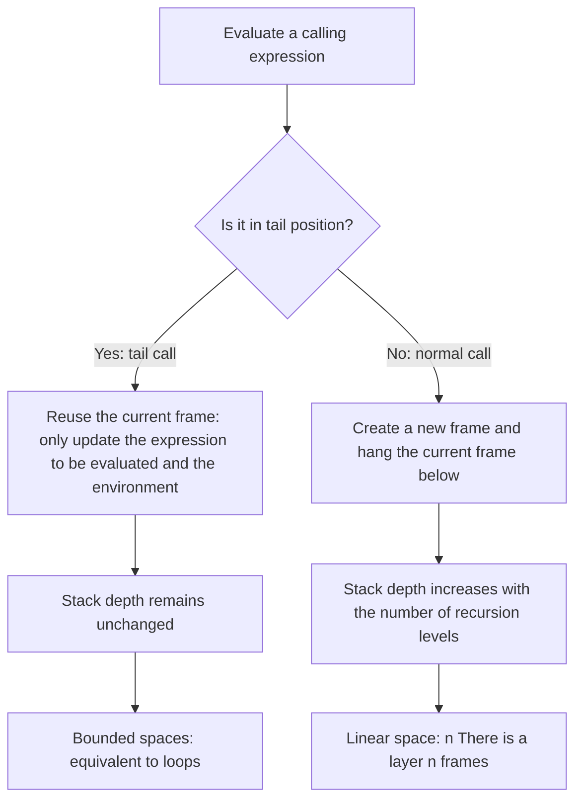
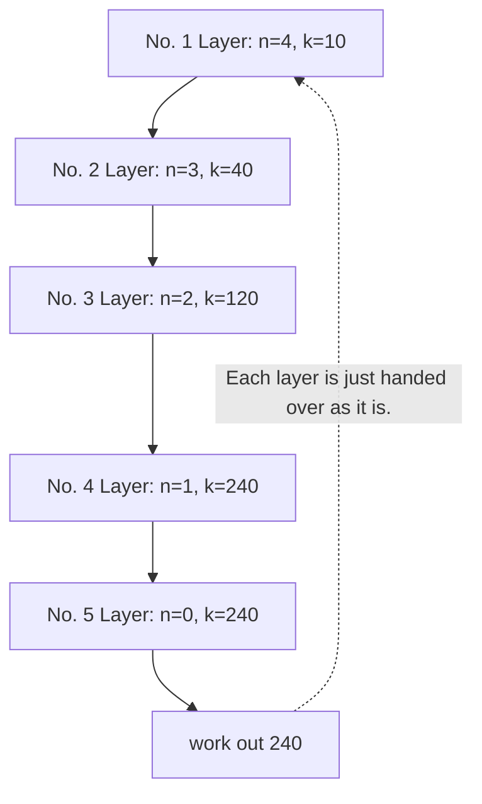
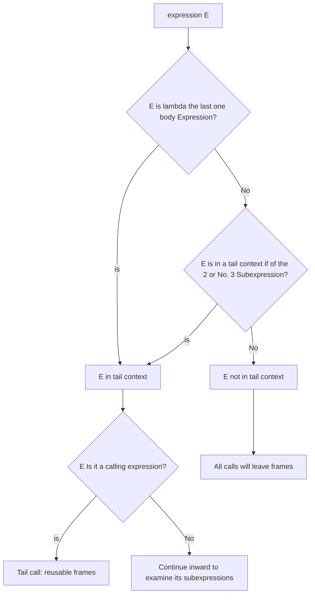
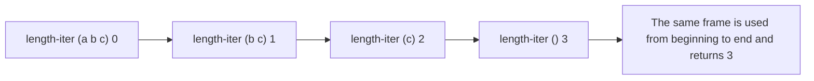
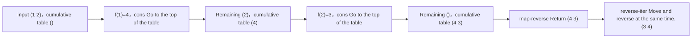
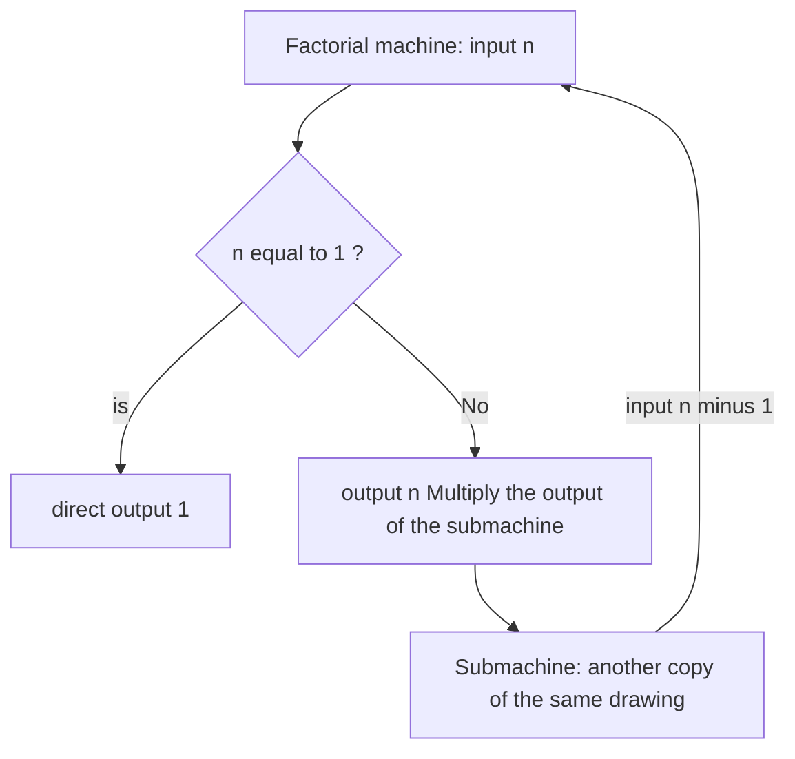
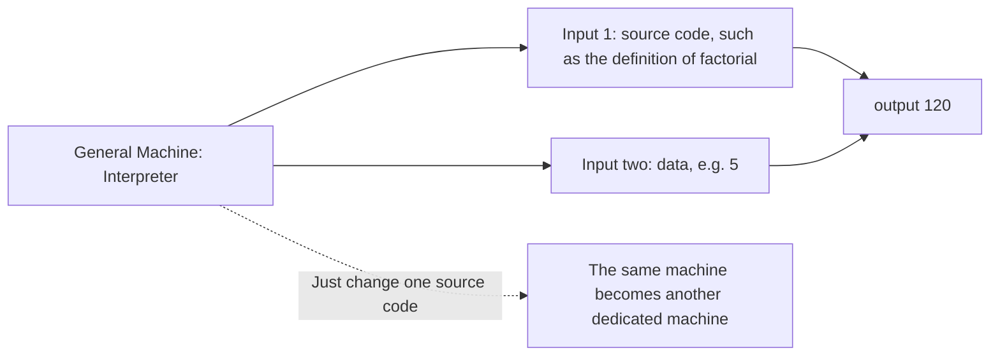

> **courses**: UC Berkeley CS61A · Structure and Interpretation of Computer Programs(Fall 2024)
> **This lecture**: Lecture 32 ｜ 32:50 ｜ Station B P 30 ｜ [Original video](https://www.bilibili.com/video/BV1sy411z7nA?p=30)
> **courseware**: No official courseware (elective lecture, `pdf_pages = 0`, 0 pages in total); the main text uses code blocks, stack diagrams and comparison tables to take over the illustrations originally belonging to the courseware
> **subtitles**: Original English subtitles of station B (32:50, paragraph 351); this note is a Chinese written reconstruction, not a sentence-by-sentence translation
> **Copyright**: The copyright of the course and courseware belongs to the UC Berkeley CS61A teaching team; this article is a secondary arrangement for learning purposes

## Quick overview of this lecture

*(Reference time: 00:00:00 – 00:00:17｜Lecture 32)*

- **Mastered**:
    - Environment model: A procedure call generates a frame, the record shape in the frame participates in the binding of local names, and the parent environment of the frame is determined by the definition;
    - Basic form of Scheme: `define`, `lambda`, `if`, `cond`, `null?`, `car`, `cdr`, `cons`;
    - The shape difference between linear recursion and tree recursion, and the rough spatial intuition of "recursion depth multiplied by frames per layer";
    - The two-level structure of the interpreter: a level that evaluates expressions, and a level that applies procedures to actual parameters.
- **Main line of this lecture**:
    - Pure functional languages prohibit rebinding, and iteration can only be written as recursion; naive recursion leaves one frame for each layer of calls. `n`  Level recursion is  `n`  frames that are alive at the same time;
    - If the caller wants to return **That’s it** The value returned by the callee, the caller's frame no longer carries any information after the call is issued, and can be reused;
    - The call expression in the tail context is called a tail call; the Scheme specification mandates that the implementation support any number of tail calls while occupying only constant space;
    - "Tail position" is a grammatical rule that can be determined mechanically and is only passed inward along a few contexts;
    - The standard handle for rewriting recursion into tail recursion is **accumulating parameter**; `map`  Need to use first  `map-reverse`  Create the table in reverse order, and then use tail recursion  `reverse`  Coming right over.
- **Key conclusions**: Tail call optimization buys space, not time. It takes "iteration" from a grammatical concept (`while`  Statements) become semantic concepts (entering the same process repeatedly in constant space), so functional languages do not have to trade purity for performance.

## 1. The origin of the problem: after disabling rebinding, what does the cycle rely on?

*(Reference time: 00:00:17 – 00:02:37｜Lecture 32)*

Functional programming is a very broad term, and this lecture only takes the narrowest set of properties: all functions are pure functions and do not produce side effects; there are no mutable data types; things created will always be there and will not be changed in place; the established name-value binding is also permanent.

This set of properties is not a moral requirement but a transaction. The first benefit listed by the instructor is: the value of an expression is related to its subexpressions **in what order** Evaluation is irrelevant. Since the order doesn't matter, you can choose any order (Python always picks one). You can evaluate the subexpressions in parallel when there are multiple processing units, or you can wait until you really need the value.

These benefits come from referential transparency: replacing a subexpression with its value leaves the entire expression unchanged. This property incidentally solves a very tricky thing in imperative languages ​​- memoization. Remember the calculated result of a certain subexpression and access it directly next time. You never have to worry about "reading the cache" itself, which will change the program behavior.

The lecturer added a sales pitch here: These properties are particularly valuable now, because machines have more and more processing units, and "can the work be automatically parallelized?" has changed from an academic issue to an engineering issue. It is these properties that make parallelization unnecessary to prove function by function.

Then the problem arises. No  `for`  Neither  `while`, and does not allow rebinding names to new values, can the basic iterative procedure still be efficient? Or can we only rely on recursion, and recursion is very slow, so this kind of language is destined not to be fast?

The instructor's answer is a clear "yes": through tail recursion, a functional language can be as efficient as a non-functional language. The weight of this statement is that it denies a tacit assumption that purity does not have to pay for itself with performance. First put the income and price together:

| criterion | Imperative: `while`  loop | Purely functional: recursive calls |
|---|---|---|
| means of changing status | Rebind the name to a new value | Only new values can be passed as arguments to the next call |
| How to write iteration | `while` / `for`  statement | recursive call |
| order of evaluation of subexpressions | Side effects can affect results | does not affect the results |
| Parallel evaluation | Need to manually prove no dependence | Guaranteed by referential transparency |
| memoization | May change program behavior | safe |
| The space overhead of one iteration | constant | Linearity under naive recursion (the point to be solved in this lecture) |

The last row of the table is where the whole problem lies. The reason why "loop" in imperative language saves space is that it reuses the same scope to repeatedly execute the same statement; in functional language "loop" is called again and again, and each call requires a new frame according to naive semantics. In other words, what purity loses is not the "expression ability of the loop", but the "space overhead of the loop". It is the latter that needs to be returned by the tail call.

## 2. Space account of recursion and iteration

*(Reference time: 00:02:39 – 00:04:10｜Lecture 32)*

The lecturer calculated the account on an example as small as possible: calculation  `k`  multiply by  `n`  The factorial of  `k`  multiply  `n!`. The extra one  `k`  Not a redundant parameter, but an accumulator - it takes "those terms that have been multiplied" with it. The recursive writing is as follows:

```python
def factorial(n, k):
    if n == 0:
        return k
    else:
        return factorial(n - 1, k * n)
```

The boundary conditions are  `0! = 1`: `n`  Directly returns to the accumulator when reset to zero  `k`, at this time  `k`  It happened to be filled with items from  `n`  All factors to 1. Otherwise put  `n`  Multiply into the accumulator (`k * n`), put  `n`  Decrement it by one and pass it to the next call.

Iterative writing of the same set of logic:

```python
def factorial(n, k):
    while n > 0:
        n, k = n - 1, k * n
    return k
```

`while`  The condition is  `n > 0`, the loop body once  `n`, `k`  rebind as  `n - 1`  with  `k * n`, returns when exiting  `k`. The time difference between the two pieces of code is only a constant factor: the recursive version is linear time, but the linear time recursion still takes up **linear space**;The iterative version has the same linear time (the loop body has to go  `n`  times), but only takes up constant space.

Why does the iterative version only occupy constant space? Because it only needs to remember three names——`n`, `k`, `factorial`——with  `n`  It doesn't matter how big it is. In the recursive version, there is one more frame for each deeper layer, and the frame stores that layer's own  `n`  with  `k`.

| criterion | recursive version | Iterative version |
|---|---|---|
| time | linear, `n`  calls | linear, `n`  wheel cycle |
| space | linear, `n`  frames alive at the same time | constant, three names |
| Where does the state exist? | Scattered in local bindings of each layer of frames | focus on  `n`, `k`  in two variables |
| failure mode | If the recursion is too deep, the stack will overflow. | Only limited by numerical scale |
| distance from mathematical definition | Almost word for word correspondence | Need to think additionally about loop invariants |
| What does the language need to provide? | As long as it supports function calls | Rebinding must be allowed |

Please pay attention to a detail that is easily overlooked: **This Python recursive function is logically at the end position**——`return`  The following is directly a recursive call. There is no operation to be done after getting its value. `n`  with  `k`  are no longer read. But CPython still opens a new frame for each layer, because the Python language itself does not promise tail call optimization. This is the gap that the next section will cross: **logical tail call** with **Implementing frame multiplexing** It's two things.

## 3. Scheme’s promise: properly tail recursive

*(Reference time: 00:04:13 – 00:05:24｜Lecture 32)*

This gap is blocked by the explicit specification in Scheme. The lecturer quoted a sentence from the Scheme specification (to its general effect):

> A system that implements Scheme **Must** is properly tail recursive. This allows an iterative calculation to be performed in constant space - even if the iterative calculation is performed by a **syntactically recursive** The process is described.

This sentence is worth taking apart word for word. The first half of the sentence is an obligation: not "recommended optimization", but "must". The second half of the sentence is the effect: **syntactically recursive** (syntactically recursive) with **Semantically iterate** (iterative computation) can coexist. A procedure can call itself in the source code and run like  `while`  Looping because it doesn't physically accumulate frames.

The same piece of logic is written as Scheme:

```scheme
(define (factorial n k)
  (if (= n 0)
      k
      (factorial (- n 1) (* k n))))
```

Line-by-line correspondence with the Python version: `n`  Returns the accumulator when zero  `k`, otherwise use  `n - 1`  with  `k * n`  Recursion. The difference is only in the evaluation rules - this code follows the specification **should** It only takes up constant space, while Python code of the same shape takes up linear space.

| criterion | Recursive version in CPython | The recursive version in Scheme |
|---|---|---|
| Does the language commit to tail call optimization? | No | Yes, the norm is mandatory |
| `n`  Take 1000 | stack overflow | normal operation |
| Space follows  `n`  growth | Linear | constant |
| The relationship between writing and iterative versions | with  `while`  Versions of different shapes | Same shape as the iterative version, both are recursive |
| Is it "grammatical recursion" or "semantic iteration"? | Both are recursive | Syntactic recursion, semantic iteration |

Why does language dare to make this promise? Because without mutable state, the entire value of a call to the caller is "the return value". If the caller has nothing to do after getting the value, the boundary between it and the callee no longer carries any information, and the entire frame can be discarded.

> **Editor's note**: CPython does not perform tail call optimization, which is a trade-off in language design. There are two common explanations. One is debuggability: once a frame is reused, the middle layers are no longer visible in the call stack, and only the deepest names are left when an error is reported. The second is semantic coupling: `try` / `finally`, `with`  and trace hooks all assume that the frame is alive for the duration of the call, and reuse would conflict with them. This has nothing to do with "technically it can't be done" - you can get the same effect by writing the evaluator as an explicit loop rather than a recursive call, which is what the demonstration in Section 7 does.

Draw this rule as a decision diagram for the evaluator:



## 4. Eliminate the middleman: which frames can be thrown

*(Reference time: 00:05:32 – 00:06:42｜Lecture 32)*

Just saying "reuse frames" is too abstract. The lecturer goes back to the Python environment diagram and walks step by step: calling  `factorial(4, 10)`, one more frame will be added each time it is called, `n`  Tie to 4, 3, 2, 1, 0 in sequence. Listing the binding of each step and "what to do after this frame receives the return value of the sub-call", the problem will be clear at a glance:

| frame | `n` | `k` | What should I do after getting the return value of the subcall? | The final value submitted |
|---|---|---|---|---|
| Tier 1 | 4 | 10 | Do nothing and hand it in as is | 240 |
| Tier 2 | 3 | 40 | do nothing | 240 |
| Tier 3 | 2 | 120 | do nothing | 240 |
| Tier 4 | 1 | 240 | do nothing | 240 |
| Level 5 | 0 | 240 | Return directly  `k` | 240 |

What the lecturer said in this example is very simple: since what each layer returns is the value returned by the next layer, there is no reason to change the value of this layer.  `n`  and  `k`  Keep it. `240`  Hand in all the way from the deepest frame, each layer just changes hands.

Those frames in between are not completely useless. them **briefly** Useful: used to calculate the actual parameters of the next call, that is  `n - 1`  with  `k * n`. But once the actual parameters are calculated and the call is issued, these frames will never be read again. So the question "Should we leave the frame?" can be rewritten as a criterion: **Does this layer have anything to say after the call.**

Let’s break this down into three steps:

1. Calculating actual parameters requires frames - this step is calling **before sending** It’s over;
2. Collecting the return value requires a frame - this step is only done when calling **After returning** just happened;
3. The tail call happens to be a "second step is empty" call, so the life of the frame can be terminated at the end of the first step.



The lecturer added a crucial confession: we kept them around anyway because that's how Python works. They are kept not because they are needed, but because the default evaluation rules never ask "are they still needed?" After a pause, he only said a half-sentence transition: "we'll not do that this time" (we'll not do that) - starting from the next section, the evaluator began to actively throw away these frames.

## 5. Definition of tail call: tail context (tail context)

*(Reference time: 00:06:48 – 00:11:01｜Lecture 32)*

Let’s first clarify two terms. once **Not returned yet** The procedure call is called **active**——It will have to hand over a value one day. Some active calls are **tail call**: The value handed over by the callee is the value to be handed over by the caller, without any processing in between.

The instructor split the definition into three sentences: if a procedure call has not returned, it is active; some active calls are tail calls; the Scheme interpreter should support **as many as you want** tail call, and only use **constant space**——The method is to skip those frames that are "not actually needed".

Strictly speaking, there is only one sentence: **A tail call is a call expression in tail context**. So all the workload falls on "what is the last position". Tail position is a recursive grammar rule. Only two of them are used in this lecture:

- one  `lambda`  expressions (including  `define`  The process of coming out, the two are equivalent) **The last body subexpression**;
- if a  `if`  The expression itself is at the tail position, then its **The 2nd and 3rd subexpressions** (consequent and alternative) are also in the last position, and the first (condition) is not.

Why does Article 1 limit "the last one"? because  `lambda`  The body can have multiple expressions, only the last one determines the return value; the previous ones are only evaluated for side effects (rare in pure functional languages), and their results will be discarded, leaving no "tail". The lecturer emphasized it again later in the article  `define`  with  `lambda`  The equivalent of: `(define (f x) ...)`  That’s it  `(define f (lambda (x) ...))`  Syntactic sugar, so the sentence "the last body expression of lambda" is correct  `define`  The process of coming out is also valid.

Take factorial to determine layer by layer:

```scheme
(define (factorial n k)
  (if (= n 0)
      k
      (factorial (- n 1) (* k n))))
```

- `define`  The body has only one expression, which is this  `if`, so this  `if`  in tail position;
- `if`  at the tail position, so its second subexpression  `k`  with the 3rd subexpression  `(factorial (- n 1) (* k n))`  are all in the tail position, the condition is  `(= n 0)`  absent;
- The third subexpression is a calling expression, and it is at the tail position, so it is **tail call**.

The intuition for this step deserves its own mention: once  `(factorial (- n 1) (* k n))`  The value of is calculated, `factorial`  All you have to do at this level is hand it over. At this time  `n`  with  `k`  They have no use anymore, they are only used to figure out the actual parameters of that call. So this call "only requires constant space, no matter how many times it is called".

There are other tail positions listed in the specification, but the lecturer just named them to indicate that they are useful to people writing programs, but not important to the principles of this lecture:

| context | Which subexpressions are at the end position | Reason |
|---|---|---|
| `lambda` / `define`  body | last expression | It determines the return value |
| `if` | 2nd, 3rd | The condition only determines which path to take, its value is discarded |
| `cond` | the last expression of each clause (without conditions) | The condition only needs a boolean value, its value is discarded |
| `and` / `or` | the last one | The first few results may be discarded by short circuit |
| `begin` | the last one | The first few are only evaluated for side effects. |

Lecturer's voiceover: These details are worth memorizing because when writing Scheme programs **The space overhead is determined by them**. Experienced people will try to put the recursive call into the end position. If it cannot be placed, they will rewrite it in the form of accumulated parameters - this is what the next section will do. In order to solidify the decision process, it can be drawn as a decision tree:



> **Editor's note**: This lecture is an elective lecture. There is no official supporting courseware. The verbatim original text of the code on the screen cannot be verified from the existing materials. The Scheme code in the text is rewritten one by one based on the semantics, parameter order and identifiers dictated by the instructor to ensure that it is runnable and that each line can correspond to a sentence in the subtitles; the logic and structure are subject to the description.

## 6. Example 1: `length`  with cumulative parameters

*(Reference time: 00:11:04 – 00:14:50｜Lecture 32)*

The other half of the criterion appears here: **If the caller continues to calculate after getting the return value, the call is not a tail call.**. The lecturer's statement is that "more computation is required in the calling procedure" - the recursive call calculates the value, but if this value is combined with other things, the tail position will be broken.

most natural  `length`  As follows:

```scheme
(define (length s)
  (if (null? s)
      0
      (+ 1 (length (cdr s)))))
```

Still judging from the outside in: body is  `if`, in the tail position, so the second and third subexpressions are both in the tail position; the third subexpression is  `(+ 1 (length (cdr s)))`, it is a **call expression** (call  `+`), so it is a tail call - the lecturer specifically said "this addition is a tail call"; but  `(length (cdr s))`  is  `+`  of **parameters**, no  `+`  By itself, it's not in the tail position.

Remember this shape in one sentence: **The calling expression is a set of calling expressions. The one inside must not be at the end position.**. Because the one outside (here is  `+`) and use the value inside.

Why does this force a linear space? `length`  stored in the frame  `s`. After the sub-call returns, this layer will add 1. This action occurs "after the call returns", so the frame must live until the addition is completed; while the frame is still alive, the one in its environment  `s`  Just keep occupying it. `n`  There are elements  `n`  frames are alive at the same time.

The way to rewrite it is to introduce a second process  `length-iter`, with one more parameter  `n`  means "how many have been counted so far":

```scheme
(define (length-tail s)
  (define (length-iter s n)
    (if (null? s)
        n
        (length-iter (cdr s) (+ n 1))))
  (length-iter s 0))
```

The logic is: when the table is empty, the accumulator is the answer; otherwise, discard the first element, add one to the count, and continue. The starting point is 0 because not one element has been counted yet.

The judgment is also easy: `length-iter`  The body is  `if`, at the tail position; the 3rd subexpression  `(length-iter (cdr s) (+ n 1))`  It is a call expression and is at the tail position, so it is a tail call. So the whole process only runs in constant space.

The lecturer emphasized that this is not a reskinned version of the same program - "this is a very different program in terms of its behavior". The difference in behavior lies in the shape of the stack: the simple version stacks frames from the outside in, and then counts from the inside out; the tail recursive version never stacks frames, and the accumulator  `n`  That's all the information to remember from those original frames.

| criterion | simple  `length` | `length-tail` |
|---|---|---|
| Where is the recursive call? | `+`  in the parameters of | `if`  The 3rd subexpression of |
| Whether to tail call | No | is |
| Are additional parameters required? | No need | Required, accumulator  `n` |
| extra space | Linear | Constant (the linked list itself is still linear) |
| Where does the return value come from? | Add one layer at a time from the innermost layer and rise up. | The innermost layer is given directly and handed over layer by layer as it is. |
| intuitive image | Stack a pile of to-do additions | A counter counts from 0 to  `n` |

The last sentence cannot be omitted: **The space occupied by the table itself cannot be saved**. What is omitted by the tail call is "the extra stack of frames to calculate the length", not the data. The lecturer's statement is: "There are not a bunch of frames in the extra space, there is only one".



## 7. Demonstration: `scheme.py`  That switch in

*(Reference time: 00:14:52 – 00:18:46｜Lecture 32)*

The principle can be condensed into one sentence: **The return value of the tail call is the return value of the current call.**, so all the frames in the middle can be skipped, and the innermost return value can be "directly handed over" to the original caller. The lecturer thought that just explaining the principles was not enough, so he ran a demonstration.

The interpreter used for demonstration is the one included in the course project  `scheme.py`. There is a line of comments in the extra-credit question section at the bottom of the file that says  `uncomment the following line to apply tail call optimization`--Uncommenting will enable tail call optimization. By default it is commented out and follows the normal evaluation path, an interpreter that does not do any special processing for tail calls.

First define tail recursion in a non-optimized interpreter  `factorial`:

```scheme
(define (factorial n k)
  (if (= n 0)
      k
      (factorial (- n 1) (* k n))))
```

This function has been determined previously: `if`  In the tail position, the recursive call is in the tail position and is a tail call. But the interpreter is not optimized, so every time it is called, a frame is opened. The frame is kept until the call returns, and the space is linear.

| call | Tail call optimization is not enabled | After enabling |
|---|---|---|
| `(factorial 10 1)` | normal | normal |
| `(factorial 100 1)` | normal | normal |
| `(factorial 673 1)` | Push to 673 and reach the top, then give up. | normal |
| `(factorial 1000 1)` | `maximum recursion depth exceeded while calling a Python object` | normal |
| `(factorial 10000 1)` | Not reachable | Normal; obviously time-consuming, ultimately limited by the size of the number itself |

The error appears now  `1000`  That time, and the evaluator held on until "about 673 factorials" before giving up. The lecturer made the reason very straightforward: it was called too many times, so it took up too much memory, and Python said "it has reached its limit." This "limit" is not the limit of Scheme, but the recursion depth of the host Python - the interpreter uses Python's recursion to implement Scheme's recursion, so the space overhead of Scheme is directly mapped to the depth of the Python call stack.

> **Editor's note**: Why it is 673 instead of about 1000, it is worth adding an explanation. Each time a Scheme call is evaluated, several layers of frames (evaluating expressions, application procedures, and then evaluating bodies) must be pressed in the host Python. Therefore, CPython's default recursion upper limit of about 1,000 levels is hit in advance, and the depth that can be advanced is far less than 1,000. This also illustrates one thing: the "complexity of the interpreted object" in the meta-circular interpreter will inherit the resource limitations of the "interpreter host language".

Then switch to the version that implements the bonus question - according to the instructor, it "just uses a different evaluation function, an evaluator that does not create new frames when it is not needed." The same definition, the same call, 10, 100, 1000 all passed, `10000`  It’s also figured out. The instructor's evaluation of speed must be left intact: **"I'm not making anything faster, but I am saving the extra space."**  Tail call optimization does not speed up, it saves space. `10000!`  The reason why it is slow is that the result is an integer with tens of thousands of digits, and multiplication itself is expensive.

The program will eventually run out of space, but the reason has changed: it's no longer that there are too many frames; **represents the number itself** Too big (too many digits). In other words, optimization pushes the failure point from "control flow overhead" to "data overhead" - this is often the real boundary of the problem. The lecturer's summary of this run is: using tail recursion, it was indeed calculated  `10000!`, and no unnecessary space is used.

> **Editor's note**: This lecture only talks about the layer of "skipping unnecessary frames" and does not expand on the implementation methods. Real implementation usually takes two paths. One is **frame multiplexing**: When the evaluation loop finds that the expression to be evaluated is at the tail position, it does not call itself recursively, but updates the "expression to be evaluated" and "current environment" to the body of the called process and its new environment, and then  `continue`  Same loop - physically only one frame. The second is  **trampoline**: When applying a process, it does not directly enter its body, but returns a "to-do" (closure or no-parameter thunk), which is repeatedly taken out and executed by the outermost driver loop until the real value is obtained; in this way, the depth of the call stack is always constant. The bonus question for the CS61A project is to take the first route - replace the evaluation function that creates a new frame for the tail call.

## 8. Discrimination Exercise: Spatial Diagnosis of Four Processes

*(Reference time: 00:18:49 – 00:23:19｜Lecture 32)*

The topic is: Which of the following processes are **tail recursive**? The definition given by the lecturer is——**all** Recursive calls are all tail calls, so the entire process can be executed in constant space. The first question is still  `length`, the code is the same as in Section 6, the answer is **No** Tail recursive, evaluating it requires space proportional to the length of the table.

Question 2  `contains`: Judgment element  `x`  Is it on the table?  `s`  inside.

```scheme
(define (contains s x)
  (if (null? s)
      #f
      (if (equal? (car s) x)
          #t
          (contains (cdr s) x))))
```

The decision chain goes like this: outer layer  `if`  is the last expression of body, at the tail position; then its third subexpression - the inner layer  `if`——Also in the tail position; inner layer  `if`  The 3rd subexpression of  `(contains (cdr s) x)`  It is also at the tail position; it happens to be the calling expression, so it is a tail call. Conclusion: `contains`  It's tail recursive. What it deals with is a linearly sized table, but **The additional space required to call it is constant**.

Question 3  `has-repeat`: Determine whether there are duplicate elements in the table. The method is to ask each element "Does it exist in the following table?", that is, calling  `contains`.

```scheme
(define (has-repeat s)
  (if (null? s)
      #f
      (if (contains (cdr s) (car s))
          #t
          (has-repeat (cdr s)))))
```

Structure and  `contains`  Identical to: body  `if`  In the tail position, inner layer  `if`  In the tail position, `(has-repeat (cdr s))`  in tail position, so it's also tail-recursive, overall constant space.

Here is a detail that the lecturer specifically pointed out: `(contains (cdr s) (car s))`  This call **Not here** tail position (it is the inner layer  `if`  conditions), there should be a price; but  `contains`  It is already in constant space, so this non-tail call will not drag in a bunch of frames. This is a beautiful combination of properties -**As long as the called procedure is itself bounded, the person calling it does not have to reserve additional space for it**.

> **Editor's note**: `contains`  use  `equal?`  instead of  `=`, in order to compare any values (numbers, symbols, tables); `=`  This is only true for numbers. In Scheme, an error will be reported for non-numeric parameters. Projects and exercises require higher versatility, so they are commonly used  `equal?`.

The fourth question is to find the first  `n`  Fibonacci numbers use two mutually recursive processes:

```scheme
(define (fib n)
  (if (= n 1)
      0
      (fib-iter n 2 1)))

(define (fib-iter n k current)
  (if (= n k)
      current
      (fib-iter n (+ k 1) (+ current (fib (- k 1))))))
```

`fib-iter`  It contains three parameters: target subscript  `n`, current subscript  `k`, and No.  `k`  Fibonacci numbers  `current`. The function body first checks "whether it has reached the desired one", and if it does, it returns directly.  `current`; Otherwise use  `current`  plus the first  `k - 1`  Fibonacci numbers, as the new round of  `current`, and at the same time put  `k`  plus one.

The judgment result is **Not established**.`fib-iter`  recursive call  `(fib-iter n (+ k 1) ...)`  It is indeed a tail call, but its third actual parameter  `(+ current (fib (- k 1)))`  Contains a pair  `fib`  recursive call, and this call is  `+`  The parameter of - is not in the last position. So in each round, the smaller one must be moved first  `fib`  Figure it out, add it in, the frames can't be dropped.

The lecturer thus gave an article about **mutual recursion** (mutually recursive) criterion: the two processes must be able to run together in constant space, **Both sides** Both must make tail calls to each other. here  `fib`  call  `fib-iter`  is a tail call (in  `if`  the 3rd subexpression of ), but  `fib-iter`  call  `fib`  No, the chain breaks at the latter, so the whole returns to the linear space; the essence of the break point is that sentence-"Chapter  `k - 1`  Once the Fibonacci numbers are calculated, they must first be summed  `current`  Only after merging can we adjust  `fib-iter`".

| process | The location of the recursive call | Whether all are tail calls | extra space | Where is the break? |
|---|---|---|---|---|
| `length` | `+`  in the parameters of | No | Linear | The third body expression is  `+`  call, `length`  Make parameters in it |
| `contains` | inner layer  `if`  The 3rd | is | constant | None |
| `has-repeat` | inner layer  `if`  The 3rd | is | constant | None; `contains`  Call non-tail, but its own constant space |
| `fib` / `fib-iter` | `fib-iter`  in the actual parameters | No | Linear | `(+ current (fib (- k 1)))`  in  `fib`  is  `+`  Parameters |

The method of this group of questions can be solidified into a four-step process:

1. Find the last body expression of the procedure, which is the starting point of the tail position;
2. if it is  `if`, the tail position is passed to the second and third subexpressions, and the condition is not passed;
3. If a calling expression is encountered, check whether the recursive call is **this** The call itself, or one of its actual parameters/addends - only the former is a tail call;
4. Once a certain recursive call is not at the end position, the chain is broken, and the space of the entire process is linear (excluding the data itself).

## 9. `reduce`: Space complexity becomes a parameter

*(Reference time: 00:23:22 – 00:25:58｜Lecture 32)*

Higher-order functions will also turn "space occupation" into parameters. `reduce`  Collect three things: a process for combining  `f`, a table to be traversed  `s`, a starting value  `start`.

```scheme
(define (reduce f s start)
  (if (null? s)
      start
      (reduce f (cdr s) (f start (car s)))))
```

The semantics are: use the starting value with the first element of the table  `f`  Combine, treat the result as the new starting value, and then combine it with the second element... until the table is empty, at which time the current starting value is handed over.

Two examples put the two usages together:

```scheme
(reduce * '(3 4 5) 2)
; 2 * 3 * 4 * 5 = 120

(reduce (lambda (x y) (cons y x)) '(3 4 5) '(2))
; (5 4 3 2)
```

The first one: the starting value changes sequentially to  `2`, `6`, `24`, `120`. Second: starting value from single element table  `(2)`  Departure, in turn becomes  `(3 2)`, `(4 3 2)`, `(5 4 3 2)`——Use  `cons`  Paste the elements to the header one by one, so the order of the results is exactly the opposite.

Judgment: body  `if`  At the tail position, the 3rd subexpression  `(reduce f (cdr s) (f start (car s)))`  in the tail position, so for  `reduce`  of **Recursive calls are tail calls**. But in the same expression, `(f start (car s))`  is  `reduce`  of **argument**, not in the tail position.

thus  `reduce`  The space depends on  `f`: if  `f`  Occupies only constant space (e.g.  `*`, `cons`), the whole  `reduce`  It only occupies constant space; if  `f`  You have to occupy linear space. `reduce`  Just follow linearity. The lecturer's statement is "hopefully it only takes constant space" - that's what's expected of the caller, not  `reduce`  Something you can decide for yourself.

| criterion | `reduce`  own recursion | incoming  `f` |
|---|---|---|
| Whether to tail call | is | with  `reduce`  Another unrelated call |
| Who decides the space? | by  `f`  decide | by  `f`  The definition of |
| Conclusion | `reduce`  total space = `f`  space | If  `f`  is a constant space, and the whole is a constant space |

This is a common form of higher-order functions: **Parameters appear in the callee's complexity**. the good news is  `reduce`  Write once to serve all combinations; the bad news is"`reduce`  It is a constant space" is not possible to be unconditionally true - its space account must be calculated together with the incoming process.

## 10. Example 2: Put  `map`  Written as tail recursion

*(Reference time: 00:26:04 – 00:30:42｜Lecture 32)*

`map`  It is the most natural higher-order function: apply a process to each element in the list, and collect the results into a new list. The most natural way to write it is:

```scheme
(define (map f s)
  (if (null? s)
      nil
      (cons (f (car s)) (map f (cdr s)))))
```

it **No** Tail recursive. Judgment: body  `if`  At the tail position, the 3rd subexpression  `(cons ...)`  in the tail position - but  `cons`  is a call in the tail context, and its second argument  `(map f (cdr s))`  Not in the tail position. The lecturer's statement is very precise: "In  `cons`  Li——`cons`  itself in tail context - there is a subexpression not in tail context that calls  `map`."

Go through it with real data, `f`  To take "Subtract it from 5", enter  `(1 2)`:

- The first call, `s`  is  `(1 2)`, want  `cons`  What went in was  `5 - 1 = 4`, the right side is  `map`  Act on  `(2)`  on;
- The second call, `s`  is  `(2)`, want  `cons`  yes  `5 - 2 = 3`, the right side is  `map`  Act on  `()`  on;
- The third call, `s`  is  `()`, return directly  `nil`.

When returning, spell it backwards: `nil`  become first  `(3)`, and then become  `(4 3)`. Three frames are alive at the same time, because each frame is waiting for the right half of the table.

The idea of ​​the tail recursive version is not intuitive. The lecturer himself said "it is not the way you expect": **First, build the mapping result in reverse, and finally reverse it as a whole.**.

```scheme
(define (map-reverse f s m)
  (if (null? s)
      m
      (map-reverse f (cdr s) (cons (f (car s)) m))))

(define (map f s)
  (reverse (map-reverse f s nil)))
```

`map-reverse`  Bring an extra accumulation table  `m`, meaning "the reverse order result of the part that has been processed". When the table is not empty, put  `(f (car s))`  cons to  `m`  of **front**, with new  `m`  to process the rest of the table; when the table is empty  `m`  That's all the results, just in reverse order.

| stage | `s` | `m` | Description |
|---|---|---|---|
| entrance | `(1 2)` | `()` | No elements have been processed yet |
| 2nd call | `(2)` | `(4)` | `5 - 1 = 4`  Stick it on the header |
| 3rd call | `()` | `(4 3)` | `5 - 2 = 3`  Stick it on the header |
| Return | — | `(4 3)` | `map-reverse`  answer |
| after reversal | — | `(3 4)` | `map`  answer |

Why is the order reversed? because **The input is from front to back, and the accumulation table is built from back to front.**: The element processed first is consed to the head of the table last, so it goes to the front. The lecturer made this causal relationship very clear - precisely because "build from back to front, read from front to back", it is necessary to add a  `reverse`.

The current judgment is divided into three parts:

- `(reverse (map-reverse f s nil))`  inside, `reverse`  It occupies the return value position of the entire body and is a tail call;
- `(map-reverse f s nil)`  is  `reverse`  The actual parameter of is not in the tail position - but it is not the  `map`  recursive call to  `map-reverse`  call, while  `map-reverse`  It is tail recursive and only occupies constant space;
- So there's only one thing left to check: `reverse`  It must also be tail recursive.

`reverse`  The tail recursive way of writing:

```scheme
(define (reverse s)
  (reverse-iter s nil))

(define (reverse-iter s r)
  (if (null? s)
      r
      (reverse-iter (cdr s) (cons (car s) r))))
```

`reverse-iter`  The recursive call is in  `if`  The third subexpression of is a tail call. it puts  `s`  The first element cons to the "reversed part" `r`  in front of, and then advances one element. The trajectory is  `()`, `(4)`, `(3 4)`, exactly the desired order.



The lecturer's evaluation of this example is "one of the more complicated examples of changing the process to tail recursion" because it requires two steps: first think clearly that "traversing and building a table at the same time" will naturally lead to reverse order, and then think clearly that after the reverse order, there must be a tail recursive one.  `reverse`  Put the order back. Both steps are in place, `map`  is truly a constant space - of course, and  `reduce`  Same, `(f (car s))`  Also  `cons`  actual parameters, `f`  Your own space will also be recorded in the general ledger.

## 11. Closure: The interpreter is a universal machine

*(Reference time: 00:30:43 – 00:32:37｜Lecture 32)*

After talking about the last call, the lecturer zoomed in to the last level: What exactly is being done by writing the interpreter itself? The answer is **a general computing machine**.

Let’s look at the analogy first. program is defining **small machine**: A program lays out the steps of "how to turn a certain input into a certain output", so it specifies the logic of a certain computing device. The factorial machine looks like this - if the input is 1, it outputs 1; otherwise it outputs "the input times the output of the submachine", and the input of the submachine is "the input minus one". The lecturer specifically emphasized: What appears in the machine drawings  `factorial`, **Just another copy of the same drawing**. Recursion in this metaphor is "a machine with a copy of itself", `5`  Go in, `120`  Come out.



The interpreter is **Universal** The kind: it accepts any code and simulates any specific machine according to that code. The Scheme interpreter receives two things at once -`5`  Such data, and the source code of "How to calculate factorial" - combine the two and output  `120`.



The lecturer’s statement is: The Scheme interpreter being built in the project is a **universal machine**, can complete any desired calculation, the specific calculation depends on the source code it is entered into **parameterization** What will become. It is also often understood as a bridge: one side is the data object being manipulated in the programming language, the other side is the language itself, and the interpreter connects the two sides.

But inside, don’t forget what it is—**A set of evaluation rules, just a program**. The last sentence of the lecturer is: "an interpreter is nothing more than a program." This sentence is not only the end of this lecture, but also the end of the entire module: the evaluator is not magic, it is the same as factorial, sum  `map`  It is also an ordinary code that can clear the overhead by the number of frames. It is precisely because of this that the seemingly trivial technique of "number of frames" appears in two places at the same time - a mandatory requirement in the language specification, and a switch in the interpreter implementation.

## Summary

*(Reference time: 00:32:41 – 00:32:48｜Lecture 32)*

- **The criterion for tail calling is "do you have anything to say after the call?"**. Calculating the actual parameters requires a frame, and collecting the return value also requires a frame; the tail call happens to be the call in which the latter is empty, so the life of the frame can end when the call is issued. This sentence could replace an entire page of definitions.
- **The tail position is a grammatical rule that can be followed mechanically**. from  `lambda`  Starting from the last body expression, along  `if`  The second and third sub-expressions of
- **Cumulative arguments are the standard handle for tail recursion**.`length`  Add a count, `map`  Add a reverse accumulation table, `reverse`  Adding a reversed list, the common point is to move "unfinished things" from the stack into actual parameters.
- **Space accounts should be calculated separately**: The overhead of the data structure itself + the overhead of control flow. Tail call optimization only affects the latter; `map`  It is still a linear table, `10000!`  It is still an integer with tens of thousands of digits.
- **Higher-order functions hand over their complexity to parameters**.`reduce`  The recursion is a tail call, but the total space depends on the passed in  `f`; When judging this type of process, the space of the actual parameter process needs to be included in the calculation.
- **Optimization buys space, not time**. The lecturer's original words were "I'm not making anything faster, but I am saving the extra space"; expecting tail call to speed up will be disappointing, expecting it to make infinitely deep recursion feasible is the correct usage.
- **An interpreter is just a program**. It has no privileges, it is just a piece of code that puts the two inputs of "data" and "how to calculate" together - so all reasoning about frames is also true for the interpreter itself.

## Attached: Slide index for this lecture

This lecture is an elective topic and there is no official supporting courseware (`pdf_pages = 0`), so there are no slide pages to index, nor any  `slide_*.png`  Quote. This section is a self-examination appendix and does not correspond to any time period in the video, so there is no time anchor. The content that would originally be printed on the courseware - the definition of tail calls, the list of tail positions, the stack frame comparison diagram, `map`  with  `reverse`  Two paragraphs of rewriting - definition lists, lookup tables, indented code blocks and Mermaid diagrams have been used respectively: the decision diagram in Section 3 corresponds to "How the evaluator decides whether to reuse a frame", and the call chain diagram in Section 4 corresponds to "`factorial` "How to hand over the five frames as they are", the decision tree in Section 5 corresponds to the "grammar rules of the tail position", the flow charts in Sections 6 and 10 correspond to "how the accumulated parameters are moved into the actual parameters", and the two pictures in Section 11 correspond to the analogy of "factorial machine and universal machine".
