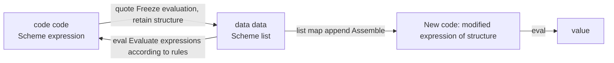
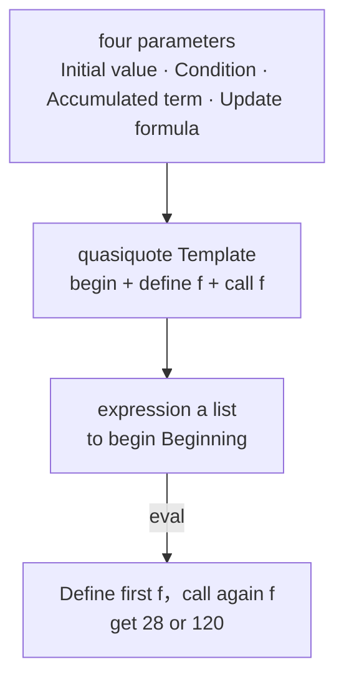

> **courses**: UC Berkeley CS61A · Structure and Interpretation of Computer Programs(Fall 2024)
> **This lecture**: Lecture 33 ｜ 18:06 ｜ Station B P 31 ｜ [Original video](https://www.bilibili.com/video/BV1sy411z7nA?p=31)
> **courseware**: `31-Programs_as_Data_1pp.pdf` (9 pages, official PDF, page-by-page renderings see text illustrations)
> **subtitles**: Original English subtitles from Station B; this note is a reconstruction of Chinese writing, not a sentence-by-sentence translation.
> **Copyright**: The copyright of the course and courseware belongs to the UC Berkeley CS61A teaching team; this article is a secondary arrangement for learning purposes

## Quick overview of this lecture

- **Mastered**: Scheme expression evaluation and special forms, use  `list`／`car`／`cdr`  Manipulating linked lists, using recursion instead of loops; and the "interpreter is a program that reads expressions and evaluates according to rules" in the first few lectures of this module.
- **Main line of this lecture**:
    - Scheme's program text and its list data structures are the same thing: combinations are lists, and lists are combinations.
    - `quote`  Freeze code into data, `eval`  The data is executed as code, and the two constitute the core channel of this lecture.
    - Changing the recursive step from "calling multiplication" to "constructing a multiplication combination" results in a process that returns an expression instead of a number.
    - The quasi-quote (backtick) leaves a slot in the template, and the comma fills the slot with the value of the current environment, so that programs with the same structure and different parameters can be generated in batches.
    - Finally, the class is written as a generator: pass in the initial value, condition, cumulative term and update formula, and it spits out a whole paragraph  `begin`  expression, `eval`  Get the answer directly afterwards.
- **Key conclusions**: The value of programs as data is not to show off skills, but to turn the repetitive work of "writing programs" into objects that can be processed by the program; once the code is a list, templates, macros, DSLs and code generators are just list operations.

*(Reference time: 00:00:00 – 00:00:30｜Lecture 33)*


Page 2 is the announcement page, with only the title and no oral paragraphs corresponding to the knowledge content. Class announcements themselves do not belong to the technical content of this lecture and are only retained here as part of the course sequence.

## 1. Expressions are lists: the first meaning of program as data

*(Reference time: 00:00:00 – 00:01:11｜Lecture 33)*


Scheme programs are composed of expressions, and there are only two types of expressions. The first category is **primitive expressions**:Number  `2`, `3.3`, Boolean value  `true`, symbol  `+`, `quotient`, `not`——They represent themselves when written, or they are symbols whose names need to be looked up in the environment. The second category is **combinations**: A form that encloses operators and operands, for example  `(quotient 10 2)`  with  `(not true)`.

The judgment given by the courseware title is: **A Scheme expression is a Scheme list**. This statement holds true for combinations and also for basic expressions - a single atom is also a trivial list structure. to  `(quotient 10 2)`  For example, if you look at it as a list, it has three elements: symbol  `quotient`, number  `10`, number  `2`. As mentioned before when talking about Scheme lists, Scheme lists are linked lists of cons pairs. `car`  Take the first paragraph, `cdr`  Take the remaining section; this structure was originally used for data, but now it also assumes the role of "program".

This is not two functions shoved together, but two ways of reading the same structure: the same list can be read as "three things in a line" or "divide 10 and 2". Who decides the reading? by **evaluation** Come and decide.


### 1.1 Use list to create a "small program"

The courseware uses two lines of interactive demonstration to nail the isomorphic relationship. The first line uses  `list`  Construct a list, `'quotient`  The preceding quotes prevent evaluation, and the remaining symbol becomes the first element of the list; the second line gives the list to  `eval`:

```scheme
scm> (list 'quotient 10 2)
(quotient 10 2)
scm> (eval (list 'quotient 10 2))
5
```

The first line prints out  `(quotient 10 2)`, exactly the same as handwritten code text, but it is a **list value**:Evaluation  `(list 'quotient 10 2)`  During the entire process, division did not occur once. According to the lecturer, what is obtained is "a small Scheme program", a combination that means "taking the quotient of 10 and 2". The second line is actually executed: `eval`  Takes an expression represented as a Scheme list (or basic expression) and returns its value, so we get  `5`.

The most common place to go wrong here is in the printing form. The list looks the same as the code on the screen, and when reading the REPL output you have to distinguish the roles of the two lines: `scm>`  This is followed by the expression to be evaluated, and its value on the next line. `(list 'quotient 10 2)`  The value of is exactly a list that looks like code, it has no side effects, and it doesn't do division.

### 1.2 Why this matter deserves its own talk

In most languages, "program" and "data" live in two separate worlds: the source code is text, and the program can only process values in the memory when it is running. If you want to generate code, you have to spell the string and pass it to the parser. Scheme merges these two worlds - expressions themselves are linked lists, and linked list operations are code generation operations. This choice brings a direct consequence: **The language parser and the language list library are the same set of tools for processing code.**.

There is also a cost: since the code is the same as the data, when reading the code, you must rely on context to determine "whether this section is being evaluated or just treated as a structure."`quote`  with the next section  `eval`, are the two switches used to explicitly mark the direction.

## 2. eval: execute data as code

*(Reference time: 00:01:11 – 00:02:25｜Lecture 33)*

If you read the two lines of 1.1 together, you will get the first engineering conclusion of this lecture: **If you want the program to generate Scheme code, you only need to construct a list; if you want to know what the generated code will calculate, just call  `eval`.**  The former is data operation, and the latter is evaluation. There is no need for string concatenation or additional parsing steps in the middle.

Python also has a built-in  `eval`, but it accepts strings: give it the source text, it parses it first and then evaluates it. Scheme of  `eval`  Accept lists directly, because lists are inherently representations of expressions in the language - you don't have to parse the text into a data structure first, the data structure is at hand.

This is exactly what Scheme (and the entire Lisp family) is repeatedly praised for in this lecture: the language’s built-in list operations——`list`, `car`, `cdr`, `map`, `append`——All can be used directly to assemble the code. write  `(list 'quotient 10 2)`  than concatenating strings  `"quotient(10, 2)"`  Less error-prone because brackets, spaces, and nesting levels are all represented by  `list`  Responsible, no need for handwritten serialization.

### 2.1 Bidirectional channel between code and data

All the techniques later in this lecture can be seen as a round trip between the following two sides:



The downward side is  `quote`: Let a piece of code stop evaluating and become data as it is, so it can be disassembled, replaced, spliced, and stored in variables. The upward side is  `eval`: Run a piece of data according to Scheme's evaluation rules to get the value. The rest of the content is just to demonstrate what these two sides can combine: first manually spell the code, then use the template to spell the code in batches, and finally write the template itself as a process.

### 2.2 eval and interpreter

> **Editor's note**: `eval`  It is one of the few general procedures in Scheme that "the input is an expression and the output is a value". Take it apart and see that it is all the work of the interpreter: determine the type of expression, evaluate by type, look up the name in the environment, and apply the process to the parameters; the course requires you to write this set of work in Python, you will see then  `eval`  It's not mysterious, it's a set of small functions that call each other. The so-called "metacircular evaluator" refers to writing one yourself using Scheme  `eval`, let Scheme explain Scheme, that is a classic exercise of SICP, and is not expanded upon in this lecture. In other words, the interpreter itself is just a program: it reads the program as data and executes it according to the rules - "the interpreter is the program" and "the program is data" are two sides of the same sentence. In addition, Python’s  `eval`  Will execute any expression in the current scope, and is usually regarded as a dangerous interface in engineering; Scheme's  `eval`  It's equally powerful, the only difference is that it gets a ready-made list instead of a string to be parsed.

## 3. quote and semi-finished expressions

*(Reference time: 00:02:25 – 00:03:47｜Lecture 33)*

Let's look at the most common case first: write an expression that evaluates to a value.

```scheme
scm> (+ 1 2)
3
```

If the same parts are "listed", the results will be different:

```scheme
scm> (list '+ 1 2)
(+ 1 2)
```

The printed result is exactly the same as the expression text just now, but it is still a list. The difference is  `'+`: `+`  Appearing at operator position will be evaluated as an addition process, `'+`  then be  `quote`  Block, leaving the symbol as it is. The lecturer emphasized that the quotation marks here are saying "I don't want to evaluate this plus sign yet", leaving it as a symbol first; when someone evaluates the entire combination, the symbol will be evaluated as a process in the operator position and then applied to 1 and 2.

This passage makes it clear  `quote`  The semantics of : it is not a decoration for printing, but **Control when evaluation occurs**. The referenced parts are frozen and the unreferenced parts are evaluated as usual.

### 3.1 Bounds for early evaluation

The following comparison illustrates this rule clearly:

```scheme
scm> (list '+ 1 (+ 2 3))
(+ 1 5)
```

inner  `(+ 2 3)`  is not referenced, so 5 is calculated according to the rules of ordinary expressions; the addition of the outer layer is not performed because the entire outer layer is just  `list`  A list of three parameters. So the 5 in the result has been calculated, but the 6 obtained by adding 1 and 5 has not yet occurred. The lecturer described this semi-finished product state as "5 has been calculated and 6 has not been calculated yet".

The term semi-finished product is worth remembering. use  `list`  When spelling code, **Which subexpressions are evaluated early, depending on whether they appear in a reference position or an ordinary position**: If you want to preserve the structure, add quotation marks. If you want to calculate a parameter first, leave it exposed. This rule is the basis for all subsequent code generation techniques, and it also exposes a trouble - manually adding quotes to each symbol is too verbose, and the template becomes unreadable once it is long. Quasi-references (section 5) exist to solve this problem.

> **Editor's note**: The interactive demonstrations and program files of Sections 3, 4, 6, 7, and 8 are from the classroom screen and are not included in the courseware; here they are reconstructed according to the expressions, structures and outputs dictated by the subtitles. The variable names and evaluation order are consistent with the dictation. If the courseware retains the process of the same name, the writing method may be slightly different.

## 4. Procedures that return expressions: fact-exp and fib-exp

*(Reference time: 00:03:50 – 00:07:14｜Lecture 33)*

In class, we first load a small program and use factorial for comparison. `fact`  is the standard recursive definition:

```scheme
(define (fact n)
  (if (= n 0)
      1
      (* n (fact (- n 1)))))
```

`(fact 3)`  Got 6, `(fact 5)`  Got 120. This process returns a number.

### 4.1 From fact to fact-exp

Then write a variant  `fact-exp`. Its goal is not to find the factorial of n; **Returns an expression that computes the factorial of n**. The baseline is still 1—1 itself is a perfectly legal expression for the number 1. The recursive step is to use  `list`  Spell out a combination: the operator is the multiplication sign, the first operand is the current n, and the second operand is a "remainder" expression.

```scheme
(define (fact-exp n)
  (if (= n 0)
      1
      (list '* n (fact-exp (- n 1)))))
```

`(fact-exp 5)`  Return:

```scheme
(* 5 (* 4 (* 3 (* 2 (* 1 1)))))
```

This string of things spreads out the entire calculation process of 5!: the outermost layer is 5 times the "factorial expression of 4", and the inner layer is 4 times the "factorial expression of 3", until  `(* 1 1)`. It's still a piece of code that can be evaluated, `(eval (fact-exp 5))`  We get 120; as data, it allows the reader to see how 5 is multiplied all the way to 1—that is, the product 1×2×3×4×5.

The shapes of the two procedures are almost the same, the only difference is whether the recursive step "calls multiplication" or "constructs a multiplication combination":

| criterion | `fact` | `fact-exp` |
| :--- | :--- | :--- |
| What to return | a number | a Scheme list (expression) |
| baseline  `n = 0` | `1` | `1` (Numbers themselves are also expressions) |
| recursive step | `(* n (fact (- n 1)))` | `(list '* n (fact-exp (- n 1)))` |
| When does multiplication occur? | Occurs immediately during construction | hand over  `eval`  only happens when |
| Typical uses | get result | Generate code and observe the calculation process |

The most memorable thing about this table is the line "When does multiplication occur?" It separates "evaluation" from "construction": the process of returning numbers does the multiplication during the construction process, and the process of returning expressions is only responsible for constructing the structure, leaving the multiplication to the future.  `eval`.**Delayed evaluation** (delayed evaluation) The idea took shape here for the first time.

### 4.2 From fib to fib-exp

The same transformation can be applied to Fibonacci. original  `fib`  Use tree recursion: `n`  Returns if less than or equal to 1  `n`, otherwise the sum of the first two items is returned.

```scheme
(define (fib n)
  (if (<= n 1)
      n
      (+ (fib (- n 2)) (fib (- n 1)))))
```

`(fib 2)`  Got 1, `(fib 6)`  Got 8. It is tree recursive: count  `fib 6`  To expand into a call tree, the left branch is  `fib 4`, the right branch counts  `fib 5`. Changing the same structure into a return expression, we get  `fib-exp`:

```scheme
(define (fib-exp n)
  (if (<= n 1)
      n
      (list '+ (fib-exp (- n 2)) (fib-exp (- n 1)))))
```

`(fib-exp 6)`  The top-level expression returned is "put  `fib 4`  The expression of  `fib 5`  The expressions add up"; and then expand it, `fib 4` "Again"`fib 2`  add  `fib 3`"...all the way to the end, what you get is a tree made of only  `+`, `0`, `1`  An addition tree composed of. Evaluating this tree, we get 8.

This expression tree is the same as  `fib`  The call tree is isomorphic, except that the nodes have changed identities: one is an "uncalculated call", and the other is an "already written expression". The lecturer summed up the difference between the two in one sentence——`fib-exp`  is the process of "give me an expression", `fib`  It is the process of "give me a number".

```text
(fib-exp 6)  ⇒  (+ (fib-exp 4) (fib-exp 5))
展开到底     ⇒  一棵只由 +、0、1 组成的加法树
eval 之后    ⇒  8
```

This is exactly the second meaning of "program is data": **The return value of a procedure can be a program, not just a result**. A procedure that returns a result hides the calculation, and a procedure that returns an expression spreads it out; the latter can be inspected, overwritten, saved, and evaluated when needed.

### 4.3 Two discussion questions on the courseware

The courseware is in  `(Demo)`  Two pages of discussion questions are then inserted. The class video did not expand on them - after the lecturer demonstrated the expression versions of factorial and Fibonacci, he went directly to talk about "why people are willing to use Lisp". These two pages belong to the discussion and practice materials supporting the courseware, but the question itself is a direct application of "program is data", so it is kept here in the order of the courseware, and an explanation of the ideas is given.


The motivation for the first question is very practical: machine-generated code often has redundant nested structures, such as  `(* 1 2 (* 3 (* 4)) ...)`. Can you write a program to **No evaluation** Amortizing the nested multiplications under the premise of obtaining an equivalent but shorter and more readable expression? Example given in the question:

```scheme
scm> (* 1 2 (* 3 (* 4)) (+ 5 (* 6 (* 7 8))))
8184
scm> (flatten-nested-* '(* 1 2 (* 3 (* 4)) (+ 5 (* 6 (* 7 8)))))
(* 1 2 3 4 (+ 5 (* 6 7 8)))
scm> (* 1 2 3 4 (+ 5 (* 6 7 8)))
8184
scm> (eval (flatten-nested-* '(* 1 2 (* 3 (* 4)) (+ 5 (* 6 (* 7 8))))))
8184
```

Note  `(+ 5 ...)`  The internals of  `*`. The skeleton of the answer is two processes: `is-*-call`  Determine whether an expression starts with  `*`  The initial multiplication call; `flatten-nested-*`  Use first  `map`  Process each subexpression recursively, and then determine whether the current layer is a multiplication call.

```scheme
(define (is-*-call expr)
  (and (list? expr) (equal? '* (car expr))))   ; E.g., (* 3 4)

(define (flatten-nested-* expr) ; Return an equivalent expression with no nested calls to *
  (if (not (list? expr))
      expr
      (let ((expr (map flatten-nested-* expr))) ; Now expr is (* 1 2 (* 3 4) (+ 5 (* 6 7 8)))
        (if (is-*-call expr)
            (apply append
                   (map (lambda (e)
                          (if (is-*-call e)
                              (cdr e)
                              (list e)))
                        expr))
            expr))))
```

The key is  `apply append`  That line. `map`  Turn each child element into "a list fragment": symbol  `*`  It is not a multiplication call and is wrapped as  `(*)`; `1`  become  `(1)`; `(* 3 4)`  It is a multiplication call itself, take  `cdr`  get  `(3 4)`; `(+ 5 (* 6 7 8))`  It is not a multiplication call and is wrapped as  `((+ 5 (* 6 7 8)))`. These fragments were again  `append`  in a string, `(*)`  The one in  `*`  becomes the operator of the result list, so we get  `(* 1 2 3 4 (+ 5 (* 6 7 8)))`.

`let`  That line just gives the intermediate result a name to avoid referring to  `(map flatten-nested-* expr)`  Write it many times; `map`  pairs of symbols  `*`  Also called  `flatten-nested-*`, while  `*`  Not a list, it returns itself directly.


The second question requires writing  `print-evals`: It accepts a number only, `+`, `*`, `>`, `if`  expressions with parentheses, each subexpression evaluated during the evaluation process and its value are **The order in which evaluation is completed** Print it out. Example is:

```scheme
scm> (define expr '(* 2 (if (> 2 (+ 1 1)) (+ 3 4) (* 5 6))))
expr
scm> (eval expr)
60
scm> (print-evals expr)
* => #[*]
2 => 2
> => #[>]
2 => 2
+ => #[+]
1 => 1
1 => 1
(+ 1 1) => 2
(> 2 (+ 1 1)) => #f
* => #[*]
5 => 5
6 => 6
(* 5 6) => 30
(if (> 2 (+ 1 1)) (+ 3 4) (* 5 6)) => 30
(* 2 (if (> 2 (+ 1 1)) (+ 3 4) (* 5 6))) => 60
```

The order of output exposes the evaluation rules: the parts of the operator expression are evaluated first, then the combination itself; `if`  Only take the selected one - predicate calculation  `#f`  After that, what is printed is  `(* 5 6)`, while  `(+ 3 4)`  Didn't show up from beginning to end. The process value is printed as  `#[*]`, `#[>]`, `#[+]`, which is Scheme's printed form of a built-in procedure.

The answer is:

```scheme
(define (print-evals expr)
  (if (list? expr)
      (if (equal? (car expr) 'if)
          (begin
            (print-evals (car (cdr expr)))
            (if (eval (car (cdr expr)))
                (print-evals (car (cdr (cdr expr))))
                (print-evals (car (cdr (cdr (cdr expr)))))))
          (map print-evals expr)))
  (print expr '=> (eval expr)))
```

The structure deserves a closer look. `(print expr '=> (eval expr))`  written in  `if` **outside**, is the last expression of the procedure body, so it will always execute: no matter  `expr`  Whether it is an atom or a combination, it will print itself after the subexpression is processed. inside  `if`  Only responsible for "going down": non-list atoms do nothing; used in ordinary combinations  `map`  Process all subexpressions once; `if`  Expressions are treated specially - the predicate is processed first, then the predicate is evaluated, then **only** Process the selected branch. due to  `if`  Only one branch is evaluated, the other is never printed, and the order of output is therefore exactly the order in which evaluation is completed.

> **Editor's note**: The code and output on the two pages above are transcribed according to the original text of the courseware. The green underlined areas are the answers left blank in the courseware; the explanation part is filled in according to the code semantics, and there is no corresponding dictation in the classroom video.

## 5. Quasi-quote: slot in quotation marks

*(Reference time: 00:07:16 – 00:11:22｜Lecture 33)*

The lecturer first answered "Why do people really use Lisp languages": The code looks like a bunch of symbols and brackets, so it is natural to write a program that generates programs. This answer ties together the demonstrations in the previous sections——`fact-exp`  with  `fib-exp`  It has been proven that "a procedure that returns an expression" exists, and the next step is to make it easy to write such a procedure.


Before writing a longer example, you need to add a language feature -**quasiquotation**. It is similar to what has been learned  `quote`  It's very similar, the difference is that you can unquote certain parts of a quasi-reference expression.


### 5.1 Three types of signs

```scheme
Quote:       '(a b)   =>   (a b)
Quasiquote:  `(a b)   =>   (a b)
(define b 4)
Quasiquote:  `(a ,(+ b 1))  =>   (a 5)
```

There are two ways to write quotes: `quote` (or single quote  `'`) and quasi-quotes (backtick, the key in the upper left corner of the keyboard). In many cases the results are the same: `'(a b)`  with  `` `(a b) ``  get all  `(a b)`. The difference is in the dequote: inside the quasi-quote expression, the comma  `,`  The marked subexpressions are evaluated and the values are filled directly into the structure; the parts not marked with commas remain unchanged.

The comparison is as follows:

| mark | Name | Scope | `b`  The result when is 4 |
| :--- | :--- | :--- | :--- |
| single quote  `'`  or  `quote` | Quote | The entire expression freezes | `'(a ,(+ b 1))`  Got  `(a (unquote (+ b 1)))` |
| backtick or  `quasiquote` | quasi-citation | Frozen overall, but unfrozen at the comma | `` `(a ,(+ b 1)) ``  Got  `(a 5)` |
| comma  `,`  or  `unquote` | backquote | Only valid within quasi-references | write alone  `,(+ b 1)`  is a grammatical error |

The third line is worth emphasizing: the comma is not a stand-alone operator, it only makes sense in the context of quasi-references. put  `,`  Written in a normal expression, the interpreter will complain because it expects itself to appear inside a template.

### 5.2 Nested examples and reading methods

For the same expression, reference and quasi-reference give two results:

```scheme
scm> '(a ,(+ b 1))
(a (unquote (+ b 1)))
scm> `(a ,(+ b 1))
(a 5)
```

The result of the former is a three-level nested list: the outer level is  `(a ...)`, the second layer is  `(unquote (+ b 1))`, the third layer is  `(+ b 1)`. because  `quote`  Freezes the entire expression as it is. The comma is just an ordinary symbol here and does not trigger any evaluation. The latter result is  `(a 5)`: `a`  keep symbols, `(+ b 1)`  Counting 5 in the current environment is filled in.

why  `(+ b 1)`  evaluated  `a`  No? The answer is that comma. The reading is: **The quasi-reference first constructs the overall structure according to the method of "constructing a list"; when encountering a comma-marked subexpression, it calculates a value according to Scheme's ordinary evaluation rules, and then puts this value into the corresponding position.**. This set of rules uses already seen evaluation rules, so it can depend on the current environment -`b`  is 4, `b + 1`  That’s 5; `b`  If you change it to another value, the result will change accordingly.

So what quasi-quotes do can be summarized in one sentence: **Mix "reference" and "evaluation" in the same template**, the skeleton of the template is data, and the slots are live codes.

### 5.3 Use templates to create processes: make-add-lambda

The courseware gives the first practical example:

```scheme
(define (make-add-lambda n) `(lambda (d) (+ d ,n)))
(make-add-lambda 2)  => (lambda (d) (+ d 2))
```

`make-add-lambda`  accept a number  `n`, returns a lambda expression whose arguments  `d`  is fixed, the number added is given by  `n`  decision. call  `(make-add-lambda 2)`  Get:

```scheme
(lambda (d) (+ d 2))
```

This is a list whose elements are symbols in order  `lambda`, only contains  `d`  list of  `(d)`, and  `(+ d 2)`——It is another manifestation of what was said in Section 1 that "a combination is a list". it is a paragraph at the same time **code**: give it to  `eval`, you get a process that only accepts one parameter and returns "parameter plus 2".

If quasi-citation is not used, the template should be written as  `(list 'lambda (list 'd) (list '+ 'd n))`: Each symbol must be quoted separately, and each sublist must be separately quoted.  `list`, once the template has two or three levels of nesting, the writing quickly becomes unreadable. Quasi-references mark "which parts are dead and which parts are alive" directly on the code using two notations, and the structure of the template corresponds one-to-one to the shape of the generated result. This is why it is "particularly suitable for generating Scheme expressions".

## 6. Scheme without while: write loops as recursive

*(Reference time: 00:11:23 – 00:13:13｜Lecture 33)*

What follows is a longer example. The lecturer first told the truth: **There is no while statement in Scheme**, but the while statement is really convenient. To illustrate how inconvenient "no loops" are, let's look at a specific calculation: Find the sum of the squares of all even numbers below 10, starting with 2, that is  $2^2 + 4^2 + 6^2 + 8^2$.

In Python, there is a ready-made way to write this:

```python
x, total = 2, 0
while x < 10:
    total = total + x * x
    x = x + 2
```

at the end of the loop  `total`  is 4 + 16 + 36 + 64 = 120.

In Scheme, there is no while available, only recursion. The idea is to turn loop variables into process parameters: `x`  is the current x, `total`  Is the current cumulative sum; if the continuation condition is still met, it will recurse with the updated value, and if it is not met, it will return.  `total`.

```scheme
(define (sum-while x total)
  (if (< x 10)
      (sum-while (+ x 2) (+ total (* x x)))
      total))

(sum-while 2 0)
; 120
```

After defining this process, you still need to call it with the correct initial value: `total`  Starting from 0, `x`  Start with 2. So write two expressions instead of one. If you want to combine them into one expression, you need to use  `begin`:

```scheme
(begin
  (define (sum-while x total)
    (if (< x 10)
        (sum-while (+ x 2) (+ total (* x x)))
        total))
  (sum-while 2 0))
```

`begin`  String multiple expressions into one, and take the last one as the value - this is exactly the semantics explained when talking about special forms earlier, and it is also the shape to be used when generating code in Section 8.

The instructor gave this code an honest review: the Python version is better to read. **This calculation itself does not have any recursion**, it is just an iteration of "going forward step by step"; Scheme is written as recursive because the language only provides this way of expressing repetition. Only by understanding this can we understand why the program is asked to write this code in the next section: what is repeated is not the calculation, but the mechanical action of "translating while into recursion".

## 7. Parameterization: Extract "which part will change"

*(Reference time: 00:13:15 – 00:14:55｜Lecture 33)*

Change a question, the shape is exactly the same: find the sum of "numbers whose square is less than 50", starting from 1, that is  $1 + 2 + \cdots + 7 = 28$ (7 squared is 49 and 8 squared is 64, which no longer satisfies the condition).

```python
x, total = 1, 0
while x * x < 50:
    total = total + x
    x = x + 1
```

Compared with the previous section, the Python version only changed four places: the initial value, the while condition, the accumulated things, and the update method of x. The Scheme version only touches these four places accordingly. The problem is: if there are a bunch of questions like this, and each one has to hand-write the "define recursive process + call with initial value" template, the work becomes copying.

The lecturer’s proposal is: **Let Scheme write this code**. Write a procedure whose input is "initial value, condition, what to add to total, how to update x", and the output is a whole evaluable Scheme expression. First think about the calling method:

```scheme
(sum-while-expr 1 '(< (* x x) 50) 'x '(+ x 1))
```

The four parameters are: initial value  `1`;continuation condition  `(< (* x x) 50)`; Accumulated item  `x`;updated  `(+ x 1)`. The last three are enclosed in quotation marks because they are **expression**, should be embedded in the template as it is, rather than evaluated now - without quotation marks, `(< (* x x) 50)`  will be evaluated immediately, and at this moment  `x`  Not worth it yet.

What code should this call generate? Following the structure of section 6, the answer is:

```scheme
(begin
  (define (f x total)
    (if (< (* x x) 50)
        (f (+ x 1) (+ total x))
        total))
  (f 0 1))
```

In other words, the skeleton of the template is fixed to "`begin`  Li Xian  `define`  a recursive process  `f`, and then call it with the initial value  `f`", there are only four parts that change: condition, update formula, accumulation term, and initial value. There are two other fixed points in the template: return when the condition is not met  `total`, and call  `f`  time  `total`  Start from 0. This is exactly what is left after extracting "which part will change".

## 8. Generate code: closed loop of templates, slots and eval

*(Reference time: 00:14:57 – 00:18:04｜Lecture 33)*

### 8.1 Template and four slots

Write the skeleton of the previous section as a quasi-reference to get the generator:

```scheme
(define (sum-while-expr initial-x condition add-to-total update-x)
  `(begin
     (define (f x total)
       (if ,condition
           (f ,update-x (+ total ,add-to-total))
           total))
     (f 0 ,initial-x)))
```

Four commas correspond to four parameters: `,condition`, `,update-x`, `,add-to-total`, `,initial-x`. The lecturer explained step by step why it is necessary to backquote: If it is written as  `condition`  Without adding a comma, the generated result is **symbol** `condition`, rather than the expression passed in by the caller; `update-x`  with  `add-to-total`  Same reason; `initial-x`  Without backquoting, `(f 0 initial-x)`  will find a value called  `initial-x`  variable, which does not exist.

This process of "writing the template first and then filling in the commas one by one" is itself a debugging method worth remembering: the appearance of symbol names that should not appear in the generated results usually means that a comma is missing in the template.

### 8.2 Run the generated code

Load this definition into a file, load the interpreter, and call:

```scheme
scm> (define result (sum-while-expr 1 '(< (* x x) 50) 'x '(+ x 1)))
result
```

`(sum-while-expr ...)`  The value of is a list, printed out as  `begin`  At the beginning, the structure is consistent with the handwritten code in Section 7. The lecturer specifically asked the audience to pay attention: **it's just data now**. But data is also code, and evaluating it gives you the answer:

```scheme
scm> (eval result)
28
```

The result is 28, the sum of 1 to 7. Change the set of parameters, and the same generator spits out another piece of code:

```scheme
scm> (eval (sum-while-expr 2 '(< x 10) '(* x x) '(+ x 2)))
120
```

The conditions this time are  `(< x 10)`, the cumulative term is  `(* x x)`, the update formula is  `(+ x 2)`, the initial value is 2, so we get the sum of even squares 120 - exactly the handwritten question in Section 6.

The closed loop of the entire process can be drawn as an assembly line:



It is worth noting that  `eval`  does two things on this chain: it first executes  `define`, put the recursive process  `f`  Load into the environment; execute again  `(f 0 1)`, to actually run that loop. The lecturer's original words are to the effect that this code "does produce a piece of code that can calculate 120, which consists of defining a new recursive function and calling it, and  `eval`  I actually defined the function, called it, and finally got the number."

The last sentence of this lecture summarizes: **Being able to write the process of "writing code for other processes" is an additional expressive power of programming languages.**, which is one of the exciting aspects of Lisp and Scheme. The reason why this sentence is true depends on the three things saved in the previous sections: code is a list, `quote`  Ability to freeze structures, `eval`  Ability to execute structures.

> **Editor's note**: Code generation is not uncommon in engineering: the compiler translates the syntax tree into target code, the test framework generates use cases in batches based on data tables, the Web framework compiles templates into functions, and Lisp macros are expanded into code during compilation. The essence is to "construct a program and then hand it over to the evaluator." This lecture demonstrates the smallest version of this mechanism; macros will be expanded in the next lecture.

### 8.3 fact-expr left as an exercise in the courseware


On the last page of the courseware, section 4  `fact-exp`  Another way of writing requires rewriting the same procedure using quasi-references and giving the expected output:

```scheme
scm> (fact-expr 5)
(* 5 (* 4 (* 3 (* 2 (* 1 1)))))
```

The template is:

```scheme
(define (fact-expr n)
  (if (= n 0) 1 `(* ,n ,(fact-expr (- n 1)))))
```

Two commas separate the current  `n`  Fill in the multiplication template with the expression obtained by recursion. Used with section 4  `list`  Compared with the written version, this code hides all the details of "constructing the list" in backticks: `(* ,n ,(fact-expr (- n 1)))`  The shape of the resulting expression is written directly and reads almost like the code it generates. The baseline is still  `1`, so when expanded, it will appear  `(* 1 1)`, consistent with the sample output.

> **Editor's note**: This page is not explained in the classroom video, and is an exercise left for discussion or after class by the courseware; the code is transcribed according to the fill-in-the-blank answers given in the courseware, and the explanatory text is written by the editor.

## Summary

- **The isomorphism of code and data is the foundation of this lecture**:Scheme combination is a linked list, `car`／`cdr`／`map`／`append`  Can handle both data and programs. To determine whether a structure is "data" or "code", just look at whether it is fed into the evaluator.
- **`quote`  with  `eval`  They are two switches with opposite directions.**: The former freezes evaluation and retains the structure, while the latter executes the structure according to rules and obtains the value. All code generation tricks are combinations of these two switches.
- **The return value can be an expression**: `fact`  with  `fact-exp`, `fib`  with  `fib-exp`  The comparison shows that changing the recursive step from "call" to "construct" delays the calculation to the future; delay makes the intermediate results checkable and rewriteable.
- **Quasi-reference writes templates and slots separately**: Backticks mark the skeleton, commas mark the live code; the structure of the template is the structure of the generated result. If a comma is omitted in the template, symbol names that should not appear will appear in the generated results - this is the most practical clue for troubleshooting.
- **No loop does not mean it cannot be repeated**: Turning loop variables into parameters and turning "next round" into recursive calls is the only way for Scheme to express iteration; this is mechanical, repetitive, and error-prone, so it is suitable to be left to the program.
- **The threshold for metaprogramming is lower than imagined**: One accepts four parameters and spits them out using quasi-references.  `begin`  The process of expression is already "a program for writing programs". The compiler's code generation, test generation, DSL, and macros are all amplified versions of this path.

*(Reference time: 00:17:51 – 00:18:04｜Lecture 33)*

## Attached: Slide index for this lecture

*(Reference time: 00:00:00 – 00:18:04｜Lecture 33)*

| page | content | Appear location |
| :--- | :--- | :--- |
| 1 | Title page Programs as Data | Quick overview of this lecture |
| 2 | Announcements page Announcements | Quick overview of this lecture |
| 3 | Section page: Programs as Data | §1 |
| 4 | Expressions are lists: `list`  structure combination, `eval`  evaluate, mark  `(Demo)` | §1 |
| 5 | Discussion Question: Flattening Nested  `*`  call | §4.3 |
| 6 | Discussion question: Print subexpressions in the order they are evaluated | §4.3 |
| 7 | Sectioned pages: Quasiquotation | §5 |
| 8 | `quote`／`quasiquote`／`unquote`  with  `make-add-lambda` | §5 |
| 9 | Discussion question: Write using quasi-citations  `fact-expr` | §8.3 |
