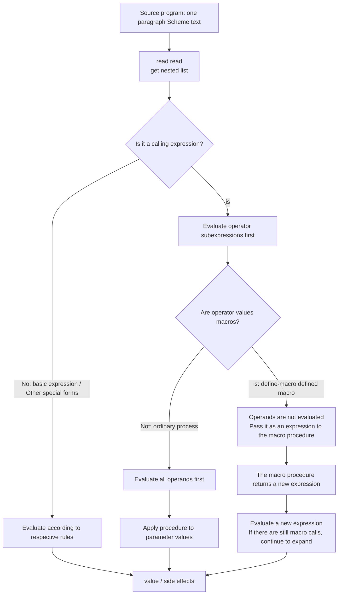
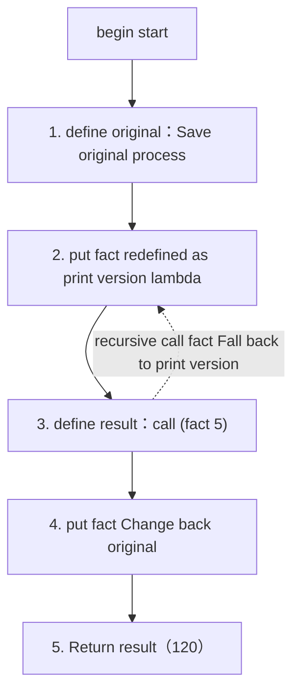

> **courses**: UC Berkeley CS61A · Structure and Interpretation of Computer Programs(Fall 2024)
> **This lecture**: Lecture 34 ｜ 28:53 ｜ Station B P 32 ｜ [Original video](https://www.bilibili.com/video/BV1sy411z7nA?p=32)
> **courseware**: `32-Macros_1pp.pdf` (11 pages, official PDF, page-by-page renderings see text illustrations)
> **subtitles**: Original English subtitles from Station B; this note is a reconstruction of Chinese writing, not a sentence-by-sentence translation.
> **Copyright**: The copyright of the course and courseware belongs to the UC Berkeley CS61A teaching team; this article is a secondary arrangement for learning purposes

## Quick overview of this lecture

*(Reference time: 00:00:01 – 00:00:11｜Lecture 34)*

- **Mastered**: Scheme’s prefix expressions and special forms, `define`/`lambda`/`if`/`begin`, list  `car`/`cdr`/`cons`/`list`, and the conclusion of the previous lecture - the program reads it as a nested list, and there is no difference in shape between code and data.
- **Main line of this lecture**:
    - Quasiquote and unquote are "templates with holes": the skeleton is left as is, and the holes are filled with the results of the evaluation to generate "a piece of code that will be evaluated later."
    - Macro is right **Source code** What to do: `define-macro`  What is defined is the transformation of "expression in, expression out", not the process of "value in, value out".
    - The evaluation of a macro call expression is divided into three steps: find the operator →**Not evaluated** The operands are passed to the macro procedure → the expression returned by the macro procedure is evaluated.
    - Because operands are not evaluated, macros can do things that procedures cannot: copy, wrap, or even discard an expression before it is evaluated; `twice`, `check`, `for`, `trace`  There are four different usages.
    - The trade-off is that the macro works at the source code level: the names it introduces actually enter the program (a hygiene issue), and its error messages point to the expanded code rather than the original call.
- **Key conclusions**: The process controls "how the value flows", and the macro controls "how the code is generated". Adding a new special form to a language is essentially writing a procedure that translates the new syntax into the old syntax, and then having the interpreter call it before evaluating it.


Page 2 is the announcement page. There is no corresponding oral content in the video and subtitles. The classroom announcement does not belong to the knowledge content. It is only reserved as part of the course sequence.


## 1. Quasi-citation review: leaving holes in code templates

*(Reference time: 00:00:11 – 00:00:44｜Lecture 34)*


Quasi-quote and anti-quote are two tools left over from the previous lecture, and we will use them as the main force in this lecture. Single quotes (quote) are the simplest: they treat the following expression as data as it is, and none of the subexpressions are evaluated. Backticks (quasiquote) do almost the same thing -`'(a b)`  Expressions with the same name written in backticks will evaluate to lists.  `(a b)`. The only difference is that backticks allow "holes" in the template: subexpressions marked with commas (unquote) are evaluated first, and the resulting values ​​are filled in the holes.


Page 4 of the courseware nails it with a small two-line example. First  `b`  Tie it into 4, then tie it  `(+ b 1)`  Put it in the hole:

```scheme
scm> '(a b)
(a b)
scm> (define b 4)
scm> `(a ,(+ b 1))
(a 5)
```

The template output is a list of two elements: symbols  `a`  And number  `5`. Note  `b`  disappeared in the result - it was not "replaced" with 4, but the expression in the hole  `(+ b 1)`  After being evaluated to 5, the entire hole is filled with 5. This distinction will appear again and again in macros: the position of the hole can be any expression, and the macro author is fully responsible for "whose value is put here?"

| symbol | Name | function | Example | Evaluation result |
| :--- | :--- | :--- | :--- | :--- |
| `'` | quote quote | Prevent evaluation entirely and treat expressions as data | `'(a b)` | `(a b)` |
| backtick | quasiquote quasi-quote | Also prevents evaluation, but allows internal commas to open holes. | backtick  `(a b)` | `(a b)` |
| `,` | unquote unquote | Only takes effect inside a quasi-reference: this subexpression must be evaluated first | backtick  `(a ,(+ b 1))`, `b`  for 4 | `(a 5)` |

The third and fourth columns in the table are two versions of the same rule: **The number of levels referenced determines the depth of evaluation**. When there is no hole, the two references are interchangeable; once there is a hole, only backticks can express "here needs to be calculated". The lecturer returned to this property repeatedly in the discussion questions, and it is also the skeleton of every macrobody that follows.

The courseware then gives the most typical use of quasi-references - generating a piece of code to be executed later:

```scheme
(define (make-add-lambda n)
  `(lambda (d) (+ d ,n)))

scm> (make-add-lambda 2)
(lambda (d) (+ d 2))
```

`make-add-lambda`  What is returned is a **list**, not a process; to get a real process, you have to evaluate the return value again (`(eval (make-add-lambda 2))`). The division of labor in the template is clear at a glance: `lambda`, `d`, `+`  It is the skeleton and enters the result as it is; `n`  is a hole, replace it with the value given when calling. The writing method of the entire set of macros is an enlarged version of this division of labor: the skeleton is the syntax, and the holes are what the caller writes.

## 2. Discussion question: Using quasi-references to generate sum-of-squares expressions

*(Reference time: 00:00:46 – 00:03:27｜Lecture 34)*

The lecturer put a fill-in-the-blank question on the screen and explained the rules very narrowly: The following program only needs a few quasi-quote and back-quote symbols, and each gap must be left blank or filled with a backtick or a comma; after filling in, the second expression should evaluate to "a squared plus b squared", which is the Scheme notation.  `(+ (* a a) (* b b))`.

> **Editor's note**: The picture of this question is not in the official 11-page courseware (page 5 of the courseware is another  `fact-expr`  Fill-in-the-blank questions), the code skeleton below is restored according to the answers read sentence by sentence in the subtitles, and the selection of blanks and answers is completely explained in the order of the instructor.

The restored answer is the following two paragraphs:

```scheme
(define (square-expr term)
  `(* ,term ,term))

`(+ ,(square-expr 'a) ,(square-expr 'b))
```

Reading sentence by sentence, you can clearly see three levels of nesting: the outermost layer is a backtick (the entire paragraph is "a piece of code to be generated"), the middle is a comma (these positions must be evaluated first), and the innermost layer appears again (`a`  with  `b`  is an unevaluated symbol). The lecturer's original words are exactly this structure: a complete quasi-quoted expression can have a dequoted subexpression, and that subexpression can have a quoted expression inside.

The space for each step is determined as follows:

1. `(define (square-expr term) ...)`  Leave blank outside. The task of this sentence is to define the process. The definition expression itself needs to be evaluated. If you reference it, you will get a piece of data. The process is not bound at all.
2. `(* ...)`  Fill in the backtick before. What is returned is "list  `(* term term)`"This data, instead of actually doing the multiplication.
3. two  `term`  Put a comma before it. `term`  is a formal parameter, the caller gives it a symbol  `a`  or  `b`, must be evaluated to that symbol before returning, otherwise the formal parameter name will be left in the generated code  `term`.
4. Outer layer  `(+ ...)`  Fill in the backtick before. The entire result is a  `+`  The list at the beginning must block evaluation.
5. `+`  Leave blank before. It is already in the quasi-reference. If you quote it again, it will be  `+`  Become a layer of reference form in the data.
6. two  `(square-expr ...)`  Put a comma before it. These two positions need to be **Calling process**, fill in the generated subexpression.
7. `a`  with  `b`  Fill in a reference before each. These two symbols are in an "evaluated" context (they are within the scope of the outer comma) and must block evaluation.

In step 7, the instructor specifically explained: You can enter either single quotes or backticks here, because there is no comma inside that subexpression, and the behavior of the two is exactly the same; he used backticks in the answer just to make the entire code look neat. This judgment that "two references are equivalent when there is no hole" is a direct application of the table in Chapter 1.

| vacant seat | What to fill in | Reason |
| :--- | :--- | :--- |
| `define`  outside the entire sentence | Leave blank | This is the definition expression and is to be evaluated; referencing it simply creates a piece of data |
| `(* ...)`  before | backtick | The return value must be a list and cannot actually be multiplied. |
| two  `term`  before | comma | The value of the formal parameter must be replaced, otherwise what is left is the formal parameter name. |
| `(+ ...)`  before | backtick | The entire result is a paragraph  `+`  code at the beginning |
| `+`  before | Leave blank | Already in the quasi-reference, adding more references will change the list header. |
| two  `(square-expr ...)`  before | comma | The procedure is called here, not the tree is retained. |
| `a`, `b`  before | Quote (`'`  or backtick) | They are in the evaluation context and must block evaluation |

If you look at this table vertically, you will find that "vacancies" and "functions" are in one-to-one correspondence: each time you fill in a symbol, it is equivalent to turning off or turning on the evaluation switch of a certain layer. This is the quasi-citation ratio  `list`  A better place to use——`list`  You can only spell it out layer by layer, and quasi-quoting allows you to "write the shape of the result first, and then mark which positions require the value."

## 3. What happens if you make a mistake: Diagnosis of five wrong answers

*(Reference time: 00:03:28 – 00:05:24｜Lecture 34)*

The lecturer then filled in several common mistakes and showed them to the class one by one. Each type of incorrect filling corresponds to a certain previous step, and the resulting phenomena are also different - this has more teaching value than the error message itself.

| Wrong entry | what do you see on the screen | Reason |
| :--- | :--- | :--- |
| `square-expr`  inside  `term`  Missing comma before | `(+ (* term term) (* term term))` | Both calls left the formal parameter names as they were, and the hole in the template was not opened. |
| `(* ...)`  Missing backtick mark | Error: symbol is not a number | This code is actually evaluated, and the symbols are used as operands for multiplication. |
| Outer layer  `(+ ...)`  There is an extra layer of references | List header is not a symbol  `+`, but a quasi-reference form | Added an extra layer, `+`  Together with the backticks, it becomes data |
| `(square-expr ...)`  Missing comma before | Keep it in the result  `(square-expr ...)`  this subtree | The location of the calling process is treated as data, and the generator is not run at all. |
| `a`, `b`  There is no reference before | Error: Unknown identifier  `a` | That position is in the context of evaluation, and the symbol is nowhere to be found. |

The first type of incorrect filling is the easiest to ignore because it does not report an error. The lecturer's statement is: every call  `square-expr`, will change the symbols  `term`  Remain in the generated expression, so "the result of calling twice is  `term`  plus the square of  `term`  square" instead of  `a`  with  `b`  of square. The program runs fine, but the result is wrong - such errors are more dangerous in macros than reporting errors.

The explanation for the second type of incorrect input is worth copying: the interpreter tries to convert the symbol into  `a`  ampersand  `a`  Multiply, complaining that the 0th operand is a symbol rather than a number. Its meaning is to explain **What the backticks block is the evaluation**: remove it, `(* a a)`  It becomes a real multiplication call.

The third type of misfilling is "over-quoting": if the outer layer is quoted one layer further, the first element in the generated list is no longer a symbol.  `+`, but a composite structure with quasi-reference notation. The result cannot be evaluated as an expression (its header is not a callable), nor is it the desired data. The fourth type is a mirror image of the first type: one hole should be opened but not opened (the formal parameter name is left), and one should be called but not called (a subtree is left).

The fifth type of incorrect filling is the most common. It reminds you of the context hierarchy: `(square-expr 'a)`  The whole is within the jurisdiction of two commas, so its parameter bits are also in the evaluation context; `a`  When it appears there alone, it will be used as a variable to check the environment, but it is nothing in the global frame.

Five errors, two error reports, and three "the value is wrong but the program is running". The lecturer demonstrates them one by one, starting with one sentence: **Each quotation mark or comma controls "whether this layer should be counted." If one bit is wrong, you will get a list that looks a lot like code, but is not the desired code.**

## 4. Macros: adding new special forms to the language

*(Reference time: 00:05:26 – 00:07:09｜Lecture 34)*


The lecturer changes the topic from here. He first gave a division: every language has a list of "expression types" - in Scheme it is  `define`, `lambda`, `if`, `cond`, `and`, `or`  And so on; combinations outside the list are handled as procedure calls. The function of macro is to let you **Add items to this list**: Invent new special forms.

The weight of this matter is not "a few more syntactic sugars". The special form determines how the evaluation proceeds: `if`  Just want one branch, `define`  Without asking for its first argument, `and`/`or`  The operands may not be evaluated completely. To invent a special form is to invent a new evaluation rule—the instructor's term is "changing the way the evaluation flow flows through the program." He also added a comment: This is the kind of feature that makes people fall in love with Lisp programming. "It sounds fancy, and it is really fancy."

Why is it so easy to get it right in Lisp languages? The reason is simple: **In Lisp code is data**, the program itself is a list, and the list is the core data structure of this language. Other languages ​​also have macros. To "correctly define" them, the language itself must first make the code and data look the same.

The definition given on page 7 of the courseware is only one sentence: Macros are for programs **Source code** The operation performed occurs before the source code is evaluated. There is only one way to implement it: describe how to assemble the various parts of the new special form into a piece of ordinary Scheme code, and then evaluate this code. Drawing these two sentences into a pipeline is the overall map of this lecture:



There is only one difference between the two branches in the figure, which is "whether the operands are evaluated or not". Ordinary procedures go to the left: all operands are calculated into values ​​first, and the procedure only sees the values. Macros go right: the macro procedure sees the expressions themselves as written by the caller, so it can do anything with them before they are evaluated—copy, splice, wrap, or just throw them away.

> **Editor's note**: In the figure, the item "evaluation will not be expanded until the macro is called" corresponds to the evaluator implementation of 61A Scheme, and is also the order listed in the three items of the courseware "Evaluation Procedure for Macro Calling". A real Lisp compiler usually expands the entire program during compilation. Expansion and evaluation are two separate stages; the results of both are the same, but "when to expand" will affect the timing of side effects.

## 5. twice: the first macro and the evaluator of the macro call

*(Reference time: 00:07:09 – 00:11:51｜Lecture 34)*


The first example only has three lines, and the demo only has two lines of output, but it shows both sides of the macro:

```scheme
(define-macro (twice expr)
  (list 'begin expr expr))

scm> (twice (print 2))
2
2
```

In appearance it is almost the same as a process definition: `define-macro`  Followed by the name and formal parameters, followed by the function body. The difference lies in the way of evaluation - the macro body is in  `(print 2)` **before being evaluated** executed. Hongti got it  `expr`  is an expression  `(print 2)`  itself, so  `(list 'begin expr expr)`  Spell out a new expression:

```scheme
(begin (print 2) (print 2))
```

This new expression is then evaluated, `print`  Executed twice.

### 5.1 Why is begin needed?

If you want to put two things into one expression, Scheme's tool is  `begin`: It evaluates several expressions in order, and the value is the last one. `(print 2)`  with  `(print 2)`  Each can only do one thing. To use an expression to express "do it twice", you have to put them into  `begin`.`twice`  The thing generated by the macro is exactly this shape, so what it generates must be a list  `(begin ... ...)`, rather than simple splicing.

### 5.2 Evaluator of macro call expressions

The courseware writes the evaluation procedures for macro calls into three items, and the order cannot be changed:

- Evaluate operator subexpression - its value should be a  `define-macro`  defined macro;
- Apply this macro procedure to **operand expression** on, but without evaluating them first (the courseware emphasizes "without evaluating them first" in italics);
- Evaluates the expression returned by the macro procedure.

The first one is consistent with the ordinary call, and is to determine "which rule should be followed for this call"; the second one is the dividing line from the ordinary call; the third one returns control to the ordinary evaluator. The lecturer summarized the consequences of this trichotomy in one sentence: What a macro takes in is an expression, and what it returns is an expression, while what a procedure takes in is a value, and what it returns is also a value.

### 5.3 If there are no macros: write twice as a procedure

In order to illustrate what the macro saves, the lecturer wrote the same function body as a procedure on the spot:

```scheme
(define (twice expr)
  (list 'begin expr expr))
```

It no longer works. The reason lies in parameter evaluation: `(twice (print 2))`  Will put it first  `(print 2)`  Evaluation, a appears on the screen  `2`, while  `print`  The return value is "nothing" - the printing action uses up the value and cannot get it back. The instructor emphasized this point with another demonstration: Write  `(print 2)`  visible  `2`, write  `(define x (print 2))`  Look again  `x`, `x`  is empty. So the process version was spelled out  `begin`  inside, the two positions are not for  `(print 2)`, but its return value, nothing will be printed again.

To achieve the same effect using a procedure, the caller has to add two steps:

```scheme
scm> (twice '(print 2))
(begin (print 2) (print 2))
scm> (eval (twice '(print 2)))
2
2
```

The first line uses quotation marks to protect the expression, and the second line uses  `eval`  Put the generated expression into the evaluator and run it. This is exactly what the macro does behind the scenes: **Reference, transformation, evaluation**, all three steps are done by language.

| criterion | process | Macro |
| :--- | :--- | :--- |
| what to receive | parametric **value** | of operands **expression** |
| When parameters are evaluated | Before calling, all requests must be completed | No automatic evaluation, the timing is determined by the macro body |
| What to return | a value | an expression, which is then processed by an evaluator |
| Does the caller need to write quotes? | must be written, otherwise the parameters are evaluated first | No writing, this is the convenience of macros |
| when to execute | Executed once per call | Each occurrence is expanded first and then evaluated. |
| Can the language be changed? | No, it only affects the value | Can, which is equivalent to adding a special form |
| Are the transformation results visible? | —— | Yes, take it  `define-macro`  Change back  `define`  That’s it |

### 5.4 A simple thing, a profound thing

The lecturer  `twice`  The harvest is split into two layers. A simple layer: it does the "reference first, then evaluate" procedure for the caller, so  `(twice (print 2))`  Can be written directly, no need to write  `(eval (twice '(print 2)))`.

Deep layer: `twice`  It is no longer a procedure, but a new special form - one that does not evaluate the parameters first. this means **The function body of the macro has complete control over "when and how many times it is evaluated"**: `twice`  Evaluate the same expression twice, `for`  give it to  `map`, evaluate each element once, `trace`  Defer its evaluation until the print layer is installed. Three timings for the same expression, all decided by the macro author.

## 6. check: Let the failed assertion speak for itself

*(Reference time: 00:11:51 – 00:13:29｜Lecture 34)*

The second example starts with a simple requirement: I want to add some self-tests to the program to determine whether a certain condition is true. It’s very straightforward to write using procedures:

```scheme
(define (check value)
  (if value 'passed 'failed))

scm> (define x -2)
scm> (check (> x 0))
failed
```

It can run and is written in a reasonable way - adding some small in-place tests to the Scheme program is the easiest way to do it. But it has a flaw: **It only knows that it failed, not why it failed**. one on the screen  `failed`, the reader has to go back and count the tests.

The root of the problem is that the information has been thrown away: the parameters received by the process are  `#f`, that once wrote  `(> x 0)`  The expression has long since been evaluated and disappeared. To tell "which assertion failed", you must evaluate **before** Get that expression. This is the entrance to the macro - so the lecturer rewrote it into a macro and emphasized that what it receives is not a value, but an expression.

```scheme
(define-macro (check expr)
  (list 'if expr ''passed ''failed))
```

Macro is putting together a new piece of code: `if`  The judgment part of the  `expr`, the two branches are two symbols that are "double referenced". Why two quotation marks? Because the generated code has to be evaluated again: `''passed`  Expand into reference form and get the symbol when evaluating  `passed`  itself, rather than looking up a name called  `passed`  variable.

> **Editor's note**: `check`  The macro body does not appear on the courseware page (the video was typed live), here it is restored according to the description of the subtitles: The lecturer said that the macro body is constructed with  `if`  At the beginning, bring the expression to be judged, followed by  `passed`  or  `failed`  list, and explicitly mentions the use of double quotes ("double quoted") to allow the results to evaluate to quoted form.

At this point, it performs exactly the same as the process version, but is a little more troublesome to write. The lecturer himself admits: after spending so much effort defining a macro, it is slightly more complex than the procedure, and it doesn't do anything new. The turning point is the failure branch: now that the macro sees the expression, it can print it out as well.

## 7. Enhanced version check and remove define-macro

*(Reference time: 00:13:35 – 00:15:53｜Lecture 34)*

Change the failed branch from "a symbol" to "a list: symbols" `failed`  Add that expression" and the macro starts doing things that procedures can't do:

```scheme
(define-macro (check expr)
  (list 'if expr ''passed (list 'quote (list 'failed expr))))

scm> (define x -2)
scm> (check (> x 0))
(failed (> x 0))
```

Failures no longer appear alone on the screen  `failed`, but  `(failed (> x 0))`- The failure value is handed over along with the expression that caused the failure. The same code is in  `x`  When it is 2, only one reply will be given.  `passed`, because no one cares what the expression looks like if it passes.

Why can't the process work? Because the material "expression" only exists before evaluation. What the process gets is always the value, and no line of source code is left in the value. The lecturer mentioned in the previous section  `twice`  quotation marks with  `eval`  I have done it manually once, and in this section I did a more direct manual shelling: **put  `define-macro`  Replace with  `define`**, the same function body immediately changes back to a normal procedure:

```scheme
(define (check expr)
  (list 'if expr ''passed (list 'quote (list 'failed expr))))

scm> (eval (check '(> x 0)))
(failed (> x 0))
```

From now on, it is just a "function that creates expressions". To actually run it, the caller has to write quotes to block the evaluation, and then write  `eval`  Evaluation result. The expanded code can be read verbatim:

```scheme
(if (> x 0) 'passed '(failed (> x 0)))
```

one piece  `if`, the judgment part is the one written by the caller, and the two branches are the symbol to be returned and the list to be returned. The very fact that you can see the results of the expansion is valuable: it reduces "macro" from magic to "one automatic code generation + one automatic evaluation". The lecturer gave a conclusion at the end of this section: a person called  `check`  A new special form of was created from scratch - it checks whether an expression evaluates to true, and tells you what the expression is if it evaluates to false.

## 8. for macro: wrap map into new syntax

*(Reference time: 00:15:55 – 00:19:04｜Lecture 34)*


The third example is "making grammar". The lecturer's opening sentence consisted of only two sentences: "Scheme does not  `for`  statement. Now it has. "The goal of this section is to define a macro that allows an expression to be evaluated once for each value in a sequence:

```scheme
scm> (for x '(2 3 4 5) (* x x))
(4 9 16 25)
```


Let's first look at "What to do with existing tools". `map`  plus one  `lambda`  You'll get the same result:

```scheme
scm> (map (lambda (x) (* x x)) '(2 3 4 5))
(4 9 16 25)
```

The two lines of output are exactly the same. The lecturer emphasized: `for`  existence **Not letting you do new things**, what it changes is the way it is stated - there is no need to explicitly write  `lambda`, no need to remember  `map`  It requires two parameters, the first is the process. The gain of macros here is readability, not power.

For the first edition  `list`  Layer by layer:

```scheme
(define-macro (for sym vals expr)
  (list 'map (list 'lambda (list sym) expr) vals))
```

The way to read it is to count the parentheses: `map`  is the head of the list; the second element is another list, and the head is  `lambda`, its parameter list is  `(list sym)` (a list containing only placeholders), the function body is  `expr`;The third element is  `vals`. The lecturer then asked to rewrite it using quasi-quotes, and the answer was to copy the generated code almost exactly, with commas inserted in three places:

```scheme
(define-macro (for sym vals expr)
  `(map (lambda (,sym) ,expr) ,vals))
```

The expressions expanded by the two pieces of code are exactly the same. The difference is readability: in the quasi-quoted version, the number of parentheses and nesting shape of the generated results **Write directly in the source code**; `list`  The reader is asked to mentally process each layer  `list`  Translated into a pair of parentheses. This is the only reason the instructor would ask for a rewrite.

What's really worth noting is that the "evaluation timing" of the three holes in the same template is completely different:

| hole | What is filled in? | Who will handle it after expansion? | Number of evaluations |
| :--- | :--- | :--- | :--- |
| `,sym` | placeholder symbol written by the caller  `x` | fall on  `lambda`  The parameter bits only accept symbols and will not be evaluated. | 0 |
| `,expr` | expression  `(* x x)` | fall on  `lambda`  The function body of , each element is evaluated once | List length times |
| `,vals` | expression  `'(2 3 4 5)` | fall on  `map`  The second parameter, evaluates once to get the list | 1 |

A table makes the lecturer’s summary clear: Macros can be mixed with three ingredients——**Will evaluate**, **is never evaluated and is just a placeholder symbol**, and **Evaluates each element once**. The third ingredient is something new that macros bring: when writing a procedure, "when the parameters are evaluated" is not a debatable issue at all, but now it becomes a design choice of the macro author.

The courseware leaves a question at the end: Why not define it as a version in which "values do not need to be quoted"? The lecturer did not expand on the class.

> **Editor's note**: The answer is "Yes, but the cost is high". Put it in the template  `,vals`  That hole is changed to "quote first, then comma" (when expanded, it is equivalent to  `(list 'quote vals)`), `(for x (2 3 4 5) (* x x))`  It can really run, because in the generated code  `(2 3 4 5)`  becomes a literal list. But in this way, values can only be "literal values that can be written directly as list data": `(for x lst (* x x))` (value comes from variable) with  `(for x (list 1 2) (* x x))` (the value is calculated from the expression) will fail, because the symbols themselves are attracted. The standard writing method requires the caller to write quotation marks precisely because the quotation marks are in **call point** Just mark "this is data" clearly, and the values position can accept any expression; and "where does the data come from" and "what does the code look like" are decided once by the macro author when writing the template.

## 9. Python's trace decorator: a "post-event wrapper"

*(Reference time: 00:19:06 – 00:21:04｜Lecture 34)*

The fourth example changes the question: I want to see what each layer calls when a recursive process is executed. This problem was solved in Python earlier in the course, and the tool was a decorator.

```python
def trace(fn):
    def traced(n):
        print(f'{fn.__name__}({n})')
        return fn(n)
    return traced

@trace
def fact(n):
    if n == 0:
        return 1
    return n * fact(n - 1)
```

`trace`  Receive a function and create a new function: the new function first prints "who was called and what are the parameters", then forwards it to the original function, and returns the return value of the original function unchanged. Print that line with two components: `fn.__name__`  Take out the function object **proper name**(intrinsic name), `n`  are the parameter values received when it is called.

> **Editor's note**: The subtitles only describe how this decorator works ("define a new version with the same return value, print the function name and parameters, and then call the original function", and mention that f-string is used for printing). The courseware does not have this page. The above code is restored orally, and the output format is (`fact(5)`  This way of writing (with parentheses) is also done according to the course convention. The subtitles only say "print facts and parameters".

After decorating, `fact(5)`  The output is this:

```python
>>> fact(5)
fact(5)
fact(4)
fact(3)
fact(2)
fact(1)
fact(0)
120
```

Six lines of printing, the last one  `120`  is the return value. There are two mechanisms here that are easily overlooked. First, after decorating the name  `fact`  bound **No** The original factorial function, but  `trace(fact)`  The return value - the new function that wraps one layer. Second, because of this, recursive calls in the function body  `fact(n - 1)`  What is found is also the packaged version, so the tracing can go layer by layer; if the "original function" is called recursively, only the first layer will be printed.

The advantage of this way of writing is that **separation of concerns**: write  `fact`  People don’t need to know about tracking to write  `trace`  People don't need to know about factorials, the only thing that connects them is  `@trace`  That line.

## 10. Scheme has no decorators: rename, redefine, restore

*(Reference time: 00:21:05 – 00:22:47｜Lecture 34)*

There is no decorator syntax in Scheme, and there is no ready-made way of "wrapping a function object with a layer". The lecturer first demonstrated a stupid method without using macros:

```scheme
(define (fact n)
  (if (= n 0) 1 (* n (fact (- n 1)))))

(define original fact)

(define (fact n)
  (print (list 'fact n))
  (original n))

scm> (fact 5)
(fact 5)
(fact 4)
(fact 3)
(fact 2)
(fact 1)
(fact 0)
120
```

Three steps: first remove the original  `fact`  Save to another name  `original`  on; again  `fact`  Redefine it as a "print first, then transfer to  `original`"'s procedure; then call the new  `fact`. give  `original`  A name is required, otherwise the original process will never be found again after redefinition.

The output is almost the same as the Python version. The instructor pointed out the only difference: **Separation of concerns is gone**. In Python, `fact`  The definition of does not mention tracking at all. `trace`  The definition of does not mention factorial a word. Here, the "tracked fact" is handwritten, and the person who wrote it must know that the recursion falls back  `fact`  This name can guarantee  `(fact 5)`  After printing, there are still  `(fact 4)`, `(fact 3)`, all the way to  `(fact 0)`——This is exactly the "name is re-bound" mechanism in Section 9, but this time it has to be arranged manually.

The method of recovery is equally straightforward: `(define fact original)`  Change the name back to the original process, and it will not print when called again. The lecturer demonstrated this back and forth: before tracking  `(fact 5)`  Only give 120; after redefinition, add 120 to six lines of printing; change back  `original`  Then only 120 was given.

Can you write it once and use it everywhere like Python? Following this idea, the last macro of this lecture came out.

## 11. Combine four steps into one begin:trace macro

*(Reference time: 00:22:50 – 00:25:12｜Lecture 34)*

To make it universal, the first thing is to do the four things of "save name, redefine, call, restore"**pack into an expression**. Scheme's container is  `begin`:

```scheme
(begin
  (define original fact)
  (define (fact n)
    (print (list 'fact n))
    (original n))
  (define result (fact 5))
  (define fact original)
  result)
```

Five statements, the order cannot be disordered: the first statement saves the original process; the second statement installs the printing layer; the third statement calls this time **The result is saved** (write directly  `(fact 5)`  The return value will be discarded because  `begin`  The value is the value of the last statement); the fourth statement  `fact`  Change back to the original process to ensure that subsequent calls are not affected; Article 5 returns the saved results. The lecturer said: You must first catch the result of this call, and then  `fact`  Change it back to the original, and finally use the result as  `begin`  The value is returned.

Why does this have to be done by a macro? Because the whole process needs to be  `(fact 5)`  evaluated **before** Hands-on: Install the print layer, load it, and remove it. If written as a procedure, the parameters  `(fact 5)`  The evaluation has been completed before entering the process body, and the printing layer has no chance to exist at all. The lecturer's judgment on this is very straightforward: there are a bunch of  `define`  changing  `fact`  The way it works, this cannot be written as a standard procedure - it has to be a macro.



Next, write it as a macro, accept a "call expression", and then use this expression to extract the required things. The first thing to unpack is the operator:

```scheme
(define operator (car expr))
```

`expr`  is  `(fact 5)`  Such a list, `car`  What is taken out is the symbol  `fact`. The lecturer emphasized the significance of this step: Macros cannot be hard-coded  `fact`, it has to deal with a bunch of recursive procedures with different names, so the name must be taken out from the calling expression.

## 12. Generalization: operator and less quotation marks

*(Reference time: 00:25:13 – 00:28:51｜Lecture 34)*

put  `begin`  everywhere in  `fact`  Replace it with "the operator taken from the calling expression" and you get a universal  `trace`  Macro:

```scheme
(define-macro (trace expr)
  (define operator (car expr))
  `(begin
     (define original ,operator)
     (define ,operator (lambda (n)
                         (print (list ',operator n))
                         (original n)))
     (define result ,expr)
     (define ,operator original)
     result))
```

Reading this template sentence by sentence can exactly reproduce the five hand-written sentences in Section 11:

- `(define original ,operator)`: Save the original process. `operator`  is the position to be replaced (originally the hard-coded  `fact`), so use commas.
- `(define ,operator (lambda (n) ...))`: Redefine. The defined name is also a replacement bit, `define`  The first parameter of must be a symbol, so insert it directly  `fact`, cannot introduce another layer.
- `(print (list ',operator n))`:Print "who was called". Note that this is a combination of "quotation marks + comma" - evaluate the symbol first  `fact`, then attract it and make it act as **symbol** Enter the generated code.
- `(define result ,expr)`: Insert the entire calling expression, for example  `(fact 5)`.
- `(define ,operator original)`  with  `result`: Restore, return.

to  `(trace (fact 5))`  For example, the expansion process can be seen clearly layer by layer:

1. read in  `(trace (fact 5))`: operator is  `trace`, the operand is an expression  `(fact 5)`.
2. Evaluate the operator to get the macro; then the operands are not evaluated and are directly bound to the formal parameters as expressions: `expr`  is  `(fact 5)`.
3. Execute the first macro: `operator`  is  `(car expr)`, that is, the symbol  `fact`.
4. Hole filling in quasi-reference templates: in the skeleton  `begin`, `define`, `original`, `lambda`, `n`, `print`, `list`  Leave as is; everywhere  `operator`  Fill in the position with a symbol  `fact` (The part where printed is preceded by quotation marks), `expr`  Position filling  `(fact 5)`, get a new piece of code.
5. Evaluate this new code: print six lines, find 120, put  `fact`  Restore, return 120.

The line worth comparing verbatim in the expanded results is this:

```scheme
(define fact (lambda (n) (print (list 'fact n)) (original n)))
```

It is handwritten with verse 10  `(define (fact n) (print (list 'fact n)) (original n))`  It's the same thing, just spread out the syntactic sugar.

### 12.1 That less-written quotation mark

The lecturer inserted a demonstration of "run the wrong one first" here. When the macro is run for the first time, printing does occur, but what appears on the screen is not  `(fact 5)`, but  `fact`  this **process object**——Putting the printed form of the process together with a number seems inexplicable.

The focus is in  `(print (list ',operator n))`  The one inside  `'`. If written as  `(list ,operator n)`, the expansion result is  `(list fact 5)`: Positional  `fact`  is a symbol that will be evaluated. What is evaluated is a process, so the process object is printed. After adding quotation marks, the expansion result becomes  `(list 'fact 5)`, location  `fact`  Being attracted, printing out is the symbol itself, matching  `5`  get  `(fact 5)`.

The lecturer’s statement means exactly this: what is to be printed is  `fact`  this **symbol**, instead of  `fact`  this **process object**;The way is to quote that symbol, and its general form in a macro is called  `operator`. This is also the reverse usage of the phrase "two references are equivalent when there is no hole" in the discussion of quasi-quotes: In this position, the quotation marks are **Must**, otherwise the things in the hole will continue to be evaluated in the generated code.

After the modification, the behavior completely meets the needs: `(fact 5)`  Only give 120; `(trace (fact 5))`  gives six lines of printing plus 120; then  `(fact 5)`, everything returned to quiet. Hongli did not appear  `fact`  The word - it assumes  `expr`  is "any calling expression that may be recursive and accepts only one argument". Only one parameter can be received because it is generated  `lambda (n)`  Only one formal parameter is written; the lecturer mentioned that a more general version can be written, and that is left as an exercise for the reader.

### 12.2 Better than the Python version

The lecturer finally compared the Scheme version and the Python version side by side and concluded that the former was stronger. The difference is **Tracked objects**: Python's decorator determines "whether this function will be tracked from now on". The answer is  `def`  It was fixed at that moment; Scheme's  `trace`  The macro determines "whether this call is tracked." In the same program, it can be tracked this time and not tracked next time, and it can also be automatically restored after tracking.

```scheme
scm> (fact 5)
120
scm> (trace (fact 5))
(fact 5)
(fact 4)
(fact 3)
(fact 2)
(fact 1)
(fact 0)
120
scm> (fact 5)
120
```

This is also another implementation of separation of concerns: the macro doesn't know  `fact`  exists, it only knows to "put a layer of printing on this calling expression". Section 9 Python version relies on syntax (`@`) to connect two things, here we rely on "macro expansion at the call point" to connect two things, and tear them down after they are connected.

| criterion | Python decorators | Scheme’s trace macro |
| :--- | :--- | :--- |
| Object of action | function object | Source code for a calling expression |
| Effective scope | The entire function, forever | This time the call |
| when to decide | `def`  time (when writing code) | every time it is called |
| Can I switch midway? | No, unless the function is rewritten | Yes, you can switch back to untracked at any time |
| new names introduced | local function  `traced`, not leaked | overall situation  `original`, `result`, will stay in the global frame |
| Where to point when an error occurs | original function body | expanded code |

### 12.3 Price: Macros work at the source level

> **Editor's note**: The cost of macros was not specifically discussed in class. This section is based on a few examples from this lecture (especially  `trace`) are compiled from the expansion results.

The last two rows of the table are exactly the two costs of the macro. The first one comes from "the macro generates real code": the expanded code reads  `(define original ...)`, while  `define`  Takes effect in the global frame - so each expansion will be left in the global environment  `original`  with  `result`  Two names. If there is a variable with the same name in the caller's program, it will be silently overwritten; conversely, if the passed-in expression happens to use  `original`, that symbol will also be hit by the binding introduced by the macro.

> **Editor's note**: This kind of problem of "the name introduced by the macro interferes with the name of the caller" is called hygiene. A true Lisp implementation provides macros with  `gensym`  A type of tool: each expansion generates a new symbol that will never conflict with the user's name,  `original`  Replace with  `original-1`, `original-2`  Such a name. Scheme 61A does not have  `gensym`, so this in class  `trace`  Macros are strictly speaking unsanitary - they only happen to be used in a  `fact`  work in an environment. The "Introduced New Names" row in the table in Section 12.2 is talking about this.

The second cost is the placement of misinformation. The code expanded by the macro has a different shape than the original code (`(define (fact n) ...)`  was flattened into  `(define fact (lambda (n) ...))`, the call is wrapped into five statements), when the interpreter reports an error, it points to the expanded copy, and the reader needs to mentally translate it back to the original call. This is verse 7 "put  `define-macro`  Exchange back  `define`, see the unfolding results with your own eyes" The practical use of that technique: it is not only a teaching demonstration, but also a general method for debugging macros.

## Summary

*(Reference time: 00:28:18 – 00:28:51｜Lecture 34)*

- **Quasi-references are "templates with holes"**: The skeleton enters the result as it is, and the expression in the hole is evaluated first and then filled in. To determine whether quotation marks and commas at a certain position should be written, just ask "Does this level count?"
- **Macros change the order of evaluation, not the calculation of values.**: `define-macro`  The definition transformation occurs at the source code level - expression in, expression out; the process is value in, value out. All the things that "macros can do but procedures cannot" have their roots in "the operands are not evaluated".
- **The evaluation procedure for macro calls is only three steps**: Evaluate the operator → hand over the unevaluated operands to the macro procedure → evaluate and return the value. The third step means that unwinding can continue to occur layer by layer, so nested macro calls will be layered out during the evaluation process.
- **Holes in the same template can be evaluated at completely different times**: `for`  The three holes of the macro are "placeholder symbols that are never evaluated", "function bodies that are evaluated once for each element" and "lists that are only evaluated once". This kind of layering cannot be expressed in the process.
- **`list`  Collapsing is equivalent to quasi-referencing, but has different readability**: Quasi-reference allows the shape of the generated code to match the shape of the generated results; `list`  You need to do a bracketed translation in your mind. The reason for choosing the right citation is maintenance cost, not capability.
- **The debugging technique for macros is to "turn it back into a process"**: put  `define-macro`  Replace with  `define`, the expanded result becomes an ordinary list that can be printed and read; with  `eval`  Manually filling in the evaluation can also verify whether the expansion is correct.
- **Macros have health costs**: The name it introduces will actually enter the program, may overwrite the caller's variables, or may be hit by the caller's expression. It is safe to make the name of the expansion introduction unique (`gensym`), and Scheme 61A does not have this tool, so you can only be careful.
- **The benefit of macros is syntax**: `for`, `check`, `trace`  Neither allows the program to calculate values that could not be calculated before. They make the intention more straightforward. To determine whether macros should be used, the question is "Is what is missing here a syntax or a function?"

## Appendix: Slides not shown in class

*(Reference time: 00:00:01 – 00:28:51｜Lecture 34)*

The official courseware has a total of 11 pages, of which three pages do not have corresponding explanations in the video: Page 5  `fact-expr`  Discussion Questions, pages 8 and 9  `repeat`  Discussion questions. The video starts with "quasi-citation review" and the lecturer then goes directly to  `twice`  Macro, these three pages of discussion questions were not developed in class. According to writing standards, they are collected here and arranged in the order of courseware; the following answers are filled in by the editor based on the blank spaces and adjacent content in the courseware, and do not belong to the original words of the class. The anchor points of this section are given based on the scope of the entire lecture, which only indicates that these pages belong to the courseware of this lecture and do not correspond to any explanation period.


Page 5 requires writing a process  `fact-expr`: it receives integer  `n`, returns a nested multiplication **expression**, after evaluating this expression, we get  `n`  of factorial. The courseware gives the target output  `(fact-expr 5)`  get  `(* 5 (* 4 (* 3 (* 2 1))))`, and cut out two holes in the template:

```scheme
(define (fact-expr n)
  (if (<= n 1) 1 `(* ,n ,(fact-expr (- n 1)))))
```

Fill in the two blanks respectively  `,n`  with  `,(fact-expr (- n 1))`. The first hole uses a comma because  `n`  is a formal parameter, it should be replaced with the number when calling; a comma is used in the second hole because it needs **recursive call** `fact-expr`  Get the next level expression instead of  `(fact-expr (- n 1))`  The tree remains intact in the fruit. In the base case, the number is returned  `1`  Instead of an expression, when filled in the hole, it naturally becomes  `(* 2 1)`  The second item - the "Value is wrong but the program is running" table in Chapter 3 talks about this kind of problem of one more or one less layer of references.


Page 8 Requirements Definition  `repeat`  Macro: it receives a number  `n`  with an expression  `expr`, put  `expr`  Evaluate  `n`  times, and finally returns the last value; courseware description  `(repeat (+ 2 2) (print 3))`  Equivalent to  `(begin (print 3) (print 3) (print 3) (print 3))`. The answer is to first write an auxiliary procedure to copy the expression  `n`  portion, and then the macro fills it in front  `begin`:

```scheme
(define (repeated-expr n expr)
  (if (zero? n) nil (cons expr (repeated-expr (- n 1) expr))))

(define-macro (repeat n expr)
  (cons 'begin (repeated-expr (eval n) expr)))
```

The key is  `(eval n)`.`n`  Here it is not a number, but an expression written by the caller——`(+ 2 2)`. The macro body itself is also being evaluated, so it can be evaluated again in the macro body: `(eval n)`  put  `(+ 2 2)`  Counts as 4, `repeated-expr`  Only then can we get a list of four elements. This is the only explicit requirement within the macro body  `eval`  place - front  `twice`  with  `check`  None of the macros use it. The two demonstrations given in the courseware just verify this: `(repeat (+ 1 2) (print 5))`  Print three times  `5`; `(repeat 3 (+ 2 3))`  The comment reads "Evaluated three times, only the last one is returned" and the result is 5.


Page 9 calls for a different way of unfolding: no longer  `expr`  Copy  `n`  parts, but generates a recursive process. `(repeat (+ 2 2) (print 3))`  This is equivalent to:

```scheme
(begin
  (define (repeater k)
    (if (= k 1) (print 3) (begin (print 3) (repeater (- k 1)))))
  (repeater 4))
```

The corresponding function body is written as a list of two elements using quasi-reference, and the macro is then used  `cons`  Make up in front  `begin`:

```scheme
(define (repeated-expr n expr)
  `((define (repeater k)
      (if (= k 1) ,expr (begin ,expr (repeater (- k 1)))))
    (repeater ,n)))

(define-macro (repeat n expr)
  (cons 'begin (repeated-expr (eval n) expr)))
```

(The blank position of the courseware is not easy to align on this page. Press "quasi-reference" above to return a two-element list. `repeat`  supplement  `begin`"'s semantic restoration; use  `list`  Explicit assembly results in the same expression. )

The difference between the two ways of writing is not in the result, but in the **Code size**. The method on page 8 allows the expansion results to be  `n`  Linear growth: `n`  If it is 1000, 1000 copies will be generated.  `expr`;The method on page 9 generates only one anyway  `define`  Add a call that repeats at runtime. This also explains why the second way of writing must be used  `(eval n)`: `n`  During the expansion period, it must be turned into a number before it can be written in  `(repeater ,n)`  inside; while  `expr`  Only one copy is kept and handed over to recursion for repeated evaluation.

## Attached: Slide index for this lecture

*(Reference time: 00:00:01 – 00:28:51｜Lecture 34)*

| page | content | Appear location |
| :--- | :--- | :--- |
| 1 | Title Page Macros | Quick overview of this lecture |
| 2 | Announcements page Announcements (the video does not correspond to the dictation) | Quick overview of this lecture |
| 3 | Section page Quasiquotation | §1 |
| 4 | Quasi-reference definitions, hole opening examples and  `make-add-lambda` | §1 |
| 5 | Discussion questions  `fact-expr` (The class has not been expanded) | Appendix |
| 6 | Sectioned Page Macros | §4 |
| 7 | `define-macro`  definition  `twice`, three evaluation rules, `(Demo)` | §5 |
| 8 | Discussion questions  `repeat`  with  `repeated-expr`  Fill in the blanks (classroom is not expanded) | Appendix |
| 9 | Discussion questions  `repeat`  Recursive writing method (not expanded in class) | Appendix |
| 10 | Section Page For Macro | §8 |
| 11 | `for`  Macro  `list`  Questions about edition, quasi-quotation, rewriting and quotation marks | §8 |
