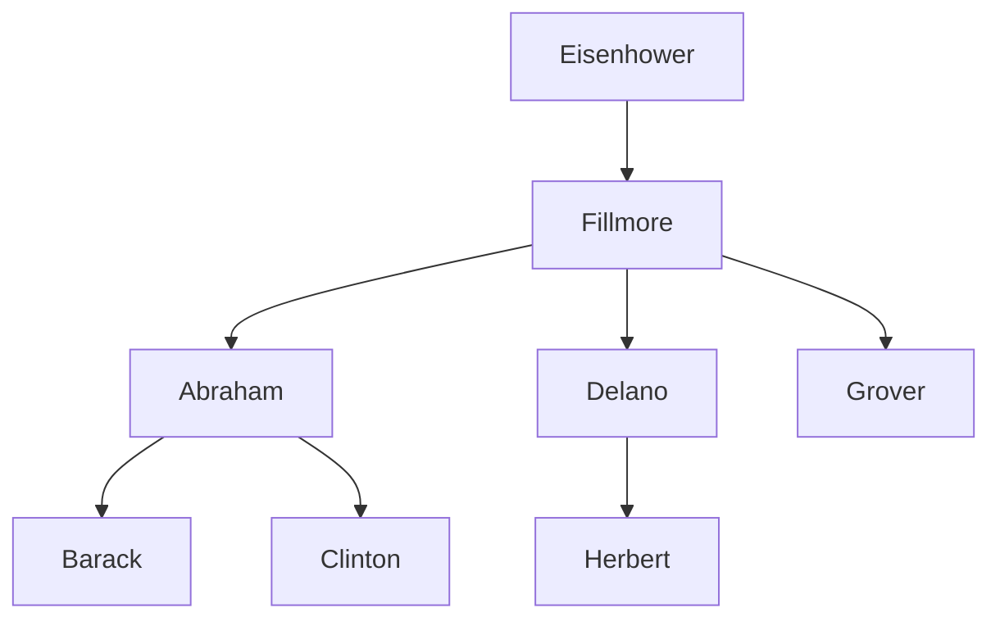
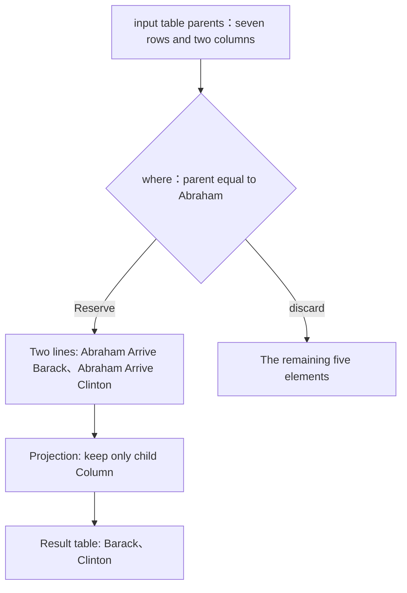

> **courses**: UC Berkeley CS61A · Structure and Interpretation of Computer Programs(Fall 2024)
> **This lecture**: Lecture 35 ｜ 25:43 ｜ Station B P 33 ｜ [Original video](https://www.bilibili.com/video/BV1sy411z7nA?p=33)
> **courseware**: `33-SQL_1pp.pdf` (17 pages, official PDF, page-by-page renderings see text illustrations)
> **subtitles**: Original English subtitles from Station B; this note is a reconstruction of Chinese writing, not a sentence-by-sentence translation.
> **Copyright**: The copyright of the course and courseware belongs to the UC Berkeley CS61A teaching team; this article is a secondary arrangement for learning purposes

## Quick overview of this lecture

*(Reference time: 00:00:01 – 00:00:16｜Lecture 35)*

- **Mastered**: Python uses lists, dictionaries, and tuples to organize data; trees and recursion; functions are first-class values, and program text can be read as data. The previous interpreter lecture has completely gone through "reading into the expression tree and evaluating according to the rules".
- **Main line of this lecture**:
    - Databases put data in tables: rows are records, columns are attributes, and each column has a name and usually a type.
    - SQL is a declarative language: the program only describes the desired results, and the database management system determines how to calculate them; the same query may have multiple execution plans.
    - `select`  Generate new tables from literals or existing tables; `union`  Connect the rows of multi-paragraph queries vertically; `create table ... as`  Give the result a reusable name.
    - `from`  Specify the input table, `where`  filter rows, `order by`  In the order of declaration, column descriptions project each input row into an output row.
    - Expressions are evaluated line by line; projection retains duplicate lines, `union`  Duplication is removed, and the order of results is not guaranteed.
- **Key conclusions**: A query = a new table obtained after filtering, sorting, and projection of the input table. The declarative approach outsources "how to do it" to the system, at the cost of the execution sequence and plan no longer being controlled by the programmer.

## 1. Opening: Data, databases, and a query language

*(Reference time: 00:00:01 – 00:00:24｜Lecture 35)*


Databases place data in structured tables. This is the starting point of the whole lecture: in Python, data are lists, dictionaries, and objects; in a database, data are rows and columns, which are stored for a long time by an independent system and can be queried by many programs at the same time.

Database Management System (DBMS) is the largest, most commonly used, and most worthy of research. Institutions are willing to pay a high price for it, and there are also good open source implementations in this area. The problem it wants to solve is not "calculating a number", but "how to reliably retrieve the desired part when there is a lot of data, a lot of users, and a long time."

The courseware uses a page to explain why data is valuable: AI is trained by data, digital images are composed of pixel values, and the resource that the world's largest companies value most is data about users. Data itself is not the answer; only when it can be stored in a structured manner and accurately queried can data generate value. Tables are the most common structure.

> **Editor's note**: Pages 3–7 of the courseware are five frames of historical title pages, marked Fall 2012/2013, Fall 2015, Fall 2015, Fall 2018, and Fall 2023 Featherweight. They are the title materials used in the course over the years and do not carry the knowledge of this lecture; they are listed here in page order to facilitate comparison with the courseware.


After dividing into sections, the courseware expands "data is valuable" into three arguments: AI is composed of data; digital images are composed of pixel values; large companies regard data about people as their most valuable assets. These three points point to the same conclusion - the value of data depends on whether it can be organized and queried, and tables are the most common and versatile organization method.


## 2. Anatomy of a table: rows, columns and types

*(Reference time: 00:00:30 – 00:01:35｜Lecture 35)*

A table is a collection of records. A record is a row in the table, and each row has a value for each column in the table. A column has a name, and the name indicates which attribute of the record the column contains; the column usually also has a type, and the type determines what can be placed in the column and how it can be compared.


The courseware uses a city table as an example. The three columns are Latitude, Longitude, and Name, and the three rows are Berkeley, Cambridge, and Minneapolis. The header row is not a record, it's just a column name: 38 is the latitude of Berkeley, 122 is the longitude, and Berkeley is the name.

| Latitude | Longitude | Name |
| :--- | :--- | :--- |
| 38 | 122 | Berkeley |
| 42 | 71 | Cambridge |
| 45 | 93 | Minneapolis |

The division of labor between rows and columns can be remembered in one sentence: **Rows describe "one thing" and columns describe "the same attribute of all things"**. Adding a city means adding a row; adding "population" means adding a column, and this column must have a value for every existing row. This constraint may seem rigid, but it is what makes the query predictable: any column in any row can be referenced.

| criterion | row(row/record) | column |
| :--- | :--- | :--- |
| what does it mean | a complete object | A property common to all objects |
| Growth method | add record | Add attributes, old rows must be filled with values |
| Example | Berkeley this whole record | longitude of all cities |
| Function during query | Filtered, projected units | The unit being quoted or compared |

SQL, the full name of Structured Query Language, may be the most widely used programming language in the world. It is indeed a programming language: you can use it to generate new tables from existing tables, and you can also change the contents of the table, add or delete rows. What's special about it is that the "program" looks like an English sentence and reads almost like a requirement.

Think of a table as "a list of dictionaries with the same keys": each dictionary is a row, and the keys are column names. This analogy only works with small tables; the real value of a database is its ability to put millions of rows on disk and to skip most of them with the help of indexes.

## 3. Declarative vs. imperative: what you want, not how to calculate it

*(Reference time: 00:01:36 – 00:02:49｜Lecture 35)*

SQL is a declarative language. In a declarative language, a program is a description of a desired result, and the interpreter finds a way to generate that result; Prolog is another example. \*\*Imperative\*\* language is the opposite: the program describes a calculation process, and the interpreter goes through the process according to the written execution and evaluation rules.

| criterion | imperative | declarative |
| :--- | :--- | :--- |
| object described by the program | Calculation process: what to do first, what to do next | Desired Result: What to Want |
| Who decides to perform the steps | The programmer writes the rules and the interpreter follows them | Interpreter or DBMS choice |
| Representatives in the course | Python, Scheme | SQL, Prolog |
| predictability | The order of evaluation is basically predictable. | Depends on data and execution plan choices |
| The cost of writing a program | High: The steps must be written in full | Low: only write results |
| Debugging mode | Follow the evaluation chain to find | Look at the execution plan and data distribution |

This class spends most of its time training on one thing: being able to mentally rehearse what the interpreter will do when writing a line of program. Declarative languages ​​make this difficult. The same SQL query often has multiple execution methods. The database management system will choose the one it thinks is the fastest, and "fastest" depends on how much data there is and how it is distributed. The relationship between programmers and program evaluation thus becomes less certain.

The trade-off is effort savings: When you write a query, you don’t have to describe how execution and evaluation will happen, that’s left to the DBMS. The effort of writing the program goes down, and the difficulty of understanding the program goes up - it's a clear trade.


The courseware uses cooking as an analogy. The imperative recipe spells out each step: add two teaspoons of salt, two teaspoons of yeast, add three cups of flour, add two tablespoons of olive oil, add a quarter cup of water, start mixing, and put the dough on the chopping board... The declarative order only has one sentence: "Make me a pizza." How to knead the dough, what temperature to bake it at, whether to put the cheese or the sauce first, is the freedom of the store.


The execution plan of SQL Server illustrates this "freedom": a query is split into an operator tree, and Hash Match, Index Scan, and Compute Scalar each carry cost estimates and row number estimates. Changing the same query to another plan may result in much different speeds; which one to choose depends on how big the table is, whether there are indexes, and how the data is distributed. Behind the declarative "sentence" is a series of decisions made by the system for the programmer.

## 4. The first table: use select and union to spell out cities

*(Reference time: 00:02:50 – 00:06:14｜Lecture 35)*

A table is usually not created out of thin air: it is written by other applications, logs, forms, sensors, and accumulated row by row. SQL also allows you to create tables from scratch. In this tutorial, we will first use this method to create several very small tables so that there will be something to look up in subsequent queries. Making a watch itself is not the main thing; what is really interesting is how to calculate new results after you already have a watch.

```sql
create table cities as
  select 38 as latitude, 122 as longitude, "Berkeley" as name union
  select 42, 71, "Cambridge" union
  select 45, 93, "Minneapolis";
```

This statement does three things. `create table cities as`  Statement "Save subsequent query results as  `cities`」; `select 38 as latitude, 122 as longitude, "Berkeley" as name`  Describe one row and three columns; two  `union`  Join the other two lines.

Quotes distinguish values from names. `"Berkeley"`  In quotes because it is a value; `latitude`  with  `longitude`  Without quotes because they are column names. Without the quotation marks, Berkeley will be looked for as a column name, and an error will be reported if it cannot be found.

> **Editor's note**: SQLite allows writing strings with double quotes; standard SQL is more strict, using single quotes for strings and leaving double quotes for identifiers. Courseware is uniformly enclosed in double quotation marks, and the text is transcribed accordingly; §11 contains double quotation marks.  `1`, `2`, `4`, `8`  is the column name, because the table does have these columns.

a literal paragraph  `select`  Generate a row. If you want more rows, just use  `union`: It combines two paragraphs  `select`  The rows are connected together, and connected twice to form three rows. This is obviously not a conventional way to create a table. You would only write it like this when you really have nothing.

Once you have a table, you can ask questions. The following query labels cities on the West Coast and then merges them with the rest of the cities:

```sql
select "west coast" as region, name from cities where longitude >= 115
union
select "other", name from cities where longitude < 115;
```

The first paragraph starts from  `cities`  Take the rows whose longitude is greater than or equal to 115 and add them  `region`  Column, value is  `west coast`;The second paragraph takes out the remaining lines, `region`  is  `other`. two paragraphs  `union`  Up and get a new table with region labels.

| region | name |
| :--- | :--- |
| west coast | Berkeley |
| other | Cambridge |
| other | Minneapolis |

There are three rows in the result, but only two paragraphs are written in the query.  `select`. The second paragraph describes not one row, but all rows with a longitude less than 115 - it filters out two cities. The output name comes from the original table, `region`  The value of comes from checking the longitude. The output of a query is determined by the data, which is where it's useful.

By the way, a detail: Cambridge is Cambridge in Massachusetts, not Cambridge in the UK; latitude 42 and longitude 71 indicate that it is in North America. The coordinates in the table are not just decoration, they are the basis for judgment.

## 5. Standards, Dialects, and the Centrality of SELECT

*(Reference time: 00:06:16 – 00:09:23｜Lecture 35)*


SQL has standards. It is defined by a set of specifications accepted in the United States and internationally; the only people who do not fully accept this set of specifications are those who actually implement database management systems - each manufacturer wants to add a few features to its products that others do not have.

So there are many dialects of SQL: the basic syntax is the same, and the peripheral functions have their own language. This lesson only takes the intersection, which is the part that all DBMSs agree on.

Two sentences support the entire lecture. `select`  Create a new table, either from scratch or projecting from an existing table; `create table`  Give a table a global name so that it can be referenced by subsequent statements. `select`  When used alone, the results are only displayed and not saved; to be used repeatedly, you must  `create table ... as`.

| statement | function | Processing of this lecture |
| :--- | :--- | :--- |
| `select` | Generate a new table from a literal or an existing table | Core, almost the whole process |
| `create table ... as` | give  `select`  Name and save the results | Expand |
| `insert` / `update` / `delete` | Change table contents | Do not expand |
| `analyze` / `explain` | Diagnosis and maintenance | Do not expand |

The rest of the statements are important in industrial systems, but not important to understanding the core of SQL. The core is  `select`  inside. execute  `select`  The code can be written in one page, and it is not difficult to write an interpreter in Python - we will do this in the next lesson. Learn to use this language first.

> **Editor's note**: `insert` / `update` / `delete`  Change rows in the table, `explain`  Show execution plan, `analyze`  Collect statistical information; these divisions of labor come from general SQL. This lecture only names them and does not expand them.

If you want to start, there are three ways: install SQLite, which is the simplest and free database management system; use the online version of SQLite; or use the SQL Example Python program included with the textbook. The last one is not a complete DBMS, it is just to demonstrate how to interpret  `select`  The essence, but it can run the examples in this lecture and the next lecture.

> **Editor's note**: This lecture does not demonstrate Python  `sqlite3`  module, but its interface is small enough that it can be directly embedded into the interpreter exercise in the next lecture. The following snippet creates a table in memory and queries it, outputting two rows of tuples.

```python
import sqlite3

db = sqlite3.connect(":memory:")
db.execute("""create table parents as
  select "Abraham" as parent, "Barack" as child union
  select "Abraham", "Clinton";""")

for row in db.execute('select child from parents where parent = "Abraham"'):
    print(row)
```

The running result is  `('Barack',)`  with  `('Clinton',)`.`execute`  Accepts a SQL statement and returns an iterable cursor; `fetchall()`  The remaining rows will be fetched at once.

## 6. Literals and unions: a seven-line family tree

*(Reference time: 00:09:25 – 00:13:00｜Lecture 35)*

`select`  The skeleton of a statement is a comma-separated list of column descriptions. A column description is an expression, optionally followed by  `as`  and a name; `as`  and name can be omitted. Select only literals to get one line; if you want multiple lines, just  `union`.

`union`  There are three rules: the number of columns on both sides must be the same; the types of the corresponding columns must be compatible; the column names can be different, and the column name of the final result takes the first paragraph  `select`  way of writing. The first two are hard constraints, and the third is just a naming convention.

Next change the subject to dogs. The lecturer liked dogs and the President of the United States, so his dogs were named in alphabetical order: Abraham, Barack, Clinton, Delano, Eisenhower, Fillmore, Grover, Herbert. The names are arranged from A to H, not to tell the history, but to make subsequent string comparisons understandable at a glance.

These dogs form a family tree: Eisenhower is the father of Fillmore, Fillmore is the father of Abraham, Delano, and Grover, Delano is the father of Herbert, and Abraham is the father of Barack and Clinton. This tree can be represented by a two-column table: each row is a parent-child edge.

```sql
select "Abraham" as parent, "Barack" as child union
select "Abraham", "Clinton" union
select "Delano", "Herbert" union
select "Fillmore", "Abraham" union
select "Fillmore", "Delano" union
select "Fillmore", "Grover" union
select "Eisenhower", "Fillmore";
```

Seven rows and two columns. first paragraph  `as parent`, `as child`  The column name is given to the result, and only the values are written in the next six paragraphs. Used between two adjacent paragraphs  `union`  Concatenate, the last paragraph ends with a semicolon - all SQL statements end with a semicolon.

| parent | child |
| :--- | :--- |
| Abraham | Barack |
| Abraham | Clinton |
| Delano | Herbert |
| Eisenhower | Fillmore |
| Fillmore | Abraham |
| Fillmore | Delano |
| Fillmore | Grover |

Draw this table according to the relationship between father and son, which is the hand-drawn tree on the right side of the courseware:



Tables and trees are two perspectives: a table is a flat collection of rows, and a tree is how these rows are connected according to parent-child relationships. The same data can be viewed as a table or as a graph - there is only one storage format, but there are many ways to interpret it.

## 7. Name the table: create table and a playlist

*(Reference time: 00:13:01 – 00:14:19｜Lecture 35)*

`select`  The results are not saved by default. It is displayed on the screen for people to glance at; if you want to use it in subsequent sentences, you have to give it a name.

```sql
create table [name] as [select statement];
```

`create table`  Turn the results of a query into data that can be accumulated: if the result has a name, it can be referenced in the next sentence.


The courseware is demonstrated with a playlist. `spotify`  The table records the songs that the lecturer listens to most often, one song per line, and the two columns are the song title and singer:

```sql
create table spotify as
  select "wildflower" as track, "billie eilish" as artist union
  select "birds of a feather" , "billie eilish"          union
  select "360"                , "charli xcx"              union
  select "pasilyo"            , "sunkissed lola"          union
  select "cinderella"         , "remi wolf"               union
  select "good luck babe!"    , "chappell roan"           union
  select "meow"               , "anamanaguchi";
```

| track | artist |
| :--- | :--- |
| wildflower | billie eilish |
| birds of a feather | billie eilish |
| 360 | charli xcx |
| pasilyo | sunkissed lola |
| cinderella | remi wolf |
| good luck babe! | chappell roan |
| meow | anamanaguchi |

Indentation and alignment are only for human eyes. SQL is not sensitive to spaces, and it is completely correct to write the entire statement on one line; the courseware  `union`  Alignment with commas is to make "which column corresponds to which column" visible at a glance.

`spotify`  It will be queried repeatedly later: filtering by singer, filtering by string comparison. It is also an example of "the first paragraph determines the listing": the first paragraph writes  `as track`, `as artist`, the next six paragraphs are omitted, and the result is still two columns of correct names.

In the same way, the seven items in §6 can be  `select`  To become a permanent table: add at the front  `create table parents as`, leaving a semicolon at the end. After the table is created, `parents`  This name can be in  `from`  used in.

## 8. Projection: from, where, order by three-piece set

*(Reference time: 00:14:22 – 00:17:17｜Lecture 35)*


The meaning of projection is very straightforward: for each row of the input table, calculate an output row according to the column description. `select`  The complete skeleton is:

```sql
select [columns] from [table] where [condition] order by [order];
```

Each of the four parts does one thing. `from`  Say which table to fetch rows from; `where`  Say which lines are left behind; `order by`  Tells how the remaining rows are arranged; the column description tells how each remaining row becomes an output row. The courseware uses three sentences to summarize the first three clauses -`from`  Specify the input table, `where`  Select a subset of rows, `order by`  Declare the order of the remaining rows - the fourth sentence is left to the column descriptions.

Both queries in the courseware are very short. First one:

```sql
select child from parents where parent = "Abraham";
```

first  `parents`  Find here  `parent`  equal to  `Abraham`  of rows, there are two rows; then add the rows of each row  `child`  Vote out and get Barack and Clinton.

| child |
| :--- |
| Barack |
| Clinton |

Second one:

```sql
select parent from parents where parent > child;
```

String comparison is in alphabetical order: F is after A and D, so among the three lines where Fillmore is the father, Abraham and Delano are satisfied, but Grover's line is not satisfied (G is after F); Eisenhower is before F, and its line is not satisfied either; the other lines are also not satisfied. The result is that the Fillmore appears twice.

| parent |
| :--- |
| Fillmore |
| Fillmore |

The courseware also gives two instructions on this page  `spotify`  query, used to demonstrate  `where`  Two conditions: `select track from spotify where artist = "billie eilish";`  Leave two lines; `select track from spotify where track < artist;`  Use strings to compare song titles and singers, leaving  `360`, `cinderella`, `pasilyo`  Three lines.

Two rows of identical values can exist in a table at the same time. The table is not a set, but a multiset: projection is only responsible for calculating values, not for deduplication. This is consistent with  `union`  On the contrary, we will encounter it again later.



> **Editor's note**: `order by`  Only the grammar appears in the courseware, without demonstration. It is written as  `order by 列名`, default ascending order, add  `desc`  descending order; `limit N`  Take only the first N rows. In real queries, the two often appear in pairs: sort first, and then take the top few. This supplement is not included in the subtitles of this lecture.

## 9. Do it yourself: asterisks, repeating lines, and output formatting

*(Reference time: 00:17:19 – 00:18:59｜Lecture 35)*

If you really run the statement, you can see some things that cannot be seen on paper.

In the online interpreter, execute first  `create table parents as ...`, `parents`  is defined; then executed  `select * from parents;`, the asterisks expand into all columns, and the screen gives a grid with two columns and seven rows. The asterisk is the abbreviation of all columns, and the order of the columns is the order when the table is created.

Then execute  `select child from parents where parent = "Abraham";`, get Barack and Clinton; execute  `select parent from parents where parent > child;`, get two rows of Fillmore. Duplicate lines are still displayed twice, and the projection does not remove duplicates.

Switching to SQLite on the command line, the output format has changed: values are separated by vertical bars, one record per line. The formats are different, but the semantics are the same - the same query is drawn as a grid by the online tool, and the command line is typed as text.

| environment | Output form | observe |
| :--- | :--- | :--- |
| online interpreter | table grid | Column names are aligned with rows, suitable for presentations |
| SQLite command line | vertical bar separated text | Fields in a row of records are separated by vertical lines. |

The asterisk is convenient, but it is best to write all the column names when writing a formal query: the columns of the table will change according to the needs. `*`  The newly added columns will also be brought into the results, which the caller may not want.

There is another point that is easy to overlook: after these statements are executed, the results are only displayed. `select`  Do not modify  `parents`;It reads tables, calculates tables, and displays tables. To save, we still have to rely on  `create table`.

## 10. Line-by-line arithmetic: How many people can fit in a ski lift?

*(Reference time: 00:19:00 – 00:20:52｜Lecture 35)*

`select`  Arithmetic can be done in expressions. The column name represents the value of the current row in the expression; the arithmetic expression combines the row value with a constant to form a new value.

The courseware uses a ski lift as an example. Each chair is numbered, and the number of solo passengers versus couples is recorded; a couple occupies two seats. Number 101 had two solo passengers and two couples, number 102 had three couples, number 103 was almost all solo passengers, and all three chairs were occupied by exactly six people.

> **Editor's note**: The cable car table does not appear in the courseware. The specific numbers of the column names and rows 102 and 103 are restored according to the lecturer's dictation ("No. 101 has two solo passengers and two couples", "No. 102 has three couples", "No. 103 is almost all solo passengers", and each row has a total of 6 people).

| chair | single | couple |
| :--- | :--- | :--- |
| 101 | 2 | 2 |
| 102 | 0 | 3 |
| 103 | 6 | 0 |

```sql
select chair, single + 2 * couple as total from chairs;
```

Count each row once: 101 is 2 + 2×2 = 6, 102 is 0 + 2×3 = 6, and 103 is 6 + 2×0 = 6. All three rows are filled with six people, but the configuration is different. Result table retained  `chair`  column, append another column  `total`.

| chair | total |
| :--- | :--- |
| 101 | 6 |
| 102 | 6 |
| 103 | 6 |

The key is "no crossing of lines": it counts as 101  `total`  When , the expression only reads the line 101  `single`  with  `couple`; 102, 103 each counts for its own sake. The lecturer specifically emphasized this point because it is the dividing line for subsequent aggregation - once a function that "combines multiple rows" appears in an expression, the row boundaries are broken.

The column name here acts like a local variable: its scope is the current row. The same column name takes different values ​​in each row, but the expression is only written once. This is why  `select`  The expression can be written very short, but it can be effective row by row for the entire table.

## 11. Discussion question: sorting of ints table, powers of 2 and union

*(Reference time: 00:20:53 – 00:25:41｜Lecture 35)*

The material for the discussion topic is a  `ints`  table. It describes how every integer is written as the sum of powers of 2. Every positive integer has one and only one way of writing it, so this table is actually enumerating binary numbers; the four powers are 1, 2, 4, and 8 respectively.

| word | 1 | 2 | 4 | 8 |
| :--- | :--- | :--- | :--- | :--- |
| one | 1 | 0 | 0 | 0 |
| two | 0 | 2 | 0 | 0 |
| three | 1 | 2 | 0 | 0 |
| four | 0 | 0 | 4 | 0 |
| five | 1 | 0 | 4 | 0 |
| six | 0 | 2 | 4 | 0 |
| seven | 1 | 2 | 4 | 0 |
| eight | 0 | 0 | 0 | 8 |

The column names are 1, 2, 4, 8, and the values are either 0 or the power itself. For example 5 = 1 + 4, so  `five`  This row is 1, 0, 4, 0; 7 = 1 + 2 + 4, so  `seven`  It's 1, 2, 4, 0. Read each line as a binary number, 101 is five, and 111 is seven.

> **Editor's note**: Courseware is not given  `ints`  The table creation statement, the table structure and query of the text are restored according to the lecturer's dictation. He called the four columns "the 4 columns" and "these 1, 2, 4, and 8 up here", hence the name of the columns.  `1`, `2`, `4`, `8`, and enclosed in double quotes - the identifier cannot start with a number, and quotes must be used as a column name.

First question: Given two columns for each integer, `word`  with  `value`, `value`  is the sum of four powers. The way to write it is to add the four column names, and then  `as value`:

```sql
select word, "1" + "2" + "4" + "8" as value from ints;
```

| word | value |
| :--- | :--- |
| one | 1 |
| two | 2 |
| three | 3 |
| four | 4 |
| five | 5 |
| six | 6 |
| seven | 7 |
| eight | 8 |

The value is exactly 1 to 8. The row order in the tables is for readability only and is not guaranteed by SQL; the actual output order is a topic at the end of this section.

`"1"`  Looks like a number, but is a column name in the expression. The lecturer emphasized: `select`  Names appearing in expressions are always interpreted by column name first. This is why when creating a table, these column names should be enclosed in double quotes - without quotes, `1`  Just numeric literals, the four constants add up to 15 for each row.

Second question: Only powers of 2 are left. The judgment method is "exactly one binary bit is 1". Divide each column by its own power, and all four columns become 0 or 1; four 0/1's add up to 1, indicating that exactly one bit is a 1.

```sql
select word from ints where "1" + "2"/2 + "4"/4 + "8"/8 = 1;
```

| word |
| :--- |
| one |
| two |
| four |
| eight |

this paragraph  `where`  The division here looks strange, but it actually normalizes "whether this column is selected" into 0/1: `"2"/2`  Gets 1 when the value is 2 and 0 when the value is 0; `"4"/4`, `"8"/8`  Same reason. `"1"`  It is already 0/1, so there is no need to divide it. The result is exactly one, two, four, eight.

Then load this table in SQLite and execute  `select * from ints;`——The order of rows is different from what was written when creating the table.  `word`  alphabetical order.

The reason is  `union`.`union`  To remove duplicate rows, one implementation of deduplication is to sort all rows first and then scan adjacent rows; order is a by-product of deduplication. SQL only guarantees the content of the result, not the order of the rows; if you want the order, you must write  `order by`.

This is a real cost of declarative languages: for the same query, the system can execute it in the way it thinks is fastest, and the order of output may change depending on the data, version, and plan. By writing down the "sequence" as part of the query, the results will be reproducible.

| Operation | Whether to remove duplicates | Is the order guaranteed? |
| :--- | :--- | :--- |
| `select`  projection | Don't remove weight | No guarantee |
| `union` | Remove duplicates | Not guaranteed, may be disrupted by sorting |
| `order by` | Don't remove weight | Sort by declared key |

## Summary

*(Reference time: 00:25:29 – 00:25:41｜Lecture 35)*

- A table is "a collection of records + one attribute per column"; the output of the query is still a table, so the query can be nested or used  `union`  Splicing.
- Declarative languages leave "how to do it" to the system: it is easier to write, but the price is that the execution plan and output sequence are unpredictable.
- Read one  `select`  The order: `from`  Find the watch, `where`  Leave rows and columns describing the projection; `order by`  Appears only when sequence is required.
- `union`  To put together the table vertically, the number of columns and the type must be compatible; it removes duplication and does not guarantee the order.
- Expressions are evaluated row by row by default; once they are summarized across rows, they enter the realm of aggregation.
- If you want a stable order, write explicitly  `order by`, don’t rely on “chance” – this is the first discipline in moving from demo to production.

## Appendix: Slides not shown in class

*(Reference time: 00:25:39 – 00:25:41｜Lecture 35)*

The video ends with "Power of 2" at 25:41. There are no corresponding subtitles on the last two pages of the courseware, which is content not covered in the class.


Page 16 is a section page: Example: UC Salary Data, Passwords. The footer gives two data sources - UC salary data from Transparent California, and the leaked passwords dataset on Kaggle. Judging from the title and source, it is the entry point for subsequent practice queries using real data, which is not expanded on in this lecture.


Page 17 is a bar chart titled State Educational Appropriations with FY01 to FY21 on the horizontal axis and millions of dollars on the vertical axis. The graph plots the two recessions of 2001 and 2008 as well as COVID-19; two notes give the conversion: \$1 in 2001 is equivalent to \$1.53 in 2021; state support for UC has fallen 46% since 2001, adjusted for inflation. The graph also reads: Fall 2001 32,128 students, \$23,811 per student (2021 USD); Fall 2021 45,057 students, \$7,857 per student.

These two pages themselves do not teach SQL syntax, but they illustrate the usefulness of SQL: real tables are often large and complex, and the value of the query lies in combining the columns of "appropriation, number of students, and year" into results that can answer the question.

> **Editor's note**: These two pages do not appear in the video. The above content is recorded according to the courseware screen and does not represent classroom explanation.

## Attached: Slide index for this lecture

*(Reference time: 00:00:01 – 00:25:41｜Lecture 35)*

| page | content | Appear location |
| :--- | :--- | :--- |
| 1 | Title page SQL | §1 |
| 2 | Announcements | §1 |
| 3 | Fall 2012–2013 title page | §1 |
| 4 | Fall 2015 title page (sphere) | §1 |
| 5 | Fall 2015 title page (portrait) | §1 |
| 6 | Fall 2018 title page | §1 |
| 7 | Fall 2023 Featherweight title page | §1 |
| 8 | Sectioned Pages Databases | §1 |
| 9 | The power of data | §1 |
| 10 | Anatomy of database management systems and tables | §2 |
| 11 | Declarative Programming and the Pizza Metaphor | §3 |
| 12 | SQL Server execution plan | §3 |
| 13 | Sectioned Page Structured Query Language | §5 |
| 14 | Naming Tables | §7 |
| 15 | Select projection and where | §8 |
| 16 | Example: UC Salary Data, Passwords | Appendix |
| 17 | California Grants Bar Chart | Appendix |
