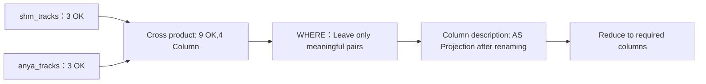
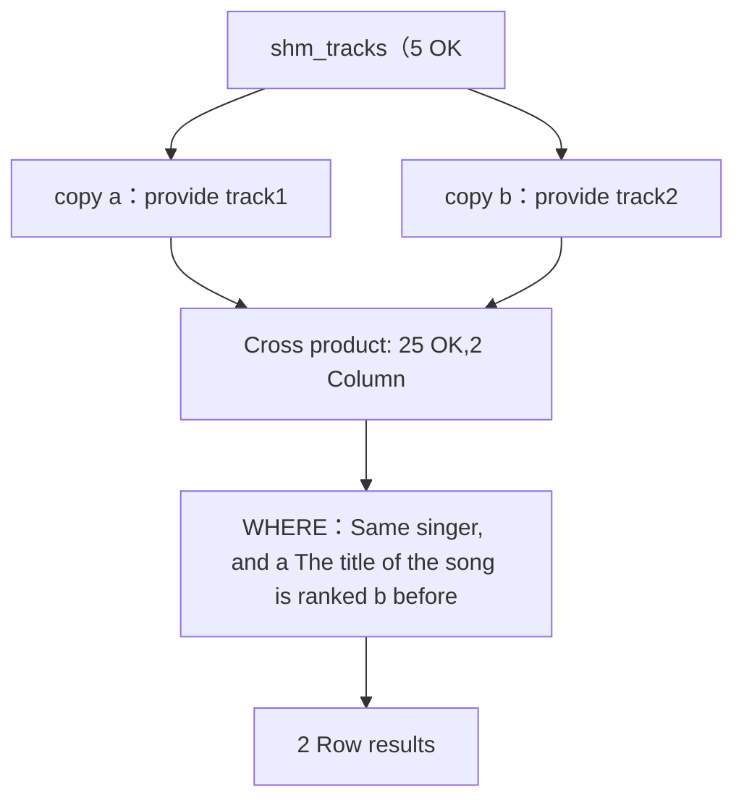
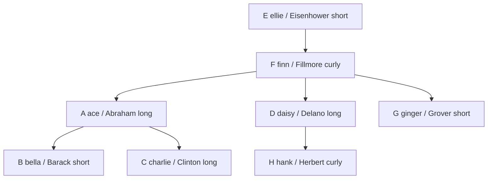

> **courses**: UC Berkeley CS61A · Structure and Interpretation of Computer Programs(Fall 2024)
> **This lecture**: Lecture 36 ｜ 24:54 ｜ Station B P 34 ｜ [Original video](https://www.bilibili.com/video/BV1sy411z7nA?p=34)
> **courseware**: `34-Tables_1pp.pdf` (22 pages, official PDF, page-by-page renderings see text illustrations)
> **subtitles**: Original English subtitles from Station B; this note is a reconstruction of Chinese writing, not a sentence-by-sentence translation.
> **Copyright**: The copyright of the course and courseware belongs to the UC Berkeley CS61A teaching team; this article is a secondary arrangement for learning purposes

## Quick overview of this lecture

*(Reference time: 00:00:01 – 00:00:04｜Lecture 36)*


- **Mastered**: `SELECT`  The four components of -column description, `FROM`, `WHERE`, `ORDER BY`; `CREATE TABLE … AS`  The results of a query can be saved into a new table; SQL is not sensitive to case and indentation, and a semicolon marks the end of the statement.
- **Main line of this lecture**:
    - `FROM a, b`  It is not "checking two tables at the same time", but "matching the rows of the two tables"; after the matching is completed,  `WHERE`  Make it clear which pairings make sense.
    - If columns with the same name appear in two tables, there will be ambiguity, and the parser will directly refuse to execute; dot expression  `表名.列名`  with aliases  `AS`  is the only means of disambiguation.
    - A table can be joined to itself: think of it as two copies, give each an alias, and you can get "two rows" in the same row at the same time for comparison.
    - The connection of three tables is a three-dimensional cross product; `grandparents`  with  `dogs AS c, dogs AS d`  The way of writing is to use three table references to check the coat color twice.
    - Expressions can appear in column descriptions, `WHERE`, `ORDER BY`  Three positions: for numerical values  `+ - * / %`  with  `abs`, `round`, for strings  `||`, `substr`, `instr`.
- **Key conclusions**: Almost all errors in multi-table queries can be broken down into two questions - whether the cross product is exhaustive, and  `WHERE`  Do you distinguish between "connection conditions" and "filter conditions" among the conditions?

> **Editor's note**: This lecture has two sets of sample data. For video recording (this version of station B)  `dogs`, `parents`  The pedigree table of two dogs opens. The dog names are Abraham, Barack, Clinton, Delano, Eisenhower, Fillmore, Grover, and Herbert; the courseware for Fall 2024 has been replaced by the "Friends Circle Playlist"`shm_tracks`, `anya_tracks`, and renamed the dog list ace, bella, charlie, daisy, ellie, finn, ginger, hank, and marked it as "from the videos" in the courseware. The two sets of dog watches are **same tree**, only the names are different (§5 gives a line-by-line comparison). This article organizes the chapters in the order of the courseware, and the codes are all based on the courseware screen verbatim; the lecturer's reasoning, analogies, and calculations in the video are retained in the corresponding positions. Where there are no individual courseware or complete sentences in the video dictation, they will be clearly marked as reconstructed by the editor.

## 1. Review: A SELECT statement is just projecting a table

*(Reference time: 00:00:01 – 00:00:10｜Lecture 36)*


The tools in the previous lecture can be summarized in one line of syntax:

```sql
SELECT [columns] FROM [table] WHERE [condition] ORDER BY [order];
```

Each square bracket in this line of syntax is a replaceable component. `FROM [table]`  Specify the input table; `[columns]`  It is a comma-separated column description that determines how each row of input is projected into a row of output; `WHERE [condition]`  Select a subset from the input rows; `ORDER BY [order]`  Declare the output order. In the column description, `[column] AS [name]`  Rename the input column in the new table - this name only affects the output header, not the original table.

The rules of projection deserve a separate emphasis: **Column descriptions work "row by row"**. A row of input comes in, and several values are calculated according to the column description to form a row of output; there are as many rows of output as there are input rows (unless  `WHERE`  Screened out some first). This property of "the number of rows remains unchanged" is the basis for understanding the connection later - the connection is special precisely because it changes the number of rows first.

The courseware gives a save statement at the end: `CREATE TABLE [name] AS [SELECT statement goes here];`. It stores the results of a query into the database and can be queried repeatedly like an ordinary table. Note that it is "creating a table using the results of the query" rather than "creating an empty table and then filling it in" - this will be used repeatedly when creating a small table in §2.

There are three engineering conventions at the bottom of the page: SQL is not case and indent sensitive (so  `select`, `SELECT`, `SeLeCt`  Equivalent, line breaks and indentation only affect the human eye); a semicolon marks the end of a statement; a statement can be written on many lines. These conventions are especially important in interactive interpreters - if you don't type the semicolon, the interpreter is still waiting for you to finish.

## 2. The first perspective of connection: cross product of two tables

*(Reference time: 00:00:12 – 00:00:59｜Lecture 36)*


At the beginning of the video, the lecturer gave a precaution against this matter: if you ask someone randomly "What is join", the other person will probably ask "What kind of join are you talking about" first. The database field has been pondering this problem for too long. There are so many connection methods invented that even professionals find them complicated, and their names overlap with each other. This lecture only focuses on one of the most basic forms, because the other types can be seen as adding conditions or supplementary lines to it.

The definition is only one sentence: **Use commas (or keywords) between table A and table B  `JOIN`) are connected to obtain all combinations of "a row of A" and "a row of B".**  The focus of this sentence is not on "combination", but on "all" - the first step of connection is exhaustion, not matching. The lecturer's original words are: This is the fundamental meaning of connecting the two tables, listing all the pairs.

### 2.1 First create two small tables


The courseware uses two "Friend Circle Playlists" as examples. The first one is Shm’s playlist, three songs:

```sql
CREATE TABLE shm_tracks AS
SELECT "360" AS track, "charli" AS artist UNION
SELECT "cinderella"     , "remi"             UNION
SELECT "wildflower"     , "billie";
```

`CREATE TABLE … AS`  What follows is not literal data, but three items.  `SELECT`, use  `UNION`  String together. `UNION`  The function is to combine the results of multiple queries into one table (completely duplicate rows are removed by default). each  `SELECT`  None  `FROM`——It has no input table, it just creates a row out of thin air. Article 1  `SELECT`  use  `AS`  Named the two columns  `track`, `artist`, only the values are written in the next two items, and the column names follow those of the first item.

The "table" written in this way has no indexes and no constraints, but it is enough to demonstrate the semantics. Courseware footer reminder: Any SQL interpreter can run, for example  `code.cs61a.org`  Get on that one.


The second one is Anya’s playlist, which also has three lines:

```sql
CREATE TABLE anya_tracks AS
SELECT "apple" AS track, "charli" AS artist UNION
SELECT "taste"         , "sabrina"          UNION
SELECT "wildflower"    , "billie";
```

The structures of the two tables are exactly the same: two columns, `track`  with  `artist`. This type of "two isomorphic tables" is the most common and error-prone scenario for joining.

### 2.2 Question: What do the two playlists have in common?


The challenge thrown by the courseware is: write a  `SELECT`, find and display two friends **jointly owned** of songs; and it’s best to have a statement that “can still be used when there are hundreds of songs.”

The lecturer first asks people to think about it in a human way: If it is done by hand, how will it be done systematically? His answer is——**Take each row of the first table and compare it with each row of the second table**. This isn't a trick from an algorithm class, it's the definition of join itself. Then he asked: How many times in this example? Three lines by three lines, nine times.

Nine times doesn’t sound like a lot, but this question is the motivation for writing a universal statement: the number of lines is  $3 \times 3 = 9$, if the two tables each have  $N$  OK and  $M$  OK, the number of comparisons is  $N \times M$. It is impossible to generalize these nine lines by hand, so let SQL do the exhaustive work.

### 2.3 What does the cross product look like?


Write the two tables side by side in  `FROM`  Here, you get the executable version of that sentence:

```sql
SELECT * FROM shm_tracks, anya_tracks;
```

The result is nine rows and four columns. The order of the columns is "first all the columns of A, then all the columns of B", and the order of the rows is "the first row of A is matched with the three rows of B, then the second row of A is matched with the three rows of B..." - the outer loop goes through A, and the inner loop goes through B. Count them: `shm_tracks`  Each of the three lines of appears three times, `anya_tracks`  Each of the three lines appears three times, and the intersection is the nine pairs.

The lecturer made a key comment on this result in the video: Many rows here have nothing to do with each other, such as the "360" row being assigned to the "taste" row. \*\*They appear in the results not because they are related in any way, but because of exhaustion. \*\*Putting two unrelated things in the same line is the honesty of cross product: it does not pretend to understand the business, it is only responsible for putting all possibilities on the table. As for which pairing counts, yes  `WHERE`  work.

`SELECT *`  It still works here because the asterisk just "copies all columns." Once you want to select a column, the problem is immediately exposed:

```sql
SELECT track FROM shm_tracks, anya_tracks;
```

```text
Parse error: ambiguous column name: track
```

Both tables have a column called  `track`, the parser can't tell which one you're talking about. The courseware stopped here and said: Rename the columns in this connection table, and the work will be much clearer. That's what the next chapter is about.



This picture breaks a multi-table query into three steps. It is worth remembering the first step: **The number of rows is  `FROM`  It has been determined**, the back  `WHERE`  It will only decrease, not increase. If a query results in more rows than expected, the problem is probably  `FROM`  on the cross product of , rather than  `WHERE`  Missed something.

> **Editor's note**: The following table is a common classification of joins in database textbooks, used to explain the lecturer's opening sentence "There are many kinds of joins." This lecture only talks about the first and second rows; outer join and natural join are not within the scope of CS61A. They are listed here just to let you know that they belong to the same family when reading SQL elsewhere.

| Name | Semantics | Does this lecture involve |
| :--- | :--- | :--- |
| cross join | All lines are correct, without any conditions | Yes `FROM a, b`  that's it |
| inner join | Filter by condition after cross product | Yes `FROM a JOIN b ON …`  equivalent to it |
| left/right outer join | Inner join and then add the unmatched rows | No |
| full outer join | Make up for both sides | No |

## 3. Aliases and dot expressions: clarify duplicate names

*(Reference time: 00:05:44 – 00:06:29｜Lecture 36)*


Before explaining how to resolve ambiguities, the lecturer first made a temporary agreement: first pretend that "the names of each column are different in all tables", and sum up the cross products  `WHERE`  Be familiar with it; wait until you encounter the same name and come back to deal with it. This order has teaching considerations - the disambiguation grammar itself is very light. The difficult thing is to think clearly about "after the connection, the columns of the two tables are mixed in one row".

Two tables may share a column name (`track`, `artist`  all hit). A more extreme and common situation is: **A table must share all column names with itself**. So the solution must cover both cases.

There are two halves of the solution, which together are complete:

- **dot expression**: `表名.列名`, indicating which table this column comes from.
- **alias**: `FROM shm_tracks AS s`  Give the table a short name and use it later  `s.track`  refer to it.


Putting the two together, the cross product after renaming is:

```sql
SELECT shm_tracks.track AS s_track, shm_tracks.artist AS s_artist,
       anya_tracks.track AS a_track, anya_tracks.artist AS a_artist
FROM shm_tracks, anya_tracks;
```

The result is still nine rows and four columns, but the four headers are now different from each other: `s_track`, `s_artist`, `a_track`, `a_artist`. This is the most important output of this chapter——**Renaming a column is not to beautify it, but to make subsequent  `WHERE`  Name available**. It turns out those two  `track`  are the same string and cannot be distinguished by SQL; after changing the name, `s_track`  with  `a_track`  They are two different identifiers, so the conditions can be written.

The courseware also leaves a small tip here: Press the up arrow in the terminal to bring up the previous command. When writing such a four-column long statement, it is much easier to change one line than to type it again.

### 3.1 Use WHERE to filter cross products into answers


Now you can write the "common song":

```sql
SELECT shm_tracks.track AS s_track, shm_tracks.artist AS s_artist,
       anya_tracks.track AS a_track, anya_tracks.artist AS a_artist
FROM shm_tracks, anya_tracks
WHERE s_track = a_track;
```

Only one of the nine lines meets the condition:

| `s_track` | `s_artist` | `a_track` | `a_artist` | why stay |
| :--- | :--- | :--- | :--- | :--- |
| wildflower | billie | wildflower | billie | same song |

Note that the term "common song" itself is ambiguous: does it count if the song title is the same, or does it count if the song title and the singer are the same? In this data set both definitions give the same row because wildflower is sung by billie on both sides. In real data, these two definitions will diverge, and you must first decide which one to use when writing a query.

The courseware then makes the problem difficult: how to expand  `WHERE`, so that the results also include matches with "the same singer but different songs"? The answer is to add one  `OR`:

```sql
WHERE s_track = a_track OR s_artist = a_artist
```

So two of the nine lines were left:

| `s_track` | `s_artist` | `a_track` | `a_artist` | why stay |
| :--- | :--- | :--- | :--- | :--- |
| 360 | charli | apple | charli | Same singer |
| wildflower | billie | wildflower | billie | The music is the same |

Although this change is small, it exposes the essence of the connection: `WHERE`  The conditions here are correct **every pairing** independently evaluated Boolean expressions, `AND`, `OR`  Just combine these criteria. written as  `OR`  That is, "either of the two relationships is valid", which is written as  `AND`  It means "must be established at the same time." For the same cross product, changing to a Boolean expression changes the problem.

## 4. Add rows to the table, and then connect a table to yourself

*(Reference time: 00:06:30 – 00:09:59｜Lecture 36)*


The new problem requires more data: "pairs of tracks" by the same artist. Each singer only appeared once in the original playlist, so it was impossible to talk about pairs, so we first inserted two lines into the table so that charli and billie each have two songs:

```sql
INSERT INTO <table> VALUES (<column1>, <column2>);
```

```sql
INSERT INTO shm_tracks VALUES ("bad guy", "billie");
INSERT INTO shm_tracks VALUES ("apple", "charli");
```

`INSERT INTO`  There are no column names in the template, only values. this means **The number and order of values must correspond to the columns of the table.**——The courseware reminds this point with a line of italics. If you write it backwards, no error will be reported, but the singer will be silently written into the song title column. This is the most easily overlooked type of error in SQL.

After insertion  `shm_tracks`  Become five elements: `360`(charli), `apple`(charli), `bad guy`(billie), `cinderella`(remi), `wildflower`(billie).


The goal is to create a table like this: two columns of song titles, one column of singers, and each row is a pair of songs by the same singer. The idea is straightforward - two rows of data need to be present at the same time, and each row in the table only has one song title. **The only way is to make this table appear twice**:

```sql
SELECT a.track AS track1, b.track AS track2
FROM shm_tracks AS a, shm_tracks AS b;
```

The courseware stopped here and asked: How many rows and columns will this statement display? The answer is 25 rows and 2 columns. The cross product of the table of the five elements and itself yields  $5 \times 5 = 25$  pairs; the column description only takes two columns, so it is 2 columns. The significance of this exercise is to allow people to calculate the size of a cross product by hand: **The self-join will not become smaller because "it is the same table", it is still a complete Cartesian product**.

Why do two copies have to be aliased? because  `shm_tracks.track`  It's hard to tell which copy you're pointing to now - both copies have exactly the same listing. Alias  `a`, `b`  It is to turn "two characters on the same table" into two distinguishable names. In the video, the lecturer explained the same principle using the relationship between brothers: a picture  `parents`  There are only two rows in the table: "Abraham-Barack" and "Abraham-Clinton". To say "Barack and Clinton are brothers", you must look at these two rows at the same time; you cannot fit two rows in one row, and you can only make the table appear twice.


Add the conditions to get the final query:

```sql
SELECT a.track AS track1, b.track AS track2
FROM shm_tracks AS a, shm_tracks AS b
WHERE a.artist = b.artist AND a.track < b.track;
```

The result is two lines:

| `track1` | `track2` | `artist` |
| :--- | :--- | :--- |
| 360 | apple | charli |
| bad guy | wildflower | billie |

`a.artist = b.artist`  is **Connection conditions**: It stitches together the lines of "same singer" in two copies. `a.track < b.track`  is **Deduplication conditions**: It determines that a pair of songs only retains one direction.

### 4.1 Why use the less than sign instead of the inequality sign?

This is the most worth stopping and thinking about in the whole lecture. put  `a.track < b.track`  Replace with  `a.track <> b.track`, functionally "can also produce results", but the results will become ugly. There are three reasons:

1. **Symmetrical repetition**. "360 and apple" and "apple and 360" are the same couplet. `<>`  Give both. Out of 25 matches  `<>`  20 lines are left (the five "oneself with oneself" are excluded because they have the same song title), and these 20 lines are written in reverse of each other. There are only 10 real song pairs; then add "same singer", `<>`  Given 4 lines, `<`  Only give 2 lines.
2. **Symmetric predicate cannot give a unique representative**.`<>`  It is a relationship that does not distinguish between left and right: as long as  $(x, y)$  established, $(y, x)$  Necessity also holds true, and the results are naturally paired. `<`  It is antisymmetric: exactly one of the pairs is satisfied, so each pair has exactly one representative.
3. **The rules can be arbitrary, but they must be consistent**. Use dictionary order to decide who should be  `track1`, this provision has nothing to do with business - replace it with  `>`  Only change the direction, not the logarithm. Its value is not in "rightness", but in "consistency": pick the same side every time so that the results will not be repeated.

The original words in the video are: If the two children are equal, they are not brothers, but Barack appears twice; and if you use "not equal", you will say "Barack is Clinton's brother" and "Clinton is Barack's brother", saying the same thing twice. With a one-way inequality sign, each pair appears only once in the result, and the song with the top dictionary order will always be ranked  `track1`.

This experience can be generalized into a criterion: **When the answer is an unordered pair (set), use  `<`  or  `>`  Pick a representative; when the answer is an ordered pair (sentences with direction, events with sequence), use  `<>`  Keep both directions.**  The latter case will be seen in §9.



Finally, the lecturer added a summary: **Whenever you join a table to itself, you must use aliases and dot expressions**, because the line after the connection is mixed with copies from  `a`  and copy  `b`  of sub-rows, you must specify which one you want to compare  `track`, which one  `artist`.

## 5. Dog pedigree table: put the two tables back together into a tree

*(Reference time: 00:00:57 – 00:05:40｜Lecture 36)*

> **Editor's note**: The courseware marks this section as "Dog Breeder (from the videos)", and it is located after the playlist examples; while in the videos it appears at the front. This chapter is inserted in the order of the courseware (the slides must appear in the order of the lecture), so the time anchor at the beginning of the chapter points to the entire paragraph at the beginning of the video. The two places talk about the same batch of queries, but the names of the data have been changed.


This set of data is a classic example of CS61A: a group of dogs, each dog has a name and coat color, and a table records the parent-child relationship. The two tables are stored separately:

```sql
CREATE TABLE dogs AS
  SELECT "ace" AS name, "long" AS fur UNION
  SELECT "bella"      , "short"       UNION
  ...;

CREATE TABLE parents AS
  SELECT "ace" AS parent, "bella" AS child UNION
  SELECT "ace"          , "charlie"         UNION
  ...;
```

The two tables describe two halves of the same tree: `parents`  Give who begat whom, `dogs`  Give the coat color of each dog. The tree is drawn twice on the right side of the courseware—with its specific name on the left and code names E, F, A, D, G, B, C, and H on the right. These eight codenames are not decorations, they are the initials of both the courseware name and the video name (ellie/Eisenhower are both E, finn/Fillmore are both F), so the two sets of names can be matched one by one, see the table below.

| code name | name in courseware | name in video | Coat color | location in tree |
| :--- | :--- | :--- | :--- | :--- |
| E | ellie | Eisenhower | short | last generation |
| F | finn | Fillmore | curly | E's children |
| A | ace | Abraham | long | F's children |
| D | daisy | Delano | long | F's children |
| G | ginger | Grover | short | F's children |
| B | bella | Barack | short | A's child |
| C | charlie | Clinton | long | A's child |
| H | hank | Herbert | curly | D's children |

> **Editor's note**: This comparison table is obtained by checking the code names of the courseware tree and the reasoning narrated in the video one by one. Parent-child relationships in the video (Abraham is the father of Barack and Clinton, Fillmore is the father of Abraham/Delano/Grover, and Delano is the father of Herbert) and courseware  `parents`  The structure of the table is exactly the same, and the coat colors also correspond one-to-one (Eisenhower short hair, Fillmore curly hair, Herbert curly hair, Grover short hair...). Therefore, the following calculations are valid for both sets of names.

### 5.1 Poodle parents

Courseware question: write a  `SELECT`, showing the poodle's parents.

```sql
SELECT parent FROM parents, dogs WHERE child = name AND fur = "curly";
```

This statement is only one line, but it contains the entire point of this lecture. Take it apart and see:

- `FROM parents, dogs`: Cross product of two tables. `parents`  There are seven lines, `dogs`  There are eight lines, and the cross product is fifty-six lines - each line is a random pairing of "a parent-child relationship + all the information about a dog".
- `child = name`: **Connection conditions**. It spans two tables and says "`parents`  That child in there is  `dogs`  That dog in there."
- `fur = "curly"`: **filter conditions**. it only involves  `dogs`  A table column that says "I only want curly hair."
- `SELECT parent`: Projection. After fifty-six rows were filtered down to two rows, only one column remained.

The result is  `ellie`  with  `daisy` (Eisenhower and Delano in the video). Check: Poodle is  `finn`  with  `hank`; `finn` 's parents are  `ellie`, `hank` 's parents are  `daisy`.

| criterion | join condition | filter condition |
| :--- | :--- | :--- |
| Several tables are involved | Columns of two (or more) tables | Usually there is only one table |
| This example | `child = name` | `fur = "curly"` |
| If you delete it | The cross product remains the same, but the pairs are all mismatches. | As the number of lines increases, what remains is still the correct pairing |
| Answered questions | Do these two lines say the same thing? | Do I want these lines? |
| Consequences of wrong writing | As a result, there is a semantic error such as "a dog is matched with the wrong parents" | Just a few more or less lines |

This table explains why "wrongly writing the connection conditions" is much more dangerous than "wrongly writing the filter conditions": If the filter conditions are written wrong, you will see the wrong number; if the connection conditions are written wrong, you will see answers with the right number and wrong content, and this kind of error is often indistinguishable when the data set is small.

### 5.2 Another execution sequence in the video

In the video, the lecturer did not write the entire sentence in one step, but approached it in two steps. This sequence is very helpful for understanding:

1. write first  `SELECT * FROM parents, dogs WHERE child = name`. You get seven lines (each parent-child relationship matches exactly one dog). At this time, all four columns are present, and  `child`  with  `name`  The values in both columns are always the same.
2. Append again  `AND fur = "curly"`, the number of rows dropped from seven to two.
3. Finally, change the column description to  `SELECT parent`, harvesting from two rows and four columns to one column.

These three steps are exactly the execution sequence of "cross product → filter → projection". The lecturer said a very simple thing during the demonstration: Let's see where we are now. This sentence is worth learning - don't write multiple table queries at once. Run the connection first to see if the number of rows is correct, add conditions, and then collect the columns.

### 5.3 Why is it divided into two tables?

Write the coat color directly  `parents`  Tables (each parent-child relationship followed by two strings of coat colors) can also be used, at the expense that the coat colors of the same dog will be stored repeatedly: `finn`  If you have three children, you have to write "curly" three times. Make any mistake and the same dog will have two coat colors.

After splitting into two tables, each dog's coat color is only saved once, and the parent-child relationship is only saved once; the price is that every time you want to match the two, you have to write a connection one more time. This is the basic trade-off of relational databases——**Trade connection overhead for data consistency**. The lecturer's statement in the video is more direct: the entire data describes a tree, and the shape of the tree is  `parents`  inside, the coat color is  `dogs`  Here, because it is divided into two tables, the information must be connected.

There is another practical detail worth remembering during the demonstration: the table creation statements are concentrated in  `dogs.sql`  In, use when starting SQLite  `-init`  The flag lets it execute the statements in the file first, and then it can be queried directly. Separating "creating data" and "querying data" is the first step to making the example repeatable.

## 6. Multi-table connection: grandparents, same coat color and three dogs

*(Reference time: 00:10:01 – 00:14:30｜Lecture 36)*


Multiple tables can be joined, and the semantics are exactly the same: \*\* Take one row from each table, all combinations. \*\*Two tables are a pairing on a plane, three tables are three-dimensional triples, and four tables go up, and the number of rows is the product of the row numbers of each table.

The courseware first gave a multiple-choice question, using a table to connect oneself to find grandparents. Five candidates, only the 3rd one is correct:

```sql
SELECT a.parent, b.child FROM parents AS a, parents AS b
WHERE b.parent = a.child;
```

Looking at the mistakes one by one is more rewarding than looking at the answers directly:

| Options | what is written | What's wrong |
| :--- | :--- | :--- |
| 1 | `SELECT a.grandparent, …` | `parents`  Not inside or outside  `grandparent`  Column |
| 2 | `WHERE a.parent = b.child` | The direction of the condition is reversed, and rows such as "self matches itself" are obtained (such as  `finn`  with  `finn`), not grandparents |
| 3 | `SELECT a.parent, b.child … WHERE b.parent = a.child` | Correct |
| 4 | `SELECT a.grandparent, … WHERE a.parent = b.child` | The column name does not exist and the conditions are reversed. |
| 5 | None of the above | 3 is right |

Option 3 reads like a tongue twister: `b.parent = a.child`. The meaning is——`a`  There is a child in this line, `b`  There is a parent in this line, and if these two names are the same person, then  `a` 's parents are  `b`  child's grandparents. People in the industry call this "middleman": a grandfather and a grandson can only be connected through the middle generation, and  `parents`  There is no "grandfather" column in the table, only a "father-son" relationship, so the table must be used twice so that the middle generation appears once in each copy.

Options 2 and 3 only differ in the direction of an equal sign, but they are completely different: `a.parent = b.child`  What you are looking for is "`a`  The parents of are equal to  `b` "children", this is a "going back" relationship, and the resulting pairing is meaningless. **The left and right sides of the connection condition are not placed casually.**, although the equal sign itself is symmetric, the roles of the two tables are asymmetric.


Save this query as a table and you will have a reusable view:

```sql
CREATE TABLE grandparents AS
  SELECT a.parent AS grandog, b.child AS granpup
  FROM parents AS a, parents AS b
  WHERE b.parent = a.child;
```

Pay attention to column names  `grandog` (ancestral dog) and  `granpup` (Sun Gou) - The courseware made up two words here, which sound awkward to read, but the naming is meaningful: the column name should indicate that the column is in **role in results**, rather than what it was called in the original table.

Calculate it based on the data in the courseware. `grandparents`  Six lines:

| `grandog` | `granpup` |
| :--- | :--- |
| ellie | ace |
| ellie | daisy |
| ellie | ginger |
| finn | bella |
| finn | charlie |
| finn | hank |

The method of checking is the same as in the video: first look at only one ancestral dog. check  `grandog = "ellie"`  rows, get  `ace`, `daisy`, `ginger`——Exactly  `finn` ’s three children (corresponding to Abraham, Delano, and Grover in the video, namely Fillmore’s three children). The reason why this step is worth taking is because **When there is an error in querying three tables, it is rarely a syntax error, but mostly a miscalculation of the middle table.**. Check the middle table first, and then stack it up.



### 6.1 Three tables: grandparents and grandchildren have the same coat color

The next question is: find all the grandparents who have the same coat color.

Here is the only three-table connection in the entire lecture. Why do you need three? because  `grandparents`  There are only names in the table, but no coat color; to compare the coat colors at both ends, you must go back to  `dogs`  Check twice - once to check the coat color of the ancestral dog, and once to check the coat color of the grandson dog. The same one  `dogs`  If used twice, two aliases must be given:

```sql
SELECT grandog FROM grandparents, dogs AS c, dogs AS d
WHERE grandog = c.name AND
      granpup = d.name AND
      c.fur = d.fur;
```

four conditions, three  `AND`, can be read into three sentences:

- `grandog = c.name`: `c`  this  `dogs`  The copy is responsible for the ancestral dog and brings in the coat color.
- `granpup = d.name`: `d`  This copy is responsible for Sun Dog.
- `c.fur = d.fur`: The coat color at both ends should be the same.

It's also worth counting the number of rows: `grandparents`  Six lines × `dogs`  Eight lines × `dogs`  Eight rows = 384 row cross product is filtered into two rows (`ellie`, `finn`;Eisenhower, Fillmore in the video). Cubic table references are not a waste; **Every citation is paying for a "coat color check"**.

Check calculation: `ellie` (short)’s grandson is  `ace`(long), `daisy`(long), `ginger` (short) - only  `ginger`  Same coat color; `finn` (curly)’s grandson is  `bella`(short), `charlie`(long), `hank` (curly) - only  `hank`  Same coat color. Both answers are consistent with the query results.

Projection is only selected  `grandog`  One column, so in the result  `ellie`, `finn`  Each appears once. If replaced by  `SELECT grandog, granpup`, you can see which pair of ancestors and grandsons match - this is also a common method for debugging this type of query: **Select a few more columns to see clearly before receiving the final answer**.

### 6.2 Comprehensive exercise: three dogs with the same coat color


The last page of the courseware is an adapted question from the 2014 fall quiz: write a query and select **The three are different from each other and have the same coat color.** All combinations of dogs, each group is arranged in reverse alphabetical order. The expected output is two lines:

```text
daisy|charlie|ace
ginger|ellie|bella
```

The vertical bar is the default column separator in the SQLite command line.

The question itself is not difficult; **It requires three to be different from each other**, and the cross product will give a large number of repeated combinations: there are 8 triples in which all three are the same dog, and one of the three triples "A, B, and A" is even more repeated. The expected output gives a hint: each group is written in reverse alphabetical order (`daisy`  greater than  `charlie`  greater than  `ace`; `ginger`  greater than  `ellie`  greater than  `bella`). This can be used as a generalization of the technique in §4:

> **Editor's note**: The courseware only provides questions and expected output, but does not provide answers. The video section is also a pure demonstration (no explanation). The following sentence was reconstructed by the editor according to the meaning of the question. It uses cubic table quotation and three inequalities to express "same coat color" and "different from each other and only appear in one direction" at the same time.

```sql
SELECT a.name, b.name, c.name
FROM dogs AS a, dogs AS b, dogs AS c
WHERE a.fur = b.fur AND b.fur = c.fur
      AND a.name > b.name AND b.name > c.name;
```

The three inequalities connected are equal to the requirement  $a > b > c$: It not only excludes any two identical dogs, but also ensures that the three dogs in each group only appear in one order. The change in the number of rows is very telling - it is not filtered at all.  $8^3 = 512$  OK; only three coat color conditions remain  $3^3 + 3^3 + 2^3 = 62$  OK; add three more inequalities, leaving only two lines.

Check the coat color again: `long`  There are three: ace, charlie, and daisy. `short`  There are three bella, ellie, and ginger, `curly`  There are only two, finn and hank - less than three. So  `long`  group given  `daisy|charlie|ace`, `short`  group given  `ginger|ellie|bella`, consistent with the expected output. `curly`  There is no row in the group. This is not an error, but the data itself does not have three curls.

The "reverse alphabetical order" required by the question refers to the internal arrangement of the three dogs in each group, not the order of the result rows; the above statement does not  `ORDER BY`, the order of the two rows is determined by the database itself. To strictly reproduce the desired output order, a sort key must be added.

## 7. Numeric expressions: common syntax between SQL and Python

*(Reference time: 00:14:34 – 00:19:20｜Lecture 36)*


Joins bring columns together, and expressions determine what those columns can do. SQL's numerical expressions are almost the same as Python's. The difficulty is not in the syntax, but in the **where can it appear**.


one piece  `SELECT`  There are three places where you can write expressions: in the column description  `[expression] AS [name]`, `WHERE [expression]`, `ORDER BY [expression]`. The lecturer’s statement is: the expression rules in these three places are the same. `+`, `-`, `*`, `/`, `%`, `and`, `or`  All can be used, `abs`, `round`, `not`  The unary minus sign can also be used.

The courseware divides operators into three categories, which is more useful than memorizing them one by one:

| Category | operator | function |
| :--- | :--- | :--- |
| combine | `+` `-` `*` `/` `%` `and` `or` | Count multiple values into one |
| transform | `abs` `round` `not`  one yuan  `-` | Swap the shape or sign of a value |
| compare | `<` `<=` `>` `>=` `<>` `!=` `=` | Turn the value into a boolean criterion |

There are two differences from Python in the comparison category, which the courseware specifically points out. First, **It doesn’t mean there are two ways to write it**: `<>`  with  `!=`, the two are completely equivalent, and both are used in the course. Second, **There is only one equal sign  `=`**. Beginners often write this incorrectly as  `==`. The reason given by the lecturer is very simple: there is no such thing as "assignment" here, so a single equal sign has no other use and can be used directly to express equality.

### 7.1 Demonstration: Cities, Latitudes and Voyages

The demonstration in the video starts with a city table: `cities`  Yes  `name`, `latitude`, `longitude`  There are three columns, containing Berkeley, Cambridge, Minneapolis, San Diego, Miami, and a North Pole that "isn't really a city, but let's leave it alone."

The first demo is  `UNION`:

```sql
SELECT name FROM cold;
```

Get Minneapolis and North Pole. But these are not the only "cold places", Chicago is also cold. To merge it in, use  `UNION`  Put the two queries together into a table:

```sql
SELECT name FROM cold
UNION
SELECT "Chicago";
```

> **Editor's note**: In the video, the lecturer only said "You can use a UNION to put Chicago into the same list", but did not read the second item.  `SELECT`  The complete writing method. Used here  `SELECT "Chicago"`  This is because SQLite allows without  `FROM`  Query - the song list of the courseware is created using this writing method, which is consistent with the classroom style.

The second demonstration is arithmetic expressions. The goal is to calculate the north-south distance between two cities:

```sql
CREATE TABLE distances AS
  SELECT a.name AS first, b.name AS second,
         60 * (b.latitude - a.latitude) AS distance
  FROM cities AS a, cities AS b;
```

Here's the self-join again: `a`  with  `b`  There are two versions  `cities`, so the latitudes of two cities can be placed in the same row. `b.latitude - a.latitude`  It is "how many degrees to the north from the first city to the second city." Multiply 60 because one degree of latitude is approximately 60 nautical miles. The value of the expression is  `AS distance`  Name it, so the whole picture  `distances`  The table now has a sortable column.

> **Editor's note**: The video subtitles here say "One degree of latitude is 16 nautical miles", but the expression written immediately after is  `60 * …`. By definition, one degree of latitude is about 60 nautical miles (1 nautical mile = 1 minute of latitude). The expression is consistent with the definition. The 16 in the subtitle should be a slip of the tongue or a recognition error. This article is based on expressions.

The lecturer gave the reason why the north-south distance is important: **Climate is mainly determined by latitude, and the difference in longitude between east and west is far less important than that between north and south.**. This is a business judgment, but it determines which expression should be calculated for the query - first think clearly "what quantity is meaningful to the problem", and then write SQL.

Got it  `distances`, it’s natural to look for “a place far away from me” while standing in Minneapolis:

```sql
SELECT second FROM distances WHERE first = "Minneapolis" ORDER BY distance;
```

`ORDER BY distance`  The default is ascending order, so the one with the most negatives is listed first - that is **The furthest south**. The results are Miami and San Diego at the top, and North Pole at the end. The lecturer commented with a bit of joking: Minneapolis people like to go to Miami and San Diego, not so much to the North Pole.

This example also has an implicit teaching point: `ORDER BY`  You can use an expression or even an alias just named in the column description. The sorting basis does not have to be a certain column of the input, it can be a calculated amount.

## 8. String expressions: splicing, substrings and "don't use strings to store structures"

*(Reference time: 00:19:27 – 00:22:25｜Lecture 36)*


The combination method of string values is concatenation, and the operator is two vertical lines.  `||`:

```sql
SELECT "hello," || " world";
```

```text
hello, world
```

The lecturer's tone was noticeably lighter here: it was a very common thing, so he "gave it the green light."


But then the tone changed. There are some basic string processing functions built into SQL, which are different from Python's functions of the same name, and the instructor said directly: **The language's support for string processing is not very good.**.

```sql
CREATE TABLE phrase AS SELECT "hello, world" AS s;
SELECT substr(s, 4, 2) || substr(s, instr(s, " ")+1, 1) FROM phrase;
```

```text
low
```

The result is  `low`, which can be checked piece by piece: `substr(s, 4, 2)`  Taking 2 characters starting from the 4th character, we get  `lo`; `instr(s, " ")`  Find the position of the space, `hello, world`  The space is the 7th character, add 1 to get 8, `substr(s, 8, 1)`  Take a character and get  `w`; Putting the two sections together is  `low`. The lecturer’s original words were: L and O were taken in the first half, and W was taken in the second half.

The easiest pitfalls for these two functions are **Subscripts start from 1**. Written in Python  `s[3:5]`  Get the 4th and 5th characters and write them in SQL  `substr(s, 4, 2)`: The starting position is increased by one (SQL counts from 1), and the length is given directly. For people who are used to 0-based writing SQL string functions, the first bug is almost always here.

What really made the lecturer shake his head was the next demonstration - using strings to represent structured data:

```sql
CREATE TABLE lists AS SELECT "one" AS car, "two,three,four" AS cdr;
SELECT substr(cdr, 1, instr(cdr, ",")-1) AS cadr FROM lists;
```

```text
two
```

Each row of this table is treated as a linked list: `car`  is the first element, `cdr`  It is a string of remaining elements joined together with commas. take  `cadr` The method (for the second element) is: find the position of the first comma and cut out the segment before it——`instr(cdr, ",")`  Get 4, subtract 1 to get 3, take the first 3 characters to get  `two`.

The lecturer's evaluation of this technique is: Of course it can be done, but **Usually not a good idea**, and there are far better ways to express data structures. The reason is clear: the comma-separated convention has no binding force - what if the element itself contains a comma? How to represent an empty list? How to represent nested lists? Every additional boundary case is an additional layer of handwriting  `instr`  Judgment; and a real relational database provides a more direct option of "opening another table". **Stuffing strings into the table is equivalent to hiding structural information in the text, making the database no longer able to help.**

| Operation | SQL writing method | Python comparison | difference |
| :--- | :--- | :--- | :--- |
| Splicing | `a \|\| b` | `a + b` | Operators are different |
| Get substring | `substr(s, 4, 2)` | `s[3:5]` | SQL is 1-based, and the second bit is the length |
| Find a location | `instr(s, " ")` | `s.find(" ")` | SQL returns 1-based, returns 0 if not found |
| equal/unequal | `=` / `<>`  or  `!=` | `==` / `!=` | SQL with a single equal sign |
| Boolean value | There is no independent type, use 0/1 and  `and` `or` | `True` / `False` | Different expression habits |

## 9. Use strings to spell sentences: the connected language

*(Reference time: 00:22:28 – 00:24:53｜Lecture 36)*

The last demonstration connects the two lines in this lecture: **Self-joining provides combinations, and splicing utters combinations into sentences.**

First make a noun list:

```sql
CREATE TABLE nouns AS
  SELECT "dog" AS phrase UNION
  SELECT "cat"          UNION
  SELECT "bird";
```

One noun per line. Then you have to make a sentence, which requires two positions: subject and object - and there is only one line in the table. So again  `nouns`  Used it twice:

```sql
SELECT "the " || a.phrase || " chased the " || b.phrase AS sentence
FROM nouns AS a, nouns AS b
WHERE a.phrase <> b.phrase;
```

Out of the nine matching pairs, three "I chase myself" were eliminated, leaving six sentences:

```text
the bird chased the cat
the bird chased the dog
the cat chased the bird
the cat chased the dog
the dog chased the bird
the dog chased the cat
```

Please note that the  `<>`  instead of  `<`: **"Dogs chasing cats" and "cats chasing dogs" are two different facts**, all should be retained. This is the exact opposite of the paired tracks in §4 - where a pair of songs has no direction, so use  `<`  Pick a representative. The answer to the same deduplication problem depends on "whether this pair is ordered or unordered."

It can be more complex. make one  `ands`  Table, use two nouns  `and`  Combined into a phrase:

```sql
CREATE TABLE ands AS
  SELECT a.phrase || " and the " || b.phrase AS phrase
  FROM nouns AS a, nouns AS b
  WHERE a.phrase <> b.phrase;
```

six phrases (`dog and the cat`, `dog and the bird`,...). then **no longer from  `nouns`  Take the subject, but from  `ands`  take**, the shape of the statement has not changed at all:

```sql
SELECT "the " || a.phrase || " chased the " || b.phrase AS sentence
FROM ands AS a, ands AS b
WHERE a.phrase <> b.phrase;
```

So there are sentences like this: the dog and the bird chased the cat and the dog; the dog and the bird chased the dog and the cat. Thirty sentences, all legal combinations.

> **Editor's note**: The courseware does not contain the SQL for this paragraph. In the video, the lecturer is typing and speaking at the same time, and the subtitles do not record the complete statement. The table creation and splicing methods above are reconstructed orally: `nouns`  Save the naked nouns (dog, cat, bird) and add the article in the sentence template  `the`, so the output is exactly consistent with the video reading "the dog and the bird chased the cat and the dog". `ands`  used in phrases  `and the`  instead of  `and`, also to make the article appear only once.

The purpose of this section goes beyond string processing itself. The lecturer's final words were: This is all the way languages ​​can be combined. The noun list is a set, generated by self-joining **combination**, splicing handle combination **Render to string**—A grammatically infinite collection of sentences, thus growing out of a three-line table. In database terms, the smallest unit of language is a relationship, and the generation of sentences is the connection of relationships; in CS61A terms, this is once again "using small, combinable parts to create large behaviors."

## Summary

*(Reference time: 00:24:49 – 00:24:53｜Lecture 36)*

- **Join = Exhaustive + Filter**.`FROM a, b`  First give all the pairs, `WHERE`  Then decide which pairings make sense. Whenever you feel that you cannot figure out a multi-table query clearly, go back to these two steps: What is the number of rows in the cross product? Which condition holds true for the remaining row?
- **`WHERE`  There are two conditions living in it**. The connection condition spans tables and answers "Do these two rows say the same thing?"; the filter condition is usually within a single table and answers "Do I want this row?" If you write the former incorrectly, you will get answers with the correct number but incorrect semantics, which is the most difficult to find.
- **Aliases and dot expressions are not optional decorations**. Once the two tables share column names (as is the case with self-joins), `表名.列名`  is the only syntax that can indicate the source, and  `AS`  It is the only way to make "two characters on the same table" distinguishable.
- **unordered pairing  `<`, orderly pairing  `<>`**. Paired tracks, pairs of dogs, and groups of three dogs all require only one direction, use  `<`  Choose representatives; "Who is chasing whom" and "Who is whose brother" and other directional facts, both directions are required, use  `<>`.
- **Number of table references = how many times need to be checked**. Please ask your grandparents to  `parents`  After using it twice, the hair color is better than that of grandparents and grandchildren.  `dogs`  Use it twice. One more quote is not verbose, but a real re-query; the number of rows is the product of the number of rows in each table. Three tables 384 and four tables are even more exaggerated, so calculate the middle table first if you can.
- **Expressions can appear in three places**: Column description (create new column), `WHERE` (Create judgment), `ORDER BY` (create sort key). There is only one equal sign in SQL  `=`, does not mean that there is  `<>`  with  `!=`  Two kinds; `substr`  The subscripts start from 1.
- **Don’t use string storage structures**. Split it into a table and add a connection. Although you have to write a few more words, the structure can now be checked and verified; inserting the structure into a comma-separated string is equivalent to downgrading the database to a text file.

## Attached: Slide index for this lecture

*(Reference time: 00:00:01 – 00:24:53｜Lecture 36)*

| page | content | Appear location |
| :--- | :--- | :--- |
| 1 | Title page Tables | Quick overview of this lecture |
| 2 | Announcements announcement page | Quick overview of this lecture |
| 3 | Review: The four components of SELECT and CREATE TABLE AS | §1 |
| 4 | Section page: Joining Tables | §2 |
| 5 | Use UNION to build shm\_tracks playlist table | §2.1 |
| 6 | Use UNION to build anya\_tracks playlist table | §2.1 |
| 7 | Challenge: Common tracks and comparison times between two playlists | §2.2 |
| 8 | Cross product with nine rows and four columns and ambiguous column parsing error | §2.3 |
| 9 | Sectioned pages: Aliases and Dot Expressions | §3 |
| 10 | Dot expression and nine rows and four columns after AS renaming | §3 |
| 11 | WHERE filter: shared songs, and expanded to shared singers | §3.1 |
| 12 | INSERT INTO Add line and "pair track with the same singer" goal | §4 |
| 13 | Self-join: one table with two aliases and 25 rows and 2 columns | §4 |
| 14 | Pair with singer: `artist =`  add  `track <` | §4 |
| 15 | Dog farm data: parents and dogs two tables and tree diagram | §5 |
| 16 | Grandparent multiple choice question (five candidates) | §6 |
| 17 | Multi-table connection: querying the same coat color between the grandparents table and the three tables | §6.1 |
| 18 | Dog Triad: Adapted Questions from the 2014 Fall Quiz | §6.2 |
| 19 | Section page: Numerical Expressions | §7 |
| 20 | Numerical expressions: three types of operators and two inequality signs | §7 |
| 21 | Section page: String Expressions | §8 |
| 22 | String concatenation, substr and storing lists with strings | §8 |
