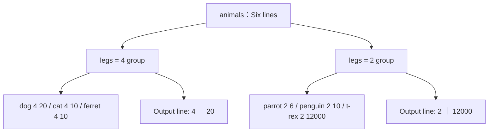
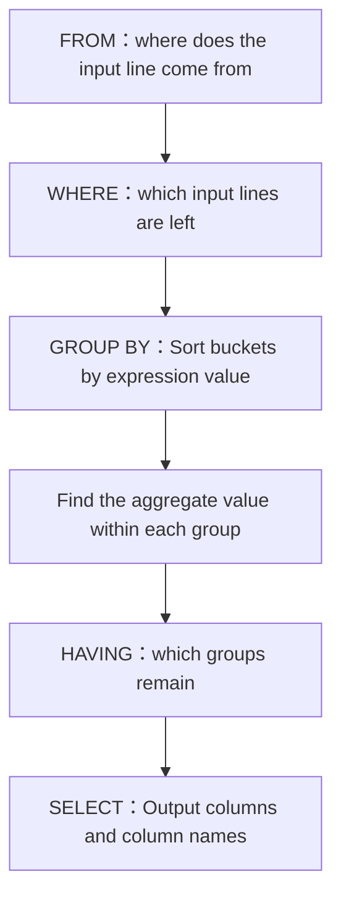

> **courses**: UC Berkeley CS61A · Structure and Interpretation of Computer Programs(Fall 2024)
> **This lecture**: Lecture 37 ｜ 17:30 ｜ Station B P 35 ｜ [Original video](https://www.bilibili.com/video/BV1sy411z7nA?p=35)
> **courseware**: `35-Aggregation_1pp.pdf` (13 pages, official PDF, page-by-page renderings see text illustrations)
> **subtitles**: Original English subtitles from Station B; this note is a reconstruction of Chinese writing, not a sentence-by-sentence translation.
> **Copyright**: The copyright of the course and courseware belongs to the UC Berkeley CS61A teaching team; this article is a secondary arrangement for learning purposes

## Quick overview of this lecture

*(Reference time: 00:00:01 – 00:00:11｜Lecture 37)*


- **Mastered**: `SELECT`  Statements are described by columns, `FROM`, `WHERE`, `ORDER BY`  Composed of several parts; `WHERE`  The expressions in are evaluated row by row to decide whether to keep a row or discard it; for multi-table queries, use commas to put the two tables together, and then use  `WHERE`  Write the connection conditions.
- **Main line of this lecture**:
    - Aggregate functions appear in column descriptions and compress multiple values in a column into one value: `MIN`, `MAX`, `SUM`, `AVG`, `COUNT`.
    - Without  `GROUP BY`  when, pass  `WHERE`  All filtered rows belong to the same group, and the result of the aggregate query is only one row.
    - `GROUP BY`  Divide the rows into several groups according to different values of an expression. The number of groups is equal to the number of different values of the expression.
    - `HAVING`  After grouping, filter by group, and aggregate functions can be written in group-level conditions; `WHERE`  Filter by row before grouping, both work at different levels.
    - When aggregate values and single-value columns are mixed in the same column description, the single-value column gives "the row selected by the aggregation". This answer is meaningful only when the aggregate value uniquely determines the row.
- **Key conclusions**: Grouping defines equivalence classes on a set of rows, and aggregation evaluates each equivalence class. `HAVING`  It is to solve Boolean expressions for equivalence classes - the combination of the three allows SQL to be upgraded from "checking a row" to "checking the statistical rules of a table".

## 1. The appearance of aggregate functions: from "one value per row" to "one value per column"

*(Reference time: 00:00:13 – 00:01:46｜Lecture 37)*


So far, every expression that has appeared in SQL has only **within one line** Take value. This statement is worth breaking down and looking at: `SELECT`  The expressions in the statement appear in three places - column description (i.e.  `SELECT`  with  `FROM`  the list of "which columns to output"), `WHERE`  clause with  `ORDER BY`  clause. What is written in these three places are column names, but the column name itself has no value. It refers to "the value of a certain row in this column."

thus  `WHERE latitude > 38`  Such filtering is performed by line-by-line scanning: taking out the  `latitude`, compare with 38, if it is true, keep this row, if not, discard this row. The expression itself is **Evaluate row by row** Yes, an expression only sees the current line. This is the common form of all previous queries and is the frame of reference for understanding aggregations.

It is this frame of reference that aggregate functions break. It can appear in the expression in the column description, but it does not look at a row, but at a certain column (or an expression) **multiple lines** All values on, such as adding up these values, taking the maximum, taking the minimum. In other words: a scalar expression has a scope of one row, an aggregate expression has a scope of a set of rows.

| criterion | scalar expression | aggregate expression |
| :--- | :--- | :--- |
| Evaluation unit | one line | A set of rows (default is the entire table) |
| Typical writing | `weight`, `latitude > 38`, `legs - weight` | `MAX(weight)`, `SUM(weight)`, `COUNT(*)` |
| Output granularity | How many lines are input and how many lines are output? | A group only outputs one value |
| Intuition | "How is this business?" | "How is this row overall?" |

All the rest of this lecture is an addition to this new frame of reference: first look at how a single aggregate function is used, then look at how aggregate values and single-value columns in a row interfere with each other, and finally look at grouping - refining "a group" from "the entire table" to "buckets cut according to a certain expression".

## 2. animals table: a data set specially prepared for aggregation

*(Reference time: 00:01:46 – 00:03:16｜Lecture 37)*

In order to study aggregation, the class replaced the previous data set and introduced a small table with only three columns and six rows.  `animals`: `kind` (type), `legs` (number of legs), `weight` (Weight in pounds).

| kind | legs | weight |
| :--- | ---: | ---: |
| dog | 4 | 20 |
| cat | 4 | 10 |
| ferret | 4 | 10 |
| parrot | 2 | 6 |
| penguin | 2 | 10 |
| t-rex | 2 | 12000 |

The origins of the six lines are told casually, but each line foreshadows the examples that follow. A dog has four legs and weighs twenty pounds; a cat has four legs and weighs ten pounds; a ferret has four legs and weighs ten pounds - the lecturer casually said that ten pounds is too fat for a ferret, but let's use this number first. The parrot is a bird with two legs weighing six pounds; the larger bird is a penguin with two legs weighing ten pounds. The last line was specially chosen by the lecturer: He was thinking about "something with only two legs and very heavy weight." He could have lifted an ostrich, but finally chose a Tyrannosaurus Rex (T-Rex), which weighs about six tons, or 12,000 pounds.

The design intent of this table is very clear: `legs`  There are only two values ​​4 and 2, which are naturally suitable for demonstration grouping; `weight`  There are duplicate values (cats, ferrets, and penguins are all 10), which will be merged when "grouping by weight"; and the outlier value of 12000 ensures that the "maximum" and "average" give completely different answers. Every counter-intuitive output in the following can be found in these six lines.

The first aggregation query has only one sentence:

```sql
SELECT MAX(legs) FROM animals;
```

pay attention to it **without any  `WHERE`**, that is, without any filtering. According to past experience, `SELECT`  A column name should output six lines; but here only one line is output, with a value of 4, that is  `legs`  The maximum value listed on six rows. This is the first counter-intuitive point of this lecture: the aggregation function compresses "multiple lines of input" into "one line of output", and this compression is the same as  `WHERE`  It has nothing to do with it, it is brought about by the aggregation itself.

## 3. Five aggregate functions: MIN, MAX, SUM, AVG, COUNT

*(Reference time: 00:03:16 – 00:07:10｜Lecture 37)*

Class demonstration first reloads the same  `animals`  Table and try each item one by one. The two most basic ones are maximum value and summation:

```sql
SELECT MAX(legs) FROM animals;      -- 4
SELECT SUM(weight) FROM animals;    -- 12056
```

`12056`  That’s the sum of the six weights: 20 + 10 + 10 + 6 + 10 + 12,000. Up to this point, the aggregate function is still the intuitive version of "do one thing for an entire column". The real flexibility comes from its parameters.

### 3.1 Parameters can be any expressions

The parameters of the aggregate function do not have to be bare column names, but can be any row-by-row evaluable expression. Aggregation occurs in **the result of an expression** on, instead of happening on the original column:

```sql
SELECT MAX(legs - weight) + 5 FROM animals;   -- 1
```

This 1 is worth counting by hand. It is the best example of understanding "aggregation on expressions". Calculate row by row  `legs - weight`:

| kind | legs | weight | legs - weight |
| :--- | ---: | ---: | ---: |
| dog | 4 | 20 | -16 |
| cat | 4 | 10 | -6 |
| ferret | 4 | 10 | -6 |
| parrot | 2 | 6 | -4 |
| penguin | 2 | 10 | -8 |
| t-rex | 2 | 12000 | -11998 |

The largest value occurs in the parrot row: six pounds for two legs, a difference of -4, the largest of all rows (closest to zero). Add 5 to the aggregated result to get 1. Note that adding 5 occurs in the aggregation step **after**, it is arithmetic on "a number", not on each row; if written as  `MAX(legs - weight + 5)`, the result is also 1, because constant addition does not change which is the largest, but the order of evaluation of the two is not the same.

Multiple aggregations can appear side by side in the same column description, each calculated independently:

```sql
SELECT MAX(legs), MIN(weight) FROM animals;        -- 4 | 6
SELECT MAX(legs) - MIN(weight) FROM animals;       -- -2
```

The first sentence output is  `4`  and  `6`. Putting these two numbers on the same line, it could easily be misread as "There is an animal with four legs and weighs six pounds." But there is no such animal: the six-pound one is a parrot, which only has two legs. The lecturer specifically pointed this out——**Both aggregations are calculated independently of each other**, their values come from different rows, SQL just spells them into the same output row. The second sentence subtracts the two aggregate values, yielding -2, which again has nothing to do with any single animal.

Aggregation can also be done with  `WHERE`  Combination, where filtering happens first and aggregation is done on the remaining rows:

```sql
SELECT MIN(legs), MAX(weight) FROM animals WHERE kind <> 't-rex';   -- 2 | 20
```

After removing the tyrannosaurus, `legs`  The minimum value of the column is still 2 (both parrots and penguins have two legs), while  `weight`  The maximum value of the column falls from 12000 to 20 on the dog. This comparison illustrates: `WHERE`  What changes is the "set of rows participating in aggregation", and the semantics of the aggregate function itself remains unchanged.

### 3.2 COUNT and DISTINCT

`AVG`  with  `COUNT`  are two functions with slightly different semantics. The average is calculated by dividing the sum by the number of rows:

```sql
SELECT AVG(weight) FROM animals;   -- 2009.3
SELECT COUNT(legs) FROM animals;   -- 6
SELECT COUNT(kind) FROM animals;   -- 6
SELECT COUNT(*) FROM animals;      -- 6
```

`AVG(weight)`  It is equal to 12056 divided by 6, which is approximately 2009.3 (orally recorded as 2009 during class demonstration). `COUNT`  Then only one question is answered: how many rows are there. It doesn't matter which column the parameter is in - counting legs, counting species, counting weight, it will always get 6, because the table has six rows. Since it has nothing to do with columns, the usual way of writing is to use asterisks instead of column names. `COUNT(*)`  It expresses the meaning of "number of lines" more directly.

What really needs to be written is the coordination  `DISTINCT` (To remove duplicates) use:

```sql
SELECT COUNT(DISTINCT legs) FROM animals;     -- 2
SELECT COUNT(DISTINCT weight) FROM animals;   -- 4
SELECT SUM(DISTINCT weight) FROM animals;     -- 12036
```

`legs`  There are only two values ​​4 and 2, so the deduplication count is 2. `weight`  After deduplication, there are four values: 20, 10, 6, and 12000, and the deduplication count is 4. `DISTINCT`  You can also modify the sum: `SUM(DISTINCT weight)`  First combine the repeated 10s into one and then add them. We get 12036, which is 20 less than the 12056 without removing the duplicates - exactly the two 10s that were removed. This shows  `DISTINCT`  Modified is **Aggregated input**, which removes duplicate values before aggregation instead of deduplicating the results.

| function | Semantics | in  `animals`  value on | Common misuse |
| :--- | :--- | :--- | :--- |
| `MIN` | minimum value in a group | `MIN(legs)`  for 2 | Think it returns the entire row |
| `MAX` | maximum value in a group | `MAX(legs)`  is 4, `MAX(weight)`  for 12000 | When used with parallel values, the answer is considered unique |
| `SUM` | Sum | `SUM(weight)`  for 12056 | forget  `DISTINCT`  will change the input |
| `AVG` | Average (sum divided by number of rows) | `AVG(weight)`  About 2009.3 | Think that the result corresponds to a certain animal |
| `COUNT` | count | `COUNT(*)`  for 6 | thought  `COUNT(列)`  Some lines will be skipped |

> **Editor's note**: The "skip" mentioned in the last row of the above table refers to  `NULL`  Processing: In most SQL implementations  `COUNT(列名)`  Count only the rows in which the column is not empty, while  `COUNT(*)`  Count all rows. The data in this lecture does not have null values, and all six rows are non-null, so the results of the two writing methods are consistent; the relationship between null values ​​and aggregation is not within the scope of this courseware, and is only a reminder here.

### 3.3 NULL Value: Exceptions to Aggregation Functions (Editor’s Supplement)

> **Editor's note**: this lecture  `animals`  The table has no null values and the subtitles have no discussion  `NULL`; But real data is almost always missing, and the aggregation function's handling of null values is inconsistent with intuition. The following content is the general rules of SQL and does not belong to this courseware.

`NULL`  It means "this grid has no value", it is neither 0 nor an empty string. Aggregation functions are calculated when **skip** `NULL`:

| situation | result |
| :--- | :--- |
| `COUNT(*)` | Count all rows, including rows with null values |
| `COUNT(列)` | Count only rows where the column is not empty |
| `SUM`, `AVG`, `MIN`, `MAX` | Ignore null values, `AVG`  The denominator of is the number of non-blank lines |
| The entire column is empty | `COUNT`  Returns 0, the remaining four return  `NULL` |

One of the consequences is  `AVG(weight)`  with  `SUM(weight) / COUNT(*)`  No longer equal in the presence of null values: the former skips missing weights, the latter counts missing rows in the denominator. Used to determine whether it is empty  `IS NULL`  with  `IS NOT NULL`, cannot write  `= NULL`——Compared with the null value, the result is "unknown", `WHERE`  Such rows are not retained.

## 4. Mixing aggregation and single-value columns: the "selected row"

*(Reference time: 00:07:09 – 00:10:55｜Lecture 37)*

The courseware allows you to mix aggregate functions and column names without aggregation in the same column description, for example:

```sql
SELECT MAX(weight), kind FROM animals;   -- 12000 | t-rex
```

The output is one line: max weight 12000, and  `kind`  Column value  `t-rex`. This is the phenomenon to be explained in this section——**In addition to calculating a value, the aggregate function also selects a certain row**. When it takes the maximum weight, that row is a tyrannosaurus, so the ones in the same row  `kind`, `legs`  The other columns also have values. So this query can be read as a question: "Who weighs 12,000 pounds?" The answer is Tyrannosaurus, which makes sense because the maximum weight is unique among the six rows.

The same mechanism also gives meaningful answers in two other situations:

```sql
SELECT MIN(weight), kind FROM animals;   -- 6 | parrot
SELECT MIN(kind), kind FROM animals;     -- cat | cat
```

In the first sentence, take the minimum weight. Only parrots weigh six pounds, so  `kind`  is  `parrot`, the only answer. The second sentence is more subtle: `MIN(kind)`  in **string** Take the minimum value and compare based on lexicographic order. `cat < dog < ferret < parrot < penguin < t-rex`, so the smallest kind is  `cat`. The entire row of this row is selected, so the second  `kind`  Also  `cat`. Arrange them vertically and read more: This animal’s  `legs`  is 4, `weight`  Yes 10.

But the mechanism does not guarantee that the answer will make sense. The following two queries reveal the truth:

```sql
SELECT MAX(legs), kind FROM animals;      -- 4 | cat
SELECT AVG(weight), kind FROM animals;    -- 2009.3 | t-rex
```

In the first sentence, there are three four-legged animals (dogs, cats, ferrets), and the maximum number of legs 4 cannot uniquely determine a line, so  `kind`  Whichever one you choose is "legal" - SQLite just gives  `cat`, but  `dog`  with  `ferret`  Also makes sense. The second sentence is more thorough: the average of 2009.3 does not correspond to any row, it is not the weight of a particular animal, and the T. rex is not average at all. But the query still outputs a line, and the name of the Tyrannosaurus is written next to the average. It looks like "The animal with the average weight is the Tyrannosaurus." This is **pure misleading**.

| Query | output | The meaning of single value column |
| :--- | :--- | :--- |
| `SELECT MAX(weight), kind` | 12000, t-rex | Meaningful: the maximum value is unique and the row is uniquely determined |
| `SELECT MIN(weight), kind` | 6, parrot | Meaningful: the minimum value is unique |
| `SELECT MIN(kind), kind` | cat, cat | Meaningful: the one with the smallest lexicographic order is the only one |
| `SELECT MAX(legs), kind` | 4, cat | Arbitrary: Three animals are tied for the largest, the result cannot be relied on |
| `SELECT AVG(weight), kind` | 2009.3, t-rex | Meaningless: the mean does not belong to any row |

The conclusion can be written very short: `MIN`  with  `MAX`  This type of "pick a row" aggregation, combined with single-value columns, may lead to meaningful answers; `AVG`, `SUM`, `COUNT`  This type of aggregation that "creates a new number" can never indicate which row it is. At this time, the single-valued column in the output is just a by-product of the implementation. The reminder given by the instructor is: Be careful when writing single-value columns and aggregates in the same column description.

> **Editor's note**: As for which row is "brought out", the SQL standard does not stipulate that different implementations and different execution plans may give different results; SQLite returns the last row aggregated during the scanning process in this demonstration. The reliable approach is not to write this kind of query, but to explicitly use subqueries or groupings to make it clear "which row" - Sections 6 and 11 of this lecture each give a way.

## 5. Default grouping: the entire table is a group

*(Reference time: 00:10:49 – 00:11:38｜Lecture 37)*

Here you can give a complete definition of the aggregate function: it takes out a certain expression (such as a column name) in **all rows in a group** All the values on , and then do one thing with these values - take the maximum, take the sum, take the average, and count.

This definition contains a word that has been ignored until now: group. By default, those rows that participate in calculating the final table—that is, passed  `WHERE`  Filtered rows - all belong to the same group, one huge group. So don’t bring it  `GROUP BY`  When , the result of any aggregate query is only one row; the root cause of the "output is only one row" phenomenon in all previous examples is here, not the aggregate function.

`SELECT`  statement allows you to change this default setting: instead of all rows being grouped together, rows are divided into multiple groups according to certain rules, and each group is aggregated once. this is  `GROUP BY`  entrance.

## 6. GROUP BY: divide rows into buckets according to the value of the expression

*(Reference time: 00:11:38 – 00:13:30｜Lecture 37)*


After adding grouping and group filtering, `SELECT`  The complete form of the statement is:

```sql
SELECT [columns] FROM [table] GROUP BY [expression] HAVING [expression];
```

Among them  `GROUP BY`  with  `HAVING`  They are all new faces. Let’s talk about this section first.  `GROUP BY`. Its sentence semantics is: **The number of groups is equal to the number of different values of the expression**. The expression is evaluated on each row, and rows with the same value fall into the same bucket, and each bucket is a group; then the aggregation is done once in each bucket, and each bucket produces one row.

The example on the courseware is:

```sql
SELECT legs, MAX(weight) FROM animals GROUP BY legs;
```

`legs`  There are only two values ​​4 and 2, so the six rows are divided into two buckets: `legs=4`  In the bucket are dogs, cats, ferrets, `legs=2`  In the bucket are parrots, penguins, and tyrannosaurs. Each bucket counts once  `MAX(weight)`, the maximum weight of the four-legged barrel is 20 (dog), and the maximum weight of the two-legged barrel is 12000 (tyrannosaurus). Output two lines.



### 6.1 Why not aggregated  `legs`  can appear in the output

The second counter-intuitive point is here: `MAX(weight)`  is an aggregation, but  `legs`  No, why does it appear in the column description?

The answer lies in the definition of grouping. Since the grouping basis is  `legs`, then all rows in the same group  `legs`  must be equal——`legs=4`  The three rows in the bucket are all 4, `legs=2`  The three rows in the bucket are all 2. At this time, "Which row to take?" `legs`"This question loses its meaning, because it doesn't matter which row you take. The lecturer's statement is: it actually gives a certain line of arbitrary  `legs`  value, but each row within the group is the same, so the result is determined. This is consistent with Section 4  `MAX(legs), kind`  The dilemma is exactly the opposite - where juxtaposition leads to uncertainty, here grouping ensures consistency.

> **Editor's note**: "The values within the group must be the same" This property is the source of standard SQL's restriction of group query projection: `SELECT`  Columns without aggregation must appear in  `GROUP BY` , otherwise it is an illegal query in the standard. SQLite is looser than the standard and allows  `SELECT MAX(weight), kind`  This kind of writing and returns any line - Section 4 steps on the pitfall caused by this looseness. Write according to the standard (non-aggregated columns are all entered)  `GROUP BY`), the output will not change with the implementation.

### 6.2 What happens to the rowset before and after grouping

By treating "Xingji" as the protagonist, you can see more clearly what is being done at each step. to  `SELECT legs, MAX(weight) FROM animals GROUP BY legs;`  For example, record the rowset shape step by step:

| stage | line set | Number of lines |
| :--- | :--- | ---: |
| ① `FROM animals` | The six lines of dog, cat, ferret, parrot, penguin, and t-rex remain intact. | 6 |
| ② `WHERE`  filter | This query does not have  `WHERE`, leave all six lines | 6 |
| ③ `GROUP BY legs`  bucket | `legs=4`  Bucket: dog, cat, ferret; `legs=2`  Barrels: parrot, penguin, t-rex | 2 groups |
| ④ Aggregation within a group  `MAX(weight)` | A four-legged bucket is worth 20, a two-legged bucket is worth 12,000 | 2 |
| ⑤ `SELECT`  output | Two lines: `4 ｜ 20`  with  `2 ｜ 12000` | 2 |

The information to be read from this table is: **The number of rows jumps during the aggregation step, and the amplitude of the jump is determined by the number of groups, not the number of rows.**. The six rows may be pressed into one row (not grouped), or they may be pressed into two rows (pressed  `legs`  divided into two groups), and possibly pressed into five elements (press  `legs`  with  `weight`  into five groups, see next section). There is no fixed ratio between the number of output rows and the number of aggregated rows. This is the biggest difference between aggregate queries and ordinary queries.

## 7. Grouping forms: multiple columns, counts and arbitrary expressions

*(Reference time: 00:13:30 – 00:15:47｜Lecture 37)*

After grouping, you can do more than just take the maximum value. The most commonly used combination is grouped counting:

```sql
SELECT legs FROM animals GROUP BY legs;             -- 4 / 2
SELECT legs, COUNT(*) FROM animals GROUP BY legs;   -- 4 ｜ 3 / 2 ｜ 3
SELECT legs, MAX(weight) FROM animals GROUP BY legs; -- 4 ｜ 20 / 2 ｜ 12000
```

The first sentence only outputs the grouping key itself, getting 4 and 2, that is  `legs`  Different values; it is semantically equivalent to "What are the number of legs in this table?" The second sentence counts lines in each group: there are three animals with two legs and three animals with four legs. The third sentence goes back to max weight, 20 pounds for a four-leg set and 12,000 pounds for a two-leg set.

`GROUP BY`  You can group by multiple columns (multiple expressions to be precise) at the same time:

```sql
SELECT legs, weight FROM animals GROUP BY legs, weight;
```

At this time, the "group" is determined by the combination of values, and the output is  `legs`  with  `weight`  All different combinations of , five lines in total:

| legs | weight | Group members |
| ---: | ---: | :--- |
| 4 | 20 | dog |
| 4 | 10 | cat, ferret |
| 2 | 6 | parrot |
| 2 | 10 | penguin |
| 2 | 12000 | t-rex |

Six rows become five, and the only ones that are merged are cats and ferrets - they are identical in those two columns. This is a criterion worth remembering: **The finer the grouping granularity, the fewer rows are merged, and the closer the number of output rows is to the number of rows in the original table.**.

Grouping by can also be any expression, including arithmetic expressions:

```sql
SELECT weight / legs, MAX(kind) FROM animals GROUP BY weight / legs;
```

Here we first calculate line by line  `weight / legs`, then group them according to this ratio, and finally take the  `kind`  The lexicographically largest one. Pay attention to the division rules of SQL: when dividing two integers, they are treated as integer division. 20 divided by 4 is 5, 10 divided by 4 is 2 (the decimal part is truncated), and the six lines are 5, 2, 2, 3, 5, and 6000 respectively.

| weight / legs | kind within the group | `MAX(kind)` |
| ---: | :--- | :--- |
| 2 | cat, ferret | ferret |
| 3 | parrot | parrot |
| 5 | dog, penguin | penguin |
| 6000 | t-rex | t-rex |

Note that the group with a ratio of 5 spans the number of legs: the dog is 20 divided by 4, and the penguin is 10 divided by 2. The two have different numbers of legs, but they are put into the same bucket because they have the same ratio. This again shows that the basis for grouping is **the evaluation result of an expression**, rather than the original value of a column.

> **Editor's note**: The above grouping results table is based on the courseware  `animals`  The six rows of data in the table, the integer division rules and the semantics of "lexicographic maximum" are calculated line by line; the classroom demonstration only showed the query results on the screen, and the subtitles did not read out the four values line by line. The order of the output rows is also not in the subtitles. The table is arranged in ascending order by ratio only for ease of reading.

## 8. HAVING: Filter by group after grouping

*(Reference time: 00:15:47 – 00:17:27｜Lecture 37)*


Sometimes after grouping, you want to keep only some groups: for example, you only care about "groups with more than one row". `HAVING`  This is what the clause does - it filters the collection of groups and determines which groups can still participate in the aggregation and appear in the final result. In contrast, `WHERE`  What is filtered is a single input line, which determines which lines are included. `HAVING`  Aggregation functions can also be written here, which is how it is related to  `WHERE`  The most crucial difference.

Courseware writing  `SELECT`  The process of the statement is compressed into three steps, and these three steps correspond to three groups of clauses:

1. Determine which existing rows are needed to express the result (`FROM`  with  `WHERE`).
2. Form groups and determine which groups should become output rows (`GROUP BY`  with  `HAVING`).
3. Format output line (`SELECT`).

Each clause answers a question:

| clause | Answered questions |
| :--- | :--- |
| `SELECT` | What values (and column names) does each output row contain? |
| `FROM` | where does the input line come from |
| `WHERE` | which input lines |
| `GROUP BY` | Form output rows (how to group) |
| `HAVING` | which output rows (which groups are left) |



### 8.1 Demonstration of group-by-group evaluation

The last demonstration is: group by "weight divided by number of legs", and only keep groups with a number of rows greater than one.

```sql
SELECT weight / legs, COUNT(*)
  FROM animals
 GROUP BY weight / legs
HAVING COUNT(*) > 1;
```

The execution process can be broken down into three levels. The first level evaluates row by row, and each row gets a ratio: dog 5, cat 2, ferret 2, parrot 3, penguin 5, tyrannosaurus 6000. The second level is divided into buckets according to the ratio, resulting in four groups: the group with a ratio of 5 has two (dogs and penguins), the group with a ratio of 2 has two (cats and ferrets), the group with a ratio of 3 has only parrots, and the group with a ratio of 6000 has only tyrannosaurs. The third level asks for each group  `COUNT(*)`, and use  `HAVING`  Judgment:

| weight / legs | Group members | `COUNT(*)` | `HAVING COUNT(*) > 1` |
| ---: | :--- | ---: | :--- |
| 5 | dog, penguin | 2 | Reserve |
| 2 | cat, ferret | 2 | Reserve |
| 3 | parrot | 1 | discard |
| 6000 | t-rex | 1 | discard |

Output two lines: `5 ｜ 2`  with  `2 ｜ 2`. The most critical point here is  `HAVING`  inside  `COUNT(*)`: It is an aggregate value that can only be calculated after the group has been formed, so it cannot be written in  `WHERE`  inside. `WHERE`  The rows are not grouped at the time of execution, and there is no concept of groups in expressions that are evaluated row by row.

> **Editor's note**: The last sentence of the video is "Both groups were discarded", which should refer to  `COUNT(*)`  The two groups with a ratio of 1 (ratios 3 and 6000) are discarded; press  `HAVING COUNT(*) > 1`  The literal semantics of , retain the two sets of ratios 5 and 2. The reference at the end of the subtitle is not clear enough, so here we restore it based on clause semantics.

### 8.2 Division of labor between WHERE and HAVING

Both are filters, but operate at different levels. Putting them side by side, the criterion is the "action object":

| criterion | `WHERE` | `HAVING` |
| :--- | :--- | :--- |
| Object of action | single input line | Already formed group |
| execution timing | Before grouping | After grouping |
| Can it contain aggregate functions? | Can't | can, for example  `HAVING COUNT(*) > 1` |
| Typical questions | "Which rows are involved in the calculation?" | "Which groups appear in the results?" |
| quoted value | columns within rows | Grouping expressions and aggregate values |

There is a ready-made evidence for "cannot" in the courseware exercise (section 11 will expand on this in detail): write directly  `WHERE legs = MAX(legs)`, SQLite will report an error during the parsing stage.

```sql
sqlite> SELECT * FROM animals WHERE legs = MAX(legs);
Parse error: misuse of aggregate function MAX()
```

The error message is reported using  `misuse` (misuse) instead of "value not found" because, from the parser's perspective, putting the aggregate function in  `WHERE`  It is contradictory at the grammatical level: `WHERE`  The logic of is executed before the grouping, while the aggregate function requires that the grouping already exists. This ordering constraint is not an implementation detail, but a semantic structure of the query language.

## 9. Courseware case: changes in the number of employees in the cal table

*(Reference time: 00:16:20 – 00:16:43｜Lecture 37)*

> **Editor's note**: Video recorded in section 8  `HAVING`  It ends after the demonstration (17:30 in total length), and there is no corresponding explanation paragraph on pages 6 to 13 of the courseware. The following four sections are organized based on the courseware images and texts to complete the remaining content of the courseware: a real aggregation case, a background diagram illustrating the motivation of the case, and two sets of exercises. In order to meet the format requirements of time anchor points, the anchor points of these sections are the actual start and end of the end of the video, and do not represent the position of these contents in the video.


Pages 6 and 7 of the courseware are a complete example, table name  `cal`, records the population statistics of the University of California, Berkeley, over the years, listed as  `source` (employee or student), `type` (category), `role` (specific position or status) and numbers for four academic years: `fa08`, `fa13`, `fa18`, `fa23`.

| source | type | role | fa08 | fa13 | fa18 | fa23 |
| :--- | :--- | :--- | ---: | ---: | ---: | ---: |
| employee | Grad Student Titles | Grad St. Instructor(GSI) | 1943 | 1925 | 2202 | 2248 |
| student | Grad Student | Grad Student | 10258 | 10253 | 11666 | 12621 |
| student | Undergrad | Undergrad | 25151 | 25951 | 30853 | 33078 |


The requirements of the question are divided into two halves: for each **employees** Category, work out  `fa23`  with  `fa18`  The difference between the total number of people; only the categories with increased numbers of people are retained. Pay attention to the word "total number of people" - there are multiple people in the same category  `role`  Rows, you must first cluster the rows by category and then subtract them.

```sql
SELECT type, SUM(fa23) - SUM(fa18) AS increase
  FROM cal
 WHERE source = "employee"
 GROUP BY type
HAVING SUM(fa23) > SUM(fa18);
```

After aligning the clauses with the three-step method, it's clear what each line does:

| clause | What do you do in this sentence? |
| :--- | :--- |
| `SELECT` | output categories, and  `fa23`  total and  `fa18`  The difference between the total number, column name  `increase` |
| `FROM` | unique input form  `cal` |
| `WHERE` | only stay  `source`  for  `employee`  rows, student rows are excluded |
| `GROUP BY` | press  `type`  Bucketing, multiple of the same category  `role`  falling into the same bucket |
| `HAVING` | only keep  `fa23`  The total is greater than  `fa18`  Total buckets, categories with declining numbers do not appear in the results |

Output four lines:

| type | increase |
| :--- | ---: |
| Grad Student Titles | 327 |
| Other Faculty | 352 |
| Regular Faculty | 48 |
| Staff | 454 |

This example ties together the three new tools in this tutorial: `SUM`  Responsible for summing up the numbers in multiple rows under the same category. `GROUP BY`  Responsible for cutting rows into buckets according to categories, `HAVING`  Responsible for filtering out buckets that do not meet the conditions based on the aggregation results. You can't write this query without any link - just use  `WHERE`  Unable to compare "Total", just use  `GROUP BY`  It is impossible to exclude the declining categories, and without grouping, you can only get a total difference value for the whole school.

> **Editor's note**: `SUM(fa23) - SUM(fa18)`  with  `SUM(fa23 - fa18)`  It is equivalent if there is no null value (the summation is linear), but the former is closer to the expression of "the difference between two totals" in the question, and is also the same as  `HAVING`  Two that are reused in  `SUM`  Be consistent. Choosing the former here is a choice in writing, not a semantic requirement.

## 10. Motivation behind the case: state funding versus cost per student

*(Reference time: 00:16:43 – 00:17:02｜Lecture 37)*


The courseware puts a background image on page 8 to explain why it is worth using SQL to analyze  `cal`  this table. Berkeley is a public university funded in part by state funding from California taxpayers; that support used to be generous, allowing the school to keep tuition down while keeping tuition down, but its share has continued to decline—the state provided 50 percent of the school's revenue thirty years ago and only 14 percent today.

The chart is titled "State Education Grants (Millions of Dollars)" and runs from FY01 to FY21 on the horizontal axis and 0 to 600 on the vertical axis. The height of the column rises and falls: FY01 is 500, FY02 rises to 520, then continuously decreases in the following years (497, 451, 421, 438, 475), FY08 returns to 506, FY09 falls to 319, FY12 is only 269, and then slowly rises, FY20 is 411, FY21 is 354. The top of the figure also marks three time points: the 2001 recession, the 2008 recession and the new coronavirus epidemic (COVID-19). The corresponding columns (FY01, FY02, FY08, FY12, FY21) are painted black to distinguish them from the blue columns.

But nominal amounts can be deceiving, and the two floating labels on the chart correct this intuition. The first note: \$1 in 2001 has purchasing power equivalent to \$1.53 in 2021; at constant prices, state government support has actually fallen by 46% since 2001. The second notation spreads the funding among students: 32,128 students in fall 2001, which works out to \$23,811 per student in 2021 dollars; there are 45,057 students in fall 2021, leaving only \$7,857 per student.

| indicator | Fall 2001 | Fall 2021 |
| :--- | ---: | ---: |
| Number of students | 32128 | 45057 |
| Cost per student after state appropriation (2021 USD) | 23811 | 7857 |

The relationship between this picture and SQL lies in the algorithm of the "funding per student" number: it requires dividing the total allocation for a year by the number of people in the same year, and the allocation and number of people are two tables and two sets of rows. Aggregation is a tool for doing just that - first group the rows by year, and then do the division within the group. front  `cal`  The example in the table does the same type of work, except that it compares the difference in the number of people in two years, while this picture compares the relative speed of the two curves of "money" and "people" in twenty years.

> **Editor's note**: This page is the background material of the courseware. The text and numbers on the screen are as mentioned above, but the lecture video does not mention it. The specific values of each year in the picture are only marked on the top of the column. The text is transcribed and summarized according to the screen, and no statistical caliber other than the courseware is introduced.

## 11. Exercise: Two paths of grouping and self-joining

*(Reference time: 00:17:02 – 00:17:12｜Lecture 37)*


The second half of the courseware contains two sets of exercises, both using  `animals`  table. The keyword of the first group is "connection": the same problem can either use self-connection to enumerate all pairs, or use grouping to compare within each group.

### 11.1 The maximum difference in the number of legs between two animals of the same weight

Question: What is the maximum difference in the number of legs between two animals with the same weight?


The first solution is  `animals`  Connect with itself, alias  `a`  with  `b`, using equal weight as the connection condition, so each pair of animals with the same weight becomes a row, and then the maximum value of the leg number difference is obtained for these rows:

```sql
SELECT MAX(a.legs - b.legs) AS difference
  FROM animals AS a, animals AS b
 WHERE a.weight = b.weight;
```

output  `2`. The second solution is from a different angle: since what is being compared is the difference "within the same weight", then group them by weight, take the maximum number of legs and reduce the minimum number of legs in each group, and then sort the results of all groups to take the first one:

```sql
SELECT MAX(legs) - MIN(legs) AS difference
  FROM animals
 GROUP BY weight
 ORDER BY difference DESC
 LIMIT 1;
```

The output is also  `2`. The difference in ideas between the two solutions is worth comparing:

| criterion | self-connection | Group |
| :--- | :--- | :--- |
| processing unit | pair of rows | a group |
| Connection conditions | `a.weight = b.weight` | group expression  `GROUP BY weight` |
| Calculation amount | square-level pairing of row numbers | Row level grouping |
| Do you need to sort first? | No, aggregation directly gives the maximum value | Yes `ORDER BY`  add  `LIMIT 1` |
| result | 2 | 2 |

Check the results: among the three animals weighing 10 pounds, the cat and ferret both have four legs, and the penguin has two legs. The maximum difference is 4 minus 2 equals 2; the other weight groups (20, 6, 12000) all have only one animal, and the intra-group difference is 0. So the answer is 2, both solutions are consistent.

### 11.2 Animals with the most legs

Question: Which animals have the most legs? This is a "output all co-ordinates" problem, which is the same as Section 4  `MAX(legs), kind`  Only output an arbitrary line for contrast.


The most natural way to write it is to use the maximum value directly as the condition, but this doesn't work:

```sql
sqlite> SELECT * FROM animals WHERE legs = MAX(legs);
Parse error: misuse of aggregate function MAX()
```

The reason is the hierarchy issue discussed in Section 8: `WHERE`  Evaluate row by row, `MAX(legs)`  The entire set needs to be evaluated, the two are not in the same stage. The courseware gives two ways around it.

The first way is to materialize the maximum value into a named value. First use aggregation to store the maximum value into a temporary table with only one row, and then combine this table with  `animals`  Connect and filter with "number of legs equal to the maximum value":

```sql
CREATE TABLE m AS SELECT MAX(legs) AS max_legs FROM animals;
SELECT kind FROM animals, m WHERE legs = max_legs;
```

The second way is to bind the same table twice, and then use grouping to turn "each animal" into a group, and then  `HAVING`  Compare here:

```sql
SELECT a.kind
  FROM animals AS a, animals AS b
 GROUP BY a.kind
HAVING a.legs = MAX(b.legs);
```

Both paths output three lines: `dog`, `cat`, `ferret`. The clever thing about the second approach is that the granularity of the grouping is chosen as "category" - each animal is in its own group, and there is only one row in the group, so  `a.legs`  is the number of legs in this group, and  `MAX(b.legs)`  because  `b`  Without grouping, the maximum value is still obtained on the entire table. Both "value by group" and "value across groups" appear in a query, which is exactly  `HAVING`  A direct application of the feature that can access aggregate values.

## 12. Practice: Grouping and Final Questions

*(Reference time: 00:17:12 – 00:17:27｜Lecture 37)*


The last page is question 7 of the spring semester of 2023, which combines three things: multi-table join, grouping and group filtering into one question.


The question gave two tables. `finals`  Record in which examination rooms the final exam for each course is held, listed as  `hall` (Examination room name, string) and  `course` (Course name, string), a course has several lines for several examination rooms; `sizes`  Record the number of seats in each room on campus, listed as  `room` (room name) and  `seats` (number of seats), one row per room, all exam rooms are rooms.

| hall | course |
| :--- | :--- |
| RSF | 61A |
| Wheeler | 61A |
| RSF | 61B |

| room | seats |
| :--- | ---: |
| RSF | 900 |
| Wheeler | 700 |
| 310 Soda | 40 |

It is required to create a table with two columns: `course`  with  `seats`, each line is the name of a course and the total number of seats in all final examination rooms for this course; only courses that use at least two examination rooms are retained.

```sql
SELECT course, SUM(seats) AS seats
  FROM finals, sizes
 WHERE hall=room
 GROUP BY course
HAVING COUNT(*) > 1;
```

Take it apart step by step:

1. `FROM finals, sizes`  First, make a Cartesian product of the two tables, and match each course and room into a row.
2. `WHERE hall=room`  Only the matching "the examination room is the room" is left, so each row of each course carries the number of seats in the corresponding room.
3. `GROUP BY course`  Divided into buckets by course, two rows of 61A fall into the same bucket, and only one row of 61B.
4. `HAVING COUNT(*) > 1`  Only courses with more than one row in the bucket are retained, 61B because only one exam room is discarded.
5. `SELECT course, SUM(seats)`  Adding up the number of seats in the bucket gives us 900 plus 700 for the 61A which equals 1600.

The result is a line: `61A ｜ 1600`.`310 Soda`  Although it appears in  `sizes` , but there are no exams scheduled there, so there will be no row for it after the connection, which will naturally not affect the total number of any course.

The last line of this question is  `HAVING COUNT(*) > 1`, and the question says "use at least two examination rooms." The reason why the two can match is that after the connection, each row corresponds to "one exam room in a course": the number of rows in the bucket is the number of exam rooms, and counting rows is equivalent to counting exam rooms. if  `finals`  The table allows the same course to appear in multiple rows in the same examination room. This equivalence relationship is no longer valid. In that case, it should be written as  `HAVING COUNT(DISTINCT hall) > 1`.

> **Editor's note**: The last discussion about "Multiple lines appearing in the same course and the same examination room" is a little elaboration on the question conditions. Neither the courseware nor the subtitles are involved, and there are no duplicate lines in the question data. Its purpose is to remind: `COUNT(*)`  What counts is rows, and the question often asks "how many different things". The two are equivalent only when the data satisfies uniqueness.

## Summary

*(Reference time: 00:00:13 – 00:17:27｜Lecture 37)*

- **Aggregation changes the granularity, not the filtering**: `WHERE`  Determines which rows participate, and aggregation determines how many values these rows are compressed into. Without  `GROUP BY`  When , all rows that pass the filter belong to the same group, and the output is always one row.
- **Aggregation operates on the value of an expression**: `MAX(legs - weight)`  First calculate the difference row by row and then take the maximum. `MAX(legs - weight) + 5`  Then do ordinary arithmetic on the result. If you understand this layering, you will not mistakenly think that constants can "follow each line".
- **Grouping is to make equivalence classes based on expression values.**: The number of groups is equal to the number of different values of the expression; the values of the grouped columns in the group must be the same, so it can appear in the output in parallel with the aggregation without causing parallel ambiguity.
- **The grouping granularity determines the number of output rows**: Group by one column, the number of rows is equal to the number of different values in the column; group by multiple columns, the number of rows is equal to the number of value combinations; group by expression, which is equivalent to adding a column first and then grouping by it.
- **When mixing single-value columns and aggregations, you must be able to tell "which row"**: `MIN`  with  `MAX`  Maybe only one line is determined, `AVG`, `SUM`, `COUNT`  It never can. If you can't explain it clearly, don't write it. Use subquery or grouping instead.
- **`WHERE`  Guan Xing, `HAVING`  management group**: `HAVING`  You can write aggregates, `WHERE`  No; `WHERE legs = MAX(legs)`  The parsing error is grammatical evidence of this division of labor.

## Attached: Slide index for this lecture

*(Reference time: 00:00:01 – 00:17:27｜Lecture 37)*

| page | content | Appear location |
| :--- | :--- | :--- |
| 1 | Title page: Aggregation | Quick overview of this lecture |
| 2 | Announcements section page | Quick overview of this lecture |
| 3 | Section page: Select Statements | §1 |
| 4 | Grouping Rows: `GROUP BY legs`  grouping instructions | §6 |
| 5 | Three-step method for writing SELECT and division of labor among five clauses | §8 |
| 6 | Section page: UC Berkeley employee headcount case | §9 |
| 7 | cal table query: `SUM`  difference, `GROUP BY type`  with  `HAVING` | §9 |
| 8 | State government funding trends and per-student funding background chart | §10 |
| 9 | Section page: Joins Practice | §11 |
| 10 | The maximum difference in the number of legs for animals of the same weight: two solutions of self-joining and grouping | §11 |
| 11 | Animal with the most legs: `WHERE`  Misuse of writing and two substitutions | §11 |
| 12 | Section page: Group By Practice | §12 |
| 13 | 2023 Spring Final Question 7: Total Seats by Course | §12 |
