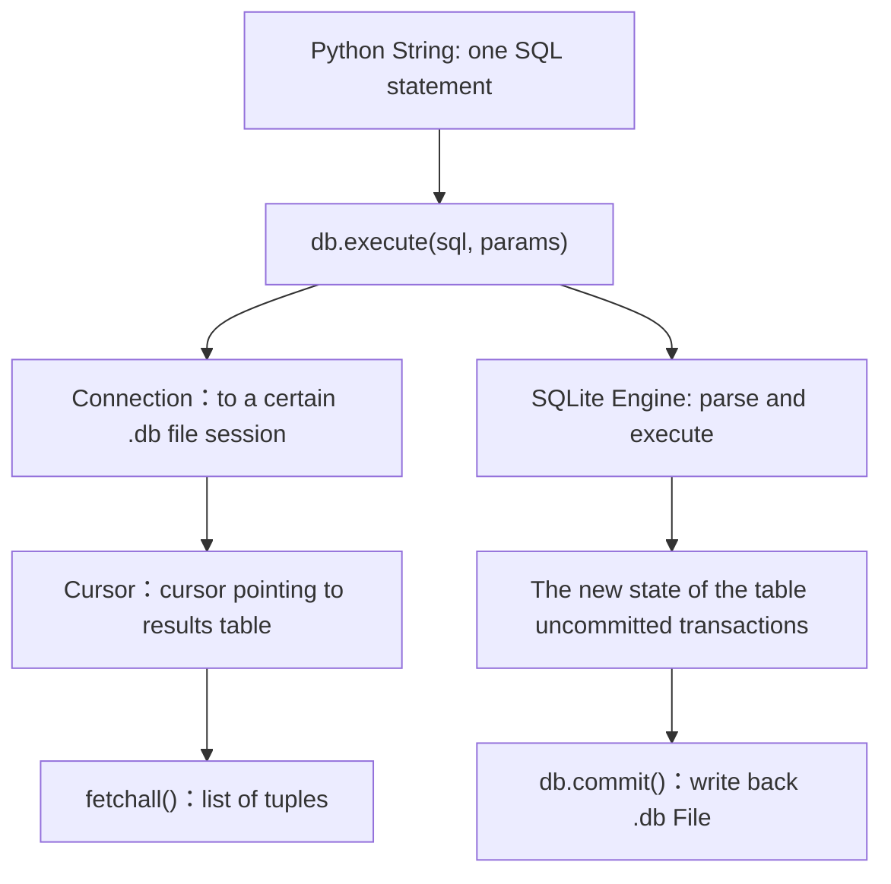
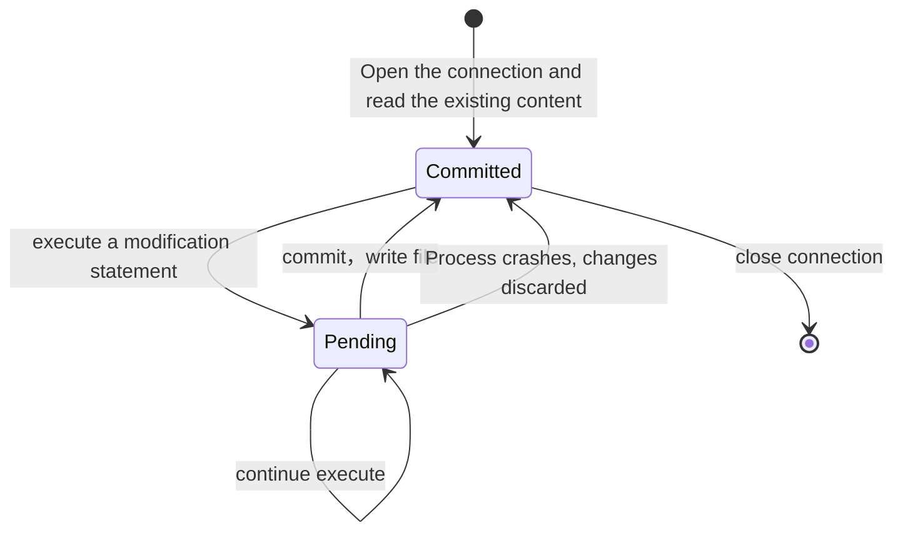
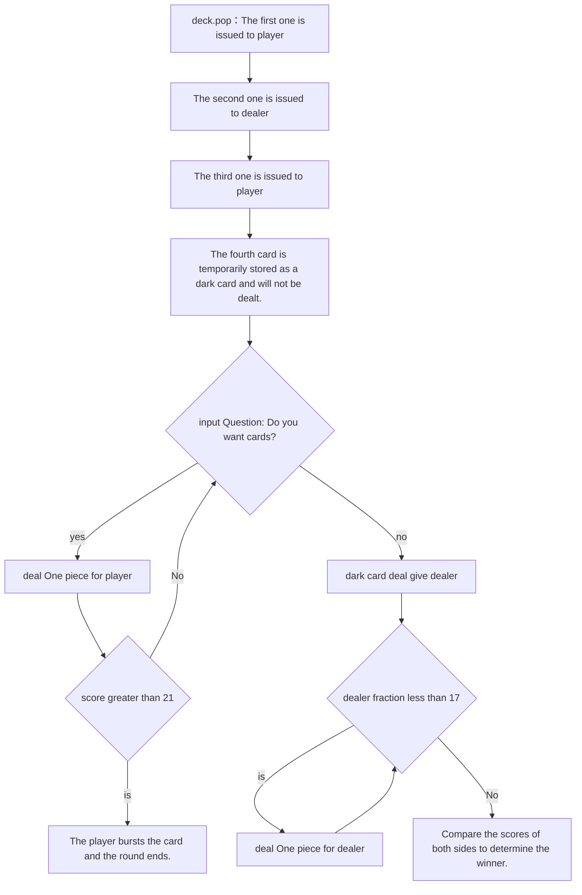

> **courses**: UC Berkeley CS61A · Structure and Interpretation of Computer Programs(Fall 2024)
> **This lecture**: Lecture 38 ｜ 26:22 ｜ Station B P 36 ｜ [Original video](https://www.bilibili.com/video/BV1sy411z7nA?p=36)
> **courseware**: `36-Databases_1pp.pdf` (13 pages, official PDF, page-by-page renderings see text illustrations)
> **subtitles**: Original English subtitles from Station B; this note is a reconstruction of Chinese writing, not a sentence-by-sentence translation.
> **Copyright**: The copyright of the course and courseware belongs to the UC Berkeley CS61A teaching team; this article is a secondary arrangement for learning purposes

## Quick overview of this lecture

*(Reference time: 00:00:01 – 00:00:21｜Lecture 38)*


- **Mastered**: `SELECT`  The five clauses of the statement (`SELECT`, `FROM`, `WHERE`, `GROUP BY`, `HAVING`) and  `ORDER BY`  Sorting; for multi-table queries, use commas to combine tables, use  `WHERE`  Write connection conditions; `CREATE TABLE ... AS SELECT ...`  The results of a query can be directly named as a table.
- **Main line of this lecture**:
    - Tables can be named or forgotten: `CREATE TABLE`  Give a table a name, `DROP TABLE`  Remove the name along with the table.
    - Column constraints can be added when creating a table: `UNIQUE`  Reject duplicate values, `DEFAULT`  Fill in missing values during insertion.
    - After the table is created, it can be modified: `INSERT`  Add line, `UPDATE`  Change career, `DELETE`  delete line, `WHERE`  Determine which rows are affected.
    - Python's standard library  `sqlite3`  Allows a program to construct a SQL string and execute it on the database, with the result  `list` of `tuple`  read back in the form.
    - Must be completed after modification  `commit`, the changes are written to the disk  `.db`  File; this is the boundary of the transaction.
    - Multiple programs can be connected to a database at the same time. This lecture uses "Black Jack Simulator written in Python + `sqlite3`  Command Line" demonstrates two clients sharing a  `cards`  table.
- **Key conclusions**: The tables in the previous lectures are all constructed in a one-time session, and nothing is left after the session is closed; the database moves the table to the disk, so it becomes a shared resource between processes and remains after a power outage. **persistent state**. SQL is the language for operating this state, and Python is the language for generating SQL and consuming results. `commit`  It's the line between the two that must be crossed.

## 1. Building tables: from the complete syntax of SQLite to the classroom subset

*(Reference time: 00:00:01 – 00:03:03｜Lecture 38)*


A table can be given a name using the statement  `CREATE TABLE`;This name can also be forgotten using the statement  `DROP TABLE`. These two things sound mundane, but together they define the identity of a "table" in the database: an object referred to by a name that can be found repeatedly. All the queries written above only exist in one session. After the query is completed and the results are printed, the table will have no name and there will be no place to find it again.

The courseware splits the creation of tables into two parts: one is the complete syntax, and the other is the small piece that will actually be used in this course. The complete syntax is taken from the official SQLite document - a railway diagram.  `CREATE TABLE`  Every legal way of writing is drawn.

```text
CREATE [TEMP | TEMPORARY] TABLE [IF NOT EXISTS]
    [schema-name .] table-name
    ( column-def [, ...] [, table-constraint] ) [WITHOUT ROWID]

CREATE [TEMP | TEMPORARY] TABLE [IF NOT EXISTS]
    [schema-name .] table-name AS select-stmt
```

There are many sentence components in this picture, some of which are themselves compound expressions: `column-def`  It consists of a column name, a type name and several column constraints. The type name can be omitted; `column-constraint`  There are more forms, you can give names to constraints, and you can also declare primary keys (`PRIMARY KEY`), not empty (`NOT NULL`), unique (`UNIQUE`), check (`CHECK`), default value (`DEFAULT`), sorting rules (`COLLATE`) and foreign key.

The lecturer's approach was simple: these details belong to a database course and will not be covered in this lecture, leaving only the black parts of the railway map. The gray ones are abandoned branches, and the black ones are the preserved skeletons.


So there are only two paths left for the course subset, both written in the same skeleton:

```text
CREATE TABLE [IF NOT EXISTS] table-name AS select-stmt
CREATE TABLE [IF NOT EXISTS] table-name ( column-name [column-constraint ...], ... )
```

The first path is "Create a table using the results of a query"——`AS`  Followed by one  `SELECT`  statement. This usage has been seen many times before. Its value is that there is no need to declare the column first. The name and type of the column are determined by the query results. The second path is to "declare an empty table" - write a series of column definitions in parentheses. Each item only requires the name of the column, and zero or more column constraints can be attached behind it.

`IF NOT EXISTS`  It's a small switch: the table is only actually created when the name is not already occupied. Its purpose is to repeatedly execute the same table creation statement in a script without reporting an error.

There are only two column constraints that this course will be concerned with. `UNIQUE`  It means that duplicate values are not allowed in this column, and an error will be reported when inserting if violated; `DEFAULT`  Specify a default value for a column. If no value is provided for this column when inserting a new row, this default value will be used to fill it in. The two examples given in the courseware are:

```sql
CREATE TABLE numbers (n, note);
CREATE TABLE numbers (n UNIQUE, note);
```

The first sentence creates a table with two columns: `n`  is a number, `note`  is a note about this number. The second sentence  `n`  Declare it to be unique, so the rule "each number can only have one comment" does not need to be written in any Python code, but is executed by the database itself. A third variation dictated by the instructor adds a default value to this:

```sql
CREATE TABLE numbers (n UNIQUE, note DEFAULT 'no comment');
```

What this sentence means is: if you only give  `n`, `note`  will automatically become  `'no comment'`, so "each number always has a comment" is guaranteed by the database, not by the callee.

| grammatical components | colors on railway map | Processing of this lecture |
| :--- | :--- | :--- |
| `TEMP` / `TEMPORARY` | gray | Not involved, the life cycle of temporary tables is not within the scope of the course |
| `IF NOT EXISTS` | black | Reserved for reproducible table creation scripts |
| `schema-name .` | gray | Not involved, this lecture only uses the default schema |
| `table-name` | black | Reserved, everything in the table is referred to by this name |
| `column-def` (listed) | black | Reserved, must be written when declaring an empty table |
| `type-name` (type name) | gray | Not involved, the type is not declared in the course |
| `table-constraint` (table-level constraints) | gray | Not involved, cross-column constraints are not expanded |
| `AS select-stmt` | black | Keep it and use the query results to create a table |
| `WITHOUT ROWID` | gray | Does not cover, details of storage layout |
| `UNIQUE` | black | Reserved, unique constraints |
| `PRIMARY KEY` / `NOT NULL` / `CHECK` / `COLLATE` / foreign key | gray | Not covered, left to the database course |
| `DEFAULT` | gray | It is painted in gray in the picture, but it is actually used in the demonstration and it is "just understand" |

> **Editor's note**: Railway map handle  `DEFAULT`  is painted gray, and the demonstration in Section 4 does use  `prime DEFAULT 1`, the reason is that the coloring standard of this picture is "whether the course is explained", not "whether the statement is legal". In addition, `type-name`  In SQLite, it is just a hint of affinity (type affinity). It is not mandatory to write or write anything. This is a special feature of SQLite. Standard SQL requires columns to have types, and other database products usually refuse to insert text into integer columns.

An empty table seems useless, but its usefulness appears immediately: you can add rows to an existing table, so the table will not be empty forever. This is the subject of the next section and the one after that.

## 2. Delete tables: DROP TABLE and IF EXISTS

*(Reference time: 00:03:04 – 00:03:29｜Lecture 38)*


`DROP TABLE`  Than  `CREATE TABLE`  Much simpler, it only does one thing: remove an existing name and the table it points to from the database.

```text
DROP TABLE [IF EXISTS] [schema-name .] table-name
```

in brackets  `IF EXISTS`  When creating the table  `IF NOT EXISTS`  Symmetry: Deletion is only performed if the name actually exists. Omitting it and deleting a name that doesn't exist will result in an error instead of silent nothing. This error is actually useful - it indicates that the script's assumptions about the state of the database are wrong.

There is a distinction that needs to be remembered in advance: `DROP TABLE`  What was deleted was **table itself** (names, columns, and all rows disappear together), later in section 5  `DELETE`  What was deleted was **rows in table** (The table is still there, just empty). Both are used in demonstrations, and the effects are completely different.

## 3. Insertion: three forms of INSERT

*(Reference time: 00:03:30 – 00:05:16｜Lecture 38)*


An empty table only makes sense if it can be modified. In fact, any table can be modified in three ways: inserting new rows, deleting old rows, and modifying values ​​in existing rows. This section talks about the first type.

`INSERT`  The complete syntax of is also given as a railway diagram, again with a large grayed-out branch: `REPLACE`, `INSERT OR REPLACE`, `OR ROLLBACK`, `OR ABORT`, `OR FAIL`, `OR IGNORE`, and  `WITH`  introductory clause. These are conflict handling strategies - what to do when an insertion violates a constraint. This lecture will not expand on them.


The skeleton that remains is: `INSERT INTO`  Table name, choose one of the following three - or directly follow  `VALUES` (Meaning to give values to all columns in order), or list the column names to be filled in brackets followed by  `VALUES`, or follow a  `SELECT`  statement. The courseware explains "A table with two columns" `t`” gives the most basic line:

```sql
INSERT INTO t VALUES (value0, value1);
```

The values separated by commas are the values of each column in this row, corresponding to the order of the columns when creating the table. If you only want to fill in one column, write the column name first:

```sql
INSERT INTO t (column_name) VALUES (value);
```

At this time the entire row will still be inserted, and the other column that is not mentioned is used  `DEFAULT`  Supplement - If there is no default value for that column, you will get a null value. On the other hand, not writing column names means that all columns must be given values, and no column can be omitted. Both writing methods only insert one row. To insert multiple lines, write parentheses after them: commas separate multiple sets of brackets, each set of brackets is one line.

```sql
INSERT INTO t VALUES (value0, value1), (value2, value3), (value4, value5);
```

The third form replaces the source of the value with a query, which is  `INSERT`  The most powerful part: if the query returns a few rows, just insert a few rows into the table, and these values can be calculated.

```sql
INSERT INTO t SELECT n FROM numbers;
```

| criterion | `INSERT INTO t VALUES (...)` | `INSERT INTO t (列, ...) VALUES (...)` | `INSERT INTO t SELECT ...` |
| :--- | :--- | :--- | :--- |
| source of value | literal | literal | Results from another query |
| Whether to write column names | Do not write, correspond to all columns according to position | To write, only list the columns you want to fill in | Don’t write, correspond by location |
| Column not mentioned | There is no such situation | use  `DEFAULT`  make up | There is no such situation |
| Insert multiple rows at once | brackets, commas, brackets | brackets, commas, brackets | Insert as many rows as the query returns |
| Typical uses | Manually enter a few lines of data | Only care about some columns | Batch copy or transform existing data |

## 4. Demonstration: primes table, column constraints and UPDATE

*(Reference time: 00:05:18 – 00:09:52｜Lecture 38)*

The demonstration starts with starting SQLite from the command line and building a table that records "whether a positive integer is a prime number". The name is  `primes`, two columns: `n`  is a number, `prime`  Record whether it is prime.

```text
sqlite> CREATE TABLE primes (n, prime);
```

This sentence does not attach any column constraints, but it could have been attached. To change to a constrained version, the fastest way is not to modify it, but to delete it and start over:

```text
sqlite> DROP TABLE primes;
sqlite> SELECT * FROM primes;
Error: no such table: primes
```

The second sentence reports an error because the name no longer exists. Rebuild the table and write the constraints clearly this time:

```text
sqlite> CREATE TABLE primes (n UNIQUE, prime DEFAULT 1);
```

`n UNIQUE`  Make sure there is only one line for each number, `prime DEFAULT 1`  Give a tendentious default value for something - the lecturer's statement is "first assume it is a prime number, and then use evidence to overturn it." This is a noteworthy way of writing: the default value not only fills in data, it also encodes a position.

Here I encounter a detail of SQLite: it does not have a Boolean type and cannot be written  `true`  and  `false`, it is customary to use  `1`  means true, `0`  means false.

```text
sqlite> SELECT * FROM primes;
sqlite> INSERT INTO primes VALUES (2, 1), (3, 1);
sqlite> SELECT * FROM primes;
2|1
3|1
```

first time  `SELECT *`  There is no output and no error - the table exists, just empty. After inserting 2 and 3, both rows are prime numbers, so  `prime`  The columns are all 1.

Next, use the default value: only give  `n`  Give value, `prime`  Leave it to the database.

```text
sqlite> INSERT INTO primes (n) VALUES (4), (5), (6), (7);
```

One line of statements is inserted into four lines, each line's  `prime`  All are default 1. At this time, the table claims that 4, 5, 6, and 7 are all prime numbers, but 4 and 6 are obviously not - this dirty state of "marking them all as prime numbers first" is deliberately left, and will be used later.  `UPDATE`  Clean up.

To quickly expand the size of a table, you don't have to write row by row. `INSERT ... SELECT`  You can process the existing numbers in the table and insert them back:

```text
sqlite> INSERT INTO primes SELECT n + 6 FROM primes;
```

This statement reads the table before execution (2 to 7), calculates 8 to 13, and appends it to the table; the table then covers 2 to 13. Do it again and add 12:

```text
sqlite> INSERT INTO primes SELECT n + 12 FROM primes;
```

There are now 24 rows in the table, from 2 to 25. Pay attention to  `INSERT ... SELECT`  The evaluation order of: the query is calculated first, the result set is formed first, and then inserted row by row, so what is "read" is not an intermediate state during the insertion process. The second operation in the above example relies on this to copy the entire number 2 to 13 into 14 to 25 without causing self-proliferation out of control.

| statement | Internal and external  `n` | Number of lines |
| :--- | :--- | ---: |
| Just created table | None | 0 |
| `INSERT INTO primes VALUES (2, 1), (3, 1);` | 2, 3 | 2 |
| `INSERT INTO primes (n) VALUES (4), (5), (6), (7);` | 2 – 7 | 6 |
| `INSERT INTO primes SELECT n + 6 FROM primes;` | 2 – 13 | 12 |
| `INSERT INTO primes SELECT n + 12 FROM primes;` | 2 – 25 | 24 |
| `DELETE FROM primes WHERE prime = 0;` | 2, 3, 5, 7, 11, 13, 17, 19, 23 | 9 |

After the table is created, you can also modify existing rows. The syntax is  `UPDATE`  Table name, `SET`  List  `=`  Expression, optional one  `WHERE`  Explain which lines to change.

```text
UPDATE table-name SET column-name = expression [WHERE expression]
```

Omit  `WHERE`, what is changed is all the rows in the table; plus  `WHERE`, only rows that meet the conditions are changed. This is a convention shared by the three modification statements: `WHERE`  Determine the scope of the spread, without which it means the whole table.


clean now  `prime`  columns. Except for 2 itself, all multiples of 2 are not prime numbers, so even numbers greater than 2 are marked as 0 at once:

```sql
UPDATE primes SET prime = 0 WHERE n > 2 AND n % 2 = 0;
```

Then add multiples of 5:

```sql
UPDATE primes SET prime = 0 WHERE n > 5 AND n % 5 = 0;
```

After execution  `SELECT *`, multiples of 2 are no longer marked as prime numbers.

> **Editor's note**: Using only the two sieves of "multiples of 2" and "multiples of 5" cannot match all the numbers from 2 to 25 - 9 and 21 are neither even numbers nor multiples of 5, and will be mistakenly left on the "prime number" side. The lecturer dictated, "Which ones between 2 and 25 are prime numbers and which ones are not, now they are all marked correctly." The premise is that the two sieves of multiples of 3 and multiples of 7 were also run during the demonstration.

After adding these two items, the complete set of marked sentences is as follows (the last sentence  `n > 7`  is to preserve 7 itself):

```sql
UPDATE primes SET prime = 0 WHERE n > 2 AND n % 2 = 0;
UPDATE primes SET prime = 0 WHERE n > 3 AND n % 3 = 0;
UPDATE primes SET prime = 0 WHERE n > 5 AND n % 5 = 0;
UPDATE primes SET prime = 0 WHERE n > 7 AND n % 7 = 0;
```

Four sentences to finish, 2 to 25 miles to maintain  `prime = 1`  are exactly the nine prime numbers 2, 3, 5, 7, 11, 13, 17, 19, and 23; the sentence in verse 5  `DELETE FROM primes WHERE prime = 0`  It is executed in this state.

This demonstration conveys a methodology: the table does not have to be built in one go. It is much easier to build roughly first, then fill in batches, and then correct each item one by one than trying to write the correct state in one sentence at once. The lecturer made this clear: Sometimes it is easier not to build the table in one go, but to manipulate its value after it is built.

## 5. Delete: DELETE and empty table

*(Reference time: 00:09:53 – 00:10:33｜Lecture 38)*

The third modification is to delete rows. The grammar is just a skeleton:

```text
DELETE FROM table-name [WHERE expression]
```


`WHERE`  The effect is the same as  `UPDATE`  Same, determine which rows are deleted; do not give  `WHERE`, all rows in the table will be deleted.

Back to the demo, put  `prime`  Delete all rows with 0:

```text
sqlite> DELETE FROM primes WHERE prime = 0;
sqlite> SELECT * FROM primes;
```

All that's left are prime numbers. There is a distinction that must be made here: `DELETE`  The table still exists, but without any rows - its columns are still there, their names are still there, and new rows can continue to be inserted into it. And  `DROP TABLE`  After that, even the table no longer exists, and the query will report again.  `no such table`. Empty tables and non-existent tables are two completely different states, and many script errors stem from confusing the two.

## 6. Python and SQL: hand over the SQL string to sqlite3 for execution

*(Reference time: 00:10:35 – 00:13:28｜Lecture 38)*


So far, SQL statements have been typed by hand in the interactive environment that comes with the database. Real usage is not like this: SQL statements are usually generated by a program and then handed over to the database for execution. Python can do this because the standard library comes with a database driver  `sqlite3`.

The courseware gives a minimal version of the entire process:


```python
import sqlite3

db = sqlite3.Connection('number.db')
db.execute('CREATE TABLE nums AS SELECT 2, 3 UNION SELECT 4, 5;')
db.execute('INSERT INTO nums VALUES (?, ?), (?, ?);', range(6, 10))
print(db.execute('SELECT * FROM nums;').fetchall())
db.commit()
```

These six statements are worth breaking down one by one.

`import sqlite3`  Import module. `sqlite3`  It is part of the CPython standard library and does not need to be installed separately. This will be mentioned at the end of Section 7 - if you change to PostgreSQL or MySQL, the driver will need to be installed separately.

`db = sqlite3.Connection('number.db')`  Construct a  `Connection`  object, the parameters are **Database file name**. This name can be chosen arbitrarily. The lecturer used it in the demonstration.  `n.db`, the courseware is finalized and written  `number.db`. filename points to a file on disk; if the file does not exist, SQLite creates an empty database. So "connecting to the database" in SQLite is "opening a file" - this sentence is the understanding behind  `commit`  key.

`db.execute('CREATE TABLE nums AS SELECT 2, 3 UNION SELECT 4, 5;')`  A table creation statement was executed. It directly names the results of a query into tables  `nums`: `SELECT 2, 3`  with  `SELECT 4, 5`  use  `UNION`  Put them together to get a result with two rows and two columns. `CREATE TABLE nums AS`  Consolidate this result. Without this layer of packaging, `SELECT 2, 3 UNION SELECT 4, 5`  It can also be executed, and you will get a table with two rows and one column - but the table has no name, it is gone after use, and cannot be referenced again. `CREATE TABLE ... AS`  All it does is give it a name.

`db.execute('INSERT INTO nums VALUES (?, ?), (?, ?);', range(6, 10))`  This is the most noteworthy item in this lecture:

```python
db.execute('INSERT INTO nums VALUES (?, ?), (?, ?);', range(6, 10))
```

Four are left in the SQL string  `?`, they are **placeholder** (placeholder), not the content to be executed; the real value is given by  `execute`  The second parameter is provided. What is being passed on here is  `range(6, 10)`, that is, the four numbers 6, 7, 8, and 9 are filled in the four holes in order to get two lines  `(6, 7)`  with  `(8, 9)`. It is this division of labor that the lecturer emphasizes: values can be calculated in any way in Python - list comprehension, `range`, read from files, get from the network - as long as it can form a sequence, it can be stuffed into the hole of the SQL statement.

`print(db.execute('SELECT * FROM nums;').fetchall())`  It's reading. `execute`  Execute one  `SELECT`  What is returned is a **Cursor** (cursor) object, not the result itself; call to cursor  `fetchall()`, and then take out all the contents of the result table, the shape is  `list` of `tuple`, each tuple is a row. put it  `print`  Come out, this is the output of this lecture:

```text
[(2, 3), (4, 5), (6, 7), (8, 9)]
```

Four rows and two columns, consistent with the previous deduction. This shape is very important: it is the most common data structure in Python and can be directly  `for`  Loopable, indexable, and summable. When the results of the database query arrive on the Python side, they become tables in memory (Section 7 will carefully compare these two tables).

> **Editor's note**: In the subtitles, the lecturer said, "Print out five tuples, each with only one element, and that element is the content of the line." and said  `n.db`  inside  `nums`  The content is  `2、3、4、5、6`. This is different from the result given by the six lines of code in the courseware finalization: the courseware uses  `SELECT 2, 3 UNION SELECT 4, 5`  Built **two columns** table, then use  `range(6, 10)`  Fill in two 2-tuples and the result is 4 2-tuples. The demo session uses **single column** Variant - for creating tables  `CREATE TABLE nums AS SELECT 2 UNION SELECT 3;`, for inserting  `INSERT INTO nums VALUES (?), (?), (?);`  Match  `range(4, 7)`, so we get five single-element tuples  `(2,)、(3,)、(4,)、(5,)、(6,)`. The two versions demonstrate the same mechanism, the courseware version is neater, and the subtitles describe the live version. This article is based on the courseware code, and the output is calculated based on the courseware code.

> **Editor's note**: `?`  Placeholders also have another value that the lecturer did not point out: it completely separates "value" from "grammar". If the diagram is easily written as string concatenation, for example, user input is formatted directly into SQL text, then as long as a single quote or semicolon is included in the input, it is enough to change the structure of the entire statement - this is SQL injection. When using placeholders, the driver will send the parameters to the database as data instead of parsing them as part of the SQL text, so the injection entry is closed. In the examples in this lecture, the parameters are all integers calculated by ourselves. There is no such risk, but in any situation where external input is accepted, `?`  Adding a parameter list is the only correct way to write it.

By drawing the process in this section as a pipeline, you can see clearly what each step is responsible for:



| steps | code | function | What to return |
| :--- | :--- | :--- | :--- |
| ① Connect | `sqlite3.Connection('number.db')` | Open (or create) database file and establish session | `Connection`  object |
| ② Create table | `db.execute('CREATE TABLE ...')` | Consolidate the query results into a named table | Cursor (content is useless) |
| ③ Write | `db.execute('INSERT ...', range(6, 10))` | Fill in with parameters  `?`  Placeholder, insert row | Cursor (content is useless) |
| ④ Read | `db.execute('SELECT ...').fetchall()` | Execute the query and retrieve all results | `list` of `tuple` |
| ⑤ Submit | `db.commit()` | Write the changes for this session to the file | `None` |

## 7. Submit: tables in memory and files on disk

*(Reference time: 00:13:31 – 00:14:41｜Lecture 38)*

After the above six lines of code are run, there will be output on the screen, but there may be nothing on the disk. To make the changes actually fall into the database file, another method must be called:

```python
db.commit()
```

The lecturer's explanation of it is short but crucial: after the submission is successful, this file contains all the content, and it is the database "constructed by executing this series of SQL statements." In other words, `commit`  Previously, those changes only belonged to the current connection; `commit`  After that, they belong to files.

The demonstration was followed by verification: re-run the program and use the SQLite command line to  `n.db`  Start the database, `SELECT * FROM nums`  The result is exactly the five numbers printed by the Python side - the table and rows are in the file.

```text
$ sqlite3 n.db
sqlite> SELECT * FROM nums;
2
3
4
5
6
```

This step is the turning point of the entire lecture. Before, the table in the demo was used and discarded in a one-time session; now, the table becomes something that exists independently of any process: it is still there when the Python program exits; you can still see it when you open the same file with another command line tool.

| criterion | Table in the program (`list` of `tuple`) | Database table on disk |
| :--- | :--- | :--- |
| Lifetime | Disappears when the process ends | The file is still there, even after a power outage. |
| who can see | only the process holding it | Any connection that can open the file |
| Visibility of changes | immediately | `commit`  Only then visible to other connections |
| failure mode | Memory is lost and all data is lost | Uncommitted changes are discarded and submitted changes are retained. |
| What can be saved | any Python object | Column values supported by the database (SQLite is integer, real, text, binary, null) |
| access cost | memory speed | There is disk and locking overhead in exchange for persistence and sharing. |

`commit`  The line drawn is called in database terminology **affairs** (transaction) boundary: once  `commit`  All previous modifications constitute a unit of work, and either all of them will take effect or none of them will take effect. The lecturer did not use the word "business"; he just said  `commit`  and "the document contains everything," but that line is what he describes.



> **Editor's note**: The following three points are correct  `commit`  Semantic supplements, courseware and subtitles are not developed. One is implicit transactions: CPython’s  `sqlite3`  In the default configuration (`isolation_level=""`), a transaction will be automatically started before executing the modification statement, so "forget  `begin`” will not go wrong, but “forgot  `commit`” will leave the changes hanging there. Before Python 3.6, `CREATE TABLE`  This type of DDL is not included in implicit transactions and will take effect immediately; after 3.6, DDL is also included in the same transaction. Available from Python 3.12  `autocommit`  Properties explicitly control this set of behavior. The second is atomicity and collapse: if in  `commit`  The process was killed before and the transaction was not committed. SQLite relied on the journal (journal/WAL) to restore the file to the last committed state - this is the meaning of the "process crash, changes discarded" side in the above figure. The third is rollback: the corresponding method is  `db.rollback()`, proactively discard uncommitted changes. It does not appear in the demonstration of this lecture, but it is the other half of the "transaction boundary"——`commit`  To confirm it, `rollback`  It's to undo it.

Finally, the lecturer added the scope of application: the same writing method can be connected to various databases, but SQLite happens to be in the standard library. Others (such as PostgreSQL) need to install the driver yourself and then use the same  `Connection` / `execute` / `commit`  Three steps to use. The division of labor between SQL statements and Python code does not change depending on the database product.

## 8. Multiple connections: same database, two clients

*(Reference time: 00:14:44 – 00:15:16｜Lecture 38)*


Once the database becomes a file, something that was impossible in the era of memory tables happens: multiple programs can connect to the same database at the same time, read and modify the same batch of tables together.

This sentence sounds mundane, but it is the reason why databases exist. If the table is just one in a program  `dict`, another program wants to take a look, the only way is to let the first program export the data; and the database puts the "table" in a place that both can open, so the two processes have a shared and negotiable state.

The courseware uses a game of blackjack to demonstrate this: a simulator written in Python is responsible for dealing cards and rules, and a  `sqlite3`  The command line takes care of observing (and cheating). There isn't any direct communication between the two, the only interface is that  `cards.db`  file.

> **Editor's note**: The concurrency model of SQLite is "multiple reads and single writes": there can be any number of connections reading at the same time, but writing will lock the entire database file. When the writing transaction is not completed, another connection will write  `database is locked`. The demonstration in this lecture is one program writing and another program reading, which happens to fall into the scenario where SQLite is best at. Real multi-user databases (PostgreSQL, etc.) use row-level locking and finer concurrency control, which is part of the database course.

## 9. Black Jack Rules: A game that requires shared state

*(Reference time: 00:15:17 – 00:17:25｜Lecture 38)*


The rules of casino blackjack are not complicated. The player takes two cards, and the dealer takes two cards, one open card and one hidden card. The goal is to have more points than the dealer, but if you go over 21, you lose. Players can continue to ask for cards (hit) to increase points, or they can stop (stay). The suit does not affect the points, so all spades are used in the demonstration; points from 2 to 10 are calculated according to the card face, and J, Q, and K are all counted as 10 points; A is more special and can be counted as 1 point or 11 points. The card holder chooses an algorithm that is beneficial to him or her.

| brand | Points |
| :--- | :--- |
| A | 1 or 11, licensee’s choice |
| 2 – 10 | face value |
| J, Q, K | 10 |

The instructor goes over the rules with a specific hand of cards. The player takes a 7 first, the dealer's upcard is a jack, and the player takes a 9 again, for a total of 16. 16 is not high, and the dealer is probably higher, so he asks for one - here comes the 5, for a total of 21. This result is good: no more than 21, and more likely than the dealer.

After the players stop playing, it is the dealer's turn. The dealer reveals the hidden cards first, adding up to 13 points. Casino rules dictate that the dealer must keep asking for cards until the count falls between 17 and 21. 13 is not in this range, so I want one: the one coming is Ace.

Here arises A's dilemma. Count 1 point, and the total is 14; count 11 points, and the total is 24. If 24 exceeds 21, the dealer loses on the spot, so the only rational choice is to count 1 point, and the dealer stops at 14. One more thing: here comes 10. 14 plus 10 equals 24, and anything over 21 is called a bust, and the dealer loses the hand.

If the card is not a 10 but a 7, the dealer's blackjack is tied with the player's blackjack. This "if" is important: it means that Black Jack's outcome depends not only on the cards in his hand, but also on what cards are left in the deck, and the latter thing is a question that a database can answer.

## 10. Write the game as a program: a cards table and a query interface

*(Reference time: 00:17:27 – 00:21:36｜Lecture 38)*

The instructor read the entire simulator. The program is not long. The idea is to leave the matter of "where the cards are" completely to the database: the only source of fact on the table is a card.  `cards`  Table, two columns -`card`(`2`  Arrive  `10`, `J`, `Q`, `K`, `A`) and  `who` (Who holds this card: `dealer`, `player`, or has been thrown into the discard pile).

The first step is to record the points in a dictionary. A first counts 1 point, J, Q, and K all have 10 points, and 2 to 10 is the face value.

```python
points = {'A': 1, 'J': 10, 'Q': 10, 'K': 10}
points.update({str(n): n for n in range(2, 11)})
```

`dict.update`  Its function is to merge the key-value pairs of another dictionary. The lecturer specifically explained: it accepts a dictionary and adds the elements inside to the current dictionary.

The second step is to use a function to score the "hand". A hand of cards is a bunch of cards. Find out the points of each card and add them up; if the total does not exceed 11 and you have an A in your hand, change the value of the A from 1 to 11, and add 10 to the total.

```python
def score(hand):
    total = sum(points[card] for card in hand)
    if total <= 11 and 'A' in hand:
        total += 10
    return total
```

The effect of this rule is: a jack plus an ace, the total is only 11, and adding 10 becomes 21, which is much better than 11. Why is the condition written as "not exceeding 11": Because only when the sum is very small, increasing A to 11 will not exceed 21. The instructor calls this "Black Jack's Rules Encoded in Python Functions."

The third step is the database connection, and an alias to save typing:

```python
db = sqlite3.Connection('cards.db')
sql = db.execute
```

From now on in this program, `sql(...)`  with  `db.execute(...)`  It's the same thing.

The fourth step is to create a table. First unconditionally delete the old table so that you can start from scratch every time, and then create a new table with two columns:

```python
sql('DROP TABLE IF EXISTS cards')
sql('CREATE TABLE cards (card, who)')
```

`DROP TABLE IF EXISTS`  The purpose here is clear: the program will be run repeatedly, and the table will not exist the first time it is run, with  `IF EXISTS`  There will be no error.

The fifth step is a dealing function and the query interface behind it:

```python
def deal(card, who):
    sql('INSERT INTO cards VALUES (?, ?)', (card, who))

def cards_of(who):
    rows = sql('SELECT card FROM cards WHERE who = ?', (who,))
    return [card for card, in rows.fetchall()]

def bust(who):
    return score(cards_of(who)) > 21
```

`cards_of`  That sentence  `WHERE who = ?`  The second parameter of is a Python value -`'player'`  or  `'dealer'`, exactly what the lecturer emphasized "feeding Python values ​​into the holes of SQL"; each row of the query result is a single-element tuple, so the list derivation must be written as  `for card, in ...`  Take it apart. `bust`  This explains the definition of "busting": the score is greater than 21.

The sixth step is the main process of a hand. The order of dealing cards is fixed: the first card is given to the player, the second card is given to the banker, the third card is given to the player, and the fourth card is the dealer's hidden card - this card is taken out of the deck first, but it is not dealt out yet because it has not been revealed yet.

```python
def play(deck):
    deal(deck.pop(), 'player')
    deal(deck.pop(), 'dealer')
    deal(deck.pop(), 'player')
    hidden = deck.pop()
    while not bust('player') and input('hit? ') == 'yes':
        deal(deck.pop(), 'player')
    if bust('player'):
        print('player busts')
        return
    deal(hidden, 'dealer')
    while score(cards_of('dealer')) < 17:
        deal(deck.pop(), 'dealer')
    dealer = score(cards_of('dealer'))
    player = score(cards_of('player'))
    print('dealer', dealer, 'player', player)
```

The player phase uses one  `input`  Loop: Ask if you want a card, if you want another card, you will be dealt another card. After the card is dealt, you will be judged as a busted card again; if you don’t want it, you will enter the dealer stage. In the dealer stage, the hidden cards are dealt out first, and then dealt out until the number of points is no less than 17. If either party busts a card, the hand ends immediately; otherwise, the scores of both sides are compared.

Finally, there is the deck and the global cycle. There are four cards of each point in a deck of cards (corresponding to four suits). Copy four copies of all the keys in the point table and put them into the list. Use  `random`  Modular  `shuffle`  Shuffle, and then play one round after another; at the end of each round, move all the cards still in the players' and dealer's hands to the discard pile.

```python
deck = [card for card in points for _ in range(4)]
random.shuffle(deck)
while True:
    play(deck)
    sql("UPDATE cards SET who = 'discard' WHERE who = 'player' OR who = 'dealer'")
    db.commit()
```

> **Editor's note**: The courseware does not give a complete picture of this program. The above code is restored in the order of the lecturer's dictation in the subtitles: Dictionary integral and  `points.update`, `score`  The "A plus 10" rule, `db = sqlite3.Connection('cards.db')`, `sql = db.execute`  alias, `DROP TABLE IF EXISTS`  Add two columns  `cards`  table, `WHERE who = ?`  query, bursting card criterion, four cards for each point, `random.shuffle`  Shuffle the cards and move the cards to the discard pile at the end of each round. The variable names and specific writing methods may differ from the original code on the screen. The logical order and keywords are based on the subtitles. In addition, every time  `deal`  Later, the lecturers emphasized that  `commit`, the above restoration puts it at the end of each game, and the effect is equivalent - as long as it is submitted before using another connection to observe next time.

The control flow of a hand is drawn like this:



## 11. Watching and cheating: using SQL client to look at the same table

*(Reference time: 00:21:37 – 00:26:20｜Lecture 38)*

After the program started running, the screen stopped at the question "Want a card or stop". The people in it at this time don’t know what to do because they can’t see what cards they have in their hands. The solution is the demonstration at the end of this lecture: open another terminal and create another connection with the same database file name.

```text
$ sqlite3 cards.db
sqlite> SELECT * FROM cards;
```

All cards on the table are now visible. Hand 1: Players are 3 and 4, dealer's upcard is 7. The player only has 7 points and obviously wants a card; a Jack comes, totaling 17 points, but the dealer only has 7 points and chooses to stop. The Python side finished the hand - the dealer revealed the hidden card Q, 7 plus 10 equals 17, 17 to 17, a draw.

```text
sqlite> SELECT * FROM cards;
```

Checking again reveals the complete record of the previous hand: the dealer's original 7, as well as the hidden queen.

Second hand: The player is J and 6, 16 points; the dealer shows 6. Although 16 points is not high, the risk of getting the card is busting, so the hand is stopped. As a result, the dealer reaches 18 points and the player loses.

When the third hand started, the discard pile was already too thick. `SELECT *`  There are a dozen or so cards that have been played mixed in the output, and it is not clear who has what. So I added a filter condition to only see cards that are still on the field:

```sql
SELECT * FROM cards WHERE who <> 'discard';
```

The player on this hand is a 4 and an Ace - counting 5 points or 15 points, neither algorithm is enough and must be taken again. Comes a 9, and the player's cards become 9, A, and 4, totaling 14 points. He can only ask for more; this time it explodes. This hand was lost again.

Fourth hand: Player 5 and A, 6 points or 16 points, want one; another A, 5, A, A is 7 points or 17 points.

At this point, players start to wonder what the next card will be, but a smarter way is to go back and count the cards: since all the cards that have been played are left in the table, they can count how many times each card has appeared. This is exactly the grouped aggregation from Lecture 37:

```sql
SELECT card, COUNT(*) FROM cards GROUP BY card;
```

The statistical results are: Ten has been out once, J has been out three times, Q has been out once, and K has not been out at all. This means there are plenty of Kings and Tens left in the deck - and the next card to be asked for is likely to be a 10-point card. At this time, the player has 17 points and the dealer's face card is 6 points. The dealer must keep playing cards until it is above 17. Since most of the remaining cards are big cards, the probability of the dealer busting the card is not low. So stop. Sure enough, the dealer busted the card and the player won.

The lecturer added an off-site comment here: In a casino, it is illegal to calculate the remaining cards by memorizing the discard pile like this - but it can indeed help you win.

The last hand demonstrated another illegal operation: changing the cards directly. The player gets a 4 and a Queen for a total of 14 points, the dealer's up card is 9 points, the hidden card is probably 10 points, and the dealer can reach 19 points at any time. If that 4 is replaced by an ace, the player has a blackjack of ace plus queen. The database allows this, in a sentence  `UPDATE`  It's enough:

```sql
UPDATE cards SET card = 'A' WHERE who = 'player' AND card = '4';
```

After checking again, the player has A and Q, blackjack, and has won the hand without needing any more cards.

| bureau | Player's hand | Banker’s name | player choice | result |
| :--- | :--- | :--- | :--- | :--- |
| 1 | 3, 4, ask for a card and get J (17 points) | 7 | Stop | The dealer's 7 plus the hidden Q gets 17, a draw. |
| 2 | J, 6 (16 points) | 6 | Stop | Banker 18 points, player loses |
| 3 | 4. A, I will ask for it after 9 | — | Ask for cards continuously | If you exceed 21 points, you will lose if you bust your cards. |
| 4 | 5. Ace, another Ace (17 points) | 6 | Stop | The dealer busts the card and the player wins |
| 5 | 4. Q, use  `UPDATE`  Change 4 to A | 9 | No need anymore | Blackjack, player wins |

After five games, the role of the database has always been the same: a shared state that both processes can read and write. The Python program changes it according to the rules, `sqlite3`  The command line reads it, counts it, and even changes it by bypassing the rules - there are no function calls between the two, the only coupling is that  `cards.db`  Files and  `cards`  Table column names. The lecturer ended the entire demonstration with one sentence: This is an example of two programs connecting to the same database and manipulating it together. One of the programs is Blackjack's Python emulator, and the other is an interactive SQLite read-evaluation-print loop.

## Summary

*(Reference time: 00:00:01 – 00:26:20｜Lecture 38)*

- **The database moves the table from memory to disk**: The tables in previous demonstrations will disappear with the session; once dropped  `.db`  In the file, the table has a lifetime independent of any process, and therefore can be shared by multiple clients.
- **To create a table, register the name and structure together.**: `CREATE TABLE`  Two roads -`AS SELECT`  Copy the query results, or declare columns in brackets; `DROP TABLE`  cancel registration, `IF EXISTS` / `IF NOT EXISTS`  Make the script repeatable.
- **Constraints are invariants given to the database**: `UNIQUE`  Ensure that a column is not repeated, `DEFAULT`  Fill in missing values. Writing the rules into the schema is more reliable than checking them repeatedly at each call point.
- **The three changes in the table share the same boundary**: `INSERT`  Add line, `UPDATE`  Change career, `DELETE`  delete line, `WHERE`  Determine the scope of influence; no  `WHERE`  It is the entire table, which is the most dangerous default value.
- **Python is responsible for creating statements and consuming results, and SQL is responsible for set operations.**: `db.execute`  execute string, `?`  Placeholders pass values in as parameters, `fetchall()`  Turn the result table into  `list` of `tuple`.
- **`commit`  is the boundary of the transaction**: Changes before submission only belong to the current connection, and only after submission belong to the file; uncommitted parts are discarded as a whole when a crash occurs - either all take effect, or none take effect.
- **The value of database is shared**: In the Blackjack demo, the two processes did not have any direct communication, but they were able to revolve around the same card.  `cards`  table collaboration; `SELECT ... WHERE`  It is the observation interface, `UPDATE ... WHERE`  It is the interference interface, and both use the same language.

## Attached: Slide index for this lecture

*(Reference time: 00:00:01 – 00:26:20｜Lecture 38)*

| page | content | Appear location |
| :--- | :--- | :--- |
| 1 | Title page: Databases | Quick overview of this lecture |
| 2 | Announcements section page | Quick overview of this lecture |
| 3 | Section page: Create Table and Drop Table | §1 |
| 4 | `CREATE TABLE`  Complete syntax railway diagram with two examples | §1 |
| 5 | `DROP TABLE`  Railway map (including  `IF EXISTS`) | §2 |
| 6 | Sectioned pages: Modifying Tables | §3 |
| 7 | `INSERT`  Railway map and how to write "insert a line" | §3 |
| 8 | `UPDATE`  railway map with  `SET` / `WHERE`  role | §4 |
| 9 | `DELETE`  railway map with  `WHERE`  optionality | §5 |
| 10 | Sectioned pages: Python and SQL | §6 |
| 11 | Six lines  `sqlite3`  Code: connection, table creation, insertion, retrieval, submission | §6 |
| 12 | Sectioned pages: Database Connections | §8 |
| 13 | Blackjack card example and dealer's light and dark cards | §9 |
