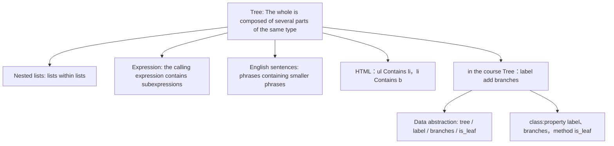
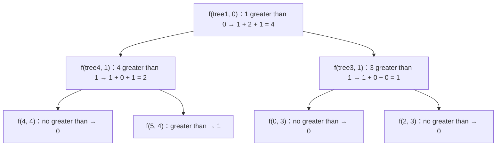
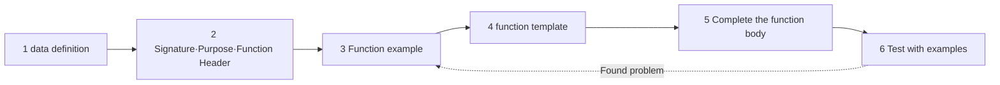
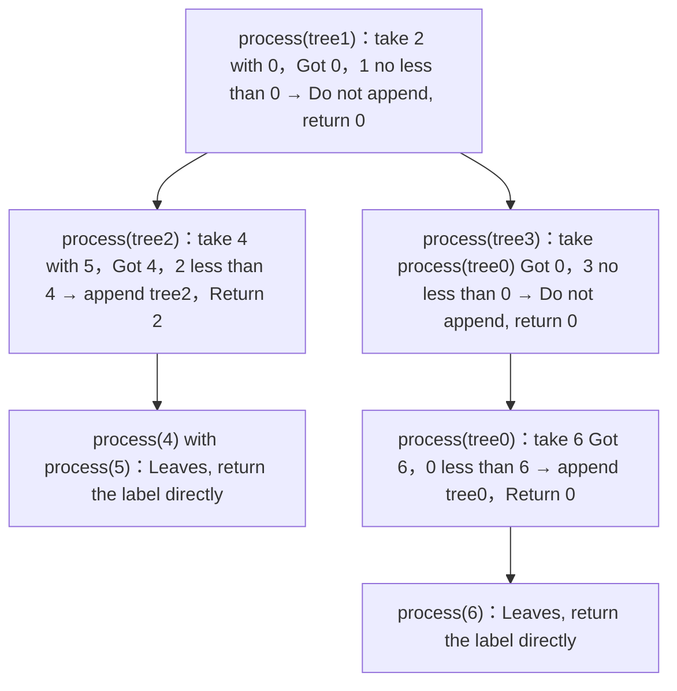

> **courses**: UC Berkeley CS61A · Structure and Interpretation of Computer Programs(Fall 2024)
> **This lecture**: Lecture 39 ｜ 38:48 ｜ Station B P 37 ｜ [Original video](https://www.bilibili.com/video/BV1sy411z7nA?p=37)
> **courseware**: No official courseware (final sample course, `pdf_pages = 0`); the question stem, code and illustrations are all displayed live in class, and the text is reconstructed according to subtitles
> **subtitles**: Original English subtitles of Station B (38:48, 491 paragraphs); this note is a Chinese written reconstruction, not a sentence-by-sentence translation
> **Copyright**: The copyright of the course and courseware belongs to the UC Berkeley CS61A teaching team; this article is a secondary arrangement for learning purposes

## Quick overview of this lecture

*(Reference time: 00:00:00 – 00:00:05｜Lecture 39)*

- **Mastered**: Data abstraction of tree (`tree`, `label`, `branches`, `is_leaf`) and its class representation; the "base case + recursive case" of tree recursion; `sum`, `min`  This type of horizontal aggregation collapses a list of sub-results into a single value; lists are mutable objects that can be rewritten in place in nested functions.
- **Main line of this lecture**:
    - Tree is an abstract concept in computer science: any "whole is composed of several similar wholes" is a tree; nested lists, expressions, English sentences, and HTML are all the same shape.
    - The final example questions do not rely on memorizing templates, but a set of reusable processes: understand the meaning of the question → hand-calculate the example → write down the components that must appear in the solution → read the template → fill in the blanks → follow up and verify.
    - The auxiliary functions of the two questions are not given by the question, but "first find out what information is missing, and then create a function that can carry this information."
    - There are two accumulation styles for the same question: accumulating the results along the return value, or initializing a variable container to update in place during traversal; the sub-goals are exactly the same, but the code shapes are different.
    - The six-step design method (How to Design Programs) separates "thinking" and "writing", advocates example-driven, and regards "writing for people to read" as one of the purposes of code.
- **Key conclusions**: The skeleton of tree questions is always "traversal + aggregation + boundary"; what really determines right or wrong is **Does the parameter in the recursive call carry ancestor (or descendant) information?**.

## 1. Why do trees appear in the final questions every year?

*(Reference time: 00:00:07 – 00:02:55｜Lecture 39)*

Trees are discussed many times in the course. There are two representations of the same abstract tree in the course: one uses a list, equipped with a constructor, two selectors, and an auxiliary function to determine whether it is a leaf; the other uses a class, using attributes to record labels and branches. The two representations describe the same thing, but the "how to get it" is changed from function call to attribute access.

Trees are neither a built-in type of Python nor a feature of the language. "Tree" in computer science is an abstract generalization: anything that "is itself composed of several smaller selves" is a tree. It has two main points: **There are other trees inside the tree**; and **Can hold more than one tree**. Because of this, this shape appears everywhere: nested lists are trees, expressions in Scheme or Python are trees (the operands that call expressions are themselves called expressions), the syntactic analysis of an English sentence is a tree (a sentence is broken into noun phrases, verb phrases and punctuation, and phrases are broken into smaller phrases), and the layout of a web page is also a tree (`HTML`  one inside  `ul`  There are several labels  `li`  label, `li`  It also contains text that is marked in bold.  `b`  label). Trees appear wherever data needs to represent hierarchical structures.

| criterion | data abstract representation | class representation |
|---|---|---|
| structure | `tree(label, branches)` | `Tree(label, branches)` |
| Get tags | `label(t)` | `t.label` |
| take branch | `branches(t)` | `t.branches` |
| judging leaves | `is_leaf(t)` | `t.is_leaf()` |
| Do you need a selector? | Required, all four names must be remembered | No, the attribute name just means |
| Basis for judging leaves | External auxiliary function | The method is inside the object, right  `self`  Determine whether there are branches |
| The cost of extending fields | To change the constructor and selector at the same time | Just add an attribute |

```python
# 数据抽象表示
t = tree(1, [tree(2), tree(3)])
label(t)          # 1
branches(t)       # [tree(2), tree(3)]
is_leaf(t)        # False

# 类表示
t = Tree(1, [Tree(2), Tree(3)])
t.label           # 1
t.branches        # [Tree(2), Tree(3)]
t.is_leaf()       # False
```

> **Editor's note**: There is no official courseware for this lecture. The codes on the slides cannot be verified word for word. The text codes are reconstructed sentence by sentence according to the subtitles and have been verified by actual running. The subtitles of this lecture record the function name of the first question as  `biggs`／`Biggs`, this article is written uniformly  `bigs`. In order for the example to actually run, the text also needs a minimum  `Tree`  category; it is filled out according to the usual way of writing in the course, `repr`  The specific format does not affect any conclusions.

This scaffolding is only used in the main text, and the following code is based on it:

```python
class Tree:
    def __init__(self, label, branches=()):
        self.label = label
        for branch in branches:
            assert isinstance(branch, Tree)
        self.branches = list(branches)

    def is_leaf(self):
        return not self.branches
```

The shape of the tree is important because **The shape of the code that handles the tree will be determined by it**. Tree processing almost always makes recursive calls to subtrees: the function gets a node and calls itself on each of its subtrees. This is also the primary reason why the course puts great effort into teaching recursion - not to show off skills, but to be able to manipulate this kind of data.



## 2. Example 1  `bigs`: Read the question first before taking action

*(Reference time: 00:02:56 – 00:07:40｜Lecture 39)*

The first question has only two sentences: Realization  `bigs`, which receives a tree instance labeled as an integer  `t`;return  `t`  The number of nodes in "The label is greater than the labels of all its ancestor nodes".

The most important reminder here is: **Don’t write code right away**, and don’t guess “what might already be in the template.” Think about the problem you want to solve first. The reason is very simple - most of the questions are not obvious at the beginning, and this is true for exams and self-written projects; after you don't understand the questions, you must have a way to push yourself out of the stuck state and get closer to the answer little by little.

The first step is to understand the meaning of the question. The first sentence is fine; the second sentence is the title of the question and the most abstract: "The label is greater than the labels of all its ancestor nodes", which is difficult to grasp without any specific examples. There happened to be no examples given in the question, so the next step was to take notes while reading——`t`  is a tree; `bigs`  Return a number - then **Create your own example**, and study it for a while before starting to write the code.

Examples are best drawn. If the question doesn't come with a picture, draw one yourself; whether it's an exam or your own project, pictures are almost always helpful. After drawing it, each number is a position in the tree, and **A node is a position in the tree**; Each position is a subtree rooted at it.

```text
1
├── 4
│   ├── 4
│   └── 5
└── 3
    ├── 0
    └── 2
```

Then check this property position by position. The instructor selects the node labeled 5: its ancestors are parent node 4, and 4's parent node 1; 5 is greater than 4 and 1, so it is indeed one of the nodes to be counted. Here comes a terminological detail - ancestor refers to the parent node, the parent node of the parent node, the parent node of the parent node's parent node... If such words are used in the exam, the question will usually give a definition; if not, write down the definition yourself before starting.

Knowing that the answer is 4 is actually not very useful. What is useful is to figure it out. **Which four?** The node satisfies the property. So I walked through the whole tree:

| node label | ancestor tag | Whether to count | Reason |
|---|---|---|---|
| 1 (root) | None | is | There is no comparable ancestor, and the condition holds on the empty set |
| 4 (left child) | 1 | is | 4 greater than 1 |
| 4 (the first child node of the left child) | 1, 4 | No | 4 is not greater than 4 |
| 5 | 1, 4 | is | 5 is greater than 4 and greater than 1 |
| 3 (right child) | 1 | is | 3 greater than 1 |
| 0 | 1, 3 | No | 0 less than 3 |
| 2 | 1, 3 | No | 2 is greater than brother 0, but less than ancestor 3 |

There are four in total, which are consistent with the answers given on the question. This time I came to two conclusions. The first is a warning: **You can’t just look at the parent node**, you must see the parent node of the parent node, the parent node of the parent node's parent node - 2 is a counterexample, it wins the brother but loses to the ancestor. The second is the fact: the label of the root node is always greater than all its ancestors, because it has no ancestors at all; this "empty" observation may seem trivial, but it later determines how to choose the initial value of the recursion.

After completing this walk, the first sub-goal has been completed: the abstract half of the sentence in the question has been translated into a criterion that can be tested node by node.

## 3. Before writing code: first list what must appear in the solution

*(Reference time: 00:07:40 – 00:10:09｜Lecture 39)*

Before actually putting pen to paper, it's worth taking a guess at what should appear in the solution. The most natural guess is the standard routine of tree processing: if  `t`  If it is a leaf, do one thing; otherwise, aggregate the recursive calls to each branch. It makes sense to think this way - if you already know how many nodes in each branch satisfy the properties, all that's left is to deal with the root node.

But this routine doesn't work here. The reason is the warning discovered in the previous section: when recursing all the way to the leaves, the function only has one leaf in hand, and **The leaves don't know what's on them**; Some of the same leaves should be counted, and some should not be counted. It is impossible to tell the difference just by looking at the leaves themselves. The lecturer’s approach to this point is worth remembering: not being able to figure out a solution is not a problem; **Just go through it quickly, figure out what the problem is, and replace it with the next one**. Time should be spent moving forward, not defending a plan that has failed.

After eliminating the standard routine, instead list "what must be in the solution":

- **an incrementing counter**. The action when calculating by hand is to judge node by node, and the hit will be increased by one.
- **a decision statement**. The form is "the label of a node is greater than the maximum value of all its ancestor labels".
- **an ancestral information**. Either write down all the ancestor tags you have seen, or find a more economical way: **Only remember the largest ancestor I have seen so far**, and then compare the node label with it.

The idea of "only remembering the largest ancestor" is what the lecturer calls a "useful hook": first identify a specific expression, and then build the rest of the implementation around it. It compresses "compare with all ancestors" into "compare with one number" at the expense of having to carry this information along with you.

| criterion | Record all ancestor tags | Only record the maximum ancestor value |
|---|---|---|
| extra parameters | a list | a number |
| Determine how to write | `t.label > max(祖先列表)` | `t.label > x` |
| Preparation work for each recursion | Copy the list and append a label | once  `max`  compare |
| space occupied | proportional to depth | constant |
| opportunity for error | One place each for list order, copy, and empty list | Just ensure that the maximum value is transmitted correctly |
| The choice of this lecture | Not adopted | adopt |

## 4. Read template: two-parameter auxiliary function  `f(a, x)`

*(Reference time: 00:10:10 – 00:15:26｜Lecture 39)*

Only here do you look at the template given in the question. There is a helper function in the template  `f`, receiving two parameters. The meaning of these two parameters requires almost no guessing: the first one explains "which node you are looking at now", and the second one explains "what is the largest label among the ancestors of this node". It solves exactly where we were stuck in the previous section - the function can now carry that critical information.

This is a recurring pattern in recursive functions: the outer function does not bring enough parameters, so another function is written to fill in the missing information in the parameter list. `f`  What finally returned was  `bigs`  promises to return something, so  `bigs`  Just put  `f`  The results can be forwarded as is.

in template  `a`  and  `x`  It is the name assigned to the topic, which is different from the usual one.  `node`, `max_ancestor`  Different. Exams sometimes force the use of specific names, which is an artificial constraint; the solution is **Immediately write down the meanings of these two names next to them**: `a`  is  `t`  A certain node in `x`  It is the maximum value of ancestor tags seen so far. If an abstract description doesn't work, write a concrete example -`a`  is  `4, 4, 5`  That sub-tree, `x`  It is 1, which is the largest ancestor of this subtree.

Build the framework first, then think about the details: `bigs`  To be called on the entire tree  `f`, so it is written as  `return f(t, ...)`, leaving only the last initial value empty. If you can’t think of the initial value at the moment, you can leave it empty——**Putting the format right is getting closer to the correct answer.**. In the skeleton below, `...`  Indicates a gap that has not yet been thought of, not runnable code.

```python
def bigs(t):
    def f(a, x):
        if a.label > x:
            return 1 + sum([f(b, ...) for b in a.branches])   # 传给下一层的最大值是什么？
        else:
            return sum([f(b, ...) for b in a.branches])
    return f(t, ...)                                          # 根节点的初始值取什么？
```

The count line is  `1 +`  Add "`a`  The number of hits in the subtree except the root." The number of hits in the subtree is calculated using the classic method: recursively call each branch and then sum. The problem here is  `a`  instead of  `t`——`bigs`  Called on the entire tree  `f`, `f`  Then call the branch  `f`, and so on, layer by layer, the entire tree was visited.

What is passed in the recursive call is the most troublesome step in writing a recursive function; but because of notes, this step can be deduced. `x`  is "see  `a` "before" the largest ancestor. If  `a.label`  Than  `x`  Still big, look like that  `a`  After that, the greatest ancestor becomes  `a.label`, the next layer should pass it; if  `a.label`  no greater than  `x`, then the maximum value does not change, and the next layer still transmits  `x`.

There is another legitimate reason that is easy to miss: even if the current node does not meet the conditions, you must continue to look into the branch. Imagine that there is a 12 hidden somewhere under the tree - it is obviously larger than all the 1s, 3s, 0s, and 2s above and must be counted. So both branches have to be recursive, `else`  Branching is not an optional "backstop", but a logical necessity.

Fill in the blanks:

```python
def bigs(t):
    """Return the number of nodes in t whose labels are larger than
    any labels of their ancestor nodes.

    >>> t = Tree(1, [Tree(4, [Tree(4), Tree(5)]), Tree(3, [Tree(0), Tree(2)])])
    >>> bigs(t)
    4
    """
    def f(a, x):
        if a.label > x:
            return 1 + sum([f(b, a.label) for b in a.branches])
        else:
            return sum([f(b, x) for b in a.branches])
    return f(t, t.label - 1)
```

## 5. Closing, tracking and “checking your work”

*(Reference time: 00:15:27 – 00:19:08｜Lecture 39)*

All that remains is the fact that was noted at the beginning: the label of the root node is always greater than that of all its ancestors. That is to say, `f`  When called at the root of the entire tree, `if`  conditions must be met.

There are two ways. The first is to give  `f`  Add a third parameter to tell it "is this a root?" This works, but the cost is that there is one more root-related information in the parameter list. The second rule is to let it stand naturally: the initial  `x`  Pass a comparison  `t.label`  A small value is enough, it doesn't have to be the true "maximum" value. Since the question limits labels to integers, `t.label - 1`  It is a qualified choice, so the root node will definitely be counted.

> **Editor's note**: `t.label - 1`  Rely on the premise that "labels are integers". If the label can be any real number, a safe way to write it is to pass negative infinity, for example  `float("-inf")`. Both writing methods are valid in this question. `t.label - 1`  More relevant to the topic.

The implementation is complete here. The lecturer finally summarized this harvest into several operational suggestions:

- Calculate an example by hand and draw it.
- If you are worried about forgetting  `a`  and  `x`  Label them whatever they refer to: write a description, or write a specific value.
- When calling recursively, what is passed to the next layer must be **meaningful** The value of , the judgment standard is the meaning of these names.
- One final check: go through the code along each node to see if the result is still 4.

The tracking process is as follows. `f(t, 0)`  of  `x`  is 0 (i.e.  `t.label - 1`), the root label 1 is greater than 0, so return  `1 + 后面那些`. Next, call the left branch  `f(4节点, 1)`: If 4 is greater than 1, continue to add one; it has two child nodes, the first 4 is not greater than 4, do not add; the second 5 is greater than 4, add one, so this branch contributes 2. Then call the right branch  `f(3节点, 1)`: If 3 is greater than 1, add one; among its two child nodes, 0 and 2 are neither greater than 3, neither is added, so this branch contributes 1. total  `1 + 2 + 1 = 4`.

| call | passed down  `x` | Whether this node counts | subtree contribution | return value |
|---|---|---|---|---|
| `f(根1, 0)` | 0 | Yes (1 is greater than 0) | 2 + 1 | 4 |
| `f(4节点, 1)` | 1 | Yes (4 is greater than 1) | 0 + 1 | 2 |
| `f(4叶子, 4)` | 4 | No (4 is not greater than 4) | 0 | 0 |
| `f(5叶子, 4)` | 4 | Yes (5 is greater than 4) | 0 | 1 |
| `f(3节点, 1)` | 1 | Yes (3 is greater than 1) | 0 + 0 | 1 |
| `f(0叶子, 3)` | 3 | No (0 is not greater than 3) | 0 | 0 |
| `f(2叶子, 3)` | 3 | No (2 is not greater than 3) | 0 | 0 |

There is another detail worth looking at separately when tracking: when walking to the leaves, `sum`  Acts on an empty branch sequence, the result is 0. This 0 happens to be the correct meaning of "no subtree to contribute", so **Baseline cases do not have to be written out explicitly**, the leaves are automatically processed. Using an aggregate identity element (here the additive identity element 0) to eat the boundary is a very trouble-free trick in tree recursion.



At this point, the lecturer said something about the environment graph, which is worth keeping in its entirety: This is why the class repeatedly emphasized "what will this code display in Python". Some people think that since there are computers, there is no need for such hand calculations and just let the machines do it. But **To figure out why a function isn't working as expected, you almost always have to manually trace its execution**; The prerequisite for manual tracing is to know exactly how expressions and statements are evaluated and executed. Checking homework is therefore not just a formality, but an integral step in the problem-solving process.

## 6. The second template: put the accumulated value into a variable container

*(Reference time: 00:19:12 – 00:24:48｜Lecture 39)*

There is another solution to the same problem. This matter itself is not new - it has been discovered in the course that a problem can be written in several ways; but it is worth noting that when faced with the same type of requirements that appear repeatedly, there are actually only a few methods available. **Accumulate** This is such a demand, which comes in two forms:

- Upload the accumulated results as the return value all the way, and let the recursive function be responsible for merging the values of each branch;
- First initialize a value (such as 0 or an empty list), and increase the value in place during the traversal process.

The template used in the first question belongs to the first type. Change a template, which forces the use of the second type: first create a function containing only  `0`  list of  `n`, what is finally returned is not 0 itself, but  `n[0]`. because  `n`  Bound to a mutable value, the function can overwrite the contents of the list during recursion. When returning  `n`  The content inside is no longer 0, it may be 5, or it may be 7; the only important thing is the element at the subscript 0.

Why does it have to be a list and not an integer? Because to change it in the internal function, there must be a variable value that can be changed. A single-element list is the simplest mutable value at hand.

You can read the structure after just one look at the template: defined  `f`, `f`  Calls itself under certain circumstances; but if no one calls  `f`, it never executes, so there must be a line calling it on the entire tree. `f`  What you need to do is the same as in the previous version: put  `n[0]`  Correctly set to "`t`  The number of nodes with a medium label greater than all ancestors". The greatest ancestor still needs to be tracked, and the current node label still needs to be compared against it.

The difference lies in the expression. write  `node.label > max_ancestor`  It doesn't work because there is no call  `node`  Didn't bark either  `max_ancestor`  something; must be used **Names already on hand**. Call "node" `a`, call the "ancestor maximum value" `x`, that sentence becomes  `a.label > x`; To translate "total plus one" into code is to change the element at subscript 0 to be 1 greater than the original.

```python
def bigs(t):
    n = [0]
    def f(a, x):
        if a.label > x:
            n[0] = n[0] + 1
        for b in a.branches:
            f(b, max(x, a.label))
    f(t, t.label - 1)
    return n[0]
```

The traversal part uses the same reasoning as the previous version. `a`  is a node in the tree, so it is also a tree itself, with  `branches`; for each branch  `b`  call  `f`. The new largest ancestor takes the "maximum value seen before" and  `a.label`  The larger of - because in this process  `x`  has always been used as the maximum value of the ancestor, and after entering the branch, the parent node of the branch  `a`  It may also refresh this maximum value itself.

The initial value must also be thought about before calling: it must be called at the root of the entire tree  `f`, and pass a value smaller than the root label, otherwise the root will not be counted.

> **Editor's note**: This version cannot be written  `n = n + 1`. Writing that way would make  `n`  in  `f`  It becomes a new local variable internally and is thrown when the line is executed.  `UnboundLocalError`;The list can be rewritten in place, precisely because there is no need to rebind the names. If you insist on counting with integers, you must write  `nonlocal n`.

The two templates express the same set of sub-goals in different ways, and it is clear when compared item by item:

| subgoal | Template 1: Return value accumulation | Template 2: Variable container accumulation |
|---|---|---|
| Know the current node | parameters  `a` | parameters  `a` |
| Know the maximum ancestor value | parameters  `x` | parameters  `x`, passed to the next layer  `max(x, a.label)` |
| Determine whether to count | `if a.label > x` | same conditions |
| count | Write the return value: `1 + ...` | Write to container: `n[0] = n[0] + 1` |
| Summarize subtrees | `sum([...])`  Fold it all in one go | `for`  Call one by one in a loop, no return value |
| Deliver results | `return f(t, t.label - 1)` | Call first, then  `return n[0]` |
| Return value of helper function | an integer | `None`, relying solely on side effects |
| Behavior when errors occur | The return value is too small or too large, making it easy to locate. | Forgot to call or miss to modify the container, the result is silently 0 |

The risk of the second way of writing is also here: `f`  Nothing is returned, and correctness relies entirely on "each node is visited exactly once, and each hit is incremented by one." Once you miss the last line  `f(t, t.label - 1)`, the function will quietly return 0; put  `max(x, a.label)`  Wrongly written as  `x`, deeper nodes will compare with the expired maximum value.

## 7. Six-step design method: separate “thinking” and “writing”

*(Reference time: 00:24:48 – 00:29:44｜Lecture 39)*

At this point, the topic shifted from the specific topic to the method itself. Each introductory course in computer science has its own focus: some courses focus on applications, and some courses focus on a certain language; this course focuses on programming paradigms and programming languages, but the real focus is **solve problems**. There is a textbook called "How to Design Programs", which only discusses one thing-how to correctly define a function. It has far less technical content than CS61A, but the author has put some effort into "how to teach the problem-solving process" and the book is free online.

The six steps for designing functions given in the book are:

| steps | things to do | The correspondence between these two questions |
|---|---|---|
| 1 Data definition | Find out the information that must be represented, decide how to represent it, and illustrate with examples | The tree has been given by the question, directly use  `label`  with  `branches`;This step in the project is to design the shape of the dictionary or list |
| 2 Documentation and function headers | Write a signature (what you eat, what you spit out, that is, the definition domain and value range), describe what the function counts in one sentence, and write  `def`  head | `bigs(t)`  Eat trees and spit out integers; `smalls(t)`  Eat a tree and spit out a bunch of trees |
| 3 Function examples | Explain the purpose of the function with an example before writing any code | Determine 1, 4, 4, 5, 3, 0, 2 node by node; and  `smalls`  Node-by-node determination |
| 4 function templates | Translate the data definition into a function skeleton: which control structures are used, what are the conditions, and which calls are intended to be issued | `if a.label > x`  two branches of; `sum([f(b, ...) ...])`; `min`  with  `for` |
| 5 function definition | Fill in the blanks in the template, using a statement of purpose and examples as evidence | Recursive parameter passing  `a.label`  Still  `x`; Append  `t`  Still  `t.label` |
| 6 tests | Turn examples into tests and make sure they all pass | `bigs(t) == 4`;Trace along each node |



This process has a through-going feature: **Example driven**. Instead of deciding what function to write before writing the code, you should figure out what the data represents very early - this number is the side length of the rectangle, and this list contains the numbers that are allowed to be used when dividing - and then do not think about it in general during the implementation stage, but stare at the examples that have been calculated: if you want to know which calls to make and how to make them, go back and look at the examples.

The reason for step six is also worth remembering: testing not only catches errors, but also makes the example an instruction manual for others to read the code. A serious program will always have someone who needs to read it, so **Writing programs is not just for machines to execute, but also for people to read.**. The lecturer does not think this is the only correct solution theory, but thinks it is a thoughtful description of a problem that "I have no idea how to do it at the beginning".

> **Editor's note**: The original text of the six steps in the book is expressed in English. The above table is the Chinese key points reproduced by subtitles; the homepage of the textbook is  `htdp.org`, which can be read online for free.

## 8. Example 2  `smalls`:Specs are half the answer

*(Reference time: 00:29:45 – 00:33:00｜Lecture 39)*

The second question changed direction: implementation  `smalls`, which receives a tree instance labeled as an integer  `t`, return  `t`  in "The label is smaller than the labels of all its descendant nodes"**non-leaf** node.

The first step of data definition is almost unnecessary, the problem works directly on the tree. The second step is to write the document. Part of the question is given, but there is one key thing that you must confirm yourself: the signature of the function - what to eat and what to spit out.

If you eat into a tree, the question has already been written; if you spit out something, you have to read it from the example. In the example  `smalls`  The result of the call is taken item by item  `.label`, and each item is something with a label, which means that it returns a string **tree**, that is  `t`  The subtrees themselves, not the label numbers.

Step 3: Hand calculation example, also draw a picture first:

```text
1
├── 2
│   ├── 4
│   └── 5
└── 3
    └── 0
        └── 6
```

Determine node by node:

| node | Whether leaves | Descendant tags | Whether to count | Reason |
|---|---|---|---|---|
| 1 | No | 2, 4, 5, 3, 0, 6 | No | has descendants 0, 1 and not less than it |
| 2 | No | 4, 5 | is | 2 is less than 4 and 5 |
| 4 | is | None | No | Leaves are not candidates |
| 5 | is | None | No | Leaves are not candidates |
| 3 | No | 0, 6 | No | 3 is not less than 0 |
| 0 | No | 6 | is | 0 less than 6 |
| 6 | is | None | No | Leaves are not candidates |

Hidden in this step is a detail that must be noted: 1 is actually smaller than 2 and 3, it is just not smaller than 0. Therefore, when judging a node, you cannot just look at the direct children, you must know **The minimum value in the entire subtree rooted at this node**. In other words, the implementation requires the ability to "find the minimum label of the subtree", which is one level deeper than "getting the label of each child".

The hand calculation is not over yet: we still need to write it down explicitly  `smalls`  What exactly is returned. The list to be built contains trees, so the answer is a subtree rooted at 2 and a subtree rooted at 0. The example in the question does not print the entire tree, but only lists the root labels (0 and 2) of these subtrees. **When reading an example, you must be able to restore it to a "string of trees"**, otherwise it is easy to write the return number later.

> **Editor's note**: In the subtitles, the order of the lecturer's node-by-node judgments is 1, 2, 4, 5, 3, 0, 6. Based on this, the tree in the picture above can be restored; the original picture of the question cannot be verified, but each judgment has been fixed by the lecturer's conclusion. The instructor mentioned that the example only displays the root labels of each subtree and gives them in ascending order (0 and 2), so the text does not include  `repr`  Regard it as the original answer; according to the implementation in Section 10, the actual result is 2 first and then 0. Both of them contain the same group of subtrees, but the order is different.

## 9. Reverse discovery  `process`: Judgment first, then function

*(Reference time: 00:33:01 – 00:35:46｜Lecture 39)*

Step 4: Write a template: Create an empty list and use a file named  `process`  The recursive function fills in the list and finally returns the list.

At this point in writing, a new function appears, so the process needs to **do it again**: There is still nothing to do with the data definition; but its signature and purpose must be thought through. `process`  What should be done? The answer is: for each node in the tree, calculate the smallest label in the subtree rooted with it.

Why do you need this ability? Because to determine whether 1 meets the standard, you need to know the minimum value of the subtree on the left, and you also need to know the minimum value of the subtree on the right - 1 must be less than all its descendants. This need does not appear out of thin air, but "realizes  `smalls`"This goal forced me to do it.

thus  `process`  The signature is: eat a tree and return a number that is the smallest label in the tree. One sentence purpose: to find out  `t`  The smallest label in .

Interestingly, `process`  OK **do two things at once**. When you recursively check each branch to find the minimum value, you will get the "minimum label in the descendants"; compare it with the label of the current node, and you will know whether the current node should be included in the result list. If you don't merge, you have to traverse the tree twice: once to find the minimum value, and once to make a judgment.

First follow the process in the book  `process`  Take an example. to  `2`  root subtree  `2, 4, 5`  As input: calculate the minimum value (4 and 5) in each branch respectively, and take the minimum value 4, which is the minimum label of the descendant; compare it with the root label 2, 2 is smaller, so add the tree with 2 as the root to the result; the minimum label of the entire subtree is the smaller of the root label and the branch minimum value, that is, 2.

At this point you can write out the template: if this is a leaf and there is only one label in the whole tree, just return it; otherwise, first calculate the minimum label in each branch, then compare it with the root label, and finally return the smaller value of the two.

## 10. Complete  `smalls`: Leaf, minimum value and post-order append

*(Reference time: 00:35:48 – 00:38:33｜Lecture 39)*

The template given in the question is almost the same as the template I just introduced, so the rest is just to fill in the blanks. The first step is still to verify the signature: `if t.is_leaf(): return t.label`  Returns a number, which is exactly the "minimum label in the leaf", consistent with  `process`  Commitment; and leaves cannot be non-leaf nodes, so this branch does not need to add anything to the result. **Every time you finish writing a branch, go back and review the specifications.**, is the most cost-effective habit in this process.

Otherwise  `t`  There must be a branch. Find the smallest label among them, and then determine whether the root is smaller than it:

```python
def smalls(t):
    """Return the non-leaf nodes in t whose labels are smaller
    than any labels of their descendant nodes.

    >>> t = Tree(1, [Tree(2, [Tree(4), Tree(5)]),
    ...              Tree(3, [Tree(0, [Tree(6)])])])
    >>> [node.label for node in smalls(t)]
    [2, 0]
    """
    result = []
    def process(t):
        if t.is_leaf():
            return t.label
        smallest = min([process(b) for b in t.branches])
        if t.label < smallest:
            result.append(t)
        return min(t.label, smallest)
    process(t)
    return result
```

Several details correspond to the previous reasoning:

- What is appended is  `t`  itself, not  `t.label`. take a look  `smalls` ’s signature, we know that the list contains trees, and  `t`  It's a tree.
- in the judgment condition  `smallest`  is the "minimum label among descendants", so  `t.label < smallest`  That is "the root is smaller than all descendants". Inventing the name first, figuring out its meaning, and then implementing its calculation is a feasible sequence - the semantics of the name are in place earlier than its calculation formula.
- `min([process(b) for b in t.branches])`  is to recursively call and then aggregate each branch, and  `bigs`  inside  `sum([...])`  It's the same routine, except that the aggregation operator is changed from summation to minimization.
- The return value is  `min(t.label, smallest)`: The minimum label of the entire subtree, either at the root or in a branch. Missing this layer  `min`, the "minimum value" obtained by the parent node will be too large, and the judgment will be wrong.

`process`  It is called exactly once for each node in the tree: the root is processed first, the root then processes the branches, and the branches process the branches of the branches. The append occurs after the recursive call returns, which is the post-order position - a subtree's descendants are not added to the list until all its descendants have been processed. Therefore, the order of the list reflects the "order in which the subtrees are completed", not the label size: in this example, the subtree rooted at 2 is appended first, and then the subtree rooted at 0 is appended. This is exactly the opposite of the example in the question, which displays 0 and 2 in ascending order. When checking the output, do not regard the order as part of the answer.



Run the entire section for real. `[node.label for node in smalls(t)]`  The output of is  `[2, 0]`, consistent with hand calculation. The following table lists the most common errors in this question:

| Easy to make mistakes | wrong way of writing | Symptoms | Reason |
|---|---|---|---|
| Only more direct children | For additional conditions  `min([b.label for b in t.branches])` | The result is  `[2, 0, 1]`, root 1 was added by mistake | 1 is smaller than children 2 and 3, but larger than offspring 0 |
| Append labels instead of trees | `result.append(t.label)` | Printed out it is still  `[2, 0]`, but the element is an integer, the caller takes  `.label`  Just report an error | Signature requires trees to be returned, not labels |
| Missing root tag when returning | Return  `smallest` | The result is  `[2, 0, 3, 1]`, 3 and 1 were mistakenly added | The minimum value of the entire subtree may be at the root |
| Forgot to start | only define  `process`  Not called | The result is always an empty list | The list depends on  `process`  padding |
| consider leaves as candidates | remove  `is_leaf`  That one | When recursing to leaves  `min([])`  Throw  `ValueError` | The leaves have no branches, cannot take the minimum value, and have no candidate qualifications |

At this point, both questions are closed. Their skeletons are exactly the same: "make judgments on each node, recurse on each branch, and use an aggregation to collect the results of the subtree"; the only changes are the aggregation operator (summation to get the count, minimum to get the extreme value) and delivery method (return value or append in place).

## Summary

*(Reference time: 00:38:34 – 00:38:47｜Lecture 39)*

There are no new language features in this lecture, and all the time is spent on "what to do if you encounter a problem you don't know". The answers given to the two questions can be broken down into several transferable methods:

- **Examples first, then code**. Examples are not decoration, but the only means of reducing abstract descriptions to testable criteria; if there is no accompanying picture, draw one yourself.
- **label name**.`a`, `x`, `smallest`  Once the meaning of such a name is unclear, the recursive parameters will inevitably be passed incorrectly; writing a description or a specific value is more effective than reading the question repeatedly.
- **Allow fast failure**. When standard routines don't apply, it's more time-consuming to go through it quickly, see the problem clearly, and change directions than to defend an ineffective solution.
- **If there is any information missing, create a function that can carry it.**.`f(a, x)`  The second parameter of  `process`  The existence of the signatures is the result of "find the gap first, then fill in the signature".
- **Eat the boundary with aggregated identity elements**. on empty branch  `sum`  is 0, the leaf therefore does not require special judgment; but there is no such unit element for the minimum value, and the boundary must be written explicitly.
- **Check jobs and track them manually**. The computer can calculate the results, but it cannot explain "why it is wrong" for people; the prerequisite for manual tracing is to know how expressions and statements are evaluated.
- **Distinguish between two types of accumulation**. The accumulation of return values ​​makes each function self-consistent and easy to test; the accumulation of variable containers is shorter and closer to imperative writing, but the correctness depends on "visiting each node exactly once".
- **Code is written to be read by humans**. The six-step design method leaves examples, purpose statements, and signatures around the function, so the test becomes a document at the same time.

## Attached: Slide index for this lecture

There is no official courseware for this lecture (`pdf_pages = 0`), so there are no slide pages to index and the text does not reference any  `slide_*.png`. This section is reserved as a self-examination appendix according to regulations and does not correspond to any period in the video, so there is no time anchor. Illustrations that should have been undertaken by the courseware (two representations of trees, `bigs`  The recursive call tree of `smalls`  The post-sequence addition) has been replaced by code blocks, comparison tables and Mermaid diagrams. The question stems and codes have been reconstructed sentence by sentence based on the subtitles, and the output has been verified by running.
