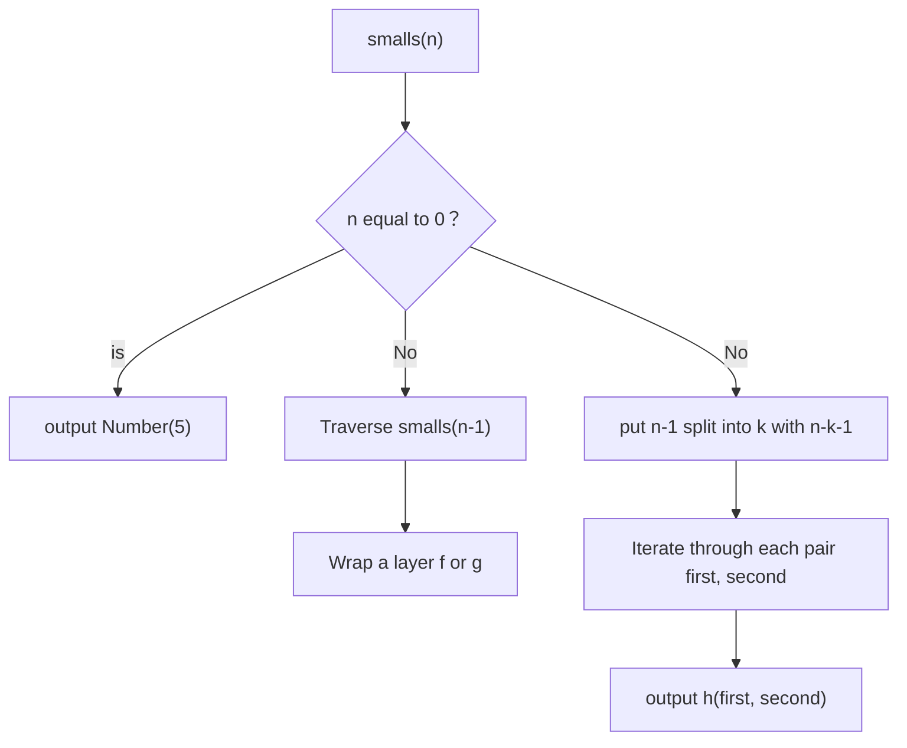
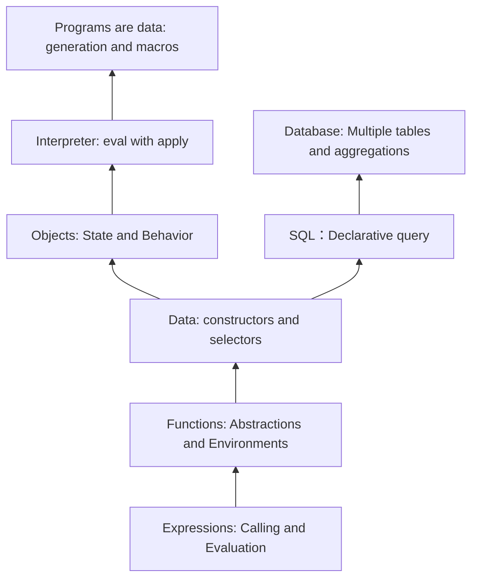

> **courses**: UC Berkeley CS61A · Structure and Interpretation of Computer Programs(Fall 2024)
> **This lecture**: Lecture 40｜Conclusion｜ **No video**, station B has no corresponding score P
> **courseware**: `38-Conclusion_1pp.pdf` (21 pages, official PDF, page-by-page renderings see text illustrations)
> **Content basis**: The official courseware is compiled page by page; this lecture does not have videos and subtitles, and the text is only based on the courseware images and does not include classroom dictation
> **Description**: There is no video, so there is no time anchor. The content is organized based on official courseware.
> **Copyright**: The copyright of the course and courseware belongs to the UC Berkeley CS61A teaching team; this article is a secondary arrangement for learning purposes

## Quick overview of this lecture

- **Mastered**: The main thread of one semester - expression evaluation, function abstraction and environment model, data abstraction, variability and objects, iterators and generators, interpreters, and later SQL. Readers should be able to understand  `Call(f, [n])`  Such an expression tree can also be written with functions that traverse it recursively.
- **Main line of this lecture**:
    - Use old questions from Discussion 0 (`f`, `g`, `h`  with 5 to spell out 2024) do the closing exercise, answers  `g(h(g(5),g(g(f(f(5))))))`  Exactly 7 calls.
    - Turn expressions into objects: `Number`  with  `Call`  The two classes are respectively responsible for three responsibilities: evaluation, printing, and counting.
    - Use generator  `smalls(n)`  Enumerate all expressions of "exactly n calls" and leave "finding the shortest solution" to the program.
    - The second half of the courseware shifts from code to people: course teams, teaching positions, undergraduate course selection map, automated decision-making and society.
- **Key conclusions**: CS61A does not teach Python syntax, but the method of "building a machine with abstraction"; the closing page puts this method back to where it will work - a group of people and what they want to do.

## 1. Closing Page: Structure of Twenty-One Slides


There is only one word on the first page of the courseware: Conclusion. There is no subtitle, no course name, and no date. The last page of a handout usually only needs to say "It's over" and the rest is left to the audience to recall.

The second page is the announcement page, with the title in the center and the page also has no text. The courseware leaves the specific matters of the announcement to the classroom; there is no video recording of this lecture, the content of this page cannot be restored, and this note will not supplement it.


The third page is a full-page picture: a black square base with thousands of thin lines in red, orange, yellow, green, blue, and purple colors converging from both sides to the middle, forming a very narrow "waist", and then spreading out to the other side. The picture has no text and no illustrations.


> **Editor's note**: The third page has no title or explanatory text in the courseware, and it is impossible to confirm the generation method and purpose of this picture. This article only describes the picture itself; reading it as "many paths traveled in one semester" is the author's association, not the explanation given by the courseware.

Arranging the 21 pages in order, the structure is actually very clear: pages 1-3 are the opening (title, announcement, full-page transition diagram), pages 4-7 are the only technical paragraphs, using an old question of calling expressions to review "expression-object-recursion"; pages 8-13 turn to the course team and teaching positions; pages 14-17 talk about the undergraduate experience and course selection map of course members; pages 18-21 The page pushes the topic to society, life and acknowledgment. Technology only occupies four pages, and the remaining seventeen pages are mostly about "people" - team, teaching, course selection, society and life. This ratio is not laziness: the task of closing the class is not to teach another knowledge point, but to put what has been learned in the semester back to where it will be effective.

## 2. Call Expressions: an old discussion topic


Page 4 is a section page. The course will not end with new syntax, but return to the earliest and most interesting expression form in the course: call expression. A call expression contains three things at once - how subexpressions are evaluated, how functions are passed as values, and how recursive structures are traversed. All subsequent chapters continue to add to these three things.

Page 5 lays out the question in its entirety: it comes from Discussion 0, discussion number 0.


The question defines three functions:

- `f(x)`: put  `x`  minus one.
- `g(x)`: put  `x`  Multiply by two.
- `h(x, y)`: put  `x`  with  `y`  concatenated decimal digits, for example  `h(8, 5)`  get  `85`.

The requirement is: only use  `f`, `g`, `h`  and numbers  `5`, write the shortest expression whose value is equal to 2024. The answer given in the courseware is  `g(h(g(5),g(g(f(f(5))))))`, a total of 7 calls. It also draws a verification chain:

1. `g(5)`  Got 10, which is  `h`  the first operand.
2. `f(5)`  Got 4, again  `f`  Get 3 at a time.
3. `g(3)`  Got 6, again  `g`  Once got 12, this is  `h`  the second operand.
4. `h(10, 12)`  Spell "10" and "12" to form "1012" to get 1012.
5. outermost layer  `g(1012)`  Got 2024.

Count the calls: Outermost  `g`  once, `h`  Once, the left one  `g(5)`  Once, on the right  `g`, `g`, `f`, `f`  Four times, 7 times in total. The arrow diagram of the courseware splits this chain into two parallel branches - one  `5➡10`, one  `5➡4➡3➡6➡12`——Zazai  `h`  They merge together and finally become 2024.

Why is 7 times the shortest? The courseware only says "has 7 calls" and does not give the proof process. To truly confirm that "there is no solution with 6 calls", the most direct way is to list all expressions with no more than 6 calls and evaluate them one by one - this is what the next two pages will do. In other words, this question appears to be a construction question, but is actually a small-scale exhaustive enumeration: the human is responsible for giving a 7-time solution, and the program is responsible for proving that there is no shorter solution.

## 3. Turn expressions into objects: Number and Call


Page 6 changes the idea: instead of writing Python calls directly, two classes are used to turn the "expression" itself into an object. The left side is the complete definition, the right side is the behavior in the REPL.

```python
def f(x):
    return x - 1
def g(x):
    return 2 * x
def h(x, y):
    return int(str(x) + str(y))

class Number:
    def __init__(self, value):
        self.value = value

    def __str__(self):
        return str(self.value)

    def calls(self):
        return 0

class Call:
    """A call expression."""
    def __init__(self, f, operands):
        self.f = f
        self.operands = operands
        self.value = f(*[e.value for e in operands])

    def __str__(self):
        return f'{self.f.__name__}({",".join(map(str, self.operands))})'

    def calls(self):
        return 1 + sum(o.calls() for o in self.operands)
```

The REPL on the right documents these behaviors:

```python
>>> n = Number(5)
>>> print(n)
5
>>> n.value
5
>>> Call(f, [n]).value
4
>>> h(g(f(5)), 5)
85
>>> c = Call(h, [Call(g, [Call(f, [n])]), n])
>>> print(c)
h(g(f(5)),5)
>>> c.value
85
>>> c.calls()
3
```

`Number`  is a leaf: it saves only one  `value`, `__str__`  Returns the text of the number, `calls()`  Return 0. `Call`  is an internal node: it holds the function  `f`, operand list  `operands`, and recursively read out the value of each operand during construction  `value`, call the function to calculate your own  `value`.`c`  The three calls come from  `h`, `g`, `f`, so  `c.calls()`  is 3, while  `n`  Contributes 0 as leaves.

There are three independent types of recursion in this tree: evaluate(`__init__`  the line in ), print (`__str__`), count (`calls()`). All three of them only rely on the structural fact of "leaf/node", so they can be written as independent recursive methods without interfering with each other. This is the bonus of data abstraction: once the representation is fixed, new operations can be added continuously without having to change the old code.

| criterion | `Number` | `Call` |
| :--- | :--- | :--- |
| position in expression tree | leaves | internal node |
| Saved core data | an integer  `value` | function  `f`, operand list  `operands`, result  `value` |
| `value`  When to determine | Written during construction | Find out recursively during construction |
| `str()`  The output of | number itself | `f(子表达式,...)` |
| `calls()`  return value | `0` | `1 + sum(o.calls() ...)` |

`Call.__init__`  inside  `self.value = f(*[e.value for e in operands])`  Worth a second look. This is eager evaluation: a  `Call`  Once the object is created, its value has been calculated and can be read later  `.value`  The calculation will no longer be triggered. The advantage is simplicity -`smalls`  You can use it easily  `e.value`  Filtering; the price is that it cannot represent "expressions that have not yet been evaluated", nor can the evaluation process itself be manipulated as data. Short-circuit evaluation and side effects must be found in other ways.

> **Editor's note**: Another design is to put  `value`  Making lazy attributes (calculated only on the first access) can represent unevaluated expressions and avoid useless calculations; the cost is that the state of the object becomes complicated, and the simple contract of "it has value after construction" no longer holds true. The eager version is chosen for the courseware in order to keep the subsequent enumeration code short.

## 4. Generate instead of search: recursive enumeration of smalls


The complete search procedure is given on page 7. It adds a generator on top of the two classes on page 6  `smalls(n)`, the semantics is "produce all calls that have exactly n times  `Call`  with  `Number`  object".

```python
def smalls(n):
    "Yield all Calls and Numbers with n calls."
    if n == 0:
        yield Number(5)
    else:
        for operand in smalls(n-1):
            yield Call(f, [operand])
            yield Call(g, [operand])
        for k in range(n):
            for first in smalls(k):
                for second in smalls(n-k-1):
                    if first.value > 0 and second.value > 0:
                        yield Call(h, [first, second])

result = []
for i in range(8):
    result.extend([e for e in smalls(i) if e.value == 2024])
print(result[0])  # prints g(h(g(5),g(g(f(f(5))))))
```

There are three cases of recursion, which correspond to the three shapes of expression trees:

- `n == 0`: the only zero-call expression is a leaf  `Number(5)`.
- Unary call: any expression that is called n-1 times, wrapped in a layer  `f`  or  `g`, you get n calls.
- Binary call: `h(first, second)`  It itself occupies one call, and the remaining n-1 times are divided into two operands. order  `first`  Use k times, `second`  It must be used n-k-1 times, k from 0 to n-1, just covering all disassembly methods.

These three items together are a structural induction: each expression is either a leaf, an outermost unary call, or an outermost binary call; all three situations are enumerated and will not be repeated. `yield`  let  `smalls`  It becomes a lazy sequence - if the caller wants one, it will go one step down; if the caller does not consume it, the calculation will stop there.



`if first.value > 0 and second.value > 0`  There is no comment on this line. What it does is exclude zeros and negative numbers: `h`  Use decimal strings to concatenate numbers. Once the operand is not a positive number, the concatenation result is no longer equal to "two numbers written side by side"——`h(0, 5)`  got 5, `h(-1, 5)`  You get -15, the printed form and the evaluation result don't match, and the generated expressions collide with each other.

> **Editor's note**: The courseware only writes this judgment without explaining the reasons; the above reasons are based on  `h`  derived from the definition of . After adding the positive value limit, the search space becomes smaller, and it also ensures that the "string form of the expression" corresponds to the "number it calculates".

The driving part is a simple way of writing a three-layer loop: Right  `i`  From 0 to 7, collect all expressions with a value of 2024 in this layer and append to  `result`;Print the first one last. because  `i`  From childhood to adulthood, `result[0]`  It is the solution with the least number of calls; the courseware comments indicate that it outputs  `g(h(g(5),g(g(f(f(5))))))`, consistent with the answer on page 5. This also fills in the missing half of the sentence on page 5: The 7 times is not a guess, but the number of layers enumerated layer by layer starting from layer 0 and when 2024 appears for the first time.

The price is here too. `smalls`  Without any cache: `smalls(n-1)`  is called at each level, `smalls(k)`  is repeatedly regenerated in k loops; the number of expressions grows rapidly with n (each n-1 solution generates two unary packages, `h`  We also need to do the Cartesian product of two sub-solutions), and by the time we reach level 7, the search tree is no longer small. Generators save memory, not time.

> **Editor's note**: If you want to further optimize, you can put  `smalls`  The results of each layer are cached, or used when only the first solution is needed.  `next(e for e in smalls(i) if e.value == 2024)`  Short-circuit layer by layer to avoid loading the entire layer of results into the list. The courseware retains the most straightforward writing method, because what it wants to show is "enumeration ideas", not engineering optimization.

## 5. Panoramic review: How six levels of abstraction build a machine

If you stack 40 machines according to their dependencies, you will see a layered machine. The lowest level is the expression: `Call`  Objects only have three things - functions, operands, and values. One level up is the function: a function becomes a value before it can be  `Call`  as  `self.f`  Save to be  `smalls`  Passed as parameters. Further up is data abstraction: `Number`  with  `Call`  Constructor and selector of each other, `value`  with  `operands`  It's an interface, `__str__`  It's another interface. Further up are the objects: `Call`  Combine data with behavior (`calls`, `__str__`) are tied to the same value, and inheritance allows "another expression" to reuse the evaluation logic. Further up is the interpreter: `Call.__init__`  inside  `f(*[e.value for e in operands])`  It is the prototype of eval; the real interpreter just replaces "function object" with "name in the environment" and replaces Python calls with Scheme's apply. Finally, there is SQL: it takes a different direction - it does not describe how to calculate, but only describes what is required.



> **Editor's note**: The picture above and the table below are the arrangement of the course structure in this note, not the original pictures of the courseware. Courseware Lecture 40 does not draw this knowledge map; it only provides a clue - use  `Call`  The three kinds of recursion tie the whole course together.

| layer | Questions answered at this level | Specific objects in this lecture | What would happen if it were expressed differently? |
| :--- | :--- | :--- | :--- |
| expression | How does a piece of code become a value? | `Call.value` | Change to postfix expression, the order of evaluation changes, but the result remains unchanged. |
| function | How to find the value of name | `f`, `g`, `h`  as  `Call`  Parameters | Change to closure or object, call protocol changes |
| data | How to create and dismantle composite values | `Number`  with  `Call`  The constructor of | Change to tuple or dictionary, the interface remains unchanged |
| object | How are status and behavior tied together? | `Call.calls()`, `Call.__str__` | Change to normal function dispatch, the behavior remains unchanged |
| interpreter | How does the program explain the program? | `Call.__init__`  Recursive evaluation in | Adding the environment can explain the language with the name |
| SQL | Why only describe the results? | This lecture does not appear, it belongs to the later part of the course | Change to a procedural loop, the result is the same but longer |

What this table wants to illustrate is one thing: abstraction layers are connected by interfaces, not by implementation details. `smalls`  don't care  `Call`  How to store value internally, only requires it to be exposed  `.value`; `__str__`  It doesn't matter how the tree is built, it only requires that the child nodes can be  `str`  Convert. As long as the interface remains unchanged and the representation below is changed, there is no need to change a single line of the program above. This is what "a machine" means: not a big program, but a set of parts that can replace each other and support each other.

Cutting through all the layers is recursion. `Call`  lining  `Call`, `smalls(n)`  tune  `smalls(k)`, of the interpreter  `eval`  tune  `eval`, tree recursion and linked list recursion are both different guises of the same thing. CS61A is repeatedly trained to "believe in recursion", and here's why: the driving axis of this machine is recursion.

## 6. Course Team: Hidden Dependencies of a Course


Page 8 is the section page Course Staff, and pages 9–11 are acknowledgments from three groups of people: TA (teaching assistant), tutor (tutor), and academic intern (academic intern). The title sentences on the three pages are almost the same: "Thank you ...!!! We couldn't have done it without you", with a heart symbol at the end of the sentence. This is not a polite statement. Page 12 lists what the course team does: student support, writing infrastructure, and iterating projects—the operation of a course depends on these labors that are not included in the lecture notes.


The TA page uses more than a dozen daily photos to form a photo wall, and there is no unified ID photo style. This detail itself is the tone of the closing page: treat people as human beings first, and then as teaching assistants.


The Tutor page has the same structure as the TA page, with more photos.


The Academic intern page has no photos, just a list of twenty-four people. The subtitles on the three pages all have the same sentence, which means "Without you, this course would not be possible." There are only two ways of acknowledging it: photos on the first two pages, and a list on the last page. The order is from the TA who leads the discussion class, to the tutor in the tutoring position, and then to the intern who helps in the experimental class - which happens to be the reverse order of the three entry paths given on page 13.

## 7. From students to teachers: why to participate and how to start


Page 12 answers "Why get involved in teaching". The reasons listed in the courseware can be divided into five items according to the original words:

- The teaching is "magical" - the courseware itself says it, for lack of a better word.
- Support the later ones, "We're all in this together".
- Meet some of the coolest people in Berkeley.
- Hone your technical understanding of course concepts.
- Independent exploration: The classroom is a small laboratory; at Berkeley, the course team does many things (student support, writing infrastructure, iterative projects).

The fourth is the most easily underestimated: explaining concepts to others will immediately expose the holes in your own understanding; filling these holes is "refining your own technical understanding". The second article puts this matter back into the group: the person being taught today will teach the next person tomorrow. The most real benefits of teaching are half in knowledge and half in this kind of relay.


Page 13 answers "How to start", giving three paths:

- Apply to be an Academic Intern, help in experimental classes, and be guided by TA; CS365 is a new project trying to standardize this experience.
- Apply directly to the course team. UCS1 (tutor) is a gentle entry, mainly polishing the teaching method (pedagogy) through office hours and group tutoring. The courseware adds a very direct sentence here: "You are qualified."
- If you want to go faster, just teach in the summer, go directly to UCS2 (teaching assistant), and lead your own discussion classes. Summer applications typically open in mid-March, see the link on this page and the EECS 101 EdStem announcement for more information.

At the end of the page, a fourth path is given: Computer Science Mentors (CSM) is an on-campus club that also provides group tutoring; the courseware author said that he started teaching at CSM.

| position | entrance | main work | Description |
| :--- | :--- | :--- | :--- |
| Academic Intern | Follow TA after applying | Help in lab class | Entry-level positions supervised by teaching assistants |
| UCS1 tutor | Apply directly to the course team | Office hours and group tutoring | Gentle entrance to hone pedagogy |
| UCS2 TA | summer teaching program | Lead a discussion class independently | If you want to get into the main lecture position quickly, go this way |

> **Editor's note**: The summer application time, CS365 and EECS 101 EdStem are all information on the courseware for the fall of 2024. The specific arrangements should be based on the course announcement for that year.

What's noteworthy about this page isn't the message, but the tone. "You are qualified." does not mean "welcome to consider", but directly tells readers that they are qualified. The closing lecture states "You too can be part of this class" as a fact rather than an invitation; for a technical class, this gesture feels more like legacy than any career advice.

## 8. Undergraduate Map: Course Selection Quadrants of Two Narrators


Page 14 switches the topic from lessons to people. The two narrators in the courseware appeared as Jedi and shm respectively, and each reviewed the undergraduate course selection.


Jedi's page is a timeline. Junior Spring, left: COMPSCI 61C (Computer Architecture), PBHLTH C160 (Environmental Health and Development), POLSCI 103 (Congress), POLSCI 171 (California Politics), plus one unit reserved for CSM and URAP. Right (super senior) Fall: COMPSCI 170 (Efficient Algorithms and Hard Problems), MATH 54 (Linear Algebra and Differential Equations), PE 1 (Hip-Hop Dance), PE 3 (Intermediate Volleyball).

Write "Most of my time" in the lower half of the page: I spent the first three years of my undergraduate degree at ASUC, served as a committee member of the City of Berkeley, and worked as a student worker at Berkeley Law; the last two years were spent teaching (CSM, CS61B). There's also a joke at the bottom: "shm's slide is a lot cooler. so i'm putting mine first \>:D".

This schedule breaks down the "CS degree" into three categories of time: professional courses (61C, 170), general studies and interests (public health, politics, sports), and extracurricular work that takes up most of the time. The courseware does not give suggestions, only a real sample. Its value lies in turning "course selection" from an abstract optimization problem into a concrete human choice.


Page 16 is shm's version, drawn as a 2D map. The horizontal axis is "predicted career importance" (pre-graduation assessment), and the vertical axis is "actual career importance" (post-graduation review). The four quadrants correspond to four prediction results:

| Quadrant | Prediction (Before Graduation) | Practical (after graduation) | Lessons in the courseware |
| :--- | :--- | :--- | :--- |
| upper left | just for fun | important to career | Art History, Painting, Sociology 101, Philosophy 101, Human-Computer Interaction |
| upper right | important to career | important to career | Data structures, software engineering, algorithms, discrete structures |
| lower left | just for fun | Mainly it’s fun | American Sign Language, Witches in Literature, Wind Ensemble |
| lower right | important to career | Mainly it’s fun | Computer Networks, Advanced Algorithms |

The upper right corner is the "accurate prediction" part: data structure, software engineering, algorithm, discrete structure. These are the core courses of CS majors. It is not surprising to guess correctly. The upper left corner is the "underestimated" part: art history, painting, sociology, philosophy, and human-computer interaction - the courseware places human-computer interaction in the upper left grid, close to the vertical axis, indicating that the value of such courses as "how people interact with computers" after graduation is higher than expected while studying. The lower right corner is the "overrated" part: networking and advanced algorithms are in this box, with the note "may come in handy one day" next to it - this is self-deprecating and reminds readers that the value of a course is not only determined by career relevance. The lower left corner is pure fun: American Sign Language, literature, orchestra, which have not become careers, but are still counted as "valuable".

There are several details on the screen: human-computer interaction and American Sign Language are pressed near the vertical axis, and computer graphics are pressed near the horizontal axis. The position itself says "this prediction is uncertain" - not a black-and-white classification. Add a new line at the bottom of the page: "also super valuable & fun: research, tutoring, game design club, poetry club". Research, tutoring, game design clubs, and poetry clubs are not on the axis, but they are equally valuable parts of the map that are recognized.

> **Editor's note**: Reading the coordinate axis as "prediction error" is the interpretation of this note. The courseware only draws four grids and course names, without giving statistics or conclusions; this picture is more like a personal review than a course selection suggestion.

## 9. Beyond programming: the two disciplines of language and decision-making


On page 17, change to John in the courseware. He first listed the "Intro courses galore": philosophy, linguistics, economics, computer science, mathematics, etc. Then he gave two sets of the coolest questions in his opinion.

The first group is language: how people use and understand language to complete communication. The courseware uses three disciplines to approach it from three directions - Linguistics studies language and its use; Philosophy attempts to answer questions that cannot be answered by scientific methods; Computers can perform simulations of "using and understanding language".

The second group is decisions: how decisions are made. Economics describes individual and collective decision-making; artificial intelligence (Artificial Intelligence) implements strategies for automated decision-making; probability theory (Probability) provides a language for precise statements of uncertainty; literature (Literature) describes complex people and how complex their decisions actually are.

| Subject | what it offers | Interface with computing |
| :--- | :--- | :--- |
| Linguistics | Language structure and use | Grammar, semantics, natural language processing |
| Philosophy | Questions that cannot be answered by scientific methods | logic, ethics, mind |
| Economics Economics | Individual and collective decision-making | Mechanism design, game |
| Artificial Intelligence Artificial Intelligence | Automated decision-making strategies | Search, learn, plan |
| Probability probability theory | The precise language of uncertainty | inference, risk assessment |
| Literature literature | Complex people and decisions | Narrative, value conflict |

> **Editor's note**: The courseware only lists one-sentence definitions of each subject; the "Interface with Computing" column in the table is a common connection point supplemented by this note, not the original text of the courseware.

The argument structure on this page is worth learning: first give the "coolest thing" (how people use and understand language), and then use three disciplines to approach it from three angles; change the subject (decision-making), and then use four disciplines to approach it. Each discipline only answers one part, and computing is the link that connects "simulation" and "implementation". This also explains why CS61A also talks about Scheme, interpreters and SQL after finishing Python: they are all different dialects of "describing the world with calculations".

## 10. Automated Decision-Making: Dilemmas and Sensors


Page 18 has just one word: Society. Page 19 crystallizes the word into a question—what should a self-driving car do?


On the left half of the page are two top-view diagrams. Same car, same road: going straight will hit one group of pedestrians in front, turning will hit another group; there is also a blue cart on the road. The title of the page is "What should the self-driving car do?" - the courseware does not give an answer.

On the right half of the page are two engineering drawings. "Self-Driving Vehicle (SDV) Overview" identifies the overhead lidar (lidar), forward-facing camera, 360° radar coverage, side and rear cameras, roof antenna and custom computing unit; "Self-Driving System Sensors" identifies the rear-facing camera, wide-angle camera, surround-view camera, forward-facing stereo camera, ultrasonic sensor, central lidar and long-range radar. Four types of sensors: cameras, lidar, radar, and ultrasonic sensors create a 360° sensing range.

The left side is an ethical issue, and the right side is an engineering issue; the courseware puts them on the same page, which is to say: the "should" of autonomous driving cannot be separated from "what can be seen". The sensor gives a representation, and the decision-making strategy makes choices based on this representation. But the representation is never complete: sensors have blind spots and distance restrictions, and pedestrians are not marked with attributes such as identity and age. Part of the reason why this type of dilemma is difficult is that it compresses incommensurable values ​​into a scalar objective function, and engineering implementation must choose a goal.

The courseware didn't say the answer. Any "who should hit" answer must first state the ethical framework; the purpose of this page is to make the reader aware that the person writing the code will eventually face the question of "who set the objective function?"

> **Editor's note**: "UBER\_NTSB\_000435" and "Confidential Treatment Requested / Exempt from Disclosure under FOIA" in the lower right corner of the picture indicate that this set of sensor images comes from the investigation files of the US National Transportation Safety Board (NTSB). The courseware uses it as a teaching example and does not represent a conclusion on any accident.

## 11. Life and closure


Page 20 has just one word: Life. Page 21 is "That's all. Thanks!". From Society to Life to Thanks, the focus of the last four pages of the courseware is not on code: page 19 juxtaposes ethics and engineering, and pages 20 and 21 are reduced to two words.


If CS61A were compressed into one sentence, it would probably be: **Break complex problems into combinable pieces and then use recursion to put them back together**. The expression is recursive (`Call`  lining  `Call`), the data is recursive (linked list, tree), the interpreter is recursive (`eval`  Li Tiao  `eval`), even "finding the shortest expression" is recursive (`smalls(n)`  tune  `smalls(k)`). This course only trains one action from beginning to end: first define the representation and interface, and then let recursion cover all situations.

The course closing page does not summarize the knowledge points, but zooms out: course team, teaching positions, course selection, society, and life. The arrangement itself says: Technical skills are only part of an undergraduate education; readers also decide what to do with it, who to do it with, and when to stop and live.

> **Editor's note**: The following are three review suggestions for readers of this note, not courseware content. First, do the 2024 question again, without looking at the answer, use  `smalls`  Verify your shortest solution. Second, pick an abstraction that you have learned (environment, closure, iterator, interpreter) and explain it to someone who has never learned it in three sentences - only if you can explain it clearly can you really master it. Third, find a class that "predictions aren't important, but you might actually like" and give it a semester.

## Summary

- There are two ways to complete the course exercise: artificial construction gives intuition, and program enumeration gives guarantees; the two ways are combined to get the "shortest" answer.
- The same expression tree can be evaluated, printed, and counted - the separation of operation and representation is the most practical form of data abstraction.
- The value of a generator is to turn an enumeration into a composable lazy sequence; the key to recursive decomposition is to split n into two parts: k and n−k−1.
- The two axes of the course selection map are "prediction" and "actual"; prediction errors are not failures, but information.
- The quality of a course is not only determined by the lecture notes, but also by the course team, teaching positions and infrastructure; on the end of the course, thank the people first and then discuss the technology. The order itself is the point of view.
- The end point of technology is decision-making: the self-driving page puts "what can be seen" and "what should be done" on the same picture, reminding readers that there is value judgment beyond abstraction.

## Attached: Slide index for this lecture

| page | content | Appear location |
| :--- | :--- | :--- |
| 1 | Title page Conclusion | §1 |
| 2 | Announcements page Announcements | §1 |
| 3 | Full page color track map with black background | §1 |
| 4 | Sectioned Pages Call Expressions | §2 |
| 5 | Problem Definition: f, g, h and 5 spell out 2024 | §2 |
| 6 | Number and Call classes and REPL behavior | §3 |
| 7 | smalls generator and driver loop | §4 |
| 8 | Section Pages Course Staff | §6 |
| 9 | Acknowledgments TA | §6 |
| 10 | Acknowledgments tutor | §6 |
| 11 | Acknowledgments academic intern | §6 |
| 12 | Why get involved in teaching | §7 |
| 13 | How to Get Started: Three Teaching Paths | §7 |
| 14 | Sectioned Pages How Did We Get Here? | §8 |
| 15 | Jedi’s undergraduate course schedule | §8 |
| 16 | Shmundergrad course selection four quadrants | §8 |
| 17 | Undergrad John: Language and decision-making | §9 |
| 18 | Section page Society | §10 |
| 19 | Autonomous Driving: Dilemmas and Sensors | §10 |
| 20 | Section page Life | §11 |
| 21 | Ending Page That's all. Thanks! | §11 |
