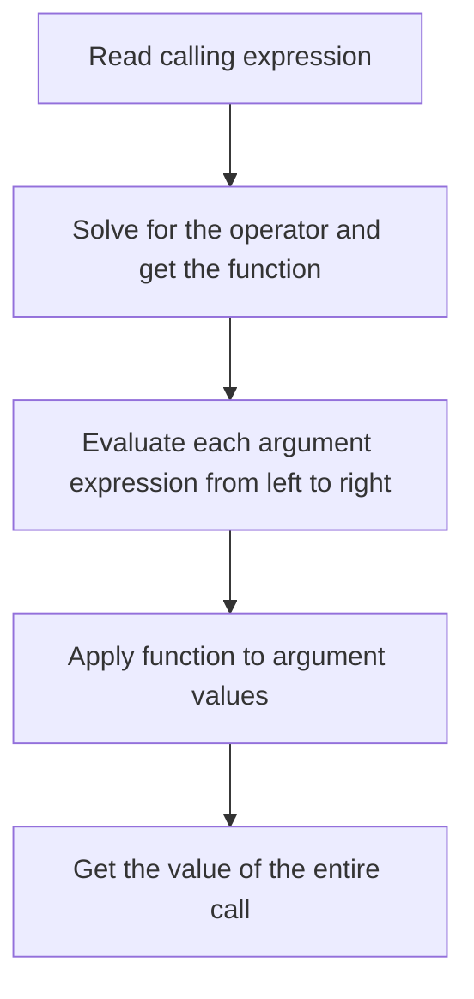
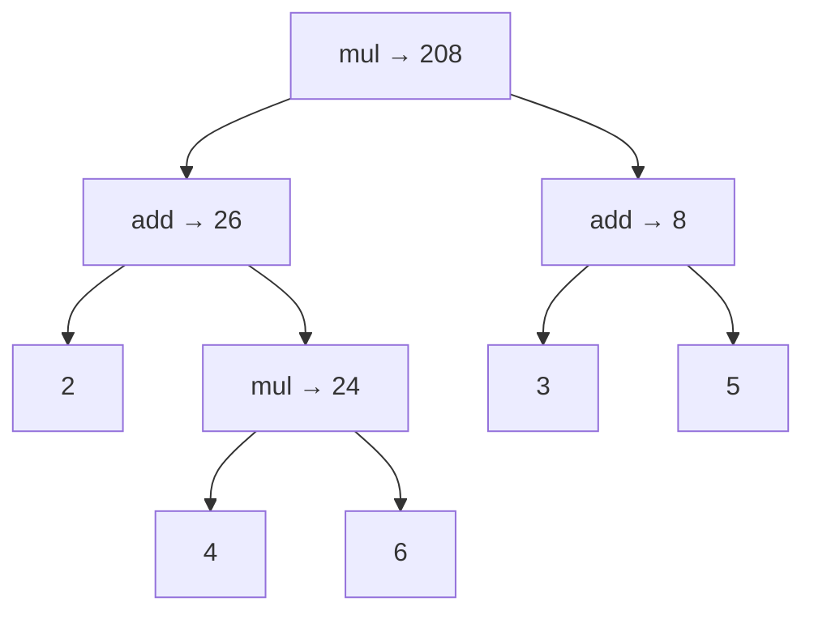

> **Course**: UC Berkeley CS61A (Fall 2024)  
> **Module**: Module 1: Functions & Abstraction  
> **Lecturer**: Prof. John DeNero (UC Berkeley)  
> **Video duration**: 13:29 ｜ **Classroom screenshots**: 6 pieces of blackboard writing/code demonstration  
> **Direct video**: [📺Watch the original video of this lecture on Bilibili (P1)](https://www.bilibili.com/video/BV1sy411z7nA/?p=1)  
> **Quick navigation**: <span>Previous Lecture: None (Lecture 1)</span> ｜ [📚 Return to the full book catalog](/en/notes/topics/CS61A) ｜ [Next lecture (P02 Lecture 2 Functions) →](/en/notes/cs61a/lecture-02)

---

## 1. How to study the course

*(Reference time: 00:00:00 · [Video jump (P1 00:00:00)](https://www.bilibili.com/video/BV1sy411z7nA/?p=1&t=0))*

In the opening, DeNero explained that he and Rao teach two classes respectively, and the two classes share homework, exams and pre-recorded videos. Students should watch the corresponding video before class, and the live lecture will further expand on the examples and discuss issues that need to be considered when solving problems.

Pre-recorded content is organized into playlists: introduction announcements first, then moving into course topics. Individual segments are usually only five to ten minutes long, and a session may include several segments. Some videos are from recordings in previous years and are re-recorded when the course is updated, so the instructor's age, terminal version, and screen style may be different.

This lecture starts with a basic program building block: **expression**.

> **Editor's note**: The class opening notice in the video belongs to the arrangement at the time of recording and does not serve as the deadline for today’s homework. When learning, you should first understand the rules and then run the examples yourself.

### In-depth formal specification and micro-evaluation process (Operational Semantics)
In the module "1. How to learn the course", the underlying computer operations rely on strict formal evaluation logic:
1. **Hierarchical parsing of abstract syntax trees (AST)**: 
   - The source code character stream is first divided into terminal symbol tokens (Tokens) by the lexical analyzer (Lexer), and then constructed into a multi-fork syntax tree by the syntax parser (Parser);
   - Operator priority and associativity are solidified during the syntax tree construction phase, eliminating ambiguity at runtime;
2. **Dynamic transitions of environment chains**: 
   - Each function call generates a new frame whose static lexical environment is determined by the function object's  `parent`  Attributes are completely determined;
   - The variable search traces back up the environment chain in one direction until the global environment frame. If it is not found, it will be triggered.  `NameError`  Abnormal;
3. **State Invariants**: 
   - The key to writing robust programs is to clarify loop invariants (Loop Invariants) and function pre/post-conditions (Pre/Post-conditions);
   - In complex control flow jumps, ensure that state variables maintain legal business constraints before each iteration.


## 2. Expression: describes calculation and obtains a value

*(Reference time: 00:02:11 · [Video jump (P1 00:02:11)](https://www.bilibili.com/video/BV1sy411z7nA/?p=1&t=131))*

**An expression describes a calculation and evaluates to obtain a value.**  An expression is a written description of a calculation, and a value is the result of the calculation.

Mathematics has long used expressions to organize calculations, but different operations often have different notations: the addition handle  `+`  Written between two numbers, division can be done by placing the numerator above the denominator, the square root has the root sign, and the sine is written as  `sin`. The instructor described the square root as putting numbers into a "little house," reminding the reader that these are symbols for calculations.

Function call notation provides a common structure: the function is given first, then the inputs are listed. in mathematics  `f(x)`  or  `f(x, y)`, calculations can also be expressed in programs. Next, the course uses this structure to explain arithmetic and more complex expressions.

### Start with the Python interactive interpreter

*(Reference time: 00:03:51 · [Video jump (P1 00:03:51)](https://www.bilibili.com/video/BV1sy411z7nA/?p=1&t=231))*

Run in terminal  `python3`, starts the interactive interpreter. see  `>>>`  Enter an expression at the prompt, and the interpreter will evaluate it and display the result.

```python
>>> 2015
2015
>>> 2000 + 15
2015
```

Numbers themselves are simple expressions; combining numbers through operations creates compound expressions. The instructor also demonstrates multiplication, nested parentheses, division, and exponentiation, showing that Python can handle these calculations like a calculator.

[](https://www.bilibili.com/video/BV1sy411z7nA/?p=1&t=260)
*⏱ Timestamp: 00:04:20 · 📷 Classroom screenshot · [Watch the corresponding clip on Bilibili (P1 00:04:20)](https://www.bilibili.com/video/BV1sy411z7nA/?p=1&t=260)*

#### 📸 In-depth reading of classroom blackboard writing and code demonstration (00:04:20)

**\[On-site blackboard writing/code demonstration restoration\]**:
At this time point, Professor DeNero conducted a core demonstration and key blackboard derivation on the screen:
> *“Here's my claim, is that all expressions can use function call notation. And for that, I'll just fire a Python and show you. I start Python by typing Python 3, which gives me a very recent version of the programming language interpreter. Now an interpreter provides a prompt where it waits for me to ...”*

**\[Underlying computing model and micro execution mechanism\]**: 
1. **Execution context and timing tracing**: 
   - At the current discussion point "2. Expression: describes calculation and obtains a value", the interpreter strictly follows the core evaluation protocol;
   - The expression evaluates the operators first, then evaluates the operands strictly from left to right, and finally applies the function object to the argument list;
   - If the environment model is involved, the local frame strictly records its static lexical parent pointer (Parent Pointer points to the environment where the function is defined), forming an orthogonal architecture with the dynamic call stack at runtime.
2. **Memory topology and object references**: 
   - Variable symbols are just keys in a hash table (environment frame), and pointers point directly to first-class citizen objects in heap memory;
   - Assignment statements are discrete-time snapshots of the state and never create implicit mathematical dependency monitoring.

**\[Guidelines for avoiding pitfalls and guidance on high-frequency test points\]**: 
- **Common misunderstandings**: In the test questions related to "WWPD and Operator Operand Early Evaluation Protocol", beginners can easily guess the results based on the surface form of the code, leading to scope confusion or variable shadowing (Shadowing) misjudgment;
- **The golden rule of debugging**: When encountering nested calls and complex branches, be sure to draw independent partial frames on the scratch paper, indicate the specific binding value of each formal parameter, and derive it step by step.


> **Editor's note**: `>>>`  is a prompt, not a code; copy to  `.py`  File to remove the prompt and result lines. The old Python version in the video belongs to the recording environment, and the examples in this book can be run in modern Python 3.

### In-depth formal specification and micro-evaluation process (Operational Semantics)
In the "2. Expression: describe calculation and obtain a value" module, the underlying computer operations rely on strict formal evaluation logic:
1. **Hierarchical parsing of abstract syntax trees (AST)**: 
   - The source code character stream is first divided into terminal symbol tokens (Tokens) by the lexical analyzer (Lexer), and then constructed into a multi-fork syntax tree by the syntax parser (Parser);
   - Operator priority and associativity are solidified during the syntax tree construction phase, eliminating ambiguity at runtime;
2. **Dynamic transitions of environment chains**: 
   - Each function call generates a new frame whose static lexical environment is determined by the function object's  `parent`  Attributes are completely determined;
   - The variable search traces back up the environment chain in one direction until the global environment frame. If it is not found, it will be triggered.  `NameError`  Abnormal;
3. **State Invariants**: 
   - The key to writing robust programs is to clarify loop invariants (Loop Invariants) and function pre/post-conditions (Pre/Post-conditions);
   - In complex control flow jumps, ensure that state variables maintain legal business constraints before each iteration.


## 3. Call expression: combination of function and input

*(Reference time: 00:04:55 · [Video jump (P1 00:04:55)](https://www.bilibili.com/video/BV1sy411z7nA/?p=1&t=295))*

The general form of a call expression is  `函数表达式(实参表达式1, 实参表达式2, ...)`. For example, `max`  Take the maximum value in the input:

```python
>>> max(2, 4)
4
>>> max(1, 2, 3, 4, 5)
5
```

`min`  Then take the minimum value. Parentheses after a function delimit a call, and commas separate input expressions. How many inputs each function can accept is determined by the rules of the function; `max`  Accepting multiple inputs does not mean that all functions accept any number of arguments.

### Write the arithmetic as a call

*(Reference time: 00:06:00 · [Video jump (P1 00:06:00)](https://www.bilibili.com/video/BV1sy411z7nA/?p=1&t=360))*

There are also corresponding functions for addition and multiplication. Start with  `operator`  Module import:

```python
>>> from operator import add, mul
>>> add(2, 3)
5
>>> mul(2, 3)
6
```

`add(2, 3)`  Expression operation and  `2 + 3`  Same, `mul(2, 3)`  with  `2 * 3`  Same. Importing makes the function name available in the current session so that it can be called repeatedly.

[](https://www.bilibili.com/video/BV1sy411z7nA/?p=1&t=388)
*⏱ Timestamp: 00:06:28 · 📷 Classroom screenshot · [Watch the corresponding clip on Bilibili (P1 00:06:28)](https://www.bilibili.com/video/BV1sy411z7nA/?p=1&t=388)*

#### 📸 In-depth reading of classroom blackboard writing and code demonstration (00:06:28)

**\[On-site blackboard writing/code demonstration restoration\]**:
At this time point, Professor DeNero conducted a core demonstration and key blackboard derivation on the screen:
> *“Which is used between two expressions to add them together. There's also a function called add. Now, it's not available all the time. I have to write this import statement in order to get access to add and mul. That's only a minor inconvenience, I just do it once, and now I can add together two and ...”*

**\[Underlying computing model and micro execution mechanism\]**: 
1. **Execution context and timing tracing**: 
   - At the current discussion point "3. Calling expressions: combination of functions and inputs", the interpreter strictly follows the core evaluation convention;
   - The expression evaluates the operators first, then evaluates the operands strictly from left to right, and finally applies the function object to the argument list;
   - If the environment model is involved, the local frame strictly records its static lexical parent pointer (Parent Pointer points to the environment where the function is defined), forming an orthogonal architecture with the dynamic call stack at runtime.
2. **Memory topology and object references**: 
   - Variable symbols are just keys in a hash table (environment frame), and pointers point directly to first-class citizen objects in heap memory;
   - Assignment statements are discrete-time snapshots of the state and never create implicit mathematical dependency monitoring.

**\[Guidelines for avoiding pitfalls and guidance on high-frequency test points\]**: 
- **Common misunderstandings**: In the test questions related to "WWPD and Operator Operand Early Evaluation Protocol", beginners can easily guess the results based on the surface form of the code, leading to scope confusion or variable shadowing (Shadowing) misjudgment;
- **The golden rule of debugging**: When encountering nested calls and complex branches, be sure to draw independent partial frames on the scratch paper, indicate the specific binding value of each formal parameter, and derive it step by step.


### Nested calls: forming large calculations from small calculations

*(Reference time: 00:06:33 · [Video jump (P1 00:06:33)](https://www.bilibili.com/video/BV1sy411z7nA/?p=1&t=393))*

One call can be placed in the actual parameter position of another call. Class core examples are:

```python
>>> mul(add(2, mul(4, 6)), add(3, 5))
208
```

The input on the left is "2 plus the product of 4 and 6", the input on the right is "the sum of 3 and 5", and finally the two are multiplied together. Parentheses indicate which result belongs to which call.

The same arithmetic can also be written as  `(2 + 4 * 6) * (3 + 5)`. When using infix operators, you need to understand the priority of operations; call notation to write the combined structure in a nested relationship. The course emphasizes calling expressions in order to establish evaluation rules that can be applied repeatedly.

[](https://www.bilibili.com/video/BV1sy411z7nA/?p=1&t=450)
*⏱ Timestamp: 00:07:30 · 📷 Classroom screenshot · [Watch the corresponding clip on Bilibili (P1 00:07:30)](https://www.bilibili.com/video/BV1sy411z7nA/?p=1&t=450)*

#### 📸 In-depth reading of classroom blackboard writing and code demonstration (00:07:30)

**\[On-site blackboard writing/code demonstration restoration\]**:
At this time point, Professor DeNero conducted a core demonstration and key blackboard derivation on the screen:
> *“OK, I've added 2 to what I get by multiplying 4 and 6, but I said I was going to multiply that by something. Well, how about the result of adding 3 and 5? And that gives me 208. Now, in call expressions, you don't need to memorize the order of operations. Just the nesting structure of the expression...”*

**\[Underlying computing model and micro execution mechanism\]**: 
1. **Execution context and timing tracing**: 
   - At the current discussion point "3. Calling expressions: combination of functions and inputs", the interpreter strictly follows the core evaluation convention;
   - The expression evaluates the operators first, then evaluates the operands strictly from left to right, and finally applies the function object to the argument list;
   - If the environment model is involved, the local frame strictly records its static lexical parent pointer (Parent Pointer points to the environment where the function is defined), forming an orthogonal architecture with the dynamic call stack at runtime.
2. **Memory topology and object references**: 
   - Variable symbols are just keys in a hash table (environment frame), and pointers point directly to first-class citizen objects in heap memory;
   - Assignment statements are discrete-time snapshots of the state and never create implicit mathematical dependency monitoring.

**\[Guidelines for avoiding pitfalls and guidance on high-frequency test points\]**: 
- **Common misunderstandings**: In the test questions related to "WWPD and Operator Operand Early Evaluation Protocol", beginners can easily guess the results based on the surface form of the code, leading to scope confusion or variable shadowing (Shadowing) misjudgment;
- **The golden rule of debugging**: When encountering nested calls and complex branches, be sure to draw independent partial frames on the scratch paper, indicate the specific binding value of each formal parameter, and derive it step by step.


### In-depth formal specification and micro-evaluation process (Operational Semantics)
In the "3. Calling Expressions: Combination of Functions and Inputs" module, the underlying computer operations rely on strict formal evaluation logic:
1. **Hierarchical parsing of abstract syntax trees (AST)**: 
   - The source code character stream is first divided into terminal symbol tokens (Tokens) by the lexical analyzer (Lexer), and then constructed into a multi-fork syntax tree by the syntax parser (Parser);
   - Operator priority and associativity are solidified during the syntax tree construction phase, eliminating ambiguity at runtime;
2. **Dynamic transitions of environment chains**: 
   - Each function call generates a new frame whose static lexical environment is determined by the function object's  `parent`  Attributes are completely determined;
   - The variable search traces back up the environment chain in one direction until the global environment frame. If it is not found, it will be triggered.  `NameError`  Abnormal;
3. **State Invariants**: 
   - The key to writing robust programs is to clarify loop invariants (Loop Invariants) and function pre/post-conditions (Pre/Post-conditions);
   - In complex control flow jumps, ensure that state variables maintain legal business constraints before each iteration.


## 4. Anatomy of calling expressions

*(Reference time: 00:08:07 · [Video jump (P1 00:08:07)](https://www.bilibili.com/video/BV1sy411z7nA/?p=1&t=487))*

to  `add(2, 3)`  For example, it still consists of expressions:

| part | This example | What is gained by seeking value? |
| --- | --- | --- |
| operator subexpression | `add` | Addition function |
| The first operand subexpression (operand subexpression) | `2` | numerical value  `2` |
| second operand subexpression | `3` | numerical value  `3` |
| The entire calling expression | `add(2, 3)` | numerical value  `5` |

Here "operator" refers to the part before the brackets, which can be a function name, but is not limited to  `+`, `*`  these symbols. **Functions themselves are also values**:Solve name  `add`, what you get is a function that can be called.

[](https://www.bilibili.com/video/BV1sy411z7nA/?p=1&t=515)
*⏱ Timestamp: 00:08:35 · 📷 Classroom screenshot · [Watch the corresponding clip on Bilibili (P1 00:08:35)](https://www.bilibili.com/video/BV1sy411z7nA/?p=1&t=515)*

#### 📸 In-depth reading of classroom blackboard writing and code demonstration (00:08:35)

**\[On-site blackboard writing/code demonstration restoration\]**:
At this time point, Professor DeNero conducted a core demonstration and key blackboard derivation on the screen:
> *“The whole thing is a call expression, which has within it other expressions. Everything that comes before the opening parenthesis is called the operator sub-expression. And by sub-expression, I just mean it's an expression within an expression. The operands are separated by commas within parentheses...”*

**\[Underlying computing model and micro execution mechanism\]**: 
1. **Execution context and timing tracing**: 
   - At the current discussion point "4. Anatomy of call expressions", the interpreter strictly follows the core evaluation convention;
   - The expression evaluates the operators first, then evaluates the operands strictly from left to right, and finally applies the function object to the argument list;
   - If the environment model is involved, the local frame strictly records its static lexical parent pointer (Parent Pointer points to the environment where the function is defined), forming an orthogonal architecture with the dynamic call stack at runtime.
2. **Memory topology and object references**: 
   - Variable symbols are just keys in a hash table (environment frame), and pointers point directly to first-class citizen objects in heap memory;
   - Assignment statements are discrete-time snapshots of the state and never create implicit mathematical dependency monitoring.

**\[Guidelines for avoiding pitfalls and guidance on high-frequency test points\]**: 
- **Common misunderstandings**: In the test questions related to "WWPD and Operator Operand Early Evaluation Protocol", beginners can easily guess the results based on the surface form of the code, leading to scope confusion or variable shadowing (Shadowing) misjudgment;
- **The golden rule of debugging**: When encountering nested calls and complex branches, be sure to draw independent partial frames on the scratch paper, indicate the specific binding value of each formal parameter, and derive it step by step.


Also distinguish: **operand is the expression written in the program, and argument is the actual parameter value passed to the function after solving the expression.**  In simple numerical examples the two look close; nested calls clearly show their difference.

### In-depth formal specification and micro-evaluation process (Operational Semantics)
In the "4. Anatomy of calling expressions" module, the underlying computer operations rely on strict formal evaluation logic:
1. **Hierarchical parsing of abstract syntax trees (AST)**: 
   - The source code character stream is first divided into terminal symbol tokens (Tokens) by the lexical analyzer (Lexer), and then constructed into a multi-fork syntax tree by the syntax parser (Parser);
   - Operator priority and associativity are solidified during the syntax tree construction phase, eliminating ambiguity at runtime;
2. **Dynamic transitions of environment chains**: 
   - Each function call generates a new frame whose static lexical environment is determined by the function object's  `parent`  Attributes are completely determined;
   - The variable search traces back up the environment chain in one direction until the global environment frame. If it is not found, it will be triggered.  `NameError`  Abnormal;
3. **State Invariants**: 
   - The key to writing robust programs is to clarify loop invariants (Loop Invariants) and function pre/post-conditions (Pre/Post-conditions);
   - In complex control flow jumps, ensure that state variables maintain legal business constraints before each iteration.


## 5. How to solve all calls with the same set of rules

*(Reference time: 00:09:12 · [Video jump (P1 00:09:12)](https://www.bilibili.com/video/BV1sy411z7nA/?p=1&t=552))*

The interpreter performs the same process over and over again:

1. First solve the operator subexpression to get the function to be called.
2. The operand subexpression is evaluated from left to right to obtain the actual parameter value.
3. Apply the function to these arguments to get the value of the entire call.



If an argument is itself a calling expression, the interpreter applies the same rules again when evaluating it. Complex expressions do not require a completely new method of evaluation.

[](https://www.bilibili.com/video/BV1sy411z7nA/?p=1&t=570)
*⏱ Timestamp: 00:09:30 · 📷 Classroom screenshot · [Watch the corresponding clip on Bilibili (P1 00:09:30)](https://www.bilibili.com/video/BV1sy411z7nA/?p=1&t=570)*

#### 📸 In-depth reading of classroom blackboard writing and code demonstration (00:09:30)

**\[On-site blackboard writing/code demonstration restoration\]**:
At this time point, Professor DeNero conducted a core demonstration and key blackboard derivation on the screen:
> *“And they just apply those same procedures over and over again, procedurally. The one for call expressions goes like this. You evaluate the operator and then the operand sub-expressions in that order. Then you get a function from the operator and arguments from the operands. You apply the function th...”*

**\[Underlying computing model and micro execution mechanism\]**: 
1. **Execution context and timing tracing**: 
   - At the current discussion point "5. How to solve all calls with the same set of rules", the interpreter strictly follows the core evaluation protocol;
   - The expression evaluates the operators first, then evaluates the operands strictly from left to right, and finally applies the function object to the argument list;
   - If the environment model is involved, the local frame strictly records its static lexical parent pointer (Parent Pointer points to the environment where the function is defined), forming an orthogonal architecture with the dynamic call stack at runtime.
2. **Memory topology and object references**: 
   - Variable symbols are just keys in a hash table (environment frame), and pointers point directly to first-class citizen objects in heap memory;
   - Assignment statements are discrete-time snapshots of the state and never create implicit mathematical dependency monitoring.

**\[Guidelines for avoiding pitfalls and guidance on high-frequency test points\]**: 
- **Common misunderstandings**: In the test questions related to "WWPD and Operator Operand Early Evaluation Protocol", beginners can easily guess the results based on the surface form of the code, leading to scope confusion or variable shadowing (Shadowing) misjudgment;
- **The golden rule of debugging**: When encountering nested calls and complex branches, be sure to draw independent partial frames on the scratch paper, indicate the specific binding value of each formal parameter, and derive it step by step.


### Step by step dismantling of the origins of 208

*(Reference time: 00:10:12 · [Video jump (P1 00:10:12)](https://www.bilibili.com/video/BV1sy411z7nA/?p=1&t=612))*

consider  `mul(add(2, mul(4, 6)), add(3, 5))`. First solve the outer layer  `mul`, the multiplication function is obtained; at this time, multiplication is not possible because the two input values have not yet been determined.

Process the first input  `add(2, mul(4, 6))`: found  `add`, get the first input  `2`;The second input is  `mul(4, 6)`, so continuing to apply the calling rules, we get  `24`. Then execute  `add(2, 24)`, get  `26`.

The first outer argument is now  `26`, the second one still needs to be dealt with. Solve  `add(3, 5)`  get  `8`;Last execution  `mul(26, 8)`, get  `208`.



This picture is called **expression tree**, showing how subexpressions form large calculations and how intermediate values are passed outward. Trees represent dependencies; when tracing the order of execution, also remember to evaluate functions first, then arguments from left to right.

[](https://www.bilibili.com/video/BV1sy411z7nA/?p=1&t=745)
*⏱ Timestamp: 00:12:25 · 📷 Classroom screenshot · [Watch the corresponding clip on Bilibili (P1 00:12:25)](https://www.bilibili.com/video/BV1sy411z7nA/?p=1&t=745)*

#### 📸 In-depth reading of classroom blackboard writing and code demonstration (00:12:25)

**\[On-site blackboard writing/code demonstration restoration\]**:
At this time point, Professor DeNero conducted a core demonstration and key blackboard derivation on the screen:
> *“It's an illustration of everything that happens within the computer as it evaluates this nested call expression. So the important thing to observe here is that the order in which the expression is evaluated provides the right information at the right time. You have to have figured out that this thin...”*

**\[Underlying computing model and micro execution mechanism\]**: 
1. **Execution context and timing tracing**: 
   - At the current discussion point "5. How to solve all calls with the same set of rules", the interpreter strictly follows the core evaluation protocol;
   - The expression evaluates the operators first, then evaluates the operands strictly from left to right, and finally applies the function object to the argument list;
   - If the environment model is involved, the local frame strictly records its static lexical parent pointer (Parent Pointer points to the environment where the function is defined), forming an orthogonal architecture with the dynamic call stack at runtime.
2. **Memory topology and object references**: 
   - Variable symbols are just keys in a hash table (environment frame), and pointers point directly to first-class citizen objects in heap memory;
   - Assignment statements are discrete-time snapshots of the state and never create implicit mathematical dependency monitoring.

**\[Guidelines for avoiding pitfalls and guidance on high-frequency test points\]**: 
- **Common misunderstandings**: In the test questions related to "WWPD and Operator Operand Early Evaluation Protocol", beginners can easily guess the results based on the surface form of the code, leading to scope confusion or variable shadowing (Shadowing) misjudgment;
- **The golden rule of debugging**: When encountering nested calls and complex branches, be sure to draw independent partial frames on the scratch paper, indicate the specific binding value of each formal parameter, and derive it step by step.


| Completed calculations | the value obtained | Who will I give it to next? |
| --- | --- | --- |
| `mul(4, 6)` | `24` | left side  `add`  The second argument of |
| `add(2, 24)` | `26` | Outer layer  `mul`  The first argument of |
| `add(3, 5)` | `8` | Outer layer  `mul`  The second argument of |
| `mul(26, 8)` | `208` | the value of the entire expression |

The rule is provided with the correct input before the calculation takes place. The lecturer finally emphasized: in the code  `add(2, mul(4, 6))`  is an operand subexpression, `26`  is its value and also the outer layer  `mul`  The first actual parameter.

### In-depth formal specification and micro-evaluation process (Operational Semantics)
In the module "5. How to solve all calls with the same set of rules", the underlying computer operations rely on strict formal evaluation logic:
1. **Hierarchical parsing of abstract syntax trees (AST)**: 
   - The source code character stream is first divided into terminal symbol tokens (Tokens) by the lexical analyzer (Lexer), and then constructed into a multi-fork syntax tree by the syntax parser (Parser);
   - Operator priority and associativity are solidified during the syntax tree construction phase, eliminating ambiguity at runtime;
2. **Dynamic transitions of environment chains**: 
   - Each function call generates a new frame whose static lexical environment is determined by the function object's  `parent`  Attributes are completely determined;
   - The variable search traces back up the environment chain in one direction until the global environment frame. If it is not found, it will be triggered.  `NameError`  Abnormal;
3. **State Invariants**: 
   - The key to writing robust programs is to clarify loop invariants (Loop Invariants) and function pre/post-conditions (Pre/Post-conditions);
   - In complex control flow jumps, ensure that state variables maintain legal business constraints before each iteration.


## 6. Self-examination: Do you really understand the call?

> **Editor's Note · Exercises**: The following questions are for review, not the original assignments in the video.

1. `add(2, 3)`  with  `5`  What's the difference?
2. in  `mul(add(2, 3), 4)`  What is the first operand in ? What about the first argument?
3. Without running the code, write  `add(mul(2, 3), mul(4, 5))`  the intermediate value and the final result.

**Reference answer**: In the first question, the former describes the calculation and the latter is the evaluation result. The second question, the operand expression is  `add(2, 3)`, the actual parameter value is  `5`. The third question, get it first  `6`, `20`, and finally get  `26`; During execution, the operator of each call is still solved first.

L2 will continue to extend these rules: let names point to new values, and define its own functions.

### In-depth formal specification and micro-evaluation process (Operational Semantics)
In the "6. Self-examination: Do you really understand the call" module, the underlying computer operations rely on strict formal evaluation logic:
1. **Hierarchical parsing of abstract syntax trees (AST)**: 
   - The source code character stream is first divided into terminal symbol tokens (Tokens) by the lexical analyzer (Lexer), and then constructed into a multi-fork syntax tree by the syntax parser (Parser);
   - Operator priority and associativity are solidified during the syntax tree construction phase, eliminating ambiguity at runtime;
2. **Dynamic transitions of environment chains**: 
   - Each function call generates a new frame whose static lexical environment is determined by the function object's  `parent`  Attributes are completely determined;
   - The variable search traces back up the environment chain in one direction until the global environment frame. If it is not found, it will be triggered.  `NameError`  Abnormal;
3. **State Invariants**: 
   - The key to writing robust programs is to clarify loop invariants (Loop Invariants) and function pre/post-conditions (Pre/Post-conditions);
   - In complex control flow jumps, ensure that state variables maintain legal business constraints before each iteration.


## Official references and sources

- [This lecture B station video · P1](https://www.bilibili.com/video/BV1sy411z7nA/?p=1): Main content and screenshot source, instructor John DeNero.
- [Composing Programs §1.2](https://composingprograms.com/pages/12-elements-of-programming.html): Calibration data for calling expressions, library functions, and evaluation rules.
- [Composing Programs §1.1](https://composingprograms.com/pages/11-getting-started.html): Extended reading for getting started with the interpreter. It is not included as additional content in this lecture.

The copyright of the video footage belongs to the original rights holder; John DeNero, the author of the textbook, and relevant permissions are retained according to the original site's instructions.

### In-depth formal specification and micro-evaluation process (Operational Semantics)
In the "Official Reference and Source" module, the underlying computer operations rely on strict formal evaluation logic:
1. **Hierarchical parsing of abstract syntax trees (AST)**: 
   - The source code character stream is first divided into terminal symbol tokens (Tokens) by the lexical analyzer (Lexer), and then constructed into a multi-fork syntax tree by the syntax parser (Parser);
   - Operator priority and associativity are solidified during the syntax tree construction phase, eliminating ambiguity at runtime;
2. **Dynamic transitions of environment chains**: 
   - Each function call generates a new frame whose static lexical environment is determined by the function object's  `parent`  Attributes are completely determined;
   - The variable search traces back up the environment chain in one direction until the global environment frame. If it is not found, it will be triggered.  `NameError`  Abnormal;
3. **State Invariants**: 
   - The key to writing robust programs is to clarify loop invariants (Loop Invariants) and function pre/post-conditions (Pre/Post-conditions);
   - In complex control flow jumps, ensure that state variables maintain legal business constraints before each iteration.


---

## Berkeley Midterm/Final classic high-frequency exam questions in-depth practice

### Practical exam questions: Environment topology and microstate tracking (WWPD & Environment Diagrams)
Consider the following microscopic execution of Python code in an interactive environment:

```python
# 经典作用域与高阶函数综合考题
x = 10

def outer(x):
    y = x + 2
    def inner(y):
        return x + y
    return inner

f = outer(5)
result = f(3)
```

#### Complete problem-solving thinking model and multi-frame environment map derivation:
1. **Global Frame initialization**: 
   - global variables  `x`  Bind to integer object  `10`; 
   - global function  `outer`  Binds to the newly created function object whose embedded  `parent = Global`; 
2. **execute  `f = outer(5)`**: 
   - create a local frame  $f_1$, mark  `f1: outer [parent=Global]`; 
   - formal parameters  `x`  Bind to actual parameters  `5`; 
   - local variables  `y`  bind to  `5 + 2 = 7`; 
   - in  $f_1$  internal execution  `def inner(y):`, create a function object  `inner`, its embedded  **`parent = f1`**; 
   - Return function object  `inner`, global variables  `f`  Bind to this object;
3. **execute  `result = f(3)`**: 
   - call function  `f` (i.e.  `inner`), open up a local frame  $f_2$; 
   - **core scoring points**:frame  $f_2$  Who does parent point to?
   - **iron law**: function  `inner`  is in frame  $f_1$  is defined internally, so  $f_2$  of  **`parent = f1`**!
   - formal parameters  `y`  Bind to actual parameters  `3`; 
   - executor  `return x + y`: 
     - in current frame  $f_2$  Find  `y`: Hit local variable  `y = 3`; 
     - in current frame  $f_2$  Find  `x`: miss, trace back along parent  **$f_1$  frame**  Find it!
     - in  $f_1$  hit in frame  `x = 5` (Global  `x = 10`  Partially obscured! );
     - Calculate  `5 + 3 = 8`, as the return value;
4. **Final output conclusion**: 
   - global variables  `result = 8`.

---

## Knowledge Matrix of the core concepts of this lecture

| core knowledge dimension | Formal definition and mechanism | Typical code examples | Core Engineering and Algorithm Value | Common pitfalls |
| :--- | :--- | :--- | :--- | :--- |
| **Basic evaluation semantics** | The expression is evaluated to obtain a value, and the execution of the statement changes the internal state. | `x = 2 + 3` | Build a discrete-time state snapshot mental model | Mistaking the assignment equal sign as a dynamic constraint on an algebraic equation |
| **Environment frame topology** | The environment is an ordered chain of frames | `Global -> f1 -> f2` | Implement safe isolation of lexical scope and variables | Confusing the caller stack frame with the parent environment pointer at the definition point |
| **abstract barrier** | Isolate implementation details and calling logic through functional interfaces | `def square(x): ...` | Reduce cognitive load on large-scale systems | Destroying interfaces directly relies on underlying private data structures |
| **control flow decisions** | Conditional branch short-circuit evaluation and loop iteration progression | `if cond: ... while: ...` | Give programs non-linear decision-making and large-scale data processing capabilities | Missing the loop progression variable causes an infinite loop |
| **higher level abilities** | Functions as first-class citizens (parameter passing, return, assignment) | `make_adder(3)` | Implement factory pattern, closure persistent state and currying | Closure late binding throws loop variable capture error |

---

## Course navigation and jump

| Previous lecture | Directory | Next lecture | Original video |
| :--- | :---: | :--- | :--- |
| Lecture 1 | [📚 Return to CS61A complete book list](/en/notes/topics/CS61A) | [Next lecture: Lecture 2 Functions →](/en/notes/cs61a/lecture-02) | [🎬Watch this lecture on Bilibili (P1)](https://www.bilibili.com/video/BV1sy411z7nA/?p=1) |
