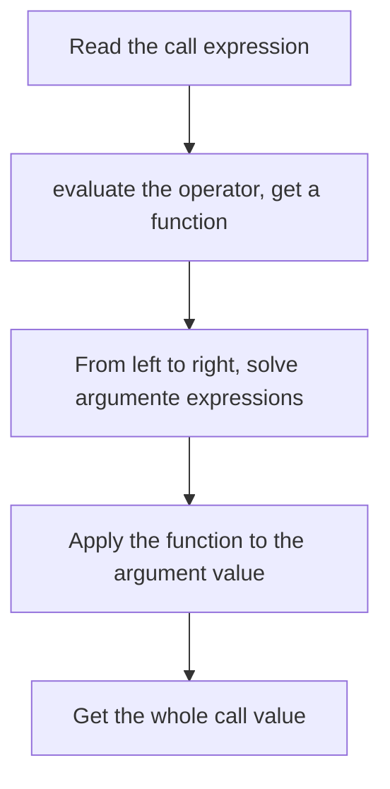
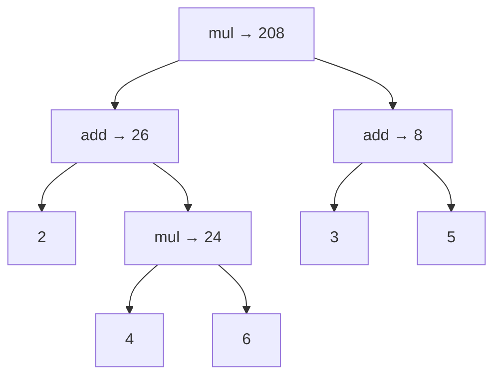

> **English original course**: CS 61A: Structure and Interpretation of Computer Programs (Fall 2024)  
> **Lecturer**: Prof. John DeNero (UC Berkeley)  
> **Text and illustrations**: VideoBook video to image to text technology e-book assembly line  
> **course coverage**: 37 / 37 on 18.2 hour audio/video instruction ⁇ 577 high-level lecture screenshots  
> **Online catalog**: [CS61A Special Catalog](/en/notes/topics/CS61A)

---

## Master Table of Contents


### Module 1: Function and abstraction (Functions & Action)

- **[Activity 01 Welcome: expression and function call](/en/notes/cs61a/lecture-01)** `(13:29 · 6 截图)` · [Original video P1](https://www.bilibili.com/video/BV1sy411z7nA/?p=1)
- **[Lecture 02 · Functions: Names, environments and custom functions](/en/notes/cs61a/lecture-02)** `(40:20 · 13 截图)` · [Original video P2](https://www.bilibili.com/video/BV1sy411z7nA/?p=2)
- **[Activity 03 Control: Multiframe environment model, Conditional Branch and Cycle Control](/en/notes/cs61a/lecture-03)** `(32:21 · 15 截图)` · [Original video P3](https://www.bilibili.com/video/BV1sy411z7nA/?p=3)
- **[Activity 04 . Higger-OrderFunctions: higher-order function, Control Flow Nature and Calculation abstraction](/en/notes/cs61a/lecture-04)** `(42:53 · 16 截图)` · [Original video P4](https://www.bilibili.com/video/BV1sy411z7nA/?p=4)
- **[Activity 05 . Environments: higher-order function environment model, Embedded scope, Lambda and Cori](/en/notes/cs61a/lecture-05)** `(36:42 · 15 截图)` · [Original video P5](https://www.bilibili.com/video/BV1sy411z7nA/?p=5)
- **[higher-order function - From zero synthetic music and Super Mario](/en/notes/cs61a/lecture-06)** `(14:36 · 10 截图)` · [Original video P6](https://www.bilibili.com/video/BV1sy411z7nA/?p=6)
- **[Activity 07 %Functional Action: Function abstraction, environment model Progress, Inverse Search and Debug Field](/en/notes/cs61a/lecture-07)** `(30:05 · 14 截图)` · [Original video P7](https://www.bilibili.com/video/BV1sy411z7nA/?p=7)
- **[Lecture 08 · Function Examples: In-depth analysis of classic midterm exam questions, comprehensive code design and decorator magic](/en/notes/cs61a/lecture-08)** `(34:16 · 14 截图)` · [Original video P8](https://www.bilibili.com/video/BV1sy411z7nA/?p=8)

### Modeule 2: recursion and data abstraction (Recursion & Settings)

- **[Lecture 09 · Recursion (recursion and environment model)](/en/notes/cs61a/lecture-09)** `(37:49 · 14 截图)` · [Original video P9](https://www.bilibili.com/video/BV1sy411z7nA/?p=9)
- **[Recure 10 . Tree Recursion (tree recursion and calculation process)](/en/notes/cs61a/lecture-10)** `(32:14 · 16 截图)` · [Original video P10](https://www.bilibili.com/video/BV1sy411z7nA/?p=10)
- **[Activity 11 . Orders (Sequence, List and list comprehension)](/en/notes/cs61a/lecture-11)** `(22:15 · 15 截图)` · [Original video P11](https://www.bilibili.com/video/BV1sy411z7nA/?p=11)
- **[Lecture 12 Containers (container, box pointer model and dictionary abstraction)](/en/notes/cs61a/lecture-12)** `(27:53 · 16 截图)` · [Original video P12](https://www.bilibili.com/video/BV1sy411z7nA/?p=12)
- **[Recure 13 Data Action data abstraction and abstraction The barrier!](/en/notes/cs61a/lecture-13)** `(29:08 · 16 截图)` · [Original video P13](https://www.bilibili.com/video/BV1sy411z7nA/?p=13)
- **[Lecture 14. Trees (tree data abstraction and tree-wide recursion)](/en/notes/cs61a/lecture-14)** `(34:32 · 16 截图)` · [Original video P14](https://www.bilibili.com/video/BV1sy411z7nA/?p=14)
- **[Lecture 15 · Mutability (mutable gender, object name and local persistence status)](/en/notes/cs61a/lecture-15)** `(37:58 · 16 截图)` · [Original video P15](https://www.bilibili.com/video/BV1sy411z7nA/?p=15)

### Modeule 3: object-oriented and Efficiency

- **[Activity 16 . Enterprises (iterator, Inert Calculating and Generating)](/en/notes/cs61a/lecture-16)** `(29:29 · 16 截图)` · [Original video P16](https://www.bilibili.com/video/BV1sy411z7nA/?p=16)
- **[Recure 17 . Generators (generated by generator, yield mechanism and recursion)](/en/notes/cs61a/lecture-17)** `(17:13 · 16 截图)` · [Original video P17](https://www.bilibili.com/video/BV1sy411z7nA/?p=17)
- **[Activity 18 . Subjects (object-oriented programming, class and example method)](/en/notes/cs61a/lecture-18)** `(17:15 · 14 截图)` · [Original video P18](https://www.bilibili.com/video/BV1sy411z7nA/?p=18)
- **[Recure 19 class attribute and Method (Attributes)](/en/notes/cs61a/lecture-19)** `(17:47 · 15 截图)` · [Original video P19](https://www.bilibili.com/video/BV1sy411z7nA/?p=19)
- **[Recure 20 inheritance and object-oriented design (Inheritance)](/en/notes/cs61a/lecture-20)** `(31:35 · 16 截图)` · [Original video P20](https://www.bilibili.com/video/BV1sy411z7nA/?p=20)
- **[Lecture 21 · Object Representation and Polymorphic Interfaces (Representation)](/en/notes/cs61a/lecture-21)** `(30:31 · 17 截图)` · [Original video P21](https://www.bilibili.com/video/BV1sy411z7nA/?p=21)
- **[Activity 22 . Grouping Objects with linked list Tree Structure (Composition)](/en/notes/cs61a/lecture-22)** `(33:16 · 17 截图)` · [Original video P22](https://www.bilibili.com/video/BV1sy411z7nA/?p=22)
- **[Lecture 23 · Program efficiency and complexity analysis (Efficiency)](/en/notes/cs61a/lecture-23)** `(36:37 · 18 截图)` · [Original video P23](https://www.bilibili.com/video/BV1sy411z7nA/?p=23)
- **[Lecture 24 · Program decomposition and modular design (Decomposition)](/en/notes/cs61a/lecture-24)** `(27:16 · 16 截图)` · [Original video P24](https://www.bilibili.com/video/BV1sy411z7nA/?p=24)
- **[Lecture 25 · Data Structure and Solutions to Midterm Classic Questions (Data Examples)](/en/notes/cs61a/lecture-25)** `(38:37 · 17 截图)` · [Original video P25](https://www.bilibili.com/video/BV1sy411z7nA/?p=25)

### Modeule 4: interpreter and Scheme (Interpreters & Scheme)

- **[Lecture 26 · Functional Language Scheme Basics (Scheme)](/en/notes/cs61a/lecture-26)** `(31:14 · 17 截图)` · [Original video P26](https://www.bilibili.com/video/BV1sy411z7nA/?p=26)
- **[Lecture 27 · Scheme Lists and Symbolic Computation (Scheme Lists)](/en/notes/cs61a/lecture-27)** `(24:44 · 16 截图)` · [Original video P27](https://www.bilibili.com/video/BV1sy411z7nA/?p=27)
- **[Letcure 28 . Abnormal processing, syntax resolution and calculator interpreter (Calculator)](/en/notes/cs61a/lecture-28)** `(47:54 · 18 截图)` · [Original video P28](https://www.bilibili.com/video/BV1sy411z7nA/?p=28)
- **[Recure 29 interpreter architecture and Scheme interpreter achieved (Interpreters)](/en/notes/cs61a/lecture-29)** `(29:48 · 17 截图)` · [Original video P29](https://www.bilibili.com/video/BV1sy411z7nA/?p=29)
- **[Leccture 30 tail recursion and end-to-end optimization (Tail Calls & Tail Recursion)](/en/notes/cs61a/lecture-30)** `(32:50 · 17 截图)` · [Original video P30](https://www.bilibili.com/video/BV1sy411z7nA/?p=30)
- **[Lecture 31 · Code as Data and Metaprogramming (Programs as Data)](/en/notes/cs61a/lecture-31)** `(18:06 · 16 截图)` · [Original video P31](https://www.bilibili.com/video/BV1sy411z7nA/?p=31)
- **[Lecture 32 · Macros and Syntax Extensions (Macros)](/en/notes/cs61a/lecture-32)** `(28:53 · 17 截图)` · [Original video P32](https://www.bilibili.com/video/BV1sy411z7nA/?p=32)

### Module 5: Declarative Programming and SQL (Declarative & SQL)

- **[Lecture 33 · Declarative Programming & SQL Basics](/en/notes/cs61a/lecture-33)** `(25:43 · 17 截图)` · [Original video P33](https://www.bilibili.com/video/BV1sy411z7nA/?p=33)
- **[Lecture 34 · Multi-table joins and relational operations (Tables & Joins)](/en/notes/cs61a/lecture-34)** `(24:54 · 17 截图)` · [Original video P34](https://www.bilibili.com/video/BV1sy411z7nA/?p=34)
- **[Lecture 35 · Data aggregation and grouping statistics (Aggregation & Group By)](/en/notes/cs61a/lecture-35)** `(17:30 · 17 截图)` · [Original video P35](https://www.bilibili.com/video/BV1sy411z7nA/?p=35)
- **[Lecture 36 · Database system and Python interaction (Databases & Python Integration)](/en/notes/cs61a/lecture-36)** `(26:22 · 17 截图)` · [Original video P36](https://www.bilibili.com/video/BV1sy411z7nA/?p=36)
- **[Lecture 37 · Course Summary and Comprehensive Practical Exercise (Final Examples & Conclusion)](/en/notes/cs61a/lecture-37)** `(38:48 · 17 截图)` · [Original video P37](https://www.bilibili.com/video/BV1sy411z7nA/?p=37)


---


> **Lecture**: John DeNero ｜ **duration**: 13:29 ｜ **Video link back**: [Single episode corresponding to station B (P1)](https://www.bilibili.com/video/BV1sy411z7nA/?p=1)

## 1. How to study the course

*I'm sorry. reference timestamp 00:00.00.  [Watch clip (P1 00:00:00)](https://www.bilibili.com/video/BV1sy411z7nA/?p=1&t=0))*

In the opening, DeNero explained that he and Rao teach two classes respectively, and the two classes share homework, exams and pre-recorded videos. Students should watch the corresponding video before class, and the live lecture will further expand on the examples and discuss issues that need to be considered when solving problems.

Pre-recorded content is organized into playlists: introduction announcements first, then moving into course topics. Individual segments are usually only five to ten minutes long, and a session may include several segments. Some videos are from recordings in previous years and are re-recorded when the course is updated, so the instructor's age, terminal version, and screen style may be different.

This lecture starts with a basic program building block: **expression**.

> **Editor's note**: The class opening notice in the video belongs to the arrangement at the time of recording and does not serve as the deadline for today’s homework. When learning, you should first understand the rules and then run the examples yourself.

## 2. expression: A value obtained with a description calculation

*reference timestamp: 00:02:11...  [Watch clip (P1 00:02:11)](https://www.bilibili.com/video/BV1sy411z7nA/?p=1&t=131))*

**expression (expertation) describes a calculation and evaluation gets a value (value).**  expression is the calculation description written down, the value is the result of the calculation.

Mathematics are already calculated using expression, but different algorithms are often used: add  `+`  Written between two numbers, division can be done by placing the numerator above the denominator, the square root has the root sign, and the sine is written as  `sin`. The instructor described the square root as putting numbers into a "little house," reminding the reader that these are symbols for calculations.

function call accounts provide a common structure: give a function first, then list the inputs.  `f(x)`  or  `f(x, y)`, the calculation can also be expressed in the program. Next, the curriculum uses this structure to explain arithmetic and more complex expressions.

### Start with Python Interactive interpreter

*reference timestamp: 00:03:51...  [Watch clip (P1 00:03:51)](https://www.bilibili.com/video/BV1sy411z7nA/?p=1&t=231))*

Run in terminal  `python3`, start interactive interpreter. See  `>>>`  Enter expression after the hint, interpreter will evaluation and display the result.

```python
>>> 2015
2015
>>> 2000 + 15
2015
```

The numbers themselves are simple expression; by combining them with calculations, they are compounded by expression. The lecturer also demonstrated multiplication, brackets, division and multipliers that Python can handle these calculations like a calculator.


*⏱ Timestamp: 00:04:20 · 📷 Lecture screenshot · [Watch clip (P1 00:04:20)](https://www.bilibili.com/video/BV1sy411z7nA/?p=1&t=260)*

> **Editor's note**: `>>>`  is a prompt, not a code; copy to  `.py`  File to remove the prompt and result lines. The old Python version in the video belongs to the recording environment, and the examples in this book can be run in modern Python 3.

## 3. call expression: Function and input combination

*reference timestamp: 00:04:55...  [Watch clip (P1 00:04:55)](https://www.bilibili.com/video/BV1sy411z7nA/?p=1&t=295))*

The general form of call expression is  `函数表达式(实参表达式1, 实参表达式2, ...)`. For example, `max`  Take the maximum value in the input:

```python
>>> max(2, 4)
4
>>> max(1, 2, 3, 4, 5)
5
```

`min` , the minimum value is taken. The number of inputs per function is determined by the rules of the function, with a single call in brackets and commas separated into expression; `max`  Accepting multiple inputs does not mean that all functions accept any number of arguments.

### Write the arithmetic as a call

*(reference timestamp: 00:06:00)  [Watch clip (P1 00:06:00)](https://www.bilibili.com/video/BV1sy411z7nA/?p=1&t=360))*

There are also corresponding functions for addition and multiplication. Start with  `operator`  Module import:

```python
>>> from operator import add, mul
>>> add(2, 3)
5
>>> mul(2, 3)
6
```

`add(2, 3)`  Expression operation and  `2 + 3`  Same, `mul(2, 3)`  and  `2 * 3`  Same. Importing makes the function name available in the current session so that it can be called repeatedly.


*⏱ Timestamp: 00:06:28 · 📷 Lecture screenshot · [Watch clip (P1 00:06:28)](https://www.bilibili.com/video/BV1sy411z7nA/?p=1&t=388)*

### Nested calls: forming large calculations from small calculations

*reference timestamp: 00:06:33...  [Watch clip (P1 00:06:33)](https://www.bilibili.com/video/BV1sy411z7nA/?p=1&t=393))*

One call can be placed in another call argument position. The core example of the classroom is:

```python
>>> mul(add(2, mul(4, 6)), add(3, 5))
208
```

The input on the left is "2 plus the product of 4 and 6", the input on the right is "the sum of 3 and 5", and finally the two are multiplied together. Parentheses indicate which result belongs to which call.

The same arithmetic can also be written as  `(2 + 4 * 6) * (3 + 5)`. Operations priority is required when using operator; call the log to write group structures in embedded relationships. The course emphasizes call expression to create evaluation rules that can be applied again.


*⏱ Timestamp: 00:07:30 · 📷 Lecture screenshot · [Watch clip (P1 00:07:30)](https://www.bilibili.com/video/BV1sy411z7nA/?p=1&t=450)*

## 4. Anatomy of call expression

*I'm sorry. reference timestamp 00:08:07 .  [Watch clip (P1 00:08:07)](https://www.bilibili.com/video/BV1sy411z7nA/?p=1&t=487))*

to  `add(2, 3)`  For example, it's still inside. expression Composition:

| part | This example | evaluation, get what? |
| --- | --- | --- |
| operator Son expression (Pector subtext) | `add` | Addition function |
| First operand Son expression (operand subtext) | `2` | numerical value  `2` |
| Second operand Son expression | `3` | numerical value  `3` |
| The whole call expression. | `add(2, 3)` | numerical value  `5` |

Here'operator' refers to the pre-bracket part, which can be a function name, but not limited to  `+`, `*`  these symbols. **Functions themselves are also values**:Solve name  `add`, what you get is a function that can be called.


*⏱ Timestamp: 00:08:35 · 📷 Lecture screenshot · [Watch clip (P1 00:08:35)](https://www.bilibili.com/video/BV1sy411z7nA/?p=1&t=515)*

Also distinguish: **Operant is the expression written in the program, and Argument is the argument value that solves the expression post-transmit function.**  In simple numerical examples the two look close; nested calls clearly show their difference.

## 5. How to solve all calls with the same set of rules

*reference timestamp: 00:09:12...  [Watch clip (P1 00:09:12)](https://www.bilibili.com/video/BV1sy411z7nA/?p=1&t=552))*

interpreter repeats the same process:

1. First evaluate the operator sub-expression, get the function to call.
2. operand sub-expression from left to right, got argument value.
3. Apply the function to these arguments and get the whole call value.



If a argument is itself call expression, interpreter applies the same rule again when solving it. Complex expression does not need a completely new evaluation method.


*⏱ Timestamp: 00:09:30 · 📷 Lecture screenshot · [Watch clip (P1 00:09:30)](https://www.bilibili.com/video/BV1sy411z7nA/?p=1&t=570)*

### Step by step dismantling of the origins of 208

*reference timestamp: 00:10:12...  [Watch clip (P1 00:10:12)](https://www.bilibili.com/video/BV1sy411z7nA/?p=1&t=612))*

consider  `mul(add(2, mul(4, 6)), add(3, 5))`. First solve the outer layer  `mul`, the multiplication function is obtained; at this time, multiplication is not possible because the two input values have not yet been determined.

Process the first input  `add(2, mul(4, 6))`: found  `add`, get the first input  `2`;The second input is  `mul(4, 6)`, so continuing to apply the calling rules, we get  `24`. Then execute  `add(2, 24)`, get  `26`.

First in the outer layer. argument Now.  `26`, the second one still needs to be dealt with. Solve  `add(3, 5)`  get  `8`;Last execution  `mul(26, 8)`, get  `208`.



This picture is called **expression Tree**, which indicates how the sub-expression is made up of large calculations, and how the median is passed out. Trees indicate dependency; when tracking the order of execution, remember to solve the function first, then to solve argument from left to right.


*⏱ Timestamp: 00:12:25 · 📷 Lecture screenshot · [Watch clip (P1 00:12:25)](https://www.bilibili.com/video/BV1sy411z7nA/?p=1&t=745)*

| Completed calculations | the value obtained | Who will I give it to next? |
| --- | --- | --- |
| `mul(4, 6)` | `24` | left side  `add`  Second argument |
| `add(2, 24)` | `26` | Outer layer  `mul`  First argument |
| `add(3, 5)` | `8` | Outer layer  `mul`  Second argument |
| `mul(26, 8)` | `208` | The value of the entire expression |

The rule is provided with the correct input before the calculation takes place. The lecturer finally emphasized: in the code  `add(2, mul(4, 6))`  A operand subdivision expression, `26`  is its value and also the outer layer  `mul`  First argument.

## 6. Self-examination: Do you really understand the call?

> **Editor's Note · Exercises**: The following questions are for review, not the original assignments in the video.

1. `add(2, 3)`  and  `5`  What's the difference?
2. In  `mul(add(2, 3), 4)`  What is the first operand in ? What about the first argument?
3. Without running the code, write  `add(mul(2, 3), mul(4, 5))`  the intermediate value and the final result.

**Reference answer**: First, the former describes the calculation and the latter is evaluation Result. Question number two. operand expression Yes.  `add(2, 3)` argument value  `5`. The third question, get it first  `6`, `20`, and finally get  `26`;preliminarily solves operator calls.

L2 will continue to expand these rules: let the name point to new values and define its own function.

## Official references and sources

- [This lecture B station video · P1](https://www.bilibili.com/video/BV1sy411z7nA/?p=1): Main content and screenshot source, instructor John DeNero.
- [Composing Programs §1.2](https://composingprograms.com/pages/12-elements-of-programming.html): calibration information for call expression, library functions, evaluation rules.
- [Composing Programs §1.1](https://composingprograms.com/pages/11-getting-started.html): interpreter introductory extended reading, not as an additional part of the present statement.

The copyright of the video footage belongs to the original rights holder; John DeNero, the author of the textbook, and relevant permissions are retained according to the original site's instructions.

---

