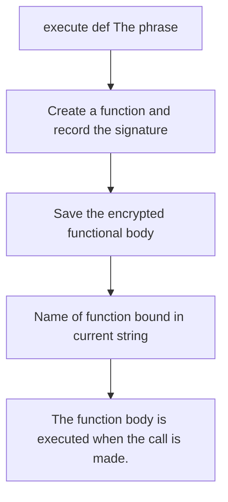
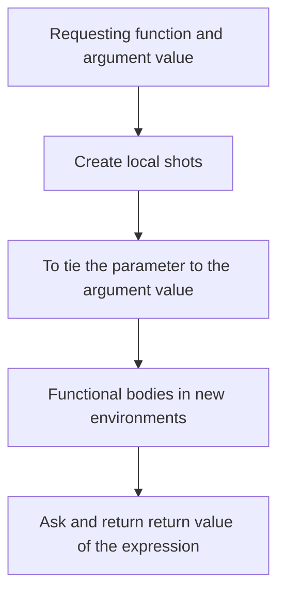
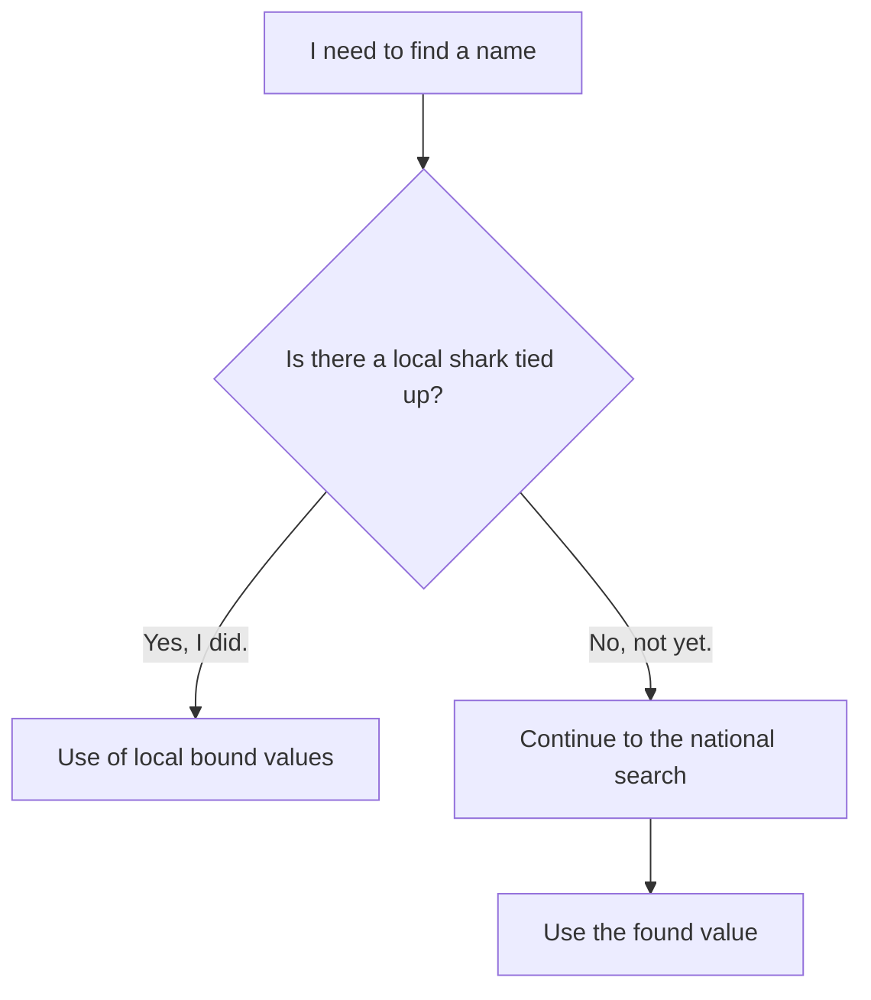
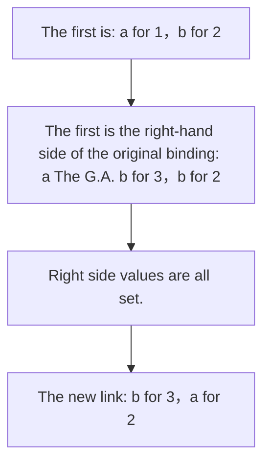

> **Earlier edition:** The Chinese edition was expanded on 22 October 2026. This English translation covers the previous edition. [Read the updated Chinese lecture](/notes/cs61a/lecture-02).

> **English original course**: CS 61A: Structure and Interpretation of Computer Programs (Fall 2024)  
> **Lecturer**: Prof. John DeNero (UC Berkeley)  
> **Text and illustrations**: VideoBook video to image to text technology e-book assembly line  
> **course coverage**: 37 / 37 on 18.2 hour audio/video instruction ⁇ 577 high-level lecture screenshots  
> **Online catalog**: [CS61A Special Catalog](/en/notes/topics/CS61A)

---


> **Lecture**: John DeNero ｜ **duration**: 40:20 ｜ **Video link back**: [Single episode corresponding to station B (P2)](https://www.bilibili.com/video/BV1sy411z7nA/?p=2)

## 1. Use what you learned to solve problems

*I'm sorry. reference timestamp 00:00.00.  [Watch clip (P2 00:00:00)](https://www.bilibili.com/video/BV1sy411z7nA/?p=2&t=0))*

The lecturer emphasized in the notice: Applying classroom knowledge to problem solving is the core of the course. You should try the assignment as soon as possible after it is posted; it is normal to encounter difficulties. You can seek help during the Q&A time, ask questions in the course forum, or discuss with the study group. Asking for help and discussing things take time, and starting early can make space for them.

> **Editor's note**: The specific release date and deadline in the video belong to the course announcement for that year. The following examples are organized by topic, and it is recommended that each group be run in a new Python session to avoid confusion with the previous group.  `max`, `square`  Rebinding of other names affects the latter group.

## 2. Name pointing value, giving value to save evaluation results

*(reference timestamp: 00:01:30 )  [Watch clip (P2 00:01:30)](https://www.bilibili.com/video/BV1sy411z7nA/?p=2&t=90))*

Python can do calculations, but many library names need to be imported first. Directly enter those that have not yet been imported  `pi`  Report  `NameError`, does not mean that Python cannot handle pi, but that the name does not exist in the current environment.

```python
>>> from math import pi, sin
>>> pi
3.141592653589793
>>> sin(pi / 2)
1.0
```

`import`  Make existing names and values available in the current environment. The lecturer also demonstrated  `Ctrl+L`  Clear screen: This only clears the terminal display. The current Python session is still there, and the established name binding will not disappear.

### Assignment: Solve the right side first, then establish binding

*reference timestamp: 00:02:31...  [Watch clip (P2 00:02:31)](https://www.bilibili.com/video/BV1sy411z7nA/?p=2&t=151))*

expression is written on the left and interpreter is written on the right. interpreter first solves the right expression and then binds the value obtained to the left name.

```python
>>> radius = 10
>>> 2 * radius
20
>>> area, circumference = pi * radius * radius, 2 * pi * radius
>>> area
314.1592653589793
>>> radius = 20
>>> area
314.1592653589793
```

final  `area`  Why doesn't it become the area of a circle with radius 20? Because the first assignment saves the value that has been calculated at that time. **`area`  I don't remember which expression to calculate this value, and I don't automatically track it.  `radius`.**  Modify  `radius`  Just change the binding of that name.


*⏱ Timestamp: 00:03:45 · 📷 Lecture screenshot · [Watch clip (P2 00:03:45)](https://www.bilibili.com/video/BV1sy411z7nA/?p=2&t=225)*

### Functions can also have multiple names

*reference timestamp: 00:03:33...  [Watch clip (P2 00:03:33)](https://www.bilibili.com/video/BV1sy411z7nA/?p=2&t=213))*

A function is a value that can be bound to a name just like a number:

```python
>>> f = max
>>> f(1, 2, 3)
3
>>> max = 7
>>> f(1, 2, max)
7
>>> max = f
>>> max(1, 2, 3)
3
```

`f = max`  let  `f`  Points to the original maximum function and does not create a new function. `max = 7`  What changes is the name  `max`  meaning, the original function can still pass  `f`  Found. finally  `max = f`  Restore the binding for this name.


*⏱ Timestamp: 00:04:50 · 📷 Lecture screenshot · [Watch clip (P2 00:04:50)](https://www.bilibili.com/video/BV1sy411z7nA/?p=2&t=290)*

**A name can be bound to at most one value in the same frame, but a value can have multiple names at the same time.**  These two directions cannot be confused.

## 3. Definition of function: Naming the computational process

*(reference timestamp: 00:05:32; 00:10:22 )  [Watch clip (P2 00:05:32)](https://www.bilibili.com/video/BV1sy411z7nA/?p=2&t=332))*

The class has shown three ways to create name binding: import statements, assignment statements, and function definition statements. Assigned names point to an output value, while function definitions create a function and name the entire computation process.

The lecturer interpreted \*\* abstraction (abstract)\*\* as giving a name to complex things, using them as a whole, without having to focus on internal details for the time being. The attribution is a simple abstraction device, with a stronger definition of functions, because the function can contain a complete expression and statement sequence.

### from square to sum\_squares

*reference timestamp: 00:06:04...  [Watch clip (P2 00:06:04)](https://www.bilibili.com/video/BV1sy411z7nA/?p=2&t=364))*

```python
from operator import add, mul

def square(x):
    return mul(x, x)

def sum_squares(x, y):
    return add(square(x), square(y))
```

Once defined, custom functions can participate in calls and nestings as if they already exist:

```python
>>> square(3 + 4)
49
>>> square(square(3))
81
>>> sum_squares(3, 4)
25
```

`sum_squares(3, 4)`  Find out first  `3`  and  `4`  square  `9`, `16`, and then add up to get  `25` Functions allow small computations that are already defined to continue to form larger ones.


*⏱ Timestamp: 00:06:55 · 📷 Lecture screenshot · [Watch clip (P2 00:06:55)](https://www.bilibili.com/video/BV1sy411z7nA/?p=2&t=415)*

### Granted and function call The key difference.

*reference timestamp: 00:07:09...  [Watch clip (P2 00:07:09)](https://www.bilibili.com/video/BV1sy411z7nA/?p=2&t=429))*

front  `area`  It doesn't change with the radius. It's just that when it comes to value, evaluation . In a function expression Reset every call evaluation :

```python
from math import pi

radius = 20

def area():
    return pi * radius * radius
```

```python
>>> area()
1256.6370614359173
>>> radius = 10
>>> area()
314.1592653589793
>>> radius = 1
>>> area()
3.141592653589793
```

`area`  It now points to the function, not the previous value. `area()`  Although no argument is active; current call is read on call  `radius`, calculate and return the area.


*⏱ Timestamp: 00:08:03 · 📷 Lecture screenshot · [Watch clip (P2 00:08:03)](https://www.bilibili.com/video/BV1sy411z7nA/?p=2&t=483)*

> **Editor's note**: This class specifically shows the behavior of reading global names. This does not mean that all functions automatically track external data; the execution from the function body and the name lookup rules at that time are recalculated.

## 4. The structure and execution rules of def

*reference timestamp: 00:10:51...  [Watch clip (P2 00:10:51)](https://www.bilibili.com/video/BV1sy411z7nA/?p=2&t=651))*

```python
def square(x):
    return mul(x, x)
```

The first line contains the keyword  `def`, function name, in brackets **parameter (formal parameter) **and colon. `square(x)`  It’s in this case** Function signature (signature)** indicates the name of the function and the structure of parameter. The code for indentation after the colon is **Function body (body)**.

parameter It's a name. It's bound to the incoming when it's called. argument value. `return`  After expression When Performing a Function evaluation , the value is the function returns the value.


*⏱ Timestamp: 00:11:45 · 📷 Lecture screenshot · [Watch clip (P2 00:11:45)](https://www.bilibili.com/video/BV1sy411z7nA/?p=2&t=705)*

execute  `def`  interpreter does three things: creates a function with the corresponding signature, saves the function, and binds the name of the function to this new function.



**Function bodies are not executed when defining functions.**  execute  `def square(x)`  No multiplication has been done yet; the multiplication is only done when calling  `square`  happens later. The lecturer used "squirreled away" to describe the function body being properly preserved, and made a linguistic joke about this word. The key point to understand is that "save" and "execute" belong to different stages.

## 5. Calling on custom functions: Create local arrays

*reference timestamp: 00:14:21...  [Watch clip (P2 00:14:21)](https://www.bilibili.com/video/BV1sy411z7nA/?p=2&t=861))*

The function is obtained with argument. For user-defined functions, the application function must also complete the following process:

1. add a new **local frame**, forming the environment for calling and using.
2. In this frame, bind the function parameter to the argument value.
3. The function body is executed in this environment.



### Track square(-2)

*reference timestamp: 00:15:28...  [Watch clip (P2 00:15:28)](https://www.bilibili.com/video/BV1sy411z7nA/?p=2&t=928))*

```python
from operator import mul

def square(x):
    return mul(x, x)

square(-2)
```

Import first  `mul`  To be bound to a multiplicative function.  `square`  function and bind it's name, the multiplication is still not performed. After the call occurs, `square`  evaluation gets this function, `-2`  evaluation gets numbers  `-2`.

Then create a local frame and build it inside  `x → -2`  binding; execution  `return mul(x, x)`  time, two  `x`  All found  `-2`, multiplied to get  `4`, and handed back to the calling place as the return value.


*⏱ Timestamp: 00:17:20 · 📷 Lecture screenshot · [Watch clip (P2 00:17:20)](https://www.bilibili.com/video/BV1sy411z7nA/?p=2&t=1040)*

Environment graphs often label local frames with function names to facilitate tracking which call was made. “Return value: 4” in the figure is a process comment, **Not an ordinary variable binding named Return value**. The function signature is important because it provides the information needed to create a local frame and to bind parameter.

## 6. Context determines what a name represents

*reference timestamp: 00:19:41...  [Watch clip (P2 00:19:41)](https://www.bilibili.com/video/BV1sy411z7nA/?p=2&t=1181))*

expression is always in evaluation in a \*\* environment.\*\* The environment record name corresponds to the value; the same name may have different meanings in different environments.

In the model of this lecture, the environment is a sequence of sequential frames. In the simplest case, there is only a global frame; when a function is called, there are local frames and subsequent global frames. Internal record name binding within the frame.

When searching for a name, start from the first frame of the current environment and search backwards, using **The earliest binding found**. For example, in  `square`  First search for the local frame in the function body; if the name cannot be found, then search for the global frame.




*⏱ Timestamp: 00:21:05 · 📷 Lecture screenshot · [Watch clip (P2 00:21:05)](https://www.bilibili.com/video/BV1sy411z7nA/?p=2&t=1265)*

> **Editor's note** This is the model used for this phase. The classroom simplifys the search for the inner name to the overall environment in the diagram, and does not expand all the inner name in the diagram; the more complete Python scope mechanism also contains details such as the built-in naming space.

### Function name is the same as parameter, why is it still working?

*reference timestamp: 00:21:47...  [Watch clip (P2 00:21:47)](https://www.bilibili.com/video/BV1sy411z7nA/?p=2&t=1307))*

```python
from operator import mul

def square(square):
    return mul(square, square)

square(-2)
```

The result of this code is still  `4`. In the global environment, `square`  Point function; this function was found when solving operator calls from the outer layer. parameter after calling to create a local frame  `square`  is bound to a number  `-2`.

So, search in the function body  `square`, first found in the local frame  `-2`, no longer use the global function of the same name. two  `square`  Belonging to different frames and having the same name does not mean that they are bound to the same value.


*⏱ Timestamp: 00:23:20 · 📷 Lecture screenshot · [Watch clip (P2 00:23:20)](https://www.bilibili.com/video/BV1sy411z7nA/?p=2&t=1400)*

> **Editor's note**: This naming scheme is intentionally used to check search rules. When actually writing a program, `def square(x)`  Easier to read.

## 7. Environment graph and multiple assignment

*reference timestamp: 00:24:07...  [Watch clip (P2 00:24:07)](https://www.bilibili.com/video/BV1sy411z7nA/?p=2&t=1447))*

The environment chart draws the interpreter execution: the left is the code, the right is the frame, the name and the value of the frame is shown. The arrow indicates the execution position; the grey arrow in the video is the statement that has just been executed, and the red arrow is the next statement that is to be executed.

The instructor demonstrates the Online Python Tutor: enter your code, click Visualize Execution, and move forward. For example, first import  `pi`, then execute  `tau = 2 * pi`, you can see how the binding of these two names appears.

```python
from math import pi
tau = 2 * pi
```

Drawing is not an accessory skill. The instructor pointed out that computer science often uses boxes and arrows to represent structures, and environment diagrams are a concrete tool for practicing understanding "what a program does."

### Multiple Quantities Count All Right expression

*reference timestamp: 00:27:44...  [Watch clip (P2 00:27:44)](https://www.bilibili.com/video/BV1sy411z7nA/?p=2&t=1664))*

```python
a = 1
b = 2
b, a = a + b, b
```

The last line is executed in two stages: **Calculates all expressions on the right from left to right, then binds the left name to the corresponding result.**  It is not possible to change the name every time a expression is counted, and then calculate the last expression with the changed name.



So the right side gets first  `(3, 2)`, then  `b`  become  `3`, `a`  become  `2`. Reassignment within the same frame replaces the original binding of the name.


*⏱ Timestamp: 00:28:35 · 📷 Lecture screenshot · [Watch clip (P2 00:28:35)](https://www.bilibili.com/video/BV1sy411z7nA/?p=2&t=1715)*

## 8. Combine name binding with nested calls

*(Question time: 00:09:14; Answer time: 00:28:45)*

This is the synthesis of this presentation. Do not guess the function by the name. Press the current binding of evaluation:

```python
f = min
f = max
g, h = min, max
max = g
max(f(2, g(h(1, 5), 3)), 4)
```


*⏱ Timestamp: 00:09:35 · 📷 Lecture screenshot · [Watch clip (P2 00:09:35)](https://www.bilibili.com/video/BV1sy411z7nA/?p=2&t=575)*

The first line gives  `f`  Points to the minimum function, and the second line immediately binds it to the maximum function. Then  `g`  points to the minimum value function, `h`  Points to the maximum function. `max = g`  also make the name  `max`  Points to the minimum function.

| The name before the last call | The function currently pointed to |
| --- | --- |
| `f` | original maximum function |
| `g` | original minimum function |
| `h` | original maximum function |
| `max` | original minimum function |

Then calculate according to the calling rules:

1. `h(1, 5)`  Using the maximum function, we get  `5`.
2. `g(5, 3)`  Using the minimum function, we get  `3`.
3. `f(2, 3)`  Using the maximum function, we get  `3`.
4. Outer layer  `max(3, 4)`  At this time, the minimum value function is actually used, and we get  **`3`**.

The original maximum and minimum functions have not been modified, and the name is changed to whom. Environmental chart records bind, expression tree logs combine; by combining the two, the example can only be reliably solved.

## 9. The output of print is not equal to the return value

*reference timestamp: 00:32:49...  [Watch clip (P2 00:32:49)](https://www.bilibili.com/video/BV1sy411z7nA/?p=2&t=1969))*

Interact interpreter The following two operations look similar, but the mechanisms are different:

```python
>>> -2
-2
>>> print(-2)
-2
>>> 'Go Bears'
'Go Bears'
>>> print('Go Bears')
Go Bears
```

expression is the value of this expression displayed by interpreter after directly entering expression. Call  `print`  When , the screen text comes from the printing action generated by function execution. The difference in quotation marks in the string example reminds us that the two paths cannot be confused.

### None is a special value

*reference timestamp: 00:33:28...  [Watch clip (P2 00:33:28)](https://www.bilibili.com/video/BV1sy411z7nA/?p=2&t=2008))*

`None`  This means that there is no meaningful return result. It is still a Python value, which does not mean that "evaluation processes have no result at all." When the function does not have a visible return value, it returns  `None`.

```python
>>> None
>>> print(None)
None
```

Interactive interpreter does not automatically show results as expression  `None`, but  `print`  You can print it out.

### The square is calculated, but the square may not be returned.

*(reference timestamp: 00:35:02 )  [Watch clip (P2 00:35:02)](https://www.bilibili.com/video/BV1sy411z7nA/?p=2&t=2102))*

```python
def does_not_square(x):
    x * x
```

The function body does calculate  `x * x`, but no  `return`, so the call returns  `None`: 

```python
>>> does_not_square(4)
>>> sixteen = does_not_square(4)
>>> sixteen
>>> sixteen + 4
Traceback (most recent call last):
    ...
TypeError: unsupported operand type(s) for +: 'NoneType' and 'int'
```

`sixteen`  Just a name, no guarantee that its value is  `16`. It is bound to the return value of the call  `None`, so adding an integer will result in an error. The problem is not that the multiplication is not performed, but that the square result is not returned to the caller.


*⏱ Timestamp: 00:35:55 · 📷 Lecture screenshot · [Watch clip (P2 00:35:55)](https://www.bilibili.com/video/BV1sy411z7nA/?p=2&t=2155)*

## 10. Pure functions, side effects and nested print

*reference timestamp: 00:36:30...  [Watch clip (P2 00:36:30)](https://www.bilibili.com/video/BV1sy411z7nA/?p=2&t=2190))*

The instructor draws a pure function as a closed pipe leading from input to output. in the classroom  `abs(-2)`  Return only  `2`, `pow`  The return value is also calculated from the input. In addition to returning a value, an impure function also produces **side effects**.

`print`  The return value is  `None`, the text on the screen is a side effect. Side effects are actions that occur, not return values that are given to the caller to continue operations.


*⏱ Timestamp: 00:37:50 · 📷 Lecture screenshot · [Watch clip (P2 00:37:50)](https://www.bilibili.com/video/BV1sy411z7nA/?p=2&t=2270)*

### Why do three lines of output appear?

*reference timestamp: 00:38:02...  [Watch clip (P2 00:38:02)](https://www.bilibili.com/video/BV1sy411z7nA/?p=2&t=2282))*

```python
>>> print(print(1), print(2))
1
2
None None
```

The order of L1 is still followed when solving this nested call: find the outer layer first  `print`, and solve two argument expressions from left to right.

| Where to execute | screen side effects | The return value of this call |
| --- | --- | --- |
| first inner layer  `print(1)` | Print  `1` | `None` |
| second inner layer  `print(2)` | Print  `2` | `None` |
| Outer layer  `print(None, None)` | Print  `None None` | `None` |

The value of the entire expression is still at the end.  `None`, the interactive interpreter does not automatically show it, so the fourth line does not appear. The first two lines are not returned values that are to be used in the inner layer, but rather print side effects that occur when they are executed.


*⏱ Timestamp: 00:39:45 · 📷 Lecture screenshot · [Watch clip (P2 00:39:45)](https://www.bilibili.com/video/BV1sy411z7nA/?p=2&t=2385)*

> **Editor's note**: in  `.py`  In the file, write directly  `2 + 3`  will not automatically show results; interactive interpreter automatic display of behaviors and  `print`  It's two different things. When writing a program, if you need to display the result, print it explicitly, and if you need to return the result, use  `return`.

## 11. Terminology and pitfalls

| Terminology | meaning in this lecture |
| --- | --- |
| name name | The identifier used to find the value |
| binding binding | Correspondence between names and values in a frame |
| frame frame | A set of records bound by name |
| environment environment | sequential frame sequence |
| parameter formal parameter | Name in function definition, such as  `x` |
| argument argument | evaluation values are entered after evaluation calls, for example  `-2` |
| function signature signature | Function name and parameter structure |
| return value return value | Value obtained by call expression |
| side effect side effect | Actions that occur other than the return value, such as printing |

The following differences avoid most of the errors in this discussion: assignment preserves current values, function bodies execute when calling; name and function to which it refers are two things; parameter is at the definition and call levels respectively and argument; output and return values also fall under different paths.

### self-examination exercise

> **Editor's Note · Exercises**: The following questions are for review, not the original assignments in the video. Each question runs independently.

1. execute  `a = 1; b = 2; a, b = b, a`  Finally, how much are each of them?
2. Definition  `def double(x): return x + x`  After that, call  `double(3 + 4)`  Time parameter  `x`  Bound to what?
3. `print(print(7))`  Which rows will be shown? What are the values of the entire expression?
4. remove  `square`  in  `return`, why the call result cannot continue to be used as a number?

**Reference answer**: The first title is  `a = 2`, `b = 1`. Solve the second question first  `3 + 4`, so  `x = 7`, return  `14`. The third question is shown first  `7`, then display  `None`;the value of the entire expression also  `None`. The fourth question still calculates the square, but the function returns  `None`, without returning the numerical result to the caller.

## Official references and sources

- [This lecture B station video · P2](https://www.bilibili.com/video/BV1sy411z7nA/?p=2): Primary source for text and screenshots, instructor John DeNero.
- [Composing Programs §1.2](https://composingprograms.com/pages/12-elements-of-programming.html): Name, embedded expressionA, auxiliary information for non-purity functions.
- [Composing Programs §1.3](https://composingprograms.com/pages/13-defining-new-functions.html) Function definition, call and local name supporting information.
- [Python Tutor](https://pythontutor.com/): Step-by-step execution of classroom demonstrations with environment diagram tools.

The copyright of the video, translation and images belongs to the original rights holder; John DeNero, the author of the textbook, and relevant permissions are retained according to the original site instructions.

---

