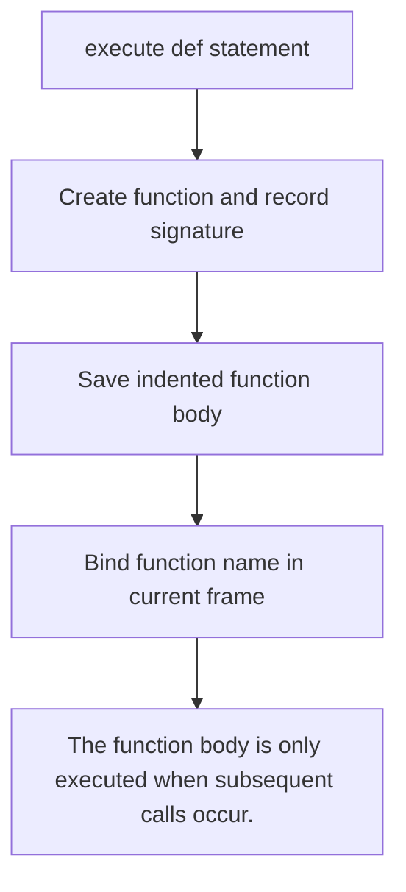
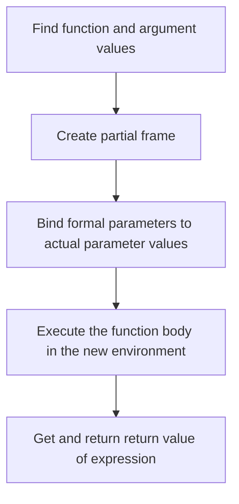
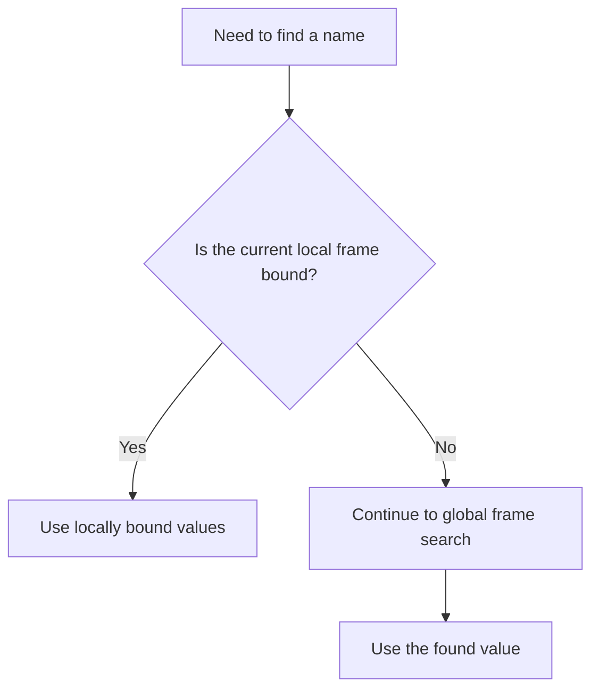
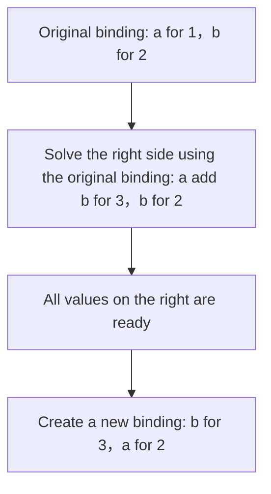

> **Course**: UC Berkeley CS61A (Fall 2024)  
> **Module**: Module 1: Functions & Abstraction  
> **Lecturer**: Prof. John DeNero (UC Berkeley)  
> **Video duration**: 40:20 ｜ **Classroom screenshots**: 13 pieces of blackboard writing/code demonstration  
> **Direct video**: [📺Watch the original video of this lecture on Bilibili (P2)](https://www.bilibili.com/video/BV1sy411z7nA/?p=2)  
> **Quick navigation**: [← Previous Lecture (P01 Lecture 1 Welcome)](/en/notes/cs61a/lecture-01) ｜ [📚 Return to the full book catalog](/en/notes/topics/CS61A) ｜ [Next Lecture (P03 Lecture 3 Control) →](/en/notes/cs61a/lecture-03)

---

## 1. Use what you learned to solve problems

*(Reference time: 00:00:00 · [Video jump (P2 00:00:00)](https://www.bilibili.com/video/BV1sy411z7nA/?p=2&t=0))*

The lecturer emphasized in the notice: Applying classroom knowledge to problem solving is the core of the course. You should try the assignment as soon as possible after it is posted; it is normal to encounter difficulties. You can seek help during the Q&A time, ask questions in the course forum, or discuss with the study group. Asking for help and discussing things take time, and starting early can make space for them.

> **Editor's note**: The specific release date and deadline in the video belong to the course announcement for that year. The following examples are organized by topic, and it is recommended that each group be run in a new Python session to avoid confusion with the previous group.  `max`, `square`  Rebinding of other names affects the latter group.

### In-depth formal specification and micro-evaluation process (Operational Semantics)
In the "1. Use what you have learned to solve problems" module, the underlying computer operations rely on strict formal evaluation logic:
1. **Hierarchical parsing of abstract syntax trees (AST)**: 
   - The source code character stream is first divided into terminal symbol tokens (Tokens) by the lexical analyzer (Lexer), and then constructed into a multi-fork syntax tree by the syntax parser (Parser);
   - Operator priority and associativity are solidified during the syntax tree construction phase, eliminating ambiguity at runtime;
2. **Dynamic transitions of environment chains**: 
   - Each function call generates a new frame whose static lexical environment is determined by the function object's  `parent`  Attributes are completely determined;
   - The variable search traces back up the environment chain in one direction until the global environment frame. If it is not found, it will be triggered.  `NameError`  Abnormal;
3. **State Invariants**: 
   - The key to writing robust programs is to clarify loop invariants (Loop Invariants) and function pre/post-conditions (Pre/Post-conditions);
   - In complex control flow jumps, ensure that state variables maintain legal business constraints before each iteration.


## 2. The name points to the value, and the assignment saves the evaluation result.

*(Reference time: 00:01:30 · [Video jump (P2 00:01:30)](https://www.bilibili.com/video/BV1sy411z7nA/?p=2&t=90))*

Python can do calculations, but many library names need to be imported first. Directly enter those that have not yet been imported  `pi`  Report  `NameError`, does not mean that Python cannot handle pi, but that the name does not exist in the current environment.

```python
>>> from math import pi, sin
>>> pi
3.141592653589793
>>> sin(pi / 2)
1.0
```

`import`  Make existing names and values available in the current environment. The lecturer also demonstrated  `Ctrl+L`  Clear screen: This only clears the terminal display. The current Python session is still there, and the established name binding will not disappear.

### Assignment: Solve the right side first, then establish binding

*(Reference time: 00:02:31 · [Video jump (P2 00:02:31)](https://www.bilibili.com/video/BV1sy411z7nA/?p=2&t=151))*

Assignment statements write the name on the left and the expression on the right. The interpreter first evaluates the expression on the right and then binds the resulting value to the name on the left.

```python
>>> radius = 10
>>> 2 * radius
20
>>> area, circumference = pi * radius * radius, 2 * pi * radius
>>> area
314.1592653589793
>>> radius = 20
>>> area
314.1592653589793
```

final  `area`  Why doesn't it become the area of a circle with radius 20? Because the first assignment saves the value that has been calculated at that time. **`area`  I don’t remember which expression this value is calculated from, and I don’t automatically track it.  `radius`.**  Modify  `radius`  Just change the binding of that name.

[](https://www.bilibili.com/video/BV1sy411z7nA/?p=2&t=225)
*⏱ Timestamp: 00:03:45 · 📷 Classroom screenshot · [Watch the corresponding clip on Bilibili (P2 00:03:45)](https://www.bilibili.com/video/BV1sy411z7nA/?p=2&t=225)*

#### 📸 In-depth reading of classroom blackboard writing and code demonstration (00:03:45)

**\[On-site blackboard writing/code demonstration restoration\]**:
At this time point, Professor DeNero conducted a core demonstration and key blackboard derivation on the screen:
> *“The area is still 314, 10 times 10 times pi. So these things are out of sync. And that's how assignment works. We are evaluating this expression to get a single value, 314, and that's what gets bound to area. It doesn't remember that area was once defined in terms of a radius. Assignment statements ...”*

**\[Underlying computing model and micro execution mechanism\]**: 
1. **Execution context and timing tracing**: 
   - At the current discussion point "2. The name points to the value, and the assignment saves the evaluation result", the interpreter strictly follows the core evaluation protocol;
   - The expression evaluates the operators first, then evaluates the operands strictly from left to right, and finally applies the function object to the argument list;
   - If the environment model is involved, the local frame strictly records its static lexical parent pointer (Parent Pointer points to the environment where the function is defined), forming an orthogonal architecture with the dynamic call stack at runtime.
2. **Memory topology and object references**: 
   - Variable symbols are just keys in a hash table (environment frame), and pointers point directly to first-class citizen objects in heap memory;
   - Assignment statements are discrete-time snapshots of the state and never create implicit mathematical dependency monitoring.

**\[Guidelines for avoiding pitfalls and guidance on high-frequency test points\]**: 
- **Common misunderstandings**: In the test questions related to "def statement evaluation, local frame creation and print vs return", beginners can easily guess the results based on the surface form of the code, leading to scope confusion or variable shadowing (Shadowing) misjudgment;
- **The golden rule of debugging**: When encountering nested calls and complex branches, be sure to draw independent partial frames on the scratch paper, indicate the specific binding value of each formal parameter, and derive it step by step.


### Functions can also have multiple names

*(Reference time: 00:03:33 · [Video jump (P2 00:03:33)](https://www.bilibili.com/video/BV1sy411z7nA/?p=2&t=213))*

A function is a value that can be bound to a name just like a number:

```python
>>> f = max
>>> f(1, 2, 3)
3
>>> max = 7
>>> f(1, 2, max)
7
>>> max = f
>>> max(1, 2, 3)
3
```

`f = max`  let  `f`  Points to the original maximum function and does not create a new function. `max = 7`  What changes is the name  `max`  meaning, the original function can still pass  `f`  Found. finally  `max = f`  Restore the binding for this name.

[](https://www.bilibili.com/video/BV1sy411z7nA/?p=2&t=290)
*⏱ Timestamp: 00:04:50 · 📷 Classroom screenshot · [Watch the corresponding clip on Bilibili (P2 00:04:50)](https://www.bilibili.com/video/BV1sy411z7nA/?p=2&t=290)*

#### 📸 In-depth reading of classroom blackboard writing and code demonstration (00:04:50)

**\[On-site blackboard writing/code demonstration restoration\]**:
At this time point, Professor DeNero conducted a core demonstration and key blackboard derivation on the screen:
> *“I can also change what the name max means. Max is now 7. I haven't broken the original max function, which is currently named f. I've just made max mean something different. So if I take the f of 1, 2, and max, I'll get 7, because max is just the number 7. Now, I haven't actually gotten into too muc...”*

**\[Underlying computing model and micro execution mechanism\]**: 
1. **Execution context and timing tracing**: 
   - At the current discussion point "2. The name points to the value, and the assignment saves the evaluation result", the interpreter strictly follows the core evaluation protocol;
   - The expression evaluates the operators first, then evaluates the operands strictly from left to right, and finally applies the function object to the argument list;
   - If the environment model is involved, the local frame strictly records its static lexical parent pointer (Parent Pointer points to the environment where the function is defined), forming an orthogonal architecture with the dynamic call stack at runtime.
2. **Memory topology and object references**: 
   - Variable symbols are just keys in a hash table (environment frame), and pointers point directly to first-class citizen objects in heap memory;
   - Assignment statements are discrete-time snapshots of the state and never create implicit mathematical dependency monitoring.

**\[Guidelines for avoiding pitfalls and guidance on high-frequency test points\]**: 
- **Common misunderstandings**: In the test questions related to "def statement evaluation, local frame creation and print vs return", beginners can easily guess the results based on the surface form of the code, leading to scope confusion or variable shadowing (Shadowing) misjudgment;
- **The golden rule of debugging**: When encountering nested calls and complex branches, be sure to draw independent partial frames on the scratch paper, indicate the specific binding value of each formal parameter, and derive it step by step.


**A name can be bound to at most one value in the same frame, but a value can have multiple names at the same time.**  These two directions cannot be confused.

### In-depth formal specification and micro-evaluation process (Operational Semantics)
In the module "2. The name points to the value, and the assignment saves the evaluation result", the underlying computer operations rely on strict formal evaluation logic:
1. **Hierarchical parsing of abstract syntax trees (AST)**: 
   - The source code character stream is first divided into terminal symbol tokens (Tokens) by the lexical analyzer (Lexer), and then constructed into a multi-fork syntax tree by the syntax parser (Parser);
   - Operator priority and associativity are solidified during the syntax tree construction phase, eliminating ambiguity at runtime;
2. **Dynamic transitions of environment chains**: 
   - Each function call generates a new frame whose static lexical environment is determined by the function object's  `parent`  Attributes are completely determined;
   - The variable search traces back up the environment chain in one direction until the global environment frame. If it is not found, it will be triggered.  `NameError`  Abnormal;
3. **State Invariants**: 
   - The key to writing robust programs is to clarify loop invariants (Loop Invariants) and function pre/post-conditions (Pre/Post-conditions);
   - In complex control flow jumps, ensure that state variables maintain legal business constraints before each iteration.


## 3. Define functions: name the calculation process

*(Reference time: 00:05:32; 00:10:22 · [Video jump (P2 00:05:32; 00:10:22)](https://www.bilibili.com/video/BV1sy411z7nA/?p=2&t=332))*

The class has shown three ways to establish name binding: import statements, assignment statements, and function definition statements. Assignment makes the name point to a calculated value, and function definition creates a function and names the entire calculation process.

The lecturer explained \*\*abstraction\*\* as: giving a complex thing a name and using it as a whole without paying attention to the internal details for the time being. Assignment is a simple means of abstraction, and function definitions are more powerful because the function body can contain complete expressions and statement sequences.

### from square to sum\_squares

*(Reference time: 00:06:04 · [Video jump (P2 00:06:04)](https://www.bilibili.com/video/BV1sy411z7nA/?p=2&t=364))*

```python
from operator import add, mul

def square(x):
    return mul(x, x)

def sum_squares(x, y):
    return add(square(x), square(y))
```

Once defined, custom functions can participate in calling and nesting like existing functions:

```python
>>> square(3 + 4)
49
>>> square(square(3))
81
>>> sum_squares(3, 4)
25
```

`sum_squares(3, 4)`  Find out first  `3`  with  `4`  square  `9`, `16`, and then add up to get  `25`. Functions allow small calculations that have already been defined to be combined into larger calculations.

[](https://www.bilibili.com/video/BV1sy411z7nA/?p=2&t=415)
*⏱ Timestamp: 00:06:55 · 📷 Classroom screenshot · [Watch the corresponding clip on Bilibili (P2 00:06:55)](https://www.bilibili.com/video/BV1sy411z7nA/?p=2&t=415)*

#### 📸 In-depth reading of classroom blackboard writing and code demonstration (00:06:55)

**\[On-site blackboard writing/code demonstration restoration\]**:
At this time point, Professor DeNero conducted a core demonstration and key blackboard derivation on the screen:
> *“Exactly as I would a built-in function. I can even define a new function, sum-squares, which sums the squares of x and y by writing a return statement where I actually use the square function that I just defined. Now I could put a plus sign here, or I could use the add function. They both do the sam...”*

**\[Underlying computing model and micro execution mechanism\]**: 
1. **Execution context and timing tracing**: 
   - At the current discussion point "3. Define functions: name the calculation process", the interpreter strictly follows the core evaluation protocol;
   - The expression evaluates the operators first, then evaluates the operands strictly from left to right, and finally applies the function object to the argument list;
   - If the environment model is involved, the local frame strictly records its static lexical parent pointer (Parent Pointer points to the environment where the function is defined), forming an orthogonal architecture with the dynamic call stack at runtime.
2. **Memory topology and object references**: 
   - Variable symbols are just keys in a hash table (environment frame), and pointers point directly to first-class citizen objects in heap memory;
   - Assignment statements are discrete-time snapshots of the state and never create implicit mathematical dependency monitoring.

**\[Guidelines for avoiding pitfalls and guidance on high-frequency test points\]**: 
- **Common misunderstandings**: In the test questions related to "def statement evaluation, local frame creation and print vs return", beginners can easily guess the results based on the surface form of the code, leading to scope confusion or variable shadowing (Shadowing) misjudgment;
- **The golden rule of debugging**: When encountering nested calls and complex branches, be sure to draw independent partial frames on the scratch paper, indicate the specific binding value of each formal parameter, and derive it step by step.


### Key differences between assignment and function call

*(Reference time: 00:07:09 · [Video jump (P2 00:07:09)](https://www.bilibili.com/video/BV1sy411z7nA/?p=2&t=429))*

front  `area`  It does not change with the radius because it is only evaluated once when assigning. Expressions in the function body are re-evaluated on each call:

```python
from math import pi

radius = 20

def area():
    return pi * radius * radius
```

```python
>>> area()
1256.6370614359173
>>> radius = 10
>>> area()
314.1592653589793
>>> radius = 1
>>> area()
3.141592653589793
```

`area`  It now points to the function, not the previous value. `area()`  Although there are no actual parameters, it is still a valid call; the current  `radius`, calculate and return the area.

[](https://www.bilibili.com/video/BV1sy411z7nA/?p=2&t=483)
*⏱ Timestamp: 00:08:03 · 📷 Classroom screenshot · [Watch the corresponding clip on Bilibili (P2 00:08:03)](https://www.bilibili.com/video/BV1sy411z7nA/?p=2&t=483)*

#### 📸 In-depth reading of classroom blackboard writing and code demonstration (00:08:03)

**\[On-site blackboard writing/code demonstration restoration\]**:
At this time point, Professor DeNero conducted a core demonstration and key blackboard derivation on the screen:
> *“Then area is a function which I can call by putting it in a call expression. This is a call expression that just doesn't have any operands. Now area here, when called, is 1256. What's that? Well, that's 20 times 20 times pi. If I change radius back to 10 and I call area again, area is updated. It's ...”*

**\[Underlying computing model and micro execution mechanism\]**: 
1. **Execution context and timing tracing**: 
   - At the current discussion point "3. Define functions: name the calculation process", the interpreter strictly follows the core evaluation protocol;
   - The expression evaluates the operators first, then evaluates the operands strictly from left to right, and finally applies the function object to the argument list;
   - If the environment model is involved, the local frame strictly records its static lexical parent pointer (Parent Pointer points to the environment where the function is defined), forming an orthogonal architecture with the dynamic call stack at runtime.
2. **Memory topology and object references**: 
   - Variable symbols are just keys in a hash table (environment frame), and pointers point directly to first-class citizen objects in heap memory;
   - Assignment statements are discrete-time snapshots of the state and never create implicit mathematical dependency monitoring.

**\[Guidelines for avoiding pitfalls and guidance on high-frequency test points\]**: 
- **Common misunderstandings**: In the test questions related to "def statement evaluation, local frame creation and print vs return", beginners can easily guess the results based on the surface form of the code, leading to scope confusion or variable shadowing (Shadowing) misjudgment;
- **The golden rule of debugging**: When encountering nested calls and complex branches, be sure to draw independent partial frames on the scratch paper, indicate the specific binding value of each formal parameter, and derive it step by step.


> **Editor's note**: This class specifically shows the behavior of reading global names. This does not mean that all functions automatically track external data; the execution from the function body and the name lookup rules at that time are recalculated.

### In-depth formal specification and micro-evaluation process (Operational Semantics)
In the "3. Define functions: Name the calculation process" module, the underlying computer operations rely on strict formal evaluation logic:
1. **Hierarchical parsing of abstract syntax trees (AST)**: 
   - The source code character stream is first divided into terminal symbol tokens (Tokens) by the lexical analyzer (Lexer), and then constructed into a multi-fork syntax tree by the syntax parser (Parser);
   - Operator priority and associativity are solidified during the syntax tree construction phase, eliminating ambiguity at runtime;
2. **Dynamic transitions of environment chains**: 
   - Each function call generates a new frame whose static lexical environment is determined by the function object's  `parent`  Attributes are completely determined;
   - The variable search traces back up the environment chain in one direction until the global environment frame. If it is not found, it will be triggered.  `NameError`  Abnormal;
3. **State Invariants**: 
   - The key to writing robust programs is to clarify loop invariants (Loop Invariants) and function pre/post-conditions (Pre/Post-conditions);
   - In complex control flow jumps, ensure that state variables maintain legal business constraints before each iteration.


## 4. The structure and execution rules of def

*(Reference time: 00:10:51 · [Video jump (P2 00:10:51)](https://www.bilibili.com/video/BV1sy411z7nA/?p=2&t=651))*

```python
def square(x):
    return mul(x, x)
```

The first line contains the keyword  `def`, function name, in brackets **formal parameter **and colon. `square(x)`  It’s in this case** Function signature (signature)**, describe the function name and formal parameter structure. The indented code after the colon is **Function body (body)**.

The formal parameters are names, which are bound to the passed actual parameter values when called. `return`  The following expression is evaluated when the function body is executed, and its value is the function return value.

[](https://www.bilibili.com/video/BV1sy411z7nA/?p=2&t=705)
*⏱ Timestamp: 00:11:45 · 📷 Classroom screenshot · [Watch the corresponding clip on Bilibili (P2 00:11:45)](https://www.bilibili.com/video/BV1sy411z7nA/?p=2&t=705)*

#### 📸 In-depth reading of classroom blackboard writing and code demonstration (00:11:45)

**\[On-site blackboard writing/code demonstration restoration\]**:
At this time point, Professor DeNero conducted a core demonstration and key blackboard derivation on the screen:
> *“And you list its formal parameters, which are going to be names that refer to the argument values passed into the function. Then, a colon, indent the next line, and write the body of the function, which in the simplest case is just return, and then a return expression that gets evaluated every time ...”*

**\[Underlying computing model and micro execution mechanism\]**: 
1. **Execution context and timing tracing**: 
   - At the current discussion point "4. Structure and execution rules of def", the interpreter strictly follows the core evaluation protocol;
   - The expression evaluates the operators first, then evaluates the operands strictly from left to right, and finally applies the function object to the argument list;
   - If the environment model is involved, the local frame strictly records its static lexical parent pointer (Parent Pointer points to the environment where the function is defined), forming an orthogonal architecture with the dynamic call stack at runtime.
2. **Memory topology and object references**: 
   - Variable symbols are just keys in a hash table (environment frame), and pointers point directly to first-class citizen objects in heap memory;
   - Assignment statements are discrete-time snapshots of the state and never create implicit mathematical dependency monitoring.

**\[Guidelines for avoiding pitfalls and guidance on high-frequency test points\]**: 
- **Common misunderstandings**: In the test questions related to "def statement evaluation, local frame creation and print vs return", beginners can easily guess the results based on the surface form of the code, leading to scope confusion or variable shadowing (Shadowing) misjudgment;
- **The golden rule of debugging**: When encountering nested calls and complex branches, be sure to draw independent partial frames on the scratch paper, indicate the specific binding value of each formal parameter, and derive it step by step.


execute  `def` , the interpreter does three things: creates a function with the corresponding signature, saves the function body, and binds the function name to this new function.



**When a function is defined, the function body is not executed.**  execute  `def square(x)`  No multiplication has been done yet; the multiplication is only done when calling  `square`  happens later. The lecturer used "squirreled away" to describe the function body being properly preserved, and made a linguistic joke about this word. The key point to understand is that "save" and "execute" belong to different stages.

### In-depth formal specification and micro-evaluation process (Operational Semantics)
In the "4. Def Structure and Execution Rules" module, the underlying computer operations rely on strict formal evaluation logic:
1. **Hierarchical parsing of abstract syntax trees (AST)**: 
   - The source code character stream is first divided into terminal symbol tokens (Tokens) by the lexical analyzer (Lexer), and then constructed into a multi-fork syntax tree by the syntax parser (Parser);
   - Operator priority and associativity are solidified during the syntax tree construction phase, eliminating ambiguity at runtime;
2. **Dynamic transitions of environment chains**: 
   - Each function call generates a new frame whose static lexical environment is determined by the function object's  `parent`  Attributes are completely determined;
   - The variable search traces back up the environment chain in one direction until the global environment frame. If it is not found, it will be triggered.  `NameError`  Abnormal;
3. **State Invariants**: 
   - The key to writing robust programs is to clarify loop invariants (Loop Invariants) and function pre/post-conditions (Pre/Post-conditions);
   - In complex control flow jumps, ensure that state variables maintain legal business constraints before each iteration.


## 5. Call custom function: create local frame

*(Reference time: 00:14:21 · [Video jump (P2 00:14:21)](https://www.bilibili.com/video/BV1sy411z7nA/?p=2&t=861))*

Following the calling rules of L1, first obtain the function and actual parameter values. For user-defined functions, the following process is also completed when applying the function:

1. add a new **local frame**, forming the environment for calling and using.
2. Bind function parameters to actual parameter values in this frame.
3. The function body is executed in this environment.



### Track square(-2)

*(Reference time: 00:15:28 · [Video jump (P2 00:15:28)](https://www.bilibili.com/video/BV1sy411z7nA/?p=2&t=928))*

```python
from operator import mul

def square(x):
    return mul(x, x)

square(-2)
```

Import first  `mul`  Bind to the multiplication function. Definition statement creation  `square`  function and bind it's name, the multiplication is still not performed. After the call occurs, `square`  Evaluate to get the function, `-2`  Evaluate to get a number  `-2`.

Then create a local frame and build it inside  `x → -2`  binding; execution  `return mul(x, x)`  time, two  `x`  All found  `-2`, multiplied to get  `4`, and handed back to the calling place as the return value.

[](https://www.bilibili.com/video/BV1sy411z7nA/?p=2&t=1040)
*⏱ Timestamp: 00:17:20 · 📷 Classroom screenshot · [Watch the corresponding clip on Bilibili (P2 00:17:20)](https://www.bilibili.com/video/BV1sy411z7nA/?p=2&t=1040)*

#### 📸 In-depth reading of classroom blackboard writing and code demonstration (00:17:20)

**\[On-site blackboard writing/code demonstration restoration\]**:
At this time point, Professor DeNero conducted a core demonstration and key blackboard derivation on the screen:
> *“Execute the body of the function in this new environment. Where x means negative 2, square still means the square function, and mul still means multiply. So the next line to execute will be the return statement of this function. When we execute that, we find that the return value of the function is ...”*

**\[Underlying computing model and micro execution mechanism\]**: 
1. **Execution context and timing tracing**: 
   - At the current discussion point "5. Calling custom functions: creating local frames", the interpreter strictly follows the core evaluation protocol;
   - The expression evaluates the operators first, then evaluates the operands strictly from left to right, and finally applies the function object to the argument list;
   - If the environment model is involved, the local frame strictly records its static lexical parent pointer (Parent Pointer points to the environment where the function is defined), forming an orthogonal architecture with the dynamic call stack at runtime.
2. **Memory topology and object references**: 
   - Variable symbols are just keys in a hash table (environment frame), and pointers point directly to first-class citizen objects in heap memory;
   - Assignment statements are discrete-time snapshots of the state and never create implicit mathematical dependency monitoring.

**\[Guidelines for avoiding pitfalls and guidance on high-frequency test points\]**: 
- **Common misunderstandings**: In the test questions related to "def statement evaluation, local frame creation and print vs return", beginners can easily guess the results based on the surface form of the code, leading to scope confusion or variable shadowing (Shadowing) misjudgment;
- **The golden rule of debugging**: When encountering nested calls and complex branches, be sure to draw independent partial frames on the scratch paper, indicate the specific binding value of each formal parameter, and derive it step by step.


Environment graphs often label local frames with function names to facilitate tracking which call was made. “Return value: 4” in the figure is a process comment, **Not an ordinary variable binding named Return value**. The function signature is important because it provides the information needed to establish local frames and formal parameter bindings.

### In-depth formal specification and micro-evaluation process (Operational Semantics)
In the "5. Calling custom functions: creating local frames" module, the underlying computer operations rely on strict formal evaluation logic:
1. **Hierarchical parsing of abstract syntax trees (AST)**: 
   - The source code character stream is first divided into terminal symbol tokens (Tokens) by the lexical analyzer (Lexer), and then constructed into a multi-fork syntax tree by the syntax parser (Parser);
   - Operator priority and associativity are solidified during the syntax tree construction phase, eliminating ambiguity at runtime;
2. **Dynamic transitions of environment chains**: 
   - Each function call generates a new frame whose static lexical environment is determined by the function object's  `parent`  Attributes are completely determined;
   - The variable search traces back up the environment chain in one direction until the global environment frame. If it is not found, it will be triggered.  `NameError`  Abnormal;
3. **State Invariants**: 
   - The key to writing robust programs is to clarify loop invariants (Loop Invariants) and function pre/post-conditions (Pre/Post-conditions);
   - In complex control flow jumps, ensure that state variables maintain legal business constraints before each iteration.


## 6. Context determines what a name represents

*(Reference time: 00:19:41 · [Video jump (P2 00:19:41)](https://www.bilibili.com/video/BV1sy411z7nA/?p=2&t=1181))*

Expressions are always evaluated in some environment. Environment records the correspondence between names and values; the same name may have different meanings in different environments.

In the model of this lecture, the environment is a sequence of sequential frames. In the simplest case, there is only a global frame; when a function is called, there are local frames and subsequent global frames. Internal record name binding within the frame.

When searching for a name, start from the first frame of the current environment and search backwards, using **The earliest binding found**. For example, in  `square`  First search for the local frame in the function body; if the name cannot be found, then search for the global frame.



[](https://www.bilibili.com/video/BV1sy411z7nA/?p=2&t=1265)
*⏱ Timestamp: 00:21:05 · 📷 Classroom screenshot · [Watch the corresponding clip on Bilibili (P2 00:21:05)](https://www.bilibili.com/video/BV1sy411z7nA/?p=2&t=1265)*

#### 📸 In-depth reading of classroom blackboard writing and code demonstration (00:21:05)

**\[On-site blackboard writing/code demonstration restoration\]**:
At this time point, Professor DeNero conducted a core demonstration and key blackboard derivation on the screen:
> *“An environment is a sequence of these, which could be the local frame followed by the global frame. A name, when evaluated, evaluates to the value bound to that name in the earliest frame of the current environment in which that name is found. So if an environment consists of a sequence of frames an...”*

**\[Underlying computing model and micro execution mechanism\]**: 
1. **Execution context and timing tracing**: 
   - At the current discussion point "6. The environment determines what a name represents", the interpreter strictly follows the core evaluation convention;
   - The expression evaluates the operators first, then evaluates the operands strictly from left to right, and finally applies the function object to the argument list;
   - If the environment model is involved, the local frame strictly records its static lexical parent pointer (Parent Pointer points to the environment where the function is defined), forming an orthogonal architecture with the dynamic call stack at runtime.
2. **Memory topology and object references**: 
   - Variable symbols are just keys in a hash table (environment frame), and pointers point directly to first-class citizen objects in heap memory;
   - Assignment statements are discrete-time snapshots of the state and never create implicit mathematical dependency monitoring.

**\[Guidelines for avoiding pitfalls and guidance on high-frequency test points\]**: 
- **Common misunderstandings**: In the test questions related to "def statement evaluation, local frame creation and print vs return", beginners can easily guess the results based on the surface form of the code, leading to scope confusion or variable shadowing (Shadowing) misjudgment;
- **The golden rule of debugging**: When encountering nested calls and complex branches, be sure to draw independent partial frames on the scratch paper, indicate the specific binding value of each formal parameter, and derive it step by step.


> **Editor's note**: This is the model used in this lecture. The class simplifies the search for built-in names to the global environment in the diagram, and does not expand all built-in names in the diagram; the more complete Python scope mechanism also includes details such as built-in namespaces.

### The function name has the same name as the formal parameter, why does it still work?

*(Reference time: 00:21:47 · [Video jump (P2 00:21:47)](https://www.bilibili.com/video/BV1sy411z7nA/?p=2&t=1307))*

```python
from operator import mul

def square(square):
    return mul(square, square)

square(-2)
```

The result of this code is still  `4`. In the global environment, `square`  Points to a function; it is this function that is found when evaluating the operator called by the outer layer. After calling to establish a local frame, the formal parameters  `square`  is bound to a number  `-2`.

So, search in the function body  `square`, first found in the local frame  `-2`, no longer use the global function of the same name. two  `square`  Belonging to different frames and having the same name does not mean that they are bound to the same value.

[](https://www.bilibili.com/video/BV1sy411z7nA/?p=2&t=1400)
*⏱ Timestamp: 00:23:20 · 📷 Classroom screenshot · [Watch the corresponding clip on Bilibili (P2 00:23:20)](https://www.bilibili.com/video/BV1sy411z7nA/?p=2&t=1400)*

#### 📸 In-depth reading of classroom blackboard writing and code demonstration (00:23:20)

**\[On-site blackboard writing/code demonstration restoration\]**:
At this time point, Professor DeNero conducted a core demonstration and key blackboard derivation on the screen:
> *“When I actually call the square function, I look up this function, I name it the local frame square, and then I bind the argument negative two to the name square, which is the formal parameter. Then I return mall, square, square. Well, mall is mall. The important thing is that square in this environ...”*

**\[Underlying computing model and micro execution mechanism\]**: 
1. **Execution context and timing tracing**: 
   - At the current discussion point "6. The environment determines what a name represents", the interpreter strictly follows the core evaluation convention;
   - The expression evaluates the operators first, then evaluates the operands strictly from left to right, and finally applies the function object to the argument list;
   - If the environment model is involved, the local frame strictly records its static lexical parent pointer (Parent Pointer points to the environment where the function is defined), forming an orthogonal architecture with the dynamic call stack at runtime.
2. **Memory topology and object references**: 
   - Variable symbols are just keys in a hash table (environment frame), and pointers point directly to first-class citizen objects in heap memory;
   - Assignment statements are discrete-time snapshots of the state and never create implicit mathematical dependency monitoring.

**\[Guidelines for avoiding pitfalls and guidance on high-frequency test points\]**: 
- **Common misunderstandings**: In the test questions related to "def statement evaluation, local frame creation and print vs return", beginners can easily guess the results based on the surface form of the code, leading to scope confusion or variable shadowing (Shadowing) misjudgment;
- **The golden rule of debugging**: When encountering nested calls and complex branches, be sure to draw independent partial frames on the scratch paper, indicate the specific binding value of each formal parameter, and derive it step by step.


> **Editor's note**: This naming scheme is intentionally used to check search rules. When actually writing a program, `def square(x)`  Easier to read.

### In-depth formal specification and micro-evaluation process (Operational Semantics)
In the module "6. The environment determines what a name represents", the underlying computer operations rely on strict formal evaluation logic:
1. **Hierarchical parsing of abstract syntax trees (AST)**: 
   - The source code character stream is first divided into terminal symbol tokens (Tokens) by the lexical analyzer (Lexer), and then constructed into a multi-fork syntax tree by the syntax parser (Parser);
   - Operator priority and associativity are solidified during the syntax tree construction phase, eliminating ambiguity at runtime;
2. **Dynamic transitions of environment chains**: 
   - Each function call generates a new frame whose static lexical environment is determined by the function object's  `parent`  Attributes are completely determined;
   - The variable search traces back up the environment chain in one direction until the global environment frame. If it is not found, it will be triggered.  `NameError`  Abnormal;
3. **State Invariants**: 
   - The key to writing robust programs is to clarify loop invariants (Loop Invariants) and function pre/post-conditions (Pre/Post-conditions);
   - In complex control flow jumps, ensure that state variables maintain legal business constraints before each iteration.


## 7. Environment graph and multiple assignment

*(Reference time: 00:24:07 · [Video jump (P2 00:24:07)](https://www.bilibili.com/video/BV1sy411z7nA/?p=2&t=1447))*

The environment diagram draws the execution process of the interpreter: the code is on the left, the frame is on the right, and the name and its corresponding value are displayed in the frame. The arrow marks the execution position; the gray arrow in the video indicates the statement just executed, and the red arrow indicates the statement to be executed next.

The instructor demonstrates the Online Python Tutor: enter your code, click Visualize Execution, and move forward. For example, first import  `pi`, then execute  `tau = 2 * pi`, you can see how the binding of these two names appears.

```python
from math import pi
tau = 2 * pi
```

Drawing is not an accessory skill. The instructor pointed out that computer science often uses boxes and arrows to represent structures, and environment diagrams are a concrete tool for practicing understanding "what a program does."

### Multiple assignment evaluates all right-hand side expressions first

*(Reference time: 00:27:44 · [Video jump (P2 00:27:44)](https://www.bilibili.com/video/BV1sy411z7nA/?p=2&t=1664))*

```python
a = 1
b = 2
b, a = a + b, b
```

The last line is executed in two stages: **First calculate all the expressions on the right side from left to right, and then bind the names on the left side to the corresponding results.**  You cannot modify the name immediately after each expression is calculated, and then use the modified name to calculate the next expression.



So the right side gets first  `(3, 2)`, then  `b`  become  `3`, `a`  become  `2`. Reassignment within the same frame replaces the original binding of the name.

[](https://www.bilibili.com/video/BV1sy411z7nA/?p=2&t=1715)
*⏱ Timestamp: 00:28:35 · 📷 Classroom screenshot · [Watch the corresponding clip on Bilibili (P2 00:28:35)](https://www.bilibili.com/video/BV1sy411z7nA/?p=2&t=1715)*

#### 📸 In-depth reading of classroom blackboard writing and code demonstration (00:28:35)

**\[On-site blackboard writing/code demonstration restoration\]**:
At this time point, Professor DeNero conducted a core demonstration and key blackboard derivation on the screen:
> *“To the resulting values. So in this case, here are all the expressions to the right of equals. We get a plus b, which evaluates to 1 plus 2 is 3. So this evaluates to 3. b evaluates to 2. And then, second step, find all names to the left of equals to the resulting values. So b will be bound to 3, an...”*

**\[Underlying computing model and micro execution mechanism\]**: 
1. **Execution context and timing tracing**: 
   - At the current discussion point "7. Environment graph and multiple assignment", the interpreter strictly follows the core evaluation protocol;
   - The expression evaluates the operators first, then evaluates the operands strictly from left to right, and finally applies the function object to the argument list;
   - If the environment model is involved, the local frame strictly records its static lexical parent pointer (Parent Pointer points to the environment where the function is defined), forming an orthogonal architecture with the dynamic call stack at runtime.
2. **Memory topology and object references**: 
   - Variable symbols are just keys in a hash table (environment frame), and pointers point directly to first-class citizen objects in heap memory;
   - Assignment statements are discrete-time snapshots of the state and never create implicit mathematical dependency monitoring.

**\[Guidelines for avoiding pitfalls and guidance on high-frequency test points\]**: 
- **Common misunderstandings**: In the test questions related to "def statement evaluation, local frame creation and print vs return", beginners can easily guess the results based on the surface form of the code, leading to scope confusion or variable shadowing (Shadowing) misjudgment;
- **The golden rule of debugging**: When encountering nested calls and complex branches, be sure to draw independent partial frames on the scratch paper, indicate the specific binding value of each formal parameter, and derive it step by step.


### In-depth formal specification and micro-evaluation process (Operational Semantics)
In the "7. Environment Graph and Multiple Assignment" module, the underlying computer operations rely on strict formal evaluation logic:
1. **Hierarchical parsing of abstract syntax trees (AST)**: 
   - The source code character stream is first divided into terminal symbol tokens (Tokens) by the lexical analyzer (Lexer), and then constructed into a multi-fork syntax tree by the syntax parser (Parser);
   - Operator priority and associativity are solidified during the syntax tree construction phase, eliminating ambiguity at runtime;
2. **Dynamic transitions of environment chains**: 
   - Each function call generates a new frame whose static lexical environment is determined by the function object's  `parent`  Attributes are completely determined;
   - The variable search traces back up the environment chain in one direction until the global environment frame. If it is not found, it will be triggered.  `NameError`  Abnormal;
3. **State Invariants**: 
   - The key to writing robust programs is to clarify loop invariants (Loop Invariants) and function pre/post-conditions (Pre/Post-conditions);
   - In complex control flow jumps, ensure that state variables maintain legal business constraints before each iteration.


## 8. Combine name binding with nested calls

*(Question time: 00:09:14; Answer time: 00:28:45)*

This is the comprehensive question of this lecture. Don't guess function behavior from the literal meaning of the name, evaluate it according to the current binding:

```python
f = min
f = max
g, h = min, max
max = g
max(f(2, g(h(1, 5), 3)), 4)
```

[](https://www.bilibili.com/video/BV1sy411z7nA/?p=2&t=575)
*⏱ Timestamp: 00:09:35 · 📷 Classroom screenshot · [Watch the corresponding clip on Bilibili (P2 00:09:35)](https://www.bilibili.com/video/BV1sy411z7nA/?p=2&t=575)*

#### 📸 In-depth reading of classroom blackboard writing and code demonstration (00:09:35)

**\[On-site blackboard writing/code demonstration restoration\]**:
At this time point, Professor DeNero conducted a core demonstration and key blackboard derivation on the screen:
> *“And how names work. So, let's go through a tricky case and see if you can figure out what happens. What is the value of the final expression in the following sequence? f equals min, f equals max, g comma h equals min comma max, then max equals g, then I compute the max of f of 2, g of h of 1 and 5, ...”*

**\[Underlying computing model and micro execution mechanism\]**: 
1. **Execution context and timing tracing**: 
   - At the current discussion point "8. Combine name binding with nested calls", the interpreter strictly follows the core evaluation convention;
   - The expression evaluates the operators first, then evaluates the operands strictly from left to right, and finally applies the function object to the argument list;
   - If the environment model is involved, the local frame strictly records its static lexical parent pointer (Parent Pointer points to the environment where the function is defined), forming an orthogonal architecture with the dynamic call stack at runtime.
2. **Memory topology and object references**: 
   - Variable symbols are just keys in a hash table (environment frame), and pointers point directly to first-class citizen objects in heap memory;
   - Assignment statements are discrete-time snapshots of the state and never create implicit mathematical dependency monitoring.

**\[Guidelines for avoiding pitfalls and guidance on high-frequency test points\]**: 
- **Common misunderstandings**: In the test questions related to "def statement evaluation, local frame creation and print vs return", beginners can easily guess the results based on the surface form of the code, leading to scope confusion or variable shadowing (Shadowing) misjudgment;
- **The golden rule of debugging**: When encountering nested calls and complex branches, be sure to draw independent partial frames on the scratch paper, indicate the specific binding value of each formal parameter, and derive it step by step.


The first line gives  `f`  Points to the minimum function, and the second line immediately binds it to the maximum function. Then  `g`  points to the minimum value function, `h`  Points to the maximum function. `max = g`  also make the name  `max`  Points to the minimum function.

| The name before the last call | The function currently pointed to |
| --- | --- |
| `f` | original maximum function |
| `g` | original minimum function |
| `h` | original maximum function |
| `max` | original minimum function |

Then calculate according to the calling rules:

1. `h(1, 5)`  Using the maximum function, we get  `5`.
2. `g(5, 3)`  Using the minimum function, we get  `3`.
3. `f(2, 3)`  Using the maximum function, we get  `3`.
4. Outer layer  `max(3, 4)`  At this time, the minimum value function is actually used, and we get  **`3`**.

The original maximum and minimum functions have not been modified, what has changed is who the names point to. The environment graph records bindings, and the expression tree records combinations; only by combining the two can this example be solved reliably.

### In-depth formal specification and micro-evaluation process (Operational Semantics)
In the module "8. Combining name binding with nested calls", the underlying computer operations rely on strict formal evaluation logic:
1. **Hierarchical parsing of abstract syntax trees (AST)**: 
   - The source code character stream is first divided into terminal symbol tokens (Tokens) by the lexical analyzer (Lexer), and then constructed into a multi-fork syntax tree by the syntax parser (Parser);
   - Operator priority and associativity are solidified during the syntax tree construction phase, eliminating ambiguity at runtime;
2. **Dynamic transitions of environment chains**: 
   - Each function call generates a new frame whose static lexical environment is determined by the function object's  `parent`  Attributes are completely determined;
   - The variable search traces back up the environment chain in one direction until the global environment frame. If it is not found, it will be triggered.  `NameError`  Abnormal;
3. **State Invariants**: 
   - The key to writing robust programs is to clarify loop invariants (Loop Invariants) and function pre/post-conditions (Pre/Post-conditions);
   - In complex control flow jumps, ensure that state variables maintain legal business constraints before each iteration.


## 9. The output of print is not equal to the return value

*(Reference time: 00:32:49 · [Video jump (P2 00:32:49)](https://www.bilibili.com/video/BV1sy411z7nA/?p=2&t=1969))*

In the interactive interpreter, the following two operations look similar but have different mechanisms:

```python
>>> -2
-2
>>> print(-2)
-2
>>> 'Go Bears'
'Go Bears'
>>> print('Go Bears')
Go Bears
```

After you enter an expression directly, the interpreter displays the value of the expression. call  `print`  When , the screen text comes from the printing action generated by function execution. The difference in quotation marks in the string example reminds us that the two paths cannot be confused.

### None is a special value

*(Reference time: 00:33:28 · [Video jump (P2 00:33:28)](https://www.bilibili.com/video/BV1sy411z7nA/?p=2&t=2008))*

`None`  Indicates that there is no meaningful return result. It is still a Python value, which does not mean "the evaluation process has no result at all". When a function does not explicitly return a value, it returns  `None`.

```python
>>> None
>>> print(None)
None
```

The interactive interpreter does not automatically display the results of expressions  `None`, but  `print`  You can print it out.

### The square is calculated, but the square may not be returned.

*(Reference time: 00:35:02 · [Video jump (P2 00:35:02)](https://www.bilibili.com/video/BV1sy411z7nA/?p=2&t=2102))*

```python
def does_not_square(x):
    x * x
```

The function body does calculate  `x * x`, but no  `return`, so the call returns  `None`: 

```python
>>> does_not_square(4)
>>> sixteen = does_not_square(4)
>>> sixteen
>>> sixteen + 4
Traceback (most recent call last):
    ...
TypeError: unsupported operand type(s) for +: 'NoneType' and 'int'
```

`sixteen`  Just a name, no guarantee that its value is  `16`. It is bound to the return value of the call  `None`, so adding an integer will result in an error. The problem is not that the multiplication is not performed, but that the square result is not returned to the caller.

[](https://www.bilibili.com/video/BV1sy411z7nA/?p=2&t=2155)
*⏱ Timestamp: 00:35:55 · 📷 Classroom screenshot · [Watch the corresponding clip on Bilibili (P2 00:35:55)](https://www.bilibili.com/video/BV1sy411z7nA/?p=2&t=2155)*

#### 📸 In-depth reading of classroom blackboard writing and code demonstration (00:35:55)

**\[On-site blackboard writing/code demonstration restoration\]**:
At this time point, Professor DeNero conducted a core demonstration and key blackboard derivation on the screen:
> *“According to this third rule, None is not displayed by the interpreter as the value of an expression. So here's a call expression. If I evaluate it, 4 does get multiplied by 4, but it doesn't get returned. What gets returned is None, and None doesn't appear at all. Okay, next I could say 16 equals d...”*

**\[Underlying computing model and micro execution mechanism\]**: 
1. **Execution context and timing tracing**: 
   - At the current discussion point "9. The output of print is not equal to the return value", the interpreter strictly follows the core evaluation convention;
   - The expression evaluates the operators first, then evaluates the operands strictly from left to right, and finally applies the function object to the argument list;
   - If the environment model is involved, the local frame strictly records its static lexical parent pointer (Parent Pointer points to the environment where the function is defined), forming an orthogonal architecture with the dynamic call stack at runtime.
2. **Memory topology and object references**: 
   - Variable symbols are just keys in a hash table (environment frame), and pointers point directly to first-class citizen objects in heap memory;
   - Assignment statements are discrete-time snapshots of the state and never create implicit mathematical dependency monitoring.

**\[Guidelines for avoiding pitfalls and guidance on high-frequency test points\]**: 
- **Common misunderstandings**: In the test questions related to "def statement evaluation, local frame creation and print vs return", beginners can easily guess the results based on the surface form of the code, leading to scope confusion or variable shadowing (Shadowing) misjudgment;
- **The golden rule of debugging**: When encountering nested calls and complex branches, be sure to draw independent partial frames on the scratch paper, indicate the specific binding value of each formal parameter, and derive it step by step.


### In-depth formal specification and micro-evaluation process (Operational Semantics)
In the "9. The output of print is not equal to the return value" module, the underlying computer operations rely on strict formal evaluation logic:
1. **Hierarchical parsing of abstract syntax trees (AST)**: 
   - The source code character stream is first divided into terminal symbol tokens (Tokens) by the lexical analyzer (Lexer), and then constructed into a multi-fork syntax tree by the syntax parser (Parser);
   - Operator priority and associativity are solidified during the syntax tree construction phase, eliminating ambiguity at runtime;
2. **Dynamic transitions of environment chains**: 
   - Each function call generates a new frame whose static lexical environment is determined by the function object's  `parent`  Attributes are completely determined;
   - The variable search traces back up the environment chain in one direction until the global environment frame. If it is not found, it will be triggered.  `NameError`  Abnormal;
3. **State Invariants**: 
   - The key to writing robust programs is to clarify loop invariants (Loop Invariants) and function pre/post-conditions (Pre/Post-conditions);
   - In complex control flow jumps, ensure that state variables maintain legal business constraints before each iteration.


## 10. Pure functions, side effects and nested print

*(Reference time: 00:36:30 · [Video jump (P2 00:36:30)](https://www.bilibili.com/video/BV1sy411z7nA/?p=2&t=2190))*

The instructor draws a pure function as a closed pipe leading from input to output. in the classroom  `abs(-2)`  Return only  `2`, `pow`  The return value is also calculated from the input. In addition to returning a value, an impure function also produces **side effects**.

`print`  The return value is  `None`, the text on the screen is a side effect. Side effects are actions that occur, not return values that are given to the caller to continue operations.

[](https://www.bilibili.com/video/BV1sy411z7nA/?p=2&t=2270)
*⏱ Timestamp: 00:37:50 · 📷 Classroom screenshot · [Watch the corresponding clip on Bilibili (P2 00:37:50)](https://www.bilibili.com/video/BV1sy411z7nA/?p=2&t=2270)*

#### 📸 In-depth reading of classroom blackboard writing and code demonstration (00:37:50)

**\[On-site blackboard writing/code demonstration restoration\]**:
At this time point, Professor DeNero conducted a core demonstration and key blackboard derivation on the screen:
> *“They take in some input. They also have some output. In this case, print has the output None or the return value of None. But in addition, instead of being a closed system, it also has a side effect. That's what's coming out of here. Is that in addition to returning None, print displays whatever was...”*

**\[Underlying computing model and micro execution mechanism\]**: 
1. **Execution context and timing tracing**: 
   - At the current discussion point "10. Pure functions, side effects and nested print", the interpreter strictly follows the core evaluation convention;
   - The expression evaluates the operators first, then evaluates the operands strictly from left to right, and finally applies the function object to the argument list;
   - If the environment model is involved, the local frame strictly records its static lexical parent pointer (Parent Pointer points to the environment where the function is defined), forming an orthogonal architecture with the dynamic call stack at runtime.
2. **Memory topology and object references**: 
   - Variable symbols are just keys in a hash table (environment frame), and pointers point directly to first-class citizen objects in heap memory;
   - Assignment statements are discrete-time snapshots of the state and never create implicit mathematical dependency monitoring.

**\[Guidelines for avoiding pitfalls and guidance on high-frequency test points\]**: 
- **Common misunderstandings**: In the test questions related to "def statement evaluation, local frame creation and print vs return", beginners can easily guess the results based on the surface form of the code, leading to scope confusion or variable shadowing (Shadowing) misjudgment;
- **The golden rule of debugging**: When encountering nested calls and complex branches, be sure to draw independent partial frames on the scratch paper, indicate the specific binding value of each formal parameter, and derive it step by step.


### Why do three lines of output appear?

*(Reference time: 00:38:02 · [Video jump (P2 00:38:02)](https://www.bilibili.com/video/BV1sy411z7nA/?p=2&t=2282))*

```python
>>> print(print(1), print(2))
1
2
None None
```

The order of L1 is still followed when solving this nested call: find the outer layer first  `print`, and then solve the two actual parameter expressions from left to right.

| Where to execute | screen side effects | The return value of this call |
| --- | --- | --- |
| first inner layer  `print(1)` | Print  `1` | `None` |
| second inner layer  `print(2)` | Print  `2` | `None` |
| Outer layer  `print(None, None)` | Print  `None None` | `None` |

Finally, the value of the entire expression is still  `None`, the interactive interpreter does not automatically display it, so the fourth line does not appear. The first two lines are not the return values of the inner calls, but the printing side effects of their execution.

[](https://www.bilibili.com/video/BV1sy411z7nA/?p=2&t=2385)
*⏱ Timestamp: 00:39:45 · 📷 Classroom screenshot · [Watch the corresponding clip on Bilibili (P2 00:39:45)](https://www.bilibili.com/video/BV1sy411z7nA/?p=2&t=2385)*

#### 📸 In-depth reading of classroom blackboard writing and code demonstration (00:39:45)

**\[On-site blackboard writing/code demonstration restoration\]**:
At this time point, Professor DeNero conducted a core demonstration and key blackboard derivation on the screen:
> *“Because that's what print always returns. Next, we evaluate this operand, which is itself a call expression. And applying print to the number 2 displays the number 2, which we see here. And the value of that sub-expression is None. So now we have print applied to None and None. When we apply print t...”*

**\[Underlying computing model and micro execution mechanism\]**: 
1. **Execution context and timing tracing**: 
   - At the current discussion point "10. Pure functions, side effects and nested print", the interpreter strictly follows the core evaluation convention;
   - The expression evaluates the operators first, then evaluates the operands strictly from left to right, and finally applies the function object to the argument list;
   - If the environment model is involved, the local frame strictly records its static lexical parent pointer (Parent Pointer points to the environment where the function is defined), forming an orthogonal architecture with the dynamic call stack at runtime.
2. **Memory topology and object references**: 
   - Variable symbols are just keys in a hash table (environment frame), and pointers point directly to first-class citizen objects in heap memory;
   - Assignment statements are discrete-time snapshots of the state and never create implicit mathematical dependency monitoring.

**\[Guidelines for avoiding pitfalls and guidance on high-frequency test points\]**: 
- **Common misunderstandings**: In the test questions related to "def statement evaluation, local frame creation and print vs return", beginners can easily guess the results based on the surface form of the code, leading to scope confusion or variable shadowing (Shadowing) misjudgment;
- **The golden rule of debugging**: When encountering nested calls and complex branches, be sure to draw independent partial frames on the scratch paper, indicate the specific binding value of each formal parameter, and derive it step by step.


> **Editor's note**: in  `.py`  In the file, write directly  `2 + 3`  Results are not automatically displayed; the interactive interpreter's automatic display behavior is the same as  `print`  It's two different things. When writing a program, if you need to display the result, print it explicitly, and if you need to return the result, use  `return`.

### In-depth formal specification and micro-evaluation process (Operational Semantics)
In the "10. Pure functions, side effects and nested print" module, the underlying computer operations rely on strict formal evaluation logic:
1. **Hierarchical parsing of abstract syntax trees (AST)**: 
   - The source code character stream is first divided into terminal symbol tokens (Tokens) by the lexical analyzer (Lexer), and then constructed into a multi-fork syntax tree by the syntax parser (Parser);
   - Operator priority and associativity are solidified during the syntax tree construction phase, eliminating ambiguity at runtime;
2. **Dynamic transitions of environment chains**: 
   - Each function call generates a new frame whose static lexical environment is determined by the function object's  `parent`  Attributes are completely determined;
   - The variable search traces back up the environment chain in one direction until the global environment frame. If it is not found, it will be triggered.  `NameError`  Abnormal;
3. **State Invariants**: 
   - The key to writing robust programs is to clarify loop invariants (Loop Invariants) and function pre/post-conditions (Pre/Post-conditions);
   - In complex control flow jumps, ensure that state variables maintain legal business constraints before each iteration.


## 11. Terminology and pitfalls

| Terminology | meaning in this lecture |
| --- | --- |
| name name | The identifier used to find the value |
| binding binding | Correspondence between names and values in a frame |
| frame frame | A set of records bound by name |
| environment environment | sequential frame sequence |
| formal parameter | The name in the function definition, such as  `x` |
| actual parameter argument | The value passed into the function after evaluation when calling, such as  `-2` |
| function signature signature | Function name and formal parameter structure |
| return value return value | The value obtained by calling the expression |
| side effect side effect | Actions that occur other than the return value, such as printing |

You can avoid most of the mistakes in this lecture by distinguishing the following things: assignment saves the current value, and the function body is executed when called; the name and the function it points to are two different things; the formal and actual parameters are at the definition and calling levels respectively; the output and return values also belong to different paths.

### self-examination exercise

> **Editor's Note · Exercises**: The following questions are for review, not the original assignments in the video. Each question runs independently.

1. execute  `a = 1; b = 2; a, b = b, a`  Finally, how much are each of them?
2. definition  `def double(x): return x + x`  After that, call  `double(3 + 4)`  time parameter  `x`  Bound to what?
3. `print(print(7))`  Which rows will be displayed? What is the value of the entire expression?
4. remove  `square`  in  `return`, why the call result cannot continue to be used as a number?

**Reference answer**: The first title is  `a = 2`, `b = 1`. Solve the second question first  `3 + 4`, so  `x = 7`, return  `14`. The third question is shown first  `7`, then display  `None`;The value of the entire expression is also  `None`. The fourth question still calculates the square, but the function returns  `None`, without returning the numerical result to the caller.

### In-depth formal specification and micro-evaluation process (Operational Semantics)
In the "11. Terminology and Error-prone Points" module, the underlying computer operations rely on strict formal evaluation logic:
1. **Hierarchical parsing of abstract syntax trees (AST)**: 
   - The source code character stream is first divided into terminal symbol tokens (Tokens) by the lexical analyzer (Lexer), and then constructed into a multi-fork syntax tree by the syntax parser (Parser);
   - Operator priority and associativity are solidified during the syntax tree construction phase, eliminating ambiguity at runtime;
2. **Dynamic transitions of environment chains**: 
   - Each function call generates a new frame whose static lexical environment is determined by the function object's  `parent`  Attributes are completely determined;
   - The variable search traces back up the environment chain in one direction until the global environment frame. If it is not found, it will be triggered.  `NameError`  Abnormal;
3. **State Invariants**: 
   - The key to writing robust programs is to clarify loop invariants (Loop Invariants) and function pre/post-conditions (Pre/Post-conditions);
   - In complex control flow jumps, ensure that state variables maintain legal business constraints before each iteration.


## Official references and sources

- [This lecture B station video · P2](https://www.bilibili.com/video/BV1sy411z7nA/?p=2): Primary source for text and screenshots, instructor John DeNero.
- [Composing Programs §1.2](https://composingprograms.com/pages/12-elements-of-programming.html): Auxiliary information for names, nested expressions, and impure functions.
- [Composing Programs §1.3](https://composingprograms.com/pages/13-defining-new-functions.html): Auxiliary information for function definitions, calls and local names.
- [Python Tutor](https://pythontutor.com/): Step-by-step execution of classroom demonstrations with environment diagram tools.

The copyright of the video, translation and images belongs to the original rights holder; John DeNero, the author of the textbook, and relevant permissions are retained according to the original site instructions.

### In-depth formal specification and micro-evaluation process (Operational Semantics)
In the "Official Reference and Source" module, the underlying computer operations rely on strict formal evaluation logic:
1. **Hierarchical parsing of abstract syntax trees (AST)**: 
   - The source code character stream is first divided into terminal symbol tokens (Tokens) by the lexical analyzer (Lexer), and then constructed into a multi-fork syntax tree by the syntax parser (Parser);
   - Operator priority and associativity are solidified during the syntax tree construction phase, eliminating ambiguity at runtime;
2. **Dynamic transitions of environment chains**: 
   - Each function call generates a new frame whose static lexical environment is determined by the function object's  `parent`  Attributes are completely determined;
   - The variable search traces back up the environment chain in one direction until the global environment frame. If it is not found, it will be triggered.  `NameError`  Abnormal;
3. **State Invariants**: 
   - The key to writing robust programs is to clarify loop invariants (Loop Invariants) and function pre/post-conditions (Pre/Post-conditions);
   - In complex control flow jumps, ensure that state variables maintain legal business constraints before each iteration.


---

## Berkeley Midterm/Final classic high-frequency exam questions in-depth practice

### Practical exam questions: Environment topology and microstate tracking (WWPD & Environment Diagrams)
Consider the following microscopic execution of Python code in an interactive environment:

```python
# 经典作用域与高阶函数综合考题
x = 10

def outer(x):
    y = x + 2
    def inner(y):
        return x + y
    return inner

f = outer(5)
result = f(3)
```

#### Complete problem-solving thinking model and multi-frame environment map derivation:
1. **Global Frame initialization**: 
   - global variables  `x`  Bind to integer object  `10`; 
   - global function  `outer`  Binds to the newly created function object whose embedded  `parent = Global`; 
2. **execute  `f = outer(5)`**: 
   - create a local frame  $f_1$, mark  `f1: outer [parent=Global]`; 
   - formal parameters  `x`  Bind to actual parameters  `5`; 
   - local variables  `y`  bind to  `5 + 2 = 7`; 
   - in  $f_1$  internal execution  `def inner(y):`, create a function object  `inner`, its embedded  **`parent = f1`**; 
   - Return function object  `inner`, global variables  `f`  Bind to this object;
3. **execute  `result = f(3)`**: 
   - call function  `f` (i.e.  `inner`), open up a local frame  $f_2$; 
   - **core scoring points**:frame  $f_2$  Who does parent point to?
   - **iron law**: function  `inner`  is in frame  $f_1$  is defined internally, so  $f_2$  of  **`parent = f1`**!
   - formal parameters  `y`  Bind to actual parameters  `3`; 
   - executor  `return x + y`: 
     - in current frame  $f_2$  Find  `y`: Hit local variable  `y = 3`; 
     - in current frame  $f_2$  Find  `x`: miss, trace back along parent  **$f_1$  frame**  Find it!
     - in  $f_1$  hit in frame  `x = 5` (Global  `x = 10`  Partially obscured! );
     - Calculate  `5 + 3 = 8`, as the return value;
4. **Final output conclusion**: 
   - global variables  `result = 8`.

---

## Knowledge Matrix of the core concepts of this lecture

| core knowledge dimension | Formal definition and mechanism | Typical code examples | Core Engineering and Algorithm Value | Common pitfalls |
| :--- | :--- | :--- | :--- | :--- |
| **Basic evaluation semantics** | The expression is evaluated to obtain a value, and the execution of the statement changes the internal state. | `x = 2 + 3` | Build a discrete-time state snapshot mental model | Mistaking the assignment equal sign as a dynamic constraint on an algebraic equation |
| **Environment frame topology** | The environment is an ordered chain of frames | `Global -> f1 -> f2` | Implement safe isolation of lexical scope and variables | Confusing the caller stack frame with the parent environment pointer at the definition point |
| **abstract barrier** | Isolate implementation details and calling logic through functional interfaces | `def square(x): ...` | Reduce cognitive load on large-scale systems | Destroying interfaces directly relies on underlying private data structures |
| **control flow decisions** | Conditional branch short-circuit evaluation and loop iteration progression | `if cond: ... while: ...` | Give programs non-linear decision-making and large-scale data processing capabilities | Missing the loop progression variable causes an infinite loop |
| **higher level abilities** | Functions as first-class citizens (parameter passing, return, assignment) | `make_adder(3)` | Implement factory pattern, closure persistent state and currying | Closure late binding throws loop variable capture error |

---

## Course navigation and jump

| Previous lecture | Directory | Next lecture | Original video |
| :--- | :---: | :--- | :--- |
| [← Previous lecture: Lecture 1 Welcome](/en/notes/cs61a/lecture-01) | [📚 Return to CS61A complete book list](/en/notes/topics/CS61A) | [Next lecture: Lecture 3 Control →](/en/notes/cs61a/lecture-03) | [🎬Watch this lecture (P2) on Bilibili](https://www.bilibili.com/video/BV1sy411z7nA/?p=2) |
