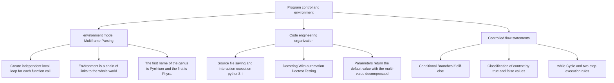

> **English original course**: CS 61A: Structure and Interpretation of Computer Programs (Fall 2024)  
> **Lecturer**: Prof. John DeNero (UC Berkeley)  
> **Text and illustrations**: VideoBook video to image to text technology e-book assembly line  
> **course coverage**: 37 / 37 on 18.2 hour audio/video instruction ⁇ 577 high-level lecture screenshots  
> **Online catalog**: [CS61A Special Catalog](/en/notes/topics/CS61A)

---


> **Lecture**: John DeNero ｜ **duration**: 32:21 ｜ **Video link back**: [Single episode corresponding to station B (P3)](https://www.bilibili.com/video/BV1sy411z7nA/?p=3)

## 1. User-defined function review and element breakdown

*I'm sorry. reference timestamp 00:00:02 .  [Watch clip (P3 00:00:02)](https://www.bilibili.com/video/BV1sy411z7nA/?p=3&t=2))*

Before going into the control flow, Professor DeNero first led us to synthesize the syntax and runtime nature of the user-defined functions.

A complete function definition is a **Compound Statement**, called  `def`  Statement:

```python
def square(x):
    return mul(x, x)
```

This statement spans multiple lines and has a strict structural division of labor:
1. **Function name (Name)**: `def`  The name immediately following the keyword (e.g.  `square`).
2. **Formal Parameters**: A list of identifiers enclosed in parentheses (e.g.  `x`. If multiple inputs are included, they are separated by commas; they will serve as argument 's place name for argument values when function call is involved.
3. **Function body (Body)**: The set of all indented statements after the first line. It determines the sequence of operations actually performed when the function is called.
4. **returns expression (Return Exchange)**: `return`  expression at the end of the keyword  `mul(x, x)`) its evaluation result will be the value of the entire call expression.


*⏱ Timestamp: 00:00:45 · 📷 Lecture screenshot · [Watch clip (P3 00:00:45)](https://www.bilibili.com/video/BV1sy411z7nA/?p=3&t=45)*

> **core mechanism**:Execute  `def`  statement, Python only creates the function object and **current frame** Middle handle name  `square`  Bind to this function. At this time **The code inside the function body will never be executed**, the multiplication has not yet occurred!

only when encountered **call expression (Call Expressing)** (e.g.  `square(2 + 2)`), the function is activated. The call contains three key elements:
- **operator (Operator)**: `square` evaluation is a function that has been defined in its current environment.
- **operand (Operand)**: expression in brackets  `2 + 2` I don't think so. evaluation Got it. argument (Argument) `4`.
- **Calling process**: Open an independent new frame to parameter  `x`  Tie to argument  `4`, and then execute the function body in this new environment to calculate  `4 * 4`  Return  `16`.


*⏱ Timestamp: 00:02:40 · 📷 Lecture screenshot · [Watch clip (P3 00:02:40)](https://www.bilibili.com/video/BV1sy411z7nA/?p=3&t=160)*

---

## 2. Multiple frame environment model and name search rules

*I'm sorry. reference timestamp 00:03:06 ..  [Watch clip (P3 00:03:06)](https://www.bilibili.com/video/BV1sy411z7nA/?p=3&t=186))*

In the previous one, the environment usually has only one global frame. Once the embedded call of a function is introduced, Python interpreter must manage **A chained environment composed of multiple frames**.

call in nested  `square(square(3))`  For example:

```python
from operator import mul

def square(x):
    return mul(x, x)

square(square(3))
```

### Embedded evaluation time series

1. **Outer layer call preparation**:operator  `square`  evaluation is a square function; operand is a sub-call  `square(3)`, its value must be found first.
2. **First tier function call (Frame F1)**: 
   - Create new frame  `F1`, the parent environment (Parent) is  `Global`.
   - Tie parameter: `x: 3`.
   - In included  `F1`  Execute the function body in the environment: find  `mul` (in  `Global`  found in the frame) and  `x` (in  `F1`  found in ), calculate  `mul(3, 3) -> 9`.
   - `F1`  Return  `9`.
3. **Second floor function call (Frame F2)**: 
   - operand has been used in the outer layer at this time  `9`.
   - call again  `square`, create a new independent frame  `F2`, the parent environment is also  `Global`.
   - Tie parameter: `x: 9`.
   - In included  `F2`  Execute the function body in the environment: calculation  `mul(9, 9) -> 81`.
   - `F2`  Return  `81`.


*⏱ Timestamp: 00:04:45 · 📷 Lecture screenshot · [Watch clip (P3 00:04:45)](https://www.bilibili.com/video/BV1sy411z7nA/?p=3&t=285)*

### The definition of environment

> **Environment**: one **An ordered sequence of linked frames**.

In the above diagram:
- There is only one  `square`  Function object, but because it was called twice, two different local frames were generated.  `F1`  and  `F2`.
- There are three different environments in the entire program:
  1. Contains only  `Global`  Frame environment.
  2. by  `F1`  guide, follow  `Global`  frame environment  `[F1 -> Global]`.
  3. by  `F2`  guide, follow  `Global`  frame environment  `[F2 -> Global]`.
- **No environment contains both F1 and F2** Every function call operates independently in its own local environment.

### The gold code for the name evaluation (EarthFrame Rule)

> **rules**: the result of a evaluation in the current environment equals the frame sequence in the current environment **The earliest frame in which this name appears** The binding value in .


*⏱ Timestamp: 00:07:30 · 📷 Lecture screenshot · [Watch clip (P3 00:07:30)](https://www.bilibili.com/video/BV1sy411z7nA/?p=3&t=450)*

when executing  `F2`  internal  `mul(x, x)`  When:
- Find  `x`: First in the first frame  `F2`  Check and find  `x = 9`, the search stops immediately.
- Find  `mul`: First in the first frame  `F2`  Checked, not found; follow the parent pointer to the next frame  `Global`, find  `mul`  The bound built-in multiplication function.

### parameter Shape Trap (Name Shattering)

What happens if someone deliberately named parameter the same name as the function?

```python
def square(square):
    return mul(square, square)

square(4)
```

When we call  `square(4)` , the result obtained is still  `16`: 
- In the global frame, `square`  Bind to this function object.
- in local frame  `F1`  Center, parameter  `square`  is bound to the value passed in  `4`.
- Function body execution  `mul(square, square)`  When , the current environment is  `[F1 -> Global]`.
- According to the proximity principle, local frames  `F1`  exist in  `square`, the value is  `4`. Therefore the calculation is  `mul(4, 4)`, get  `16`. The global function name is masked by the local variable name\*\*.


*⏱ Timestamp: 00:08:48 · 📷 Lecture screenshot · [Watch clip (P3 00:08:48)](https://www.bilibili.com/video/BV1sy411z7nA/?p=3&t=528)*

---

## 3. operator lower semantics, division and multi-value returns

*reference timestamp: 00:10:05...  [Watch clip (P3 00:10:05)](https://www.bilibili.com/video/BV1sy411z7nA/?p=3&t=605))*

### Correlation of operator to built-in functions

Centered operator (if  `+`, `*`) Follows standard operating priorities, but can essentially correspond to the built-in function call:

```python
from operator import add, mul

2 + 3 * 4 + 5  # 等价于 add(add(2, mul(3, 4)), 5)
(2 + 3) * (4 + 5)  # 等价于 mul(add(2, 3), add(4, 5))
```

### Two Division and Number Splitting Techniques

Computer science often requires precise discrete decomposition of integers:
1. **True Division,  `/`)**: Corresponds  `operator.truediv`, produces the approximate number of floating-points.  `2013 / 10 -> 201.3`, `5 / 3 -> 1.6666666666666667`.
2. **Floor Division/Floor Division,  `//`)**: Corresponds  `operator.floordiv`, discarding decimal places and rounding down. `2013 // 10 -> 201`.
3. **Modulo operation (Modulo,  `%`)**: Corresponds  `operator.mod`, find the remainder after division. `2013 % 10 -> 3`.

Divisibility and modulo are complete **Accurate without loss of precision**, often used for number splitting (such as extracting the lowest decimal digit and stripping the lowest digit).


*⏱ Timestamp: 00:12:35 · 📷 Lecture screenshot · [Watch clip (P3 00:12:35)](https://www.bilibili.com/video/BV1sy411z7nA/?p=3&t=755)*

### Multiple assignment and function multiple return

Python allows an assignment statement to bind values to multiple names at the same time, and also supports functions returning multiple results at once:

```python
def divide_exact(n, d):
    return n // d, n % d

quotient, remainder = divide_exact(2013, 10)
# quotient 绑定为 201，remainder 绑定为 3
```


*⏱ Timestamp: 00:14:15 · 📷 Lecture screenshot · [Watch clip (P3 00:14:15)](https://www.bilibili.com/video/BV1sy411z7nA/?p=3&t=855)*

---

## 4. Permanent code organization: source code files, interactive execution and Doctest

*reference timestamp: 00:14:44...  [Watch clip (P3 00:14:44)](https://www.bilibili.com/video/BV1sy411z7nA/?p=3&t=884))*

Writing codes in terminal interactive interpreter is appropriate for rapid exploration, but building long-term, durable software must be done  `.py`  in the source code file.

### Write and run source files

In  `ex.py`  Write code in the file:

```python
from operator import floordiv, mod

def divide_exact(n, d=10):
    """返回 n 除以 d 的商和余数。

    >>> q, r = divide_exact(2013, 10)
    >>> q
    201
    >>> r
    3
    """
    return floordiv(n, d), mod(n, d)
```

There are two ways to run it in the terminal:
1. **Direct batch execution**: `python3 ex.py` (If not  `print`  statement, there will be no visible output to the terminal).
2. **Interactive loading mode (recommended)**: `python3 -i ex.py`.
   - First execute all the definitions in the entire file, then stop at the interaction prompt  `>>>`, for developers to call and check variable directly.


*⏱ Timestamp: 00:16:30 · 📷 Lecture screenshot · [Watch clip (P3 00:16:30)](https://www.bilibili.com/video/BV1sy411z7nA/?p=3&t=990)*

### Docstring and Doctest

High-quality functions must provide descriptions and test cases. Follow closely  `def`  The triple quoted string below the declaration is  **Docstring**.

An example of interactive interpreter-like session, embedded in Python, can be inserted in Docstring  `doctest`  The module can directly extract and execute these use cases for automated testing:

```bash
# 静默验证：若所有测试通过，则不输出任何信息
python3 -m doctest ex.py

# 详细模式（Verbose）：打印每一步执行与通过状态
python3 -m doctest -v ex.py
```


*⏱ Timestamp: 00:18:40 · 📷 Lecture screenshot · [Watch clip (P3 00:18:40)](https://www.bilibili.com/video/BV1sy411z7nA/?p=3&t=1120)*

### parameter Default (Default Arguments)

The default value is specified when defining parameter. When the caller omits the argument, the default will be automatically enabled:

```python
# 当未传入 d 时，默认 d 为 10
q, r = divide_exact(2013)  # q = 201, r = 3
```


*⏱ Timestamp: 00:20:45 · 📷 Lecture screenshot · [Watch clip (P3 00:20:45)](https://www.bilibili.com/video/BV1sy411z7nA/?p=3&t=1245)*

---

## 5. Compound statement structure and conditional branch (if-elif-else)

*reference timestamp: 00:21:23...  [Watch clip (P3 00:21:23)](https://www.bilibili.com/video/BV1sy411z7nA/?p=3&t=1283))*

### Anatomy of a Compound Statement

Python’s statement system is divided into simple statements (such as assignment, `return`) and compound statements. Compound statements have unified structural characteristics:

```text
Header 1:
    Suite 1 (一组缩进语句)
Header 2:
    Suite 2
```

- **Clause**: Contains a header (Header) and a set of indented statement blocks (Suite) controlled by it.
- The first Header determines the category of the entire statement (such as  `def`, `if`, `while`).
- **Suite execution rules**: Execute each statement in it sequentially, unless a control jump is encountered (such as  `return`, `break`).


*⏱ Timestamp: 00:22:20 · 📷 Lecture screenshot · [Watch clip (P3 00:22:20)](https://www.bilibili.com/video/BV1sy411z7nA/?p=3&t=1340)*

### Conditional Statements

Conditional statements enable a program to run on different branches depending on the situation. For example, define an absolute value function:

```python
def absolute_value(x):
    """返回 x 的绝对值。"""
    if x < 0:
        return -x
    elif x == 0:
        return 0
    else:
        return x
```

### The iron law of execution of conditional statements

1. Examine each clause in turn from top to bottom.
2. For the current sub-statement Boolean expression evaluation in Header.
3. **Once a expression evaluation is true**: 
   - Immediately execute the Suite corresponding to this clause.
   - **skip completely** All remaining clauses that follow (whether  `elif`  Still  `else`)!
4. During any execution, **At most one Suite will be activated for execution**.


*⏱ Timestamp: 00:24:40 · 📷 Lecture screenshot · [Watch clip (P3 00:24:40)](https://www.bilibili.com/video/BV1sy411z7nA/?p=3&t=1480)*

---

## 6. Boolean context and truth determination (George Boole’s logical vision)

*reference timestamp: 00:25:40...  [Watch clip (P3 00:25:40)](https://www.bilibili.com/video/BV1sy411z7nA/?p=3&t=1540))*

George Boole, one of the founders of computer science, pioneered logical algebra. Any location in the Python code that needs to be judged as true or false is collectively called **Boolean Context**.

In  `if x < 0:`  or  `elif x == 0:` , the head expression value is in the Boolean context. This not only allows simple comparison of expression, but any Python object can evaluation!


*⏱ Timestamp: 00:26:40 · 📷 Lecture screenshot · [Watch clip (P3 00:26:40)](https://www.bilibili.com/video/BV1sy411z7nA/?p=3&t=1600)*

### Truth and False Value Rules in Python

- **False Values**: 
  - `False` (boolean false)
  - `0` (number zero)
  - `""` (empty string)
  - `None` (null object)
- **True Values**: 
  - Except for the above false values **All other values** (Including non-zero integers, non-empty strings, function objects, etc.) are all true values!

---

## 7. Iteration and while loop execution mechanism

*reference timestamp: 00:27:48...  [Watch clip (P3 00:27:48)](https://www.bilibili.com/video/BV1sy411z7nA/?p=3&t=1668))*

The core power of computers lies in high-speed repetitive execution. `while`  Loop statements are the most basic iteration control structure in Python.

The following example uses  `while`  Loop calculation  $1 + 2 + 3 = 6$: 

```python
i = 0
total = 0
while i < 3:
    i = i + 1
    total = total + i
```


*⏱ Timestamp: 00:29:30 · 📷 Lecture screenshot · [Watch clip (P3 00:29:30)](https://www.bilibili.com/video/BV1sy411z7nA/?p=3&t=1770)*

### Two-step rule for while loop execution

1. **First step (evaluation head condition)**: For expression (in the Boolean context) evaluation in Header.
   - if for **false value**, the loop terminates and execution of the code after the loop body continues.
   - if for **truth value**, enter the second step.
2. **Step 2 (Execute the complete Suite)**: Completely execute all statements in Suite from beginning to end. After execution, **Return to the first step unconditionally** Reassess head condition.

### Loop execution trace table (Trace Table)

The key to understanding the cycle is to understand the change in the status of variable in each of the rotational typologies:

| Iteration rounds | Before judgment i | Head expression  `i < 3` | Enter loop execution  `i = i + 1` | execute  `total = total + i` | round end status |
| :---: | :---: | :---: | :---: | :---: | :---: |
| **initial** | `0` | — | — | — | `i=0, total=0` |
| **Round 1** | `0` | `0 < 3 -> True` | `i = 1` | `total = 0 + 1 = 1` | `i=1, total=1` |
| **Round 2** | `1` | `1 < 3 -> True` | `i = 2` | `total = 1 + 2 = 3` | `i=2, total=3` |
| **Round 3** | `2` | `2 < 3 -> True` | `i = 3` | `total = 3 + 3 = 6` | `i=3, total=6` |
| **Exit judgment** | `3` | `3 < 3 -> False` | *Skip Suite, loop ends* | *Skip Suite, loop ends* | **Final result: i=3, total=6** |


*⏱ Timestamp: 00:31:30 · 📷 Lecture screenshot · [Watch clip (P3 00:31:30)](https://www.bilibili.com/video/BV1sy411z7nA/?p=3&t=1890)*

> **extremely important mental models**: Completed in Round 3  `i = i + 1`  After, `i`  has become  `3`. But at this time Python  **Never stop to check conditions**, but the entire Suite must be completely executed (that is, the  `total`  Bonus  `6`), only to find that the condition is false when we return to the first step and exit.

---

## 8. Summary and core mind map of this lecture



In this context, we have completed the transition from "pure calculation of expression" to "full control stream of Turing":
1. **environment model** It provides us with accurate predictions of multiple function calls and embedded X-ray capabilities.
2. **Source code organization and Doctest**  Established basic practice specifications for industrial-grade Python development.
3. **Conditional branches and while loops**  It gives the code the core ability to make decisions based on data and perform large-scale iterative operations.

---

