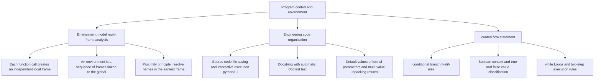

> **Course**: UC Berkeley CS61A (Fall 2024)  
> **Module**: Module 1: Functions & Abstraction  
> **Lecturer**: Prof. John DeNero (UC Berkeley)  
> **Video duration**: 32:21 ｜ **Classroom screenshots**: 15 pieces of blackboard writing/code demonstration  
> **Direct video**: [📺Watch the original video of this lecture (P3) on Bilibili](https://www.bilibili.com/video/BV1sy411z7nA/?p=3)  
> **Quick navigation**: [← Previous Lecture (P02 Lecture 2 Functions)](/en/notes/cs61a/lecture-02) ｜ [📚 Return to the full book catalog](/en/notes/topics/CS61A) ｜ [Next lecture (P04 Lecture 4 Higher-Order Functions) →](/en/notes/cs61a/lecture-04)

---

## 1. Review of user-defined functions and disassembly of elements

*(Reference time: 00:00:02 · [Video jump (P3 00:00:02)](https://www.bilibili.com/video/BV1sy411z7nA/?p=3&t=2))*

Before delving into the control flow, Professor DeNero first led us to review the syntax and runtime nature of user-defined functions (User-Defined Functions).

A complete function definition is a **Compound Statement**, called  `def`  Statement:

```python
def square(x):
    return mul(x, x)
```

This statement spans multiple lines and has a strict structural division of labor:
1. **Function name (Name)**: `def`  The name immediately following the keyword (e.g.  `square`).
2. **Formal Parameters**: A list of identifiers enclosed in parentheses (e.g.  `x`). If multiple inputs are included, separate them with commas; they will serve as placeholder names for the actual parameter values ​​when the function is called.
3. **Function body (Body)**: The set of all indented statements after the first line. It determines the sequence of operations actually performed when the function is called.
4. **Return Expression**: `return`  The expression following the keyword (such as  `mul(x, x)`), its evaluation result will be used as the value of the entire calling expression.

[](https://www.bilibili.com/video/BV1sy411z7nA/?p=3&t=45)
*⏱ Timestamp: 00:00:45 · 📷 Classroom screenshot · [Watch the corresponding clip on Bilibili (P3 00:00:45)](https://www.bilibili.com/video/BV1sy411z7nA/?p=3&t=45)*

#### 📸 In-depth reading of classroom blackboard writing and code demonstration (00:00:45)

**\[On-site blackboard writing/code demonstration restoration\]**:
At this time point, Professor DeNero conducted a core demonstration and key blackboard derivation on the screen:
> *“Here on one slide, in summary form, with all the vocabulary that you need. So first, we have a def statement. A def statement is what creates functions. It looks like this. That whole thing is a def statement, which spans multiple lines. It has a name for the function you're defining, a formal param...”*

**\[Underlying computing model and micro execution mechanism\]**: 
1. **Execution context and timing tracing**: 
   - At the current discussion point "1. User-defined function review and element disassembly", the interpreter strictly follows the core evaluation protocol;
   - The expression evaluates the operators first, then evaluates the operands strictly from left to right, and finally applies the function object to the argument list;
   - If the environment model is involved, the local frame strictly records its static lexical parent pointer (Parent Pointer points to the environment where the function is defined), forming an orthogonal architecture with the dynamic call stack at runtime.
2. **Memory topology and object references**: 
   - Variable symbols are just keys in a hash table (environment frame), and pointers point directly to first-class citizen objects in heap memory;
   - Assignment statements are discrete-time snapshots of the state and never create implicit mathematical dependency monitoring.

**\[Guidelines for avoiding pitfalls and guidance on high-frequency test points\]**: 
- **Common misunderstandings**: In exam questions related to "Short-circuiting, while loops and prime number determination", beginners can easily guess the results based on the surface form of the code, leading to scope confusion or variable shadowing misjudgments;
- **The golden rule of debugging**: When encountering nested calls and complex branches, be sure to draw independent partial frames on the scratch paper, indicate the specific binding value of each formal parameter, and derive it step by step.


> **core mechanism**:Execute  `def`  statement, Python only creates the function object and **current frame** Middle handle name  `square`  Bind to this function. At this time **The code inside the function body will never be executed**, the multiplication has not yet occurred!

only when encountered **Call Expression** (e.g.  `square(2 + 2)`), the function is activated. The call contains three key elements:
- **Operator**: `square`, which evaluates in the current environment to the function just defined.
- **Operand (Operand)**: Expression in parentheses  `2 + 2`, evaluate to get the actual parameter (Argument) `4`.
- **Calling process**: Open an independent new frame and change the formal parameters to  `x`  Bind to actual parameters  `4`, and then execute the function body in this new environment to calculate  `4 * 4`  Return  `16`.

[](https://www.bilibili.com/video/BV1sy411z7nA/?p=3&t=160)
*⏱ Timestamp: 00:02:40 · 📷 Classroom screenshot · [Watch the corresponding clip on Bilibili (P3 00:02:40)](https://www.bilibili.com/video/BV1sy411z7nA/?p=3&t=160)*

#### 📸 In-depth reading of classroom blackboard writing and code demonstration (00:02:40)

**\[On-site blackboard writing/code demonstration restoration\]**:
At this time point, Professor DeNero conducted a core demonstration and key blackboard derivation on the screen:
> *“There's an operand in between parentheses. An operand is an expression, in this case, 2 plus 2. It evaluates to a value 4, which is the argument of the function. So, when we reach a call expression, we evaluate it by evaluating the operators and operands and then calling the function on the argument...”*

**\[Underlying computing model and micro execution mechanism\]**: 
1. **Execution context and timing tracing**: 
   - At the current discussion point "1. User-defined function review and element disassembly", the interpreter strictly follows the core evaluation protocol;
   - The expression evaluates the operators first, then evaluates the operands strictly from left to right, and finally applies the function object to the argument list;
   - If the environment model is involved, the local frame strictly records its static lexical parent pointer (Parent Pointer points to the environment where the function is defined), forming an orthogonal architecture with the dynamic call stack at runtime.
2. **Memory topology and object references**: 
   - Variable symbols are just keys in a hash table (environment frame), and pointers point directly to first-class citizen objects in heap memory;
   - Assignment statements are discrete-time snapshots of the state and never create implicit mathematical dependency monitoring.

**\[Guidelines for avoiding pitfalls and guidance on high-frequency test points\]**: 
- **Common misunderstandings**: In exam questions related to "Short-circuiting, while loops and prime number determination", beginners can easily guess the results based on the surface form of the code, leading to scope confusion or variable shadowing misjudgments;
- **The golden rule of debugging**: When encountering nested calls and complex branches, be sure to draw independent partial frames on the scratch paper, indicate the specific binding value of each formal parameter, and derive it step by step.


---

### In-depth formal specification and micro-evaluation process (Operational Semantics)
In the "1. User-defined function review and element disassembly" module, the underlying computer operations rely on strict formal evaluation logic:
1. **Hierarchical parsing of abstract syntax trees (AST)**: 
   - The source code character stream is first divided into terminal symbol tokens (Tokens) by the lexical analyzer (Lexer), and then constructed into a multi-fork syntax tree by the syntax parser (Parser);
   - Operator priority and associativity are solidified during the syntax tree construction phase, eliminating ambiguity at runtime;
2. **Dynamic transitions of environment chains**: 
   - Each function call generates a new frame whose static lexical environment is determined by the function object's  `parent`  Attributes are completely determined;
   - The variable search traces back up the environment chain in one direction until the global environment frame. If it is not found, it will be triggered.  `NameError`  Abnormal;
3. **State Invariants**: 
   - The key to writing robust programs is to clarify loop invariants (Loop Invariants) and function pre/post-conditions (Pre/Post-conditions);
   - In complex control flow jumps, ensure that state variables maintain legal business constraints before each iteration.


## 2. Multi-frame environment model and name search rules

*(Reference time: 00:03:06 · [Video jump (P3 00:03:06)](https://www.bilibili.com/video/BV1sy411z7nA/?p=3&t=186))*

In the previous lecture, the environment usually only has one global frame (Global Frame). Once nested calls to functions are introduced, the Python interpreter must manage **A chained environment composed of multiple frames**.

call in nested  `square(square(3))`  For example:

```python
from operator import mul

def square(x):
    return mul(x, x)

square(square(3))
```

### Evaluation timing of nested calls

1. **Outer layer call preparation**:Operator  `square`  Evaluates as a square function; operands are subcalls  `square(3)`, its value must be found first.
2. **First level function call (Frame F1)**: 
   - Create new frame  `F1`, the parent environment (Parent) is  `Global`.
   - Binding parameters: `x: 3`.
   - In included  `F1`  Execute the function body in the environment: find  `mul` (in  `Global`  found in the frame) and  `x` (in  `F1`  found in ), calculate  `mul(3, 3) -> 9`.
   - `F1`  Return  `9`.
3. **Second level function call (Frame F2)**: 
   - At this time, the operand of the outer call has obtained the value.  `9`.
   - call again  `square`, create a new independent frame  `F2`, the parent environment is also  `Global`.
   - Binding parameters: `x: 9`.
   - In included  `F2`  Execute the function body in the environment: calculation  `mul(9, 9) -> 81`.
   - `F2`  Return  `81`.

[](https://www.bilibili.com/video/BV1sy411z7nA/?p=3&t=285)
*⏱ Timestamp: 00:04:45 · 📷 Classroom screenshot · [Watch the corresponding clip on Bilibili (P3 00:04:45)](https://www.bilibili.com/video/BV1sy411z7nA/?p=3&t=285)*

#### 📸 In-depth reading of classroom blackboard writing and code demonstration (00:04:45)

**\[On-site blackboard writing/code demonstration restoration\]**:
At this time point, Professor DeNero conducted a core demonstration and key blackboard derivation on the screen:
> *“So I have to multiply x and x together. I get a return value of 9, and that's how I get the value of this call expression. Now that I know what the value of this operand expression is, I can apply this function square to the argument 9 and repeat the process again. Okay, so that means introducing a ...”*

**\[Underlying computing model and micro execution mechanism\]**: 
1. **Execution context and timing tracing**: 
   - At the current discussion point "2. Multi-frame environment model and name search rules", the interpreter strictly follows the core evaluation protocol;
   - The expression evaluates the operators first, then evaluates the operands strictly from left to right, and finally applies the function object to the argument list;
   - If the environment model is involved, the local frame strictly records its static lexical parent pointer (Parent Pointer points to the environment where the function is defined), forming an orthogonal architecture with the dynamic call stack at runtime.
2. **Memory topology and object references**: 
   - Variable symbols are just keys in a hash table (environment frame), and pointers point directly to first-class citizen objects in heap memory;
   - Assignment statements are discrete-time snapshots of the state and never create implicit mathematical dependency monitoring.

**\[Guidelines for avoiding pitfalls and guidance on high-frequency test points\]**: 
- **Common misunderstandings**: In exam questions related to "Short-circuiting, while loops and prime number determination", beginners can easily guess the results based on the surface form of the code, leading to scope confusion or variable shadowing misjudgments;
- **The golden rule of debugging**: When encountering nested calls and complex branches, be sure to draw independent partial frames on the scratch paper, indicate the specific binding value of each formal parameter, and derive it step by step.


### Precise definition of environment

> **Environment**: one **An ordered sequence of linked frames**.

In the above illustration:
- There is only one  `square`  Function object, but because it was called twice, two different local frames were generated.  `F1`  and  `F2`.
- There are three different environments in the entire program:
  1. Contains only  `Global`  Frame environment.
  2. by  `F1`  guide, follow  `Global`  frame environment  `[F1 -> Global]`.
  3. by  `F2`  guide, follow  `Global`  frame environment  `[F2 -> Global]`.
- **No environment contains both F1 and F2**! Each function call runs independently in its own local environment.

### The Golden Rule of Name Evaluation (Earliest Frame Rule)

> **rules**: The evaluation result of a name in the current environment, equal to the frame sequence of the current environment **The earliest frame in which this name appears** The binding value in .

[](https://www.bilibili.com/video/BV1sy411z7nA/?p=3&t=450)
*⏱ Timestamp: 00:07:30 · 📷 Classroom screenshot · [Watch the corresponding clip on Bilibili (P3 00:07:30)](https://www.bilibili.com/video/BV1sy411z7nA/?p=3&t=450)*

#### 📸 In-depth reading of classroom blackboard writing and code demonstration (00:07:30)

**\[On-site blackboard writing/code demonstration restoration\]**:
At this time point, Professor DeNero conducted a core demonstration and key blackboard derivation on the screen:
> *“Which allows us to figure out what names mean. And a name evaluates to the value bound to that name in the earliest frame of the current environment in which that name is found. In this case, when we evaluate mall.xx for the second time, it's in an environment that starts with the frame F2, followed...”*

**\[Underlying computing model and micro execution mechanism\]**: 
1. **Execution context and timing tracing**: 
   - At the current discussion point "2. Multi-frame environment model and name search rules", the interpreter strictly follows the core evaluation protocol;
   - The expression evaluates the operators first, then evaluates the operands strictly from left to right, and finally applies the function object to the argument list;
   - If the environment model is involved, the local frame strictly records its static lexical parent pointer (Parent Pointer points to the environment where the function is defined), forming an orthogonal architecture with the dynamic call stack at runtime.
2. **Memory topology and object references**: 
   - Variable symbols are just keys in a hash table (environment frame), and pointers point directly to first-class citizen objects in heap memory;
   - Assignment statements are discrete-time snapshots of the state and never create implicit mathematical dependency monitoring.

**\[Guidelines for avoiding pitfalls and guidance on high-frequency test points\]**: 
- **Common misunderstandings**: In exam questions related to "Short-circuiting, while loops and prime number determination", beginners can easily guess the results based on the surface form of the code, leading to scope confusion or variable shadowing misjudgments;
- **The golden rule of debugging**: When encountering nested calls and complex branches, be sure to draw independent partial frames on the scratch paper, indicate the specific binding value of each formal parameter, and derive it step by step.


when executing  `F2`  internal  `mul(x, x)`  When:
- Find  `x`: First in the first frame  `F2`  Check and find  `x = 9`, the search stops immediately.
- Find  `mul`: First in the first frame  `F2`  Checked, not found; follow the parent pointer to the next frame  `Global`, find  `mul`  The bound built-in multiplication function.

### Formal parameter shadowing trap (Name Shadowing)

What happens if someone intentionally names a parameter the same as a function?

```python
def square(square):
    return mul(square, square)

square(4)
```

When we call  `square(4)` , the result obtained is still  `16`: 
- In the global frame, `square`  Bind to this function object.
- in local frame  `F1`  in, formal parameter  `square`  is bound to the value passed in  `4`.
- Function body execution  `mul(square, square)`  When , the current environment is  `[F1 -> Global]`.
- According to the proximity principle, local frames  `F1`  exist in  `square`, the value is  `4`. Therefore the calculation is  `mul(4, 4)`, get  `16`. The global function name is shadowed by the local variable name.

[](https://www.bilibili.com/video/BV1sy411z7nA/?p=3&t=528)
*⏱ Timestamp: 00:08:48 · 📷 Classroom screenshot · [Watch the corresponding clip on Bilibili (P3 00:08:48)](https://www.bilibili.com/video/BV1sy411z7nA/?p=3&t=528)*

#### 📸 In-depth reading of classroom blackboard writing and code demonstration (00:08:48)

**\[On-site blackboard writing/code demonstration restoration\]**:
At this time point, Professor DeNero conducted a core demonstration and key blackboard derivation on the screen:
> *“For both the name of a function and the name of the formal parameter. def square squared return moles square squared. Now, I'm not recommending you do this, but if you square 4 in this case, you really do get 16. Why is that? Well, in the environment diagram for this example, there's a global frame ...”*

**\[Underlying computing model and micro execution mechanism\]**: 
1. **Execution context and timing tracing**: 
   - At the current discussion point "2. Multi-frame environment model and name search rules", the interpreter strictly follows the core evaluation protocol;
   - The expression evaluates the operators first, then evaluates the operands strictly from left to right, and finally applies the function object to the argument list;
   - If the environment model is involved, the local frame strictly records its static lexical parent pointer (Parent Pointer points to the environment where the function is defined), forming an orthogonal architecture with the dynamic call stack at runtime.
2. **Memory topology and object references**: 
   - Variable symbols are just keys in a hash table (environment frame), and pointers point directly to first-class citizen objects in heap memory;
   - Assignment statements are discrete-time snapshots of the state and never create implicit mathematical dependency monitoring.

**\[Guidelines for avoiding pitfalls and guidance on high-frequency test points\]**: 
- **Common misunderstandings**: In exam questions related to "Short-circuiting, while loops and prime number determination", beginners can easily guess the results based on the surface form of the code, leading to scope confusion or variable shadowing misjudgments;
- **The golden rule of debugging**: When encountering nested calls and complex branches, be sure to draw independent partial frames on the scratch paper, indicate the specific binding value of each formal parameter, and derive it step by step.


---

### In-depth formal specification and micro-evaluation process (Operational Semantics)
In the "2. Multi-frame environment model and name search rules" module, the underlying computer operations rely on strict formal evaluation logic:
1. **Hierarchical parsing of abstract syntax trees (AST)**: 
   - The source code character stream is first divided into terminal symbol tokens (Tokens) by the lexical analyzer (Lexer), and then constructed into a multi-fork syntax tree by the syntax parser (Parser);
   - Operator priority and associativity are solidified during the syntax tree construction phase, eliminating ambiguity at runtime;
2. **Dynamic transitions of environment chains**: 
   - Each function call generates a new frame whose static lexical environment is determined by the function object's  `parent`  Attributes are completely determined;
   - The variable search traces back up the environment chain in one direction until the global environment frame. If it is not found, it will be triggered.  `NameError`  Abnormal;
3. **State Invariants**: 
   - The key to writing robust programs is to clarify loop invariants (Loop Invariants) and function pre/post-conditions (Pre/Post-conditions);
   - In complex control flow jumps, ensure that state variables maintain legal business constraints before each iteration.


## 3. The underlying semantics of operators, integer division and multi-value return

*(Reference time: 00:10:05 · [Video jump (P3 00:10:05)](https://www.bilibili.com/video/BV1sy411z7nA/?p=3&t=605))*

### Correspondence between operators and built-in functions

Infix operators (such as  `+`, `*`) follows standard operation precedence, but essentially corresponds to built-in function calls:

```python
from operator import add, mul

2 + 3 * 4 + 5  # 等价于 add(add(2, mul(3, 4)), 5)
(2 + 3) * (4 + 5)  # 等价于 mul(add(2, 3), add(4, 5))
```

### Two Division and Number Splitting Techniques

Computer science often requires precise discrete decomposition of integers:
1. **True Division,  `/`)**: Corresponds  `operator.truediv`, producing a floating-point approximation. Such as  `2013 / 10 -> 201.3`, `5 / 3 -> 1.6666666666666667`.
2. **Floor Division/Floor Division,  `//`)**: Corresponds  `operator.floordiv`, discarding decimal places and rounding down. `2013 // 10 -> 201`.
3. **Modulo operation (Modulo,  `%`)**: Corresponds  `operator.mod`, find the remainder after division. `2013 % 10 -> 3`.

Divisibility and modulo are complete **Accurate without loss of precision**, often used for number splitting (such as extracting the lowest decimal digit and stripping the lowest digit).

[](https://www.bilibili.com/video/BV1sy411z7nA/?p=3&t=755)
*⏱ Timestamp: 00:12:35 · 📷 Classroom screenshot · [Watch the corresponding clip on Bilibili (P3 00:12:35)](https://www.bilibili.com/video/BV1sy411z7nA/?p=3&t=755)*

#### 📸 In-depth reading of classroom blackboard writing and code demonstration (00:12:35)

**\[On-site blackboard writing/code demonstration restoration\]**:
At this time point, Professor DeNero conducted a core demonstration and key blackboard derivation on the screen:
> *“Or we can do what's called integer division, which only gives the number of times that the divisor goes into the dividend, not including any remainder. So we lost a 0.3. These have corresponding functions, from operator, import, true div, and floor div. The first and the second. So I can true div 20...”*

**\[Underlying computing model and micro execution mechanism\]**: 
1. **Execution context and timing tracing**: 
   - At the current discussion point "3. The underlying semantics of operators, integer division and multi-value return", the interpreter strictly follows the core evaluation protocol;
   - The expression evaluates the operators first, then evaluates the operands strictly from left to right, and finally applies the function object to the argument list;
   - If the environment model is involved, the local frame strictly records its static lexical parent pointer (Parent Pointer points to the environment where the function is defined), forming an orthogonal architecture with the dynamic call stack at runtime.
2. **Memory topology and object references**: 
   - Variable symbols are just keys in a hash table (environment frame), and pointers point directly to first-class citizen objects in heap memory;
   - Assignment statements are discrete-time snapshots of the state and never create implicit mathematical dependency monitoring.

**\[Guidelines for avoiding pitfalls and guidance on high-frequency test points\]**: 
- **Common misunderstandings**: In exam questions related to "Short-circuiting, while loops and prime number determination", beginners can easily guess the results based on the surface form of the code, leading to scope confusion or variable shadowing misjudgments;
- **The golden rule of debugging**: When encountering nested calls and complex branches, be sure to draw independent partial frames on the scratch paper, indicate the specific binding value of each formal parameter, and derive it step by step.


### Multiple assignment and function multiple return

Python allows one assignment statement to bind values to multiple names at the same time, and also supports functions returning multiple results at once:

```python
def divide_exact(n, d):
    return n // d, n % d

quotient, remainder = divide_exact(2013, 10)
# quotient 绑定为 201，remainder 绑定为 3
```

[](https://www.bilibili.com/video/BV1sy411z7nA/?p=3&t=855)
*⏱ Timestamp: 00:14:15 · 📷 Classroom screenshot · [Watch the corresponding clip on Bilibili (P3 00:14:15)](https://www.bilibili.com/video/BV1sy411z7nA/?p=3&t=855)*

#### 📸 In-depth reading of classroom blackboard writing and code demonstration (00:14:15)

**\[On-site blackboard writing/code demonstration restoration\]**:
At this time point, Professor DeNero conducted a core demonstration and key blackboard derivation on the screen:
> *“So it's good to know how they work. Here's another feature of Python, is that just as I can assign multiple values to multiple names using one assignment statement, I can also return multiple values from a function. And you'll do this once in your project. So let's say I want both the quotient and t...”*

**\[Underlying computing model and micro execution mechanism\]**: 
1. **Execution context and timing tracing**: 
   - At the current discussion point "3. The underlying semantics of operators, integer division and multi-value return", the interpreter strictly follows the core evaluation protocol;
   - The expression evaluates the operators first, then evaluates the operands strictly from left to right, and finally applies the function object to the argument list;
   - If the environment model is involved, the local frame strictly records its static lexical parent pointer (Parent Pointer points to the environment where the function is defined), forming an orthogonal architecture with the dynamic call stack at runtime.
2. **Memory topology and object references**: 
   - Variable symbols are just keys in a hash table (environment frame), and pointers point directly to first-class citizen objects in heap memory;
   - Assignment statements are discrete-time snapshots of the state and never create implicit mathematical dependency monitoring.

**\[Guidelines for avoiding pitfalls and guidance on high-frequency test points\]**: 
- **Common misunderstandings**: In exam questions related to "Short-circuiting, while loops and prime number determination", beginners can easily guess the results based on the surface form of the code, leading to scope confusion or variable shadowing misjudgments;
- **The golden rule of debugging**: When encountering nested calls and complex branches, be sure to draw independent partial frames on the scratch paper, indicate the specific binding value of each formal parameter, and derive it step by step.


---

### In-depth formal specification and micro-evaluation process (Operational Semantics)
In the "3. Underlying Semantics of Operators, Integer Division and Multi-Value Return" module, the underlying computer operations rely on strict formal evaluation logic:
1. **Hierarchical parsing of abstract syntax trees (AST)**: 
   - The source code character stream is first divided into terminal symbol tokens (Tokens) by the lexical analyzer (Lexer), and then constructed into a multi-fork syntax tree by the syntax parser (Parser);
   - Operator priority and associativity are solidified during the syntax tree construction phase, eliminating ambiguity at runtime;
2. **Dynamic transitions of environment chains**: 
   - Each function call generates a new frame whose static lexical environment is determined by the function object's  `parent`  Attributes are completely determined;
   - The variable search traces back up the environment chain in one direction until the global environment frame. If it is not found, it will be triggered.  `NameError`  Abnormal;
3. **State Invariants**: 
   - The key to writing robust programs is to clarify loop invariants (Loop Invariants) and function pre/post-conditions (Pre/Post-conditions);
   - In complex control flow jumps, ensure that state variables maintain legal business constraints before each iteration.


## 4. Permanent code organization: source code files, interactive execution and Doctest

*(Reference time: 00:14:44 · [Video jump (P3 00:14:44)](https://www.bilibili.com/video/BV1sy411z7nA/?p=3&t=884))*

Writing code in a terminal's interactive interpreter is fine for quick exploration, but to build long-term durable software, you must write code in  `.py`  in the source code file.

### Write and run source files

in  `ex.py`  Write code in the file:

```python
from operator import floordiv, mod

def divide_exact(n, d=10):
    """返回 n 除以 d 的商和余数。

    >>> q, r = divide_exact(2013, 10)
    >>> q
    201
    >>> r
    3
    """
    return floordiv(n, d), mod(n, d)
```

There are two ways to run it in the terminal:
1. **Direct batch execution**: `python3 ex.py` (If not  `print`  statement, there will be no visible output to the terminal).
2. **Interactive loading mode (recommended)**: `python3 -i ex.py`.
   - First execute all definitions in the entire file, then stay at the interactive prompt  `>>>`, for developers to directly call and check variables.

[](https://www.bilibili.com/video/BV1sy411z7nA/?p=3&t=990)
*⏱ Timestamp: 00:16:30 · 📷 Classroom screenshot · [Watch the corresponding clip on Bilibili (P3 00:16:30)](https://www.bilibili.com/video/BV1sy411z7nA/?p=3&t=990)*

#### 📸 In-depth reading of classroom blackboard writing and code demonstration (00:16:30)

**\[On-site blackboard writing/code demonstration restoration\]**:
At this time point, Professor DeNero conducted a core demonstration and key blackboard derivation on the screen:
> *“But otherwise doesn't give us any output. OK, so if instead I go over here and I say q,r equals divide exact 2013 by 10, and I save that, and I execute it, still, nothing happens. But, if I finally print something out, a quotient is q, the remainder is r. I save that, and I execute it, then I'll act...”*

**\[Underlying computing model and micro execution mechanism\]**: 
1. **Execution context and timing tracing**: 
   - At the current discussion point "4. Permanent code organization: source code files, interactive runs and Doctest", the interpreter strictly follows the core evaluation protocol;
   - The expression evaluates the operators first, then evaluates the operands strictly from left to right, and finally applies the function object to the argument list;
   - If the environment model is involved, the local frame strictly records its static lexical parent pointer (Parent Pointer points to the environment where the function is defined), forming an orthogonal architecture with the dynamic call stack at runtime.
2. **Memory topology and object references**: 
   - Variable symbols are just keys in a hash table (environment frame), and pointers point directly to first-class citizen objects in heap memory;
   - Assignment statements are discrete-time snapshots of the state and never create implicit mathematical dependency monitoring.

**\[Guidelines for avoiding pitfalls and guidance on high-frequency test points\]**: 
- **Common misunderstandings**: In exam questions related to "Short-circuiting, while loops and prime number determination", beginners can easily guess the results based on the surface form of the code, leading to scope confusion or variable shadowing misjudgments;
- **The golden rule of debugging**: When encountering nested calls and complex branches, be sure to draw independent partial frames on the scratch paper, indicate the specific binding value of each formal parameter, and derive it step by step.


### Docstring and Doctest

High-quality functions must provide descriptions and test cases. Follow closely  `def`  The triple quoted string below the declaration is  **Docstring**.

In Docstring, you can insert a conversational example like an interactive interpreter, Python's built-in  `doctest`  The module can directly extract and execute these use cases for automated testing:

```bash
# 静默验证：若所有测试通过，则不输出任何信息
python3 -m doctest ex.py

# 详细模式（Verbose）：打印每一步执行与通过状态
python3 -m doctest -v ex.py
```

[](https://www.bilibili.com/video/BV1sy411z7nA/?p=3&t=1120)
*⏱ Timestamp: 00:18:40 · 📷 Classroom screenshot · [Watch the corresponding clip on Bilibili (P3 00:18:40)](https://www.bilibili.com/video/BV1sy411z7nA/?p=3&t=1120)*

#### 📸 In-depth reading of classroom blackboard writing and code demonstration (00:18:40)

**\[On-site blackboard writing/code demonstration restoration\]**:
At this time point, Professor DeNero conducted a core demonstration and key blackboard derivation on the screen:
> *“OK, so we give some documentation. That's called a docstring. It's the first line below the def line in a def statement. In addition to just describing for humans what this does, we can also show some examples of how it works. I'm going to get rid of this too. And I'm going to put it up here so I ca...”*

**\[Underlying computing model and micro execution mechanism\]**: 
1. **Execution context and timing tracing**: 
   - At the current discussion point "4. Permanent code organization: source code files, interactive runs and Doctest", the interpreter strictly follows the core evaluation protocol;
   - The expression evaluates the operators first, then evaluates the operands strictly from left to right, and finally applies the function object to the argument list;
   - If the environment model is involved, the local frame strictly records its static lexical parent pointer (Parent Pointer points to the environment where the function is defined), forming an orthogonal architecture with the dynamic call stack at runtime.
2. **Memory topology and object references**: 
   - Variable symbols are just keys in a hash table (environment frame), and pointers point directly to first-class citizen objects in heap memory;
   - Assignment statements are discrete-time snapshots of the state and never create implicit mathematical dependency monitoring.

**\[Guidelines for avoiding pitfalls and guidance on high-frequency test points\]**: 
- **Common misunderstandings**: In exam questions related to "Short-circuiting, while loops and prime number determination", beginners can easily guess the results based on the surface form of the code, leading to scope confusion or variable shadowing misjudgments;
- **The golden rule of debugging**: When encountering nested calls and complex branches, be sure to draw independent partial frames on the scratch paper, indicate the specific binding value of each formal parameter, and derive it step by step.


### Default Arguments

Default values can be specified when defining formal parameters. When the caller omits this argument, the default value automatically takes effect:

```python
# 当未传入 d 时，默认 d 为 10
q, r = divide_exact(2013)  # q = 201, r = 3
```

[](https://www.bilibili.com/video/BV1sy411z7nA/?p=3&t=1245)
*⏱ Timestamp: 00:20:45 · 📷 Classroom screenshot · [Watch the corresponding clip on Bilibili (P3 00:20:45)](https://www.bilibili.com/video/BV1sy411z7nA/?p=3&t=1245)*

#### 📸 In-depth reading of classroom blackboard writing and code demonstration (00:20:45)

**\[On-site blackboard writing/code demonstration restoration\]**:
At this time point, Professor DeNero conducted a core demonstration and key blackboard derivation on the screen:
> *“When you're defining a function, you can give what are called default values. This is not an assignment statement. This is instead a placeholder for a default value that I put after a formal parameter. And what this says is, if there's no argument passed in to be bound to D, then I'll bind 10 to D i...”*

**\[Underlying computing model and micro execution mechanism\]**: 
1. **Execution context and timing tracing**: 
   - At the current discussion point "4. Permanent code organization: source code files, interactive runs and Doctest", the interpreter strictly follows the core evaluation protocol;
   - The expression evaluates the operators first, then evaluates the operands strictly from left to right, and finally applies the function object to the argument list;
   - If the environment model is involved, the local frame strictly records its static lexical parent pointer (Parent Pointer points to the environment where the function is defined), forming an orthogonal architecture with the dynamic call stack at runtime.
2. **Memory topology and object references**: 
   - Variable symbols are just keys in a hash table (environment frame), and pointers point directly to first-class citizen objects in heap memory;
   - Assignment statements are discrete-time snapshots of the state and never create implicit mathematical dependency monitoring.

**\[Guidelines for avoiding pitfalls and guidance on high-frequency test points\]**: 
- **Common misunderstandings**: In exam questions related to "Short-circuiting, while loops and prime number determination", beginners can easily guess the results based on the surface form of the code, leading to scope confusion or variable shadowing misjudgments;
- **The golden rule of debugging**: When encountering nested calls and complex branches, be sure to draw independent partial frames on the scratch paper, indicate the specific binding value of each formal parameter, and derive it step by step.


---

### In-depth formal specification and micro-evaluation process (Operational Semantics)
In the "4. Permanent code organization: source code files, interactive execution and Doctest" module, the underlying computer operations rely on strict formal evaluation logic:
1. **Hierarchical parsing of abstract syntax trees (AST)**: 
   - The source code character stream is first divided into terminal symbol tokens (Tokens) by the lexical analyzer (Lexer), and then constructed into a multi-fork syntax tree by the syntax parser (Parser);
   - Operator priority and associativity are solidified during the syntax tree construction phase, eliminating ambiguity at runtime;
2. **Dynamic transitions of environment chains**: 
   - Each function call generates a new frame whose static lexical environment is determined by the function object's  `parent`  Attributes are completely determined;
   - The variable search traces back up the environment chain in one direction until the global environment frame. If it is not found, it will be triggered.  `NameError`  Abnormal;
3. **State Invariants**: 
   - The key to writing robust programs is to clarify loop invariants (Loop Invariants) and function pre/post-conditions (Pre/Post-conditions);
   - In complex control flow jumps, ensure that state variables maintain legal business constraints before each iteration.


## 5. Compound statement structure and conditional branch (if-elif-else)

*(Reference time: 00:21:23 · [Video jump (P3 00:21:23)](https://www.bilibili.com/video/BV1sy411z7nA/?p=3&t=1283))*

### Anatomy of a Compound Statement

Python’s statement system is divided into simple statements (such as assignment, `return`) and compound statements. Compound statements have unified structural characteristics:

```text
Header 1:
    Suite 1 (一组缩进语句)
Header 2:
    Suite 2
```

- **Clause**: Contains a header (Header) and a set of indented statement blocks (Suite) controlled by it.
- The first Header determines the category of the entire statement (such as  `def`, `if`, `while`).
- **Suite execution rules**: Execute each statement in it sequentially, unless a control jump is encountered (such as  `return`, `break`).

[](https://www.bilibili.com/video/BV1sy411z7nA/?p=3&t=1340)
*⏱ Timestamp: 00:22:20 · 📷 Classroom screenshot · [Watch the corresponding clip on Bilibili (P3 00:22:20)](https://www.bilibili.com/video/BV1sy411z7nA/?p=3&t=1340)*

#### 📸 In-depth reading of classroom blackboard writing and code demonstration (00:22:20)

**\[On-site blackboard writing/code demonstration restoration\]**:
At this time point, Professor DeNero conducted a core demonstration and key blackboard derivation on the screen:
> *“And that has statements indented after it, etc. This whole thing can be a statement. Within it, a clause is a single header followed by some indented statements. And those indented statements are called the suite of the clause. The first header determines a statement's type. So you can always tell w...”*

**\[Underlying computing model and micro execution mechanism\]**: 
1. **Execution context and timing tracing**: 
   - At the current discussion point "5. Compound statement structure and conditional branch (if-elif-else)", the interpreter strictly follows the core evaluation protocol;
   - The expression evaluates the operators first, then evaluates the operands strictly from left to right, and finally applies the function object to the argument list;
   - If the environment model is involved, the local frame strictly records its static lexical parent pointer (Parent Pointer points to the environment where the function is defined), forming an orthogonal architecture with the dynamic call stack at runtime.
2. **Memory topology and object references**: 
   - Variable symbols are just keys in a hash table (environment frame), and pointers point directly to first-class citizen objects in heap memory;
   - Assignment statements are discrete-time snapshots of the state and never create implicit mathematical dependency monitoring.

**\[Guidelines for avoiding pitfalls and guidance on high-frequency test points\]**: 
- **Common misunderstandings**: In exam questions related to "Short-circuiting, while loops and prime number determination", beginners can easily guess the results based on the surface form of the code, leading to scope confusion or variable shadowing misjudgments;
- **The golden rule of debugging**: When encountering nested calls and complex branches, be sure to draw independent partial frames on the scratch paper, indicate the specific binding value of each formal parameter, and derive it step by step.


### Conditional Statements

Conditional statements enable the program to take different branches according to different situations. Take the custom absolute value function as an example:

```python
def absolute_value(x):
    """返回 x 的绝对值。"""
    if x < 0:
        return -x
    elif x == 0:
        return 0
    else:
        return x
```

### The iron law of execution of conditional statements

1. Examine each clause in turn from top to bottom.
2. Evaluates the Boolean expression in the current clause Header.
3. **Once an expression evaluates to True Value**: 
   - Immediately execute the Suite corresponding to this clause.
   - **skip completely** All remaining clauses that follow (whether  `elif`  Still  `else`)!
4. During any execution, **At most one Suite will be activated for execution**.

[](https://www.bilibili.com/video/BV1sy411z7nA/?p=3&t=1480)
*⏱ Timestamp: 00:24:40 · 📷 Classroom screenshot · [Watch the corresponding clip on Bilibili (P3 00:24:40)](https://www.bilibili.com/video/BV1sy411z7nA/?p=3&t=1480)*

#### 📸 In-depth reading of classroom blackboard writing and code demonstration (00:24:40)

**\[On-site blackboard writing/code demonstration restoration\]**:
At this time point, Professor DeNero conducted a core demonstration and key blackboard derivation on the screen:
> *“And finally, if neither of those are true, that means x is greater than zero, we will return x itself. Okay, this is an absolute value function. We can load it by starting an interactive session and first reading in ex.py. So now we have absolute value defined. When I take the absolute value of nega...”*

**\[Underlying computing model and micro execution mechanism\]**: 
1. **Execution context and timing tracing**: 
   - At the current discussion point "5. Compound statement structure and conditional branch (if-elif-else)", the interpreter strictly follows the core evaluation protocol;
   - The expression evaluates the operators first, then evaluates the operands strictly from left to right, and finally applies the function object to the argument list;
   - If the environment model is involved, the local frame strictly records its static lexical parent pointer (Parent Pointer points to the environment where the function is defined), forming an orthogonal architecture with the dynamic call stack at runtime.
2. **Memory topology and object references**: 
   - Variable symbols are just keys in a hash table (environment frame), and pointers point directly to first-class citizen objects in heap memory;
   - Assignment statements are discrete-time snapshots of the state and never create implicit mathematical dependency monitoring.

**\[Guidelines for avoiding pitfalls and guidance on high-frequency test points\]**: 
- **Common misunderstandings**: In exam questions related to "Short-circuiting, while loops and prime number determination", beginners can easily guess the results based on the surface form of the code, leading to scope confusion or variable shadowing misjudgments;
- **The golden rule of debugging**: When encountering nested calls and complex branches, be sure to draw independent partial frames on the scratch paper, indicate the specific binding value of each formal parameter, and derive it step by step.


---

### In-depth formal specification and micro-evaluation process (Operational Semantics)
In the "5. Compound statement structure and conditional branch (if-elif-else)" module, the underlying computer operations rely on strict formal evaluation logic:
1. **Hierarchical parsing of abstract syntax trees (AST)**: 
   - The source code character stream is first divided into terminal symbol tokens (Tokens) by the lexical analyzer (Lexer), and then constructed into a multi-fork syntax tree by the syntax parser (Parser);
   - Operator priority and associativity are solidified during the syntax tree construction phase, eliminating ambiguity at runtime;
2. **Dynamic transitions of environment chains**: 
   - Each function call generates a new frame whose static lexical environment is determined by the function object's  `parent`  Attributes are completely determined;
   - The variable search traces back up the environment chain in one direction until the global environment frame. If it is not found, it will be triggered.  `NameError`  Abnormal;
3. **State Invariants**: 
   - The key to writing robust programs is to clarify loop invariants (Loop Invariants) and function pre/post-conditions (Pre/Post-conditions);
   - In complex control flow jumps, ensure that state variables maintain legal business constraints before each iteration.


## 6. Boolean context and truth determination (George Boole’s logical vision)

*(Reference time: 00:25:40 · [Video jump (P3 00:25:40)](https://www.bilibili.com/video/BV1sy411z7nA/?p=3&t=1540))*

George Boole, one of the founders of computer science, pioneered logical algebra. Any location in the Python code that needs to be judged as true or false is collectively called **Boolean Context**.

in  `if x < 0:`  or  `elif x == 0:` , the value of the head expression is in a Boolean context. Not only can you write simple comparison expressions here, any Python object can be evaluated!

[](https://www.bilibili.com/video/BV1sy411z7nA/?p=3&t=1600)
*⏱ Timestamp: 00:26:40 · 📷 Classroom screenshot · [Watch the corresponding clip on Bilibili (P3 00:26:40)](https://www.bilibili.com/video/BV1sy411z7nA/?p=3&t=1600)*

#### 📸 In-depth reading of classroom blackboard writing and code demonstration (00:26:40)

**\[On-site blackboard writing/code demonstration restoration\]**:
At this time point, Professor DeNero conducted a core demonstration and key blackboard derivation on the screen:
> *“Early founder of computer science. He's really important, so let's make him big. George is going to be interested in what are called boolean contexts. So those are places in Python code where you place an expression, but all that matters about that expression is whether it's true or false. In this c...”*

**\[Underlying computing model and micro execution mechanism\]**: 
1. **Execution context and timing tracing**: 
   - At the current discussion point "6. Boolean context and truth determination (George Boole's logical horizon)", the interpreter strictly follows the core evaluation convention;
   - The expression evaluates the operators first, then evaluates the operands strictly from left to right, and finally applies the function object to the argument list;
   - If the environment model is involved, the local frame strictly records its static lexical parent pointer (Parent Pointer points to the environment where the function is defined), forming an orthogonal architecture with the dynamic call stack at runtime.
2. **Memory topology and object references**: 
   - Variable symbols are just keys in a hash table (environment frame), and pointers point directly to first-class citizen objects in heap memory;
   - Assignment statements are discrete-time snapshots of the state and never create implicit mathematical dependency monitoring.

**\[Guidelines for avoiding pitfalls and guidance on high-frequency test points\]**: 
- **Common misunderstandings**: In exam questions related to "Short-circuiting, while loops and prime number determination", beginners can easily guess the results based on the surface form of the code, leading to scope confusion or variable shadowing misjudgments;
- **The golden rule of debugging**: When encountering nested calls and complex branches, be sure to draw independent partial frames on the scratch paper, indicate the specific binding value of each formal parameter, and derive it step by step.


### Truth and False Value Rules in Python

- **False Values**: 
  - `False` (boolean false)
  - `0` (number zero)
  - `""` (empty string)
  - `None` (null object)
- **True Values**: 
  - Except for the above false values **All other values** (Including non-zero integers, non-empty strings, function objects, etc.) are all true values!

---

### In-depth formal specification and micro-evaluation process (Operational Semantics)
In the "6. Boolean context and truth determination (George Boole's logical vision)" module, the underlying computer operations rely on strict formal evaluation logic:
1. **Hierarchical parsing of abstract syntax trees (AST)**: 
   - The source code character stream is first divided into terminal symbol tokens (Tokens) by the lexical analyzer (Lexer), and then constructed into a multi-fork syntax tree by the syntax parser (Parser);
   - Operator priority and associativity are solidified during the syntax tree construction phase, eliminating ambiguity at runtime;
2. **Dynamic transitions of environment chains**: 
   - Each function call generates a new frame whose static lexical environment is determined by the function object's  `parent`  Attributes are completely determined;
   - The variable search traces back up the environment chain in one direction until the global environment frame. If it is not found, it will be triggered.  `NameError`  Abnormal;
3. **State Invariants**: 
   - The key to writing robust programs is to clarify loop invariants (Loop Invariants) and function pre/post-conditions (Pre/Post-conditions);
   - In complex control flow jumps, ensure that state variables maintain legal business constraints before each iteration.


## 7. Iteration and while loop execution mechanism

*(Reference time: 00:27:48 · [Video jump (P3 00:27:48)](https://www.bilibili.com/video/BV1sy411z7nA/?p=3&t=1668))*

The core power of computers lies in high-speed repetitive execution. `while`  Loop statements are the most basic iteration control structure in Python.

The following example uses  `while`  Loop calculation  $1 + 2 + 3 = 6$: 

```python
i = 0
total = 0
while i < 3:
    i = i + 1
    total = total + i
```

[](https://www.bilibili.com/video/BV1sy411z7nA/?p=3&t=1770)
*⏱ Timestamp: 00:29:30 · 📷 Classroom screenshot · [Watch the corresponding clip on Bilibili (P3 00:29:30)](https://www.bilibili.com/video/BV1sy411z7nA/?p=3&t=1770)*

#### 📸 In-depth reading of classroom blackboard writing and code demonstration (00:29:30)

**\[On-site blackboard writing/code demonstration restoration\]**:
At this time point, Professor DeNero conducted a core demonstration and key blackboard derivation on the screen:
> *“How did that happen? Well, to understand exactly what happened, we need to look at the execution rule for a while statement. So here's the code that I typed in. Here's the execution rule. First thing we do when we have a compound while statement, which is this whole last three lines, is to evaluate ...”*

**\[Underlying computing model and micro execution mechanism\]**: 
1. **Execution context and timing tracing**: 
   - At the current discussion point "7. Iteration and while loop execution mechanism", the interpreter strictly follows the core evaluation protocol;
   - The expression evaluates the operators first, then evaluates the operands strictly from left to right, and finally applies the function object to the argument list;
   - If the environment model is involved, the local frame strictly records its static lexical parent pointer (Parent Pointer points to the environment where the function is defined), forming an orthogonal architecture with the dynamic call stack at runtime.
2. **Memory topology and object references**: 
   - Variable symbols are just keys in a hash table (environment frame), and pointers point directly to first-class citizen objects in heap memory;
   - Assignment statements are discrete-time snapshots of the state and never create implicit mathematical dependency monitoring.

**\[Guidelines for avoiding pitfalls and guidance on high-frequency test points\]**: 
- **Common misunderstandings**: In exam questions related to "Short-circuiting, while loops and prime number determination", beginners can easily guess the results based on the surface form of the code, leading to scope confusion or variable shadowing misjudgments;
- **The golden rule of debugging**: When encountering nested calls and complex branches, be sure to draw independent partial frames on the scratch paper, indicate the specific binding value of each formal parameter, and derive it step by step.


### Two-step rule for while loop execution

1. **The first step (evaluating the head condition)**: Evaluates the expression in Header (in a Boolean context).
   - if for **false value**, the loop terminates and execution of the code after the loop body continues.
   - if for **truth value**, enter the second step.
2. **Step 2 (Execute the complete Suite)**: Completely execute all statements in Suite from beginning to end. After execution, **Return to the first step unconditionally** Reassess head condition.

### Loop execution trace table (Trace Table)

The key to understanding loops is to grasp the changes in the state of variables in each iteration:

| Iteration rounds | Before judgment i | header expression  `i < 3` | Enter loop execution  `i = i + 1` | execute  `total = total + i` | round end status |
| :---: | :---: | :---: | :---: | :---: | :---: |
| **initial** | `0` | — | — | — | `i=0, total=0` |
| **Round 1** | `0` | `0 < 3 -> True` | `i = 1` | `total = 0 + 1 = 1` | `i=1, total=1` |
| **Round 2** | `1` | `1 < 3 -> True` | `i = 2` | `total = 1 + 2 = 3` | `i=2, total=3` |
| **Round 3** | `2` | `2 < 3 -> True` | `i = 3` | `total = 3 + 3 = 6` | `i=3, total=6` |
| **Exit judgment** | `3` | `3 < 3 -> False` | *Skip Suite, loop ends* | *Skip Suite, loop ends* | **Final result: i=3, total=6** |

[](https://www.bilibili.com/video/BV1sy411z7nA/?p=3&t=1890)
*⏱ Timestamp: 00:31:30 · 📷 Classroom screenshot · [Watch the corresponding clip on Bilibili (P3 00:31:30)](https://www.bilibili.com/video/BV1sy411z7nA/?p=3&t=1890)*

#### 📸 In-depth reading of classroom blackboard writing and code demonstration (00:31:30)

**\[On-site blackboard writing/code demonstration restoration\]**:
At this time point, Professor DeNero conducted a core demonstration and key blackboard derivation on the screen:
> *“Plus i is 2 is 3. Now total is bound to 3. We return to step 1. And we see if 2 is less than 3, which it is. If George is happy, we then execute the whole suite again. And here's the really important part. When we first execute this assignment statement, i equals i plus 1, i is now 3. But we don't g...”*

**\[Underlying computing model and micro execution mechanism\]**: 
1. **Execution context and timing tracing**: 
   - At the current discussion point "7. Iteration and while loop execution mechanism", the interpreter strictly follows the core evaluation protocol;
   - The expression evaluates the operators first, then evaluates the operands strictly from left to right, and finally applies the function object to the argument list;
   - If the environment model is involved, the local frame strictly records its static lexical parent pointer (Parent Pointer points to the environment where the function is defined), forming an orthogonal architecture with the dynamic call stack at runtime.
2. **Memory topology and object references**: 
   - Variable symbols are just keys in a hash table (environment frame), and pointers point directly to first-class citizen objects in heap memory;
   - Assignment statements are discrete-time snapshots of the state and never create implicit mathematical dependency monitoring.

**\[Guidelines for avoiding pitfalls and guidance on high-frequency test points\]**: 
- **Common misunderstandings**: In exam questions related to "Short-circuiting, while loops and prime number determination", beginners can easily guess the results based on the surface form of the code, leading to scope confusion or variable shadowing misjudgments;
- **The golden rule of debugging**: When encountering nested calls and complex branches, be sure to draw independent partial frames on the scratch paper, indicate the specific binding value of each formal parameter, and derive it step by step.


> **extremely important mental models**: Completed in Round 3  `i = i + 1`  After, `i`  has become  `3`. But at this time Python  **Never stop to check conditions**, but the entire Suite must be completely executed (that is, the  `total`  Bonus  `6`), only to find that the condition is false when we return to the first step and exit.

---

### In-depth formal specification and micro-evaluation process (Operational Semantics)
In the "7. Iteration and while loop execution mechanism" module, the underlying computer operations rely on strict formal evaluation logic:
1. **Hierarchical parsing of abstract syntax trees (AST)**: 
   - The source code character stream is first divided into terminal symbol tokens (Tokens) by the lexical analyzer (Lexer), and then constructed into a multi-fork syntax tree by the syntax parser (Parser);
   - Operator priority and associativity are solidified during the syntax tree construction phase, eliminating ambiguity at runtime;
2. **Dynamic transitions of environment chains**: 
   - Each function call generates a new frame whose static lexical environment is determined by the function object's  `parent`  Attributes are completely determined;
   - The variable search traces back up the environment chain in one direction until the global environment frame. If it is not found, it will be triggered.  `NameError`  Abnormal;
3. **State Invariants**: 
   - The key to writing robust programs is to clarify loop invariants (Loop Invariants) and function pre/post-conditions (Pre/Post-conditions);
   - In complex control flow jumps, ensure that state variables maintain legal business constraints before each iteration.


## 8. Summary and core mind map of this lecture



In this lecture, we have completed the leap from "pure computational expressions" to "Turing complete control flow":
1. **environment model** Provides us with X-ray capabilities to accurately predict multiple function calls and nested execution.
2. **Source code organization and Doctest**  Established basic practice specifications for industrial-grade Python development.
3. **Conditional branches and while loops**  It gives the code the core ability to make decisions based on data and perform large-scale iterative operations.

### In-depth formal specification and micro-evaluation process (Operational Semantics)
In the "8. Lecture Summary and Core Mind Map" module, the underlying computer operations rely on strict formal evaluation logic:
1. **Hierarchical parsing of abstract syntax trees (AST)**: 
   - The source code character stream is first divided into terminal symbol tokens (Tokens) by the lexical analyzer (Lexer), and then constructed into a multi-fork syntax tree by the syntax parser (Parser);
   - Operator priority and associativity are solidified during the syntax tree construction phase, eliminating ambiguity at runtime;
2. **Dynamic transitions of environment chains**: 
   - Each function call generates a new frame whose static lexical environment is determined by the function object's  `parent`  Attributes are completely determined;
   - The variable search traces back up the environment chain in one direction until the global environment frame. If it is not found, it will be triggered.  `NameError`  Abnormal;
3. **State Invariants**: 
   - The key to writing robust programs is to clarify loop invariants (Loop Invariants) and function pre/post-conditions (Pre/Post-conditions);
   - In complex control flow jumps, ensure that state variables maintain legal business constraints before each iteration.


---

## Berkeley Midterm/Final classic high-frequency exam questions in-depth practice

### Practical exam questions: Environment topology and microstate tracking (WWPD & Environment Diagrams)
Consider the following microscopic execution of Python code in an interactive environment:

```python
# 经典作用域与高阶函数综合考题
x = 10

def outer(x):
    y = x + 2
    def inner(y):
        return x + y
    return inner

f = outer(5)
result = f(3)
```

#### Complete problem-solving thinking model and multi-frame environment map derivation:
1. **Global Frame initialization**: 
   - global variables  `x`  Bind to integer object  `10`; 
   - global function  `outer`  Binds to the newly created function object whose embedded  `parent = Global`; 
2. **execute  `f = outer(5)`**: 
   - create a local frame  $f_1$, mark  `f1: outer [parent=Global]`; 
   - formal parameters  `x`  Bind to actual parameters  `5`; 
   - local variables  `y`  bind to  `5 + 2 = 7`; 
   - in  $f_1$  internal execution  `def inner(y):`, create a function object  `inner`, its embedded  **`parent = f1`**; 
   - Return function object  `inner`, global variables  `f`  Bind to this object;
3. **execute  `result = f(3)`**: 
   - call function  `f` (i.e.  `inner`), open up a local frame  $f_2$; 
   - **core scoring points**:frame  $f_2$  Who does parent point to?
   - **iron law**: function  `inner`  is in frame  $f_1$  is defined internally, so  $f_2$  of  **`parent = f1`**!
   - formal parameters  `y`  Bind to actual parameters  `3`; 
   - executor  `return x + y`: 
     - in current frame  $f_2$  Find  `y`: Hit local variable  `y = 3`; 
     - in current frame  $f_2$  Find  `x`: miss, trace back along parent  **$f_1$  frame**  Find it!
     - in  $f_1$  hit in frame  `x = 5` (Global  `x = 10`  Partially obscured! );
     - Calculate  `5 + 3 = 8`, as the return value;
4. **Final output conclusion**: 
   - global variables  `result = 8`.

---

## Knowledge Matrix of the core concepts of this lecture

| core knowledge dimension | Formal definition and mechanism | Typical code examples | Core Engineering and Algorithm Value | Common pitfalls |
| :--- | :--- | :--- | :--- | :--- |
| **Basic evaluation semantics** | The expression is evaluated to obtain a value, and the execution of the statement changes the internal state. | `x = 2 + 3` | Build a discrete-time state snapshot mental model | Mistaking the assignment equal sign as a dynamic constraint on an algebraic equation |
| **Environment frame topology** | The environment is an ordered chain of frames | `Global -> f1 -> f2` | Implement safe isolation of lexical scope and variables | Confusing the caller stack frame with the parent environment pointer at the definition point |
| **abstract barrier** | Isolate implementation details and calling logic through functional interfaces | `def square(x): ...` | Reduce cognitive load on large-scale systems | Destroying interfaces directly relies on underlying private data structures |
| **control flow decisions** | Conditional branch short-circuit evaluation and loop iteration progression | `if cond: ... while: ...` | Give programs non-linear decision-making and large-scale data processing capabilities | Missing the loop progression variable causes an infinite loop |
| **higher level abilities** | Functions as first-class citizens (parameter passing, return, assignment) | `make_adder(3)` | Implement factory pattern, closure persistent state and currying | Closure late binding throws loop variable capture error |

---

## Course navigation and jump

| Previous lecture | Directory | Next lecture | Original video |
| :--- | :---: | :--- | :--- |
| [← Previous lecture: Lecture 2 Functions](/en/notes/cs61a/lecture-02) | [📚 Return to CS61A complete book list](/en/notes/topics/CS61A) | [Next lecture: Lecture 4 Higher-Order Functions →](/en/notes/cs61a/lecture-04) | [🎬Watch this lecture (P3) on Bilibili](https://www.bilibili.com/video/BV1sy411z7nA/?p=3) |
