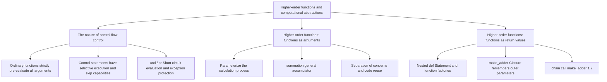

> **Course**: UC Berkeley CS61A (Fall 2024)  
> **Module**: Module 1: Functions & Abstraction  
> **Lecturer**: Prof. John DeNero (UC Berkeley)  
> **Video duration**: 42:53 ｜ **Classroom screenshots**: 16 pieces of blackboard writing/code demonstration  
> **Direct video**: [📺Watch the original video of this lecture on Bilibili (P4)](https://www.bilibili.com/video/BV1sy411z7nA/?p=4)  
> **Quick navigation**: [← Previous Lecture (P03 Lecture 3 Control)](/en/notes/cs61a/lecture-03) ｜ [📚 Return to the full book catalog](/en/notes/topics/CS61A) ｜ [Next lecture (P05 Lecture 5 Environments) →](/en/notes/cs61a/lecture-05)

---

## 1. Classic iteration case: Fibonacci Sequence

*(Reference time: 00:01:25 · [Video jump (P4 00:01:25)](https://www.bilibili.com/video/BV1sy411z7nA/?p=4&t=85))*

In order to master the mental model of loop control, Professor DeNero used the famous Fibonacci sequence as an example to develop iterative algorithm design.

The Fibonacci sequence consists of  $0$  and  $1$  Initially, each subsequent item is the sum of the previous two: 
$$0, 1, 1, 2, 3, 5, 8, 13, 21, 34, 55, \dots$$

As usual, we will  $0$  Fibonacci numbers are recorded as  $\text{Fib}(0) = 0$, No.  $1$  one is recorded as  $\text{Fib}(1) = 1$, No.  $5$  One is  $\text{Fib}(5) = 5$. The Fibonacci sequence is closely connected to the Golden Spiral in geometry: put together squares with side lengths of Fibonacci numbers and connect the intersections to get a logarithmic spiral that is common in nature.

[](https://www.bilibili.com/video/BV1sy411z7nA/?p=4&t=110)
*⏱ Timestamp: 00:01:50 · 📷 Classroom screenshot · [Watch the corresponding clip on Bilibili (P4 00:01:50)](https://www.bilibili.com/video/BV1sy411z7nA/?p=4&t=110)*

#### 📸 In-depth reading of classroom blackboard writing and code demonstration (00:01:50)

**\[On-site blackboard writing/code demonstration restoration\]**:
At this time point, Professor DeNero conducted a core demonstration and key blackboard derivation on the screen:
> *“But for now, it's important to just mark your calendar, finish that homework, and get started on the project. If you get stuck, remember that there are drop-in office hours available that you can come to for help, and members of the course staff will be there. Let's look at a famous example of itera...”*

**\[Underlying computing model and micro execution mechanism\]**: 
1. **Execution context and timing tracing**: 
   - At the current discussion point "1. Classic iteration case: Fibonacci Sequence", the interpreter strictly follows the core evaluation protocol;
   - The expression evaluates the operators first, then evaluates the operands strictly from left to right, and finally applies the function object to the argument list;
   - If the environment model is involved, the local frame strictly records its static lexical parent pointer (Parent Pointer points to the environment where the function is defined), forming an orthogonal architecture with the dynamic call stack at runtime.
2. **Memory topology and object references**: 
   - Variable symbols are just keys in a hash table (environment frame), and pointers point directly to first-class citizen objects in heap memory;
   - Assignment statements are discrete-time snapshots of the state and never create implicit mathematical dependency monitoring.

**\[Guidelines for avoiding pitfalls and guidance on high-frequency test points\]**: 
- **Common misunderstandings**: In the test questions related to "Function as formal parameter, function as return value (make\_adder) and Currying", beginners can easily guess the result based on the surface form of the code, leading to scope confusion or variable shadowing (Shadowing) misjudgment;
- **The golden rule of debugging**: When encountering nested calls and complex branches, be sure to draw independent partial frames on the scratch paper, indicate the specific binding value of each formal parameter, and derive it step by step.


### Tips for iterative function design: selection of state variables

The key to designing an iterative function is to make it clear **What status information needs to be tracked**: 
- Previous value: `pred`(Predecessor)
- Current item value: `cur`(Current)
- Index corresponding to the current item: `k`
- Target item index: `n`

```python
def fib(n):
    """计算第 n 个斐波那契数，其中 n >= 1。"""
    pred, cur = 0, 1
    k = 1
    while k < n:
        pred, cur = cur, pred + cur
        k = k + 1
    return cur
```

[](https://www.bilibili.com/video/BV1sy411z7nA/?p=4&t=255)
*⏱ Timestamp: 00:04:15 · 📷 Classroom screenshot · [Watch the corresponding clip on Bilibili (P4 00:04:15)](https://www.bilibili.com/video/BV1sy411z7nA/?p=4&t=255)*

#### 📸 In-depth reading of classroom blackboard writing and code demonstration (00:04:15)

**\[On-site blackboard writing/code demonstration restoration\]**:
At this time point, Professor DeNero conducted a core demonstration and key blackboard derivation on the screen:
> *“Okay, enough about the Fibonacci sequence. Let's figure out how to compute it using a while statement. Here's a function that takes n, the position or index in the Fibonacci sequence, where we want that Fibonacci number, and it computes the nth Fibonacci number for n greater than or equal to one. It...”*

**\[Underlying computing model and micro execution mechanism\]**: 
1. **Execution context and timing tracing**: 
   - At the current discussion point "1. Classic iteration case: Fibonacci Sequence", the interpreter strictly follows the core evaluation protocol;
   - The expression evaluates the operators first, then evaluates the operands strictly from left to right, and finally applies the function object to the argument list;
   - If the environment model is involved, the local frame strictly records its static lexical parent pointer (Parent Pointer points to the environment where the function is defined), forming an orthogonal architecture with the dynamic call stack at runtime.
2. **Memory topology and object references**: 
   - Variable symbols are just keys in a hash table (environment frame), and pointers point directly to first-class citizen objects in heap memory;
   - Assignment statements are discrete-time snapshots of the state and never create implicit mathematical dependency monitoring.

**\[Guidelines for avoiding pitfalls and guidance on high-frequency test points\]**: 
- **Common misunderstandings**: In the test questions related to "Function as formal parameter, function as return value (make\_adder) and Currying", beginners can easily guess the result based on the surface form of the code, leading to scope confusion or variable shadowing (Shadowing) misjudgment;
- **The golden rule of debugging**: When encountering nested calls and complex branches, be sure to draw independent partial frames on the scratch paper, indicate the specific binding value of each formal parameter, and derive it step by step.


In the environment graph, call  `fib(5)`  This set of variables will be maintained in the local frame. Pay attention to multiple assignment statements  `pred, cur = cur, pred + cur`  The power of:
1. **The expressions on the right are evaluated simultaneously**: Calculation  `cur`  the current value of , and  `pred + cur`  of and.
2. **The left name is then bound at the same time**: This ensures that when calculating the next item, the original value of the previous item that has not been overwritten is still used!

| cycle rounds | k | pred | cur | Judgment conditions  `k < 5` |
| :---: | :---: | :---: | :---: | :---: |
| initial state | 1 | 0 | 1 | `1 < 5 -> True` |
| Round 1 ends | 2 | 1 | 1 | `2 < 5 -> True` |
| Round 2 ends | 3 | 1 | 2 | `3 < 5 -> True` |
| Round 3 ends | 4 | 2 | 3 | `4 < 5 -> True` |
| Round 4 ends | 5 | 3 | 5 | `5 < 5 -> False` (Exit the loop) |

eventually return  `cur = 5`, the 5th Fibonacci number is correctly obtained.

[](https://www.bilibili.com/video/BV1sy411z7nA/?p=4&t=410)
*⏱ Timestamp: 00:06:50 · 📷 Classroom screenshot · [Watch the corresponding clip on Bilibili (P4 00:06:50)](https://www.bilibili.com/video/BV1sy411z7nA/?p=4&t=410)*

#### 📸 In-depth reading of classroom blackboard writing and code demonstration (00:06:50)

**\[On-site blackboard writing/code demonstration restoration\]**:
At this time point, Professor DeNero conducted a core demonstration and key blackboard derivation on the screen:
> *“n never changes, so if we're trying to find the fifth Fibonacci number, which is 5, then n would be 5 at the beginning, pred and cur would be 0 and 1, and k would be 1. Now we'll track which values are bound to these names every time we finish executing k equals k plus 1. So the first time through, ...”*

**\[Underlying computing model and micro execution mechanism\]**: 
1. **Execution context and timing tracing**: 
   - At the current discussion point "1. Classic iteration case: Fibonacci Sequence", the interpreter strictly follows the core evaluation protocol;
   - The expression evaluates the operators first, then evaluates the operands strictly from left to right, and finally applies the function object to the argument list;
   - If the environment model is involved, the local frame strictly records its static lexical parent pointer (Parent Pointer points to the environment where the function is defined), forming an orthogonal architecture with the dynamic call stack at runtime.
2. **Memory topology and object references**: 
   - Variable symbols are just keys in a hash table (environment frame), and pointers point directly to first-class citizen objects in heap memory;
   - Assignment statements are discrete-time snapshots of the state and never create implicit mathematical dependency monitoring.

**\[Guidelines for avoiding pitfalls and guidance on high-frequency test points\]**: 
- **Common misunderstandings**: In the test questions related to "Function as formal parameter, function as return value (make\_adder) and Currying", beginners can easily guess the result based on the surface form of the code, leading to scope confusion or variable shadowing (Shadowing) misjudgment;
- **The golden rule of debugging**: When encountering nested calls and complex branches, be sure to draw independent partial frames on the scratch paper, indicate the specific binding value of each formal parameter, and derive it step by step.


### Classroom Thoughts: A subtle rewriting of initial conditions

If the initial conditions are changed to  `pred, cur = 1, 0`, `k = 0`, is the algorithm still correct?

```python
def fib_alt(n):
    pred, cur = 1, 0
    k = 0
    while k < n:
        pred, cur = cur, pred + cur
        k = k + 1
    return cur
```

> **Conclusion**: Not only is this change equally correct; **perform better**!
> - When entering  `n = 0`  At that time, the old version was  `n >= 1`  Restriction cannot be processed; in new version  `k < n` (i.e.  `0 < 0`) is false, the loop is skipped directly and returns  `cur = 0`, perfectly supported  $\text{Fib}(0) = 0$  boundary conditions.
> - when  `n = 5`  When , the loop body is executed 5 times, and the sequence advances as  `0 -> 1 -> 1 -> 2 -> 3 -> 5`, and finally get the same  `5`.

[](https://www.bilibili.com/video/BV1sy411z7nA/?p=4&t=465)
*⏱ Timestamp: 00:07:45 · 📷 Classroom screenshot · [Watch the corresponding clip on Bilibili (P4 00:07:45)](https://www.bilibili.com/video/BV1sy411z7nA/?p=4&t=465)*

#### 📸 In-depth reading of classroom blackboard writing and code demonstration (00:07:45)

**\[On-site blackboard writing/code demonstration restoration\]**:
At this time point, Professor DeNero conducted a core demonstration and key blackboard derivation on the screen:
> *“What if, in the body of fib, I had made the following change? I had bound pred and cur to 1 and 0, and k equals 0. Is this alternative definition of fib the same or different from the original one? Pause the video and think about that for a moment, then we'll discuss together. So this is still a cor...”*

**\[Underlying computing model and micro execution mechanism\]**: 
1. **Execution context and timing tracing**: 
   - At the current discussion point "1. Classic iteration case: Fibonacci Sequence", the interpreter strictly follows the core evaluation protocol;
   - The expression evaluates the operators first, then evaluates the operands strictly from left to right, and finally applies the function object to the argument list;
   - If the environment model is involved, the local frame strictly records its static lexical parent pointer (Parent Pointer points to the environment where the function is defined), forming an orthogonal architecture with the dynamic call stack at runtime.
2. **Memory topology and object references**: 
   - Variable symbols are just keys in a hash table (environment frame), and pointers point directly to first-class citizen objects in heap memory;
   - Assignment statements are discrete-time snapshots of the state and never create implicit mathematical dependency monitoring.

**\[Guidelines for avoiding pitfalls and guidance on high-frequency test points\]**: 
- **Common misunderstandings**: In the test questions related to "Function as formal parameter, function as return value (make\_adder) and Currying", beginners can easily guess the result based on the surface form of the code, leading to scope confusion or variable shadowing (Shadowing) misjudgment;
- **The golden rule of debugging**: When encountering nested calls and complex branches, be sure to draw independent partial frames on the scratch paper, indicate the specific binding value of each formal parameter, and derive it step by step.


---

### In-depth formal specification and micro-evaluation process (Operational Semantics)
In the "1. Classic iteration case: Fibonacci Sequence" module, the underlying computer operations rely on strict formal evaluation logic:
1. **Hierarchical parsing of abstract syntax trees (AST)**: 
   - The source code character stream is first divided into terminal symbol tokens (Tokens) by the lexical analyzer (Lexer), and then constructed into a multi-fork syntax tree by the syntax parser (Parser);
   - Operator priority and associativity are solidified during the syntax tree construction phase, eliminating ambiguity at runtime;
2. **Dynamic transitions of environment chains**: 
   - Each function call generates a new frame whose static lexical environment is determined by the function object's  `parent`  Attributes are completely determined;
   - The variable search traces back up the environment chain in one direction until the global environment frame. If it is not found, it will be triggered.  `NameError`  Abnormal;
3. **State Invariants**: 
   - The key to writing robust programs is to clarify loop invariants (Loop Invariants) and function pre/post-conditions (Pre/Post-conditions);
   - In complex control flow jumps, ensure that state variables maintain legal business constraints before each iteration.


## 2. Why do we need control statements? The essential difference between call expressions and control statements

*(Reference time: 00:09:12 · [Video jump (P4 00:09:12)](https://www.bilibili.com/video/BV1sy411z7nA/?p=4&t=552))*

Since Python has a powerful function mechanism, can we write an ordinary function  `if_(condition, true_result, false_result)`, thereby completely abolishing  `if`  Syntax keyword?

[](https://www.bilibili.com/video/BV1sy411z7nA/?p=4&t=580)
*⏱ Timestamp: 00:09:40 · 📷 Classroom screenshot · [Watch the corresponding clip on Bilibili (P4 00:09:40)](https://www.bilibili.com/video/BV1sy411z7nA/?p=4&t=580)*

#### 📸 In-depth reading of classroom blackboard writing and code demonstration (00:09:40)

**\[On-site blackboard writing/code demonstration restoration\]**:
At this time point, Professor DeNero conducted a core demonstration and key blackboard derivation on the screen:
> *“Control statements, such as if and while, are different from functions in that they control which parts of the code get executed and how many times. But maybe we could have that same control just using functions. Well, let's explore. Let's try to write a function that does the same thing as an if st...”*

**\[Underlying computing model and micro execution mechanism\]**: 
1. **Execution context and timing tracing**: 
   - At the current discussion point "2. Why are control statements needed? The essential differences between calling expressions and control statements", the interpreter strictly follows the core evaluation convention;
   - The expression evaluates the operators first, then evaluates the operands strictly from left to right, and finally applies the function object to the argument list;
   - If the environment model is involved, the local frame strictly records its static lexical parent pointer (Parent Pointer points to the environment where the function is defined), forming an orthogonal architecture with the dynamic call stack at runtime.
2. **Memory topology and object references**: 
   - Variable symbols are just keys in a hash table (environment frame), and pointers point directly to first-class citizen objects in heap memory;
   - Assignment statements are discrete-time snapshots of the state and never create implicit mathematical dependency monitoring.

**\[Guidelines for avoiding pitfalls and guidance on high-frequency test points\]**: 
- **Common misunderstandings**: In the test questions related to "Function as formal parameter, function as return value (make\_adder) and Currying", beginners can easily guess the result based on the surface form of the code, leading to scope confusion or variable shadowing (Shadowing) misjudgment;
- **The golden rule of debugging**: When encountering nested calls and complex branches, be sure to draw independent partial frames on the scratch paper, indicate the specific binding value of each formal parameter, and derive it step by step.


### Thought experiment: Try implementing a custom if\_ function

```python
def if_(c, t, f):
    if c:
        return t
    else:
        return f
```

Now we try using  `if_`  to write a function that computes the square root of a nonnegative real number  `real_sqrt(x)`. For negative numbers, the real square root part is defined as  `0`: 

```python
from math import sqrt

# 标准 if 语句版本：工作完全正常
def real_sqrt_statement(x):
    if x >= 0:
        return sqrt(x)
    else:
        return 0

# 尝试用 if_ 函数替代：
def real_sqrt_call(x):
    return if_(x >= 0, sqrt(x), 0)
```

when we test  `real_sqrt_call(-16)`  When, the program crashes:
```text
ValueError: math domain error
```

[](https://www.bilibili.com/video/BV1sy411z7nA/?p=4&t=690)
*⏱ Timestamp: 00:11:30 · 📷 Classroom screenshot · [Watch the corresponding clip on Bilibili (P4 00:11:30)](https://www.bilibili.com/video/BV1sy411z7nA/?p=4&t=690)*

#### 📸 In-depth reading of classroom blackboard writing and code demonstration (00:11:30)

**\[On-site blackboard writing/code demonstration restoration\]**:
At this time point, Professor DeNero conducted a core demonstration and key blackboard derivation on the screen:
> *“If C is true, we return the T value, otherwise return the F value, where we pass C, T, and F in. Sounds great. Now, instead of having to write ifs and colons and remember what to indent, we could just use this if function wherever we want and write all our code that way. But there's a problem. The p...”*

**\[Underlying computing model and micro execution mechanism\]**: 
1. **Execution context and timing tracing**: 
   - At the current discussion point "2. Why are control statements needed? The essential differences between calling expressions and control statements", the interpreter strictly follows the core evaluation convention;
   - The expression evaluates the operators first, then evaluates the operands strictly from left to right, and finally applies the function object to the argument list;
   - If the environment model is involved, the local frame strictly records its static lexical parent pointer (Parent Pointer points to the environment where the function is defined), forming an orthogonal architecture with the dynamic call stack at runtime.
2. **Memory topology and object references**: 
   - Variable symbols are just keys in a hash table (environment frame), and pointers point directly to first-class citizen objects in heap memory;
   - Assignment statements are discrete-time snapshots of the state and never create implicit mathematical dependency monitoring.

**\[Guidelines for avoiding pitfalls and guidance on high-frequency test points\]**: 
- **Common misunderstandings**: In the test questions related to "Function as formal parameter, function as return value (make\_adder) and Currying", beginners can easily guess the result based on the surface form of the code, leading to scope confusion or variable shadowing (Shadowing) misjudgment;
- **The golden rule of debugging**: When encountering nested calls and complex branches, be sure to draw independent partial frames on the scratch paper, indicate the specific binding value of each formal parameter, and derive it step by step.


### Root cause of failure: conflict between call expression evaluation rules and control statements

> **Call expression evaluation rules (strict evaluation)**:
Before calling any function, **The operator and all operand subexpressions must first be evaluated**, and then pass the actual parameters into the function body!

in  `if_(x >= 0, sqrt(x), 0)`  Medium:
1. The interpreter attempts to evaluate the three actual parameters.
2. When evaluating the second argument  `sqrt(-16)`  Python immediately throws a math domain error!
3. function  `if_`  internal logic **Didn't even have time to run**!

> **The meaning of existence of control statements**:Control statement (such as  `if`, `while`)’s core capabilities lie in **selective execution** with **Skip execution**. For branches whose conditions are not met, their code will never be executed. Function calls cannot achieve this, so the programming language must preserve control statements.

[](https://www.bilibili.com/video/BV1sy411z7nA/?p=4&t=880)
*⏱ Timestamp: 00:14:40 · 📷 Classroom screenshot · [Watch the corresponding clip on Bilibili (P4 00:14:40)](https://www.bilibili.com/video/BV1sy411z7nA/?p=4&t=880)*

#### 📸 In-depth reading of classroom blackboard writing and code demonstration (00:14:40)

**\[On-site blackboard writing/code demonstration restoration\]**:
At this time point, Professor DeNero conducted a core demonstration and key blackboard derivation on the screen:
> *“And replace this conditional statement with a call. What's going to happen here is that it's going to call if on these three things, which come in as c, t, and f. If c, then, oh, I need to return t. Otherwise, I return f. And now I have a very convenient implementation of real square root that all f...”*

**\[Underlying computing model and micro execution mechanism\]**: 
1. **Execution context and timing tracing**: 
   - At the current discussion point "2. Why are control statements needed? The essential differences between calling expressions and control statements", the interpreter strictly follows the core evaluation convention;
   - The expression evaluates the operators first, then evaluates the operands strictly from left to right, and finally applies the function object to the argument list;
   - If the environment model is involved, the local frame strictly records its static lexical parent pointer (Parent Pointer points to the environment where the function is defined), forming an orthogonal architecture with the dynamic call stack at runtime.
2. **Memory topology and object references**: 
   - Variable symbols are just keys in a hash table (environment frame), and pointers point directly to first-class citizen objects in heap memory;
   - Assignment statements are discrete-time snapshots of the state and never create implicit mathematical dependency monitoring.

**\[Guidelines for avoiding pitfalls and guidance on high-frequency test points\]**: 
- **Common misunderstandings**: In the test questions related to "Function as formal parameter, function as return value (make\_adder) and Currying", beginners can easily guess the result based on the surface form of the code, leading to scope confusion or variable shadowing (Shadowing) misjudgment;
- **The golden rule of debugging**: When encountering nested calls and complex branches, be sure to draw independent partial frames on the scratch paper, indicate the specific binding value of each formal parameter, and derive it step by step.


---

### In-depth formal specification and micro-evaluation process (Operational Semantics)
In the module "2. Why are control statements needed? The essential differences between calling expressions and control statements", the underlying computer operations rely on strict formal evaluation logic:
1. **Hierarchical parsing of abstract syntax trees (AST)**: 
   - The source code character stream is first divided into terminal symbol tokens (Tokens) by the lexical analyzer (Lexer), and then constructed into a multi-fork syntax tree by the syntax parser (Parser);
   - Operator priority and associativity are solidified during the syntax tree construction phase, eliminating ambiguity at runtime;
2. **Dynamic transitions of environment chains**: 
   - Each function call generates a new frame whose static lexical environment is determined by the function object's  `parent`  Attributes are completely determined;
   - The variable search traces back up the environment chain in one direction until the global environment frame. If it is not found, it will be triggered.  `NameError`  Abnormal;
3. **State Invariants**: 
   - The key to writing robust programs is to clarify loop invariants (Loop Invariants) and function pre/post-conditions (Pre/Post-conditions);
   - In complex control flow jumps, ensure that state variables maintain legal business constraints before each iteration.


## 3. Expression-level control: Short-circuiting evaluation of Boolean operators (Short-Circuiting)

*(Reference time: 00:15:37 · [Video jump (P4 00:15:37)](https://www.bilibili.com/video/BV1sy411z7nA/?p=4&t=937))*

While normal functions cannot skip parameter evaluation, logical operators in Python  `and`  and  `or`  Special expressions that belong to the language kernel level and have the \*\*Short-Circuit Evaluation\*\* feature:

[](https://www.bilibili.com/video/BV1sy411z7nA/?p=4&t=990)
*⏱ Timestamp: 00:16:30 · 📷 Classroom screenshot · [Watch the corresponding clip on Bilibili (P4 00:16:30)](https://www.bilibili.com/video/BV1sy411z7nA/?p=4&t=990)*

#### 📸 In-depth reading of classroom blackboard writing and code demonstration (00:16:30)

**\[On-site blackboard writing/code demonstration restoration\]**:
At this time point, Professor DeNero conducted a core demonstration and key blackboard derivation on the screen:
> *“Let's take a quick look at examples of those. The logical operators AND and OR exhibit a behavior called a short-circuiting. Here's how you evaluate some expression and some other expression, where we'll call them left and right, but these are just placeholders. You evaluate the sub-expression to th...”*

**\[Underlying computing model and micro execution mechanism\]**: 
1. **Execution context and timing tracing**: 
   - At the current discussion point "3. Expression-level control: Short-circuiting evaluation of Boolean operators (Short-Circuiting)", the interpreter strictly follows the core evaluation convention;
   - The expression evaluates the operators first, then evaluates the operands strictly from left to right, and finally applies the function object to the argument list;
   - If the environment model is involved, the local frame strictly records its static lexical parent pointer (Parent Pointer points to the environment where the function is defined), forming an orthogonal architecture with the dynamic call stack at runtime.
2. **Memory topology and object references**: 
   - Variable symbols are just keys in a hash table (environment frame), and pointers point directly to first-class citizen objects in heap memory;
   - Assignment statements are discrete-time snapshots of the state and never create implicit mathematical dependency monitoring.

**\[Guidelines for avoiding pitfalls and guidance on high-frequency test points\]**: 
- **Common misunderstandings**: In the test questions related to "Function as formal parameter, function as return value (make\_adder) and Currying", beginners can easily guess the result based on the surface form of the code, leading to scope confusion or variable shadowing (Shadowing) misjudgment;
- **The golden rule of debugging**: When encountering nested calls and complex branches, be sure to draw independent partial frames on the scratch paper, indicate the specific binding value of each formal parameter, and derive it step by step.


### Execution rules for and

for expression  `<left> and <right>`: 
1. Right first  `<left>`  Evaluate.
2. If  `<left>`  is a false value, **Immediately evaluate the entire expression to that false value**, skip completely  `<right>`  The evaluation of!
3. If  `<left>`  is a true value, then  `<right>`  Evaluate and use  `<right>`  value as the result of the entire expression.

### Execution rules for or

for expression  `<left> or <right>`: 
1. Right first  `<left>`  Evaluate.
2. If  `<left>`  is the true value, **Immediately evaluate the entire expression to that truth value**, skip completely  `<right>`  The evaluation of!
3. If  `<left>`  is a false value, then for  `<right>`  Evaluate and use  `<right>`  value as the result of the entire expression.

### Defensive engineering applications of short-circuit evaluation

Using the short-circuit property, we can write safe protective expressions to prevent the program from crashing due to illegal input:

```python
# 案例 1：防止 math.sqrt 传入负数
def has_big_sqrt(x):
    return x >= 0 and sqrt(x) > 10

# 案例 2：防止除以零错误（ZeroDivisionError）
def is_reasonable(n):
    return n == 0 or (1 / n != 0)
```

when  `has_big_sqrt(-1000)`  When executing, `x >= 0`  Evaluates as  `False`, `and`  Immediately stop evaluation and return  `False`, on the right  `sqrt(-1000)`  Being completely skipped, the exception was successfully avoided!

[](https://www.bilibili.com/video/BV1sy411z7nA/?p=4&t=1100)
*⏱ Timestamp: 00:18:20 · 📷 Classroom screenshot · [Watch the corresponding clip on Bilibili (P4 00:18:20)](https://www.bilibili.com/video/BV1sy411z7nA/?p=4&t=1100)*

#### 📸 In-depth reading of classroom blackboard writing and code demonstration (00:18:20)

**\[On-site blackboard writing/code demonstration restoration\]**:
At this time point, Professor DeNero conducted a core demonstration and key blackboard derivation on the screen:
> *“So I don't want this to crash if x is a negative number. I just want to know whether the real part of the square root of x is big. I could write, x is greater than zero and square root of x is greater than 10. When I run this code, has big square root, tells me that 1 does not, 1000 does, and negati...”*

**\[Underlying computing model and micro execution mechanism\]**: 
1. **Execution context and timing tracing**: 
   - At the current discussion point "3. Expression-level control: Short-circuiting evaluation of Boolean operators (Short-Circuiting)", the interpreter strictly follows the core evaluation convention;
   - The expression evaluates the operators first, then evaluates the operands strictly from left to right, and finally applies the function object to the argument list;
   - If the environment model is involved, the local frame strictly records its static lexical parent pointer (Parent Pointer points to the environment where the function is defined), forming an orthogonal architecture with the dynamic call stack at runtime.
2. **Memory topology and object references**: 
   - Variable symbols are just keys in a hash table (environment frame), and pointers point directly to first-class citizen objects in heap memory;
   - Assignment statements are discrete-time snapshots of the state and never create implicit mathematical dependency monitoring.

**\[Guidelines for avoiding pitfalls and guidance on high-frequency test points\]**: 
- **Common misunderstandings**: In the test questions related to "Function as formal parameter, function as return value (make\_adder) and Currying", beginners can easily guess the result based on the surface form of the code, leading to scope confusion or variable shadowing (Shadowing) misjudgment;
- **The golden rule of debugging**: When encountering nested calls and complex branches, be sure to draw independent partial frames on the scratch paper, indicate the specific binding value of each formal parameter, and derive it step by step.


---

### In-depth formal specification and micro-evaluation process (Operational Semantics)
In the "3. Expression-level control: Short-circuiting evaluation of Boolean operators (Short-Circuiting)" module, the underlying computer operations rely on strict formal evaluation logic:
1. **Hierarchical parsing of abstract syntax trees (AST)**: 
   - The source code character stream is first divided into terminal symbol tokens (Tokens) by the lexical analyzer (Lexer), and then constructed into a multi-fork syntax tree by the syntax parser (Parser);
   - Operator priority and associativity are solidified during the syntax tree construction phase, eliminating ambiguity at runtime;
2. **Dynamic transitions of environment chains**: 
   - Each function call generates a new frame whose static lexical environment is determined by the function object's  `parent`  Attributes are completely determined;
   - The variable search traces back up the environment chain in one direction until the global environment frame. If it is not found, it will be triggered.  `NameError`  Abnormal;
3. **State Invariants**: 
   - The key to writing robust programs is to clarify loop invariants (Loop Invariants) and function pre/post-conditions (Pre/Post-conditions);
   - In complex control flow jumps, ensure that state variables maintain legal business constraints before each iteration.


## 4. Higher-order functions and the first level of abstraction: parameterized numerical constants

*(Reference time: 00:20:52 · [Video jump (P4 00:20:52)](https://www.bilibili.com/video/BV1sy411z7nA/?p=4&t=1252))*

One of the principles of writing clear programs is **DRY: Don't Repeat Yourself**. If multiple functions share similar structures, we should refine common patterns.

Examine the area calculations of three geometric figures:
- Square (side length  $r$): $\text{Area} = 1 \times r^2$
- Circle (radius  $r$): $\text{Area} = \pi \times r^2$
- Regular hexagon (side length  $r$): $\text{Area} = \left(\frac{3\sqrt{3}}{2}\right) \times r^2$

[](https://www.bilibili.com/video/BV1sy411z7nA/?p=4&t=1305)
*⏱ Timestamp: 00:21:45 · 📷 Classroom screenshot · [Watch the corresponding clip on Bilibili (P4 00:21:45)](https://www.bilibili.com/video/BV1sy411z7nA/?p=4&t=1305)*

#### 📸 In-depth reading of classroom blackboard writing and code demonstration (00:21:45)

**\[On-site blackboard writing/code demonstration restoration\]**:
At this time point, Professor DeNero conducted a core demonstration and key blackboard derivation on the screen:
> *“Let me show you what I mean. So what we'd like to do is to generalize patterns by defining functions that take arguments that give us back the specific instances of those patterns. So, as just a general example, let's look at how we compute the area of geometric shapes based on their length. So here...”*

**\[Underlying computing model and micro execution mechanism\]**: 
1. **Execution context and timing tracing**: 
   - At the current discussion point "4. Higher-order functions and the first level of abstraction: formal parameterized numerical constants", the interpreter strictly follows the core evaluation convention;
   - The expression evaluates the operators first, then evaluates the operands strictly from left to right, and finally applies the function object to the argument list;
   - If the environment model is involved, the local frame strictly records its static lexical parent pointer (Parent Pointer points to the environment where the function is defined), forming an orthogonal architecture with the dynamic call stack at runtime.
2. **Memory topology and object references**: 
   - Variable symbols are just keys in a hash table (environment frame), and pointers point directly to first-class citizen objects in heap memory;
   - Assignment statements are discrete-time snapshots of the state and never create implicit mathematical dependency monitoring.

**\[Guidelines for avoiding pitfalls and guidance on high-frequency test points\]**: 
- **Common misunderstandings**: In the test questions related to "Function as formal parameter, function as return value (make\_adder) and Currying", beginners can easily guess the result based on the surface form of the code, leading to scope confusion or variable shadowing (Shadowing) misjudgment;
- **The golden rule of debugging**: When encountering nested calls and complex branches, be sure to draw independent partial frames on the scratch paper, indicate the specific binding value of each formal parameter, and derive it step by step.


These three formulas share the same calculation structure: $r^2 \times \text{Shape Constant}$, and both require side lengths  $r > 0$ (available  `assert`  assertions to constrain).

By passing in specific geometric constants as parameters, we can construct a unified  `area`  Function:

```python
from math import pi, sqrt

def area(r, shape_constant):
    assert r > 0, "A length must be positive"
    return r * r * shape_constant

def area_square(r):
    return area(r, 1)

def area_circle(r):
    return area(r, pi)

def area_hexagon(r):
    return area(r, 3 * sqrt(3) / 2)
```

[](https://www.bilibili.com/video/BV1sy411z7nA/?p=4&t=1530)
*⏱ Timestamp: 00:25:30 · 📷 Classroom screenshot · [Watch the corresponding clip on Bilibili (P4 00:25:30)](https://www.bilibili.com/video/BV1sy411z7nA/?p=4&t=1530)*

#### 📸 In-depth reading of classroom blackboard writing and code demonstration (00:25:30)

**\[On-site blackboard writing/code demonstration restoration\]**:
At this time point, Professor DeNero conducted a core demonstration and key blackboard derivation on the screen:
> *“So I could copy this line, and I could paste it in here, and I could paste it in here, but then I would be repeating myself, and I'm not supposed to repeat myself. John told me so. Okay, so what do we do about that? Well, we can generalize these three examples by factoring out the part that they hav...”*

**\[Underlying computing model and micro execution mechanism\]**: 
1. **Execution context and timing tracing**: 
   - At the current discussion point "4. Higher-order functions and the first level of abstraction: formal parameterized numerical constants", the interpreter strictly follows the core evaluation convention;
   - The expression evaluates the operators first, then evaluates the operands strictly from left to right, and finally applies the function object to the argument list;
   - If the environment model is involved, the local frame strictly records its static lexical parent pointer (Parent Pointer points to the environment where the function is defined), forming an orthogonal architecture with the dynamic call stack at runtime.
2. **Memory topology and object references**: 
   - Variable symbols are just keys in a hash table (environment frame), and pointers point directly to first-class citizen objects in heap memory;
   - Assignment statements are discrete-time snapshots of the state and never create implicit mathematical dependency monitoring.

**\[Guidelines for avoiding pitfalls and guidance on high-frequency test points\]**: 
- **Common misunderstandings**: In the test questions related to "Function as formal parameter, function as return value (make\_adder) and Currying", beginners can easily guess the result based on the surface form of the code, leading to scope confusion or variable shadowing (Shadowing) misjudgment;
- **The golden rule of debugging**: When encountering nested calls and complex branches, be sure to draw independent partial frames on the scratch paper, indicate the specific binding value of each formal parameter, and derive it step by step.


---

### In-depth formal specification and micro-evaluation process (Operational Semantics)
In the module "4. Higher-order functions and the first level of abstraction: formal parameterized numerical constants", the underlying computer operations rely on strict formal evaluation logic:
1. **Hierarchical parsing of abstract syntax trees (AST)**: 
   - The source code character stream is first divided into terminal symbol tokens (Tokens) by the lexical analyzer (Lexer), and then constructed into a multi-fork syntax tree by the syntax parser (Parser);
   - Operator priority and associativity are solidified during the syntax tree construction phase, eliminating ambiguity at runtime;
2. **Dynamic transitions of environment chains**: 
   - Each function call generates a new frame whose static lexical environment is determined by the function object's  `parent`  Attributes are completely determined;
   - The variable search traces back up the environment chain in one direction until the global environment frame. If it is not found, it will be triggered.  `NameError`  Abnormal;
3. **State Invariants**: 
   - The key to writing robust programs is to clarify loop invariants (Loop Invariants) and function pre/post-conditions (Pre/Post-conditions);
   - In complex control flow jumps, ensure that state variables maintain legal business constraints before each iteration.


## 5. The second level of abstraction: higher-order functions (functions as formal parameters)

*(Reference time: 00:27:00 · [Video jump (P4 00:27:00)](https://www.bilibili.com/video/BV1sy411z7nA/?p=4&t=1620))*

If the difference between similar functions is not just a constant, but **a whole calculation process**, how to abstract it?

Examine three common cumulative series in mathematics:
1. **Sum of natural numbers**: $\sum_{k=1}^n k = 1 + 2 + \dots + n$
2. **sum of cubes**: $\sum_{k=1}^n k^3 = 1^3 + 2^3 + \dots + n^3$
3. **Leibniz  $\pi$  series**: $\sum_{k=1}^n \frac{8}{(4k-3)(4k-1)} \approx \pi$

[](https://www.bilibili.com/video/BV1sy411z7nA/?p=4&t=1650)
*⏱ Timestamp: 00:27:30 · 📷 Classroom screenshot · [Watch the corresponding clip on Bilibili (P4 00:27:30)](https://www.bilibili.com/video/BV1sy411z7nA/?p=4&t=1650)*

#### 📸 In-depth reading of classroom blackboard writing and code demonstration (00:27:30)

**\[On-site blackboard writing/code demonstration restoration\]**:
At this time point, Professor DeNero conducted a core demonstration and key blackboard derivation on the screen:
> *“One is the formula for summing up natural numbers. So the sum for k equals 1 to 5 of k is shorthand for 1 plus 2 plus 3 plus 4 plus 5, which is 15. And the sum for k equals 1 to 5 of k cubed is a bunch of cubes, 225. And here's the third formula. The sum for k equals 1 to 5 of... This expression is ...”*

**\[Underlying computing model and micro execution mechanism\]**: 
1. **Execution context and timing tracing**: 
   - At the current discussion point "5. Second level of abstraction: higher-order functions (functions as formal parameters)", the interpreter strictly follows the core evaluation protocol;
   - The expression evaluates the operators first, then evaluates the operands strictly from left to right, and finally applies the function object to the argument list;
   - If the environment model is involved, the local frame strictly records its static lexical parent pointer (Parent Pointer points to the environment where the function is defined), forming an orthogonal architecture with the dynamic call stack at runtime.
2. **Memory topology and object references**: 
   - Variable symbols are just keys in a hash table (environment frame), and pointers point directly to first-class citizen objects in heap memory;
   - Assignment statements are discrete-time snapshots of the state and never create implicit mathematical dependency monitoring.

**\[Guidelines for avoiding pitfalls and guidance on high-frequency test points\]**: 
- **Common misunderstandings**: In the test questions related to "Function as formal parameter, function as return value (make\_adder) and Currying", beginners can easily guess the result based on the surface form of the code, leading to scope confusion or variable shadowing (Shadowing) misjudgment;
- **The golden rule of debugging**: When encountering nested calls and complex branches, be sure to draw independent partial frames on the scratch paper, indicate the specific binding value of each formal parameter, and derive it step by step.


These three functions are exactly the same in the skeleton of iterative accumulation: they all add from the 1st item to the 1st item.  $n$  item. The only difference is: **How to index based on items  $k$  Calculate the value of a specific item**.

### General summation higher-order function: summation

We can define a higher-order function  `summation`, which accepts an additional parameter  `term`——**And  `term`  Itself is a function**!

```python
def summation(n, term):
    """累加前 n 项，每一项由函数 term(k) 给出。

    >>> summation(5, cube)
    225
    """
    total, k = 0, 1
    while k <= n:
        total, k = total + term(k), k + 1
    return total

def identity(x):
    return x

def cube(x):
    return x ** 3

def sum_naturals(n):
    return summation(n, identity)

def sum_cubes(n):
    return summation(n, cube)
```

[](https://www.bilibili.com/video/BV1sy411z7nA/?p=4&t=1950)
*⏱ Timestamp: 00:32:30 · 📷 Classroom screenshot · [Watch the corresponding clip on Bilibili (P4 00:32:30)](https://www.bilibili.com/video/BV1sy411z7nA/?p=4&t=1950)*

#### 📸 In-depth reading of classroom blackboard writing and code demonstration (00:32:30)

**\[On-site blackboard writing/code demonstration restoration\]**:
At this time point, Professor DeNero conducted a core demonstration and key blackboard derivation on the screen:
> *“Which is a function that tells us how to compute each term of the summation. So sum the first n terms of a sequence, and how's this going to work? Well, we'll call summation, we'll sum five terms, and we have to then pass in how to compute each term. For instance, if we want to cube each term to get...”*

**\[Underlying computing model and micro execution mechanism\]**: 
1. **Execution context and timing tracing**: 
   - At the current discussion point "5. Second level of abstraction: higher-order functions (functions as formal parameters)", the interpreter strictly follows the core evaluation protocol;
   - The expression evaluates the operators first, then evaluates the operands strictly from left to right, and finally applies the function object to the argument list;
   - If the environment model is involved, the local frame strictly records its static lexical parent pointer (Parent Pointer points to the environment where the function is defined), forming an orthogonal architecture with the dynamic call stack at runtime.
2. **Memory topology and object references**: 
   - Variable symbols are just keys in a hash table (environment frame), and pointers point directly to first-class citizen objects in heap memory;
   - Assignment statements are discrete-time snapshots of the state and never create implicit mathematical dependency monitoring.

**\[Guidelines for avoiding pitfalls and guidance on high-frequency test points\]**: 
- **Common misunderstandings**: In the test questions related to "Function as formal parameter, function as return value (make\_adder) and Currying", beginners can easily guess the result based on the surface form of the code, leading to scope confusion or variable shadowing (Shadowing) misjudgment;
- **The golden rule of debugging**: When encountering nested calls and complex branches, be sure to draw independent partial frames on the scratch paper, indicate the specific binding value of each formal parameter, and derive it step by step.


### What is a higher-order function?

> **definition**: **Accept another function as an argument**, or **Return function as return value** functions are called higher-order functions.

in  `summation(5, cube)`  Medium:
- `cube`  is a function object passed as an argument to  `summation`  formal parameters  `term`.
- In the body of the loop, `term(k)`  Dynamically call the incoming  `cube`  Function that calculates the value of an item.

We can also use it to easily approximate  $\pi$: 

```python
def pi_term(k):
    return 8 / ((4 * k - 3) * * (4 * k - 1))

summation(1000000, pi_term)  # 逼近 3.141592...
```

[](https://www.bilibili.com/video/BV1sy411z7nA/?p=4&t=2140)
*⏱ Timestamp: 00:35:40 · 📷 Classroom screenshot · [Watch the corresponding clip on Bilibili (P4 00:35:40)](https://www.bilibili.com/video/BV1sy411z7nA/?p=4&t=2140)*

#### 📸 In-depth reading of classroom blackboard writing and code demonstration (00:35:40)

**\[On-site blackboard writing/code demonstration restoration\]**:
At this time point, Professor DeNero conducted a core demonstration and key blackboard derivation on the screen:
> *“So this is a function of a single argument. Notice that this function is not called term, it's called cube. It cubes numbers. There is a formal parameter of the summation function that will be bound to the cube function, the function that cubes. So that within the body of summation, we can refer to ...”*

**\[Underlying computing model and micro execution mechanism\]**: 
1. **Execution context and timing tracing**: 
   - At the current discussion point "5. Second level of abstraction: higher-order functions (functions as formal parameters)", the interpreter strictly follows the core evaluation protocol;
   - The expression evaluates the operators first, then evaluates the operands strictly from left to right, and finally applies the function object to the argument list;
   - If the environment model is involved, the local frame strictly records its static lexical parent pointer (Parent Pointer points to the environment where the function is defined), forming an orthogonal architecture with the dynamic call stack at runtime.
2. **Memory topology and object references**: 
   - Variable symbols are just keys in a hash table (environment frame), and pointers point directly to first-class citizen objects in heap memory;
   - Assignment statements are discrete-time snapshots of the state and never create implicit mathematical dependency monitoring.

**\[Guidelines for avoiding pitfalls and guidance on high-frequency test points\]**: 
- **Common misunderstandings**: In the test questions related to "Function as formal parameter, function as return value (make\_adder) and Currying", beginners can easily guess the result based on the surface form of the code, leading to scope confusion or variable shadowing (Shadowing) misjudgment;
- **The golden rule of debugging**: When encountering nested calls and complex branches, be sure to draw independent partial frames on the scratch paper, indicate the specific binding value of each formal parameter, and derive it step by step.


---

### In-depth formal specification and micro-evaluation process (Operational Semantics)
In the "5. Second level of abstraction: higher-order functions (functions as formal parameters)" module, the underlying computer operations rely on strict formal evaluation logic:
1. **Hierarchical parsing of abstract syntax trees (AST)**: 
   - The source code character stream is first divided into terminal symbol tokens (Tokens) by the lexical analyzer (Lexer), and then constructed into a multi-fork syntax tree by the syntax parser (Parser);
   - Operator priority and associativity are solidified during the syntax tree construction phase, eliminating ambiguity at runtime;
2. **Dynamic transitions of environment chains**: 
   - Each function call generates a new frame whose static lexical environment is determined by the function object's  `parent`  Attributes are completely determined;
   - The variable search traces back up the environment chain in one direction until the global environment frame. If it is not found, it will be triggered.  `NameError`  Abnormal;
3. **State Invariants**: 
   - The key to writing robust programs is to clarify loop invariants (Loop Invariants) and function pre/post-conditions (Pre/Post-conditions);
   - In complex control flow jumps, ensure that state variables maintain legal business constraints before each iteration.


## 6. Function as return value: Factory pattern and prototype of Currying

*(Reference time: 00:37:00 · [Video jump (P4 00:37:00)](https://www.bilibili.com/video/BV1sy411z7nA/?p=4&t=2220))*

The second superpower of higher-order functions is: **Dynamically create and return brand new functions at runtime**.

Take the adder factory  `make_adder`  For example:

```python
def make_adder(n):
    """返回一个将参数与 n 相加的函数。

    >>> add_three = make_adder(3)
    >>> add_three(4)
    7
    """
    def adder(k):
        return k + n
    return adder
```

[](https://www.bilibili.com/video/BV1sy411z7nA/?p=4&t=2260)
*⏱ Timestamp: 00:37:40 · 📷 Classroom screenshot · [Watch the corresponding clip on Bilibili (P4 00:37:40)](https://www.bilibili.com/video/BV1sy411z7nA/?p=4&t=2260)*

#### 📸 In-depth reading of classroom blackboard writing and code demonstration (00:37:40)

**\[On-site blackboard writing/code demonstration restoration\]**:
At this time point, Professor DeNero conducted a core demonstration and key blackboard derivation on the screen:
> *“An argument, which is a number, we'll call it n, and it's going to return a function. This function will take one argument, we'll call it k, and return k plus n. So what does that mean? That means we can create new functions on the fly. Like we'll create one called add3, which we'll get by calling m...”*

**\[Underlying computing model and micro execution mechanism\]**: 
1. **Execution context and timing tracing**: 
   - At the current discussion point "6. Function as return value: factory pattern and prototype of currying", the interpreter strictly follows the core evaluation protocol;
   - The expression evaluates the operators first, then evaluates the operands strictly from left to right, and finally applies the function object to the argument list;
   - If the environment model is involved, the local frame strictly records its static lexical parent pointer (Parent Pointer points to the environment where the function is defined), forming an orthogonal architecture with the dynamic call stack at runtime.
2. **Memory topology and object references**: 
   - Variable symbols are just keys in a hash table (environment frame), and pointers point directly to first-class citizen objects in heap memory;
   - Assignment statements are discrete-time snapshots of the state and never create implicit mathematical dependency monitoring.

**\[Guidelines for avoiding pitfalls and guidance on high-frequency test points\]**: 
- **Common misunderstandings**: In the test questions related to "Function as formal parameter, function as return value (make\_adder) and Currying", beginners can easily guess the result based on the surface form of the code, leading to scope confusion or variable shadowing (Shadowing) misjudgment;
- **The golden rule of debugging**: When encountering nested calls and complex branches, be sure to draw independent partial frames on the scratch paper, indicate the specific binding value of each formal parameter, and derive it step by step.


### A first look at nested def statements and lexical scope

1. `make_adder`  Contains a local  `def adder(k)`  statement.
2. internal function  `adder`  Two names are referenced in the function body: formal parameters  `k`  and formal parameters of external functions  `n`.
3. when executing  `add_three = make_adder(3)`  When:
   - Created  `make_adder`  local frame of  `n = 3`.
   - execute internal  `def`, creating a dedicated addition function, **It firmly remembers that the value of n is 3**!
   - `make_adder`  Return the function you just created as a value and bind it to the global  `add_three`.
4. subsequent calls  `add_three(4)`  when, the internal calculation  `4 + 3`, get  `7`.

### Direct evaluation of nested call chains: make\_adder(1)(2)

We can even chain calls directly without intermediate variables:

```python
make_adder(1)(2)  # 求值得到 3
```

According to the strict rules for calling expressions:
- `make_adder(1)`  is the operator called by the outer layer, and the internal value is obtained by evaluating  `adder`  function (where  `n=1`).
- The function then acts immediately on the operands  `2`, calculate  `2 + 1`  Return  `3`.

[](https://www.bilibili.com/video/BV1sy411z7nA/?p=4&t=2420)
*⏱ Timestamp: 00:40:20 · 📷 Classroom screenshot · [Watch the corresponding clip on Bilibili (P4 00:40:20)](https://www.bilibili.com/video/BV1sy411z7nA/?p=4&t=2420)*

#### 📸 In-depth reading of classroom blackboard writing and code demonstration (00:40:20)

**\[On-site blackboard writing/code demonstration restoration\]**:
At this time point, Professor DeNero conducted a core demonstration and key blackboard derivation on the screen:
> *“was bound to that function that was returned. Now we have a local def statement here, def adder k, which can refer to names in the enclosing function. So n is bound here, k is bound here, and both k and n are available in the body of adder. What happens if I type something like make adder 1, 2? Thes...”*

**\[Underlying computing model and micro execution mechanism\]**: 
1. **Execution context and timing tracing**: 
   - At the current discussion point "6. Function as return value: factory pattern and prototype of currying", the interpreter strictly follows the core evaluation protocol;
   - The expression evaluates the operators first, then evaluates the operands strictly from left to right, and finally applies the function object to the argument list;
   - If the environment model is involved, the local frame strictly records its static lexical parent pointer (Parent Pointer points to the environment where the function is defined), forming an orthogonal architecture with the dynamic call stack at runtime.
2. **Memory topology and object references**: 
   - Variable symbols are just keys in a hash table (environment frame), and pointers point directly to first-class citizen objects in heap memory;
   - Assignment statements are discrete-time snapshots of the state and never create implicit mathematical dependency monitoring.

**\[Guidelines for avoiding pitfalls and guidance on high-frequency test points\]**: 
- **Common misunderstandings**: In the test questions related to "Function as formal parameter, function as return value (make\_adder) and Currying", beginners can easily guess the result based on the surface form of the code, leading to scope confusion or variable shadowing (Shadowing) misjudgment;
- **The golden rule of debugging**: When encountering nested calls and complex branches, be sure to draw independent partial frames on the scratch paper, indicate the specific binding value of each formal parameter, and derive it step by step.


---

### In-depth formal specification and micro-evaluation process (Operational Semantics)
In the module "6. Function as Return Value: Factory Pattern and Currying Prototype", the underlying computer operations rely on strict formal evaluation logic:
1. **Hierarchical parsing of abstract syntax trees (AST)**: 
   - The source code character stream is first divided into terminal symbol tokens (Tokens) by the lexical analyzer (Lexer), and then constructed into a multi-fork syntax tree by the syntax parser (Parser);
   - Operator priority and associativity are solidified during the syntax tree construction phase, eliminating ambiguity at runtime;
2. **Dynamic transitions of environment chains**: 
   - Each function call generates a new frame whose static lexical environment is determined by the function object's  `parent`  Attributes are completely determined;
   - The variable search traces back up the environment chain in one direction until the global environment frame. If it is not found, it will be triggered.  `NameError`  Abnormal;
3. **State Invariants**: 
   - The key to writing robust programs is to clarify loop invariants (Loop Invariants) and function pre/post-conditions (Pre/Post-conditions);
   - In complex control flow jumps, ensure that state variables maintain legal business constraints before each iteration.


## 7. First-class citizenship and the principle of separation of duties

*(Reference time: 00:41:50 · [Video jump (P4 00:41:50)](https://www.bilibili.com/video/BV1sy411z7nA/?p=4&t=2510))*

In Python, the function is **First-Class Citizens**: 
- Functions can be bound to any variable name;
- Functions can be passed as arguments to another function;
- Functions can be output as the return value of another function;
- Functions can be freely combined and nested just like numbers and strings.

### Architectural advantages brought by higher-order functions

1. **Express common calculation methods**: For example  `summation`  Expresses a pure "accumulation mode" without caring about what is accumulated.
2. **Completely eliminate code duplication**: The skeleton logic of the accumulation loop only needs to be written once in the entire project.
3. **Separation of Concerns**: Each function only does one specialized thing. Universal summation is only responsible for loop scheduling, `cube`  It is only responsible for finding cubes, and the two are decoupled and combined to build an elegant and robust software system.

---

### In-depth formal specification and micro-evaluation process (Operational Semantics)
In the module "7. First-Class Citizenship and the Principle of Separation of Responsibilities", the underlying computer operations rely on strict formal evaluation logic:
1. **Hierarchical parsing of abstract syntax trees (AST)**: 
   - The source code character stream is first divided into terminal symbol tokens (Tokens) by the lexical analyzer (Lexer), and then constructed into a multi-fork syntax tree by the syntax parser (Parser);
   - Operator priority and associativity are solidified during the syntax tree construction phase, eliminating ambiguity at runtime;
2. **Dynamic transitions of environment chains**: 
   - Each function call generates a new frame whose static lexical environment is determined by the function object's  `parent`  Attributes are completely determined;
   - The variable search traces back up the environment chain in one direction until the global environment frame. If it is not found, it will be triggered.  `NameError`  Abnormal;
3. **State Invariants**: 
   - The key to writing robust programs is to clarify loop invariants (Loop Invariants) and function pre/post-conditions (Pre/Post-conditions);
   - In complex control flow jumps, ensure that state variables maintain legal business constraints before each iteration.


## 8. Summary and core mind map of this lecture



### In-depth formal specification and micro-evaluation process (Operational Semantics)
In the "8. Lecture Summary and Core Mind Map" module, the underlying computer operations rely on strict formal evaluation logic:
1. **Hierarchical parsing of abstract syntax trees (AST)**: 
   - The source code character stream is first divided into terminal symbol tokens (Tokens) by the lexical analyzer (Lexer), and then constructed into a multi-fork syntax tree by the syntax parser (Parser);
   - Operator priority and associativity are solidified during the syntax tree construction phase, eliminating ambiguity at runtime;
2. **Dynamic transitions of environment chains**: 
   - Each function call generates a new frame whose static lexical environment is determined by the function object's  `parent`  Attributes are completely determined;
   - The variable search traces back up the environment chain in one direction until the global environment frame. If it is not found, it will be triggered.  `NameError`  Abnormal;
3. **State Invariants**: 
   - The key to writing robust programs is to clarify loop invariants (Loop Invariants) and function pre/post-conditions (Pre/Post-conditions);
   - In complex control flow jumps, ensure that state variables maintain legal business constraints before each iteration.


---

## Berkeley Midterm/Final classic high-frequency exam questions in-depth practice

### Practical exam questions: Environment topology and microstate tracking (WWPD & Environment Diagrams)
Consider the following microscopic execution of Python code in an interactive environment:

```python
# 经典作用域与高阶函数综合考题
x = 10

def outer(x):
    y = x + 2
    def inner(y):
        return x + y
    return inner

f = outer(5)
result = f(3)
```

#### Complete problem-solving thinking model and multi-frame environment map derivation:
1. **Global Frame initialization**: 
   - global variables  `x`  Bind to integer object  `10`; 
   - global function  `outer`  Binds to the newly created function object whose embedded  `parent = Global`; 
2. **execute  `f = outer(5)`**: 
   - create a local frame  $f_1$, mark  `f1: outer [parent=Global]`; 
   - formal parameters  `x`  Bind to actual parameters  `5`; 
   - local variables  `y`  bind to  `5 + 2 = 7`; 
   - in  $f_1$  internal execution  `def inner(y):`, create a function object  `inner`, its embedded  **`parent = f1`**; 
   - Return function object  `inner`, global variables  `f`  Bind to this object;
3. **execute  `result = f(3)`**: 
   - call function  `f` (i.e.  `inner`), open up a local frame  $f_2$; 
   - **core scoring points**:frame  $f_2$  Who does parent point to?
   - **iron law**: function  `inner`  is in frame  $f_1$  is defined internally, so  $f_2$  of  **`parent = f1`**!
   - formal parameters  `y`  Bind to actual parameters  `3`; 
   - executor  `return x + y`: 
     - in current frame  $f_2$  Find  `y`: Hit local variable  `y = 3`; 
     - in current frame  $f_2$  Find  `x`: miss, trace back along parent  **$f_1$  frame**  Find it!
     - in  $f_1$  hit in frame  `x = 5` (Global  `x = 10`  Partially obscured! );
     - Calculate  `5 + 3 = 8`, as the return value;
4. **Final output conclusion**: 
   - global variables  `result = 8`.

---

## Knowledge Matrix of the core concepts of this lecture

| core knowledge dimension | Formal definition and mechanism | Typical code examples | Core Engineering and Algorithm Value | Common pitfalls |
| :--- | :--- | :--- | :--- | :--- |
| **Basic evaluation semantics** | The expression is evaluated to obtain a value, and the execution of the statement changes the internal state. | `x = 2 + 3` | Build a discrete-time state snapshot mental model | Mistaking the assignment equal sign as a dynamic constraint on an algebraic equation |
| **Environment frame topology** | The environment is an ordered chain of frames | `Global -> f1 -> f2` | Implement safe isolation of lexical scope and variables | Confusing the caller stack frame with the parent environment pointer at the definition point |
| **abstract barrier** | Isolate implementation details and calling logic through functional interfaces | `def square(x): ...` | Reduce cognitive load on large-scale systems | Destroying interfaces directly relies on underlying private data structures |
| **control flow decisions** | Conditional branch short-circuit evaluation and loop iteration progression | `if cond: ... while: ...` | Give programs non-linear decision-making and large-scale data processing capabilities | Missing the loop progression variable causes an infinite loop |
| **higher level abilities** | Functions as first-class citizens (parameter passing, return, assignment) | `make_adder(3)` | Implement factory pattern, closure persistent state and currying | Closure late binding throws loop variable capture error |

---

## Course navigation and jump

| Previous lecture | Directory | Next lecture | Original video |
| :--- | :---: | :--- | :--- |
| [← Previous Lecture: Lecture 3 Control](/en/notes/cs61a/lecture-03) | [📚 Return to CS61A complete book list](/en/notes/topics/CS61A) | [Next lecture: Lecture 5 Environments →](/en/notes/cs61a/lecture-05) | [🎬Watch this lecture on Bilibili (P4)](https://www.bilibili.com/video/BV1sy411z7nA/?p=4) |
