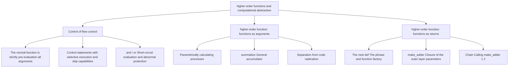

> **Earlier edition:** The Chinese edition was expanded on 22 October 2026. This English translation covers the previous edition. [Read the updated Chinese lecture](/notes/cs61a/lecture-04).

> **English original course**: CS 61A: Structure and Interpretation of Computer Programs (Fall 2024)  
> **Lecturer**: Prof. John DeNero (UC Berkeley)  
> **Text and illustrations**: VideoBook video to image to text technology e-book assembly line  
> **course coverage**: 37 / 37 on 18.2 hour audio/video instruction ⁇ 577 high-level lecture screenshots  
> **Online catalog**: [CS61A Special Catalog](/en/notes/topics/CS61A)

---


> **Lecture**: John DeNero ｜ **duration**: 42:53 ｜ **Video link back**: [Single episode corresponding to Station B (P4)](https://www.bilibili.com/video/BV1sy411z7nA/?p=4)

## 1. Classic iteration case: Fibonacci Sequence

*(reference timestamp: 00:01:25 )  [Watch clip (P4 00:01:25)](https://www.bilibili.com/video/BV1sy411z7nA/?p=4&t=85))*

In order to master the mental model of loop control, Professor DeNero used the famous Fibonacci sequence as an example to develop iterative algorithm design.

The Fibonacci sequence consists of  $0$  and  $1$  Initially, each subsequent item is the sum of the previous two: 
$$0, 1, 1, 2, 3, 5, 8, 13, 21, 34, 55, \dots$$

As usual, we will  $0$  Fibonacci numbers are recorded as  $\text{Fib}(0) = 0$, No.  $1$  one is recorded as  $\text{Fib}(1) = 1$, No.  $5$  One is  $\text{Fib}(5) = 5$. The Fibonacci sequence is closely connected to the Golden Spiral in geometry: put together squares with side lengths of Fibonacci numbers and connect the intersections to get a logarithmic spiral that is common in nature.


*⏱ Timestamp: 00:01:50 · 📷 Lecture screenshot · [Watch clip (P4 00:01:50)](https://www.bilibili.com/video/BV1sy411z7nA/?p=4&t=110)*

### Illustrative Design Key: Selection of Status variable

The key to designing an iterative function is to make it clear **What status information needs to be tracked**: 
- Previous value: `pred`(Predecessor)
- Current item value: `cur`(Current)
- Index corresponding to the current item: `k`
- Target item index: `n`

```python
def fib(n):
    """计算第 n 个斐波那契数，其中 n >= 1。"""
    pred, cur = 0, 1
    k = 1
    while k < n:
        pred, cur = cur, pred + cur
        k = k + 1
    return cur
```


*⏱ Timestamp: 00:04:15 · 📷 Lecture screenshot · [Watch clip (P4 00:04:15)](https://www.bilibili.com/video/BV1sy411z7nA/?p=4&t=255)*

In the environment graph, call  `fib(5)`  This group of variables will be maintained in the local frame. Note multiple value-giving statements  `pred, cur = cur, pred + cur`  The power of:
1. **Right, expression. First, simultaneously, evaluation.**: Calculation  `cur`  the current value of , and  `pred + cur`  of and.
2. **The left name is then bound at the same time**: This ensures that when calculating the next item, the original value of the previous item that has not been overwritten is still used!

| cycle rounds | k | pred | cur | Judgment conditions  `k < 5` |
| :---: | :---: | :---: | :---: | :---: |
| initial state | 1 | 0 | 1 | `1 < 5 -> True` |
| Round 1 ends | 2 | 1 | 1 | `2 < 5 -> True` |
| Round 2 ends | 3 | 1 | 2 | `3 < 5 -> True` |
| Round 3 ends | 4 | 2 | 3 | `4 < 5 -> True` |
| Round 4 ends | 5 | 3 | 5 | `5 < 5 -> False` (Exit the loop) |

eventually return  `cur = 5`, the 5th Fibonacci number is correctly obtained.


*⏱ Timestamp: 00:06:50 · 📷 Lecture screenshot · [Watch clip (P4 00:06:50)](https://www.bilibili.com/video/BV1sy411z7nA/?p=4&t=410)*

### Classroom Thoughts: A subtle rewriting of initial conditions

If the initial conditions are changed to  `pred, cur = 1, 0`, `k = 0`, is the algorithm still correct?

```python
def fib_alt(n):
    pred, cur = 1, 0
    k = 0
    while k < n:
        pred, cur = cur, pred + cur
        k = k + 1
    return cur
```

> **Conclusion**: Not only is this change equally correct; **perform better**!
> - When entering  `n = 0`  At that time, the old version was  `n >= 1`  Restriction cannot be processed; in new version  `k < n` (i.e.  `0 < 0`) is false, the loop is skipped directly and returns  `cur = 0`, perfectly supported  $\text{Fib}(0) = 0$  boundary conditions.
> - when  `n = 5`  When , the loop body is executed 5 times, and the sequence advances as  `0 -> 1 -> 1 -> 2 -> 3 -> 5`, and finally get the same  `5`.


*⏱ Timestamp: 00:07:45 · 📷 Lecture screenshot · [Watch clip (P4 00:07:45)](https://www.bilibili.com/video/BV1sy411z7nA/?p=4&t=465)*

---

## 2. Why control statements? The difference between call expression and the nature of control statements

*reference timestamp: 00:09:12...  [Watch clip (P4 00:09:12)](https://www.bilibili.com/video/BV1sy411z7nA/?p=4&t=552))*

Since Python has a powerful function mechanism, can we write an ordinary function  `if_(condition, true_result, false_result)`, thereby completely abolishing  `if`  Syntax keyword?


*⏱ Timestamp: 00:09:40 · 📷 Lecture screenshot · [Watch clip (P4 00:09:40)](https://www.bilibili.com/video/BV1sy411z7nA/?p=4&t=580)*

### Thought experiment: Try to customize the if\_ function

```python
def if_(c, t, f):
    if c:
        return t
    else:
        return f
```

Now we try using  `if_`  to write a function that computes the square root of a nonnegative real number  `real_sqrt(x)` For negative numbers, the real number square root portion is defined as  `0`: 

```python
from math import sqrt

# 标准 if 语句版本：工作完全正常
def real_sqrt_statement(x):
    if x >= 0:
        return sqrt(x)
    else:
        return 0

# 尝试用 if_ 函数替代：
def real_sqrt_call(x):
    return if_(x >= 0, sqrt(x), 0)
```

when we test  `real_sqrt_call(-16)`  When, the program crashes:
```text
ValueError: math domain error
```


*⏱ Timestamp: 00:11:30 · 📷 Lecture screenshot · [Watch clip (P4 00:11:30)](https://www.bilibili.com/video/BV1sy411z7nA/?p=4&t=690)*

### Failed source: Conflict between call expression evaluation Rules and Control Words

> **call expression evaluation rules (strict evaluation)**:
Before calling any function, **It has to be right first. operator And all operand Son expression Completed evaluation**, and then argument into the function!

In  `if_(x >= 0, sqrt(x), 0)`  Medium:
1. interpreter seeks to obtain the value of three arguments.
2. When? evaluation Second argument  `sqrt(-16)`  Python immediately throws a math domain error!
3. function  `if_`  internal logic **Didn't even have time to run**!

> **The meaning of existence of control statements**:Control statement (such as  `if`, `while`)’s core capabilities lie in **selective execution** with **Skip execution**. The branch whose condition is not met, the code will never be executed. function call cannot achieve this, so the programming language must retain the control statement.


*⏱ Timestamp: 00:14:40 · 📷 Lecture screenshot · [Watch clip (P4 00:14:40)](https://www.bilibili.com/video/BV1sy411z7nA/?p=4&t=880)*

---

## 3. expression Level Control: short-circuit evaluation (Short-Circuiting) of Bur operator

*reference timestamp: 00:15:37...  [Watch clip (P4 00:15:37)](https://www.bilibili.com/video/BV1sy411z7nA/?p=4&t=937))*

Although normal functions cannot skip parameters evaluation, logic operator in Python  `and`  and  `or`  It's a special language nuclear level. expression , available\*\* short-circuit evaluation (Short-Circuit Participation)\*\*


*⏱ Timestamp: 00:16:30 · 📷 Lecture screenshot · [Watch clip (P4 00:16:30)](https://www.bilibili.com/video/BV1sy411z7nA/?p=4&t=990)*

### Execution rules for and

For expression  `<left> and <right>`: 
1. Right first  `<left>`  evaluation.
2. If  `<left>`  is a false value, **Use this fake value immediately as the result of the entire expression**, skip completely  `<right>`  evaluation!
3. If  `<left>`  is a true value, then  `<right>`  evaluation and by  `<right>`  value as the result of the entire expression.

### Execution rules for or

For expression  `<left> or <right>`: 
1. Right first  `<left>`  evaluation.
2. If  `<left>`  is the true value, **Use the real value immediately as the result of the entire expression**, skip completely  `<right>`  evaluation!
3. If  `<left>`  is a false value, then for  `<right>`  evaluation and by  `<right>`  value as the result of the entire expression.

### Defense engineering applications for short-circuit evaluation

Using short circuit features, we can create a secure expression to prevent the program from crashing due to illegal entry:

```python
# 案例 1：防止 math.sqrt 传入负数
def has_big_sqrt(x):
    return x >= 0 and sqrt(x) > 10

# 案例 2：防止除以零错误（ZeroDivisionError）
def is_reasonable(n):
    return n == 0 or (1 / n != 0)
```

when  `has_big_sqrt(-1000)`  When executing, `x >= 0`  evaluation IS  `False`, `and`  Stop immediately evaluation and return  `False`, on the right  `sqrt(-1000)`  Being completely skipped, the exception was successfully avoided!


*⏱ Timestamp: 00:18:20 · 📷 Lecture screenshot · [Watch clip (P4 00:18:20)](https://www.bilibili.com/video/BV1sy411z7nA/?p=4&t=1100)*

---

## 4. higher-order function and first heavy abstraction: parameter numeric constant

*reference timestamp: 00:20:52...  [Watch clip (P4 00:20:52)](https://www.bilibili.com/video/BV1sy411z7nA/?p=4&t=1252))*

One of the principles of writing clear programs is **DRY: Don't Repeat Yourself**. If multiple functions share similar structures, we should refine common patterns.

Examine the area calculations of three geometric figures:
- Square (side length  $r$): $\text{Area} = 1 \times r^2$
- Circle (radius  $r$): $\text{Area} = \pi \times r^2$
- Regular hexagon (side length  $r$): $\text{Area} = \left(\frac{3\sqrt{3}}{2}\right) \times r^2$


*⏱ Timestamp: 00:21:45 · 📷 Lecture screenshot · [Watch clip (P4 00:21:45)](https://www.bilibili.com/video/BV1sy411z7nA/?p=4&t=1305)*

These three formulas share the same calculation structure: $r^2 \times \text{Shape Constant}$, and both require side lengths  $r > 0$ (available  `assert`  assertions to constrain).

By passing in specific geometric constants as parameters, we can construct a unified  `area`  Function:

```python
from math import pi, sqrt

def area(r, shape_constant):
    assert r > 0, "A length must be positive"
    return r * r * shape_constant

def area_square(r):
    return area(r, 1)

def area_circle(r):
    return area(r, pi)

def area_hexagon(r):
    return area(r, 3 * sqrt(3) / 2)
```


*⏱ Timestamp: 00:25:30 · 📷 Lecture screenshot · [Watch clip (P4 00:25:30)](https://www.bilibili.com/video/BV1sy411z7nA/?p=4&t=1530)*

---

## 5. Second heavy abstraction: higher-order function (function as parameter)

*(reference timestamp: 00:27:00 )  [Watch clip (P4 00:27:00)](https://www.bilibili.com/video/BV1sy411z7nA/?p=4&t=1620))*

If the difference between similar functions is not just a constant, but **a whole calculation process** abstraction?

Examine three common cumulative series in mathematics:
1. **Sum of natural numbers**: $\sum_{k=1}^n k = 1 + 2 + \dots + n$
2. **sum of cubes**: $\sum_{k=1}^n k^3 = 1^3 + 2^3 + \dots + n^3$
3. **Leibniz  $\pi$  series**: $\sum_{k=1}^n \frac{8}{(4k-3)(4k-1)} \approx \pi$


*⏱ Timestamp: 00:27:30 · 📷 Lecture screenshot · [Watch clip (P4 00:27:30)](https://www.bilibili.com/video/BV1sy411z7nA/?p=4&t=1650)*

These three functions are exactly the same in the skeleton of iterative accumulation: they all add from the 1st item to the 1st item.  $n$  item. The only difference is: **How to index based on items  $k$  Calculate the value of a specific item**.

### Universal Summation higher-order function: number

We can define a higher-order function  `summation`, which accepts an additional parameter  `term`——**And  `term`  Itself is a function**!

```python
def summation(n, term):
    """累加前 n 项，每一项由函数 term(k) 给出。

    >>> summation(5, cube)
    225
    """
    total, k = 0, 1
    while k <= n:
        total, k = total + term(k), k + 1
    return total

def identity(x):
    return x

def cube(x):
    return x ** 3

def sum_naturals(n):
    return summation(n, identity)

def sum_cubes(n):
    return summation(n, cube)
```


*⏱ Timestamp: 00:32:30 · 📷 Lecture screenshot · [Watch clip (P4 00:32:30)](https://www.bilibili.com/video/BV1sy411z7nA/?p=4&t=1950)*

### What's higher-order function?

> **Definition**: **Accept another function as argument**, or **Return function as return value** function, called higher-order function.

In  `summation(5, cube)`  Medium:
- `cube`  A function object passed as argument to  `summation`  parameter  `term`.
- In the body of the loop, `term(k)`  Dynamically call the incoming  `cube`  Function that calculates the value of an item.

We can also use it to easily approximate  $\pi$: 

```python
def pi_term(k):
    return 8 / ((4 * k - 3) * * (4 * k - 1))

summation(1000000, pi_term)  # 逼近 3.141592...
```


*⏱ Timestamp: 00:35:40 · 📷 Lecture screenshot · [Watch clip (P4 00:35:40)](https://www.bilibili.com/video/BV1sy411z7nA/?p=4&t=2140)*

---

## 6. Function as return value: Factory pattern and prototype of Currying

*(reference timestamp: 00:37:00)  [Watch clip (P4 00:37:00)](https://www.bilibili.com/video/BV1sy411z7nA/?p=4&t=2220))*

higher-order function's second superpower is: **Dynamically create and return brand new functions at runtime**.

Take the adder factory  `make_adder`  For example:

```python
def make_adder(n):
    """返回一个将参数与 n 相加的函数。

    >>> add_three = make_adder(3)
    >>> add_three(4)
    7
    """
    def adder(k):
        return k + n
    return adder
```


*⏱ Timestamp: 00:37:40 · 📷 Lecture screenshot · [Watch clip (P4 00:37:40)](https://www.bilibili.com/video/BV1sy411z7nA/?p=4&t=2260)*

### Embedded def statement with lexical scope initial probe

1. `make_adder`  Contains a local  `def adder(k)`  statement.
2. internal function  `adder`  in which two names are cited: parameter  `k`  parameter for external functions  `n`.
3. when executing  `add_three = make_adder(3)`  When:
   - Created  `make_adder`  local frame of  `n = 3`.
   - execute internal  `def`, creating a dedicated addition function, **It firmly remembers that the value of n is 3**!
   - `make_adder`  Return the function you just created as a value and bind it to the global  `add_three`.
4. subsequent calls  `add_three(4)`  when, the internal calculation  `4 + 3`, get  `7`.

### Direct evaluation: make\_adder(1) (2)

We don't even need the middle. variable , direct chain call:

```python
make_adder(1)(2)  # 求值得到 3
```

According to the strict rules of call expression:
- `make_adder(1)`  operator, evaluation gets internal.  `adder`  function (where  `n=1`).
- This function then works immediately on operand  `2`, calculate  `2 + 1`  Return  `3`.


*⏱ Timestamp: 00:40:20 · 📷 Lecture screenshot · [Watch clip (P4 00:40:20)](https://www.bilibili.com/video/BV1sy411z7nA/?p=4&t=2420)*

---

## 7. First-class citizenship and the principle of separation of duties

*reference timestamp: 00:41:50...  [Watch clip (P4 00:41:50)](https://www.bilibili.com/video/BV1sy411z7nA/?p=4&t=2510))*

In Python, the function is **First-Class Citizens**: 
- function to bind to any variable name;
- function can be passed as argument to another function;
- Functions can be output as the return value of another function;
- Functions can be freely combined and nested just like numbers and strings.

### Structural advantages of higher-order function

1. **Express common calculation methods**: For example  `summation`  Expresses a pure "accumulation mode" without caring about what is accumulated.
2. **Completely eliminate code duplication**: The skeleton logic of the accumulation loop only needs to be written once in the entire project.
3. **Separation of Concerns**: Each function only does one specialized thing. Universal summation is only responsible for loop scheduling, `cube`  It is only responsible for finding cubes, and the two are decoupled and combined to build an elegant and robust software system.

---

## 8. Summary and core mind map of this lecture



---

