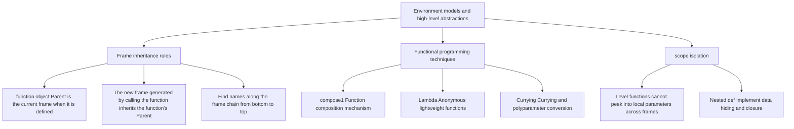

> **Course**: UC Berkeley CS61A (Fall 2024)  
> **Module**: Module 1: Functions & Abstraction  
> **Lecturer**: Prof. John DeNero (UC Berkeley)  
> **Video duration**: 36:42 ｜ **Classroom screenshots**: 15 pieces of blackboard writing/code demonstration  
> **Direct video**: [📺Watch the original video of this lecture on Bilibili (P5)](https://www.bilibili.com/video/BV1sy411z7nA/?p=5)  
> **Quick navigation**: [← Previous Lecture (P04 Lecture 4 Higher-Order Functions)](/en/notes/cs61a/lecture-04) ｜ [📚 Return to the full book catalog](/en/notes/topics/CS61A) ｜ [Next lecture (P06 Lecture 6 Sound (Optional)) →](/en/notes/cs61a/lecture-06)

---

## 1. Behavior of higher-order functions in environment graphs

*(Reference time: 00:01:48 · [Video jump (P5 00:01:48)](https://www.bilibili.com/video/BV1sy411z7nA/?p=5&t=108))*

In the previous lecture, we learned the basic concepts of higher-order functions. Many beginners will ask: After the introduction of higher-order functions, do the underlying rules of the Python interpreter become more complex?

> **good news**: The environment graph evaluation rules we established in the previous lectures, **No modifications required at all**, you can explain all the behaviors of higher-order functions smoothly and accurately! The existence of the environment graph is to completely uncover the black box of running high-order functions.

Examine classical higher-order functions that accept functions as arguments  `apply_twice`: 

```python
def apply_twice(f, x):
    return f(f(x))

def square(x):
    return x * x

result = apply_twice(square, 2)
```

[](https://www.bilibili.com/video/BV1sy411z7nA/?p=5&t=180)
*⏱ Timestamp: 00:03:00 · 📷 Classroom screenshot · [Watch the corresponding clip on Bilibili (P5 00:03:00)](https://www.bilibili.com/video/BV1sy411z7nA/?p=5&t=180)*

#### 📸 In-depth reading of classroom blackboard writing and code demonstration (00:03:00)

**\[On-site blackboard writing/code demonstration restoration\]**:
At this time point, Professor DeNero conducted a core demonstration and key blackboard derivation on the screen:
> *“Apply twice is a higher order function. Why? Because it's going to take another function as an argument. We better create such a function. How about our friend, square? Now we're going to run Python, starting with this file, so we can square things, of course, but we can also apply twice the square ...”*

**\[Underlying computing model and micro execution mechanism\]**: 
1. **Execution context and timing tracing**: 
   - At the current discussion point "1. Behavior of higher-order functions in environment graphs", the interpreter strictly follows the core evaluation protocol;
   - The expression evaluates the operators first, then evaluates the operands strictly from left to right, and finally applies the function object to the argument list;
   - If the environment model is involved, the local frame strictly records its static lexical parent pointer (Parent Pointer points to the environment where the function is defined), forming an orthogonal architecture with the dynamic call stack at runtime.
2. **Memory topology and object references**: 
   - Variable symbols are just keys in a hash table (environment frame), and pointers point directly to first-class citizen objects in heap memory;
   - Assignment statements are discrete-time snapshots of the state and never create implicit mathematical dependency monitoring.

**\[Guidelines for avoiding pitfalls and guidance on high-frequency test points\]**: 
- **Common misunderstandings**: In the exam questions related to "Parent frame pointer determination (definition point rather than call point) and Lambda scope", beginners can easily guess the result based on the surface form of the code, leading to scope confusion or variable shadowing (Shadowing) misjudgment;
- **The golden rule of debugging**: When encountering nested calls and complex branches, be sure to draw independent partial frames on the scratch paper, indicate the specific binding value of each formal parameter, and derive it step by step.


### Call timing and frame generation step by step

execute  `apply_twice(square, 2)`  The specific steps:
1. **Global frame preparation**:Definition  `apply_twice`  and  `square`, all saved in  `Global`  frame.
2. **Create F1 frame**: for  `apply_twice`  Create partial frame  `F1`. formal parameters  `f`  bound to global  `square`  Function object, formal parameters  `x`  bind to integer  `2`.
3. **inner call  `f(x)`**: 
   - in  `F1`  Find in environment  `f`, get  `square`  function.
   - call  `square(2)`, open up an independent frame  `F2` (The parent environment is  `Global`), formal parameters  `x`  bound as  `2`.
   - `F2`  Return  `4`.
4. **Outer layer call  `f(4)`**: 
   - call again  `square`, open up a new independent frame  `F3` (The parent environment is  `Global`), formal parameters  `x`  bound as  `4`.
   - `F3`  Return  `16`.
5. `F1`  The final calculation result will be  `16`  Returns and globally binds to  `result`.

[](https://www.bilibili.com/video/BV1sy411z7nA/?p=5&t=280)
*⏱ Timestamp: 00:04:40 · 📷 Classroom screenshot · [Watch the corresponding clip on Bilibili (P5 00:04:40)](https://www.bilibili.com/video/BV1sy411z7nA/?p=5&t=280)*

#### 📸 In-depth reading of classroom blackboard writing and code demonstration (00:04:40)

**\[On-site blackboard writing/code demonstration restoration\]**:
At this time point, Professor DeNero conducted a core demonstration and key blackboard derivation on the screen:
> *“f of x. So f of x requires a call. 2f, which is currently bound to square. So I call the square function on the number 2, which is what x is bound to. By squaring 2, I end up with a return value of 4. So this inner f of x right there evaluates to 4, and then I'm going to call f on 4. And once f agai...”*

**\[Underlying computing model and micro execution mechanism\]**: 
1. **Execution context and timing tracing**: 
   - At the current discussion point "1. Behavior of higher-order functions in environment graphs", the interpreter strictly follows the core evaluation protocol;
   - The expression evaluates the operators first, then evaluates the operands strictly from left to right, and finally applies the function object to the argument list;
   - If the environment model is involved, the local frame strictly records its static lexical parent pointer (Parent Pointer points to the environment where the function is defined), forming an orthogonal architecture with the dynamic call stack at runtime.
2. **Memory topology and object references**: 
   - Variable symbols are just keys in a hash table (environment frame), and pointers point directly to first-class citizen objects in heap memory;
   - Assignment statements are discrete-time snapshots of the state and never create implicit mathematical dependency monitoring.

**\[Guidelines for avoiding pitfalls and guidance on high-frequency test points\]**: 
- **Common misunderstandings**: In the exam questions related to "Parent frame pointer determination (definition point rather than call point) and Lambda scope", beginners can easily guess the result based on the surface form of the code, leading to scope confusion or variable shadowing (Shadowing) misjudgment;
- **The golden rule of debugging**: When encountering nested calls and complex branches, be sure to draw independent partial frames on the scratch paper, indicate the specific binding value of each formal parameter, and derive it step by step.


[](https://www.bilibili.com/video/BV1sy411z7nA/?p=5&t=370)
*⏱ Timestamp: 00:06:10 · 📷 Classroom screenshot · [Watch the corresponding clip on Bilibili (P5 00:06:10)](https://www.bilibili.com/video/BV1sy411z7nA/?p=5&t=370)*

#### 📸 In-depth reading of classroom blackboard writing and code demonstration (00:06:10)

**\[On-site blackboard writing/code demonstration restoration\]**:
At this time point, Professor DeNero conducted a core demonstration and key blackboard derivation on the screen:
> *“With this environment diagram. I kept the old one around just so you can see the difference. So when you apply a user-defined function, we've created a new frame. This one's called f1. It was created for executing the body of the apply twice function. And it has the formal parameters f and x bound t...”*

**\[Underlying computing model and micro execution mechanism\]**: 
1. **Execution context and timing tracing**: 
   - At the current discussion point "1. Behavior of higher-order functions in environment graphs", the interpreter strictly follows the core evaluation protocol;
   - The expression evaluates the operators first, then evaluates the operands strictly from left to right, and finally applies the function object to the argument list;
   - If the environment model is involved, the local frame strictly records its static lexical parent pointer (Parent Pointer points to the environment where the function is defined), forming an orthogonal architecture with the dynamic call stack at runtime.
2. **Memory topology and object references**: 
   - Variable symbols are just keys in a hash table (environment frame), and pointers point directly to first-class citizen objects in heap memory;
   - Assignment statements are discrete-time snapshots of the state and never create implicit mathematical dependency monitoring.

**\[Guidelines for avoiding pitfalls and guidance on high-frequency test points\]**: 
- **Common misunderstandings**: In the exam questions related to "Parent frame pointer determination (definition point rather than call point) and Lambda scope", beginners can easily guess the result based on the surface form of the code, leading to scope confusion or variable shadowing (Shadowing) misjudgment;
- **The golden rule of debugging**: When encountering nested calls and complex branches, be sure to draw independent partial frames on the scratch paper, indicate the specific binding value of each formal parameter, and derive it step by step.


---

### In-depth formal specification and micro-evaluation process (Operational Semantics)
In the "1. Behavior of high-order functions in environment graphs" module, the underlying computer operations rely on strict formal evaluation logic:
1. **Hierarchical parsing of abstract syntax trees (AST)**: 
   - The source code character stream is first divided into terminal symbol tokens (Tokens) by the lexical analyzer (Lexer), and then constructed into a multi-fork syntax tree by the syntax parser (Parser);
   - Operator priority and associativity are solidified during the syntax tree construction phase, eliminating ambiguity at runtime;
2. **Dynamic transitions of environment chains**: 
   - Each function call generates a new frame whose static lexical environment is determined by the function object's  `parent`  Attributes are completely determined;
   - The variable search traces back up the environment chain in one direction until the global environment frame. If it is not found, it will be triggered.  `NameError`  Abnormal;
3. **State Invariants**: 
   - The key to writing robust programs is to clarify loop invariants (Loop Invariants) and function pre/post-conditions (Pre/Post-conditions);
   - In complex control flow jumps, ensure that state variables maintain legal business constraints before each iteration.


## 2. The iron law of nested function definition and parent frame inheritance

*(Reference time: 00:07:00 · [Video jump (P5 00:07:00)](https://www.bilibili.com/video/BV1sy411z7nA/?p=5&t=420))*

When inside a function **Nested definitions** When used as another function, the environment model exhibits its most fascinating mechanics. Take the adder factory  `make_adder`  For example:

```python
def make_adder(n):
    def adder(k):
        return k + n
    return adder

add_three = make_adder(3)
result = add_three(4)  # 得到 7
```

[](https://www.bilibili.com/video/BV1sy411z7nA/?p=5&t=520)
*⏱ Timestamp: 00:08:40 · 📷 Classroom screenshot · [Watch the corresponding clip on Bilibili (P5 00:08:40)](https://www.bilibili.com/video/BV1sy411z7nA/?p=5&t=520)*

#### 📸 In-depth reading of classroom blackboard writing and code demonstration (00:08:40)

**\[On-site blackboard writing/code demonstration restoration\]**:
At this time point, Professor DeNero conducted a core demonstration and key blackboard derivation on the screen:
> *“On three. And now I have a function that adds three to things. I could add three to four, I could add three to five, I could add three to six. And somehow part of this function add three is the number three that gets added in. How is it that we have a function that has data within it? Well, let's lo...”*

**\[Underlying computing model and micro execution mechanism\]**: 
1. **Execution context and timing tracing**: 
   - At the current discussion point "2. Nested function definition and the iron law of parent frame inheritance", the interpreter strictly follows the core evaluation protocol;
   - The expression evaluates the operators first, then evaluates the operands strictly from left to right, and finally applies the function object to the argument list;
   - If the environment model is involved, the local frame strictly records its static lexical parent pointer (Parent Pointer points to the environment where the function is defined), forming an orthogonal architecture with the dynamic call stack at runtime.
2. **Memory topology and object references**: 
   - Variable symbols are just keys in a hash table (environment frame), and pointers point directly to first-class citizen objects in heap memory;
   - Assignment statements are discrete-time snapshots of the state and never create implicit mathematical dependency monitoring.

**\[Guidelines for avoiding pitfalls and guidance on high-frequency test points\]**: 
- **Common misunderstandings**: In the exam questions related to "Parent frame pointer determination (definition point rather than call point) and Lambda scope", beginners can easily guess the result based on the surface form of the code, leading to scope confusion or variable shadowing (Shadowing) misjudgment;
- **The golden rule of debugging**: When encountering nested calls and complex branches, be sure to draw independent partial frames on the scratch paper, indicate the specific binding value of each formal parameter, and derive it step by step.


### Why can adder remember n = 3?

Track the evolution of the environment graph:
1. **call  `make_adder(3)`**: 
   - Create partial frame  `F1 [make_adder]`, the parent frame is  `Global`.
   - formal parameters  `n`  bound as  `3`.
2. **execution internal  `def adder(k)`**: 
   - The currently active frame at this time is  `F1`.
   - The interpreter creates a new function object  `adder`, and put **The current frame F1 is marked as the parent frame of this function (Parent: F1)**!
   - name  `adder`  bind to  `F1`  interior.
3. **Return function object**: 
   - `return adder`  Brought this with me  `Parent: F1`  The marked function is returned to the caller.
   - In the global frame, the variable name  `add_three`  Bind to this function.

[](https://www.bilibili.com/video/BV1sy411z7nA/?p=5&t=645)
*⏱ Timestamp: 00:10:45 · 📷 Classroom screenshot · [Watch the corresponding clip on Bilibili (P5 00:10:45)](https://www.bilibili.com/video/BV1sy411z7nA/?p=5&t=645)*

#### 📸 In-depth reading of classroom blackboard writing and code demonstration (00:10:45)

**\[On-site blackboard writing/code demonstration restoration\]**:
At this time point, Professor DeNero conducted a core demonstration and key blackboard derivation on the screen:
> *“I return right back to where I was before, which was in the global frame, having evaluated make adder 3, and the value of that was this function adder, which I bind to the name add3, using regular assignment. Remember, we can give multiple names to the same function. Okay, now we have add3, which is...”*

**\[Underlying computing model and micro execution mechanism\]**: 
1. **Execution context and timing tracing**: 
   - At the current discussion point "2. Nested function definition and the iron law of parent frame inheritance", the interpreter strictly follows the core evaluation protocol;
   - The expression evaluates the operators first, then evaluates the operands strictly from left to right, and finally applies the function object to the argument list;
   - If the environment model is involved, the local frame strictly records its static lexical parent pointer (Parent Pointer points to the environment where the function is defined), forming an orthogonal architecture with the dynamic call stack at runtime.
2. **Memory topology and object references**: 
   - Variable symbols are just keys in a hash table (environment frame), and pointers point directly to first-class citizen objects in heap memory;
   - Assignment statements are discrete-time snapshots of the state and never create implicit mathematical dependency monitoring.

**\[Guidelines for avoiding pitfalls and guidance on high-frequency test points\]**: 
- **Common misunderstandings**: In the exam questions related to "Parent frame pointer determination (definition point rather than call point) and Lambda scope", beginners can easily guess the result based on the surface form of the code, leading to scope confusion or variable shadowing (Shadowing) misjudgment;
- **The golden rule of debugging**: When encountering nested calls and complex branches, be sure to draw independent partial frames on the scratch paper, indicate the specific binding value of each formal parameter, and derive it step by step.


### Environment lookup chain when calling add\_three(4)

When we execute globally  `add_three(4)`  When:
1. Create a new partial frame  `F2 [adder]`, formal parameters  `k`  bound as  `4`.
2. **Key Steps (Parent Frame Inheritance)**: Because it is called  `adder`  The parent frame of the function object is  `F1`, so **The parent frame of the new frame F2 is directly set to F1**!
3. At this time, the current environment is a chain containing 3 frames: 
   $$\text{Current Environment} = [F2] \longrightarrow [F1] \longrightarrow [\text{Global}]$$
4. execute  `return k + n`: 
   - Find  `k`: at frame 1  `F2`  Found immediately in  `4`.
   - Find  `n`: in  `F2`  Not found in; following parent pointer to frame 2  `F1`, find  `n = 3`!
   - Calculate  `4 + 3 = 7`, returned successfully!

[](https://www.bilibili.com/video/BV1sy411z7nA/?p=5&t=770)
*⏱ Timestamp: 00:12:50 · 📷 Classroom screenshot · [Watch the corresponding clip on Bilibili (P5 00:12:50)](https://www.bilibili.com/video/BV1sy411z7nA/?p=5&t=770)*

#### 📸 In-depth reading of classroom blackboard writing and code demonstration (00:12:50)

**\[On-site blackboard writing/code demonstration restoration\]**:
At this time point, Professor DeNero conducted a core demonstration and key blackboard derivation on the screen:
> *“And that's why its parent is F1. So when the parent is F1, then we call the function adder. We copy the name down into the new frame. We copy the formal parameters down and bind them to the argument values. And we also copy the parent of the function as the parent of the frame. So here's an explanat...”*

**\[Underlying computing model and micro execution mechanism\]**: 
1. **Execution context and timing tracing**: 
   - At the current discussion point "2. Nested function definition and the iron law of parent frame inheritance", the interpreter strictly follows the core evaluation protocol;
   - The expression evaluates the operators first, then evaluates the operands strictly from left to right, and finally applies the function object to the argument list;
   - If the environment model is involved, the local frame strictly records its static lexical parent pointer (Parent Pointer points to the environment where the function is defined), forming an orthogonal architecture with the dynamic call stack at runtime.
2. **Memory topology and object references**: 
   - Variable symbols are just keys in a hash table (environment frame), and pointers point directly to first-class citizen objects in heap memory;
   - Assignment statements are discrete-time snapshots of the state and never create implicit mathematical dependency monitoring.

**\[Guidelines for avoiding pitfalls and guidance on high-frequency test points\]**: 
- **Common misunderstandings**: In the exam questions related to "Parent frame pointer determination (definition point rather than call point) and Lambda scope", beginners can easily guess the result based on the surface form of the code, leading to scope confusion or variable shadowing (Shadowing) misjudgment;
- **The golden rule of debugging**: When encountering nested calls and complex branches, be sure to draw independent partial frames on the scratch paper, indicate the specific binding value of each formal parameter, and derive it step by step.


### Two rules for environmental mapping

> **Rule 1 (when defining functions)**:
function object  `Parent`  is always equal to this function **The current frame in which it is defined (Current Frame)**.
>
> **Rule 2 (when calling a function)**:
of the newly created local frame  `Parent`, always equal to **Parent recorded by the called function object**.

[](https://www.bilibili.com/video/BV1sy411z7nA/?p=5&t=920)
*⏱ Timestamp: 00:15:20 · 📷 Classroom screenshot · [Watch the corresponding clip on Bilibili (P5 00:15:20)](https://www.bilibili.com/video/BV1sy411z7nA/?p=5&t=920)*

#### 📸 In-depth reading of classroom blackboard writing and code demonstration (00:15:20)

**\[On-site blackboard writing/code demonstration restoration\]**:
At this time point, Professor DeNero conducted a core demonstration and key blackboard derivation on the screen:
> *“is right here in the function value. So if you know which function you're calling, you know how to write down its frame correctly. So here's a little guide to how to draw environment diagrams so that you can draw them on your own without using Python Tutor. And that's really helpful because then you...”*

**\[Underlying computing model and micro execution mechanism\]**: 
1. **Execution context and timing tracing**: 
   - At the current discussion point "2. Nested function definition and the iron law of parent frame inheritance", the interpreter strictly follows the core evaluation protocol;
   - The expression evaluates the operators first, then evaluates the operands strictly from left to right, and finally applies the function object to the argument list;
   - If the environment model is involved, the local frame strictly records its static lexical parent pointer (Parent Pointer points to the environment where the function is defined), forming an orthogonal architecture with the dynamic call stack at runtime.
2. **Memory topology and object references**: 
   - Variable symbols are just keys in a hash table (environment frame), and pointers point directly to first-class citizen objects in heap memory;
   - Assignment statements are discrete-time snapshots of the state and never create implicit mathematical dependency monitoring.

**\[Guidelines for avoiding pitfalls and guidance on high-frequency test points\]**: 
- **Common misunderstandings**: In the exam questions related to "Parent frame pointer determination (definition point rather than call point) and Lambda scope", beginners can easily guess the result based on the surface form of the code, leading to scope confusion or variable shadowing (Shadowing) misjudgment;
- **The golden rule of debugging**: When encountering nested calls and complex branches, be sure to draw independent partial frames on the scratch paper, indicate the specific binding value of each formal parameter, and derive it step by step.


---

### In-depth formal specification and micro-evaluation process (Operational Semantics)
In the module "2. Nested function definition and the iron law of parent frame inheritance", the underlying computer operations rely on strict formal evaluation logic:
1. **Hierarchical parsing of abstract syntax trees (AST)**: 
   - The source code character stream is first divided into terminal symbol tokens (Tokens) by the lexical analyzer (Lexer), and then constructed into a multi-fork syntax tree by the syntax parser (Parser);
   - Operator priority and associativity are solidified during the syntax tree construction phase, eliminating ambiguity at runtime;
2. **Dynamic transitions of environment chains**: 
   - Each function call generates a new frame whose static lexical environment is determined by the function object's  `parent`  Attributes are completely determined;
   - The variable search traces back up the environment chain in one direction until the global environment frame. If it is not found, it will be triggered.  `NameError`  Abnormal;
3. **State Invariants**: 
   - The key to writing robust programs is to clarify loop invariants (Loop Invariants) and function pre/post-conditions (Pre/Post-conditions);
   - In complex control flow jumps, ensure that state variables maintain legal business constraints before each iteration.


## 3. Scope trap: local names and flat functions cannot be accessed across frames

*(Reference time: 00:16:22 · [Video jump (P5 00:16:22)](https://www.bilibili.com/video/BV1sy411z7nA/?p=5&t=982))*

Beginners often try to read variables between horizontally defined functions, for example:

```python
def f(x, y):
    return g(x)

def g(a):
    return a + y

f(1, 2)
```

Executing this code will result in an error: `NameError: name 'y' is not defined`.

[](https://www.bilibili.com/video/BV1sy411z7nA/?p=5&t=1060)
*⏱ Timestamp: 00:17:40 · 📷 Classroom screenshot · [Watch the corresponding clip on Bilibili (P5 00:17:40)](https://www.bilibili.com/video/BV1sy411z7nA/?p=5&t=1060)*

#### 📸 In-depth reading of classroom blackboard writing and code demonstration (00:17:40)

**\[On-site blackboard writing/code demonstration restoration\]**:
At this time point, Professor DeNero conducted a core demonstration and key blackboard derivation on the screen:
> *“Here's the example. We define F. We define G. We call F. X is bound to 1. Y is bound to 2. We call G because we're executing the body of F. Now, in G, A is bound to 1. We have various bindings for various names and values. And here we see that error. Why is it an error, even though Y is right here? ...”*

**\[Underlying computing model and micro execution mechanism\]**: 
1. **Execution context and timing tracing**: 
   - At the current discussion point "3. Scope trap: local names and flat functions cannot be accessed across frames", the interpreter strictly follows the core evaluation convention;
   - The expression evaluates the operators first, then evaluates the operands strictly from left to right, and finally applies the function object to the argument list;
   - If the environment model is involved, the local frame strictly records its static lexical parent pointer (Parent Pointer points to the environment where the function is defined), forming an orthogonal architecture with the dynamic call stack at runtime.
2. **Memory topology and object references**: 
   - Variable symbols are just keys in a hash table (environment frame), and pointers point directly to first-class citizen objects in heap memory;
   - Assignment statements are discrete-time snapshots of the state and never create implicit mathematical dependency monitoring.

**\[Guidelines for avoiding pitfalls and guidance on high-frequency test points\]**: 
- **Common misunderstandings**: In the exam questions related to "Parent frame pointer determination (definition point rather than call point) and Lambda scope", beginners can easily guess the result based on the surface form of the code, leading to scope confusion or variable shadowing (Shadowing) misjudgment;
- **The golden rule of debugging**: When encountering nested calls and complex branches, be sure to draw independent partial frames on the scratch paper, indicate the specific binding value of each formal parameter, and derive it step by step.


### Why can't g find y?

Observe the environment chain at this time:
- `g`  is defined in the global scope, so  `g`  The parent frame of the function object is  `Global`.
- Dangzai  `f`  internal call  `g(x)`  time, for  `g`  Created local frame  `F2`, whose parent frame is  `Global`, instead of  `F1`!
- At this time  `g`  The environment chain is  `[F2] -> [Global]`.
- The interpreter comes first  `F2`  Find  `y`, not found; again in  `Global`  Find  `y`, still not found; **The interpreter will never jump sideways into an unrelated F1 frame to find y**!
- Hence the error. This reflects the \*\*Local Scope\*\* closure of function formal parameters.

---

### In-depth formal specification and micro-evaluation process (Operational Semantics)
In the "3. Scope Trap: Local names and flat functions cannot be accessed across frames" module, the underlying operations of the computer rely on strict formal evaluation logic:
1. **Hierarchical parsing of abstract syntax trees (AST)**: 
   - The source code character stream is first divided into terminal symbol tokens (Tokens) by the lexical analyzer (Lexer), and then constructed into a multi-fork syntax tree by the syntax parser (Parser);
   - Operator priority and associativity are solidified during the syntax tree construction phase, eliminating ambiguity at runtime;
2. **Dynamic transitions of environment chains**: 
   - Each function call generates a new frame whose static lexical environment is determined by the function object's  `parent`  Attributes are completely determined;
   - The variable search traces back up the environment chain in one direction until the global environment frame. If it is not found, it will be triggered.  `NameError`  Abnormal;
3. **State Invariants**: 
   - The key to writing robust programs is to clarify loop invariants (Loop Invariants) and function pre/post-conditions (Pre/Post-conditions);
   - In complex control flow jumps, ensure that state variables maintain legal business constraints before each iteration.


## 4. Classic case: Universal function compounder (Function Composition)

*(Reference time: 00:18:44 · [Video jump (P5 00:18:44)](https://www.bilibili.com/video/BV1sy411z7nA/?p=5&t=1124))*

In mathematics, composite functions  $(f \circ g)(x) = f(g(x))$. We can write a completely general first-order compounder in Python:

```python
def compose1(f, g):
    """返回一个新函数 h，使得 h(x) = f(g(x))。"""
    def h(x):
        return f(g(x))
    return h
```

[](https://www.bilibili.com/video/BV1sy411z7nA/?p=5&t=1200)
*⏱ Timestamp: 00:20:00 · 📷 Classroom screenshot · [Watch the corresponding clip on Bilibili (P5 00:20:00)](https://www.bilibili.com/video/BV1sy411z7nA/?p=5&t=1200)*

#### 📸 In-depth reading of classroom blackboard writing and code demonstration (00:20:00)

**\[On-site blackboard writing/code demonstration restoration\]**:
At this time point, Professor DeNero conducted a core demonstration and key blackboard derivation on the screen:
> *“On the result of calling g on x. So this is composing the functions f and g into one new function, h, which will return. Okay, so how does this work? We can square five, we can triple five. Now we're going to define a new hybrid function called squipple, which involves composing square and triple to...”*

**\[Underlying computing model and micro execution mechanism\]**: 
1. **Execution context and timing tracing**: 
   - At the current discussion point "4. Classic case: Universal Function Composition", the interpreter strictly follows the core evaluation protocol;
   - The expression evaluates the operators first, then evaluates the operands strictly from left to right, and finally applies the function object to the argument list;
   - If the environment model is involved, the local frame strictly records its static lexical parent pointer (Parent Pointer points to the environment where the function is defined), forming an orthogonal architecture with the dynamic call stack at runtime.
2. **Memory topology and object references**: 
   - Variable symbols are just keys in a hash table (environment frame), and pointers point directly to first-class citizen objects in heap memory;
   - Assignment statements are discrete-time snapshots of the state and never create implicit mathematical dependency monitoring.

**\[Guidelines for avoiding pitfalls and guidance on high-frequency test points\]**: 
- **Common misunderstandings**: In the exam questions related to "Parent frame pointer determination (definition point rather than call point) and Lambda scope", beginners can easily guess the result based on the surface form of the code, leading to scope confusion or variable shadowing (Shadowing) misjudgment;
- **The golden rule of debugging**: When encountering nested calls and complex branches, be sure to draw independent partial frames on the scratch paper, indicate the specific binding value of each formal parameter, and derive it step by step.


### Flexible combination of basic operators

```python
def square(x):
    return x * x

def triple(x):
    return 3 * x

# 组合 1：先三倍再平方 -> (3 * x)^2
squipple = compose1(square, triple)
squipple(5)  # (3 * 5)^2 = 15^2 = 225

# 组合 2：先平方再三倍 -> 3 * (x^2)
tripere = compose1(triple, square)
tripere(5)   # 3 * (5^2) = 3 * 25 = 75

# 组合 3：复合高阶函数构造的闭包
squatter = compose1(square, make_adder(2))
squatter(3)  # (3 + 2)^2 = 5^2 = 25
```

We can condense the entire process into a very expressive compound call expression: 
`compose1(square, make_adder(2))(3) -> 25`.

[](https://www.bilibili.com/video/BV1sy411z7nA/?p=5&t=1340)
*⏱ Timestamp: 00:22:20 · 📷 Classroom screenshot · [Watch the corresponding clip on Bilibili (P5 00:22:20)](https://www.bilibili.com/video/BV1sy411z7nA/?p=5&t=1340)*

#### 📸 In-depth reading of classroom blackboard writing and code demonstration (00:22:20)

**\[On-site blackboard writing/code demonstration restoration\]**:
At this time point, Professor DeNero conducted a core demonstration and key blackboard derivation on the screen:
> *“By the way, you can write one call expression that does all of this together. Let's look at the environment diagram for that one. We have square, we have make adder, we have compose one. We call compose one, which defines the adder function and returns it. Now we've passed that into compose. So comp...”*

**\[Underlying computing model and micro execution mechanism\]**: 
1. **Execution context and timing tracing**: 
   - At the current discussion point "4. Classic case: Universal Function Composition", the interpreter strictly follows the core evaluation protocol;
   - The expression evaluates the operators first, then evaluates the operands strictly from left to right, and finally applies the function object to the argument list;
   - If the environment model is involved, the local frame strictly records its static lexical parent pointer (Parent Pointer points to the environment where the function is defined), forming an orthogonal architecture with the dynamic call stack at runtime.
2. **Memory topology and object references**: 
   - Variable symbols are just keys in a hash table (environment frame), and pointers point directly to first-class citizen objects in heap memory;
   - Assignment statements are discrete-time snapshots of the state and never create implicit mathematical dependency monitoring.

**\[Guidelines for avoiding pitfalls and guidance on high-frequency test points\]**: 
- **Common misunderstandings**: In the exam questions related to "Parent frame pointer determination (definition point rather than call point) and Lambda scope", beginners can easily guess the result based on the surface form of the code, leading to scope confusion or variable shadowing (Shadowing) misjudgment;
- **The golden rule of debugging**: When encountering nested calls and complex branches, be sure to draw independent partial frames on the scratch paper, indicate the specific binding value of each formal parameter, and derive it step by step.


---

### In-depth formal specification and micro-evaluation process (Operational Semantics)
In the "4. Classic Case: Universal Function Composition" module, the underlying computer operations rely on strict formal evaluation logic:
1. **Hierarchical parsing of abstract syntax trees (AST)**: 
   - The source code character stream is first divided into terminal symbol tokens (Tokens) by the lexical analyzer (Lexer), and then constructed into a multi-fork syntax tree by the syntax parser (Parser);
   - Operator priority and associativity are solidified during the syntax tree construction phase, eliminating ambiguity at runtime;
2. **Dynamic transitions of environment chains**: 
   - Each function call generates a new frame whose static lexical environment is determined by the function object's  `parent`  Attributes are completely determined;
   - The variable search traces back up the environment chain in one direction until the global environment frame. If it is not found, it will be triggered.  `NameError`  Abnormal;
3. **State Invariants**: 
   - The key to writing robust programs is to clarify loop invariants (Loop Invariants) and function pre/post-conditions (Pre/Post-conditions);
   - In complex control flow jumps, ensure that state variables maintain legal business constraints before each iteration.


## 5. Lambda expression: in-depth comparison of anonymous functions and Def

*(Reference time: 00:24:18 · [Video jump (P5 00:24:18)](https://www.bilibili.com/video/BV1sy411z7nA/?p=5&t=1458))*

In functional programming, many auxiliary functions (such as  `triple`  or simple term functions) are used only once somewhere. Write a special one for this  `def`  Seems cumbersome. Python provides  **Lambda Expression**  Let’s define anonymous functions on the spot.

```python
# 传统 def 语句
def square(x):
    return x * x

# 等价的 lambda 表达式形式
square_lambda = lambda x: x * x
```

[](https://www.bilibili.com/video/BV1sy411z7nA/?p=5&t=1550)
*⏱ Timestamp: 00:25:50 · 📷 Classroom screenshot · [Watch the corresponding clip on Bilibili (P5 00:25:50)](https://www.bilibili.com/video/BV1sy411z7nA/?p=5&t=1550)*

#### 📸 In-depth reading of classroom blackboard writing and code demonstration (00:25:50)

**\[On-site blackboard writing/code demonstration restoration\]**:
At this time point, Professor DeNero conducted a core demonstration and key blackboard derivation on the screen:
> *“Well, it's not a function at all. It's just the number 100. And why is that? That's because I evaluated x times x in order to get its value, and that's what I bound to square. Now, what a lambda expression allows you to do is achieve what we wanted in the first place. Bind to the name square using a...”*

**\[Underlying computing model and micro execution mechanism\]**: 
1. **Execution context and timing tracing**: 
   - At the current discussion point "5. Lambda expressions: in-depth comparison of anonymous functions and Def", the interpreter strictly follows the core evaluation protocol;
   - The expression evaluates the operators first, then evaluates the operands strictly from left to right, and finally applies the function object to the argument list;
   - If the environment model is involved, the local frame strictly records its static lexical parent pointer (Parent Pointer points to the environment where the function is defined), forming an orthogonal architecture with the dynamic call stack at runtime.
2. **Memory topology and object references**: 
   - Variable symbols are just keys in a hash table (environment frame), and pointers point directly to first-class citizen objects in heap memory;
   - Assignment statements are discrete-time snapshots of the state and never create implicit mathematical dependency monitoring.

**\[Guidelines for avoiding pitfalls and guidance on high-frequency test points\]**: 
- **Common misunderstandings**: In the exam questions related to "Parent frame pointer determination (definition point rather than call point) and Lambda scope", beginners can easily guess the result based on the surface form of the code, leading to scope confusion or variable shadowing (Shadowing) misjudgment;
- **The golden rule of debugging**: When encountering nested calls and complex branches, be sure to draw independent partial frames on the scratch paper, indicate the specific binding value of each formal parameter, and derive it step by step.


### Grammatical features of lambda expressions

- Keywords  `lambda`  Enable an anonymous function.
- colon  `:`  On the left is the formal parameter list (such as  `x`, multiple parameters separated by commas  `x, y`).
- colon  `:`  On the right is **single return expression**.
- **Note**: Lambda internal **Prohibited use  `return`  Keywords**, nor is it allowed to contain  `while`, `if`  etc. statements. The value of the expression is automatically used as the return value.

### Lambda vs Def (Face-Off)

| Compare dimensions | `lambda x: x * x` | `def square(x): return x * x` |
| :--- | :--- | :--- |
| **Definition and essence** | is a **Expression**, evaluation produces a function object | It's one **Compound statement (Statement)** |
| **Intrinsic Name** | No name (displayed as  `<function <lambda> at ...>`) | Has its own intrinsic name (displayed as  `<function square at ...>`) |
| **name binding** | Must be bound by an external assignment statement, or passed directly as an actual parameter | Automatically complete name binding in the current frame when executing the statement |
| **support structure** | Only supports single expressions, not statement blocks | Supports any multi-line statement blocks, branches, loops and exception handling |
| **Parent frame Parent** | The current frame in which it is defined (the rules are exactly the same) | The current frame in which it is defined (the rules are exactly the same) |

[](https://www.bilibili.com/video/BV1sy411z7nA/?p=5&t=1730)
*⏱ Timestamp: 00:28:50 · 📷 Classroom screenshot · [Watch the corresponding clip on Bilibili (P5 00:28:50)](https://www.bilibili.com/video/BV1sy411z7nA/?p=5&t=1730)*

#### 📸 In-depth reading of classroom blackboard writing and code demonstration (00:28:50)

**\[On-site blackboard writing/code demonstration restoration\]**:
At this time point, Professor DeNero conducted a core demonstration and key blackboard derivation on the screen:
> *“In other programming languages that didn't have them for a long time, they're starting to appear, because people have realized just how wonderful a lambda expression is. Lambda expressions in Python cannot contain statements, and so they are limited relative to their close cousin, the def statement....”*

**\[Underlying computing model and micro execution mechanism\]**: 
1. **Execution context and timing tracing**: 
   - At the current discussion point "5. Lambda expressions: in-depth comparison of anonymous functions and Def", the interpreter strictly follows the core evaluation protocol;
   - The expression evaluates the operators first, then evaluates the operands strictly from left to right, and finally applies the function object to the argument list;
   - If the environment model is involved, the local frame strictly records its static lexical parent pointer (Parent Pointer points to the environment where the function is defined), forming an orthogonal architecture with the dynamic call stack at runtime.
2. **Memory topology and object references**: 
   - Variable symbols are just keys in a hash table (environment frame), and pointers point directly to first-class citizen objects in heap memory;
   - Assignment statements are discrete-time snapshots of the state and never create implicit mathematical dependency monitoring.

**\[Guidelines for avoiding pitfalls and guidance on high-frequency test points\]**: 
- **Common misunderstandings**: In the exam questions related to "Parent frame pointer determination (definition point rather than call point) and Lambda scope", beginners can easily guess the result based on the surface form of the code, leading to scope confusion or variable shadowing (Shadowing) misjudgment;
- **The golden rule of debugging**: When encountering nested calls and complex branches, be sure to draw independent partial frames on the scratch paper, indicate the specific binding value of each formal parameter, and derive it step by step.


[](https://www.bilibili.com/video/BV1sy411z7nA/?p=5&t=1890)
*⏱ Timestamp: 00:31:30 · 📷 Classroom screenshot · [Watch the corresponding clip on Bilibili (P5 00:31:30)](https://www.bilibili.com/video/BV1sy411z7nA/?p=5&t=1890)*

#### 📸 In-depth reading of classroom blackboard writing and code demonstration (00:31:30)

**\[On-site blackboard writing/code demonstration restoration\]**:
At this time point, Professor DeNero conducted a core demonstration and key blackboard derivation on the screen:
> *“We'll look like this. We have the name square bound to a function. We introduce a new frame to call that function on 4. And we get a return value of 16. The name square appears in the frame. And these are the names that we actually use in order to evaluate expressions. These are the important ones. ...”*

**\[Underlying computing model and micro execution mechanism\]**: 
1. **Execution context and timing tracing**: 
   - At the current discussion point "5. Lambda expressions: in-depth comparison of anonymous functions and Def", the interpreter strictly follows the core evaluation protocol;
   - The expression evaluates the operators first, then evaluates the operands strictly from left to right, and finally applies the function object to the argument list;
   - If the environment model is involved, the local frame strictly records its static lexical parent pointer (Parent Pointer points to the environment where the function is defined), forming an orthogonal architecture with the dynamic call stack at runtime.
2. **Memory topology and object references**: 
   - Variable symbols are just keys in a hash table (environment frame), and pointers point directly to first-class citizen objects in heap memory;
   - Assignment statements are discrete-time snapshots of the state and never create implicit mathematical dependency monitoring.

**\[Guidelines for avoiding pitfalls and guidance on high-frequency test points\]**: 
- **Common misunderstandings**: In the exam questions related to "Parent frame pointer determination (definition point rather than call point) and Lambda scope", beginners can easily guess the result based on the surface form of the code, leading to scope confusion or variable shadowing (Shadowing) misjudgment;
- **The golden rule of debugging**: When encountering nested calls and complex branches, be sure to draw independent partial frames on the scratch paper, indicate the specific binding value of each formal parameter, and derive it step by step.


---

### In-depth formal specification and micro-evaluation process (Operational Semantics)
In the "5. Lambda Expression: In-depth Comparison of Anonymous Functions and Def" module, the underlying computer operations rely on strict formal evaluation logic:
1. **Hierarchical parsing of abstract syntax trees (AST)**: 
   - The source code character stream is first divided into terminal symbol tokens (Tokens) by the lexical analyzer (Lexer), and then constructed into a multi-fork syntax tree by the syntax parser (Parser);
   - Operator priority and associativity are solidified during the syntax tree construction phase, eliminating ambiguity at runtime;
2. **Dynamic transitions of environment chains**: 
   - Each function call generates a new frame whose static lexical environment is determined by the function object's  `parent`  Attributes are completely determined;
   - The variable search traces back up the environment chain in one direction until the global environment frame. If it is not found, it will be triggered.  `NameError`  Abnormal;
3. **State Invariants**: 
   - The key to writing robust programs is to clarify loop invariants (Loop Invariants) and function pre/post-conditions (Pre/Post-conditions);
   - In complex control flow jumps, ensure that state variables maintain legal business constraints before each iteration.


## 6. Function Currying

*(Reference time: 00:32:26 · [Video jump (P5 00:32:26)](https://www.bilibili.com/video/BV1sy411z7nA/?p=5&t=1946))*

In computer science, **Currying**  It refers to the technology of converting a function that receives multiple parameters into a series of high-order function chains that receive a single parameter.

Examine the ordinary two-participant function and  `make_adder`  The symmetry of:
- Ordinary functions: `add(2, 3) -> 5`
- Curried form: `make_adder(2)(3) -> 5`

We can write a meta-function  `curry2`, put **Any ordinary function that takes two arguments is automatically curried**: 

```python
def curry2(f):
    """将双参函数 f 转换为单参高阶函数链。"""
    def g(x):
        def h(y):
            return f(x, y)
        return h
    return g
```

use  `curry2`: 
```python
from operator import add, mul

curried_add = curry2(add)
add_three = curried_add(3)
add_three(4)  # 得到 7

curried_mul = curry2(mul)
curried_mul(6)(7)  # 得到 42
```

[](https://www.bilibili.com/video/BV1sy411z7nA/?p=5&t=2080)
*⏱ Timestamp: 00:34:40 · 📷 Classroom screenshot · [Watch the corresponding clip on Bilibili (P5 00:34:40)](https://www.bilibili.com/video/BV1sy411z7nA/?p=5&t=2080)*

#### 📸 In-depth reading of classroom blackboard writing and code demonstration (00:34:40)

**\[On-site blackboard writing/code demonstration restoration\]**:
At this time point, Professor DeNero conducted a core demonstration and key blackboard derivation on the screen:
> *“What h actually does is it returns f, called on x and y, g returns h, and curry2 returns g. Now what have I done? I've created a function, curry2, that turns two argument functions, such as add, into higher order functions, such as make adder. Here's the add function. If I want to create an add, if ...”*

**\[Underlying computing model and micro execution mechanism\]**: 
1. **Execution context and timing tracing**: 
   - At the current discussion point "6. Function Currying", the interpreter strictly follows the core evaluation protocol;
   - The expression evaluates the operators first, then evaluates the operands strictly from left to right, and finally applies the function object to the argument list;
   - If the environment model is involved, the local frame strictly records its static lexical parent pointer (Parent Pointer points to the environment where the function is defined), forming an orthogonal architecture with the dynamic call stack at runtime.
2. **Memory topology and object references**: 
   - Variable symbols are just keys in a hash table (environment frame), and pointers point directly to first-class citizen objects in heap memory;
   - Assignment statements are discrete-time snapshots of the state and never create implicit mathematical dependency monitoring.

**\[Guidelines for avoiding pitfalls and guidance on high-frequency test points\]**: 
- **Common misunderstandings**: In the exam questions related to "Parent frame pointer determination (definition point rather than call point) and Lambda scope", beginners can easily guess the result based on the surface form of the code, leading to scope confusion or variable shadowing (Shadowing) misjudgment;
- **The golden rule of debugging**: When encountering nested calls and complex branches, be sure to draw independent partial frames on the scratch paper, indicate the specific binding value of each formal parameter, and derive it step by step.


### Minimalist Nested Lambda Expression

Using Lambda expressions, `curry2`  It can be written as an extremely elegant line of code:

```python
curry2 = lambda f: lambda x: lambda y: f(x, y)
```

> **Interesting historical facts**: This technique was first proposed by logician Moses Schönfinkel in 1924 and later popularized by Haskell Curry. Although academic circles call it Currying, many scholars humorously believe that it should be called Currying.  **“Schönfinkeling”**!

[](https://www.bilibili.com/video/BV1sy411z7nA/?p=5&t=2190)
*⏱ Timestamp: 00:36:30 · 📷 Classroom screenshot · [Watch the corresponding clip on Bilibili (P5 00:36:30)](https://www.bilibili.com/video/BV1sy411z7nA/?p=5&t=2190)*

#### 📸 In-depth reading of classroom blackboard writing and code demonstration (00:36:30)

**\[On-site blackboard writing/code demonstration restoration\]**:
At this time point, Professor DeNero conducted a core demonstration and key blackboard derivation on the screen:
> *“of x, y. Just as before, I can apply my new curry to add, and then add things with it, via a higher-order function. So that's the general relationship. Curry-ing is the act of transforming a multi-argument function into a single-argument higher-order function that returns a function that takes the r...”*

**\[Underlying computing model and micro execution mechanism\]**: 
1. **Execution context and timing tracing**: 
   - At the current discussion point "6. Function Currying", the interpreter strictly follows the core evaluation protocol;
   - The expression evaluates the operators first, then evaluates the operands strictly from left to right, and finally applies the function object to the argument list;
   - If the environment model is involved, the local frame strictly records its static lexical parent pointer (Parent Pointer points to the environment where the function is defined), forming an orthogonal architecture with the dynamic call stack at runtime.
2. **Memory topology and object references**: 
   - Variable symbols are just keys in a hash table (environment frame), and pointers point directly to first-class citizen objects in heap memory;
   - Assignment statements are discrete-time snapshots of the state and never create implicit mathematical dependency monitoring.

**\[Guidelines for avoiding pitfalls and guidance on high-frequency test points\]**: 
- **Common misunderstandings**: In the exam questions related to "Parent frame pointer determination (definition point rather than call point) and Lambda scope", beginners can easily guess the result based on the surface form of the code, leading to scope confusion or variable shadowing (Shadowing) misjudgment;
- **The golden rule of debugging**: When encountering nested calls and complex branches, be sure to draw independent partial frames on the scratch paper, indicate the specific binding value of each formal parameter, and derive it step by step.


---

### In-depth formal specification and micro-evaluation process (Operational Semantics)
In the "6. Function Currying" module, the underlying computer operations rely on strict formal evaluation logic:
1. **Hierarchical parsing of abstract syntax trees (AST)**: 
   - The source code character stream is first divided into terminal symbol tokens (Tokens) by the lexical analyzer (Lexer), and then constructed into a multi-fork syntax tree by the syntax parser (Parser);
   - Operator priority and associativity are solidified during the syntax tree construction phase, eliminating ambiguity at runtime;
2. **Dynamic transitions of environment chains**: 
   - Each function call generates a new frame whose static lexical environment is determined by the function object's  `parent`  Attributes are completely determined;
   - The variable search traces back up the environment chain in one direction until the global environment frame. If it is not found, it will be triggered.  `NameError`  Abnormal;
3. **State Invariants**: 
   - The key to writing robust programs is to clarify loop invariants (Loop Invariants) and function pre/post-conditions (Pre/Post-conditions);
   - In complex control flow jumps, ensure that state variables maintain legal business constraints before each iteration.


## 7. Summary and core mind map of this lecture



### In-depth formal specification and micro-evaluation process (Operational Semantics)
In the "7. Lecture Summary and Core Mind Map" module, the underlying computer operations rely on strict formal evaluation logic:
1. **Hierarchical parsing of abstract syntax trees (AST)**: 
   - The source code character stream is first divided into terminal symbol tokens (Tokens) by the lexical analyzer (Lexer), and then constructed into a multi-fork syntax tree by the syntax parser (Parser);
   - Operator priority and associativity are solidified during the syntax tree construction phase, eliminating ambiguity at runtime;
2. **Dynamic transitions of environment chains**: 
   - Each function call generates a new frame whose static lexical environment is determined by the function object's  `parent`  Attributes are completely determined;
   - The variable search traces back up the environment chain in one direction until the global environment frame. If it is not found, it will be triggered.  `NameError`  Abnormal;
3. **State Invariants**: 
   - The key to writing robust programs is to clarify loop invariants (Loop Invariants) and function pre/post-conditions (Pre/Post-conditions);
   - In complex control flow jumps, ensure that state variables maintain legal business constraints before each iteration.


---

## Berkeley Midterm/Final classic high-frequency exam questions in-depth practice

### Practical exam questions: Environment topology and microstate tracking (WWPD & Environment Diagrams)
Consider the following microscopic execution of Python code in an interactive environment:

```python
# 经典作用域与高阶函数综合考题
x = 10

def outer(x):
    y = x + 2
    def inner(y):
        return x + y
    return inner

f = outer(5)
result = f(3)
```

#### Complete problem-solving thinking model and multi-frame environment map derivation:
1. **Global Frame initialization**: 
   - global variables  `x`  Bind to integer object  `10`; 
   - global function  `outer`  Binds to the newly created function object whose embedded  `parent = Global`; 
2. **execute  `f = outer(5)`**: 
   - create a local frame  $f_1$, mark  `f1: outer [parent=Global]`; 
   - formal parameters  `x`  Bind to actual parameters  `5`; 
   - local variables  `y`  bind to  `5 + 2 = 7`; 
   - in  $f_1$  internal execution  `def inner(y):`, create a function object  `inner`, its embedded  **`parent = f1`**; 
   - Return function object  `inner`, global variables  `f`  Bind to this object;
3. **execute  `result = f(3)`**: 
   - call function  `f` (i.e.  `inner`), open up a local frame  $f_2$; 
   - **core scoring points**:frame  $f_2$  Who does parent point to?
   - **iron law**: function  `inner`  is in frame  $f_1$  is defined internally, so  $f_2$  of  **`parent = f1`**!
   - formal parameters  `y`  Bind to actual parameters  `3`; 
   - executor  `return x + y`: 
     - in current frame  $f_2$  Find  `y`: Hit local variable  `y = 3`; 
     - in current frame  $f_2$  Find  `x`: miss, trace back along parent  **$f_1$  frame**  Find it!
     - in  $f_1$  hit in frame  `x = 5` (Global  `x = 10`  Partially obscured! );
     - Calculate  `5 + 3 = 8`, as the return value;
4. **Final output conclusion**: 
   - global variables  `result = 8`.

---

## Knowledge Matrix of the core concepts of this lecture

| core knowledge dimension | Formal definition and mechanism | Typical code examples | Core Engineering and Algorithm Value | Common pitfalls |
| :--- | :--- | :--- | :--- | :--- |
| **Basic evaluation semantics** | The expression is evaluated to obtain a value, and the execution of the statement changes the internal state. | `x = 2 + 3` | Build a discrete-time state snapshot mental model | Mistaking the assignment equal sign as a dynamic constraint on an algebraic equation |
| **Environment frame topology** | The environment is an ordered chain of frames | `Global -> f1 -> f2` | Implement safe isolation of lexical scope and variables | Confusing the caller stack frame with the parent environment pointer at the definition point |
| **abstract barrier** | Isolate implementation details and calling logic through functional interfaces | `def square(x): ...` | Reduce cognitive load on large-scale systems | Destroying interfaces directly relies on underlying private data structures |
| **control flow decisions** | Conditional branch short-circuit evaluation and loop iteration progression | `if cond: ... while: ...` | Give programs non-linear decision-making and large-scale data processing capabilities | Missing the loop progression variable causes an infinite loop |
| **higher level abilities** | Functions as first-class citizens (parameter passing, return, assignment) | `make_adder(3)` | Implement factory pattern, closure persistent state and currying | Closure late binding throws loop variable capture error |

---

## Course navigation and jump

| Previous lecture | Directory | Next lecture | Original video |
| :--- | :---: | :--- | :--- |
| [← Previous lecture: Lecture 4 Higher-Order Functions](/en/notes/cs61a/lecture-04) | [📚 Return to CS61A complete book list](/en/notes/topics/CS61A) | [Next lecture: Lecture 6 Sound (Optional) →](/en/notes/cs61a/lecture-06) | [🎬Watch this lecture on Bilibili (P5)](https://www.bilibili.com/video/BV1sy411z7nA/?p=5) |
