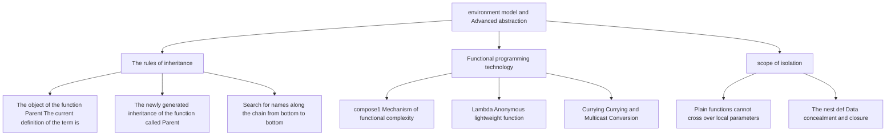

> **Earlier edition:** The Chinese edition was expanded on 22 October 2026. This English translation covers the previous edition. [Read the updated Chinese lecture](/notes/cs61a/lecture-05).

> **English original course**: CS 61A: Structure and Interpretation of Computer Programs (Fall 2024)  
> **Lecturer**: Prof. John DeNero (UC Berkeley)  
> **Text and illustrations**: VideoBook video to image to text technology e-book assembly line  
> **course coverage**: 37 / 37 on 18.2 hour audio/video instruction ⁇ 577 high-level lecture screenshots  
> **Online catalog**: [CS61A Special Catalog](/en/notes/topics/CS61A)

---


> **Lecture**: John DeNero ｜ **duration**: 36:42 ｜ **Video link back**: [Single episode corresponding to station B (P5)](https://www.bilibili.com/video/BV1sy411z7nA/?p=5)

## 1. higher-order function behaviour in environmental maps

*(reference timestamp: 00:01:48 )  [Watch clip (P5 00:01:48)](https://www.bilibili.com/video/BV1sy411z7nA/?p=5&t=108))*

In the previous statement, we learned the basic concepts of higher-order function (Higher-OrderFunctions). Many beginners would ask, "Did the bottom rules of Python interpreter become more complex with the introduction of higher-order function?

> **good news**: We have created the evaluation rules on the environment. **No modifications required at all** It's a smooth, precise explanation. higher-order function It's all about behavior. It's all about the environmental map. higher-order function Run the black box.

Look at the classic higher-order function for accepting functions as parameters  `apply_twice`: 

```python
def apply_twice(f, x):
    return f(f(x))

def square(x):
    return x * x

result = apply_twice(square, 2)
```


*⏱ Timestamp: 00:03:00 · 📷 Lecture screenshot · [Watch clip (P5 00:03:00)](https://www.bilibili.com/video/BV1sy411z7nA/?p=5&t=180)*

### Call timing and frame generation step by step

execute  `apply_twice(square, 2)`  The specific steps:
1. **Global frame preparation** Definition:  `apply_twice`  and  `square`, all saved in  `Global`  frame.
2. **Create F1 frame**: for  `apply_twice`  Create partial frame  `F1` parameter  `f`  bound to global  `square`  Function Object, parameter  `x`  bind to integer  `2`.
3. **inner call  `f(x)`**: 
   - In  `F1`  Find in environment  `f`, get  `square`  function.
   - call  `square(2)`, open up an independent frame  `F2` (with parent environment  `Global` parameter  `x`  bound as  `2`.
   - `F2`  Return  `4`.
4. **Outer layer call  `f(4)`**: 
   - call again  `square`, open up a new independent frame  `F3` (with parent environment  `Global` parameter  `x`  bound as  `4`.
   - `F3`  Return  `16`.
5. `F1`  The final calculation result will be  `16`  Returns and globally binds to  `result`.


*⏱ Timestamp: 00:04:40 · 📷 Lecture screenshot · [Watch clip (P5 00:04:40)](https://www.bilibili.com/video/BV1sy411z7nA/?p=5&t=280)*


*⏱ Timestamp: 00:06:10 · 📷 Lecture screenshot · [Watch clip (P5 00:06:10)](https://www.bilibili.com/video/BV1sy411z7nA/?p=5&t=370)*

---

## 2. The embedded function is defined with the parent inheritance hierarchy

*(reference timestamp: 00:07:00 )  [Watch clip (P5 00:07:00)](https://www.bilibili.com/video/BV1sy411z7nA/?p=5&t=420))*

When inside a function **Definition of nested** In the other function, environment model displays its most fascinating mechanism.  `make_adder`  For example:

```python
def make_adder(n):
    def adder(k):
        return k + n
    return adder

add_three = make_adder(3)
result = add_three(4)  # 得到 7
```


*⏱ Timestamp: 00:08:40 · 📷 Lecture screenshot · [Watch clip (P5 00:08:40)](https://www.bilibili.com/video/BV1sy411z7nA/?p=5&t=520)*

### Why can adder remember n = 3?

Track the evolution of the environment graph:
1. **call  `make_adder(3)`**: 
   - Create partial frame  `F1 [make_adder]`, the parent frame is  `Global`.
   - parameter  `n`  bound as  `3`.
2. **execution internal  `def adder(k)`**: 
   - The currently active frame at this time is  `F1`.
   - interpreter Create a new function object  `adder`, and put **The current frame F1 is marked as the parent frame of this function (Parent: F1)**!
   - name  `adder`  Binded to  `F1`  Inside the house.
3. **Returns the object function**: 
   - `return adder`  I'm going to take this.  `Parent: F1`  The function marked returns to the caller.
   - In the global grid, variable names  `add_three`  The function is bound to the function.


*⏱ Timestamp: 00:10:45 · 📷 Lecture screenshot · [Watch clip (P5 00:10:45)](https://www.bilibili.com/video/BV1sy411z7nA/?p=5&t=645)*

### Environmental search for the chain when calling add\_three (x4)

When we implement it nationwide  `add_three(4)`  When:
1. Opening up new local sheds  `F2 [adder]` The parameters  `k`  bound as  `4`.
2. **The key steps are father and mother inheritance** Because they were called:  `adder`  The parent of the function object is  `F1` So, what? **The new F2's parent engine is directly set to F1**!
3. The current environment is a chain of three chains: 
   $$\text{Current Environment} = [F2] \longrightarrow [F1] \longrightarrow [\text{Global}]$$
4. execute  `return k + n`: 
   - Find  `k` In the first column:  `F2`  The value of the data is  `4`.
   - Find  `n`: in  `F2`  The second column is located in the middle of the building.  `F1`, find  `n = 3`!
   - Calculation  `4 + 3 = 7` We're back!


*⏱ Timestamp: 00:12:50 · 📷 Lecture screenshot · [Watch clip (P5 00:12:50)](https://www.bilibili.com/video/BV1sy411z7nA/?p=5&t=770)*

### Environmental map drawing two major laws

> **Rule one (when defining a function)** The object function:  `Parent`  Always equal to the function **Current Frame (current frame)**.
>
> **Rule 2 (when calling a function)** Newly created local shots:  `Parent` It's always equal to **Parent recorded by the object of the function called**.


*⏱ Timestamp: 00:15:20 · 📷 Lecture screenshot · [Watch clip (P5 00:15:20)](https://www.bilibili.com/video/BV1sy411z7nA/?p=5&t=920)*

---

## 3. scope trap: Local names and level functions cannot be cross-scope accessed

*reference timestamp: 00:16:22...  [Watch clip (P5 00:16:22)](https://www.bilibili.com/video/BV1sy411z7nA/?p=5&t=982))*

Beginners often try to read variables between functions defined at a level, such as:

```python
def f(x, y):
    return g(x)

def g(a):
    return a + y

f(1, 2)
```

The code is executed by: `NameError: name 'y' is not defined`.


*⏱ Timestamp: 00:17:40 · 📷 Lecture screenshot · [Watch clip (P5 00:17:40)](https://www.bilibili.com/video/BV1sy411z7nA/?p=5&t=1060)*

### Why can't g find y?

The following is a list of the most common environmental factors:
- `g`  The first is that the data is defined in a global scope, so  `g`  The parent of the function object is  `Global`.
- When I was  `f`  Internal calls  `g(x)`  The  `g`  Local shells created  `F2` His father and mother were  `Global` But not  `F1`!
- This time  `g`  The environmental chain is  `[F2] -> [Global]`.
- The interpreter is the first  `F2`  Find out  `y` I'm not here.  `Global`  Find out  `y`, still not found; **interpreter will never jump horizontally into the F1 frame with no affiliation to find y**!
- Errors are therefore reported. This reflects the partial scope (Local Scope)\*\* closure of the function form parameters.

---

## 4. Classic case: Universal function compounder (Function Composition)

*reference timestamp: 00:18:44...  [Watch clip (P5 00:18:44)](https://www.bilibili.com/video/BV1sy411z7nA/?p=5&t=1124))*

In mathematics, composite functions  $(f \circ g)(x) = f(g(x))$. We can write a completely general first-order compounder in Python:

```python
def compose1(f, g):
    """返回一个新函数 h，使得 h(x) = f(g(x))。"""
    def h(x):
        return f(g(x))
    return h
```


*⏱ Timestamp: 00:20:00 · 📷 Lecture screenshot · [Watch clip (P5 00:20:00)](https://www.bilibili.com/video/BV1sy411z7nA/?p=5&t=1200)*

### Flexible combination of basic operators

```python
def square(x):
    return x * x

def triple(x):
    return 3 * x

# 组合 1：先三倍再平方 -> (3 * x)^2
squipple = compose1(square, triple)
squipple(5)  # (3 * 5)^2 = 15^2 = 225

# 组合 2：先平方再三倍 -> 3 * (x^2)
tripere = compose1(triple, square)
tripere(5)   # 3 * (5^2) = 3 * 25 = 75

# 组合 3：复合高阶函数构造的闭包
squatter = compose1(square, make_adder(2))
squatter(3)  # (3 + 2)^2 = 5^2 = 25
```

We can condensate the process into a highly performing composite call expression: 
`compose1(square, make_adder(2))(3) -> 25`.


*⏱ Timestamp: 00:22:20 · 📷 Lecture screenshot · [Watch clip (P5 00:22:20)](https://www.bilibili.com/video/BV1sy411z7nA/?p=5&t=1340)*

---

## 5. Lambda expression: Anonymity function compared to Def depth

*reference timestamp: 00:24:18...  [Watch clip (P5 00:24:18)](https://www.bilibili.com/video/BV1sy411z7nA/?p=5&t=1458))*

In functional programming, many auxiliary functions (such as  `triple`  or simple term functions) are used only once somewhere. Write a special one for this  `def`  Seems cumbersome. Python provides  **Lambda expression (Lambda Exchange)**  The site defines the function anonymously.

```python
# 传统 def 语句
def square(x):
    return x * x

# 等价的 lambda 表达式形式
square_lambda = lambda x: x * x
```


*⏱ Timestamp: 00:25:50 · 📷 Lecture screenshot · [Watch clip (P5 00:25:50)](https://www.bilibili.com/video/BV1sy411z7nA/?p=5&t=1550)*

### Syntaxical feature of Lambda expression

- Keywords  `lambda`  Enable an anonymous function.
- colon  `:`  List of parameters on the left (if  `x`, multiple parameters separated by commas  `x, y`).
- colon  `:`  On the right is **Single returns expression**.
- **Note**: Lambda internal **Prohibited use  `return`  Keywords**, nor is it allowed to contain  `while`, `if` . The value of expression is automatically a return value.

### Lambda vs Def (Face-Off)

| Compare dimensions | `lambda x: x * x` | `def square(x): return x * x` |
| :--- | :--- | :--- |
| **Definition and substance** | is a **expression (Expression)**, evaluation produces a function object | It's one **Compound statement (Statement)** |
| **Intrinsic Name** | No name (displayed as  `<function <lambda> at ...>`) | Has its own intrinsic name (displayed as  `<function square at ...>`) |
| **name binding** | Must be bound by an external value statement or passed directly as argument | Automatically complete name binding in the current frame when executing the statement |
| **support structure** | Only single expression is supported, no statement blocks are supported | Supports any multi-line statement blocks, branches, loops and exception handling |
| **Parent frame Parent** | The current definition of the current code is (the rules are perfectly consistent) | The current definition of the current code is (the rules are perfectly consistent) |


*⏱ Timestamp: 00:28:50 · 📷 Lecture screenshot · [Watch clip (P5 00:28:50)](https://www.bilibili.com/video/BV1sy411z7nA/?p=5&t=1730)*


*⏱ Timestamp: 00:31:30 · 📷 Lecture screenshot · [Watch clip (P5 00:31:30)](https://www.bilibili.com/video/BV1sy411z7nA/?p=5&t=1890)*

---

## 6. Function Currying

*reference timestamp: 00:32:26...  [Watch clip (P5 00:32:26)](https://www.bilibili.com/video/BV1sy411z7nA/?p=5&t=1946))*

In computer science, **Currying**  is the technology that converts a function that receives multiple parameters into a series of higher-order function chains that receive a single parameter.

Examine the ordinary two-participant function and  `make_adder`  The symmetry of:
- Ordinary functions: `add(2, 3) -> 5`
- Curried form: `make_adder(2)(3) -> 5`

We can write a meta-function  `curry2`, put **Any ordinary function that takes two arguments is automatically curried**: 

```python
def curry2(f):
    """将双参函数 f 转换为单参高阶函数链。"""
    def g(x):
        def h(y):
            return f(x, y)
        return h
    return g
```

Use  `curry2`: 
```python
from operator import add, mul

curried_add = curry2(add)
add_three = curried_add(3)
add_three(4)  # 得到 7

curried_mul = curry2(mul)
curried_mul(6)(7)  # 得到 42
```


*⏱ Timestamp: 00:34:40 · 📷 Lecture screenshot · [Watch clip (P5 00:34:40)](https://www.bilibili.com/video/BV1sy411z7nA/?p=5&t=2080)*

### Minimalist Nested Lambda Expression

Using Lambda expression, `curry2`  It can be written as an extremely elegant line of code:

```python
curry2 = lambda f: lambda x: lambda y: f(x, y)
```

> **Historical note**: This technique was first proposed by logician Moses Schönfinkel in 1924 and later popularized by Haskell Curry. Although academic circles call it Currying, many scholars humorously believe that it should be called Currying.  **“Schönfinkeling”**!


*⏱ Timestamp: 00:36:30 · 📷 Lecture screenshot · [Watch clip (P5 00:36:30)](https://www.bilibili.com/video/BV1sy411z7nA/?p=5&t=2190)*

---

## 7. Summary and core mind map of this lecture



---

