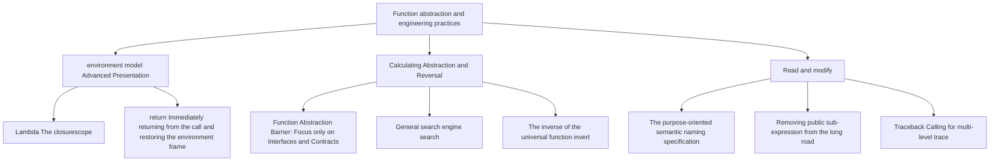

> **English original course**: CS 61A: Structure and Interpretation of Computer Programs (Fall 2024)  
> **Lecturer**: Prof. John DeNero (UC Berkeley)  
> **Text and illustrations**: VideoBook video to image to text technology e-book assembly line  
> **course coverage**: 37 / 37 on 18.2 hour audio/video instruction ⁇ 577 high-level lecture screenshots  
> **Online catalog**: [CS61A Special Catalog](/en/notes/topics/CS61A)

---


> **Lecture**: John DeNero ｜ **duration**: 30:05 ｜ **Video link back**: [Single episode corresponding to Station B (P7)](https://www.bilibili.com/video/BV1sy411z7nA/?p=7)

## 1. Midterm exam knowledge map and core specifications

*I'm sorry. reference timestamp 00:30.  [Watch clip (P7 00:00:30)](https://www.bilibili.com/video/BV1sy411z7nA/?p=7&t=30))*

Before entering this lecture, Professor DeNero sorted out the scope and study guide of the midterm exam (Midterm 1):
- **Scope of investigation** The first section discusses the content of the fifth section: expression, control flow, function definition and higher-order environment model).
- **Exam format**: Closed-book paper-and-pencil exam, providing an official carefully compiled Study Guide (covering all statement execution rules, built-in functions, and comprehensive sample questions on large-scale environment diagrams).
- **Suggestions on preparation for actual combat**: Complete the first phase (Phase 1) of the Lab, Discussion, Homework 2 and Hog assignments, and based on this, independently complete a previous year's exam question.


*⏱ Timestamp: 00:00:55 · 📷 Lecture screenshot · [Watch clip (P7 00:00:55)](https://www.bilibili.com/video/BV1sy411z7nA/?p=7&t=55)*

---

## 2. Major challenges of the environmental map: Embedded Lambda and closure scope

*reference timestamp: 00:02:21...  [Watch clip (P7 00:02:21)](https://www.bilibili.com/video/BV1sy411z7nA/?p=7&t=141))*

In order to test your real understanding of environment model, DeNero offers an extremely classic and confusing test:

```python
a = 1

def f(g):
    a = 2
    return lambda y: a * g(y)

result = f(lambda y: a + y)(a)
```

After this code is executed, `result`  What is the value of ?


*⏱ Timestamp: 00:02:40 · 📷 Lecture screenshot · [Watch clip (P7 00:02:40)](https://www.bilibili.com/video/BV1sy411z7nA/?p=7&t=160)*

### Static lexical Analysis (Lexical Analysis)

Look at each by indentation before drawing the verb. expression Yes. **Where defined (when created)**: 
1. `lambda y: a + y`: in the outermost expression in row 6, **without any indentation**. So it is created in global frame and its parent frame is  `Global`! which is referenced internally  `a`  variable.  `a = 1`.
2. Call argument  `(a)`: Also at the outermost level, so it's brought in argument It's global.  `a = 1`.
3. `lambda y: a * g(y)`: located in  `f`  inside the function body (line 4). when  `f`  When called, the currently active local frame is  `F1` (of which local variable  `a = 2`), so the parent frame of the anonymous function is stamped as  `F1`! its internal  `a`  It's local. variable  `a = 2`.


*⏱ Timestamp: 00:05:00 · 📷 Lecture screenshot · [Watch clip (P7 00:05:00)](https://www.bilibili.com/video/BV1sy411z7nA/?p=7&t=300)*

### Runtime environment graph tracking (Step-by-Step)

1. **global frame**: `a: 1`, `f: func f(g) [parent=Global]`.
2. **execute  `f(...)`**: 
   - argument first.  `lambda y: a + y`  evaluation to generate anonymous function objects  `λ1 [parent=Global]`.
   - call  `f(λ1)`, create a local frame  `F1` parameter  `g`  bound as  `λ1`.
   - In  `F1`  executed in  `a = 2` (local assignment, **Never affects the global a=1**).
   - In  `F1`  Create and return another anonymous function in  `λ2 [parent=F1]`.
3. **Execute outer layer call  `λ2(1)`**: 
   - for  `λ2`  Create partial frame  `F2` (Father frame inheritance is  `F1` parameter  `y`  bound as  `1`.
   - Execute function body  `a * g(y)`: 
     - Find  `a`: In the current environment  `[F2 -> F1 -> Global]`  middle, first frame  `F2`  None  `a`, enter the parent frame  `F1`  found  `a = 2`.
     - Find  `g`: in  `F1`  found in  `g = λ1`.
     - call  `g(1)`:Create partial frame  `F3`.**Note: Because the parent frame of λ1 is Global, the parent frame of F3 is Global, not F1 or F2**!
     - In  `F3`  environment  `[F3 -> Global]`  executed in  `a + y`: `a`  from  `Global` (value is 1), `y`  is 1, returns  `1 + 1 = 2`.
   - return to  `F2`: Calculation  `a * g(y) = 2 * 2 = 4`.

Finally, `result`  The value is  **`4`**!


*⏱ Timestamp: 00:06:50 · 📷 Lecture screenshot · [Watch clip (P7 00:06:50)](https://www.bilibili.com/video/BV1sy411z7nA/?p=7&t=410)*

---

## 3. Return statement execution rules and loop early exit

*reference timestamp: 00:07:40...  [Watch clip (P7 00:07:40)](https://www.bilibili.com/video/BV1sy411z7nA/?p=7&t=460))*

`return`  The core responsibility of a statement is **End the current function call and deliver the results to the caller**.

> **The environment switching principle of calling and returning**: interpreter to perform a function in the newly created local environment when call expression is encountered; once implemented  `return`  Statement, interpreter **Immediately destroy/freeze the current local context and switch back to the external environment when the call occurred**, and returns the value of expression to the position of call expression.


*⏱ Timestamp: 00:08:40 · 📷 Lecture screenshot · [Watch clip (P7 00:08:40)](https://www.bilibili.com/video/BV1sy411z7nA/?p=7&t=520)*

### Classic trick: Use return to interrupt early in a while loop

When writing search or number processing functions, we often need to jump out of the entire function as soon as a condition is hit, without waiting for the loop to finish naturally.

Print integer numbers from low-order to high-order, and when encountering the specified number  $d$  For example, a function that terminates when:

```python
def end(n, d):
    """倒序打印 n 的各位数字，直到遇到 d 为止。

    >>> end(34567, 5)
    7
    6
    5
    """
    while n > 0:
        last, n = n % 10, n // 10
        print(last)
        if last == d:
            return None
```

provided that  `last == d`  established, `return None`  will immediately end the entire  `end`  Execution of the function, subsequent loop iterations and code blocks are completely skipped.


*⏱ Timestamp: 00:10:00 · 📷 Lecture screenshot · [Watch clip (P7 00:10:00)](https://www.bilibili.com/video/BV1sy411z7nA/?p=7&t=600)*

---

## 4. higher-order searcher versus automatic function reverse (Function Inversion)

*I'm sorry. reference timestamp 00:10:30.  [Watch clip (P7 00:10:30)](https://www.bilibili.com/video/BV1sy411z7nA/?p=7&t=630))*

A lot of these seemingly complex mathematical algorithms, the bottom of which is a common search process. We can define a common one. higher-order Searcher  `search`: 

```python
def search(f):
    """寻找使 f(x) 为真值的最小非负整数 x。"""
    x = 0
    while not f(x):
        x += 1
    return x
```


*⏱ Timestamp: 00:11:30 · 📷 Lecture screenshot · [Watch clip (P7 00:11:30)](https://www.bilibili.com/video/BV1sy411z7nA/?p=7&t=690)*

### General operator for function inversion: invert

In mathematics, a function  $f$  inverse function of  $g = f^{-1}$  satisfy  $g(y) = x \iff f(x) = y$.

Use higher-order searcher  `search`, we only need 3 lines of code to construct a **Universal function inverter**: 

```python
def invert(f):
    """返回单调递增函数 f 的反函数。"""
    return lambda y: search(lambda x: f(x) == y)
```

### Zero math library implements square roots

We don't even need to call any math library, we can directly invert the square function to get the square root:

```python
square = lambda x: x * x
sqrt = invert(square)

sqrt(16)   # 4
sqrt(256)  # 16
sqrt(100)  # 10
```

> **Limitations and Extensions**: This very simple integer search algorithm is very efficient for full square numbers. The Newton's Method is still the essence of the value analysis if it is to support the exact opening of any real number. higher-order function It's coming close to zero.


*⏱ Timestamp: 00:13:50 · 📷 Lecture screenshot · [Watch clip (P7 00:13:50)](https://www.bilibili.com/video/BV1sy411z7nA/?p=7&t=830)*

---

## 5. Nature of function abstraction: What does the caller really need to know?

*reference timestamp: 00:15:16...  [Watch clip (P7 00:15:16)](https://www.bilibili.com/video/BV1sy411z7nA/?p=7&t=916))*

> **Function abstraction (Fundamental Action)**: Give a name to a calculation process, and then use the process as a black box as a whole, and **No need to care about its internal implementation details**.

inspect call  `square`  upper level function  `sum_squares`: 

```python
def sum_squares(x, y):
    return square(x) + square(y)
```

about being called  `square`  function, caller  `sum_squares`  What exactly do you need to know?


*⏱ Timestamp: 00:15:30 · 📷 Lecture screenshot · [Watch clip (P7 00:15:30)](https://www.bilibili.com/video/BV1sy411z7nA/?p=7&t=930)*

| question item | Need to know? | Reason analysis |
| :--- | :---: | :--- |
| **Does square accept exactly 1 argument?** | **must know** | A mismatch in the number of parameters will result in the call being unable to be initiated correctly. |
| **Is the intrinsic name of square 'square'?** | **No need** | Regardless of whether the function's intrinsic name is lambda or something else, it only needs to be bound to square in the current environment. |
| **The calculation behavior of square (Behavior, that is, finding the square)?** | **must know** | The caller must clarify its functional contract to achieve the correct composition purpose |
| **square is used internally  `x*x`  Still  `pow(x, 2)`  Realized?** | **Never needed** | The details of the internal realization were completely captured. abstraction Absorption Barrier |

---

## 6. Engineering Practice: Code Naming Standards and Bad Smell Identification

*reference timestamp: 00:17:38...  [Watch clip (P7 00:17:38)](https://www.bilibili.com/video/BV1sy411z7nA/?p=7&t=1058))*

Programs are written to be read by humans, but can be run by machines by the way. Reasonable naming can make the code have its own documentation properties.


*⏱ Timestamp: 00:18:40 · 📷 Lecture screenshot · [Watch clip (P7 00:18:40)](https://www.bilibili.com/video/BV1sy411z7nA/?p=7&t=1120)*

### golden naming rule

1. **Describe meaning rather than type**: 
   - ❌ `true_false` $\longrightarrow$ ✅ `has_rolled_one`
   - ❌ `my_int` $\longrightarrow$ ✅ `num_rolls`
2. **Describe responsibilities rather than calling relationships**: 
   - ❌ `play_helper` $\longrightarrow$ ✅ `take_turn`
3. **Avoid visually confusing characters**: Single letter variable to avoid using lowercase  `l`, uppercase  `I`  or capitalized  `O`, take priority  `k`, `i`, `m`, `n`.
4. **Refinement of duplicate compound length expression**: If a complex mathematical expression appears repeatedly, extracts it and gives it a meaningful name, eliminating the duplicate code while significantly reducing the mental burden:

```python
# 坏味道：冗长难以阅读
root1 = (-b + sqrt(b * b - 4 * a * c)) / (2 * a)
root2 = (-b - sqrt(b * b - 4 * a * c)) / (2 * a)

# 好风格：提取判别式（Discriminant）
discriminant = b * b - 4 * a * c
root1 = (-b + sqrt(discriminant)) / (2 * a)
root2 = (-b - sqrt(discriminant)) / (2 * a)
```


*⏱ Timestamp: 00:21:00 · 📷 Lecture screenshot · [Watch clip (P7 00:21:00)](https://www.bilibili.com/video/BV1sy411z7nA/?p=7&t=1260)*

---

## 7. Three-part classification of program errors and dismantling of Traceback call stack

*reference timestamp: 00:22:51...  [Watch clip (P7 00:22:51)](https://www.bilibili.com/video/BV1sy411z7nA/?p=7&t=1371))*

Bugs in Python are mainly divided into three categories:
1. **Syntax Errors**: The code does not comply with the grammar rules (e.g., brackets are not matched, operator is used in connection). The decryption is intercepted before the program is officially operational.
2. **Runtime Errors**: The syntax is correct, but illegal operations are encountered during execution (such as division by zero, type mismatch  `TypeError` Name not defined  `NameError`).
3. **Logical Errors**: The program runs smoothly without reporting an error, but the calculation results are completely wrong. Can only be discovered through unit tests (such as Doctest).


*⏱ Timestamp: 00:23:40 · 📷 Lecture screenshot · [Watch clip (P7 00:23:40)](https://www.bilibili.com/video/BV1sy411z7nA/?p=7&t=1420)*

### How to read traceback information professionally?

When a runtime error occurs, a Traceback is printed to the terminal. Many novices tend to only read the last line, but the correct reading method is **Top-down reconstruction of the call chain**: 


*⏱ Timestamp: 00:26:00 · 📷 Lecture screenshot · [Watch clip (P7 00:26:00)](https://www.bilibili.com/video/BV1sy411z7nA/?p=7&t=1560)*

1. **outermost entrance**: Observe which line of global code (such as  `print(f(12))`) triggered a chain reaction.
2. **Intermediate call chain**: `f`  called  `g`, `g`  Calling  `h`.
3. **live capture point**: The last line indicates the specific line of code that threw the exception.
4. **Root cause positioning principle**: **The scene where the error is reported is often not the place where the bug originated.**!

### Classic case: Chain disaster caused by missing return

```python
def h(z):
    z * z  # 忘记写 return！默认返回了 None

def g(y):
    return h(y) - h(1 / y)
```

When executing, the error point stays at  `g`  On internal subtraction: 
`TypeError: unsupported operand type(s) for -: 'NoneType' and 'NoneType'`.

if you are only  `g`  If you look for subtraction problems in it, you will be puzzled; the real problem lies in  `h`  not written  `return`, quietly returned  `None`!


*⏱ Timestamp: 00:28:15 · 📷 Lecture screenshot · [Watch clip (P7 00:28:15)](https://www.bilibili.com/video/BV1sy411z7nA/?p=7&t=1695)*

---

## 8. Summary and core mind map of this lecture



---

