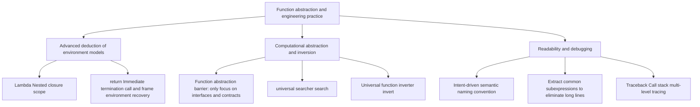

> **Course**: UC Berkeley CS61A (Fall 2024)  
> **Module**: Module 1: Functions & Abstraction  
> **Lecturer**: Prof. John DeNero (UC Berkeley)  
> **Video duration**: 30:05 ｜ **Classroom screenshots**: 14 pieces of blackboard writing/code demonstration  
> **Direct video**: [📺Watch the original video of this lecture on Bilibili (P7)](https://www.bilibili.com/video/BV1sy411z7nA/?p=7)  
> **Quick navigation**: [← Previous Lecture (P06 Lecture 6 Sound (Optional))](/en/notes/cs61a/lecture-06) ｜ [📚 Return to the full book catalog](/en/notes/topics/CS61A) ｜ [Next lecture (P08 Lecture 8 Function Examples) →](/en/notes/cs61a/lecture-08)

---

## 1. Midterm exam knowledge map and core specifications

*(Reference time: 00:00:30 · [Video jump (P7 00:00:30)](https://www.bilibili.com/video/BV1sy411z7nA/?p=7&t=30))*

Before entering this lecture, Professor DeNero sorted out the scope and study guide of the midterm exam (Midterm 1):
- **Scope of investigation**: Lecture 1 to Lecture 5 (expressions, control flow, function definition and high-order environment model).
- **Exam format**: Closed-book paper-and-pencil exam, providing an official carefully compiled Study Guide (covering all statement execution rules, built-in functions, and comprehensive sample questions on large-scale environment diagrams).
- **Suggestions on preparation for actual combat**: Complete the first phase (Phase 1) of the Lab, Discussion, Homework 2 and Hog assignments, and based on this, independently complete a previous year's exam question.

[](https://www.bilibili.com/video/BV1sy411z7nA/?p=7&t=55)
*⏱ Timestamp: 00:00:55 · 📷 Classroom screenshot · [Watch the corresponding clip on Bilibili (P7 00:00:55)](https://www.bilibili.com/video/BV1sy411z7nA/?p=7&t=55)*

#### 📸 In-depth reading of classroom blackboard writing and code demonstration (00:00:55)

**\[On-site blackboard writing/code demonstration restoration\]**:
At this time point, Professor DeNero conducted a core demonstration and key blackboard derivation on the screen:
> *“Midterm one is coming up next Monday. The format of the exam is a paper exam. You can see past exams here. We list them all. And you can expect the format of the exam to be similar to past exams, especially past fall semester exams. We will provide on paper the midterm one study guide, which looks l...”*

**\[Underlying computing model and micro execution mechanism\]**: 
1. **Execution context and timing tracing**: 
   - At the current discussion point "1. Midterm exam knowledge map and core specifications", the interpreter strictly follows the core evaluation specifications;
   - The expression evaluates the operators first, then evaluates the operands strictly from left to right, and finally applies the function object to the argument list;
   - If the environment model is involved, the local frame strictly records its static lexical parent pointer (Parent Pointer points to the environment where the function is defined), forming an orthogonal architecture with the dynamic call stack at runtime.
2. **Memory topology and object references**: 
   - Variable symbols are just keys in a hash table (environment frame), and pointers point directly to first-class citizen objects in heap memory;
   - Assignment statements are discrete-time snapshots of the state and never create implicit mathematical dependency monitoring.

**\[Guidelines for avoiding pitfalls and guidance on high-frequency test points\]**: 
- **Common misunderstandings**: In the exam questions related to "Abstract barrier, Newton's method approximation and inverse function high-order searcher", beginners can easily guess the results based on the surface form of the code, leading to scope confusion or variable shadowing (Shadowing) misjudgment;
- **The golden rule of debugging**: When encountering nested calls and complex branches, be sure to draw independent partial frames on the scratch paper, indicate the specific binding value of each formal parameter, and derive it step by step.


---

### In-depth formal specification and micro-evaluation process (Operational Semantics)
In the module "1. Midterm Examination Knowledge Map and Core Specifications", the underlying computer operations rely on strict formal evaluation logic:
1. **Hierarchical parsing of abstract syntax trees (AST)**: 
   - The source code character stream is first divided into terminal symbol tokens (Tokens) by the lexical analyzer (Lexer), and then constructed into a multi-fork syntax tree by the syntax parser (Parser);
   - Operator priority and associativity are solidified during the syntax tree construction phase, eliminating ambiguity at runtime;
2. **Dynamic transitions of environment chains**: 
   - Each function call generates a new frame whose static lexical environment is determined by the function object's  `parent`  Attributes are completely determined;
   - The variable search traces back up the environment chain in one direction until the global environment frame. If it is not found, it will be triggered.  `NameError`  Abnormal;
3. **State Invariants**: 
   - The key to writing robust programs is to clarify loop invariants (Loop Invariants) and function pre/post-conditions (Pre/Post-conditions);
   - In complex control flow jumps, ensure that state variables maintain legal business constraints before each iteration.


## 2. Advanced Environment Graph Challenge: Nested Lambda and Closure Scope Resolution

*(Reference time: 00:02:21 · [Video jump (P7 00:02:21)](https://www.bilibili.com/video/BV1sy411z7nA/?p=7&t=141))*

In order to test everyone's true understanding of the environment model, DeNero gave an extremely classic and confusing question:

```python
a = 1

def f(g):
    a = 2
    return lambda y: a * g(y)

result = f(lambda y: a + y)(a)
```

After this code is executed, `result`  What is the value of ?

[](https://www.bilibili.com/video/BV1sy411z7nA/?p=7&t=160)
*⏱ Timestamp: 00:02:40 · 📷 Classroom screenshot · [Watch the corresponding clip on Bilibili (P7 00:02:40)](https://www.bilibili.com/video/BV1sy411z7nA/?p=7&t=160)*

#### 📸 In-depth reading of classroom blackboard writing and code demonstration (00:02:40)

**\[On-site blackboard writing/code demonstration restoration\]**:
At this time point, Professor DeNero conducted a core demonstration and key blackboard derivation on the screen:
> *“Good luck. Let's look at an example of an environment diagram that includes lambda expressions and lambda functions. A lambda function's parent is the current frame in which the corresponding lambda expression is evaluated. So here's an example. Where we set a equal to 1, we define a new function f,...”*

**\[Underlying computing model and micro execution mechanism\]**: 
1. **Execution context and timing tracing**: 
   - At the current discussion point "2. Advanced Environment Graph Challenge: Nested Lambda and Closure Scope Resolution", the interpreter strictly follows the core evaluation protocol;
   - The expression evaluates the operators first, then evaluates the operands strictly from left to right, and finally applies the function object to the argument list;
   - If the environment model is involved, the local frame strictly records its static lexical parent pointer (Parent Pointer points to the environment where the function is defined), forming an orthogonal architecture with the dynamic call stack at runtime.
2. **Memory topology and object references**: 
   - Variable symbols are just keys in a hash table (environment frame), and pointers point directly to first-class citizen objects in heap memory;
   - Assignment statements are discrete-time snapshots of the state and never create implicit mathematical dependency monitoring.

**\[Guidelines for avoiding pitfalls and guidance on high-frequency test points\]**: 
- **Common misunderstandings**: In the exam questions related to "Abstract barrier, Newton's method approximation and inverse function high-order searcher", beginners can easily guess the results based on the surface form of the code, leading to scope confusion or variable shadowing (Shadowing) misjudgment;
- **The golden rule of debugging**: When encountering nested calls and complex branches, be sure to draw independent partial frames on the scratch paper, indicate the specific binding value of each formal parameter, and derive it step by step.


### Static lexical analysis (Lexical Analysis)

Before drawing a picture, first observe the position of each expression through indentation. **Where is it defined (when is it created)**: 
1. `lambda y: a + y`: in the outermost expression on line 6, **without any indentation**. So it is created in global frame and its parent frame is  `Global`! which is referenced internally  `a`  is a global variable  `a = 1`.
2. call arguments  `(a)`: Also in the outermost layer, so the actual parameters passed in are global  `a = 1`.
3. `lambda y: a * g(y)`: located in  `f`  inside the function body (line 4). when  `f`  When called, the currently active local frame is  `F1` (where local variables  `a = 2`), so the parent frame of the anonymous function is stamped as  `F1`! its internal  `a`  is a local variable  `a = 2`.

[](https://www.bilibili.com/video/BV1sy411z7nA/?p=7&t=300)
*⏱ Timestamp: 00:05:00 · 📷 Classroom screenshot · [Watch the corresponding clip on Bilibili (P7 00:05:00)](https://www.bilibili.com/video/BV1sy411z7nA/?p=7&t=300)*

#### 📸 In-depth reading of classroom blackboard writing and code demonstration (00:05:00)

**\[On-site blackboard writing/code demonstration restoration\]**:
At this time point, Professor DeNero conducted a core demonstration and key blackboard derivation on the screen:
> *“As assigned to one, f's bound to the f function, then we try to evaluate this expression. In order to do so, we have to evaluate its operator to figure out what function we're going to call. And that operator is itself a call expression where we evaluate f's. Okay, so we're calling this function and...”*

**\[Underlying computing model and micro execution mechanism\]**: 
1. **Execution context and timing tracing**: 
   - At the current discussion point "2. Advanced Environment Graph Challenge: Nested Lambda and Closure Scope Resolution", the interpreter strictly follows the core evaluation protocol;
   - The expression evaluates the operators first, then evaluates the operands strictly from left to right, and finally applies the function object to the argument list;
   - If the environment model is involved, the local frame strictly records its static lexical parent pointer (Parent Pointer points to the environment where the function is defined), forming an orthogonal architecture with the dynamic call stack at runtime.
2. **Memory topology and object references**: 
   - Variable symbols are just keys in a hash table (environment frame), and pointers point directly to first-class citizen objects in heap memory;
   - Assignment statements are discrete-time snapshots of the state and never create implicit mathematical dependency monitoring.

**\[Guidelines for avoiding pitfalls and guidance on high-frequency test points\]**: 
- **Common misunderstandings**: In the exam questions related to "Abstract barrier, Newton's method approximation and inverse function high-order searcher", beginners can easily guess the results based on the surface form of the code, leading to scope confusion or variable shadowing (Shadowing) misjudgment;
- **The golden rule of debugging**: When encountering nested calls and complex branches, be sure to draw independent partial frames on the scratch paper, indicate the specific binding value of each formal parameter, and derive it step by step.


### Runtime environment graph tracking (Step-by-Step)

1. **global frame**: `a: 1`, `f: func f(g) [parent=Global]`.
2. **execute  `f(...)`**: 
   - First the actual parameters  `lambda y: a + y`  Evaluate and generate an anonymous function object  `λ1 [parent=Global]`.
   - call  `f(λ1)`, create a local frame  `F1`. formal parameters  `g`  bound as  `λ1`.
   - in  `F1`  executed in  `a = 2` (local assignment, **Never affects the global a=1**).
   - in  `F1`  Create and return another anonymous function in  `λ2 [parent=F1]`.
3. **Execute outer layer call  `λ2(1)`**: 
   - for  `λ2`  Create partial frame  `F2` (The parent frame inherits as  `F1`), formal parameters  `y`  bound as  `1`.
   - Execute function body  `a * g(y)`: 
     - Find  `a`: In the current environment  `[F2 -> F1 -> Global]`  middle, first frame  `F2`  None  `a`, enter the parent frame  `F1`  found  `a = 2`.
     - Find  `g`: in  `F1`  found in  `g = λ1`.
     - call  `g(1)`:Create partial frame  `F3`.**Note: Because the parent frame of λ1 is Global, the parent frame of F3 is Global, not F1 or F2**!
     - in  `F3`  environment  `[F3 -> Global]`  executed in  `a + y`: `a`  from  `Global` (value is 1), `y`  is 1, returns  `1 + 1 = 2`.
   - return to  `F2`: Calculation  `a * g(y) = 2 * 2 = 4`.

Finally, `result`  The value is  **`4`**!

[](https://www.bilibili.com/video/BV1sy411z7nA/?p=7&t=410)
*⏱ Timestamp: 00:06:50 · 📷 Classroom screenshot · [Watch the corresponding clip on Bilibili (P7 00:06:50)](https://www.bilibili.com/video/BV1sy411z7nA/?p=7&t=410)*

#### 📸 In-depth reading of classroom blackboard writing and code demonstration (00:06:50)

**\[On-site blackboard writing/code demonstration restoration\]**:
At this time point, Professor DeNero conducted a core demonstration and key blackboard derivation on the screen:
> *“Well, we have to go look up its body. This one, A times G of Y. What's A? We look here, and there's no A, so we look in the parent, A is 2. And what's G times Y? Well, we have to figure out what G is. There's no G here, so we look in the parent, there's G. We're going to call G on the number 1, and ...”*

**\[Underlying computing model and micro execution mechanism\]**: 
1. **Execution context and timing tracing**: 
   - At the current discussion point "2. Advanced Environment Graph Challenge: Nested Lambda and Closure Scope Resolution", the interpreter strictly follows the core evaluation protocol;
   - The expression evaluates the operators first, then evaluates the operands strictly from left to right, and finally applies the function object to the argument list;
   - If the environment model is involved, the local frame strictly records its static lexical parent pointer (Parent Pointer points to the environment where the function is defined), forming an orthogonal architecture with the dynamic call stack at runtime.
2. **Memory topology and object references**: 
   - Variable symbols are just keys in a hash table (environment frame), and pointers point directly to first-class citizen objects in heap memory;
   - Assignment statements are discrete-time snapshots of the state and never create implicit mathematical dependency monitoring.

**\[Guidelines for avoiding pitfalls and guidance on high-frequency test points\]**: 
- **Common misunderstandings**: In the exam questions related to "Abstract barrier, Newton's method approximation and inverse function high-order searcher", beginners can easily guess the results based on the surface form of the code, leading to scope confusion or variable shadowing (Shadowing) misjudgment;
- **The golden rule of debugging**: When encountering nested calls and complex branches, be sure to draw independent partial frames on the scratch paper, indicate the specific binding value of each formal parameter, and derive it step by step.


---

### In-depth formal specification and micro-evaluation process (Operational Semantics)
In the "2. Advanced Environment Graph Challenge: Nested Lambda and Closure Scope Analysis" module, the underlying computer operations rely on strict formal evaluation logic:
1. **Hierarchical parsing of abstract syntax trees (AST)**: 
   - The source code character stream is first divided into terminal symbol tokens (Tokens) by the lexical analyzer (Lexer), and then constructed into a multi-fork syntax tree by the syntax parser (Parser);
   - Operator priority and associativity are solidified during the syntax tree construction phase, eliminating ambiguity at runtime;
2. **Dynamic transitions of environment chains**: 
   - Each function call generates a new frame whose static lexical environment is determined by the function object's  `parent`  Attributes are completely determined;
   - The variable search traces back up the environment chain in one direction until the global environment frame. If it is not found, it will be triggered.  `NameError`  Abnormal;
3. **State Invariants**: 
   - The key to writing robust programs is to clarify loop invariants (Loop Invariants) and function pre/post-conditions (Pre/Post-conditions);
   - In complex control flow jumps, ensure that state variables maintain legal business constraints before each iteration.


## 3. Return statement execution rules and loop early exit

*(Reference time: 00:07:40 · [Video jump (P7 00:07:40)](https://www.bilibili.com/video/BV1sy411z7nA/?p=7&t=460))*

`return`  The core responsibility of a statement is **End the current function call and deliver the result to the caller**.

> **The environment switching principle of calling and returning**:
When a calling expression is encountered, the interpreter switches to the newly created local environment to execute the function body; once executed  `return`  statement, interpreter **Immediately destroy/freeze the current local context and switch back to the external environment when the call occurred**, and substitute the value of the returned expression into the location of the calling expression.

[](https://www.bilibili.com/video/BV1sy411z7nA/?p=7&t=520)
*⏱ Timestamp: 00:08:40 · 📷 Classroom screenshot · [Watch the corresponding clip on Bilibili (P7 00:08:40)](https://www.bilibili.com/video/BV1sy411z7nA/?p=7&t=520)*

#### 📸 In-depth reading of classroom blackboard writing and code demonstration (00:08:40)

**\[On-site blackboard writing/code demonstration restoration\]**:
At this time point, Professor DeNero conducted a core demonstration and key blackboard derivation on the screen:
> *“When you reach a call expression like f of x for some user-defined function f, that's when you switch to a new environment, and it's time to execute f's body. Why are we doing all this work? In order to figure out what's the value of f of x. When the return statement within f is reached, we switch b...”*

**\[Underlying computing model and micro execution mechanism\]**: 
1. **Execution context and timing tracing**: 
   - At the current discussion point "3. Return statement execution rules and early exit of loops", the interpreter strictly follows the core evaluation protocol;
   - The expression evaluates the operators first, then evaluates the operands strictly from left to right, and finally applies the function object to the argument list;
   - If the environment model is involved, the local frame strictly records its static lexical parent pointer (Parent Pointer points to the environment where the function is defined), forming an orthogonal architecture with the dynamic call stack at runtime.
2. **Memory topology and object references**: 
   - Variable symbols are just keys in a hash table (environment frame), and pointers point directly to first-class citizen objects in heap memory;
   - Assignment statements are discrete-time snapshots of the state and never create implicit mathematical dependency monitoring.

**\[Guidelines for avoiding pitfalls and guidance on high-frequency test points\]**: 
- **Common misunderstandings**: In the exam questions related to "Abstract barrier, Newton's method approximation and inverse function high-order searcher", beginners can easily guess the results based on the surface form of the code, leading to scope confusion or variable shadowing (Shadowing) misjudgment;
- **The golden rule of debugging**: When encountering nested calls and complex branches, be sure to draw independent partial frames on the scratch paper, indicate the specific binding value of each formal parameter, and derive it step by step.


### Classic trick: Use return to interrupt early in a while loop

When writing search or number processing functions, we often need to jump out of the entire function as soon as a condition is hit, without waiting for the loop to finish naturally.

Print integer numbers from low-order to high-order, and when encountering the specified number  $d$  For example, a function that terminates when:

```python
def end(n, d):
    """倒序打印 n 的各位数字，直到遇到 d 为止。

    >>> end(34567, 5)
    7
    6
    5
    """
    while n > 0:
        last, n = n % 10, n // 10
        print(last)
        if last == d:
            return None
```

As long as  `last == d`  established, `return None`  will immediately end the entire  `end`  Execution of the function, subsequent loop iterations and code blocks are completely skipped.

[](https://www.bilibili.com/video/BV1sy411z7nA/?p=7&t=600)
*⏱ Timestamp: 00:10:00 · 📷 Classroom screenshot · [Watch the corresponding clip on Bilibili (P7 00:10:00)](https://www.bilibili.com/video/BV1sy411z7nA/?p=7&t=600)*

#### 📸 In-depth reading of classroom blackboard writing and code demonstration (00:10:00)

**\[On-site blackboard writing/code demonstration restoration\]**:
At this time point, Professor DeNero conducted a core demonstration and key blackboard derivation on the screen:
> *“How would we write this function? Well, one simple way to do it is to write a while statement that just prints all of the digits, 7, 6, 5, 4, 3. The approach here is to say that while n is greater than zero, we split n up into its last digit and everything but the last digit, print the last one out....”*

**\[Underlying computing model and micro execution mechanism\]**: 
1. **Execution context and timing tracing**: 
   - At the current discussion point "3. Return statement execution rules and early exit of loops", the interpreter strictly follows the core evaluation protocol;
   - The expression evaluates the operators first, then evaluates the operands strictly from left to right, and finally applies the function object to the argument list;
   - If the environment model is involved, the local frame strictly records its static lexical parent pointer (Parent Pointer points to the environment where the function is defined), forming an orthogonal architecture with the dynamic call stack at runtime.
2. **Memory topology and object references**: 
   - Variable symbols are just keys in a hash table (environment frame), and pointers point directly to first-class citizen objects in heap memory;
   - Assignment statements are discrete-time snapshots of the state and never create implicit mathematical dependency monitoring.

**\[Guidelines for avoiding pitfalls and guidance on high-frequency test points\]**: 
- **Common misunderstandings**: In the exam questions related to "Abstract barrier, Newton's method approximation and inverse function high-order searcher", beginners can easily guess the results based on the surface form of the code, leading to scope confusion or variable shadowing (Shadowing) misjudgment;
- **The golden rule of debugging**: When encountering nested calls and complex branches, be sure to draw independent partial frames on the scratch paper, indicate the specific binding value of each formal parameter, and derive it step by step.


---

### In-depth formal specification and micro-evaluation process (Operational Semantics)
In the module "3. Return Statement Execution Rules and Early Exit of Loops", the underlying computer operations rely on strict formal evaluation logic:
1. **Hierarchical parsing of abstract syntax trees (AST)**: 
   - The source code character stream is first divided into terminal symbol tokens (Tokens) by the lexical analyzer (Lexer), and then constructed into a multi-fork syntax tree by the syntax parser (Parser);
   - Operator priority and associativity are solidified during the syntax tree construction phase, eliminating ambiguity at runtime;
2. **Dynamic transitions of environment chains**: 
   - Each function call generates a new frame whose static lexical environment is determined by the function object's  `parent`  Attributes are completely determined;
   - The variable search traces back up the environment chain in one direction until the global environment frame. If it is not found, it will be triggered.  `NameError`  Abnormal;
3. **State Invariants**: 
   - The key to writing robust programs is to clarify loop invariants (Loop Invariants) and function pre/post-conditions (Pre/Post-conditions);
   - In complex control flow jumps, ensure that state variables maintain legal business constraints before each iteration.


## 4. High-order searcher and automatic function inversion (Function Inversion)

*(Reference time: 00:10:30 · [Video jump (P7 00:10:30)](https://www.bilibili.com/video/BV1sy411z7nA/?p=7&t=630))*

Underlying many seemingly complex mathematical algorithms is a general search process. We can define a general higher-order searcher  `search`: 

```python
def search(f):
    """寻找使 f(x) 为真值的最小非负整数 x。"""
    x = 0
    while not f(x):
        x += 1
    return x
```

[](https://www.bilibili.com/video/BV1sy411z7nA/?p=7&t=690)
*⏱ Timestamp: 00:11:30 · 📷 Classroom screenshot · [Watch the corresponding clip on Bilibili (P7 00:11:30)](https://www.bilibili.com/video/BV1sy411z7nA/?p=7&t=690)*

#### 📸 In-depth reading of classroom blackboard writing and code demonstration (00:11:30)

**\[On-site blackboard writing/code demonstration restoration\]**:
At this time point, Professor DeNero conducted a core demonstration and key blackboard derivation on the screen:
> *“One way to do that is to purposefully construct an infinite loop. This while statement will run forever unless a return statement within it tells us that we're done. While true, if it's the case that f of x is a true value, I want to return x. If that's not the case, I want to try a different x. I c...”*

**\[Underlying computing model and micro execution mechanism\]**: 
1. **Execution context and timing tracing**: 
   - At the current discussion point "4. High-order searcher and automatic function inversion (Function Inversion)", the interpreter strictly follows the core evaluation protocol;
   - The expression evaluates the operators first, then evaluates the operands strictly from left to right, and finally applies the function object to the argument list;
   - If the environment model is involved, the local frame strictly records its static lexical parent pointer (Parent Pointer points to the environment where the function is defined), forming an orthogonal architecture with the dynamic call stack at runtime.
2. **Memory topology and object references**: 
   - Variable symbols are just keys in a hash table (environment frame), and pointers point directly to first-class citizen objects in heap memory;
   - Assignment statements are discrete-time snapshots of the state and never create implicit mathematical dependency monitoring.

**\[Guidelines for avoiding pitfalls and guidance on high-frequency test points\]**: 
- **Common misunderstandings**: In the exam questions related to "Abstract barrier, Newton's method approximation and inverse function high-order searcher", beginners can easily guess the results based on the surface form of the code, leading to scope confusion or variable shadowing (Shadowing) misjudgment;
- **The golden rule of debugging**: When encountering nested calls and complex branches, be sure to draw independent partial frames on the scratch paper, indicate the specific binding value of each formal parameter, and derive it step by step.


### General operator for function inversion: invert

In mathematics, a function  $f$  inverse function of  $g = f^{-1}$  satisfy  $g(y) = x \iff f(x) = y$.

Use advanced search engines  `search`, we only need 3 lines of code to construct a **Universal function inverter**: 

```python
def invert(f):
    """返回单调递增函数 f 的反函数。"""
    return lambda y: search(lambda x: f(x) == y)
```

### Zero math library implements square roots

We don't even need to call any math library, we can directly invert the square function to get the square root:

```python
square = lambda x: x * x
sqrt = invert(square)

sqrt(16)   # 4
sqrt(256)  # 16
sqrt(100)  # 10
```

> **Limitations and Extensions**: This minimalist integer search algorithm is very efficient for perfect square numbers. If you want to support the accurate square root of any real number, you need to use Newton's Method in numerical analysis. Its essence is still to use high-order functions to iteratively approach the zero point.

[](https://www.bilibili.com/video/BV1sy411z7nA/?p=7&t=830)
*⏱ Timestamp: 00:13:50 · 📷 Classroom screenshot · [Watch the corresponding clip on Bilibili (P7 00:13:50)](https://www.bilibili.com/video/BV1sy411z7nA/?p=7&t=830)*

#### 📸 In-depth reading of classroom blackboard writing and code demonstration (00:13:50)

**\[On-site blackboard writing/code demonstration restoration\]**:
At this time point, Professor DeNero conducted a core demonstration and key blackboard derivation on the screen:
> *“A method for computing square roots just by trying a bunch of numbers until I find it. This is a general strategy for computing inverse functions. The inverse of s is to return a g such that it's the case that f of x passed into g gives us back x. And how do we find such a g? Well, it's a function t...”*

**\[Underlying computing model and micro execution mechanism\]**: 
1. **Execution context and timing tracing**: 
   - At the current discussion point "4. High-order searcher and automatic function inversion (Function Inversion)", the interpreter strictly follows the core evaluation protocol;
   - The expression evaluates the operators first, then evaluates the operands strictly from left to right, and finally applies the function object to the argument list;
   - If the environment model is involved, the local frame strictly records its static lexical parent pointer (Parent Pointer points to the environment where the function is defined), forming an orthogonal architecture with the dynamic call stack at runtime.
2. **Memory topology and object references**: 
   - Variable symbols are just keys in a hash table (environment frame), and pointers point directly to first-class citizen objects in heap memory;
   - Assignment statements are discrete-time snapshots of the state and never create implicit mathematical dependency monitoring.

**\[Guidelines for avoiding pitfalls and guidance on high-frequency test points\]**: 
- **Common misunderstandings**: In the exam questions related to "Abstract barrier, Newton's method approximation and inverse function high-order searcher", beginners can easily guess the results based on the surface form of the code, leading to scope confusion or variable shadowing (Shadowing) misjudgment;
- **The golden rule of debugging**: When encountering nested calls and complex branches, be sure to draw independent partial frames on the scratch paper, indicate the specific binding value of each formal parameter, and derive it step by step.


---

### In-depth formal specification and micro-evaluation process (Operational Semantics)
In the "4. High-order searcher and automatic function inversion (Function Inversion)" module, the underlying computer operations rely on strict formal evaluation logic:
1. **Hierarchical parsing of abstract syntax trees (AST)**: 
   - The source code character stream is first divided into terminal symbol tokens (Tokens) by the lexical analyzer (Lexer), and then constructed into a multi-fork syntax tree by the syntax parser (Parser);
   - Operator priority and associativity are solidified during the syntax tree construction phase, eliminating ambiguity at runtime;
2. **Dynamic transitions of environment chains**: 
   - Each function call generates a new frame whose static lexical environment is determined by the function object's  `parent`  Attributes are completely determined;
   - The variable search traces back up the environment chain in one direction until the global environment frame. If it is not found, it will be triggered.  `NameError`  Abnormal;
3. **State Invariants**: 
   - The key to writing robust programs is to clarify loop invariants (Loop Invariants) and function pre/post-conditions (Pre/Post-conditions);
   - In complex control flow jumps, ensure that state variables maintain legal business constraints before each iteration.


## 5. The nature of function abstraction: What does the caller really need to know?

*(Reference time: 00:15:16 · [Video jump (P7 00:15:16)](https://www.bilibili.com/video/BV1sy411z7nA/?p=7&t=916))*

> **Functional Abstraction**: Give a name to a calculation process, and then use the process as a black box as a whole, and **No need to care about its internal implementation details**.

inspect call  `square`  upper level function  `sum_squares`: 

```python
def sum_squares(x, y):
    return square(x) + square(y)
```

about being called  `square`  function, caller  `sum_squares`  What exactly do you need to know?

[](https://www.bilibili.com/video/BV1sy411z7nA/?p=7&t=930)
*⏱ Timestamp: 00:15:30 · 📷 Classroom screenshot · [Watch the corresponding clip on Bilibili (P7 00:15:30)](https://www.bilibili.com/video/BV1sy411z7nA/?p=7&t=930)*

#### 📸 In-depth reading of classroom blackboard writing and code demonstration (00:15:30)

**\[On-site blackboard writing/code demonstration restoration\]**:
At this time point, Professor DeNero conducted a core demonstration and key blackboard derivation on the screen:
> *“So I think once you've written down an implementation for a function, it can't hurt to stare at it for a little while and see if there's some way to simplify the logic. Abstraction. So functional abstraction is giving a name to some computational process, and then referring to that process as a whol...”*

**\[Underlying computing model and micro execution mechanism\]**: 
1. **Execution context and timing tracing**: 
   - At the current discussion point "5. The nature of function abstraction: what does the caller really need to know?", the interpreter strictly follows the core evaluation convention;
   - The expression evaluates the operators first, then evaluates the operands strictly from left to right, and finally applies the function object to the argument list;
   - If the environment model is involved, the local frame strictly records its static lexical parent pointer (Parent Pointer points to the environment where the function is defined), forming an orthogonal architecture with the dynamic call stack at runtime.
2. **Memory topology and object references**: 
   - Variable symbols are just keys in a hash table (environment frame), and pointers point directly to first-class citizen objects in heap memory;
   - Assignment statements are discrete-time snapshots of the state and never create implicit mathematical dependency monitoring.

**\[Guidelines for avoiding pitfalls and guidance on high-frequency test points\]**: 
- **Common misunderstandings**: In the exam questions related to "Abstract barrier, Newton's method approximation and inverse function high-order searcher", beginners can easily guess the results based on the surface form of the code, leading to scope confusion or variable shadowing (Shadowing) misjudgment;
- **The golden rule of debugging**: When encountering nested calls and complex branches, be sure to draw independent partial frames on the scratch paper, indicate the specific binding value of each formal parameter, and derive it step by step.


| question item | Need to know? | Reason analysis |
| :--- | :---: | :--- |
| **Does square accept exactly 1 argument?** | **must know** | A mismatch in the number of parameters will result in the call being unable to be initiated correctly. |
| **Is the intrinsic name of square 'square'?** | **No need** | Regardless of whether the function's intrinsic name is lambda or something else, it only needs to be bound to square in the current environment. |
| **The calculation behavior of square (Behavior, that is, finding the square)?** | **must know** | The caller must clarify its functional contract to achieve the correct composition purpose |
| **square is used internally  `x*x`  Still  `pow(x, 2)`  Realized?** | **Never needed** | Internal implementation details are completely isolated by abstraction barrier |

---

### In-depth formal specification and micro-evaluation process (Operational Semantics)
In the "5. The Nature of Function Abstraction: What Does the Caller Really Need to Know?" module, the underlying computer operations rely on strict formal evaluation logic:
1. **Hierarchical parsing of abstract syntax trees (AST)**: 
   - The source code character stream is first divided into terminal symbol tokens (Tokens) by the lexical analyzer (Lexer), and then constructed into a multi-fork syntax tree by the syntax parser (Parser);
   - Operator priority and associativity are solidified during the syntax tree construction phase, eliminating ambiguity at runtime;
2. **Dynamic transitions of environment chains**: 
   - Each function call generates a new frame whose static lexical environment is determined by the function object's  `parent`  Attributes are completely determined;
   - The variable search traces back up the environment chain in one direction until the global environment frame. If it is not found, it will be triggered.  `NameError`  Abnormal;
3. **State Invariants**: 
   - The key to writing robust programs is to clarify loop invariants (Loop Invariants) and function pre/post-conditions (Pre/Post-conditions);
   - In complex control flow jumps, ensure that state variables maintain legal business constraints before each iteration.


## 6. Engineering Practice: Code Naming Standards and Bad Smell Identification

*(Reference time: 00:17:38 · [Video jump (P7 00:17:38)](https://www.bilibili.com/video/BV1sy411z7nA/?p=7&t=1058))*

Programs are written to be read by humans, but can be run by machines by the way. Reasonable naming can make the code have its own documentation properties.

[](https://www.bilibili.com/video/BV1sy411z7nA/?p=7&t=1120)
*⏱ Timestamp: 00:18:40 · 📷 Classroom screenshot · [Watch the corresponding clip on Bilibili (P7 00:18:40)](https://www.bilibili.com/video/BV1sy411z7nA/?p=7&t=1120)*

#### 📸 In-depth reading of classroom blackboard writing and code demonstration (00:18:40)

**\[On-site blackboard writing/code demonstration restoration\]**:
At this time point, Professor DeNero conducted a core demonstration and key blackboard derivation on the screen:
> *“Bound to the name, whether it's a number or a string, is best documented in a function's docstring, as opposed to the name that you bind to the value itself. And function names, the names that we give to our functions that we define, typically convey either their effect, such as printing, their beha...”*

**\[Underlying computing model and micro execution mechanism\]**: 
1. **Execution context and timing tracing**: 
   - At the current discussion point "6. Engineering Practice: Code Naming Standards and Bad Smell Identification", the interpreter strictly follows the core evaluation protocol;
   - The expression evaluates the operators first, then evaluates the operands strictly from left to right, and finally applies the function object to the argument list;
   - If the environment model is involved, the local frame strictly records its static lexical parent pointer (Parent Pointer points to the environment where the function is defined), forming an orthogonal architecture with the dynamic call stack at runtime.
2. **Memory topology and object references**: 
   - Variable symbols are just keys in a hash table (environment frame), and pointers point directly to first-class citizen objects in heap memory;
   - Assignment statements are discrete-time snapshots of the state and never create implicit mathematical dependency monitoring.

**\[Guidelines for avoiding pitfalls and guidance on high-frequency test points\]**: 
- **Common misunderstandings**: In the exam questions related to "Abstract barrier, Newton's method approximation and inverse function high-order searcher", beginners can easily guess the results based on the surface form of the code, leading to scope confusion or variable shadowing (Shadowing) misjudgment;
- **The golden rule of debugging**: When encountering nested calls and complex branches, be sure to draw independent partial frames on the scratch paper, indicate the specific binding value of each formal parameter, and derive it step by step.


### golden naming rule

1. **Describe meaning rather than type**: 
   - ❌ `true_false` $\longrightarrow$ ✅ `has_rolled_one`
   - ❌ `my_int` $\longrightarrow$ ✅ `num_rolls`
2. **Describe responsibilities rather than calling relationships**: 
   - ❌ `play_helper` $\longrightarrow$ ✅ `take_turn`
3. **Avoid visually confusing characters**: Try to avoid using lowercase letters for single-letter variables.  `l`, uppercase  `I`  or capitalized  `O`, take priority  `k`, `i`, `m`, `n`.
4. **Extract repeated compound long expressions**:
If a complex mathematical expression appears multiple times, extracting it and giving it a meaningful name not only eliminates duplicate code, but also greatly reduces the mental load:

```python
# 坏味道：冗长难以阅读
root1 = (-b + sqrt(b * b - 4 * a * c)) / (2 * a)
root2 = (-b - sqrt(b * b - 4 * a * c)) / (2 * a)

# 好风格：提取判别式（Discriminant）
discriminant = b * b - 4 * a * c
root1 = (-b + sqrt(discriminant)) / (2 * a)
root2 = (-b - sqrt(discriminant)) / (2 * a)
```

[](https://www.bilibili.com/video/BV1sy411z7nA/?p=7&t=1260)
*⏱ Timestamp: 00:21:00 · 📷 Classroom screenshot · [Watch the corresponding clip on Bilibili (P7 00:21:00)](https://www.bilibili.com/video/BV1sy411z7nA/?p=7&t=1260)*

#### 📸 In-depth reading of classroom blackboard writing and code demonstration (00:21:00)

**\[On-site blackboard writing/code demonstration restoration\]**:
At this time point, Professor DeNero conducted a core demonstration and key blackboard derivation on the screen:
> *“of a squared plus b squared, both in a conditional statement and in the assignment statement in the suite. It's probably better to give that thing a name and then use it twice. Here and there. So that if we need to change how we compute the hypotenuse in some way, we can do that all in one place. So...”*

**\[Underlying computing model and micro execution mechanism\]**: 
1. **Execution context and timing tracing**: 
   - At the current discussion point "6. Engineering Practice: Code Naming Standards and Bad Smell Identification", the interpreter strictly follows the core evaluation protocol;
   - The expression evaluates the operators first, then evaluates the operands strictly from left to right, and finally applies the function object to the argument list;
   - If the environment model is involved, the local frame strictly records its static lexical parent pointer (Parent Pointer points to the environment where the function is defined), forming an orthogonal architecture with the dynamic call stack at runtime.
2. **Memory topology and object references**: 
   - Variable symbols are just keys in a hash table (environment frame), and pointers point directly to first-class citizen objects in heap memory;
   - Assignment statements are discrete-time snapshots of the state and never create implicit mathematical dependency monitoring.

**\[Guidelines for avoiding pitfalls and guidance on high-frequency test points\]**: 
- **Common misunderstandings**: In the exam questions related to "Abstract barrier, Newton's method approximation and inverse function high-order searcher", beginners can easily guess the results based on the surface form of the code, leading to scope confusion or variable shadowing (Shadowing) misjudgment;
- **The golden rule of debugging**: When encountering nested calls and complex branches, be sure to draw independent partial frames on the scratch paper, indicate the specific binding value of each formal parameter, and derive it step by step.


---

### In-depth formal specification and micro-evaluation process (Operational Semantics)
In the "6. Engineering Practice: Code Naming Standards and Bad Smell Identification" module, the underlying computer operations rely on strict formal evaluation logic:
1. **Hierarchical parsing of abstract syntax trees (AST)**: 
   - The source code character stream is first divided into terminal symbol tokens (Tokens) by the lexical analyzer (Lexer), and then constructed into a multi-fork syntax tree by the syntax parser (Parser);
   - Operator priority and associativity are solidified during the syntax tree construction phase, eliminating ambiguity at runtime;
2. **Dynamic transitions of environment chains**: 
   - Each function call generates a new frame whose static lexical environment is determined by the function object's  `parent`  Attributes are completely determined;
   - The variable search traces back up the environment chain in one direction until the global environment frame. If it is not found, it will be triggered.  `NameError`  Abnormal;
3. **State Invariants**: 
   - The key to writing robust programs is to clarify loop invariants (Loop Invariants) and function pre/post-conditions (Pre/Post-conditions);
   - In complex control flow jumps, ensure that state variables maintain legal business constraints before each iteration.


## 7. Three-part classification of program errors and dismantling of Traceback call stack

*(Reference time: 00:22:51 · [Video jump (P7 00:22:51)](https://www.bilibili.com/video/BV1sy411z7nA/?p=7&t=1371))*

Bugs in Python are mainly divided into three categories:
1. **Syntax Errors**: The code does not comply with the language grammar rules (such as mismatched brackets, combined use of operators). It will be intercepted by the parser before the program is officially run.
2. **Runtime Errors**: The syntax is correct, but illegal operations are encountered during execution (such as division by zero, type mismatch  `TypeError`, undefined name  `NameError`).
3. **Logical Errors**: The program runs smoothly without reporting an error, but the calculation results are completely wrong. Can only be discovered through unit tests (such as Doctest).

[](https://www.bilibili.com/video/BV1sy411z7nA/?p=7&t=1420)
*⏱ Timestamp: 00:23:40 · 📷 Classroom screenshot · [Watch the corresponding clip on Bilibili (P7 00:23:40)](https://www.bilibili.com/video/BV1sy411z7nA/?p=7&t=1420)*

#### 📸 In-depth reading of classroom blackboard writing and code demonstration (00:23:40)

**\[On-site blackboard writing/code demonstration restoration\]**:
At this time point, Professor DeNero conducted a core demonstration and key blackboard derivation on the screen:
> *“And they're caused by having expressions that aren't formed well. The syntax of a language is its form, which requires that every opening parenthesis has a closing parenthesis and that a plus sign has to come between two expressions. It can't come at the beginning. These kinds of things. The second ...”*

**\[Underlying computing model and micro execution mechanism\]**: 
1. **Execution context and timing tracing**: 
   - At the current discussion point "7. Three-part classification of program errors and disassembly of Traceback call stack", the interpreter strictly follows the core evaluation protocol;
   - The expression evaluates the operators first, then evaluates the operands strictly from left to right, and finally applies the function object to the argument list;
   - If the environment model is involved, the local frame strictly records its static lexical parent pointer (Parent Pointer points to the environment where the function is defined), forming an orthogonal architecture with the dynamic call stack at runtime.
2. **Memory topology and object references**: 
   - Variable symbols are just keys in a hash table (environment frame), and pointers point directly to first-class citizen objects in heap memory;
   - Assignment statements are discrete-time snapshots of the state and never create implicit mathematical dependency monitoring.

**\[Guidelines for avoiding pitfalls and guidance on high-frequency test points\]**: 
- **Common misunderstandings**: In the exam questions related to "Abstract barrier, Newton's method approximation and inverse function high-order searcher", beginners can easily guess the results based on the surface form of the code, leading to scope confusion or variable shadowing (Shadowing) misjudgment;
- **The golden rule of debugging**: When encountering nested calls and complex branches, be sure to draw independent partial frames on the scratch paper, indicate the specific binding value of each formal parameter, and derive it step by step.


### How to read traceback information professionally?

When a runtime error occurs, a Traceback is printed to the terminal. Many novices tend to only read the last line, but the correct reading method is **Top-down reconstruction of the call chain**: 

[](https://www.bilibili.com/video/BV1sy411z7nA/?p=7&t=1560)
*⏱ Timestamp: 00:26:00 · 📷 Classroom screenshot · [Watch the corresponding clip on Bilibili (P7 00:26:00)](https://www.bilibili.com/video/BV1sy411z7nA/?p=7&t=1560)*

#### 📸 In-depth reading of classroom blackboard writing and code demonstration (00:26:00)

**\[On-site blackboard writing/code demonstration restoration\]**:
At this time point, Professor DeNero conducted a core demonstration and key blackboard derivation on the screen:
> *“I opened a parenthesis and never closed it up here. So Python was expecting that whatever appeared on this line was part of the abs expression that I had never finished. And you can't have a def in the middle of a call to abs. So sometimes when you see a syntax error, in fact, the error is nearby. A...”*

**\[Underlying computing model and micro execution mechanism\]**: 
1. **Execution context and timing tracing**: 
   - At the current discussion point "7. Three-part classification of program errors and disassembly of Traceback call stack", the interpreter strictly follows the core evaluation protocol;
   - The expression evaluates the operators first, then evaluates the operands strictly from left to right, and finally applies the function object to the argument list;
   - If the environment model is involved, the local frame strictly records its static lexical parent pointer (Parent Pointer points to the environment where the function is defined), forming an orthogonal architecture with the dynamic call stack at runtime.
2. **Memory topology and object references**: 
   - Variable symbols are just keys in a hash table (environment frame), and pointers point directly to first-class citizen objects in heap memory;
   - Assignment statements are discrete-time snapshots of the state and never create implicit mathematical dependency monitoring.

**\[Guidelines for avoiding pitfalls and guidance on high-frequency test points\]**: 
- **Common misunderstandings**: In the exam questions related to "Abstract barrier, Newton's method approximation and inverse function high-order searcher", beginners can easily guess the results based on the surface form of the code, leading to scope confusion or variable shadowing (Shadowing) misjudgment;
- **The golden rule of debugging**: When encountering nested calls and complex branches, be sure to draw independent partial frames on the scratch paper, indicate the specific binding value of each formal parameter, and derive it step by step.


1. **outermost entrance**: Observe which line of global code (such as  `print(f(12))`) triggered a chain reaction.
2. **intermediate delivery chain**: `f`  called  `g`, `g`  Calling  `h`.
3. **live capture point**: The last line indicates the specific line of code that threw the exception.
4. **Root cause positioning principle**: **The scene where the error is reported is often not the place where the bug originated.**!

### Classic case: Chain disaster caused by missing return

```python
def h(z):
    z * z  # 忘记写 return！默认返回了 None

def g(y):
    return h(y) - h(1 / y)
```

When executing, the error point stays at  `g`  On internal subtraction: 
`TypeError: unsupported operand type(s) for -: 'NoneType' and 'NoneType'`.

if you are only  `g`  If you look for subtraction problems in it, you will be puzzled; the real problem lies in  `h`  not written  `return`, quietly returned  `None`!

[](https://www.bilibili.com/video/BV1sy411z7nA/?p=7&t=1695)
*⏱ Timestamp: 00:28:15 · 📷 Classroom screenshot · [Watch the corresponding clip on Bilibili (P7 00:28:15)](https://www.bilibili.com/video/BV1sy411z7nA/?p=7&t=1695)*

#### 📸 In-depth reading of classroom blackboard writing and code demonstration (00:28:15)

**\[On-site blackboard writing/code demonstration restoration\]**:
At this time point, Professor DeNero conducted a core demonstration and key blackboard derivation on the screen:
> *“And it hadn't completed yet. It was in the process of executing f's body, and this line in f's body, which said call g of x minus one, when the error occurred. And in fact, that's not the only thing that was going on. Python was also trying to find the value of print f of 12. In order to do that, it...”*

**\[Underlying computing model and micro execution mechanism\]**: 
1. **Execution context and timing tracing**: 
   - At the current discussion point "7. Three-part classification of program errors and disassembly of Traceback call stack", the interpreter strictly follows the core evaluation protocol;
   - The expression evaluates the operators first, then evaluates the operands strictly from left to right, and finally applies the function object to the argument list;
   - If the environment model is involved, the local frame strictly records its static lexical parent pointer (Parent Pointer points to the environment where the function is defined), forming an orthogonal architecture with the dynamic call stack at runtime.
2. **Memory topology and object references**: 
   - Variable symbols are just keys in a hash table (environment frame), and pointers point directly to first-class citizen objects in heap memory;
   - Assignment statements are discrete-time snapshots of the state and never create implicit mathematical dependency monitoring.

**\[Guidelines for avoiding pitfalls and guidance on high-frequency test points\]**: 
- **Common misunderstandings**: In the exam questions related to "Abstract barrier, Newton's method approximation and inverse function high-order searcher", beginners can easily guess the results based on the surface form of the code, leading to scope confusion or variable shadowing (Shadowing) misjudgment;
- **The golden rule of debugging**: When encountering nested calls and complex branches, be sure to draw independent partial frames on the scratch paper, indicate the specific binding value of each formal parameter, and derive it step by step.


---

### In-depth formal specification and micro-evaluation process (Operational Semantics)
In the module "7. Three-Part Classification of Program Errors and Traceback Call Stack Disassembly", the underlying computer operations rely on strict formal evaluation logic:
1. **Hierarchical parsing of abstract syntax trees (AST)**: 
   - The source code character stream is first divided into terminal symbol tokens (Tokens) by the lexical analyzer (Lexer), and then constructed into a multi-fork syntax tree by the syntax parser (Parser);
   - Operator priority and associativity are solidified during the syntax tree construction phase, eliminating ambiguity at runtime;
2. **Dynamic transitions of environment chains**: 
   - Each function call generates a new frame whose static lexical environment is determined by the function object's  `parent`  Attributes are completely determined;
   - The variable search traces back up the environment chain in one direction until the global environment frame. If it is not found, it will be triggered.  `NameError`  Abnormal;
3. **State Invariants**: 
   - The key to writing robust programs is to clarify loop invariants (Loop Invariants) and function pre/post-conditions (Pre/Post-conditions);
   - In complex control flow jumps, ensure that state variables maintain legal business constraints before each iteration.


## 8. Summary and core mind map of this lecture



### In-depth formal specification and micro-evaluation process (Operational Semantics)
In the "8. Lecture Summary and Core Mind Map" module, the underlying computer operations rely on strict formal evaluation logic:
1. **Hierarchical parsing of abstract syntax trees (AST)**: 
   - The source code character stream is first divided into terminal symbol tokens (Tokens) by the lexical analyzer (Lexer), and then constructed into a multi-fork syntax tree by the syntax parser (Parser);
   - Operator priority and associativity are solidified during the syntax tree construction phase, eliminating ambiguity at runtime;
2. **Dynamic transitions of environment chains**: 
   - Each function call generates a new frame whose static lexical environment is determined by the function object's  `parent`  Attributes are completely determined;
   - The variable search traces back up the environment chain in one direction until the global environment frame. If it is not found, it will be triggered.  `NameError`  Abnormal;
3. **State Invariants**: 
   - The key to writing robust programs is to clarify loop invariants (Loop Invariants) and function pre/post-conditions (Pre/Post-conditions);
   - In complex control flow jumps, ensure that state variables maintain legal business constraints before each iteration.


---

## Berkeley Midterm/Final classic high-frequency exam questions in-depth practice

### Practical exam questions: Environment topology and microstate tracking (WWPD & Environment Diagrams)
Consider the following microscopic execution of Python code in an interactive environment:

```python
# 经典作用域与高阶函数综合考题
x = 10

def outer(x):
    y = x + 2
    def inner(y):
        return x + y
    return inner

f = outer(5)
result = f(3)
```

#### Complete problem-solving thinking model and multi-frame environment map derivation:
1. **Global Frame initialization**: 
   - global variables  `x`  Bind to integer object  `10`; 
   - global function  `outer`  Binds to the newly created function object whose embedded  `parent = Global`; 
2. **execute  `f = outer(5)`**: 
   - create a local frame  $f_1$, mark  `f1: outer [parent=Global]`; 
   - formal parameters  `x`  Bind to actual parameters  `5`; 
   - local variables  `y`  bind to  `5 + 2 = 7`; 
   - in  $f_1$  internal execution  `def inner(y):`, create a function object  `inner`, its embedded  **`parent = f1`**; 
   - Return function object  `inner`, global variables  `f`  Bind to this object;
3. **execute  `result = f(3)`**: 
   - call function  `f` (i.e.  `inner`), open up a local frame  $f_2$; 
   - **core scoring points**:frame  $f_2$  Who does parent point to?
   - **iron law**: function  `inner`  is in frame  $f_1$  is defined internally, so  $f_2$  of  **`parent = f1`**!
   - formal parameters  `y`  Bind to actual parameters  `3`; 
   - executor  `return x + y`: 
     - in current frame  $f_2$  Find  `y`: Hit local variable  `y = 3`; 
     - in current frame  $f_2$  Find  `x`: miss, trace back along parent  **$f_1$  frame**  Find it!
     - in  $f_1$  hit in frame  `x = 5` (Global  `x = 10`  Partially obscured! );
     - Calculate  `5 + 3 = 8`, as the return value;
4. **Final output conclusion**: 
   - global variables  `result = 8`.

---

## Knowledge Matrix of the core concepts of this lecture

| core knowledge dimension | Formal definition and mechanism | Typical code examples | Core Engineering and Algorithm Value | Common pitfalls |
| :--- | :--- | :--- | :--- | :--- |
| **Basic evaluation semantics** | The expression is evaluated to obtain a value, and the execution of the statement changes the internal state. | `x = 2 + 3` | Build a discrete-time state snapshot mental model | Mistaking the assignment equal sign as a dynamic constraint on an algebraic equation |
| **Environment frame topology** | The environment is an ordered chain of frames | `Global -> f1 -> f2` | Implement safe isolation of lexical scope and variables | Confusing the caller stack frame with the parent environment pointer at the definition point |
| **abstract barrier** | Isolate implementation details and calling logic through functional interfaces | `def square(x): ...` | Reduce cognitive load on large-scale systems | Destroying interfaces directly relies on underlying private data structures |
| **control flow decisions** | Conditional branch short-circuit evaluation and loop iteration progression | `if cond: ... while: ...` | Give programs non-linear decision-making and large-scale data processing capabilities | Missing the loop progression variable causes an infinite loop |
| **higher level abilities** | Functions as first-class citizens (parameter passing, return, assignment) | `make_adder(3)` | Implement factory pattern, closure persistent state and currying | Closure late binding throws loop variable capture error |

---

## Course navigation and jump

| Previous lecture | Directory | Next lecture | Original video |
| :--- | :---: | :--- | :--- |
| [← Previous lecture: Lecture 6 Sound (Optional)](/en/notes/cs61a/lecture-06) | [📚 Return to CS61A complete book list](/en/notes/topics/CS61A) | [Next lecture: Lecture 8 Function Examples →](/en/notes/cs61a/lecture-08) | [🎬Watch this lecture on Bilibili (P7)](https://www.bilibili.com/video/BV1sy411z7nA/?p=7) |
