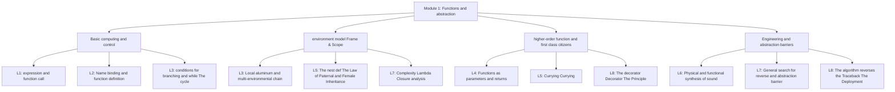

> **Earlier edition:** The Chinese edition was expanded on 22 October 2026. This English translation covers the previous edition. [Read the updated Chinese lecture](/notes/cs61a/lecture-08).

> **English original course**: CS 61A: Structure and Interpretation of Computer Programs (Fall 2024)  
> **Lecturer**: Prof. John DeNero (UC Berkeley)  
> **Text and illustrations**: VideoBook video to image to text technology e-book assembly line  
> **course coverage**: 37 / 37 on 18.2 hour audio/video instruction ⁇ 577 high-level lecture screenshots  
> **Online catalog**: [CS61A Special Catalog](/en/notes/topics/CS61A)

---


> **Lecture**: John DeNero ｜ **duration**: 34:16 ｜ **Video link back**: [Single episode corresponding to station B (P8)](https://www.bilibili.com/video/BV1sy411z7nA/?p=8)

## 1. Analysis of midterm exam questions and “What does Python print” (WWPP)

*reference timestamp: 00:01:24...  [Watch clip (P8 00:01:24)](https://www.bilibili.com/video/BV1sy411z7nA/?p=8&t=84))*

The focus of the midterm exam (Midterm 1) is to test your understanding of **Language Inline evaluation Accurate interpretation of the rules** with **Ability to use basic tools to solve new problems**.

The most classic question type is  **“What Would Python Print?” (WWPP)**: Enter a complex nested code in the interactive interpreter, predict what the terminal will output, and why expression will eventually evaluation.

The absolute iron rule for doing WWPP questions: **Strictly separate Display from Display expression evaluation (Value)”**!


*⏱ Timestamp: 00:03:00 · 📷 Lecture screenshot · [Watch clip (P8 00:03:00)](https://www.bilibili.com/video/BV1sy411z7nA/?p=8&t=180)*

| expression | evaluation Results (Value) | Interactive Output |
| :--- | :---: | :---: |
| `5` | `5` | `5` |
| `print(5)` | `None` | `5` (Note: None is hidden and not displayed by default in interactive terminals) |
| `print(print(5))` | `None` | `5`<br>`None` (First seek the internal parameter output 5, and then print the external return value None) |


*⏱ Timestamp: 00:04:15 · 📷 Lecture screenshot · [Watch clip (P8 00:04:15)](https://www.bilibili.com/video/BV1sy411z7nA/?p=8&t=255)*

---

## 2. Closures and Chained Calls: delay and pirate

*reference timestamp: 00:04:22...  [Watch clip (P8 00:04:22)](https://www.bilibili.com/video/BV1sy411z7nA/?p=8&t=262))*

### Subject 1: Delay calls with closurescope

```python
def delay(arg):
    print("delayed")
    def g():
        return arg
    return g
```

The following is a chain call:
```python
delay(delay)()(6)()
```


*⏱ Timestamp: 00:06:40 · 📷 Lecture screenshot · [Watch clip (P8 00:06:40)](https://www.bilibili.com/video/BV1sy411z7nA/?p=8&t=400)*

#### The analysis is broken down by layer

1. `delay(delay)`: 
   - call  `delay` It's a little bit of a mess.
   - Printed: `delayed`.
   - Returns an inner layer function  `g` The closure was captured.  `arg = delay`.
2. `delay(delay)()`: 
   - Calling for  `g()` And they return to their records.  `arg` It's the  `delay`  The function itself.
3. `delay(delay)()(6)`: 
   - That's what I mean.  `delay(6)`.
   - Printed: `delayed`.
   - Returning the new function  `g` The closure was captured.  `arg = 6`.
4. `delay(delay)()(6)()`: 
   - Calling for  `g()`, return  `6`.
   - The end of the terminal prints the value of the expression  `6`.

**The final output**: 
```text
delayed
delayed
6
```

---

### Subject 2: Parameters of the same name shielding and constant transformation (pirate)

```python
def pirate(arg):
    print("matey")
    def plunder(arg):
        return arg
    return plunder
```


*⏱ Timestamp: 00:09:10 · 📷 Lecture screenshot · [Watch clip (P8 00:09:10)](https://www.bilibili.com/video/BV1sy411z7nA/?p=8&t=550)*

#### The core traps are dissected

Attention to inner layer functions  `def plunder(arg)`  The parameters are also called  `arg`!
- when  `plunder`  When called, the interpreter first searches in its exclusive local folder  `arg`.
- The head of the clock finds the parameter.  `arg` So, what is the **The outer pirate's arg is completely hidden and never accessible.**!
- In other words, `plunder`  In any case, it is just one of the purest **The first is the identity function.** The first is that the user can't see anything.

#### The variable is called 1: `add(pirate(3)(square)(4), 1)`
1. `pirate(3)` Printed  `matey`, return  `plunder`.
2. `plunder(square)` Back to the way it was:  `square`  function.
3. `square(4)` Calculate:  `16`.
4. `add(16, 1)` Back to the drawing board:  `17`.
**The terminal output** Printed first  `matey` The next line shows the evaluation results.  `17`.

#### The variable is called 2: `pirate(pirate(pirate))(5)(7)`
1. The inner layer  `pirate(pirate)` Printed  `matey`, return  `plunder`.
2. Outer layer  `pirate(plunder)` Printed  `matey`, return  `plunder`.
3. `plunder(5)` Return the whole number:  `5`!
4. Next, try to execute  `5(7)`: 
   - The whole number  `5`  The operator is in the call expression position!
   - The following is a list of the most common types of error: `TypeError: 'int' object is not callable`.


*⏱ Timestamp: 00:11:45 · 📷 Lecture screenshot · [Watch clip (P8 00:11:45)](https://www.bilibili.com/video/BV1sy411z7nA/?p=8&t=705)*

---

## The legendary Berkeley-era question: the Horse-Mask scope topology

*reference timestamp: 00:13:32...  [Watch clip (P8 00:13:32)](https://www.bilibili.com/video/BV1sy411z7nA/?p=8&t=812))*

This is the most legendary higher-order environmental test for the CS61A calendar period:

```python
def horse(mask):
    horse = mask
    def mask(horse):
        return horse
    return horse(mask)

mask = lambda horse: horse(2)
horse(mask)
```

call  `horse(mask)`  What is the final return value of?


*⏱ Timestamp: 00:13:40 · 📷 Lecture screenshot · [Watch clip (P8 00:13:40)](https://www.bilibili.com/video/BV1sy411z7nA/?p=8&t=820)*

### Environmental evolution deduction diagram

1. **Global frame preparation**: 
   - `horse`: Bind to outer function  `horse(mask)`.
   - `mask`: bind to  `lambda horse: horse(2)` (marked as  $\lambda_1$), the parent frame is  `Global`.
2. **enter  `horse(mask)` (Create frame F1)**: 
   - parameter  `mask`  Bind as incoming  $\lambda_1$.
   - execute  `horse = mask`: In the current local frame  `F1`  in which to create local variable  `horse`, also pointing to  $\lambda_1$.
   - execute  `def mask(horse)`: 
     - in current frame  `F1`  Create new function  `mask` (marked as  $f_{mask}$), its parent frame is  `F1`!
     - Change the name in the local frame  `mask` **rebind** for  $f_{mask}$ (Old  $\lambda_1$  binding is overridden).
3. **execute  `return horse(mask)`**: 
   - Find current frame  `F1`  in  `horse`: Yes  $\lambda_1$!
   - Find current frame  `F1`  in  `mask` It's just defined.  $f_{mask}$!
   - Make a call: $\lambda_1(f_{mask})$.


*⏱ Timestamp: 00:15:30 · 📷 Lecture screenshot · [Watch clip (P8 00:15:30)](https://www.bilibili.com/video/BV1sy411z7nA/?p=8&t=930)*

4. **enter  $\lambda_1$ (Create frame F2)**: 
   - $\lambda_1$  The parent frame is  `Global`.
   - Its parameter  `horse`  argument bound for inbound  $f_{mask}$.
   - Execute function body  `horse(2)`: i.e. call  $f_{mask}(2)$!
5. **enter  $f_{mask}$ (Create frame F3)**: 
   - $f_{mask}$  The parent frame is  `F1`.
   - Its parameter  `horse`  argument bound for inbound  `2`.
   - Execute function body  `return horse`: Directly returns the number bound to the current frame  **`2`**!
6. The whole expression is finally evaluation  **`2`**!


*⏱ Timestamp: 00:17:30 · 📷 Lecture screenshot · [Watch clip (P8 00:17:30)](https://www.bilibili.com/video/BV1sy411z7nA/?p=8&t=1050)*

---

## 4. General strategy for function implementation: take remove(n, digit) as an example

*reference timestamp: 00:19:35...  [Watch clip (P8 00:19:35)](https://www.bilibili.com/video/BV1sy411z7nA/?p=8&t=1175))*

In a paper-based exam, when faced with a new algorithm fill-in-the-blank question, how can you write bug-free code in an orderly manner?

```python
def remove(n, digit):
    """从非负整数 n 中移除所有等于 digit 的数字，返回剩余数字拼成的整数。

    >>> remove(231, 3)
    21
    >>> remove(243132, 2)
    4313
    """
    kept, digits = 0, 0
    while n > 0:
        n, last = n // 10, n % 10
        if last != digit:
            kept = kept + last * (10 ** digits)
            digits = digits + 1
    return kept
```


*⏱ Timestamp: 00:19:40 · 📷 Lecture screenshot · [Watch clip (P8 00:19:40)](https://www.bilibili.com/video/BV1sy411z7nA/?p=8&t=1180)*

### Four-step method for scientific problem solving

1. **Thoroughly understand examples (Trace small cases)**: Get specific  `n = 231, digit = 3`  Draft on paper.
2. **Split basic actions**: 
   - Extract the last bit: `last = n % 10`
   - Strip off the last bit: `n = n // 10`
   - Filter criteria: `if last != digit`
3. **Breakthrough invention of core weight algorithm (The Creative Leap)**: 
   - When peeling numbers from low to high, get them first  `1`, skip again  `3`, then get it  `2`.
   - If we do the addition directly, we get  $1 + 2 = 3$; if written as  `kept * 10 + last`, spelled out in reverse order  $12$.
   - Correct mathematical model: **The actual decimal place weight of the currently reserved number depends on "how many digits have been reserved before"**!
   - 1st reserved digit  `1`  should be placed  $10^0$  Digit (units digit); 2nd reserved digit  `2`  should be placed  $10^1$  place (tens).
   - The formula is locked as: `kept + last * (10 ** digits)`!


*⏱ Timestamp: 00:23:30 · 📷 Lecture screenshot · [Watch clip (P8 00:23:30)](https://www.bilibili.com/video/BV1sy411z7nA/?p=8&t=1410)*


*⏱ Timestamp: 00:26:40 · 📷 Lecture screenshot · [Watch clip (P8 00:26:40)](https://www.bilibili.com/video/BV1sy411z7nA/?p=8&t=1600)*

---

## 5. Discovery of Python Decorators: higher-order function under syntax sugar

*reference timestamp: 00:29:08...  [Watch clip (P8 00:29:08)](https://www.bilibili.com/video/BV1sy411z7nA/?p=8&t=1748))*

In industrial Python code, you often see statements of the form  `@trace`  special syntax. this is **Decorator**.

A lot of beginners think the decorator is mysterious, but they learn it. higher-order function After that, you'll find out **It doesn't have any new magic at all, it's just an extremely elegant syntactic sugar**!


*⏱ Timestamp: 00:30:40 · 📷 Lecture screenshot · [Watch clip (P8 00:30:40)](https://www.bilibili.com/video/BV1sy411z7nA/?p=8&t=1840)*

### Building the trace decorator from scratch

We want to add a debugging function that "automatically prints the parameters when called" to any single-parameter function:

```python
def trace1(fn):
    """接受函数 fn，返回一个带有打印日志增强功能的包裹函数。"""
    def traced(x):
        print(f"Calling {fn.__name__} on argument {x}")
        return fn(x)
    return traced
```


*⏱ Timestamp: 00:32:00 · 📷 Lecture screenshot · [Watch clip (P8 00:32:00)](https://www.bilibili.com/video/BV1sy411z7nA/?p=8&t=1920)*

### Decorator syntactic sugar equivalence principle

The following two writings are in Python interpreter **Completely 100% equivalent**: 

```python
# 写法 A：使用 @ 装饰器语法
@trace1
def square(x):
    return x * x

# 写法 B：原始高阶函数重绑定
def square(x):
    return x * x
square = trace1(square)
```

when we are  `sum_squares_up_to`  decorated in call  `square`  At this time, each calculation will clearly print out the participating call timings on the console.

> **Thinking questions**: Why Python should be specially introduced  `@`  Grammar?
> 1. **Pre-declaration of intent**: Write the decorator at the head of the function so that people know that the function has special aspects (such as caching, authentication, log tracking) when reading the first line.
> 2. **lower mental threshold**: A simple intuitive statement interface for those developers who have not yet understood the higher-order function closure mechanism in depth.


*⏱ Timestamp: 00:33:30 · 📷 Lecture screenshot · [Watch clip (P8 00:33:30)](https://www.bilibili.com/video/BV1sy411z7nA/?p=8&t=2010)*

---

## 6. Panoramic summary of the first module and winning strategies for mid-term

So far, we have completed the journey  **Module 1: Function and abstraction (Functions & Action)**  All 8 lectures:



### Three midterm clearance secrets

1. **Draw environmental pictures without distractions**: Remember " Create function Parent, call function Parent " , always parse the name of variable at the earliest position of the frame.
2. **Isolated reading of calculation formulas WWPP**: Never rely on intuitive guessing, honestly write down the return value and printout of each operation step.
3. **Small example deduction construction cycle**: In the face of the complex trajectories, take the simplest example of the variable movement, extrapolate the weight formula and write the generic cycle.

---

