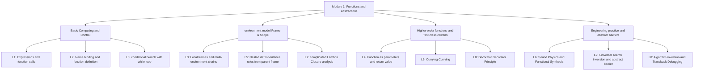

> **Course**: UC Berkeley CS61A (Fall 2024)  
> **Module**: Module 1: Functions & Abstraction  
> **Lecturer**: Prof. John DeNero (UC Berkeley)  
> **Video duration**: 34:16 ｜ **Classroom screenshots**: 14 pieces of blackboard writing/code demonstration  
> **Direct video**: [📺Watch the original video of this lecture on Bilibili (P8)](https://www.bilibili.com/video/BV1sy411z7nA/?p=8)  
> **Quick navigation**: [← Previous Lecture (P07 Lecture 7 Functional Abstraction)](/en/notes/cs61a/lecture-07) ｜ [📚 Return to the full book catalog](/en/notes/topics/CS61A) ｜ [Next Lecture (P09 Lecture 9 Recursion) →](/en/notes/cs61a/lecture-09)

---

## 1. Analysis of midterm exam questions and “What does Python print” (WWPP)

*(Reference time: 00:01:24 · [Video jump (P8 00:01:24)](https://www.bilibili.com/video/BV1sy411z7nA/?p=8&t=84))*

The focus of the midterm exam (Midterm 1) is to test your understanding of **Precise understanding of language intrinsic evaluation rules** with **Ability to use basic tools to solve new problems**.

The most classic question type is  **“What Would Python Print?” (WWPP)**: Enter a complex nested code into the interactive interpreter and predict what the terminal will output and what the expression will ultimately evaluate to.

The absolute iron rule for doing WWPP questions: **Strictly distinguish between "screen display side effects (Display)" and "expression evaluation results (Value)"**!

[](https://www.bilibili.com/video/BV1sy411z7nA/?p=8&t=180)
*⏱ Timestamp: 00:03:00 · 📷 Classroom screenshot · [Watch the corresponding clip on Bilibili (P8 00:03:00)](https://www.bilibili.com/video/BV1sy411z7nA/?p=8&t=180)*

#### 📸 In-depth reading of classroom blackboard writing and code demonstration (00:03:00)

**\[On-site blackboard writing/code demonstration restoration\]**:
At this time point, Professor DeNero conducted a core demonstration and key blackboard derivation on the screen:
> *“Often, I'll put something like this, a small definition, such as the square function, maybe import add and mall from operator. Then I'll start asking questions like, given an expression, what does it evaluate to? Or, what interactive output would you see if you entered that expression in the interac...”*

**\[Underlying computing model and micro execution mechanism\]**: 
1. **Execution context and timing tracing**: 
   - At the current discussion point "1. Analysis of midterm exam questions and "What does Python print" (WWPP)", the interpreter strictly follows the core evaluation protocol;
   - The expression evaluates the operators first, then evaluates the operands strictly from left to right, and finally applies the function object to the argument list;
   - If the environment model is involved, the local frame strictly records its static lexical parent pointer (Parent Pointer points to the environment where the function is defined), forming an orthogonal architecture with the dynamic call stack at runtime.
2. **Memory topology and object references**: 
   - Variable symbols are just keys in a hash table (environment frame), and pointers point directly to first-class citizen objects in heap memory;
   - Assignment statements are discrete-time snapshots of the state and never create implicit mathematical dependency monitoring.

**\[Guidelines for avoiding pitfalls and guidance on high-frequency test points\]**: 
- **Common misunderstandings**: In the exam questions related to "Horse-Mask Legendary Scope Topology Question and Python Decorator Principle", beginners can easily guess the results based on the surface form of the code, leading to scope confusion or variable shadowing (Shadowing) misjudgment;
- **The golden rule of debugging**: When encountering nested calls and complex branches, be sure to draw independent partial frames on the scratch paper, indicate the specific binding value of each formal parameter, and derive it step by step.


| expression | Evaluation result (Value) | Interactive Output |
| :--- | :---: | :---: |
| `5` | `5` | `5` |
| `print(5)` | `None` | `5` (Note: None is hidden and not displayed by default in interactive terminals) |
| `print(print(5))` | `None` | `5`<br>`None` (First seek the internal parameter output 5, and then print the external return value None) |

[](https://www.bilibili.com/video/BV1sy411z7nA/?p=8&t=255)
*⏱ Timestamp: 00:04:15 · 📷 Classroom screenshot · [Watch the corresponding clip on Bilibili (P8 00:04:15)](https://www.bilibili.com/video/BV1sy411z7nA/?p=8&t=255)*

#### 📸 In-depth reading of classroom blackboard writing and code demonstration (00:04:15)

**\[On-site blackboard writing/code demonstration restoration\]**:
At this time point, Professor DeNero conducted a core demonstration and key blackboard derivation on the screen:
> *“Call expressions are evaluated by evaluating the operator, evaluating the operand. In this case, evaluating the operand prints the number 5 and evaluates to None. And then we apply the print function to this value, None, which actually prints that out in the interactive output. Now, the whole thing ...”*

**\[Underlying computing model and micro execution mechanism\]**: 
1. **Execution context and timing tracing**: 
   - At the current discussion point "1. Analysis of midterm exam questions and "What does Python print" (WWPP)", the interpreter strictly follows the core evaluation protocol;
   - The expression evaluates the operators first, then evaluates the operands strictly from left to right, and finally applies the function object to the argument list;
   - If the environment model is involved, the local frame strictly records its static lexical parent pointer (Parent Pointer points to the environment where the function is defined), forming an orthogonal architecture with the dynamic call stack at runtime.
2. **Memory topology and object references**: 
   - Variable symbols are just keys in a hash table (environment frame), and pointers point directly to first-class citizen objects in heap memory;
   - Assignment statements are discrete-time snapshots of the state and never create implicit mathematical dependency monitoring.

**\[Guidelines for avoiding pitfalls and guidance on high-frequency test points\]**: 
- **Common misunderstandings**: In the exam questions related to "Horse-Mask Legendary Scope Topology Question and Python Decorator Principle", beginners can easily guess the results based on the surface form of the code, leading to scope confusion or variable shadowing (Shadowing) misjudgment;
- **The golden rule of debugging**: When encountering nested calls and complex branches, be sure to draw independent partial frames on the scratch paper, indicate the specific binding value of each formal parameter, and derive it step by step.


---

### In-depth formal specification and micro-evaluation process (Operational Semantics)
In the module "1. Analysis of midterm exam questions and "What does Python print" (WWPP)", the underlying computer operations rely on strict formal evaluation logic:
1. **Hierarchical parsing of abstract syntax trees (AST)**: 
   - The source code character stream is first divided into terminal symbol tokens (Tokens) by the lexical analyzer (Lexer), and then constructed into a multi-fork syntax tree by the syntax parser (Parser);
   - Operator priority and associativity are solidified during the syntax tree construction phase, eliminating ambiguity at runtime;
2. **Dynamic transitions of environment chains**: 
   - Each function call generates a new frame whose static lexical environment is determined by the function object's  `parent`  Attributes are completely determined;
   - The variable search traces back up the environment chain in one direction until the global environment frame. If it is not found, it will be triggered.  `NameError`  Abnormal;
3. **State Invariants**: 
   - The key to writing robust programs is to clarify loop invariants (Loop Invariants) and function pre/post-conditions (Pre/Post-conditions);
   - In complex control flow jumps, ensure that state variables maintain legal business constraints before each iteration.


## 2. Closure and chain call actual test: delay and pirate

*(Reference time: 00:04:22 · [Video jump (P8 00:04:22)](https://www.bilibili.com/video/BV1sy411z7nA/?p=8&t=262))*

### Topic 1: Delayed call and closure scope (delay)

```python
def delay(arg):
    print("delayed")
    def g():
        return arg
    return g
```

Examine the following chain of calls:
```python
delay(delay)()(6)()
```

[](https://www.bilibili.com/video/BV1sy411z7nA/?p=8&t=400)
*⏱ Timestamp: 00:06:40 · 📷 Classroom screenshot · [Watch the corresponding clip on Bilibili (P8 00:06:40)](https://www.bilibili.com/video/BV1sy411z7nA/?p=8&t=400)*

#### 📸 In-depth reading of classroom blackboard writing and code demonstration (00:06:40)

**\[On-site blackboard writing/code demonstration restoration\]**:
At this time point, Professor DeNero conducted a core demonstration and key blackboard derivation on the screen:
> *“This call expression. So this call expression has a complex operator, which is this whole thing up to, but not including, the final set of parentheses. So we have to evaluate everything that's underlined here first, and then we'll apply that function to no arguments at the very end. Now, what's that...”*

**\[Underlying computing model and micro execution mechanism\]**: 
1. **Execution context and timing tracing**: 
   - At the current discussion point "2. Closure and chain call real-world practice: delay and pirate", the interpreter strictly follows the core evaluation protocol;
   - The expression evaluates the operators first, then evaluates the operands strictly from left to right, and finally applies the function object to the argument list;
   - If the environment model is involved, the local frame strictly records its static lexical parent pointer (Parent Pointer points to the environment where the function is defined), forming an orthogonal architecture with the dynamic call stack at runtime.
2. **Memory topology and object references**: 
   - Variable symbols are just keys in a hash table (environment frame), and pointers point directly to first-class citizen objects in heap memory;
   - Assignment statements are discrete-time snapshots of the state and never create implicit mathematical dependency monitoring.

**\[Guidelines for avoiding pitfalls and guidance on high-frequency test points\]**: 
- **Common misunderstandings**: In the exam questions related to "Horse-Mask Legendary Scope Topology Question and Python Decorator Principle", beginners can easily guess the results based on the surface form of the code, leading to scope confusion or variable shadowing (Shadowing) misjudgment;
- **The golden rule of debugging**: When encountering nested calls and complex branches, be sure to draw independent partial frames on the scratch paper, indicate the specific binding value of each formal parameter, and derive it step by step.


#### Layer-by-layer disassembly and analysis

1. `delay(delay)`: 
   - call  `delay`, pass in itself.
   - Print: `delayed`.
   - Return an inner function  `g`, whose closure captures  `arg = delay`.
2. `delay(delay)()`: 
   - Call the above  `g()`, returns its recorded  `arg`, that is  `delay`  function itself.
3. `delay(delay)()(6)`: 
   - That is  `delay(6)`.
   - Print: `delayed`.
   - Return new function  `g`, whose closure captures  `arg = 6`.
4. `delay(delay)()(6)()`: 
   - call this  `g()`, return  `6`.
   - The terminal prints out the value of the expression at the end  `6`.

**final output**: 
```text
delayed
delayed
6
```

---

### Question 2: Masking and identity transformation (pirate) of parameters with the same name

```python
def pirate(arg):
    print("matey")
    def plunder(arg):
        return arg
    return plunder
```

[](https://www.bilibili.com/video/BV1sy411z7nA/?p=8&t=550)
*⏱ Timestamp: 00:09:10 · 📷 Classroom screenshot · [Watch the corresponding clip on Bilibili (P8 00:09:10)](https://www.bilibili.com/video/BV1sy411z7nA/?p=8&t=550)*

#### 📸 In-depth reading of classroom blackboard writing and code demonstration (00:09:10)

**\[On-site blackboard writing/code demonstration restoration\]**:
At this time point, Professor DeNero conducted a core demonstration and key blackboard derivation on the screen:
> *“The print function. I call that. That's fine. So now I get back the print function. I call print on 4, and I see the number 4. And then this whole thing evaluates to exactly what print 4 would evaluate to, which is None, and that's what I print out. And the value of the whole expression is None. Let...”*

**\[Underlying computing model and micro execution mechanism\]**: 
1. **Execution context and timing tracing**: 
   - At the current discussion point "2. Closure and chain call real-world practice: delay and pirate", the interpreter strictly follows the core evaluation protocol;
   - The expression evaluates the operators first, then evaluates the operands strictly from left to right, and finally applies the function object to the argument list;
   - If the environment model is involved, the local frame strictly records its static lexical parent pointer (Parent Pointer points to the environment where the function is defined), forming an orthogonal architecture with the dynamic call stack at runtime.
2. **Memory topology and object references**: 
   - Variable symbols are just keys in a hash table (environment frame), and pointers point directly to first-class citizen objects in heap memory;
   - Assignment statements are discrete-time snapshots of the state and never create implicit mathematical dependency monitoring.

**\[Guidelines for avoiding pitfalls and guidance on high-frequency test points\]**: 
- **Common misunderstandings**: In the exam questions related to "Horse-Mask Legendary Scope Topology Question and Python Decorator Principle", beginners can easily guess the results based on the surface form of the code, leading to scope confusion or variable shadowing (Shadowing) misjudgment;
- **The golden rule of debugging**: When encountering nested calls and complex branches, be sure to draw independent partial frames on the scratch paper, indicate the specific binding value of each formal parameter, and derive it step by step.


#### Analysis of Core Traps

Pay attention to the inner function  `def plunder(arg)`  The formal parameter is also called  `arg`!
- when  `plunder`  When called, the interpreter first looks in its own local frame  `arg`.
- The formal parameter was found in the first frame  `arg`, therefore **The arg passed in by the outer pirate is completely obscured and can never be accessed.**!
- In other words, `plunder`  No matter what the circumstances, it is just the purest **Identity Function**: Whatever is passed in will be returned unchanged.

#### Variant call 1: `add(pirate(3)(square)(4), 1)`
1. `pirate(3)`: print  `matey`, return  `plunder`.
2. `plunder(square)`:Return as is  `square`  function.
3. `square(4)`: Calculated  `16`.
4. `add(16, 1)`:return  `17`.
**Terminal output**:Print first  `matey`, the next line displays the evaluation results  `17`.

#### Variant call 2: `pirate(pirate(pirate))(5)(7)`
1. inner layer  `pirate(pirate)`: print  `matey`, return  `plunder`.
2. Outer layer  `pirate(plunder)`: print  `matey`, return  `plunder`.
3. `plunder(5)`: Returns an integer  `5`!
4. Next try to execute  `5(7)`: 
   - integer  `5`  In the operator position of the calling expression!
   - Throws a fatal runtime error: `TypeError: 'int' object is not callable`.

[](https://www.bilibili.com/video/BV1sy411z7nA/?p=8&t=705)
*⏱ Timestamp: 00:11:45 · 📷 Classroom screenshot · [Watch the corresponding clip on Bilibili (P8 00:11:45)](https://www.bilibili.com/video/BV1sy411z7nA/?p=8&t=705)*

#### 📸 In-depth reading of classroom blackboard writing and code demonstration (00:11:45)

**\[On-site blackboard writing/code demonstration restoration\]**:
At this time point, Professor DeNero conducted a core demonstration and key blackboard derivation on the screen:
> *“Or the function that returns whatever argument is passed into it. So if I call pirate3, I get back a function that will just evaluate to whatever I pass in. So if I pass in square, then this whole thing evaluates to the square function. And what happens when I square 4? I get 16, I add that to 1, an...”*

**\[Underlying computing model and micro execution mechanism\]**: 
1. **Execution context and timing tracing**: 
   - At the current discussion point "2. Closure and chain call real-world practice: delay and pirate", the interpreter strictly follows the core evaluation protocol;
   - The expression evaluates the operators first, then evaluates the operands strictly from left to right, and finally applies the function object to the argument list;
   - If the environment model is involved, the local frame strictly records its static lexical parent pointer (Parent Pointer points to the environment where the function is defined), forming an orthogonal architecture with the dynamic call stack at runtime.
2. **Memory topology and object references**: 
   - Variable symbols are just keys in a hash table (environment frame), and pointers point directly to first-class citizen objects in heap memory;
   - Assignment statements are discrete-time snapshots of the state and never create implicit mathematical dependency monitoring.

**\[Guidelines for avoiding pitfalls and guidance on high-frequency test points\]**: 
- **Common misunderstandings**: In the exam questions related to "Horse-Mask Legendary Scope Topology Question and Python Decorator Principle", beginners can easily guess the results based on the surface form of the code, leading to scope confusion or variable shadowing (Shadowing) misjudgment;
- **The golden rule of debugging**: When encountering nested calls and complex branches, be sure to draw independent partial frames on the scratch paper, indicate the specific binding value of each formal parameter, and derive it step by step.


---

### In-depth formal specification and micro-evaluation process (Operational Semantics)
In the module "2. Closure and chain call real test: delay and pirate" module, the underlying computer operations rely on strict formal evaluation logic:
1. **Hierarchical parsing of abstract syntax trees (AST)**: 
   - The source code character stream is first divided into terminal symbol tokens (Tokens) by the lexical analyzer (Lexer), and then constructed into a multi-fork syntax tree by the syntax parser (Parser);
   - Operator priority and associativity are solidified during the syntax tree construction phase, eliminating ambiguity at runtime;
2. **Dynamic transitions of environment chains**: 
   - Each function call generates a new frame whose static lexical environment is determined by the function object's  `parent`  Attributes are completely determined;
   - The variable search traces back up the environment chain in one direction until the global environment frame. If it is not found, it will be triggered.  `NameError`  Abnormal;
3. **State Invariants**: 
   - The key to writing robust programs is to clarify loop invariants (Loop Invariants) and function pre/post-conditions (Pre/Post-conditions);
   - In complex control flow jumps, ensure that state variables maintain legal business constraints before each iteration.


## 3. Berkeley’s legendary midterm exam question: Horse-Mask scope topology puzzle

*(Reference time: 00:13:32 · [Video jump (P8 00:13:32)](https://www.bilibili.com/video/BV1sy411z7nA/?p=8&t=812))*

This is the most legendary high-level environmental map test question in CS61A over the years:

```python
def horse(mask):
    horse = mask
    def mask(horse):
        return horse
    return horse(mask)

mask = lambda horse: horse(2)
horse(mask)
```

call  `horse(mask)`  What is the final return value of ?

[](https://www.bilibili.com/video/BV1sy411z7nA/?p=8&t=820)
*⏱ Timestamp: 00:13:40 · 📷 Classroom screenshot · [Watch the corresponding clip on Bilibili (P8 00:13:40)](https://www.bilibili.com/video/BV1sy411z7nA/?p=8&t=820)*

#### 📸 In-depth reading of classroom blackboard writing and code demonstration (00:13:40)

**\[On-site blackboard writing/code demonstration restoration\]**:
At this time point, Professor DeNero conducted a core demonstration and key blackboard derivation on the screen:
> *“One of my favorites that I ever came up with. The horse mask. So it says I'm going to define horse mask as a function that sets horse equal to mask, then defines mask of horse, which returns horse, and finally returns horse, called on mask. What is mask anyway? Well, mask is a function that takes in...”*

**\[Underlying computing model and micro execution mechanism\]**: 
1. **Execution context and timing tracing**: 
   - At the current discussion point "3. Berkeley Midterm Legend Exam Question: Horse-Mask Scope Topology Puzzle", the interpreter strictly follows the core evaluation protocol;
   - The expression evaluates the operators first, then evaluates the operands strictly from left to right, and finally applies the function object to the argument list;
   - If the environment model is involved, the local frame strictly records its static lexical parent pointer (Parent Pointer points to the environment where the function is defined), forming an orthogonal architecture with the dynamic call stack at runtime.
2. **Memory topology and object references**: 
   - Variable symbols are just keys in a hash table (environment frame), and pointers point directly to first-class citizen objects in heap memory;
   - Assignment statements are discrete-time snapshots of the state and never create implicit mathematical dependency monitoring.

**\[Guidelines for avoiding pitfalls and guidance on high-frequency test points\]**: 
- **Common misunderstandings**: In the exam questions related to "Horse-Mask Legendary Scope Topology Question and Python Decorator Principle", beginners can easily guess the results based on the surface form of the code, leading to scope confusion or variable shadowing (Shadowing) misjudgment;
- **The golden rule of debugging**: When encountering nested calls and complex branches, be sure to draw independent partial frames on the scratch paper, indicate the specific binding value of each formal parameter, and derive it step by step.


### Environmental evolution deduction diagram

1. **Global frame preparation**: 
   - `horse`: Bind to outer function  `horse(mask)`.
   - `mask`: bind to  `lambda horse: horse(2)` (marked as  $\lambda_1$), the parent frame is  `Global`.
2. **enter  `horse(mask)` (Create frame F1)**: 
   - formal parameters  `mask`  Bind as incoming  $\lambda_1$.
   - execute  `horse = mask`: In the current local frame  `F1`  Create local variables in  `horse`, also pointing to  $\lambda_1$.
   - execute  `def mask(horse)`: 
     - in current frame  `F1`  Create new function  `mask` (marked as  $f_{mask}$), its parent frame is  `F1`!
     - Change the name in the local frame  `mask` **rebind** for  $f_{mask}$ (Old  $\lambda_1$  binding is overridden).
3. **execute  `return horse(mask)`**: 
   - Find current frame  `F1`  in  `horse`: Yes  $\lambda_1$!
   - Find current frame  `F1`  in  `mask`: is just defined  $f_{mask}$!
   - Make a call: $\lambda_1(f_{mask})$.

[](https://www.bilibili.com/video/BV1sy411z7nA/?p=8&t=930)
*⏱ Timestamp: 00:15:30 · 📷 Classroom screenshot · [Watch the corresponding clip on Bilibili (P8 00:15:30)](https://www.bilibili.com/video/BV1sy411z7nA/?p=8&t=930)*

#### 📸 In-depth reading of classroom blackboard writing and code demonstration (00:15:30)

**\[On-site blackboard writing/code demonstration restoration\]**:
At this time point, Professor DeNero conducted a core demonstration and key blackboard derivation on the screen:
> *“To the argument that was passed in. And we passed in whatever mask was in the global frame. Oh, it was this lambda function. So that's bound to mask here. So now we have mask meaning this lambda function in the first frame of the current environment. Now we execute the body of the function, which sa...”*

**\[Underlying computing model and micro execution mechanism\]**: 
1. **Execution context and timing tracing**: 
   - At the current discussion point "3. Berkeley Midterm Legend Exam Question: Horse-Mask Scope Topology Puzzle", the interpreter strictly follows the core evaluation protocol;
   - The expression evaluates the operators first, then evaluates the operands strictly from left to right, and finally applies the function object to the argument list;
   - If the environment model is involved, the local frame strictly records its static lexical parent pointer (Parent Pointer points to the environment where the function is defined), forming an orthogonal architecture with the dynamic call stack at runtime.
2. **Memory topology and object references**: 
   - Variable symbols are just keys in a hash table (environment frame), and pointers point directly to first-class citizen objects in heap memory;
   - Assignment statements are discrete-time snapshots of the state and never create implicit mathematical dependency monitoring.

**\[Guidelines for avoiding pitfalls and guidance on high-frequency test points\]**: 
- **Common misunderstandings**: In the exam questions related to "Horse-Mask Legendary Scope Topology Question and Python Decorator Principle", beginners can easily guess the results based on the surface form of the code, leading to scope confusion or variable shadowing (Shadowing) misjudgment;
- **The golden rule of debugging**: When encountering nested calls and complex branches, be sure to draw independent partial frames on the scratch paper, indicate the specific binding value of each formal parameter, and derive it step by step.


4. **enter  $\lambda_1$ (Create frame F2)**: 
   - $\lambda_1$  The parent frame is  `Global`.
   - Its formal parameters  `horse`  Bind to the actual parameters passed in  $f_{mask}$.
   - Execute function body  `horse(2)`: i.e. call  $f_{mask}(2)$!
5. **enter  $f_{mask}$ (Create frame F3)**: 
   - $f_{mask}$  The parent frame is  `F1`.
   - Its formal parameters  `horse`  Bind to the actual parameters passed in  `2`.
   - Execute function body  `return horse`: Directly returns the number bound to the current frame  **`2`**!
6. Passed all the way up unchanged, the entire expression finally evaluates to  **`2`**!

[](https://www.bilibili.com/video/BV1sy411z7nA/?p=8&t=1050)
*⏱ Timestamp: 00:17:30 · 📷 Classroom screenshot · [Watch the corresponding clip on Bilibili (P8 00:17:30)](https://www.bilibili.com/video/BV1sy411z7nA/?p=8&t=1050)*

#### 📸 In-depth reading of classroom blackboard writing and code demonstration (00:17:30)

**\[On-site blackboard writing/code demonstration restoration\]**:
At this time point, Professor DeNero conducted a core demonstration and key blackboard derivation on the screen:
> *“of evaluating the horse function, and so we're in a horse frame, and so we figure out that currently horse means this lambda function, and mask means this mask function. So we call this lambda function, but this is an argument. Calling a lambda function means that we introduce a new frame, that fram...”*

**\[Underlying computing model and micro execution mechanism\]**: 
1. **Execution context and timing tracing**: 
   - At the current discussion point "3. Berkeley Midterm Legend Exam Question: Horse-Mask Scope Topology Puzzle", the interpreter strictly follows the core evaluation protocol;
   - The expression evaluates the operators first, then evaluates the operands strictly from left to right, and finally applies the function object to the argument list;
   - If the environment model is involved, the local frame strictly records its static lexical parent pointer (Parent Pointer points to the environment where the function is defined), forming an orthogonal architecture with the dynamic call stack at runtime.
2. **Memory topology and object references**: 
   - Variable symbols are just keys in a hash table (environment frame), and pointers point directly to first-class citizen objects in heap memory;
   - Assignment statements are discrete-time snapshots of the state and never create implicit mathematical dependency monitoring.

**\[Guidelines for avoiding pitfalls and guidance on high-frequency test points\]**: 
- **Common misunderstandings**: In the exam questions related to "Horse-Mask Legendary Scope Topology Question and Python Decorator Principle", beginners can easily guess the results based on the surface form of the code, leading to scope confusion or variable shadowing (Shadowing) misjudgment;
- **The golden rule of debugging**: When encountering nested calls and complex branches, be sure to draw independent partial frames on the scratch paper, indicate the specific binding value of each formal parameter, and derive it step by step.


---

### In-depth formal specification and micro-evaluation process (Operational Semantics)
In the module "3. Berkeley Midterm Legend Exam Question: Horse-Mask Scope Topology Puzzle", the underlying computer operations rely on strict formal evaluation logic:
1. **Hierarchical parsing of abstract syntax trees (AST)**: 
   - The source code character stream is first divided into terminal symbol tokens (Tokens) by the lexical analyzer (Lexer), and then constructed into a multi-fork syntax tree by the syntax parser (Parser);
   - Operator priority and associativity are solidified during the syntax tree construction phase, eliminating ambiguity at runtime;
2. **Dynamic transitions of environment chains**: 
   - Each function call generates a new frame whose static lexical environment is determined by the function object's  `parent`  Attributes are completely determined;
   - The variable search traces back up the environment chain in one direction until the global environment frame. If it is not found, it will be triggered.  `NameError`  Abnormal;
3. **State Invariants**: 
   - The key to writing robust programs is to clarify loop invariants (Loop Invariants) and function pre/post-conditions (Pre/Post-conditions);
   - In complex control flow jumps, ensure that state variables maintain legal business constraints before each iteration.


## 4. General strategies for function implementation: take remove(n, digit) as an example

*(Reference time: 00:19:35 · [Video jump (P8 00:19:35)](https://www.bilibili.com/video/BV1sy411z7nA/?p=8&t=1175))*

In a paper-based exam, when faced with a new algorithm fill-in-the-blank question, how can you write bug-free code in an orderly manner?

```python
def remove(n, digit):
    """从非负整数 n 中移除所有等于 digit 的数字，返回剩余数字拼成的整数。

    >>> remove(231, 3)
    21
    >>> remove(243132, 2)
    4313
    """
    kept, digits = 0, 0
    while n > 0:
        n, last = n // 10, n % 10
        if last != digit:
            kept = kept + last * (10 ** digits)
            digits = digits + 1
    return kept
```

[](https://www.bilibili.com/video/BV1sy411z7nA/?p=8&t=1180)
*⏱ Timestamp: 00:19:40 · 📷 Classroom screenshot · [Watch the corresponding clip on Bilibili (P8 00:19:40)](https://www.bilibili.com/video/BV1sy411z7nA/?p=8&t=1180)*

#### 📸 In-depth reading of classroom blackboard writing and code demonstration (00:19:40)

**\[On-site blackboard writing/code demonstration restoration\]**:
At this time point, Professor DeNero conducted a core demonstration and key blackboard derivation on the screen:
> *“Remove from N some digit, which returns all digits of non-negative N that are not digit for some non-negative digit less than 10. And what does it mean to return the digits? Well, this question originally had a longer text description, which said that you should return an integer that's got all the ...”*

**\[Underlying computing model and micro execution mechanism\]**: 
1. **Execution context and timing tracing**: 
   - At the current discussion point "4. General strategy for function implementation: taking remove(n, digit) as an example", the interpreter strictly follows the core evaluation protocol;
   - The expression evaluates the operators first, then evaluates the operands strictly from left to right, and finally applies the function object to the argument list;
   - If the environment model is involved, the local frame strictly records its static lexical parent pointer (Parent Pointer points to the environment where the function is defined), forming an orthogonal architecture with the dynamic call stack at runtime.
2. **Memory topology and object references**: 
   - Variable symbols are just keys in a hash table (environment frame), and pointers point directly to first-class citizen objects in heap memory;
   - Assignment statements are discrete-time snapshots of the state and never create implicit mathematical dependency monitoring.

**\[Guidelines for avoiding pitfalls and guidance on high-frequency test points\]**: 
- **Common misunderstandings**: In the exam questions related to "Horse-Mask Legendary Scope Topology Question and Python Decorator Principle", beginners can easily guess the results based on the surface form of the code, leading to scope confusion or variable shadowing (Shadowing) misjudgment;
- **The golden rule of debugging**: When encountering nested calls and complex branches, be sure to draw independent partial frames on the scratch paper, indicate the specific binding value of each formal parameter, and derive it step by step.


### Four-step method for scientific problem solving

1. **Thoroughly understand examples (Trace small cases)**: Get specific  `n = 231, digit = 3`  Draft on paper.
2. **Split basic actions**: 
   - Extract the last bit: `last = n % 10`
   - Strip off the last bit: `n = n // 10`
   - Filter criteria: `if last != digit`
3. **Breakthrough invention of core weight algorithm (The Creative Leap)**: 
   - When peeling numbers from low to high, get them first  `1`, skip again  `3`, then get it  `2`.
   - If we do the addition directly, we get  $1 + 2 = 3$; if written as  `kept * 10 + last`, spelled out in reverse order  $12$.
   - Correct mathematical model: **The actual decimal place weight of the currently reserved number depends on "how many digits have been reserved before"**!
   - 1st reserved digit  `1`  should be placed  $10^0$  Digit (units digit); 2nd reserved digit  `2`  should be placed  $10^1$  place (tens).
   - The formula is locked as: `kept + last * (10 ** digits)`!

[](https://www.bilibili.com/video/BV1sy411z7nA/?p=8&t=1410)
*⏱ Timestamp: 00:23:30 · 📷 Classroom screenshot · [Watch the corresponding clip on Bilibili (P8 00:23:30)](https://www.bilibili.com/video/BV1sy411z7nA/?p=8&t=1410)*

#### 📸 In-depth reading of classroom blackboard writing and code demonstration (00:23:30)

**\[On-site blackboard writing/code demonstration restoration\]**:
At this time point, Professor DeNero conducted a core demonstration and key blackboard derivation on the screen:
> *“And I need to return 21. Once you do that annotation, then you can start working through the problem. Write the code, try to compute the result, make sure you actually return to the right thing, and check your solution with some other examples. But focus on one at first. So if we pick this one, then...”*

**\[Underlying computing model and micro execution mechanism\]**: 
1. **Execution context and timing tracing**: 
   - At the current discussion point "4. General strategy for function implementation: taking remove(n, digit) as an example", the interpreter strictly follows the core evaluation protocol;
   - The expression evaluates the operators first, then evaluates the operands strictly from left to right, and finally applies the function object to the argument list;
   - If the environment model is involved, the local frame strictly records its static lexical parent pointer (Parent Pointer points to the environment where the function is defined), forming an orthogonal architecture with the dynamic call stack at runtime.
2. **Memory topology and object references**: 
   - Variable symbols are just keys in a hash table (environment frame), and pointers point directly to first-class citizen objects in heap memory;
   - Assignment statements are discrete-time snapshots of the state and never create implicit mathematical dependency monitoring.

**\[Guidelines for avoiding pitfalls and guidance on high-frequency test points\]**: 
- **Common misunderstandings**: In the exam questions related to "Horse-Mask Legendary Scope Topology Question and Python Decorator Principle", beginners can easily guess the results based on the surface form of the code, leading to scope confusion or variable shadowing (Shadowing) misjudgment;
- **The golden rule of debugging**: When encountering nested calls and complex branches, be sure to draw independent partial frames on the scratch paper, indicate the specific binding value of each formal parameter, and derive it step by step.


[](https://www.bilibili.com/video/BV1sy411z7nA/?p=8&t=1600)
*⏱ Timestamp: 00:26:40 · 📷 Classroom screenshot · [Watch the corresponding clip on Bilibili (P8 00:26:40)](https://www.bilibili.com/video/BV1sy411z7nA/?p=8&t=1600)*

#### 📸 In-depth reading of classroom blackboard writing and code demonstration (00:26:40)

**\[On-site blackboard writing/code demonstration restoration\]**:
At this time point, Professor DeNero conducted a core demonstration and key blackboard derivation on the screen:
> *“So one way to do that is to raise 10 to the power of how many digits are already in Kept. So that means you would keep track of how many digits are in Kept, and you would multiply last by 10 to the digits. This works for this case. The first time through, last is one, digits is zero, Kept is now one...”*

**\[Underlying computing model and micro execution mechanism\]**: 
1. **Execution context and timing tracing**: 
   - At the current discussion point "4. General strategy for function implementation: taking remove(n, digit) as an example", the interpreter strictly follows the core evaluation protocol;
   - The expression evaluates the operators first, then evaluates the operands strictly from left to right, and finally applies the function object to the argument list;
   - If the environment model is involved, the local frame strictly records its static lexical parent pointer (Parent Pointer points to the environment where the function is defined), forming an orthogonal architecture with the dynamic call stack at runtime.
2. **Memory topology and object references**: 
   - Variable symbols are just keys in a hash table (environment frame), and pointers point directly to first-class citizen objects in heap memory;
   - Assignment statements are discrete-time snapshots of the state and never create implicit mathematical dependency monitoring.

**\[Guidelines for avoiding pitfalls and guidance on high-frequency test points\]**: 
- **Common misunderstandings**: In the exam questions related to "Horse-Mask Legendary Scope Topology Question and Python Decorator Principle", beginners can easily guess the results based on the surface form of the code, leading to scope confusion or variable shadowing (Shadowing) misjudgment;
- **The golden rule of debugging**: When encountering nested calls and complex branches, be sure to draw independent partial frames on the scratch paper, indicate the specific binding value of each formal parameter, and derive it step by step.


---

### In-depth formal specification and micro-evaluation process (Operational Semantics)
In the module "4. General strategies for function implementation: taking remove(n, digit) as an example", the underlying computer operations rely on strict formal evaluation logic:
1. **Hierarchical parsing of abstract syntax trees (AST)**: 
   - The source code character stream is first divided into terminal symbol tokens (Tokens) by the lexical analyzer (Lexer), and then constructed into a multi-fork syntax tree by the syntax parser (Parser);
   - Operator priority and associativity are solidified during the syntax tree construction phase, eliminating ambiguity at runtime;
2. **Dynamic transitions of environment chains**: 
   - Each function call generates a new frame whose static lexical environment is determined by the function object's  `parent`  Attributes are completely determined;
   - The variable search traces back up the environment chain in one direction until the global environment frame. If it is not found, it will be triggered.  `NameError`  Abnormal;
3. **State Invariants**: 
   - The key to writing robust programs is to clarify loop invariants (Loop Invariants) and function pre/post-conditions (Pre/Post-conditions);
   - In complex control flow jumps, ensure that state variables maintain legal business constraints before each iteration.


## 5. Python Decorators revealed: higher-order functions under syntactic sugar

*(Reference time: 00:29:08 · [Video jump (P8 00:29:08)](https://www.bilibili.com/video/BV1sy411z7nA/?p=8&t=1748))*

In industrial Python code, you often see statements of the form  `@trace`  special syntax. this is **Decorator**.

Many beginners think decorators are mysterious and profound, but after learning higher-order functions, you will find **It doesn't have any new magic at all, it's just an extremely elegant syntactic sugar**!

[](https://www.bilibili.com/video/BV1sy411z7nA/?p=8&t=1840)
*⏱ Timestamp: 00:30:40 · 📷 Classroom screenshot · [Watch the corresponding clip on Bilibili (P8 00:30:40)](https://www.bilibili.com/video/BV1sy411z7nA/?p=8&t=1840)*

#### 📸 In-depth reading of classroom blackboard writing and code demonstration (00:30:40)

**\[On-site blackboard writing/code demonstration restoration\]**:
At this time point, Professor DeNero conducted a core demonstration and key blackboard derivation on the screen:
> *“3 at 55. So, um, I told you about this trace decorator, and a decorator is a name for this thing that looks like at, and then a name. I use that, and I square something, then I see something gets printed before the value returns. So, first line gets printed when it gets called, another line gets pri...”*

**\[Underlying computing model and micro execution mechanism\]**: 
1. **Execution context and timing tracing**: 
   - At the current discussion point "5. Python Decorators Revealed: Higher-Order Functions under Syntactic Sugar", the interpreter strictly follows the core evaluation convention;
   - The expression evaluates the operators first, then evaluates the operands strictly from left to right, and finally applies the function object to the argument list;
   - If the environment model is involved, the local frame strictly records its static lexical parent pointer (Parent Pointer points to the environment where the function is defined), forming an orthogonal architecture with the dynamic call stack at runtime.
2. **Memory topology and object references**: 
   - Variable symbols are just keys in a hash table (environment frame), and pointers point directly to first-class citizen objects in heap memory;
   - Assignment statements are discrete-time snapshots of the state and never create implicit mathematical dependency monitoring.

**\[Guidelines for avoiding pitfalls and guidance on high-frequency test points\]**: 
- **Common misunderstandings**: In the exam questions related to "Horse-Mask Legendary Scope Topology Question and Python Decorator Principle", beginners can easily guess the results based on the surface form of the code, leading to scope confusion or variable shadowing (Shadowing) misjudgment;
- **The golden rule of debugging**: When encountering nested calls and complex branches, be sure to draw independent partial frames on the scratch paper, indicate the specific binding value of each formal parameter, and derive it step by step.


### Building the trace decorator from scratch

We want to add a debugging function that "automatically prints the parameters when called" to any single-parameter function:

```python
def trace1(fn):
    """接受函数 fn，返回一个带有打印日志增强功能的包裹函数。"""
    def traced(x):
        print(f"Calling {fn.__name__} on argument {x}")
        return fn(x)
    return traced
```

[](https://www.bilibili.com/video/BV1sy411z7nA/?p=8&t=1920)
*⏱ Timestamp: 00:32:00 · 📷 Classroom screenshot · [Watch the corresponding clip on Bilibili (P8 00:32:00)](https://www.bilibili.com/video/BV1sy411z7nA/?p=8&t=1920)*

#### 📸 In-depth reading of classroom blackboard writing and code demonstration (00:32:00)

**\[On-site blackboard writing/code demonstration restoration\]**:
At this time point, Professor DeNero conducted a core demonstration and key blackboard derivation on the screen:
> *“Well, I'll define a traced version of the function, which will first print calling this function on argument and then the argument, and then it will actually return the value of calling fun on x. And then we'll return that traced function. So traced is just like fun, except for it also prints. And n...”*

**\[Underlying computing model and micro execution mechanism\]**: 
1. **Execution context and timing tracing**: 
   - At the current discussion point "5. Python Decorators Revealed: Higher-Order Functions under Syntactic Sugar", the interpreter strictly follows the core evaluation convention;
   - The expression evaluates the operators first, then evaluates the operands strictly from left to right, and finally applies the function object to the argument list;
   - If the environment model is involved, the local frame strictly records its static lexical parent pointer (Parent Pointer points to the environment where the function is defined), forming an orthogonal architecture with the dynamic call stack at runtime.
2. **Memory topology and object references**: 
   - Variable symbols are just keys in a hash table (environment frame), and pointers point directly to first-class citizen objects in heap memory;
   - Assignment statements are discrete-time snapshots of the state and never create implicit mathematical dependency monitoring.

**\[Guidelines for avoiding pitfalls and guidance on high-frequency test points\]**: 
- **Common misunderstandings**: In the exam questions related to "Horse-Mask Legendary Scope Topology Question and Python Decorator Principle", beginners can easily guess the results based on the surface form of the code, leading to scope confusion or variable shadowing (Shadowing) misjudgment;
- **The golden rule of debugging**: When encountering nested calls and complex branches, be sure to draw independent partial frames on the scratch paper, indicate the specific binding value of each formal parameter, and derive it step by step.


### Decorator syntactic sugar equivalence principle

The following two ways of writing are in the Python interpreter **Completely 100% equivalent**: 

```python
# 写法 A：使用 @ 装饰器语法
@trace1
def square(x):
    return x * x

# 写法 B：原始高阶函数重绑定
def square(x):
    return x * x
square = trace1(square)
```

when we are  `sum_squares_up_to`  decorated in call  `square`  At this time, each calculation will clearly print out the participating call timings on the console.

> **Thinking questions**: Why Python should be specially introduced  `@`  Grammar?
> 1. **Pre-declaration of intent**: Write the decorator at the head of the function so that people know that the function has special aspects (such as caching, authentication, log tracking) when reading the first line.
> 2. **lower mental threshold**: Provide a simple and intuitive declarative interface for developers who have not yet deeply understood the high-order function closure mechanism.

[](https://www.bilibili.com/video/BV1sy411z7nA/?p=8&t=2010)
*⏱ Timestamp: 00:33:30 · 📷 Classroom screenshot · [Watch the corresponding clip on Bilibili (P8 00:33:30)](https://www.bilibili.com/video/BV1sy411z7nA/?p=8&t=2010)*

#### 📸 In-depth reading of classroom blackboard writing and code demonstration (00:33:30)

**\[On-site blackboard writing/code demonstration restoration\]**:
At this time point, Professor DeNero conducted a core demonstration and key blackboard derivation on the screen:
> *“Which is called a decorator. So if I trace a function, that's called the decorator. What you get back is a decorated function and it's bound to the name of the function that's given. So this is identical to first defining the function and then rebinding the name of the function to a traced version o...”*

**\[Underlying computing model and micro execution mechanism\]**: 
1. **Execution context and timing tracing**: 
   - At the current discussion point "5. Python Decorators Revealed: Higher-Order Functions under Syntactic Sugar", the interpreter strictly follows the core evaluation convention;
   - The expression evaluates the operators first, then evaluates the operands strictly from left to right, and finally applies the function object to the argument list;
   - If the environment model is involved, the local frame strictly records its static lexical parent pointer (Parent Pointer points to the environment where the function is defined), forming an orthogonal architecture with the dynamic call stack at runtime.
2. **Memory topology and object references**: 
   - Variable symbols are just keys in a hash table (environment frame), and pointers point directly to first-class citizen objects in heap memory;
   - Assignment statements are discrete-time snapshots of the state and never create implicit mathematical dependency monitoring.

**\[Guidelines for avoiding pitfalls and guidance on high-frequency test points\]**: 
- **Common misunderstandings**: In the exam questions related to "Horse-Mask Legendary Scope Topology Question and Python Decorator Principle", beginners can easily guess the results based on the surface form of the code, leading to scope confusion or variable shadowing (Shadowing) misjudgment;
- **The golden rule of debugging**: When encountering nested calls and complex branches, be sure to draw independent partial frames on the scratch paper, indicate the specific binding value of each formal parameter, and derive it step by step.


---

### In-depth formal specification and micro-evaluation process (Operational Semantics)
In the module "5. Python Decorators Revealed: High-Order Functions Under Syntax Sugar", the underlying computer operations rely on strict formal evaluation logic:
1. **Hierarchical parsing of abstract syntax trees (AST)**: 
   - The source code character stream is first divided into terminal symbol tokens (Tokens) by the lexical analyzer (Lexer), and then constructed into a multi-fork syntax tree by the syntax parser (Parser);
   - Operator priority and associativity are solidified during the syntax tree construction phase, eliminating ambiguity at runtime;
2. **Dynamic transitions of environment chains**: 
   - Each function call generates a new frame whose static lexical environment is determined by the function object's  `parent`  Attributes are completely determined;
   - The variable search traces back up the environment chain in one direction until the global environment frame. If it is not found, it will be triggered.  `NameError`  Abnormal;
3. **State Invariants**: 
   - The key to writing robust programs is to clarify loop invariants (Loop Invariants) and function pre/post-conditions (Pre/Post-conditions);
   - In complex control flow jumps, ensure that state variables maintain legal business constraints before each iteration.


## 6. Panoramic summary of the first module and winning strategies for mid-term

So far, we have completed the journey  **Module 1: Functions & Abstraction**  All 8 lectures:



### Three midterm clearance secrets

1. **Draw environmental pictures without distractions**: Keep in mind "Create a function to determine Parent, call a function to determine Parent", and always resolve variable names at the earliest position in the current frame.
2. **Isolated reading of calculation formulas WWPP**: Never rely on intuitive guessing, honestly write down the return value and printout of each operation step.
3. **Small example deduction construction cycle**: When faced with complex iteration problems, first use the simplest example to mark the trend of variables, deduce the weight formula and then write a general loop.

### In-depth formal specification and micro-evaluation process (Operational Semantics)
In the module "6. Panoramic summary of the first module and winning strategies for mid-term", the underlying computer operations rely on strict formal evaluation logic:
1. **Hierarchical parsing of abstract syntax trees (AST)**: 
   - The source code character stream is first divided into terminal symbol tokens (Tokens) by the lexical analyzer (Lexer), and then constructed into a multi-fork syntax tree by the syntax parser (Parser);
   - Operator priority and associativity are solidified during the syntax tree construction phase, eliminating ambiguity at runtime;
2. **Dynamic transitions of environment chains**: 
   - Each function call generates a new frame whose static lexical environment is determined by the function object's  `parent`  Attributes are completely determined;
   - The variable search traces back up the environment chain in one direction until the global environment frame. If it is not found, it will be triggered.  `NameError`  Abnormal;
3. **State Invariants**: 
   - The key to writing robust programs is to clarify loop invariants (Loop Invariants) and function pre/post-conditions (Pre/Post-conditions);
   - In complex control flow jumps, ensure that state variables maintain legal business constraints before each iteration.


---

## Berkeley Midterm/Final classic high-frequency exam questions in-depth practice

### Practical exam questions: Environment topology and microstate tracking (WWPD & Environment Diagrams)
Consider the following microscopic execution of Python code in an interactive environment:

```python
# 经典作用域与高阶函数综合考题
x = 10

def outer(x):
    y = x + 2
    def inner(y):
        return x + y
    return inner

f = outer(5)
result = f(3)
```

#### Complete problem-solving thinking model and multi-frame environment map derivation:
1. **Global Frame initialization**: 
   - global variables  `x`  Bind to integer object  `10`; 
   - global function  `outer`  Binds to the newly created function object whose embedded  `parent = Global`; 
2. **execute  `f = outer(5)`**: 
   - create a local frame  $f_1$, mark  `f1: outer [parent=Global]`; 
   - formal parameters  `x`  Bind to actual parameters  `5`; 
   - local variables  `y`  bind to  `5 + 2 = 7`; 
   - in  $f_1$  internal execution  `def inner(y):`, create a function object  `inner`, its embedded  **`parent = f1`**; 
   - Return function object  `inner`, global variables  `f`  Bind to this object;
3. **execute  `result = f(3)`**: 
   - call function  `f` (i.e.  `inner`), open up a local frame  $f_2$; 
   - **core scoring points**:frame  $f_2$  Who does parent point to?
   - **iron law**: function  `inner`  is in frame  $f_1$  is defined internally, so  $f_2$  of  **`parent = f1`**!
   - formal parameters  `y`  Bind to actual parameters  `3`; 
   - executor  `return x + y`: 
     - in current frame  $f_2$  Find  `y`: Hit local variable  `y = 3`; 
     - in current frame  $f_2$  Find  `x`: miss, trace back along parent  **$f_1$  frame**  Find it!
     - in  $f_1$  hit in frame  `x = 5` (Global  `x = 10`  Partially obscured! );
     - Calculate  `5 + 3 = 8`, as the return value;
4. **Final output conclusion**: 
   - global variables  `result = 8`.

---

## Knowledge Matrix of the core concepts of this lecture

| core knowledge dimension | Formal definition and mechanism | Typical code examples | Core Engineering and Algorithm Value | Common pitfalls |
| :--- | :--- | :--- | :--- | :--- |
| **Basic evaluation semantics** | The expression is evaluated to obtain a value, and the execution of the statement changes the internal state. | `x = 2 + 3` | Build a discrete-time state snapshot mental model | Mistaking the assignment equal sign as a dynamic constraint on an algebraic equation |
| **Environment frame topology** | The environment is an ordered chain of frames | `Global -> f1 -> f2` | Implement safe isolation of lexical scope and variables | Confusing the caller stack frame with the parent environment pointer at the definition point |
| **abstract barrier** | Isolate implementation details and calling logic through functional interfaces | `def square(x): ...` | Reduce cognitive load on large-scale systems | Destroying interfaces directly relies on underlying private data structures |
| **control flow decisions** | Conditional branch short-circuit evaluation and loop iteration progression | `if cond: ... while: ...` | Give programs non-linear decision-making and large-scale data processing capabilities | Missing the loop progression variable causes an infinite loop |
| **higher level abilities** | Functions as first-class citizens (parameter passing, return, assignment) | `make_adder(3)` | Implement factory pattern, closure persistent state and currying | Closure late binding throws loop variable capture error |

---

## Course navigation and jump

| Previous lecture | Directory | Next lecture | Original video |
| :--- | :---: | :--- | :--- |
| [← Previous lecture: Lecture 7 Functional Abstraction](/en/notes/cs61a/lecture-07) | [📚 Return to CS61A complete book list](/en/notes/topics/CS61A) | [Next lecture: Lecture 9 Recursion →](/en/notes/cs61a/lecture-09) | [🎬Watch this lecture on Bilibili (P8)](https://www.bilibili.com/video/BV1sy411z7nA/?p=8) |
