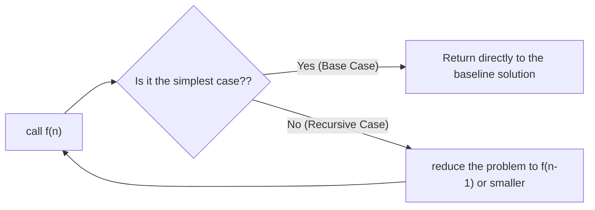
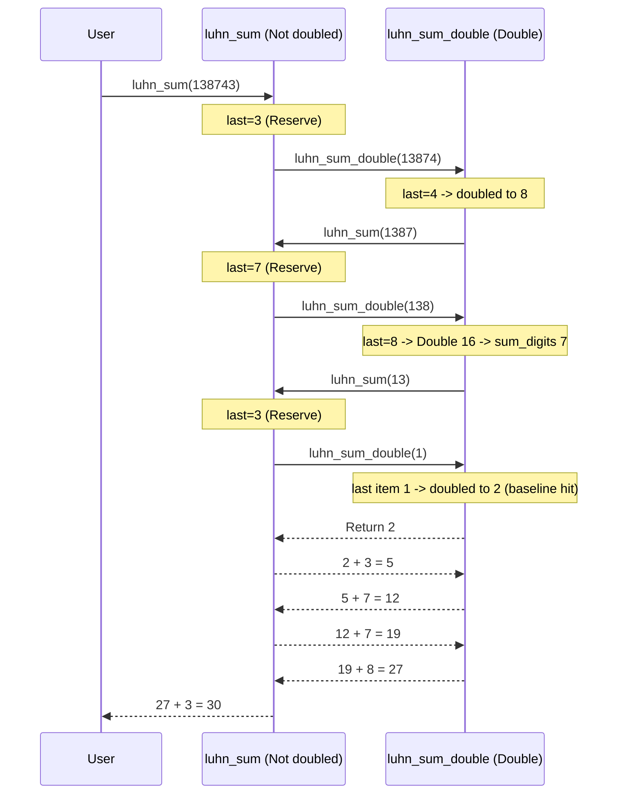

> **Course**: UC Berkeley CS61A (Fall 2024)  
> **Module**: Module 2: Recursion & Data Abstraction (Recursion & Sequences)  
> **Lecturer**: Prof. John DeNero (UC Berkeley)  
> **Video duration**: 37:49 ｜ **Classroom screenshots**: 14 pieces of blackboard writing/code demonstration  
> **Direct video**: [📺Watch the original video of this lecture on Bilibili (P9)](https://www.bilibili.com/video/BV1sy411z7nA/?p=9)  
> **Quick navigation**: [← Previous lecture (P08 Lecture 8 Function Examples)](/en/notes/cs61a/lecture-08) ｜ [📚 Return to the full book catalog](/en/notes/topics/CS61A) ｜ [Next lecture (P10 Lecture 10 Tree Recursion) →](/en/notes/cs61a/lecture-10)

---

## Table of Contents
1. [Introduction: Self-reference and state accumulation in environment models](/en/notes/cs61a/lecture-09#1-introduction-self-reference-and-state-accumulation-in-environment-models)
2. [The nature of recursion and its reflection in reality](/en/notes/cs61a/lecture-09#2-the-essence-of-recursion-and-its-reflection-in-reality)
3. [Anatomy of a Recursive Function](/en/notes/cs61a/lecture-09#3-anatomy-of-a-recursive-function)
4. [Environment model perspective: call stack expansion and return of factorial function](/en/notes/cs61a/lecture-09#4-environment-model-perspective-call-stack-expansion-and-return-of-factorial-function)
5. [Iteration vs. recursion: the choice between expressiveness and state storage](/en/notes/cs61a/lecture-09#5-iteration-vs-recursion-the-choice-between-expressiveness-and-state-storage)
6. [Thinking Leap: The Recursive Leap of Faith](/en/notes/cs61a/lecture-09#6-thinking-leap-the-recursive-leap-of-faith)
7. [Mutual Recursion in Practice: Credit Card Verification Luhn Algorithm](/en/notes/cs61a/lecture-09#7-mutual-recursion-in-practice-credit-card-verification-luhn-algorithm)
8. [The two-way transformation theorem of recursion and iteration](/en/notes/cs61a/lecture-09#8-bidirectional-transformation-theorem-of-recursion-and-iteration)
9. [Key points and thinking questions of this lecture](/en/notes/cs61a/lecture-09#9-core-points-and-thinking-questions-of-this-lecture)

---

### In-depth formal specification and micro-evaluation process (Operational Semantics)
In the "Table of Contents" module, the underlying computer operations rely on strict formal evaluation logic:
1. **Hierarchical parsing of abstract syntax trees (AST)**: 
   - The source code character stream is first divided into terminal symbol tokens (Tokens) by the lexical analyzer (Lexer), and then constructed into a multi-fork syntax tree by the syntax parser (Parser);
   - Operator priority and associativity are solidified during the syntax tree construction phase, eliminating ambiguity at runtime;
2. **Dynamic transitions of environment chains**: 
   - Each function call generates a new frame whose static lexical environment is determined by the function object's  `parent`  Attributes are completely determined;
   - The variable search traces back up the environment chain in one direction until the global environment frame. If it is not found, it will be triggered.  `NameError`  Abnormal;
3. **State Invariants**: 
   - The key to writing robust programs is to clarify loop invariants (Loop Invariants) and function pre/post-conditions (Pre/Post-conditions);
   - In complex control flow jumps, ensure that state variables maintain legal business constraints before each iteration.


## 1. Introduction: Self-reference and state accumulation in environment models

Before diving into classic recursion, Professor DeNero started from the natural inference of the environment model and discussed a seemingly simple but extremely powerful mechanism: **The function body can refer to its own name**.

### 1.1 Self-referential functions that return themselves (`print_all`)

Consider the following Python function:
```python
def print_all(x):
    print(x)
    return print_all
```
When we perform chain calls  `print_all(1)(3)(5)`  When:
1. `print_all(1)`: First search in the global frame  `print_all`, create a local frame  `f1`, binding  `x = 1`. Print  `1`, then search the function body  `print_all`  and returns the function itself.
2. The second bracket of the chain call  `(3)`  Immediately applied to the returned  `print_all`, create a local frame  `f2`, binding  `x = 3`, print  `3`, return again  `print_all`.
3. third bracket  `(5)`  Also call this function to print  `5`.

[](https://www.bilibili.com/video/BV1sy411z7nA/?p=9&t=322)
*⏱ Timestamp: 00:05:22 · 📷 Classroom screenshot · [Watch the corresponding clip on Bilibili (P9 00:05:22)](https://www.bilibili.com/video/BV1sy411z7nA/?p=9&t=322)*

#### 📸 In-depth reading of classroom blackboard writing and code demonstration (00:05:22)

**\[On-site blackboard writing/code demonstration restoration\]**:
At this time point, Professor DeNero conducted a core demonstration and key blackboard derivation on the screen:
> *“And that expression will evaluate to the printAll function, so I could call it again. Let's see what happens. printAll is defined. By the time I call printAll, notice that printAll is already bound in the global frame. I call printAll on the first argument 1. 1 gets printed out. In this environment ...”*

**\[Underlying computing model and micro execution mechanism\]**: 
1. **Execution context and timing tracing**: 
   - At the current discussion point "1. Introduction: Self-reference and state accumulation in environment models", the interpreter strictly follows the core evaluation protocol;
   - The expression evaluates the operators first, then evaluates the operands strictly from left to right, and finally applies the function object to the argument list;
   - If the environment model is involved, the local frame strictly records its static lexical parent pointer (Parent Pointer points to the environment where the function is defined), forming an orthogonal architecture with the dynamic call stack at runtime.
2. **Memory topology and object references**: 
   - Variable symbols are just keys in a hash table (environment frame), and pointers point directly to first-class citizen objects in heap memory;
   - Assignment statements are discrete-time snapshots of the state and never create implicit mathematical dependency monitoring.

**\[Guidelines for avoiding pitfalls and guidance on high-frequency test points\]**: 
- **Common misunderstandings**: In the test questions related to "Recursive expansion and return mechanism, Luhn credit card verification mutual recursion algorithm", beginners can easily guess the results based on the surface form of the code, leading to scope confusion or variable shadowing (Shadowing) misjudgment;
- **The golden rule of debugging**: When encountering nested calls and complex branches, be sure to draw independent partial frames on the scratch paper, indicate the specific binding value of each formal parameter, and derive it step by step.


```
Global frame
  print_all ───► func print_all(x) [parent=Global]
                    ▲
                    │ (returned each time)
f1: print_all [parent=Global]
  x: 1
  Return value ───► func print_all(x)

f2: print_all [parent=Global]
  x: 3
  Return value ───► func print_all(x)

f3: print_all [parent=Global]
  x: 5
  Return value ───► func print_all(x)
```

> **Core conclusion**:Although  `print_all`  refers to itself internally, but it is not in the function body **call** itself, so there will be no infinite loop; the number of calls is completely determined by the external chain call expression.

---

### 1.2 Higher-order functions and historical state accumulation (`print_sums`)

What if we want each call to not only print the current parameters, but also the "cumulative sum of all parameters so far"?

Using lexical closures and the parent frame environment, we can write:
```python
def print_sums(x):
    print(x)
    def next_sum(y):
        return print_sums(x + y)
    return next_sum
```

Execute call: `print_sums(1)(3)(5)`
- `print_sums(1)`: print  `1`, define local functions  `next_sum` (its parent frame is  `f1: x=1`), and return  `next_sum`.
- `next_sum(3)`: local frame  `f2`  binding  `y = 3`. execute  `print_sums(x + y)`, where it passes through the parent frame  `f1`  found  `x = 1`, calculate  `1 + 3 = 4`, initiate a pair  `print_sums(4)`  call.
- `print_sums(4)`:Enter  `f3`  frame, print cumulative sum  `4`, define new  `next_sum` (The parent frame is  `f3: x=4`) and return.
- Finally passed in  `5`  When , the new internal function calculates  `4 + 5 = 9`, enter  `f5`  Print  `9`.

[](https://www.bilibili.com/video/BV1sy411z7nA/?p=9&t=499)
*⏱ Timestamp: 00:08:19 · 📷 Classroom screenshot · [Watch the corresponding clip on Bilibili (P9 00:08:19)](https://www.bilibili.com/video/BV1sy411z7nA/?p=9&t=499)*

#### 📸 In-depth reading of classroom blackboard writing and code demonstration (00:08:19)

**\[On-site blackboard writing/code demonstration restoration\]**:
At this time point, Professor DeNero conducted a core demonstration and key blackboard derivation on the screen:
> *“It's the value of print sums 1, 3. Notice that the function we're returning, which has parent f3, knows the sum so far of 4. And so if it wants to compute the sum of the whole thing, 1 plus 3 plus 5, it needs that 4 along with the 5 that I'm about to pass in. So I've just called nextSum for the seco...”*

**\[Underlying computing model and micro execution mechanism\]**: 
1. **Execution context and timing tracing**: 
   - At the current discussion point "1. Introduction: Self-reference and state accumulation in environment models", the interpreter strictly follows the core evaluation protocol;
   - The expression evaluates the operators first, then evaluates the operands strictly from left to right, and finally applies the function object to the argument list;
   - If the environment model is involved, the local frame strictly records its static lexical parent pointer (Parent Pointer points to the environment where the function is defined), forming an orthogonal architecture with the dynamic call stack at runtime.
2. **Memory topology and object references**: 
   - Variable symbols are just keys in a hash table (environment frame), and pointers point directly to first-class citizen objects in heap memory;
   - Assignment statements are discrete-time snapshots of the state and never create implicit mathematical dependency monitoring.

**\[Guidelines for avoiding pitfalls and guidance on high-frequency test points\]**: 
- **Common misunderstandings**: In the test questions related to "Recursive expansion and return mechanism, Luhn credit card verification mutual recursion algorithm", beginners can easily guess the results based on the surface form of the code, leading to scope confusion or variable shadowing (Shadowing) misjudgment;
- **The golden rule of debugging**: When encountering nested calls and complex branches, be sure to draw independent partial frames on the scratch paper, indicate the specific binding value of each formal parameter, and derive it step by step.


This pattern demonstrates: **Parameters can be passed between different function calls through frame chains and the calculation history is remembered**. This lays an intuitive foundation for us to understand recursive state transitions.

---

### In-depth formal specification and micro-evaluation process (Operational Semantics)
In the "1. Introduction: Self-reference and state accumulation in environment model" module, the underlying computer operations rely on strict formal evaluation logic:
1. **Hierarchical parsing of abstract syntax trees (AST)**: 
   - The source code character stream is first divided into terminal symbol tokens (Tokens) by the lexical analyzer (Lexer), and then constructed into a multi-fork syntax tree by the syntax parser (Parser);
   - Operator priority and associativity are solidified during the syntax tree construction phase, eliminating ambiguity at runtime;
2. **Dynamic transitions of environment chains**: 
   - Each function call generates a new frame whose static lexical environment is determined by the function object's  `parent`  Attributes are completely determined;
   - The variable search traces back up the environment chain in one direction until the global environment frame. If it is not found, it will be triggered.  `NameError`  Abnormal;
3. **State Invariants**: 
   - The key to writing robust programs is to clarify loop invariants (Loop Invariants) and function pre/post-conditions (Pre/Post-conditions);
   - In complex control flow jumps, ensure that state variables maintain legal business constraints before each iteration.


## 2. The essence of recursion and its reflection in reality

### 2.1 What is a recursive function?
> **Recursive Function**: Directly or indirectly call its own function within its own function body.



Recursion is not only the cornerstone of computer algorithms, but can also be found everywhere in nature, art, and mathematics:
- **Sierpinski Triangle**: A large triangle consists of three small Sierpinski triangles with corners as vertices, infinitely nested.
- **Matryoshka Dolls**: Open a doll, and inside is an identical but smaller doll, down to the innermost solid puppet that cannot be separated.

[](https://www.bilibili.com/video/BV1sy411z7nA/?p=9&t=622)
*⏱ Timestamp: 00:10:22 · 📷 Classroom screenshot · [Watch the corresponding clip on Bilibili (P9 00:10:22)](https://www.bilibili.com/video/BV1sy411z7nA/?p=9&t=622)*

#### 📸 In-depth reading of classroom blackboard writing and code demonstration (00:10:22)

**\[On-site blackboard writing/code demonstration restoration\]**:
At this time point, Professor DeNero conducted a core demonstration and key blackboard derivation on the screen:
> *“Recursive functions. One of my favorite topics in this course. So a recursive function is a function whose body calls itself either directly or indirectly. We'll see both cases today. So what does that mean? Well, it means that sometimes when you're executing the body of a function, and it's a recur...”*

**\[Underlying computing model and micro execution mechanism\]**: 
1. **Execution context and timing tracing**: 
   - At the current discussion point "2. The nature of recursion and the reflection of reality", the interpreter strictly follows the core evaluation protocol;
   - The expression evaluates the operators first, then evaluates the operands strictly from left to right, and finally applies the function object to the argument list;
   - If the environment model is involved, the local frame strictly records its static lexical parent pointer (Parent Pointer points to the environment where the function is defined), forming an orthogonal architecture with the dynamic call stack at runtime.
2. **Memory topology and object references**: 
   - Variable symbols are just keys in a hash table (environment frame), and pointers point directly to first-class citizen objects in heap memory;
   - Assignment statements are discrete-time snapshots of the state and never create implicit mathematical dependency monitoring.

**\[Guidelines for avoiding pitfalls and guidance on high-frequency test points\]**: 
- **Common misunderstandings**: In the test questions related to "Recursive expansion and return mechanism, Luhn credit card verification mutual recursion algorithm", beginners can easily guess the results based on the surface form of the code, leading to scope confusion or variable shadowing (Shadowing) misjudgment;
- **The golden rule of debugging**: When encountering nested calls and complex branches, be sure to draw independent partial frames on the scratch paper, indicate the specific binding value of each formal parameter, and derive it step by step.


### 2.2 Typical motivation: Sum Digits and check digits

Take calculating the sum of the digits of a positive integer as an example: `2013 -> 2 + 0 + 1 + 3 = 6`.
- **mathematical properties**: An integer is divisible by 9 if and only if the sum of its digits is divisible by 9.
- **Engineering Application (Checksum Digit)**: In credit cards, barcodes (UPC), and ID numbers, the last digit is usually not the account number itself, but a check digit calculated from all the previous digits. If the user makes a mistake in input, the system can identify the clerical error directly without the need for an Internet connection.

[](https://www.bilibili.com/video/BV1sy411z7nA/?p=9&t=690)
*⏱ Timestamp: 00:11:30 · 📷 Classroom screenshot · [Watch the corresponding clip on Bilibili (P9 00:11:30)](https://www.bilibili.com/video/BV1sy411z7nA/?p=9&t=690)*

#### 📸 In-depth reading of classroom blackboard writing and code demonstration (00:11:30)

**\[On-site blackboard writing/code demonstration restoration\]**:
At this time point, Professor DeNero conducted a core demonstration and key blackboard derivation on the screen:
> *“2 plus 0 plus 1 plus 3 is 6. Why would we do this? Well, there are interesting properties of digit sums, such as a number A is divisible by 9, if and only if its digit sum is also divisible by 9. And, summing up digits is very useful for typo detection. So here's a credit card. Now, the problem with...”*

**\[Underlying computing model and micro execution mechanism\]**: 
1. **Execution context and timing tracing**: 
   - At the current discussion point "2. The nature of recursion and the reflection of reality", the interpreter strictly follows the core evaluation protocol;
   - The expression evaluates the operators first, then evaluates the operands strictly from left to right, and finally applies the function object to the argument list;
   - If the environment model is involved, the local frame strictly records its static lexical parent pointer (Parent Pointer points to the environment where the function is defined), forming an orthogonal architecture with the dynamic call stack at runtime.
2. **Memory topology and object references**: 
   - Variable symbols are just keys in a hash table (environment frame), and pointers point directly to first-class citizen objects in heap memory;
   - Assignment statements are discrete-time snapshots of the state and never create implicit mathematical dependency monitoring.

**\[Guidelines for avoiding pitfalls and guidance on high-frequency test points\]**: 
- **Common misunderstandings**: In the test questions related to "Recursive expansion and return mechanism, Luhn credit card verification mutual recursion algorithm", beginners can easily guess the results based on the surface form of the code, leading to scope confusion or variable shadowing (Shadowing) misjudgment;
- **The golden rule of debugging**: When encountering nested calls and complex branches, be sure to draw independent partial frames on the scratch paper, indicate the specific binding value of each formal parameter, and derive it step by step.


---

### In-depth formal specification and micro-evaluation process (Operational Semantics)
In the module "2. The Essence of Recursion and Reality Mapping", the underlying computer operations rely on strict formal evaluation logic:
1. **Hierarchical parsing of abstract syntax trees (AST)**: 
   - The source code character stream is first divided into terminal symbol tokens (Tokens) by the lexical analyzer (Lexer), and then constructed into a multi-fork syntax tree by the syntax parser (Parser);
   - Operator priority and associativity are solidified during the syntax tree construction phase, eliminating ambiguity at runtime;
2. **Dynamic transitions of environment chains**: 
   - Each function call generates a new frame whose static lexical environment is determined by the function object's  `parent`  Attributes are completely determined;
   - The variable search traces back up the environment chain in one direction until the global environment frame. If it is not found, it will be triggered.  `NameError`  Abnormal;
3. **State Invariants**: 
   - The key to writing robust programs is to clarify loop invariants (Loop Invariants) and function pre/post-conditions (Pre/Post-conditions);
   - In complex control flow jumps, ensure that state variables maintain legal business constraints before each iteration.


## 3. Anatomy of a Recursive Function

How not to use  `while`  Loop to sum the digits of an integer?

### 3.1 Building block structure: digital splitting (`split`)
First define the basic operations of integer division and modulo:
```python
def split(n):
    """返回 (去除个位后的数, 个位数字)"""
    return n // 10, n % 10
```
For example: `split(2013)`  Return  `(201, 3)`. If we already know how to  `201`  Sum the digits of (we get  `3`), plus single digits  `3`, you can get the result of the original number  `6`!

[](https://www.bilibili.com/video/BV1sy411z7nA/?p=9&t=828)
*⏱ Timestamp: 00:13:48 · 📷 Classroom screenshot · [Watch the corresponding clip on Bilibili (P9 00:13:48)](https://www.bilibili.com/video/BV1sy411z7nA/?p=9&t=828)*

#### 📸 In-depth reading of classroom blackboard writing and code demonstration (00:13:48)

**\[On-site blackboard writing/code demonstration restoration\]**:
At this time point, Professor DeNero conducted a core demonstration and key blackboard derivation on the screen:
> *“And then the last digit is 3. So if I can sum up the digits of 201, and I can add 3 to that, then I'll get the sum for 2013. Let's write that in code. In order to sum the digits of n, well, if n is less than 10, meaning it's a single digit, we'll just return n. The sum of the digits of 7 is just 7. ...”*

**\[Underlying computing model and micro execution mechanism\]**: 
1. **Execution context and timing tracing**: 
   - At the current discussion point "3. Anatomy of a Recursive Function", the interpreter strictly follows the core evaluation convention;
   - The expression evaluates the operators first, then evaluates the operands strictly from left to right, and finally applies the function object to the argument list;
   - If the environment model is involved, the local frame strictly records its static lexical parent pointer (Parent Pointer points to the environment where the function is defined), forming an orthogonal architecture with the dynamic call stack at runtime.
2. **Memory topology and object references**: 
   - Variable symbols are just keys in a hash table (environment frame), and pointers point directly to first-class citizen objects in heap memory;
   - Assignment statements are discrete-time snapshots of the state and never create implicit mathematical dependency monitoring.

**\[Guidelines for avoiding pitfalls and guidance on high-frequency test points\]**: 
- **Common misunderstandings**: In the test questions related to "Recursive expansion and return mechanism, Luhn credit card verification mutual recursion algorithm", beginners can easily guess the results based on the surface form of the code, leading to scope confusion or variable shadowing (Shadowing) misjudgment;
- **The golden rule of debugging**: When encountering nested calls and complex branches, be sure to draw independent partial frames on the scratch paper, indicate the specific binding value of each formal parameter, and derive it step by step.


### 3.2 Recursive standard paradigm
A standard recursive function must consist of two pillars:
1. **Base Cases**: The simplest case that can be solved directly without recursive calls.
2. **Recursive Cases**: By splitting the original problem into **Smaller sub-problems of the same type**, and complete the assembly on the sub-problem results.

```python
def sum_digits(n):
    """计算正整数 n 的各位数字之和。"""
    if n < 10:
        return n  # 基线条件：单数位直接返回自身
    else:
        all_but_last, last = split(n)
        return sum_digits(all_but_last) + last  # 递归条件：更小的问题 + 当前个位
```

[](https://www.bilibili.com/video/BV1sy411z7nA/?p=9&t=922)
*⏱ Timestamp: 00:15:22 · 📷 Classroom screenshot · [Watch the corresponding clip on Bilibili (P9 00:15:22)](https://www.bilibili.com/video/BV1sy411z7nA/?p=9&t=922)*

#### 📸 In-depth reading of classroom blackboard writing and code demonstration (00:15:22)

**\[On-site blackboard writing/code demonstration restoration\]**:
At this time point, Professor DeNero conducted a core demonstration and key blackboard derivation on the screen:
> *“Base cases are very simple versions of the problem I'm trying to solve. In this case, the base case is a really simple case where you only have one digit, so summing it up is trivial. You just return N. So base cases are evaluated without recursive calls. They can usually be computed directly, such ...”*

**\[Underlying computing model and micro execution mechanism\]**: 
1. **Execution context and timing tracing**: 
   - At the current discussion point "3. Anatomy of a Recursive Function", the interpreter strictly follows the core evaluation convention;
   - The expression evaluates the operators first, then evaluates the operands strictly from left to right, and finally applies the function object to the argument list;
   - If the environment model is involved, the local frame strictly records its static lexical parent pointer (Parent Pointer points to the environment where the function is defined), forming an orthogonal architecture with the dynamic call stack at runtime.
2. **Memory topology and object references**: 
   - Variable symbols are just keys in a hash table (environment frame), and pointers point directly to first-class citizen objects in heap memory;
   - Assignment statements are discrete-time snapshots of the state and never create implicit mathematical dependency monitoring.

**\[Guidelines for avoiding pitfalls and guidance on high-frequency test points\]**: 
- **Common misunderstandings**: In the test questions related to "Recursive expansion and return mechanism, Luhn credit card verification mutual recursion algorithm", beginners can easily guess the results based on the surface form of the code, leading to scope confusion or variable shadowing (Shadowing) misjudgment;
- **The golden rule of debugging**: When encountering nested calls and complex branches, be sure to draw independent partial frames on the scratch paper, indicate the specific binding value of each formal parameter, and derive it step by step.


> **Anatomical elements comparison table**: 
> | components | `sum_digits`  implementation in | key role |
> | :--- | :--- | :--- |
> | **function signature** | `def sum_digits(n):` | Declare the parameters received by the function (state carrier) |
> | **conditional branch** | `if n < 10:` | Distinguish between baselines and recursive branches to prevent infinite self-tuning |
> | **Baseline solution** | `return n` | Provide stopping conditions and exit return values for recursion |
> | **status shrink** | `all_but_last, last = split(n)` | Ensure that the input of each recursive call is converging towards the baseline |
> | **recursive combination** | `return sum_digits(...) + last` | Trust the solutions to the subproblems and synthesize the final answer |

---

### In-depth formal specification and micro-evaluation process (Operational Semantics)
In the "3. Anatomy of a Recursive Function" module, the underlying computer operations rely on strict formal evaluation logic:
1. **Hierarchical parsing of abstract syntax trees (AST)**: 
   - The source code character stream is first divided into terminal symbol tokens (Tokens) by the lexical analyzer (Lexer), and then constructed into a multi-fork syntax tree by the syntax parser (Parser);
   - Operator priority and associativity are solidified during the syntax tree construction phase, eliminating ambiguity at runtime;
2. **Dynamic transitions of environment chains**: 
   - Each function call generates a new frame whose static lexical environment is determined by the function object's  `parent`  Attributes are completely determined;
   - The variable search traces back up the environment chain in one direction until the global environment frame. If it is not found, it will be triggered.  `NameError`  Abnormal;
3. **State Invariants**: 
   - The key to writing robust programs is to clarify loop invariants (Loop Invariants) and function pre/post-conditions (Pre/Post-conditions);
   - In complex control flow jumps, ensure that state variables maintain legal business constraints before each iteration.


## 4. Environment model perspective: call stack expansion and return of factorial function

To completely demystify recursion, we use CS61A’s most powerful tool—**Environment Diagrams**  Analyze factorial function frame by frame  `fact(3)`: 

```python
def fact(n):
    if n == 0:
        return 1
    else:
        return n * fact(n - 1)

fact(3)
```

[](https://www.bilibili.com/video/BV1sy411z7nA/?p=9&t=1058)
*⏱ Timestamp: 00:17:38 · 📷 Classroom screenshot · [Watch the corresponding clip on Bilibili (P9 00:17:38)](https://www.bilibili.com/video/BV1sy411z7nA/?p=9&t=1058)*

#### 📸 In-depth reading of classroom blackboard writing and code demonstration (00:17:38)

**\[On-site blackboard writing/code demonstration restoration\]**:
At this time point, Professor DeNero conducted a core demonstration and key blackboard derivation on the screen:
> *“The nice thing is that environment diagrams are useful for understanding recursive functions. So we're going to look at a new example, the factorial function, which computes the factorial of n, or n times n minus 1 times n minus 2 times n minus 3, all the way down until you get to 1. We'll start out...”*

**\[Underlying computing model and micro execution mechanism\]**: 
1. **Execution context and timing tracing**: 
   - At the current discussion point "4. Environment model perspective: call stack expansion and return of factorial function", the interpreter strictly follows the core evaluation protocol;
   - The expression evaluates the operators first, then evaluates the operands strictly from left to right, and finally applies the function object to the argument list;
   - If the environment model is involved, the local frame strictly records its static lexical parent pointer (Parent Pointer points to the environment where the function is defined), forming an orthogonal architecture with the dynamic call stack at runtime.
2. **Memory topology and object references**: 
   - Variable symbols are just keys in a hash table (environment frame), and pointers point directly to first-class citizen objects in heap memory;
   - Assignment statements are discrete-time snapshots of the state and never create implicit mathematical dependency monitoring.

**\[Guidelines for avoiding pitfalls and guidance on high-frequency test points\]**: 
- **Common misunderstandings**: In the test questions related to "Recursive expansion and return mechanism, Luhn credit card verification mutual recursion algorithm", beginners can easily guess the results based on the surface form of the code, leading to scope confusion or variable shadowing (Shadowing) misjudgment;
- **The golden rule of debugging**: When encountering nested calls and complex branches, be sure to draw independent partial frames on the scratch paper, indicate the specific binding value of each formal parameter, and derive it step by step.


### 4.1 Going deeper into the call stack (progressing toward the baseline)
1. **call  `fact(3)`**:Create frame  `f1`, binding  `n = 3`. enter  `else`  branch, evaluate expression  `3 * fact(2)`. To obtain the multiplication operand, pause the return of the current frame and initiate a subcall  `fact(2)`.
2. **call  `fact(2)`**:Create frame  `f2`, binding  `n = 2`. Evaluate  `2 * fact(1)`, pause and wait  `fact(1)`  return value.
3. **call  `fact(1)`**:Create frame  `f3`, binding  `n = 1`. Evaluate  `1 * fact(0)`, pause and wait  `fact(0)`.
4. **reach baseline  `fact(0)`**:Create frame  `f4`, binding  `n = 0`. satisfy  `n == 0`, return directly  `1`!

### 4.2 Stack frame return and product aggregation (backtracking from baseline)
5. `f4`  Return  `1`  Arrive  `f3`  Waiting point: `f3`  Calculate  `1 * 1 = 1`, will  `1`  as  `f3`  The return value is returned to  `f2`.
6. `f2`  received  `1`: Calculation  `2 * 1 = 2`, will  `2`  return to  `f1`.
7. `f1`  received  `2`: Calculation  `3 * 2 = 6`, eventually return  `6`.

[](https://www.bilibili.com/video/BV1sy411z7nA/?p=9&t=1300)
*⏱ Timestamp: 00:21:40 · 📷 Classroom screenshot · [Watch the corresponding clip on Bilibili (P9 00:21:40)](https://www.bilibili.com/video/BV1sy411z7nA/?p=9&t=1300)*

#### 📸 In-depth reading of classroom blackboard writing and code demonstration (00:21:40)

**\[On-site blackboard writing/code demonstration restoration\]**:
At this time point, Professor DeNero conducted a core demonstration and key blackboard derivation on the screen:
> *“Of the original call to fact. In that case, we're multiplying 3 times whatever we got here, which was this return value, and 3 times 2 is 6. And so we get 6 for the entire return value of fact 3, which is actually the right answer. 3 times 2 times 1 is 6. So somewhere in the middle of execution, our...”*

**\[Underlying computing model and micro execution mechanism\]**: 
1. **Execution context and timing tracing**: 
   - At the current discussion point "4. Environment model perspective: call stack expansion and return of factorial function", the interpreter strictly follows the core evaluation protocol;
   - The expression evaluates the operators first, then evaluates the operands strictly from left to right, and finally applies the function object to the argument list;
   - If the environment model is involved, the local frame strictly records its static lexical parent pointer (Parent Pointer points to the environment where the function is defined), forming an orthogonal architecture with the dynamic call stack at runtime.
2. **Memory topology and object references**: 
   - Variable symbols are just keys in a hash table (environment frame), and pointers point directly to first-class citizen objects in heap memory;
   - Assignment statements are discrete-time snapshots of the state and never create implicit mathematical dependency monitoring.

**\[Guidelines for avoiding pitfalls and guidance on high-frequency test points\]**: 
- **Common misunderstandings**: In the test questions related to "Recursive expansion and return mechanism, Luhn credit card verification mutual recursion algorithm", beginners can easily guess the results based on the surface form of the code, leading to scope confusion or variable shadowing (Shadowing) misjudgment;
- **The golden rule of debugging**: When encountering nested calls and complex branches, be sure to draw independent partial frames on the scratch paper, indicate the specific binding value of each formal parameter, and derive it step by step.


```
Global frame
  fact ───► func fact(n) [parent=Global]

f1: fact [parent=Global]
  n: 3
  Return value: 6  ◄── 3 * 2

f2: fact [parent=Global]
  n: 2
  Return value: 2  ◄── 2 * 1

f3: fact [parent=Global]
  n: 1
  Return value: 1  ◄── 1 * 1

f4: fact [parent=Global]
  n: 0
  Return value: 1  (Base Case reached!)
```

> **Key Implications of Environmental Models**: 
> - **The same function is called multiple times**, but **Each call corresponds to an independent activity frame (Frame)**.
> - Computers never mix up different levels of  `n`, because each time the current expression is evaluated  `n` , it only looks backward in the currently active environment.
> - All pending computations are saved in the execution context of their respective frames.

---

### In-depth formal specification and micro-evaluation process (Operational Semantics)
In the "4. Environment Model Perspective: Call Stack Expansion and Return of Factorial Function" module, the underlying computer operations rely on strict formal evaluation logic:
1. **Hierarchical parsing of abstract syntax trees (AST)**: 
   - The source code character stream is first divided into terminal symbol tokens (Tokens) by the lexical analyzer (Lexer), and then constructed into a multi-fork syntax tree by the syntax parser (Parser);
   - Operator priority and associativity are solidified during the syntax tree construction phase, eliminating ambiguity at runtime;
2. **Dynamic transitions of environment chains**: 
   - Each function call generates a new frame whose static lexical environment is determined by the function object's  `parent`  Attributes are completely determined;
   - The variable search traces back up the environment chain in one direction until the global environment frame. If it is not found, it will be triggered.  `NameError`  Abnormal;
3. **State Invariants**: 
   - The key to writing robust programs is to clarify loop invariants (Loop Invariants) and function pre/post-conditions (Pre/Post-conditions);
   - In complex control flow jumps, ensure that state variables maintain legal business constraints before each iteration.


## 5. Iteration vs. Recursion: the choice between expressiveness and state storage

### 5.1 Comparison of code and mathematical form

Iterative and recursive implementations of calculating factorial:

```python
# 迭代实现 (Iteration)
def fact_iter(n):
    total, k = 1, 1
    while k <= n:
        total, k = total * k, k + 1
    return total

# 递归实现 (Recursion)
def fact(n):
    if n == 0:
        return 1
    return n * fact(n - 1)
```

[](https://www.bilibili.com/video/BV1sy411z7nA/?p=9&t=1456)
*⏱ Timestamp: 00:24:16 · 📷 Classroom screenshot · [Watch the corresponding clip on Bilibili (P9 00:24:16)](https://www.bilibili.com/video/BV1sy411z7nA/?p=9&t=1456)*

#### 📸 In-depth reading of classroom blackboard writing and code demonstration (00:24:16)

**\[On-site blackboard writing/code demonstration restoration\]**:
At this time point, Professor DeNero conducted a core demonstration and key blackboard derivation on the screen:
> *“By keeping track of the total factorial, and what number I'm about to multiply in, and as long as k is less than or equal to n, I change total to be total times the next number that I multiply in, and I change k to be one more than it was before. And when I'm finished with this while statement, then...”*

**\[Underlying computing model and micro execution mechanism\]**: 
1. **Execution context and timing tracing**: 
   - At the current discussion point "5. Iteration vs. Recursion: the choice between expressiveness and state storage", the interpreter strictly follows the core evaluation protocol;
   - The expression evaluates the operators first, then evaluates the operands strictly from left to right, and finally applies the function object to the argument list;
   - If the environment model is involved, the local frame strictly records its static lexical parent pointer (Parent Pointer points to the environment where the function is defined), forming an orthogonal architecture with the dynamic call stack at runtime.
2. **Memory topology and object references**: 
   - Variable symbols are just keys in a hash table (environment frame), and pointers point directly to first-class citizen objects in heap memory;
   - Assignment statements are discrete-time snapshots of the state and never create implicit mathematical dependency monitoring.

**\[Guidelines for avoiding pitfalls and guidance on high-frequency test points\]**: 
- **Common misunderstandings**: In the test questions related to "Recursive expansion and return mechanism, Luhn credit card verification mutual recursion algorithm", beginners can easily guess the results based on the surface form of the code, leading to scope confusion or variable shadowing (Shadowing) misjudgment;
- **The golden rule of debugging**: When encountering nested calls and complex branches, be sure to draw independent partial frames on the scratch paper, indicate the specific binding value of each formal parameter, and derive it step by step.


### 5.2 Core difference analysis
| Dimensions | Iteration | Recursion |
| :--- | :--- | :--- |
| **State maintenance mechanism** | The programmer must explicitly define variables (e.g.  `total`, `k`) and continuously modify its value through assignment statements within the loop body | Depend on **Call Stack Frames**  Implicitly maintain local state at each step |
| **Variable naming burden** | Multiple state variable names need to be maintained, the variable life cycle is long, and it is easy for variables to be contaminated or out of bounds. | You only need to pay attention to the function parameters and the current sub-problem scale, and there are few local variables. |
| **mathematical correspondence** | Corresponding cumulative product notation: $\prod_{k=1}^n k$ | Corresponding recursive induction definition: $n! = \begin{cases} 1 & \text{if } n = 0 \\ n \cdot (n-1)! & \text{otherwise} \end{cases}$ |
| **space overhead** | Constant space complexity  $O(1)$ | The stack frame depth is proportional to the number of recursion steps  $O(n)$ (When non-tail recursive optimization) |

---

### In-depth formal specification and micro-evaluation process (Operational Semantics)
In the "5. Iteration vs. Recursion: Choice between Expression and State Storage" module, the underlying computer operations rely on strict formal evaluation logic:
1. **Hierarchical parsing of abstract syntax trees (AST)**: 
   - The source code character stream is first divided into terminal symbol tokens (Tokens) by the lexical analyzer (Lexer), and then constructed into a multi-fork syntax tree by the syntax parser (Parser);
   - Operator priority and associativity are solidified during the syntax tree construction phase, eliminating ambiguity at runtime;
2. **Dynamic transitions of environment chains**: 
   - Each function call generates a new frame whose static lexical environment is determined by the function object's  `parent`  Attributes are completely determined;
   - The variable search traces back up the environment chain in one direction until the global environment frame. If it is not found, it will be triggered.  `NameError`  Abnormal;
3. **State Invariants**: 
   - The key to writing robust programs is to clarify loop invariants (Loop Invariants) and function pre/post-conditions (Pre/Post-conditions);
   - In complex control flow jumps, ensure that state variables maintain legal business constraints before each iteration.


## 6. Thinking Leap: The Recursive Leap of Faith

The most common psychological obstacle for beginners when writing recursion is: "I haven't finished writing this function yet, why can I call it itself directly in the code? How can it give the correct answer?"

Professor DeNero vividly calls it the "Leap of Faith"\*\*.

[](https://www.bilibili.com/video/BV1sy411z7nA/?p=9&t=1608)
*⏱ Timestamp: 00:26:48 · 📷 Classroom screenshot · [Watch the corresponding clip on Bilibili (P9 00:26:48)](https://www.bilibili.com/video/BV1sy411z7nA/?p=9&t=1608)*

#### 📸 In-depth reading of classroom blackboard writing and code demonstration (00:26:48)

**\[On-site blackboard writing/code demonstration restoration\]**:
At this time point, Professor DeNero conducted a core demonstration and key blackboard derivation on the screen:
> *“Whereas on the left, we have to do that by keeping track of total and keeping track of k. Next, we'll talk about verifying the correctness of a recursive function. And that requires the recursive leap of faith. There's my friend Kevin, sitting on top of a very large cliff. And that's what it can fee...”*

**\[Underlying computing model and micro execution mechanism\]**: 
1. **Execution context and timing tracing**: 
   - At the current discussion point "6. Thinking Leap: The Recursive Leap of Faith", the interpreter strictly follows the core evaluation protocol;
   - The expression evaluates the operators first, then evaluates the operands strictly from left to right, and finally applies the function object to the argument list;
   - If the environment model is involved, the local frame strictly records its static lexical parent pointer (Parent Pointer points to the environment where the function is defined), forming an orthogonal architecture with the dynamic call stack at runtime.
2. **Memory topology and object references**: 
   - Variable symbols are just keys in a hash table (environment frame), and pointers point directly to first-class citizen objects in heap memory;
   - Assignment statements are discrete-time snapshots of the state and never create implicit mathematical dependency monitoring.

**\[Guidelines for avoiding pitfalls and guidance on high-frequency test points\]**: 
- **Common misunderstandings**: In the test questions related to "Recursive expansion and return mechanism, Luhn credit card verification mutual recursion algorithm", beginners can easily guess the results based on the surface form of the code, leading to scope confusion or variable shadowing (Shadowing) misjudgment;
- **The golden rule of debugging**: When encountering nested calls and complex branches, be sure to draw independent partial frames on the scratch paper, indicate the specific binding value of each formal parameter, and derive it step by step.


### 6.1 Three-step method to verify the correctness of recursion
1. **Step 1: Verify the Base Cases**
   - Check whether the function directly returns the correct answer for the simplest input. for  `fact(0)`, which returns  `1`, no doubt.
2. **Step 2: Treat Recursive Call as Functional Abstraction**
   - **Never unfold the execution details of recursive calls in your head!**
   - will  `fact(n - 1)`  Treat it as a black box abstraction. only care about it **Contract**: That is, assuming that it can be calculated correctly  $(n-1)!$.
3. **Step 3: Verify the overall correctness by induction (Verify Induction Step)**
   - Proof: If  `fact(n - 1)`  works as expected, then based on its results the  `n * fact(n - 1)`  Is it strictly equivalent to  $n!$?
   - $n \cdot (n-1)! = n!$, the equation is absolutely mathematically true. Combined with the baseline conditions, the entire function is correct over the entire range of natural numbers!

> **Laws of thinking**: When writing recursion, your focus must always be on "how to use the solutions to the subproblems to build a solution to the current problem", rather than getting bogged down in the infinite details of tracing the call stack schedule.

---

### In-depth formal specification and micro-evaluation process (Operational Semantics)
In the "6. Thinking Leap: The Recursive Leap of Faith" module, the underlying computer operations rely on strict formal evaluation logic:
1. **Hierarchical parsing of abstract syntax trees (AST)**: 
   - The source code character stream is first divided into terminal symbol tokens (Tokens) by the lexical analyzer (Lexer), and then constructed into a multi-fork syntax tree by the syntax parser (Parser);
   - Operator priority and associativity are solidified during the syntax tree construction phase, eliminating ambiguity at runtime;
2. **Dynamic transitions of environment chains**: 
   - Each function call generates a new frame whose static lexical environment is determined by the function object's  `parent`  Attributes are completely determined;
   - The variable search traces back up the environment chain in one direction until the global environment frame. If it is not found, it will be triggered.  `NameError`  Abnormal;
3. **State Invariants**: 
   - The key to writing robust programs is to clarify loop invariants (Loop Invariants) and function pre/post-conditions (Pre/Post-conditions);
   - In complex control flow jumps, ensure that state variables maintain legal business constraints before each iteration.


## 7. Mutual Recursion in Practice: Credit Card Verification Luhn Algorithm

### 7.1 Algorithm Principles (Wikipedia)
Used by globally accepted credit cards (such as Visa, MasterCard)  **Luhn's algorithm (modulo 10 algorithm)**  Detect input errors:
1. Starting from the rightmost digit (the check digit itself), scan from right to left.
2. **Even-numbered positions (2nd, 4th, 6th... numbers from right to left) are doubled (Double)**.
3. If the doubled result is greater than 9 (e.g.  $8 \times 2 = 16$), then change it **Sum of individual digits**($1 + 6 = 7$, which is equivalent to subtracting 9).
4. Add all digits (doubled and undoubled).
5. If the final sum is a multiple of 10 (i.e.  `sum % 10 == 0`), the credit card number is valid.

[](https://www.bilibili.com/video/BV1sy411z7nA/?p=9&t=1794)
*⏱ Timestamp: 00:29:54 · 📷 Classroom screenshot · [Watch the corresponding clip on Bilibili (P9 00:29:54)](https://www.bilibili.com/video/BV1sy411z7nA/?p=9&t=1794)*

#### 📸 In-depth reading of classroom blackboard writing and code demonstration (00:29:54)

**\[On-site blackboard writing/code demonstration restoration\]**:
At this time point, Professor DeNero conducted a core demonstration and key blackboard derivation on the screen:
> *“Double the value of every second digit. If product of this doubling operation is greater than 9, then sum the digits of the products. Take the sum of all the digits. So how does this work? Well, let's compute the ln sum of 1, 3, 8, 7, 4, 3. We do that by taking each digit, except for every other dig...”*

**\[Underlying computing model and micro execution mechanism\]**: 
1. **Execution context and timing tracing**: 
   - At the current discussion point "7. Mutual Recursion in Practice: Credit Card Verification Luhn Algorithm", the interpreter strictly follows the core evaluation protocol;
   - The expression evaluates the operators first, then evaluates the operands strictly from left to right, and finally applies the function object to the argument list;
   - If the environment model is involved, the local frame strictly records its static lexical parent pointer (Parent Pointer points to the environment where the function is defined), forming an orthogonal architecture with the dynamic call stack at runtime.
2. **Memory topology and object references**: 
   - Variable symbols are just keys in a hash table (environment frame), and pointers point directly to first-class citizen objects in heap memory;
   - Assignment statements are discrete-time snapshots of the state and never create implicit mathematical dependency monitoring.

**\[Guidelines for avoiding pitfalls and guidance on high-frequency test points\]**: 
- **Common misunderstandings**: In the test questions related to "Recursive expansion and return mechanism, Luhn credit card verification mutual recursion algorithm", beginners can easily guess the results based on the surface form of the code, leading to scope confusion or variable shadowing (Shadowing) misjudgment;
- **The golden rule of debugging**: When encountering nested calls and complex branches, be sure to draw independent partial frames on the scratch paper, indicate the specific binding value of each formal parameter, and derive it step by step.


**Example**:Account  `1 3 8 7 4 3`
- Process from right to left:
  - `3` (position 1, reserved): $3$
  - `4` (No. 2, doubled): $4 \times 2 = 8$
  - `7` (position 3, reserved): $7$
  - `8` (No. 4, doubled): $8 \times 2 = 16 \rightarrow 1 + 6 = 7$
  - `3` (No. 5, reserved): $3$
  - `1` (No. 6, doubled): $1 \times 2 = 2$
- Sum: $2 + 3 + 7 + 7 + 8 + 3 = 30$.$30 \pmod{10} == 0$, verification passed!

---

### 7.2 Mutual recursive code implementation (`luhn_sum`  with  `luhn_sum_double`)
By calling each other between the two functions, we can handle the "double every other bit" state alternation extremely elegantly:

```python
def split(n):
    return n // 10, n % 10

def sum_digits(n):
    if n < 10:
        return n
    all_but_last, last = split(n)
    return sum_digits(all_but_last) + last

def luhn_sum(n):
    """计算当前最右侧数位不翻倍时的 Luhn 和。"""
    if n < 10:
        return n
    all_but_last, last = split(n)
    return luhn_sum_double(all_but_last) + last

def luhn_sum_double(n):
    """计算当前最右侧数位需要翻倍时的 Luhn 和。"""
    all_but_last, last = split(n)
    luhn_digit = sum_digits(2 * last)
    if n < 10:
        return luhn_digit
    return luhn_sum(all_but_last) + luhn_digit
```

[](https://www.bilibili.com/video/BV1sy411z7nA/?p=9&t=1953)
*⏱ Timestamp: 00:32:33 · 📷 Classroom screenshot · [Watch the corresponding clip on Bilibili (P9 00:32:33)](https://www.bilibili.com/video/BV1sy411z7nA/?p=9&t=1953)*

#### 📸 In-depth reading of classroom blackboard writing and code demonstration (00:32:33)

**\[On-site blackboard writing/code demonstration restoration\]**:
At this time point, Professor DeNero conducted a core demonstration and key blackboard derivation on the screen:
> *“Otherwise, it does this doubly. Let's compute that double digit. So the first thing we'll do is we'll break up N, and then we'll compute the LUN digit, which is the sum of the digits of two times the last. If N is less than 10, we just return the LUN digit. Otherwise, we'll return the LUN sum of all...”*

**\[Underlying computing model and micro execution mechanism\]**: 
1. **Execution context and timing tracing**: 
   - At the current discussion point "7. Mutual Recursion in Practice: Credit Card Verification Luhn Algorithm", the interpreter strictly follows the core evaluation protocol;
   - The expression evaluates the operators first, then evaluates the operands strictly from left to right, and finally applies the function object to the argument list;
   - If the environment model is involved, the local frame strictly records its static lexical parent pointer (Parent Pointer points to the environment where the function is defined), forming an orthogonal architecture with the dynamic call stack at runtime.
2. **Memory topology and object references**: 
   - Variable symbols are just keys in a hash table (environment frame), and pointers point directly to first-class citizen objects in heap memory;
   - Assignment statements are discrete-time snapshots of the state and never create implicit mathematical dependency monitoring.

**\[Guidelines for avoiding pitfalls and guidance on high-frequency test points\]**: 
- **Common misunderstandings**: In the test questions related to "Recursive expansion and return mechanism, Luhn credit card verification mutual recursion algorithm", beginners can easily guess the results based on the surface form of the code, leading to scope confusion or variable shadowing (Shadowing) misjudgment;
- **The golden rule of debugging**: When encountering nested calls and complex branches, be sure to draw independent partial frames on the scratch paper, indicate the specific binding value of each formal parameter, and derive it step by step.




> **Mutual Recursion**  The core feature: two or more functions form a loop that calls each other. Through the alternating transfer of function control rights, a multi-state machine is naturally realized (such as the dual-state alternation of "normal bit" and "double bit" in this example), without the need to explicitly maintain Boolean flags.

---

### In-depth formal specification and micro-evaluation process (Operational Semantics)
In the "7. Mutual Recursion Practice: Credit Card Verification Luhn Algorithm" module, the underlying computer operations rely on strict formal evaluation logic:
1. **Hierarchical parsing of abstract syntax trees (AST)**: 
   - The source code character stream is first divided into terminal symbol tokens (Tokens) by the lexical analyzer (Lexer), and then constructed into a multi-fork syntax tree by the syntax parser (Parser);
   - Operator priority and associativity are solidified during the syntax tree construction phase, eliminating ambiguity at runtime;
2. **Dynamic transitions of environment chains**: 
   - Each function call generates a new frame whose static lexical environment is determined by the function object's  `parent`  Attributes are completely determined;
   - The variable search traces back up the environment chain in one direction until the global environment frame. If it is not found, it will be triggered.  `NameError`  Abnormal;
3. **State Invariants**: 
   - The key to writing robust programs is to clarify loop invariants (Loop Invariants) and function pre/post-conditions (Pre/Post-conditions);
   - In complex control flow jumps, ensure that state variables maintain legal business constraints before each iteration.


## 8. Bidirectional transformation theorem of recursion and iteration

### 8.1 Recursion to iteration: explicit state promotion
When converting recursion to iteration, the key is to identify **The partial sum of the status passed and the returned value in each recursive call**, and promote it to a loop variable:

```python
def sum_digits_iter(n):
    digit_sum = 0
    while n > 0:
        n, last = split(n)
        digit_sum = digit_sum + last
    return digit_sum
```
[](https://www.bilibili.com/video/BV1sy411z7nA/?p=9&t=2079)
*⏱ Timestamp: 00:34:39 · 📷 Classroom screenshot · [Watch the corresponding clip on Bilibili (P9 00:34:39)](https://www.bilibili.com/video/BV1sy411z7nA/?p=9&t=2079)*

#### 📸 In-depth reading of classroom blackboard writing and code demonstration (00:34:39)

**\[On-site blackboard writing/code demonstration restoration\]**:
At this time point, Professor DeNero conducted a core demonstration and key blackboard derivation on the screen:
> *“The idea is that you have to figure out what state needs to be maintained by the iterative function across each pass through the while statements. And so if we look at the sum digits function that we implemented earlier, we can look at what gets passed into some digits in each recursive call and wha...”*

**\[Underlying computing model and micro execution mechanism\]**: 
1. **Execution context and timing tracing**: 
   - At the current discussion point "8. Bidirectional transformation theorem of recursion and iteration", the interpreter strictly follows the core evaluation protocol;
   - The expression evaluates the operators first, then evaluates the operands strictly from left to right, and finally applies the function object to the argument list;
   - If the environment model is involved, the local frame strictly records its static lexical parent pointer (Parent Pointer points to the environment where the function is defined), forming an orthogonal architecture with the dynamic call stack at runtime.
2. **Memory topology and object references**: 
   - Variable symbols are just keys in a hash table (environment frame), and pointers point directly to first-class citizen objects in heap memory;
   - Assignment statements are discrete-time snapshots of the state and never create implicit mathematical dependency monitoring.

**\[Guidelines for avoiding pitfalls and guidance on high-frequency test points\]**: 
- **Common misunderstandings**: In the test questions related to "Recursive expansion and return mechanism, Luhn credit card verification mutual recursion algorithm", beginners can easily guess the results based on the surface form of the code, leading to scope confusion or variable shadowing (Shadowing) misjudgment;
- **The golden rule of debugging**: When encountering nested calls and complex branches, be sure to draw independent partial frames on the scratch paper, indicate the specific binding value of each formal parameter, and derive it step by step.


### 8.2 Iteration to Recursion: Loop State Parameterization
Converting iteration to recursion is more mechanical and straightforward (since iteration is theoretically just a special case of recursion):
1. Find out in  `while`  All state variables that change between loop bodies (e.g.  `n`  with  `digit_sum`).
2. Treat these variables as **Formal parameters of recursive functions**.
3. `while`  The exit condition of the loop is converted to **baseline conditions**.
4. The assignment update operation in the loop body is converted to **Passing parameters during recursive calls**.

```python
def sum_digits_rec(n, digit_sum=0):
    if n == 0:
        return digit_sum  # 退出循环的基线条件
    n, last = split(n)
    return sum_digits_rec(n, digit_sum + last)  # 状态更新通过实参传递
```
[](https://www.bilibili.com/video/BV1sy411z7nA/?p=9&t=2216)
*⏱ Timestamp: 00:36:56 · 📷 Classroom screenshot · [Watch the corresponding clip on Bilibili (P9 00:36:56)](https://www.bilibili.com/video/BV1sy411z7nA/?p=9&t=2216)*

#### 📸 In-depth reading of classroom blackboard writing and code demonstration (00:36:56)

**\[On-site blackboard writing/code demonstration restoration\]**:
At this time point, Professor DeNero conducted a core demonstration and key blackboard derivation on the screen:
> *“of sum digits. And the state that's maintained across each pass for the while suite here is n, which changes to be all but the last digit of n, and the digit sum, which contains the partial sum of digits so far. So, when we write a recursive version of the same thing, we pass in exactly that n and t...”*

**\[Underlying computing model and micro execution mechanism\]**: 
1. **Execution context and timing tracing**: 
   - At the current discussion point "8. Bidirectional transformation theorem of recursion and iteration", the interpreter strictly follows the core evaluation protocol;
   - The expression evaluates the operators first, then evaluates the operands strictly from left to right, and finally applies the function object to the argument list;
   - If the environment model is involved, the local frame strictly records its static lexical parent pointer (Parent Pointer points to the environment where the function is defined), forming an orthogonal architecture with the dynamic call stack at runtime.
2. **Memory topology and object references**: 
   - Variable symbols are just keys in a hash table (environment frame), and pointers point directly to first-class citizen objects in heap memory;
   - Assignment statements are discrete-time snapshots of the state and never create implicit mathematical dependency monitoring.

**\[Guidelines for avoiding pitfalls and guidance on high-frequency test points\]**: 
- **Common misunderstandings**: In the test questions related to "Recursive expansion and return mechanism, Luhn credit card verification mutual recursion algorithm", beginners can easily guess the results based on the surface form of the code, leading to scope confusion or variable shadowing (Shadowing) misjudgment;
- **The golden rule of debugging**: When encountering nested calls and complex branches, be sure to draw independent partial frames on the scratch paper, indicate the specific binding value of each formal parameter, and derive it step by step.


---

### In-depth formal specification and micro-evaluation process (Operational Semantics)
In the module "8. Bidirectional transformation theorem of recursion and iteration", the underlying computer operations rely on strict formal evaluation logic:
1. **Hierarchical parsing of abstract syntax trees (AST)**: 
   - The source code character stream is first divided into terminal symbol tokens (Tokens) by the lexical analyzer (Lexer), and then constructed into a multi-fork syntax tree by the syntax parser (Parser);
   - Operator priority and associativity are solidified during the syntax tree construction phase, eliminating ambiguity at runtime;
2. **Dynamic transitions of environment chains**: 
   - Each function call generates a new frame whose static lexical environment is determined by the function object's  `parent`  Attributes are completely determined;
   - The variable search traces back up the environment chain in one direction until the global environment frame. If it is not found, it will be triggered.  `NameError`  Abnormal;
3. **State Invariants**: 
   - The key to writing robust programs is to clarify loop invariants (Loop Invariants) and function pre/post-conditions (Pre/Post-conditions);
   - In complex control flow jumps, ensure that state variables maintain legal business constraints before each iteration.


## 9. Core points and thinking questions of this lecture

### Refining key rules
1. **Baseline conditions are essential**: Every recursive function must have at least one baseline branch that can be calculated directly without recursion, and the parameters of the recursive branch must continue to converge toward the baseline.
2. **The environment model is the fundamental cornerstone of understanding recursion**: Each time the function is called, a dedicated activity frame will be opened, and variable evaluation is strictly limited to the current environment context.
3. **Embrace Functional Abstraction (Leap of Faith)**: Refuse to mentally single-step through multiple levels of nested recursion; when writing recursion, assume that smaller sub-calls have been resolved correctly and concentrate on completing the assembly of the current step.
4. **Mutually recursive processing of alternating states**: When dealing with two-phase alternation problems (such as even-digit processing, two-person game decision-making), mutual recursion is a highly expressive design paradigm.

---

### After-class self-assessment exercises

#### Exercise 1: Recursive calculation to print digits in reverse order
Write a recursive function  `print_digits_reverse(n)`, given a positive integer  `n`, print its digits line by line from right to left.
```python
def print_digits_reverse(n):
    """
    >>> print_digits_reverse(1234)
    4
    3
    2
    1
    """
    print(n % 10)
    if n >= 10:
        print_digits_reverse(n // 10)
```

#### Exercise 2: Cascade Printing (Cascade)
Write a recursive function  `cascade(n)`, output the following symmetrical digital triangle:
```
>>> cascade(1234)
1234
123
12
1
12
123
1234
```
*Thinking tip: Print once before the recursive call and print once after the recursive call. What happens in the middle?*
```python
def cascade(n):
    if n < 10:
        print(n)
    else:
        print(n)
        cascade(n // 10)
        print(n)
```
It can be clearly seen from the environment model of this lecture: pre-order printing occurs when pushing into the stack and progressing, and post-order printing is executed when backing off the stack, showing the natural mirror symmetry structure of recursive calls!

### In-depth formal specification and micro-evaluation process (Operational Semantics)
In the "9. Core Key Points and Questions of This Lecture" module, the underlying computer operations rely on strict formal evaluation logic:
1. **Hierarchical parsing of abstract syntax trees (AST)**: 
   - The source code character stream is first divided into terminal symbol tokens (Tokens) by the lexical analyzer (Lexer), and then constructed into a multi-fork syntax tree by the syntax parser (Parser);
   - Operator priority and associativity are solidified during the syntax tree construction phase, eliminating ambiguity at runtime;
2. **Dynamic transitions of environment chains**: 
   - Each function call generates a new frame whose static lexical environment is determined by the function object's  `parent`  Attributes are completely determined;
   - The variable search traces back up the environment chain in one direction until the global environment frame. If it is not found, it will be triggered.  `NameError`  Abnormal;
3. **State Invariants**: 
   - The key to writing robust programs is to clarify loop invariants (Loop Invariants) and function pre/post-conditions (Pre/Post-conditions);
   - In complex control flow jumps, ensure that state variables maintain legal business constraints before each iteration.


---

## Berkeley Midterm/Final classic high-frequency exam questions in-depth practice

### Practical exam questions: Environment topology and microstate tracking (WWPD & Environment Diagrams)
Consider the following microscopic execution of Python code in an interactive environment:

```python
# 经典作用域与高阶函数综合考题
x = 10

def outer(x):
    y = x + 2
    def inner(y):
        return x + y
    return inner

f = outer(5)
result = f(3)
```

#### Complete problem-solving thinking model and multi-frame environment map derivation:
1. **Global Frame initialization**: 
   - global variables  `x`  Bind to integer object  `10`; 
   - global function  `outer`  Binds to the newly created function object whose embedded  `parent = Global`; 
2. **execute  `f = outer(5)`**: 
   - create a local frame  $f_1$, mark  `f1: outer [parent=Global]`; 
   - formal parameters  `x`  Bind to actual parameters  `5`; 
   - local variables  `y`  bind to  `5 + 2 = 7`; 
   - in  $f_1$  internal execution  `def inner(y):`, create a function object  `inner`, its embedded  **`parent = f1`**; 
   - Return function object  `inner`, global variables  `f`  Bind to this object;
3. **execute  `result = f(3)`**: 
   - call function  `f` (i.e.  `inner`), open up a local frame  $f_2$; 
   - **core scoring points**:frame  $f_2$  Who does parent point to?
   - **iron law**: function  `inner`  is in frame  $f_1$  is defined internally, so  $f_2$  of  **`parent = f1`**!
   - formal parameters  `y`  Bind to actual parameters  `3`; 
   - executor  `return x + y`: 
     - in current frame  $f_2$  Find  `y`: Hit local variable  `y = 3`; 
     - in current frame  $f_2$  Find  `x`: miss, trace back along parent  **$f_1$  frame**  Find it!
     - in  $f_1$  hit in frame  `x = 5` (Global  `x = 10`  Partially obscured! );
     - Calculate  `5 + 3 = 8`, as the return value;
4. **Final output conclusion**: 
   - global variables  `result = 8`.

---

## Knowledge Matrix of the core concepts of this lecture

| core knowledge dimension | Formal definition and mechanism | Typical code examples | Core Engineering and Algorithm Value | Common pitfalls |
| :--- | :--- | :--- | :--- | :--- |
| **Basic evaluation semantics** | The expression is evaluated to obtain a value, and the execution of the statement changes the internal state. | `x = 2 + 3` | Build a discrete-time state snapshot mental model | Mistaking the assignment equal sign as a dynamic constraint on an algebraic equation |
| **Environment frame topology** | The environment is an ordered chain of frames | `Global -> f1 -> f2` | Implement safe isolation of lexical scope and variables | Confusing the caller stack frame with the parent environment pointer at the definition point |
| **abstract barrier** | Isolate implementation details and calling logic through functional interfaces | `def square(x): ...` | Reduce cognitive load on large-scale systems | Destroying interfaces directly relies on underlying private data structures |
| **control flow decisions** | Conditional branch short-circuit evaluation and loop iteration progression | `if cond: ... while: ...` | Give programs non-linear decision-making and large-scale data processing capabilities | Missing the loop progression variable causes an infinite loop |
| **higher level abilities** | Functions as first-class citizens (parameter passing, return, assignment) | `make_adder(3)` | Implement factory pattern, closure persistent state and currying | Closure late binding throws loop variable capture error |

---

## Course navigation and jump

| Previous lecture | Directory | Next lecture | Original video |
| :--- | :---: | :--- | :--- |
| [← Previous lecture: Lecture 8 Function Examples](/en/notes/cs61a/lecture-08) | [📚 Return to CS61A complete book list](/en/notes/topics/CS61A) | [Next lecture: Lecture 10 Tree Recursion →](/en/notes/cs61a/lecture-10) | [🎬Watch this lecture on Bilibili (P9)](https://www.bilibili.com/video/BV1sy411z7nA/?p=9) |
