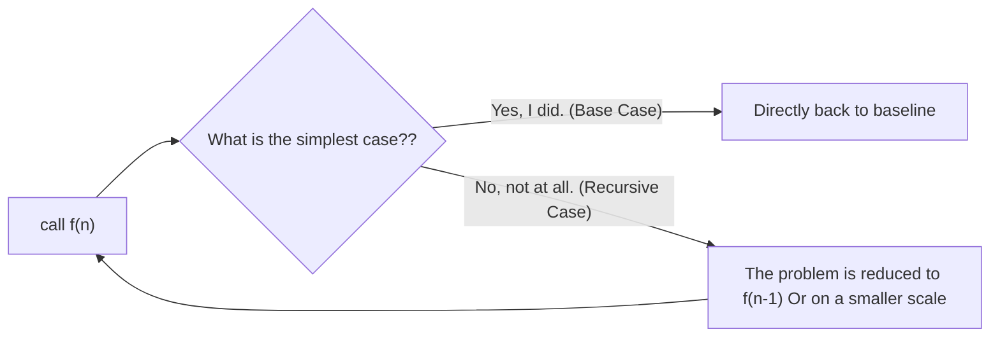
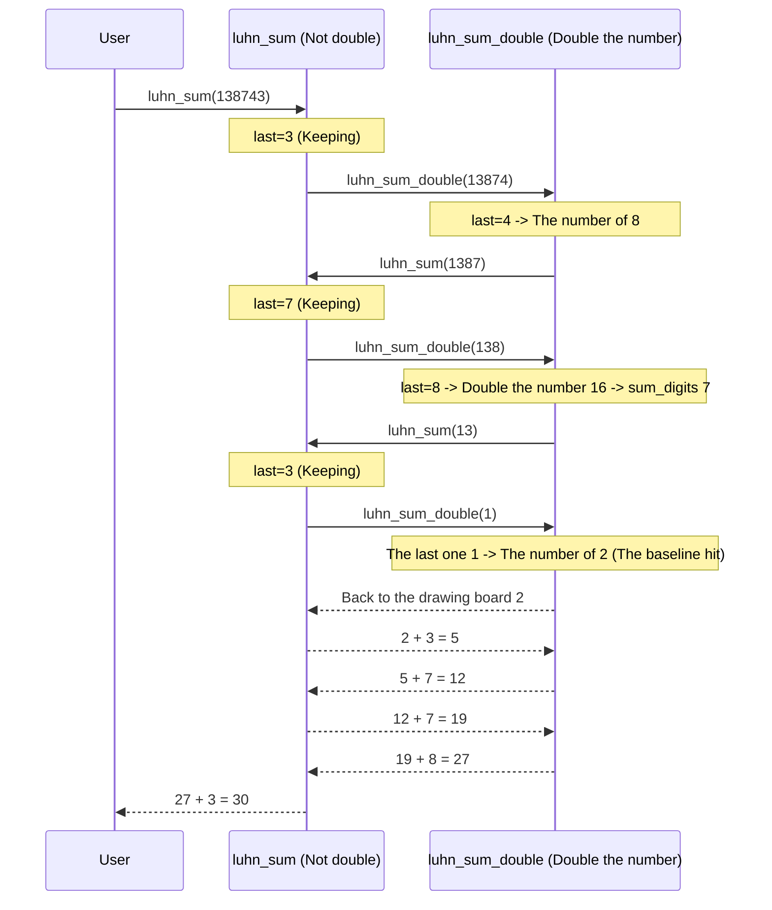

> **Earlier edition:** The Chinese edition was expanded on 22 October 2026. This English translation covers the previous edition. [Read the updated Chinese lecture](/notes/cs61a/lecture-09).

> **English original course**: CS 61A: Structure and Interpretation of Computer Programs (Fall 2024)  
> **Lecturer**: Prof. John DeNero (UC Berkeley)  
> **Text and illustrations**: VideoBook video to image to text technology e-book assembly line  
> **course coverage**: 37 / 37 on 18.2 hour audio/video instruction ⁇ 577 high-level lecture screenshots  
> **Online catalog**: [CS61A Special Catalog](/en/notes/topics/CS61A)

---


> **Lecture**: John DeNero ｜ **duration**: 37:49 ｜ **Video link back**: [Single episode corresponding to station B (P9)](https://www.bilibili.com/video/BV1sy411z7nA/?p=9)

## Introduction: Self-citation and status accumulation in environment model

Before going deep into the classic recursion, Professor DeNero, from the natural inference of environment model, explored a mechanism that seemed simple but very powerful: **The function body can refer to its own name**.

### 1.1 Self-referential functions that return themselves (`print_all`)

Consider the following Python function:
```python
def print_all(x):
    print(x)
    return print_all
```
When we perform chain calls  `print_all(1)(3)(5)`  When:
1. `print_all(1)`: First search in the global frame  `print_all`, create a local frame  `f1`, binding  `x = 1`. Print  `1`, then search the function body  `print_all`  and returns the function itself.
2. The second bracket of the chain call  `(3)`  Immediately applied to the returned  `print_all`, create a local frame  `f2`, binding  `x = 3`, print  `3`, return again  `print_all`.
3. third bracket  `(5)`  Also call this function to print  `5`.


*⏱ Timestamp: 00:05:22 · 📷 Lecture screenshot · [Watch clip (P9 00:05:22)](https://www.bilibili.com/video/BV1sy411z7nA/?p=9&t=322)*

```
Global frame
  print_all ───► func print_all(x) [parent=Global]
                    ▲
                    │ (returned each time)
f1: print_all [parent=Global]
  x: 1
  Return value ───► func print_all(x)

f2: print_all [parent=Global]
  x: 3
  Return value ───► func print_all(x)

f3: print_all [parent=Global]
  x: 5
  Return value ───► func print_all(x)
```

> **Key conclusion**:Although  `print_all`  refers to itself internally, but it is not in the function body **call** Self, therefore, does not circulate indefinitely; the number of calls is entirely determined by the external chain call expression.

---

### 1.2 higher-order function Accumulated with historical state (`print_sums`)

What if we want each call to not only print the current parameters, but also the "cumulative sum of all parameters so far"?

Using lexical closure and parent environment, we can write:
```python
def print_sums(x):
    print(x)
    def next_sum(y):
        return print_sums(x + y)
    return next_sum
```

Execute call: `print_sums(1)(3)(5)`
- `print_sums(1)` Printed  `1` Defining local functions  `next_sum` (its parent frame is  `f1: x=1`), and return  `next_sum`.
- `next_sum(3)`: local frame  `f2`  binding  `y = 3`. execute  `print_sums(x + y)`, where it passes through the parent frame  `f1`  found  `x = 1`, calculate  `1 + 3 = 4`, initiate a pair  `print_sums(4)`  call.
- `print_sums(4)`:Enter  `f3`  frame, print cumulative sum  `4` The new  `next_sum` (The parent frame is  `f3: x=4`) and return.
- Finally passed in  `5`  When , the new internal function calculates  `4 + 5 = 9`, enter  `f5`  Print  `9`.


*⏱ Timestamp: 00:08:19 · 📷 Lecture screenshot · [Watch clip (P9 00:08:19)](https://www.bilibili.com/video/BV1sy411z7nA/?p=9&t=499)*

This pattern demonstrates: **Parameters can be passed between different function calls by frame chains and account for history** That's how we understand it. recursion The shift in status provides a visual basis.

---

## 2. The essence and reality of recursion

### 2.1 What is this? recursion Function?
> **recursion function (RecursiveFunction)**: Directly or indirectly call its own function within its own function body.



recursion is not only the cornerstone of computer algorithms, but is more visible in nature, art and mathematics:
- **Sierpinski Triangle**: A large triangle consists of three small Sierpinski triangles with corners as vertices, infinitely nested.
- **Matryoshka Dolls**: Open a doll, and inside is an identical but smaller doll, down to the innermost solid puppet that cannot be separated.


*⏱ Timestamp: 00:10:22 · 📷 Lecture screenshot · [Watch clip (P9 00:10:22)](https://www.bilibili.com/video/BV1sy411z7nA/?p=9&t=622)*

### 2.2 Typical motivation: Sum Digits and check digits

Take calculating the sum of the digits of a positive integer as an example: `2013 -> 2 + 0 + 1 + 3 = 6`.
- **mathematical properties**: An integer is divisible by 9 if and only if the sum of its digits is divisible by 9.
- **Engineering Application (Checksum Digit)**: In credit cards, barcodes (UPC), and ID numbers, the last digit is usually not the account number itself, but a check digit calculated from all the previous digits. If the user makes an input error, the system can identify the clerical error directly without the need for an Internet connection.


*⏱ Timestamp: 00:11:30 · 📷 Lecture screenshot · [Watch clip (P9 00:11:30)](https://www.bilibili.com/video/BV1sy411z7nA/?p=9&t=690)*

---

## 3. recursion Anatomy of a functional structure

How not to use  `while`  Loop to sum the digits of an integer?

### 3.1 Building block structure: digital splitting (`split`)
First, define the basic operations of integral differential equations and modeling:
```python
def split(n):
    """返回 (去除个位后的数, 个位数字)"""
    return n // 10, n % 10
```
For example: `split(2013)`  Return  `(201, 3)`. If we already know how to  `201`  Sum the digits of (we get  `3`), plus single digits  `3`, you can get the result of the original number  `6`!


*⏱ Timestamp: 00:13:48 · 📷 Lecture screenshot · [Watch clip (P9 00:13:48)](https://www.bilibili.com/video/BV1sy411z7nA/?p=9&t=828)*

### 3.2 recursion standard paradigm
A regulated recursion function necessarily consists of two pillars:
1. **Base Cases**: The simplest case where a recursion call is not required to solve it directly.
2. **recursion Conditions (Recursive Cases)**: By splitting the original problem into **Smaller sub-problems of the same type**, and complete the assembly on the sub-problem results.

```python
def sum_digits(n):
    """计算正整数 n 的各位数字之和。"""
    if n < 10:
        return n  # 基线条件：单数位直接返回自身
    else:
        all_but_last, last = split(n)
        return sum_digits(all_but_last) + last  # 递归条件：更小的问题 + 当前个位
```


*⏱ Timestamp: 00:15:22 · 📷 Lecture screenshot · [Watch clip (P9 00:15:22)](https://www.bilibili.com/video/BV1sy411z7nA/?p=9&t=922)*

> **Anatomical elements comparison table**: 
> | components | `sum_digits`  implementation in | key role |
> | :--- | :--- | :--- |
> | **function signature** | `def sum_digits(n):` | Declare the parameters received by the function (state carrier) |
> | **conditional branch** | `if n < 10:` | Distinguishing baselines from recursion branches to prevent unlimited self-regulation |
> | **Baseline solution** | `return n` | Provide recursion with cessation conditions and export return values |
> | **status shrink** | `all_but_last, last = split(n)` | Make sure every time recursion All the incoming inputs are leaning towards the baseline. |
> | **recursion Group** | `return sum_digits(...) + last` | Trust the solutions to the subproblems and synthesize the final answer |

---

## 4. environment model Perspective: Factorial Catalyst Extension and Return

To get rid of them. recursion The mystery, we use CS61A's most powerful tool... **environment model (Environment Diagrams)**  Step by step analysis of the function  `fact(3)`: 

```python
def fact(n):
    if n == 0:
        return 1
    else:
        return n * fact(n - 1)

fact(3)
```


*⏱ Timestamp: 00:17:38 · 📷 Lecture screenshot · [Watch clip (P9 00:17:38)](https://www.bilibili.com/video/BV1sy411z7nA/?p=9&t=1058)*

### 4.1 Deep calling of the pump (pass to baseline)
1. **call  `fact(3)`** Creating a mouse:  `f1`, binding  `n = 3`- Get in there.  `else`  Branch, evaluation expression  `3 * fact(2)` In order to get a multiplication operand, suspend the return of the current torque and call the launcher.  `fact(2)`.
2. **call  `fact(2)`** Creating a mouse:  `f2`, binding  `n = 2` Evaluation  `2 * fact(1)` Stop waiting.  `fact(1)`  The return value of the
3. **call  `fact(1)`** Creating a mouse:  `f3`, binding  `n = 1` Evaluation  `1 * fact(0)` Stop waiting.  `fact(0)`.
4. **Reach the baseline  `fact(0)`** Creating a mouse:  `f4`, binding  `n = 0`- Satisfied  `n == 0` I'm going straight back.  `1`!

### 4.2 Returns with multiplication of polymers (return from the baseline)
5. `f4`  Return  `1`  to  `f3`  The waiting points: `f3`  Calculation  `1 * 1 = 1` It will be  `1`  As a  `f3`  The return value is returned to  `f2`.
6. `f2`  Received  `1`: Calculation  `2 * 1 = 2` It will be  `2`  Give it back.  `f1`.
7. `f1`  Received  `2`: Calculation  `3 * 2 = 6` And finally back.  `6`.


*⏱ Timestamp: 00:21:40 · 📷 Lecture screenshot · [Watch clip (P9 00:21:40)](https://www.bilibili.com/video/BV1sy411z7nA/?p=9&t=1300)*

```
Global frame
  fact ───► func fact(n) [parent=Global]

f1: fact [parent=Global]
  n: 3
  Return value: 6  ◄── 3 * 2

f2: fact [parent=Global]
  n: 2
  Return value: 2  ◄── 2 * 1

f3: fact [parent=Global]
  n: 1
  Return value: 1  ◄── 1 * 1

f4: fact [parent=Global]
  n: 0
  Return value: 1  (Base Case reached!)
```

> **environment model's key revelation**: 
> - **The same function is called multiple times** But **Each call is a separate activity frame.**.
> - The computer never confuses different levels of  `n` The current expression of the value of each evaluation is  `n`  It is only backward-looking in the current active environment.
> - All pending computations are stored in the execution context of their respective tables.

---

## 5. Retrogression vs. recursion: choice between expression and state storage

### 5.1 Contrast between code and mathematical form

The following are the steps in computational iteration and recursion:

```python
# 迭代实现 (Iteration)
def fact_iter(n):
    total, k = 1, 1
    while k <= n:
        total, k = total * k, k + 1
    return total

# 递归实现 (Recursion)
def fact(n):
    if n == 0:
        return 1
    return n * fact(n - 1)
```


*⏱ Timestamp: 00:24:16 · 📷 Lecture screenshot · [Watch clip (P9 00:24:16)](https://www.bilibili.com/video/BV1sy411z7nA/?p=9&t=1456)*

### 5.2 Analysis of core differences
| Dimension | Iteration | Recursion |
| :--- | :--- | :--- |
| **State maintenance mechanisms** | The programming language is defined by the user as a variable.  `total`, `k` (i) and continuously modify its value in the loop body by assigning statements | Depending **Call Stack Frames**  Impressive local status at every step |
| **variable name load** | Multi-state variable names, long life cycles, and prone to being contaminated or crossed | Just focus on the function parameters and the current subproblem size, local variables are less |
| **Mathematical correspondence** | The corresponding cumulative multiplication marks: $\prod_{k=1}^n k$ | The definition of a regression is: $n! = \begin{cases} 1 & \text{if } n = 0 \\ n \cdot (n-1)! & \text{otherwise} \end{cases}$ |
| **Space expenses** | Constant Level space complexity  $O(1)$ | The depth of the fluid is equal to the number of recursion steps  $O(n)$ (When non-tail recursion is optimized) |

---

## 6. Thinking leap: recursion Trust leap (The Recursive Leap of Faith)

The most common psychological disorder experienced by beginners when writing recursions is: "Oh, I haven't written this function yet, why can I call it directly in the code?

Professor DeNero described it as the "Leap of Faith" when he jumped a cliff.


*⏱ Timestamp: 00:26:48 · 📷 Lecture screenshot · [Watch clip (P9 00:26:48)](https://www.bilibili.com/video/BV1sy411z7nA/?p=9&t=1608)*

### 6.1 Three-step method for verifying the correctness of recursion
1. **Step 1: Verify the Base Cases**
   - Check the simplest input to see if the function returns the correct answer directly.  `fact(0)` It's back.  `1` I'm not sure.
2. **Step 2: Treat Recursive Call as Functional Abstraction (TREAT) to call a recursion as a functional abstraction**
   - **It is absolutely impossible to unfold the execution details of recursion calls in your mind!**
   - I will  `fact(n - 1)`  The idea of the black box is an abstraction. **The contract description** And if it were to be calculated correctly,  $(n-1)!$.
3. **Step 3: Verify Induction Step, which is a proof of total correctness.**
   - The proof: If  `fact(n - 1)`  The results of the study were based on the results of the research.  `n * fact(n - 1)`  The question is whether the strict equivalent of  $n!$?
   - $n \cdot (n-1)! = n!$ The equation is absolutely mathematically valid. Combined with the baseline condition, the whole function is correct in all natural numbers!

> **The Law of Thought** When writing a recursion, your attention should always be on how to use the subproblems to solve the current problem instead of being trapped in the infinite details of tracking the call-to-call scheduling.

---

## 7. Mutual Recursion: The Luhn Algorithm for Credit Card Validation

### 7.1 Principles of algorithms (Wikipedia)
The world's most popular credit cards, such as Visa and MasterCard, are used worldwide.  **Luhn algorithm (Mode 10 algorithm)**  The first is the "Full-in" error.
1. Starting with the number on the right (the test site itself), scan from right to left.
2. **Double the number from right to left 2, 4, 6...**.
3. If the result of doubling is greater than 9 (for example,  $8 \times 2 = 16$ (A) and **The number of digits**($1 + 6 = 7$ The value of the equation is less than 9.
4. Add all the digits (including the number of digits that have been processed with doubling and the number that has not been duplicated).
5. If the final sum is a multiple of 10, then  `sum % 10 == 0` The credit card is legal.


*⏱ Timestamp: 00:29:54 · 📷 Lecture screenshot · [Watch clip (P9 00:29:54)](https://www.bilibili.com/video/BV1sy411z7nA/?p=9&t=1794)*

**Examples** The account:  `1 3 8 7 4 3`
- The following is a list of the most common types of cancer:
  - `3` (No. 1, reserved): $3$
  - `4` (Second, double): $4 \times 2 = 8$
  - `7` (Third, reserved): $7$
  - `8` (Fourth, double): $8 \times 2 = 16 \rightarrow 1 + 6 = 7$
  - `3` (Fifth, reserved): $3$
  - `1` (Sixth, double): $1 \times 2 = 2$
- The following is a list of the most common causes: $2 + 3 + 7 + 7 + 8 + 3 = 30$.$30 \pmod{10} == 0$ The test passed!

---

### 7.2 Recursion code implementation (`luhn_sum`  and  `luhn_sum_double`)
By calling each other two functions, we can very elegantly handle the state switching of each double-digit digits:

```python
def split(n):
    return n // 10, n % 10

def sum_digits(n):
    if n < 10:
        return n
    all_but_last, last = split(n)
    return sum_digits(all_but_last) + last

def luhn_sum(n):
    """计算当前最右侧数位不翻倍时的 Luhn 和。"""
    if n < 10:
        return n
    all_but_last, last = split(n)
    return luhn_sum_double(all_but_last) + last

def luhn_sum_double(n):
    """计算当前最右侧数位需要翻倍时的 Luhn 和。"""
    all_but_last, last = split(n)
    luhn_digit = sum_digits(2 * last)
    if n < 10:
        return luhn_digit
    return luhn_sum(all_but_last) + luhn_digit
```


*⏱ Timestamp: 00:32:33 · 📷 Lecture screenshot · [Watch clip (P9 00:32:33)](https://www.bilibili.com/video/BV1sy411z7nA/?p=9&t=1953)*



> **The first is the "Mutual Recursion".**  The core characteristic of the function is that two or more functions form a circular circuit called to each other. By switching over controls, a natural multi-state machine (such as the double state alternation of normal-bit valves and double-bit valve in this case) is achieved without the need for explicitly maintaining the Boolean signalling position.

---

## 8. The two-way transformation theorem of recursion and iteration

### 8.1 recursion reversal: improvement of the apparent state
The key to converting recursion into iteration is identification. **The state of the call is transmitted in each recursion and the part that returns** The first is the "Circle Variable" and the second is the "Round Variable":

```python
def sum_digits_iter(n):
    digit_sum = 0
    while n > 0:
        n, last = split(n)
        digit_sum = digit_sum + last
    return digit_sum
```

*⏱ Timestamp: 00:34:39 · 📷 Lecture screenshot · [Watch clip (P9 00:34:39)](https://www.bilibili.com/video/BV1sy411z7nA/?p=9&t=2079)*

### 8.2 Retro-recursion: parameterization of the state of a cycle
Converting the iteration to recursion is more mechanical and direct (since iteration is only a special case of recursion in theory):
1. Find out where  `while`  All states of change between the cycles are variable (e.g.,  `n`  and  `digit_sum`).
2. The variables are **The parameter of the recursion function**.
3. `while`  The exit conditions of the cycle are converted into **Baseline conditions**.
4. In the loop, the value of update operation is converted to **The signal when recursion is called**.

```python
def sum_digits_rec(n, digit_sum=0):
    if n == 0:
        return digit_sum  # 退出循环的基线条件
    n, last = split(n)
    return sum_digits_rec(n, digit_sum + last)  # 状态更新通过实参传递
```

*⏱ Timestamp: 00:36:56 · 📷 Lecture screenshot · [Watch clip (P9 00:36:56)](https://www.bilibili.com/video/BV1sy411z7nA/?p=9&t=2216)*

---

## 9. Core points and thought-provoking topics

### The key rules are refined
1. **Basic conditions are essential**: Each recursion function must have at least one direct-computing baseline branch without recursion, and the parameters of the recursion branch must continuously converge to the baseline.
2. **environment model is the fundamental building block for understanding recursion** Each call function opens a unique activity bar, and variable evaluation is strictly limited to the context in which it is used.
3. **The first is the "Leap of Faith" abstraction.** Refusal to follow a single step in the brain of multilayered nested recursion; when writing recursions, assume that smaller subcalls have been correctly resolved and focus on completing the current steps.
4. **Interrecursion processing alternate state** When dealing with two-phase interchange (e.g., even number processing, two-person gambling) problems, reciprocal recursion is a very powerful design paradigm.

---

### Self-testing after school

#### Exercise 1: Recursion calculates the number of printed reverse sequences
Write a recursion function  `print_digits_reverse(n)` Give me a positive integer  `n` The first is the number of digits, which are printed in a row from right to left.
```python
def print_digits_reverse(n):
    """
    >>> print_digits_reverse(1234)
    4
    3
    2
    1
    """
    print(n % 10)
    if n >= 10:
        print_digits_reverse(n // 10)
```

#### Exercise 2: Printing the Cascade
Write a recursion function  `cascade(n)` The following symmetrical triangles are produced:
```
>>> cascade(1234)
1234
123
12
1
12
123
1234
```
*Thinking Tip: What happens in the middle when you print before and after a recursion call?*
```python
def cascade(n):
    if n < 10:
        print(n)
    else:
        print(n)
        cascade(n // 10)
        print(n)
```
The environment model is clear: the first order printing occurs when the input is passed in and the second order printing is executed when the retracement is done, showing a natural mirror symmetry structure called recursion!

---

