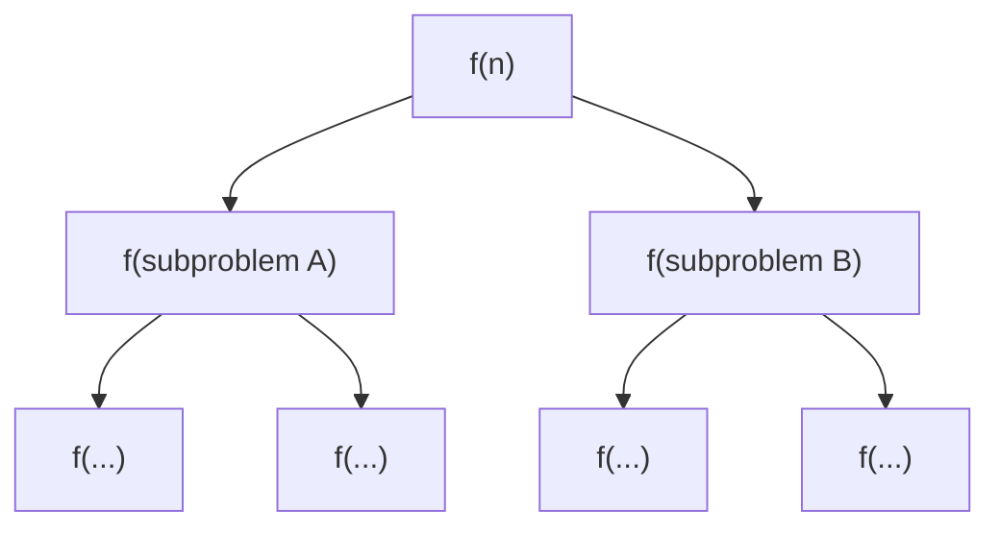
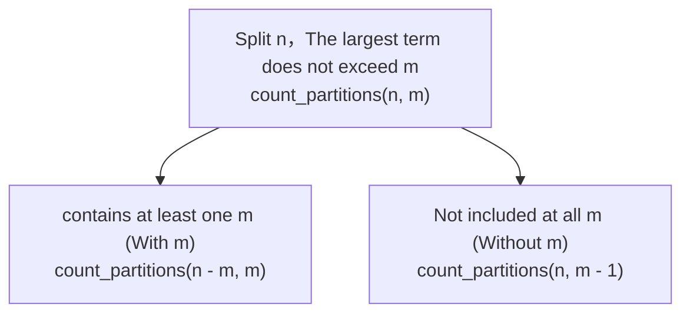

> **Course**: UC Berkeley CS61A (Fall 2024)  
> **Module**: Module 2: Recursion & Data Abstraction (Recursion & Sequences)  
> **Lecturer**: Prof. John DeNero (UC Berkeley)  
> **Video duration**: 32:14 ｜ **Classroom screenshots**: 16 pieces of blackboard writing/code demonstration  
> **Direct video**: [📺Watch the original video of this lecture on Bilibili (P10)](https://www.bilibili.com/video/BV1sy411z7nA/?p=10)  
> **Quick navigation**: [← Previous Lecture (P09 Lecture 9 Recursion)](/en/notes/cs61a/lecture-09) ｜ [📚 Return to the full book catalog](/en/notes/topics/CS61A) ｜ [Next Lecture (P11 Lecture 11 Sequences) →](/en/notes/cs61a/lecture-11)

---

## Table of Contents
1. [Introduction: The order and waiting mechanism of recursive calls](/en/notes/cs61a/lecture-10#1-introduction-the-order-and-waiting-mechanism-of-recursive-calls)
2. [Cascade function (Cascade) and symmetric call stack](/en/notes/cs61a/lecture-10#2-cascade-function-cascade-and-symmetric-call-stack)
3. [Code Aesthetics and Abstract Thinking: Inverse Cascade](/en/notes/cs61a/lecture-10#3-code-aesthetics-and-abstract-thinking-inverse-cascade)
4. [The definition and structural evolution of tree recursion](/en/notes/cs61a/lecture-10#4-definition-and-structural-evolution-of-tree-recursion)
5. [Classic case: tree expansion of Fibonacci sequence](/en/notes/cs61a/lecture-10#5-classic-case-tree-expansion-of-fibonacci-sequence)
6. [Computational overhead and repeated calculations: `@trace`  Observe the tree explosion](/en/notes/cs61a/lecture-10#6-computational-overhead-and-repeated-calculations-trace--observe-the-tree-explosion)
7. [Core problem: Counting Partitions](/en/notes/cs61a/lecture-10#7-core-problem-counting-partitions)
8. [Boundary deduction of baseline conditions and code implementation](/en/notes/cs61a/lecture-10#8-boundary-deduction-and-code-implementation-of-baseline-conditions)
9. [Key points and thinking questions of this lecture](/en/notes/cs61a/lecture-10#9-core-points-and-thinking-questions-of-this-lecture)

---

### In-depth formal specification and micro-evaluation process (Operational Semantics)
In the "Table of Contents" module, the underlying computer operations rely on strict formal evaluation logic:
1. **Hierarchical parsing of abstract syntax trees (AST)**: 
   - The source code character stream is first divided into terminal symbol tokens (Tokens) by the lexical analyzer (Lexer), and then constructed into a multi-fork syntax tree by the syntax parser (Parser);
   - Operator priority and associativity are solidified during the syntax tree construction phase, eliminating ambiguity at runtime;
2. **Dynamic transitions of environment chains**: 
   - Each function call generates a new frame whose static lexical environment is determined by the function object's  `parent`  Attributes are completely determined;
   - The variable search traces back up the environment chain in one direction until the global environment frame. If it is not found, it will be triggered.  `NameError`  Abnormal;
3. **State Invariants**: 
   - The key to writing robust programs is to clarify loop invariants (Loop Invariants) and function pre/post-conditions (Pre/Post-conditions);
   - In complex control flow jumps, ensure that state variables maintain legal business constraints before each iteration.


## 1. Introduction: The order and waiting mechanism of recursive calls

In the previous lesson, we saw linear recursion and mutual recursion. Many beginners will ask: "Since many questions can be used  `while`  Loop solution, why do we have to learn recursion? "

Professor DeNero noted:
> **Many complex problems in computer science inherently have divide-and-conquer and branching structures.**. Linear recursion is just the beginning, when the calculation process of a function requires exploring multiple mutually exclusive choices. **Tree Recursion**  It shows simplicity and elegance that loop statements cannot match.

The key to understanding recursion is to always remember **The blocking and return mechanism of the call stack**: 
- When a function initiates another function call, **The initiator must pause the execution of the current frame and wait for the callee to completely return the result.**, and then continue to execute subsequent statements.
- Any recursive call **before** The executed code is all run when pushed onto the stack (progressing to a smaller scale);
- Any recursive call **after** The executed code is all run when popping the stack (returning from the baseline).

---

### In-depth formal specification and micro-evaluation process (Operational Semantics)
In the "1. Introduction: Sequence and Waiting Mechanism of Recursive Calls" module, the underlying computer operations rely on strict formal evaluation logic:
1. **Hierarchical parsing of abstract syntax trees (AST)**: 
   - The source code character stream is first divided into terminal symbol tokens (Tokens) by the lexical analyzer (Lexer), and then constructed into a multi-fork syntax tree by the syntax parser (Parser);
   - Operator priority and associativity are solidified during the syntax tree construction phase, eliminating ambiguity at runtime;
2. **Dynamic transitions of environment chains**: 
   - Each function call generates a new frame whose static lexical environment is determined by the function object's  `parent`  Attributes are completely determined;
   - The variable search traces back up the environment chain in one direction until the global environment frame. If it is not found, it will be triggered.  `NameError`  Abnormal;
3. **State Invariants**: 
   - The key to writing robust programs is to clarify loop invariants (Loop Invariants) and function pre/post-conditions (Pre/Post-conditions);
   - In complex control flow jumps, ensure that state variables maintain legal business constraints before each iteration.


## 2. Cascade function (Cascade) and symmetric call stack

In order to intuitively understand this execution sequence, we examine the classic cascade printing function  `cascade`.

### 2.1 Recursive cascade definition and output
```python
def cascade(n):
    """打印正整数 n 的级联图案。"""
    if n < 10:
        print(n)
    else:
        print(n)          # 递归调用之前：入栈时打印（降序缩减）
        cascade(n // 10)  # 递归子问题：去掉个位
        print(n)          # 递归调用之后：退栈时打印（升序恢复）
```

call  `cascade(12345)`  The output effect:
```
12345
1234
123
12
1
12
123
1234
12345
```

[](https://www.bilibili.com/video/BV1sy411z7nA/?p=10&t=148)
*⏱ Timestamp: 00:02:28 · 📷 Classroom screenshot · [Watch the corresponding clip on Bilibili (P10 00:02:28)](https://www.bilibili.com/video/BV1sy411z7nA/?p=10&t=148)*

#### 📸 In-depth reading of classroom blackboard writing and code demonstration (00:02:28)

**\[On-site blackboard writing/code demonstration restoration\]**:
At this time point, Professor DeNero conducted a core demonstration and key blackboard derivation on the screen:
> *“Then, makes a recursive call to cascade. On a smaller number, that's everything except for the last digit of n, or n divided by 10, with the remainder thrown away. Finally, after that recursive call to cascade, it prints n again. Let's take a look at the behavior of this function. If I cascade just ...”*

**\[Underlying computing model and micro execution mechanism\]**: 
1. **Execution context and timing tracing**: 
   - At the current discussion point "2. Cascade function (Cascade) and symmetric call stack", the interpreter strictly follows the core evaluation protocol;
   - The expression evaluates the operators first, then evaluates the operands strictly from left to right, and finally applies the function object to the argument list;
   - If the environment model is involved, the local frame strictly records its static lexical parent pointer (Parent Pointer points to the environment where the function is defined), forming an orthogonal architecture with the dynamic call stack at runtime.
2. **Memory topology and object references**: 
   - Variable symbols are just keys in a hash table (environment frame), and pointers point directly to first-class citizen objects in heap memory;
   - Assignment statements are discrete-time snapshots of the state and never create implicit mathematical dependency monitoring.

**\[Guidelines for avoiding pitfalls and guidance on high-frequency test points\]**: 
- **Common misunderstandings**: In the exam questions related to "Tree Recursive Branch Divide and Conquer Model, Integer Partitions (Count Partitions)", beginners can easily guess the results based on the surface form of the code, leading to scope confusion or variable shadowing (Shadowing) misjudgment;
- **The golden rule of debugging**: When encountering nested calls and complex branches, be sure to draw independent partial frames on the scratch paper, indicate the specific binding value of each formal parameter, and derive it step by step.


This perfectly symmetrical geometric hourglass structure clearly reflects: except for the baseline branches  `n=1`  The innermost frame is printed only once, and the outer  `12`, `123`, `1234`, `12345`  Printed once before and after recursion!

---

### 2.2 Environment model tracking call stack
We use Python Tutor to observe  `cascade(123)`  The evolution of the environment model:

[](https://www.bilibili.com/video/BV1sy411z7nA/?p=10&t=212)
*⏱ Timestamp: 00:03:32 · 📷 Classroom screenshot · [Watch the corresponding clip on Bilibili (P10 00:03:32)](https://www.bilibili.com/video/BV1sy411z7nA/?p=10&t=212)*

#### 📸 In-depth reading of classroom blackboard writing and code demonstration (00:03:32)

**\[On-site blackboard writing/code demonstration restoration\]**:
At this time point, Professor DeNero conducted a core demonstration and key blackboard derivation on the screen:
> *“What this is supposed to illustrate is that all the cascading that happens recursively happens before the final print. And that's why you get this nice nested structure. Let's take a look at the environment diagram so that we can see exactly what's happening. So we defined cascade and then call it o...”*

**\[Underlying computing model and micro execution mechanism\]**: 
1. **Execution context and timing tracing**: 
   - At the current discussion point "2. Cascade function (Cascade) and symmetric call stack", the interpreter strictly follows the core evaluation protocol;
   - The expression evaluates the operators first, then evaluates the operands strictly from left to right, and finally applies the function object to the argument list;
   - If the environment model is involved, the local frame strictly records its static lexical parent pointer (Parent Pointer points to the environment where the function is defined), forming an orthogonal architecture with the dynamic call stack at runtime.
2. **Memory topology and object references**: 
   - Variable symbols are just keys in a hash table (environment frame), and pointers point directly to first-class citizen objects in heap memory;
   - Assignment statements are discrete-time snapshots of the state and never create implicit mathematical dependency monitoring.

**\[Guidelines for avoiding pitfalls and guidance on high-frequency test points\]**: 
- **Common misunderstandings**: In the exam questions related to "Tree Recursive Branch Divide and Conquer Model, Integer Partitions (Count Partitions)", beginners can easily guess the results based on the surface form of the code, leading to scope confusion or variable shadowing (Shadowing) misjudgment;
- **The golden rule of debugging**: When encountering nested calls and complex branches, be sure to draw independent partial frames on the scratch paper, indicate the specific binding value of each formal parameter, and derive it step by step.


1. **frame  `f1` (`n=123`)**: print  `123`, encounter  `cascade(12)`, `f1`  suspend, derive  `f2`.
2. **frame  `f2` (`n=12`)**: print  `12`, encounter  `cascade(1)`, `f2`  suspend, derive  `f3`.
3. **frame  `f3` (`n=1`)**: Hit the baseline condition  `n < 10`, print  `1`.`f3`  After execution, implicit return  `None`.
4. **`f2`  Resume execution**: `f3`  After returning, `f2`  Continue to execute the third line  `print(n)`, print  `12`, return  `None`.
5. **`f1`  Resume execution**: `f2`  After returning, `f1`  Execute the third line  `print(n)`, print  `123`, return  `None`.

[](https://www.bilibili.com/video/BV1sy411z7nA/?p=10&t=328)
*⏱ Timestamp: 00:05:28 · 📷 Classroom screenshot · [Watch the corresponding clip on Bilibili (P10 00:05:28)](https://www.bilibili.com/video/BV1sy411z7nA/?p=10&t=328)*

#### 📸 In-depth reading of classroom blackboard writing and code demonstration (00:05:28)

**\[On-site blackboard writing/code demonstration restoration\]**:
At this time point, Professor DeNero conducted a core demonstration and key blackboard derivation on the screen:
> *“And when we print that, we actually see that 12 appear, and we have a return value of None from this call, which means that we can finally return to our original call to Cascade and finish up. So we've evaluated this, and in the course of evaluating that, we've generated all this output, and finally...”*

**\[Underlying computing model and micro execution mechanism\]**: 
1. **Execution context and timing tracing**: 
   - At the current discussion point "2. Cascade function (Cascade) and symmetric call stack", the interpreter strictly follows the core evaluation protocol;
   - The expression evaluates the operators first, then evaluates the operands strictly from left to right, and finally applies the function object to the argument list;
   - If the environment model is involved, the local frame strictly records its static lexical parent pointer (Parent Pointer points to the environment where the function is defined), forming an orthogonal architecture with the dynamic call stack at runtime.
2. **Memory topology and object references**: 
   - Variable symbols are just keys in a hash table (environment frame), and pointers point directly to first-class citizen objects in heap memory;
   - Assignment statements are discrete-time snapshots of the state and never create implicit mathematical dependency monitoring.

**\[Guidelines for avoiding pitfalls and guidance on high-frequency test points\]**: 
- **Common misunderstandings**: In the exam questions related to "Tree Recursive Branch Divide and Conquer Model, Integer Partitions (Count Partitions)", beginners can easily guess the results based on the surface form of the code, leading to scope confusion or variable shadowing (Shadowing) misjudgment;
- **The golden rule of debugging**: When encountering nested calls and complex branches, be sure to draw independent partial frames on the scratch paper, indicate the specific binding value of each formal parameter, and derive it step by step.


```
调用进入 (Call / Push)        返回退出 (Return / Pop)
─────────────────────►        ◄─────────────────────
f1: cascade(123)              f1: print(123)
 └── f2: cascade(12)           └── f2: print(12)
      └── f3: cascade(1)            └── (f3 returns None)
          (print 1)
```

---

### 2.3 Choice of coding style: clear vs. compact
`cascade`  It can also be written as the following None  `else`  Form:
```python
def cascade_short(n):
    print(n)
    if n >= 10:
        cascade_short(n // 10)
        print(n)
```

[](https://www.bilibili.com/video/BV1sy411z7nA/?p=10&t=425)
*⏱ Timestamp: 00:07:05 · 📷 Classroom screenshot · [Watch the corresponding clip on Bilibili (P10 00:07:05)](https://www.bilibili.com/video/BV1sy411z7nA/?p=10&t=425)*

#### 📸 In-depth reading of classroom blackboard writing and code demonstration (00:07:05)

**\[On-site blackboard writing/code demonstration restoration\]**:
At this time point, Professor DeNero conducted a core demonstration and key blackboard derivation on the screen:
> *“Now, that's not the only way to define cascade. An even shorter version would say, well, in the base case or in the recursive case, I always print N first. So why not just put that at the very top? And then there's actually nothing left to do in the base case. So I could just change this if statemen...”*

**\[Underlying computing model and micro execution mechanism\]**: 
1. **Execution context and timing tracing**: 
   - At the current discussion point "2. Cascade function (Cascade) and symmetric call stack", the interpreter strictly follows the core evaluation protocol;
   - The expression evaluates the operators first, then evaluates the operands strictly from left to right, and finally applies the function object to the argument list;
   - If the environment model is involved, the local frame strictly records its static lexical parent pointer (Parent Pointer points to the environment where the function is defined), forming an orthogonal architecture with the dynamic call stack at runtime.
2. **Memory topology and object references**: 
   - Variable symbols are just keys in a hash table (environment frame), and pointers point directly to first-class citizen objects in heap memory;
   - Assignment statements are discrete-time snapshots of the state and never create implicit mathematical dependency monitoring.

**\[Guidelines for avoiding pitfalls and guidance on high-frequency test points\]**: 
- **Common misunderstandings**: In the exam questions related to "Tree Recursive Branch Divide and Conquer Model, Integer Partitions (Count Partitions)", beginners can easily guess the results based on the surface form of the code, leading to scope confusion or variable shadowing (Shadowing) misjudgment;
- **The golden rule of debugging**: When encountering nested calls and complex branches, be sure to draw independent partial frames on the scratch paper, indicate the specific binding value of each formal parameter, and derive it step by step.


The two writing methods are completely equivalent in function:
- The compact version abstracts common operations (both baseline and recursive)  `print(n)`).
- The standard version explicitly isolates baselines and recursive branches.

> **SICP design philosophy**: 
> > *"Programs must be written for people to read, and only incidentally for machines to execute."* —— Harold Abelson & Gerald Jay Sussman  
> If both implementations run correctly, take precedence **Easier to convey intent to human readers** of that kind. Explicit baseline branches are crucial for beginners to build inductive thinking.

---

### In-depth formal specification and micro-evaluation process (Operational Semantics)
In the "2. Cascade and Symmetric Call Stack" module, the underlying computer operations rely on strict formal evaluation logic:
1. **Hierarchical parsing of abstract syntax trees (AST)**: 
   - The source code character stream is first divided into terminal symbol tokens (Tokens) by the lexical analyzer (Lexer), and then constructed into a multi-fork syntax tree by the syntax parser (Parser);
   - Operator priority and associativity are solidified during the syntax tree construction phase, eliminating ambiguity at runtime;
2. **Dynamic transitions of environment chains**: 
   - Each function call generates a new frame whose static lexical environment is determined by the function object's  `parent`  Attributes are completely determined;
   - The variable search traces back up the environment chain in one direction until the global environment frame. If it is not found, it will be triggered.  `NameError`  Abnormal;
3. **State Invariants**: 
   - The key to writing robust programs is to clarify loop invariants (Loop Invariants) and function pre/post-conditions (Pre/Post-conditions);
   - In complex control flow jumps, ensure that state variables maintain legal business constraints before each iteration.


## 3. Code aesthetics and abstract thinking: Inverse Cascade

If we wish to print an inverted cascade (growing from small to large, then shrinking from large to small):
```
1
12
123
1234
123
12
1
```

How to break down this process using higher-level abstractions?

[](https://www.bilibili.com/video/BV1sy411z7nA/?p=10&t=551)
*⏱ Timestamp: 00:09:11 · 📷 Classroom screenshot · [Watch the corresponding clip on Bilibili (P10 00:09:11)](https://www.bilibili.com/video/BV1sy411z7nA/?p=10&t=551)*

#### 📸 In-depth reading of classroom blackboard writing and code demonstration (00:09:11)

**\[On-site blackboard writing/code demonstration restoration\]**:
At this time point, Professor DeNero conducted a core demonstration and key blackboard derivation on the screen:
> *“Well, if we pass in the number 1, 2, 3, 4, we want it to print out the following lines. 1, 1, 2, 1, 2, 3, 1, 2, 3, 4, and then get smaller on the way down. Now, if you want, you can try to implement this from scratch. I'm going to give you some structure right now so that you can implement it in a p...”*

**\[Underlying computing model and micro execution mechanism\]**: 
1. **Execution context and timing tracing**: 
   - At the current discussion point "3. Code Aesthetics and Abstract Thinking: Inverse Cascade", the interpreter strictly follows the core evaluation protocol;
   - The expression evaluates the operators first, then evaluates the operands strictly from left to right, and finally applies the function object to the argument list;
   - If the environment model is involved, the local frame strictly records its static lexical parent pointer (Parent Pointer points to the environment where the function is defined), forming an orthogonal architecture with the dynamic call stack at runtime.
2. **Memory topology and object references**: 
   - Variable symbols are just keys in a hash table (environment frame), and pointers point directly to first-class citizen objects in heap memory;
   - Assignment statements are discrete-time snapshots of the state and never create implicit mathematical dependency monitoring.

**\[Guidelines for avoiding pitfalls and guidance on high-frequency test points\]**: 
- **Common misunderstandings**: In the exam questions related to "Tree Recursive Branch Divide and Conquer Model, Integer Partitions (Count Partitions)", beginners can easily guess the results based on the surface form of the code, leading to scope confusion or variable shadowing (Shadowing) misjudgment;
- **The golden rule of debugging**: When encountering nested calls and complex branches, be sure to draw independent partial frames on the scratch paper, indicate the specific binding value of each formal parameter, and derive it step by step.


Professor DeNero designed a general higher-order function  `f_then_g`: 
```python
def inverse_cascade(n):
    grow(n)
    print(n)
    shrink(n)

def f_then_g(f, g, n):
    if n:
        f(n)
        g(n)

grow = lambda n: f_then_g(grow, print, n // 10)
shrink = lambda n: f_then_g(print, shrink, n // 10)
```

[](https://www.bilibili.com/video/BV1sy411z7nA/?p=10&t=641)
*⏱ Timestamp: 00:10:41 · 📷 Classroom screenshot · [Watch the corresponding clip on Bilibili (P10 00:10:41)](https://www.bilibili.com/video/BV1sy411z7nA/?p=10&t=641)*

#### 📸 In-depth reading of classroom blackboard writing and code demonstration (00:10:41)

**\[On-site blackboard writing/code demonstration restoration\]**:
At this time point, Professor DeNero conducted a core demonstration and key blackboard derivation on the screen:
> *“Pause the video and think about it. I'll show you the answer in three, two, one. One way to implement inverse cascade is with a grow function that first grows and then prints. So why does grow grow and then print? Well, because we want to do the small stuff first and then the big stuff. And we're ca...”*

**\[Underlying computing model and micro execution mechanism\]**: 
1. **Execution context and timing tracing**: 
   - At the current discussion point "3. Code Aesthetics and Abstract Thinking: Inverse Cascade", the interpreter strictly follows the core evaluation protocol;
   - The expression evaluates the operators first, then evaluates the operands strictly from left to right, and finally applies the function object to the argument list;
   - If the environment model is involved, the local frame strictly records its static lexical parent pointer (Parent Pointer points to the environment where the function is defined), forming an orthogonal architecture with the dynamic call stack at runtime.
2. **Memory topology and object references**: 
   - Variable symbols are just keys in a hash table (environment frame), and pointers point directly to first-class citizen objects in heap memory;
   - Assignment statements are discrete-time snapshots of the state and never create implicit mathematical dependency monitoring.

**\[Guidelines for avoiding pitfalls and guidance on high-frequency test points\]**: 
- **Common misunderstandings**: In the exam questions related to "Tree Recursive Branch Divide and Conquer Model, Integer Partitions (Count Partitions)", beginners can easily guess the results based on the surface form of the code, leading to scope confusion or variable shadowing (Shadowing) misjudgment;
- **The golden rule of debugging**: When encountering nested calls and complex branches, be sure to draw independent partial frames on the scratch paper, indicate the specific binding value of each formal parameter, and derive it step by step.


- `grow`: Call itself recursively first  `grow(n // 10)`, then execute  `print(n)`, so printing starts from the smallest prefix outward (from small to large).
- `shrink`:Print first  `print(n)`, and then call recursively  `shrink(n // 10)`, so it decays step by step from large to small.

---

### In-depth formal specification and micro-evaluation process (Operational Semantics)
In the "3. Code Aesthetics and Abstract Thinking: Inverse Cascade" module, the underlying computer operations rely on strict formal evaluation logic:
1. **Hierarchical parsing of abstract syntax trees (AST)**: 
   - The source code character stream is first divided into terminal symbol tokens (Tokens) by the lexical analyzer (Lexer), and then constructed into a multi-fork syntax tree by the syntax parser (Parser);
   - Operator priority and associativity are solidified during the syntax tree construction phase, eliminating ambiguity at runtime;
2. **Dynamic transitions of environment chains**: 
   - Each function call generates a new frame whose static lexical environment is determined by the function object's  `parent`  Attributes are completely determined;
   - The variable search traces back up the environment chain in one direction until the global environment frame. If it is not found, it will be triggered.  `NameError`  Abnormal;
3. **State Invariants**: 
   - The key to writing robust programs is to clarify loop invariants (Loop Invariants) and function pre/post-conditions (Pre/Post-conditions);
   - In complex control flow jumps, ensure that state variables maintain legal business constraints before each iteration.


## 4. Definition and structural evolution of tree recursion

> **Tree Recursion**: In the execution body of a function, initiate **twice or more** A recursive call to itself.

When a call forks into two sub-calls, and each sub-call forks into two smaller sub-calls, the entire calculation process expands into a tree in space and time. **Computation Tree**.



---

### In-depth formal specification and micro-evaluation process (Operational Semantics)
In the "4. Definition and Structural Evolution of Tree Recursion" module, the underlying computer operations rely on strict formal evaluation logic:
1. **Hierarchical parsing of abstract syntax trees (AST)**: 
   - The source code character stream is first divided into terminal symbol tokens (Tokens) by the lexical analyzer (Lexer), and then constructed into a multi-fork syntax tree by the syntax parser (Parser);
   - Operator priority and associativity are solidified during the syntax tree construction phase, eliminating ambiguity at runtime;
2. **Dynamic transitions of environment chains**: 
   - Each function call generates a new frame whose static lexical environment is determined by the function object's  `parent`  Attributes are completely determined;
   - The variable search traces back up the environment chain in one direction until the global environment frame. If it is not found, it will be triggered.  `NameError`  Abnormal;
3. **State Invariants**: 
   - The key to writing robust programs is to clarify loop invariants (Loop Invariants) and function pre/post-conditions (Pre/Post-conditions);
   - In complex control flow jumps, ensure that state variables maintain legal business constraints before each iteration.


## 5. Classic case: tree expansion of Fibonacci sequence

The Fibonacci sequence is the most classic two-branch tree recursion: 
$$\text{Fib}(0) = 0, \quad \text{Fib}(1) = 1, \quad \text{Fib}(n) = \text{Fib}(n-2) + \text{Fib}(n-1) \quad (n \ge 2)$$

[](https://www.bilibili.com/video/BV1sy411z7nA/?p=10&t=706)
*⏱ Timestamp: 00:11:46 · 📷 Classroom screenshot · [Watch the corresponding clip on Bilibili (P10 00:11:46)](https://www.bilibili.com/video/BV1sy411z7nA/?p=10&t=706)*

#### 📸 In-depth reading of classroom blackboard writing and code demonstration (00:11:46)

**\[On-site blackboard writing/code demonstration restoration\]**:
At this time point, Professor DeNero conducted a core demonstration and key blackboard derivation on the screen:
> *“Makes more than one recursive call. So tree recursion creates tree-shaped processes that arise whenever executing the body of a recursive function makes more than one call to that function. And there's one example that almost every class that includes tree recursion covers at some point. The Fibonac...”*

**\[Underlying computing model and micro execution mechanism\]**: 
1. **Execution context and timing tracing**: 
   - At the current discussion point "5. Classic case: tree expansion of the Fibonacci sequence", the interpreter strictly follows the core evaluation protocol;
   - The expression evaluates the operators first, then evaluates the operands strictly from left to right, and finally applies the function object to the argument list;
   - If the environment model is involved, the local frame strictly records its static lexical parent pointer (Parent Pointer points to the environment where the function is defined), forming an orthogonal architecture with the dynamic call stack at runtime.
2. **Memory topology and object references**: 
   - Variable symbols are just keys in a hash table (environment frame), and pointers point directly to first-class citizen objects in heap memory;
   - Assignment statements are discrete-time snapshots of the state and never create implicit mathematical dependency monitoring.

**\[Guidelines for avoiding pitfalls and guidance on high-frequency test points\]**: 
- **Common misunderstandings**: In the exam questions related to "Tree Recursive Branch Divide and Conquer Model, Integer Partitions (Count Partitions)", beginners can easily guess the results based on the surface form of the code, leading to scope confusion or variable shadowing (Shadowing) misjudgment;
- **The golden rule of debugging**: When encountering nested calls and complex branches, be sure to draw independent partial frames on the scratch paper, indicate the specific binding value of each formal parameter, and derive it step by step.


### 5.1 Python implementation
```python
def fib(n):
    if n == 0:
        return 0
    elif n == 1:
        return 1
    else:
        return fib(n - 2) + fib(n - 1)
```

[](https://www.bilibili.com/video/BV1sy411z7nA/?p=10&t=797)
*⏱ Timestamp: 00:13:17 · 📷 Classroom screenshot · [Watch the corresponding clip on Bilibili (P10 00:13:17)](https://www.bilibili.com/video/BV1sy411z7nA/?p=10&t=797)*

#### 📸 In-depth reading of classroom blackboard writing and code demonstration (00:13:17)

**\[On-site blackboard writing/code demonstration restoration\]**:
At this time point, Professor DeNero conducted a core demonstration and key blackboard derivation on the screen:
> *“35. So, let's look at a tree recursive way of computing Fibonacci numbers. We'll define fib to take in n. If n is 0, return 0. If n is 1, we'll return 1. Those are two base cases. What's the recursive case? Well, each Fibonacci number is the sum of the previous two, which we can write as fib n minus...”*

**\[Underlying computing model and micro execution mechanism\]**: 
1. **Execution context and timing tracing**: 
   - At the current discussion point "5. Classic case: tree expansion of the Fibonacci sequence", the interpreter strictly follows the core evaluation protocol;
   - The expression evaluates the operators first, then evaluates the operands strictly from left to right, and finally applies the function object to the argument list;
   - If the environment model is involved, the local frame strictly records its static lexical parent pointer (Parent Pointer points to the environment where the function is defined), forming an orthogonal architecture with the dynamic call stack at runtime.
2. **Memory topology and object references**: 
   - Variable symbols are just keys in a hash table (environment frame), and pointers point directly to first-class citizen objects in heap memory;
   - Assignment statements are discrete-time snapshots of the state and never create implicit mathematical dependency monitoring.

**\[Guidelines for avoiding pitfalls and guidance on high-frequency test points\]**: 
- **Common misunderstandings**: In the exam questions related to "Tree Recursive Branch Divide and Conquer Model, Integer Partitions (Count Partitions)", beginners can easily guess the results based on the surface form of the code, leading to scope confusion or variable shadowing (Shadowing) misjudgment;
- **The golden rule of debugging**: When encountering nested calls and complex branches, be sure to draw independent partial frames on the scratch paper, indicate the specific binding value of each formal parameter, and derive it step by step.


### 5.2 Depth-First Execution
The computer is executing  `fib(5)`  When **Depth first, left to right** The single-threaded execution sequence:

[](https://www.bilibili.com/video/BV1sy411z7nA/?p=10&t=891)
*⏱ Timestamp: 00:14:51 · 📷 Classroom screenshot · [Watch the corresponding clip on Bilibili (P10 00:14:51)](https://www.bilibili.com/video/BV1sy411z7nA/?p=10&t=891)*

#### 📸 In-depth reading of classroom blackboard writing and code demonstration (00:14:51)

**\[On-site blackboard writing/code demonstration restoration\]**:
At this time point, Professor DeNero conducted a core demonstration and key blackboard derivation on the screen:
> *“So computing fib 5 actually traverses this tree-structured computation in the following way. In order to compute fib 5, we compute fib 3 first. That's n minus 2. And in order to compute fib 3, we compute fib 1. That gives us the number 1. So I put a blue dot here to say that this is the first return...”*

**\[Underlying computing model and micro execution mechanism\]**: 
1. **Execution context and timing tracing**: 
   - At the current discussion point "5. Classic case: tree expansion of the Fibonacci sequence", the interpreter strictly follows the core evaluation protocol;
   - The expression evaluates the operators first, then evaluates the operands strictly from left to right, and finally applies the function object to the argument list;
   - If the environment model is involved, the local frame strictly records its static lexical parent pointer (Parent Pointer points to the environment where the function is defined), forming an orthogonal architecture with the dynamic call stack at runtime.
2. **Memory topology and object references**: 
   - Variable symbols are just keys in a hash table (environment frame), and pointers point directly to first-class citizen objects in heap memory;
   - Assignment statements are discrete-time snapshots of the state and never create implicit mathematical dependency monitoring.

**\[Guidelines for avoiding pitfalls and guidance on high-frequency test points\]**: 
- **Common misunderstandings**: In the exam questions related to "Tree Recursive Branch Divide and Conquer Model, Integer Partitions (Count Partitions)", beginners can easily guess the results based on the surface form of the code, leading to scope confusion or variable shadowing (Shadowing) misjudgment;
- **The golden rule of debugging**: When encountering nested calls and complex branches, be sure to draw independent partial frames on the scratch paper, indicate the specific binding value of each formal parameter, and derive it step by step.


1. Calculate  `fib(5)`: First find the left operand  `fib(3)`.
2. Calculate  `fib(3)`: Find its left operand  `fib(1)`, directly hits the baseline and returns  `1` (This is the first return value of the whole tree!).
3. Then ask for  `fib(3)`  The right operand of  `fib(2)`: Expand calculation  `fib(0) -> 0`  with  `fib(1) -> 1`, return  `1`.
4. `fib(3)`  Summary: $1 + 1 = 2$. At this time  `fib(5)`  The left half of it is completely finished!
5. Then start the right subtree  `fib(4)`  Expand the complete tree shape of , and finally get  $2 + 3 = 5$.

---

### In-depth formal specification and micro-evaluation process (Operational Semantics)
In the "5. Classic Case: Tree Expansion of Fibonacci Sequence" module, the underlying computer operations rely on strict formal evaluation logic:
1. **Hierarchical parsing of abstract syntax trees (AST)**: 
   - The source code character stream is first divided into terminal symbol tokens (Tokens) by the lexical analyzer (Lexer), and then constructed into a multi-fork syntax tree by the syntax parser (Parser);
   - Operator priority and associativity are solidified during the syntax tree construction phase, eliminating ambiguity at runtime;
2. **Dynamic transitions of environment chains**: 
   - Each function call generates a new frame whose static lexical environment is determined by the function object's  `parent`  Attributes are completely determined;
   - The variable search traces back up the environment chain in one direction until the global environment frame. If it is not found, it will be triggered.  `NameError`  Abnormal;
3. **State Invariants**: 
   - The key to writing robust programs is to clarify loop invariants (Loop Invariants) and function pre/post-conditions (Pre/Post-conditions);
   - In complex control flow jumps, ensure that state variables maintain legal business constraints before each iteration.


## 6. Computational overhead and repeated calculations: `@trace`  Observe the tree explosion

When we execute in Python  `fib(35)`  When the program is running, there will be visible glitches in the program. Why does it take several seconds for a modern processor running at several GHz to add a 35-term addition?

### 6.1 Use  `@trace`  Probing the call stack
Take advantage of what the CS61A offers  `@trace`  Decorator, we can print the process of functions in and out of the call stack in real time on the terminal:

```python
from ucb import trace

@trace
def fib(n):
    if n == 0:
        return 0
    elif n == 1:
        return 1
    return fib(n - 2) + fib(n - 1)
```

[](https://www.bilibili.com/video/BV1sy411z7nA/?p=10&t=1082)
*⏱ Timestamp: 00:18:02 · 📷 Classroom screenshot · [Watch the corresponding clip on Bilibili (P10 00:18:02)](https://www.bilibili.com/video/BV1sy411z7nA/?p=10&t=1082)*

#### 📸 In-depth reading of classroom blackboard writing and code demonstration (00:18:02)

**\[On-site blackboard writing/code demonstration restoration\]**:
At this time point, Professor DeNero conducted a core demonstration and key blackboard derivation on the screen:
> *“And perhaps you want to use it on future projects as well. It's called Trace. It's imported from the UCB module, which I provided with your project. Trace is called a decorator. You place it with an add sign just before the function that you want to define, and it changes the behavior of the functio...”*

**\[Underlying computing model and micro execution mechanism\]**: 
1. **Execution context and timing tracing**: 
   - At the current discussion point "6. Computational overhead and repeated calculations: `@trace` "Observe tree explosion", the interpreter strictly follows the core evaluation convention;
   - The expression evaluates the operators first, then evaluates the operands strictly from left to right, and finally applies the function object to the argument list;
   - If the environment model is involved, the local frame strictly records its static lexical parent pointer (Parent Pointer points to the environment where the function is defined), forming an orthogonal architecture with the dynamic call stack at runtime.
2. **Memory topology and object references**: 
   - Variable symbols are just keys in a hash table (environment frame), and pointers point directly to first-class citizen objects in heap memory;
   - Assignment statements are discrete-time snapshots of the state and never create implicit mathematical dependency monitoring.

**\[Guidelines for avoiding pitfalls and guidance on high-frequency test points\]**: 
- **Common misunderstandings**: In the exam questions related to "Tree Recursive Branch Divide and Conquer Model, Integer Partitions (Count Partitions)", beginners can easily guess the results based on the surface form of the code, leading to scope confusion or variable shadowing (Shadowing) misjudgment;
- **The golden rule of debugging**: When encountering nested calls and complex branches, be sure to draw independent partial frames on the scratch paper, indicate the specific binding value of each formal parameter, and derive it step by step.


run  `fib(5)`  When , the terminal prints out the tree-like nested calls:
- `fib(3)`  is called independently and fully computed  **2 times**; 
- `fib(2)`  was double counted  **3 times**; 
- baseline conditions  `fib(1)`  was called  **5 times**, `fib(0)`  was called  **3 times**!

[](https://www.bilibili.com/video/BV1sy411z7nA/?p=10&t=1201)
*⏱ Timestamp: 00:20:01 · 📷 Classroom screenshot · [Watch the corresponding clip on Bilibili (P10 00:20:01)](https://www.bilibili.com/video/BV1sy411z7nA/?p=10&t=1201)*

#### 📸 In-depth reading of classroom blackboard writing and code demonstration (00:20:01)

**\[On-site blackboard writing/code demonstration restoration\]**:
At this time point, Professor DeNero conducted a core demonstration and key blackboard derivation on the screen:
> *“Which went all the way up to here, and fib8, which goes all the way up to the top. And within fib8, there's fib6, and fib4, and fib2, and all of those have recursive structures within them as well. And if we call fib15, all of a sudden we have really long lines that are extending off the end of the ...”*

**\[Underlying computing model and micro execution mechanism\]**: 
1. **Execution context and timing tracing**: 
   - At the current discussion point "6. Computational overhead and repeated calculations: `@trace` "Observe tree explosion", the interpreter strictly follows the core evaluation convention;
   - The expression evaluates the operators first, then evaluates the operands strictly from left to right, and finally applies the function object to the argument list;
   - If the environment model is involved, the local frame strictly records its static lexical parent pointer (Parent Pointer points to the environment where the function is defined), forming an orthogonal architecture with the dynamic call stack at runtime.
2. **Memory topology and object references**: 
   - Variable symbols are just keys in a hash table (environment frame), and pointers point directly to first-class citizen objects in heap memory;
   - Assignment statements are discrete-time snapshots of the state and never create implicit mathematical dependency monitoring.

**\[Guidelines for avoiding pitfalls and guidance on high-frequency test points\]**: 
- **Common misunderstandings**: In the exam questions related to "Tree Recursive Branch Divide and Conquer Model, Integer Partitions (Count Partitions)", beginners can easily guess the results based on the surface form of the code, leading to scope confusion or variable shadowing (Shadowing) misjudgment;
- **The golden rule of debugging**: When encountering nested calls and complex branches, be sure to draw independent partial frames on the scratch paper, indicate the specific binding value of each formal parameter, and derive it step by step.


### 6.2 Exponential complexity and memorized forecasting
Calculate  $fib(n)$  When , the number of leaf nodes of the entire tree is strictly equal to  $Fib(n+1)$.
- With  $n$  growth, the total number of calls explodes geometrically (the time complexity is  $O(\phi^n)$, where the golden ratio  $\phi \approx 1.618$).
- Repeated calculations consume over 99.99% of CPU cycles!
- **Preview**: In subsequent chapters, we will learn **Memoization and dynamic programming**, simply caching the calculation results, allowing tree recursion to run in linear time  $O(n)$  Finished quickly.

---

### In-depth formal specification and micro-evaluation process (Operational Semantics)
In "6. Computational overhead and repeated calculations: `@trace`  In the "Observe Tree Explosion" module, the underlying computer operations rely on strict formal evaluation logic:
1. **Hierarchical parsing of abstract syntax trees (AST)**: 
   - The source code character stream is first divided into terminal symbol tokens (Tokens) by the lexical analyzer (Lexer), and then constructed into a multi-fork syntax tree by the syntax parser (Parser);
   - Operator priority and associativity are solidified during the syntax tree construction phase, eliminating ambiguity at runtime;
2. **Dynamic transitions of environment chains**: 
   - Each function call generates a new frame whose static lexical environment is determined by the function object's  `parent`  Attributes are completely determined;
   - The variable search traces back up the environment chain in one direction until the global environment frame. If it is not found, it will be triggered.  `NameError`  Abnormal;
3. **State Invariants**: 
   - The key to writing robust programs is to clarify loop invariants (Loop Invariants) and function pre/post-conditions (Pre/Post-conditions);
   - In complex control flow jumps, ensure that state variables maintain legal business constraints before each iteration.


## 7. Core problem: Counting Partitions

The truly irreplaceable scenario for tree recursion is to solve **Combinatorial Counting Problem with Mutually Exclusive Choice Spaces**.

### 7.1 Problem Definition
> **Counting Partitions**: convert positive integer  $n$  Split into a series **no more than  $m$  The sum of positive integers** (arranged in non-descending order), find the total number of different splitting methods.

**Example**:Asking  $n = 6, m = 4$  The number of split types.
All legal splits are as follows:
```
1) 2 + 4
2) 1 + 1 + 4
3) 3 + 3
4) 1 + 2 + 3
5) 1 + 1 + 1 + 3
6) 2 + 2 + 2
7) 1 + 1 + 2 + 2
8) 1 + 1 + 1 + 1 + 2
9) 1 + 1 + 1 + 1 + 1 + 1
```
total  **9 kinds**. Therefore  `count_partitions(6, 4)`  should return  `9`.

[](https://www.bilibili.com/video/BV1sy411z7nA/?p=10&t=1324)
*⏱ Timestamp: 00:22:04 · 📷 Classroom screenshot · [Watch the corresponding clip on Bilibili (P10 00:22:04)](https://www.bilibili.com/video/BV1sy411z7nA/?p=10&t=1324)*

#### 📸 In-depth reading of classroom blackboard writing and code demonstration (00:22:04)

**\[On-site blackboard writing/code demonstration restoration\]**:
At this time point, Professor DeNero conducted a core demonstration and key blackboard derivation on the screen:
> *“Well, the number of partitions of a positive integer n using parts up to size m is the number of different ways in which n can be expressed as the sum of parts up to m in increasing order. Let me show you an example. Say we want to count the partitions of n equals 6 using parts up to size m equals 4...”*

**\[Underlying computing model and micro execution mechanism\]**: 
1. **Execution context and timing tracing**: 
   - At the current discussion point "7. Core problem: Counting Partitions", the interpreter strictly follows the core evaluation protocol;
   - The expression evaluates the operators first, then evaluates the operands strictly from left to right, and finally applies the function object to the argument list;
   - If the environment model is involved, the local frame strictly records its static lexical parent pointer (Parent Pointer points to the environment where the function is defined), forming an orthogonal architecture with the dynamic call stack at runtime.
2. **Memory topology and object references**: 
   - Variable symbols are just keys in a hash table (environment frame), and pointers point directly to first-class citizen objects in heap memory;
   - Assignment statements are discrete-time snapshots of the state and never create implicit mathematical dependency monitoring.

**\[Guidelines for avoiding pitfalls and guidance on high-frequency test points\]**: 
- **Common misunderstandings**: In the exam questions related to "Tree Recursive Branch Divide and Conquer Model, Integer Partitions (Count Partitions)", beginners can easily guess the results based on the surface form of the code, leading to scope confusion or variable shadowing (Shadowing) misjudgment;
- **The golden rule of debugging**: When encountering nested calls and complex branches, be sure to draw independent partial frames on the scratch paper, indicate the specific binding value of each formal parameter, and derive it step by step.


---

### 7.2 Core Insight: Dichotomous Choice Space
How to divide all splits into two **Mutually Exclusive & Collectively Exhaustive**  subcollection of ?

Professor DeNero gave an extremely classic analysis framework:
Under examination of split plan **Whether the maximum number of candidates is used  $m$**: 

[](https://www.bilibili.com/video/BV1sy411z7nA/?p=10&t=1479)
*⏱ Timestamp: 00:24:39 · 📷 Classroom screenshot · [Watch the corresponding clip on Bilibili (P10 00:24:39)](https://www.bilibili.com/video/BV1sy411z7nA/?p=10&t=1479)*

#### 📸 In-depth reading of classroom blackboard writing and code demonstration (00:24:39)

**\[On-site blackboard writing/code demonstration restoration\]**:
At this time point, Professor DeNero conducted a core demonstration and key blackboard derivation on the screen:
> *“We're going to do that by exploring two different possibilities. One is that we'll include at least one group of four or one four in the sum of parts that we use in the partition. The other option, which is everything that doesn't include a four, says that we're never going to include a four in the ...”*

**\[Underlying computing model and micro execution mechanism\]**: 
1. **Execution context and timing tracing**: 
   - At the current discussion point "7. Core problem: Counting Partitions", the interpreter strictly follows the core evaluation protocol;
   - The expression evaluates the operators first, then evaluates the operands strictly from left to right, and finally applies the function object to the argument list;
   - If the environment model is involved, the local frame strictly records its static lexical parent pointer (Parent Pointer points to the environment where the function is defined), forming an orthogonal architecture with the dynamic call stack at runtime.
2. **Memory topology and object references**: 
   - Variable symbols are just keys in a hash table (environment frame), and pointers point directly to first-class citizen objects in heap memory;
   - Assignment statements are discrete-time snapshots of the state and never create implicit mathematical dependency monitoring.

**\[Guidelines for avoiding pitfalls and guidance on high-frequency test points\]**: 
- **Common misunderstandings**: In the exam questions related to "Tree Recursive Branch Divide and Conquer Model, Integer Partitions (Count Partitions)", beginners can easily guess the results based on the surface form of the code, leading to scope confusion or variable shadowing (Shadowing) misjudgment;
- **The golden rule of debugging**: When encountering nested calls and complex branches, be sure to draw independent partial frames on the scratch paper, indicate the specific binding value of each formal parameter, and derive it step by step.




1. **Subset 1: At least one is used  $m$ (With at least one $m$)**
   - Now that you are sure to use a  $m$, the sum of the remaining numbers must be made up  $n - m$.
   - The remaining part is still allowed to be used no more than  $m$  number.
   - Corresponding sub-question: `count_partitions(n - m, m)`.
   - in  $n=6, m=4$  Time: just ask for it  $6 - 4 = 2$  splitting method (corresponding to  `2+4`  with  `1+1+4`  Two types).

2. **Subset 2: Not used at all  $m$ (Without any $m$)**
   - Since it is not used  $m$, then all split items must be **less than or equal to  $m - 1$**.
   - The total to be added up is still the original number  $n$.
   - Corresponding sub-question: `count_partitions(n, m - 1)`.
   - in  $n=6, m=4$  time: that is, it is required to use no more than  $3$  Make up the number  $6$  solutions (corresponding to items 3 to 9, 7 options in total).

Add the two parts: $2 + 7 = 9$! Perfect mathematical induction and problem decomposition!

[](https://www.bilibili.com/video/BV1sy411z7nA/?p=10&t=1579)
*⏱ Timestamp: 00:26:19 · 📷 Classroom screenshot · [Watch the corresponding clip on Bilibili (P10 00:26:19)](https://www.bilibili.com/video/BV1sy411z7nA/?p=10&t=1579)*

#### 📸 In-depth reading of classroom blackboard writing and code demonstration (00:26:19)

**\[On-site blackboard writing/code demonstration restoration\]**:
At this time point, Professor DeNero conducted a core demonstration and key blackboard derivation on the screen:
> *“Using at least one 4 means that we then have to count the partitions of 2, again using parts up to size 4. So there's the simpler instance of the problem that we solve above this line, assuming that we use at least one 4. The other simpler instance is that we count the partitions of the whole number...”*

**\[Underlying computing model and micro execution mechanism\]**: 
1. **Execution context and timing tracing**: 
   - At the current discussion point "7. Core problem: Counting Partitions", the interpreter strictly follows the core evaluation protocol;
   - The expression evaluates the operators first, then evaluates the operands strictly from left to right, and finally applies the function object to the argument list;
   - If the environment model is involved, the local frame strictly records its static lexical parent pointer (Parent Pointer points to the environment where the function is defined), forming an orthogonal architecture with the dynamic call stack at runtime.
2. **Memory topology and object references**: 
   - Variable symbols are just keys in a hash table (environment frame), and pointers point directly to first-class citizen objects in heap memory;
   - Assignment statements are discrete-time snapshots of the state and never create implicit mathematical dependency monitoring.

**\[Guidelines for avoiding pitfalls and guidance on high-frequency test points\]**: 
- **Common misunderstandings**: In the exam questions related to "Tree Recursive Branch Divide and Conquer Model, Integer Partitions (Count Partitions)", beginners can easily guess the results based on the surface form of the code, leading to scope confusion or variable shadowing (Shadowing) misjudgment;
- **The golden rule of debugging**: When encountering nested calls and complex branches, be sure to draw independent partial frames on the scratch paper, indicate the specific binding value of each formal parameter, and derive it step by step.


---

### In-depth formal specification and micro-evaluation process (Operational Semantics)
In the "7. Core Problem: Counting Partitions" module, the underlying computer operations rely on strict formal evaluation logic:
1. **Hierarchical parsing of abstract syntax trees (AST)**: 
   - The source code character stream is first divided into terminal symbol tokens (Tokens) by the lexical analyzer (Lexer), and then constructed into a multi-fork syntax tree by the syntax parser (Parser);
   - Operator priority and associativity are solidified during the syntax tree construction phase, eliminating ambiguity at runtime;
2. **Dynamic transitions of environment chains**: 
   - Each function call generates a new frame whose static lexical environment is determined by the function object's  `parent`  Attributes are completely determined;
   - The variable search traces back up the environment chain in one direction until the global environment frame. If it is not found, it will be triggered.  `NameError`  Abnormal;
3. **State Invariants**: 
   - The key to writing robust programs is to clarify loop invariants (Loop Invariants) and function pre/post-conditions (Pre/Post-conditions);
   - In complex control flow jumps, ensure that state variables maintain legal business constraints before each iteration.


## 8. Boundary deduction and code implementation of baseline conditions

When designing tree recursion, the most important test of internal strength is **Base Cases**.

### 8.1 Rigorous baseline analysis
1. **$n == 0$**: 
   - Just hit the target number (e.g.  $n - m = 0$)! This means that a sequence of choices in the preceding order constitutes a **Complete and legal split plan**.
   - Success count  $+1$, therefore  `return 1`.
2. **$n < 0$**: 
   - The sum of the selected splits exceeds the target (e.g. using  $4$  to split  $2$, remaining  $-2$) and hit a dead end.
   - Invalid plan, `return 0`.
3. **$m == 0$**: 
   - The maximum allowed split term has decayed to  $0$, but at this time there are still  $n > 0$  It has not been collected and cannot be split further.
   - Invalid plan, `return 0`.

### 8.2 Complete Python code implementation
```python
def count_partitions(n, m):
    """计算使用不超过 m 的部分拆分正整数 n 的方式总数。
    
    >>> count_partitions(6, 4)
    9
    >>> count_partitions(5, 3)
    5
    """
    if n == 0:
        return 1      # 基线 1：成功完成一种拆分
    elif n < 0:
        return 0      # 基线 2：选数超额，路径非法
    elif m == 0:
        return 0      # 基线 3：无可用正整数零件
    else:
        with_m = count_partitions(n - m, m)
        without_m = count_partitions(n, m - 1)
        return with_m + without_m
```

[](https://www.bilibili.com/video/BV1sy411z7nA/?p=10&t=1737)
*⏱ Timestamp: 00:28:57 · 📷 Classroom screenshot · [Watch the corresponding clip on Bilibili (P10 00:28:57)](https://www.bilibili.com/video/BV1sy411z7nA/?p=10&t=1737)*

#### 📸 In-depth reading of classroom blackboard writing and code demonstration (00:28:57)

**\[On-site blackboard writing/code demonstration restoration\]**:
At this time point, Professor DeNero conducted a core demonstration and key blackboard derivation on the screen:
> *“of size m. We also count the partitions of n using parts that are smaller than m, or m minus 1. And then we sum together the cases in which we used in m and the cases in which we didn't. And that should give us all the different cases that we're interested in and the total ways of partitioning n. So...”*

**\[Underlying computing model and micro execution mechanism\]**: 
1. **Execution context and timing tracing**: 
   - At the current discussion point "8. Boundary deduction of baseline conditions and code implementation", the interpreter strictly follows the core evaluation protocol;
   - The expression evaluates the operators first, then evaluates the operands strictly from left to right, and finally applies the function object to the argument list;
   - If the environment model is involved, the local frame strictly records its static lexical parent pointer (Parent Pointer points to the environment where the function is defined), forming an orthogonal architecture with the dynamic call stack at runtime.
2. **Memory topology and object references**: 
   - Variable symbols are just keys in a hash table (environment frame), and pointers point directly to first-class citizen objects in heap memory;
   - Assignment statements are discrete-time snapshots of the state and never create implicit mathematical dependency monitoring.

**\[Guidelines for avoiding pitfalls and guidance on high-frequency test points\]**: 
- **Common misunderstandings**: In the exam questions related to "Tree Recursive Branch Divide and Conquer Model, Integer Partitions (Count Partitions)", beginners can easily guess the results based on the surface form of the code, leading to scope confusion or variable shadowing (Shadowing) misjudgment;
- **The golden rule of debugging**: When encountering nested calls and complex branches, be sure to draw independent partial frames on the scratch paper, indicate the specific binding value of each formal parameter, and derive it step by step.


---

### 8.3 Instance tracking: `count_partitions(5, 3)`
to  $n=5, m=3$  For example, there are 5 splitting methods: 
`1+1+1+1+1`, `1+1+1+2`, `1+2+2`, `1+1+3`, `2+3`.

Recurse through two-way branches:
- `with_m = count_partitions(2, 3)` $\rightarrow$  Find 2 types (`1+1`, `2`).
- `without_m = count_partitions(5, 2)` $\rightarrow$  Find 3 types (`1+1+1+1+1`, `1+1+1+2`, `1+2+2`).
- total  $2 + 3 = 5$  species.

[](https://www.bilibili.com/video/BV1sy411z7nA/?p=10&t=1868)
*⏱ Timestamp: 00:31:08 · 📷 Classroom screenshot · [Watch the corresponding clip on Bilibili (P10 00:31:08)](https://www.bilibili.com/video/BV1sy411z7nA/?p=10&t=1868)*

#### 📸 In-depth reading of classroom blackboard writing and code demonstration (00:31:08)

**\[On-site blackboard writing/code demonstration restoration\]**:
At this time point, Professor DeNero conducted a core demonstration and key blackboard derivation on the screen:
> *“Like, if we try to use a part of size 3 in order to partition 2, that's impossible. So that's why we get a 0 there. If we try to partition the number 2 with things smaller than 3, then we find there are two different ways. 1 plus 1, and just the number 2 alone. So those are the two different alterna...”*

**\[Underlying computing model and micro execution mechanism\]**: 
1. **Execution context and timing tracing**: 
   - At the current discussion point "8. Boundary deduction of baseline conditions and code implementation", the interpreter strictly follows the core evaluation protocol;
   - The expression evaluates the operators first, then evaluates the operands strictly from left to right, and finally applies the function object to the argument list;
   - If the environment model is involved, the local frame strictly records its static lexical parent pointer (Parent Pointer points to the environment where the function is defined), forming an orthogonal architecture with the dynamic call stack at runtime.
2. **Memory topology and object references**: 
   - Variable symbols are just keys in a hash table (environment frame), and pointers point directly to first-class citizen objects in heap memory;
   - Assignment statements are discrete-time snapshots of the state and never create implicit mathematical dependency monitoring.

**\[Guidelines for avoiding pitfalls and guidance on high-frequency test points\]**: 
- **Common misunderstandings**: In the exam questions related to "Tree Recursive Branch Divide and Conquer Model, Integer Partitions (Count Partitions)", beginners can easily guess the results based on the surface form of the code, leading to scope confusion or variable shadowing (Shadowing) misjudgment;
- **The golden rule of debugging**: When encountering nested calls and complex branches, be sure to draw independent partial frames on the scratch paper, indicate the specific binding value of each formal parameter, and derive it step by step.


---

### In-depth formal specification and micro-evaluation process (Operational Semantics)
In the "8. Boundary Deduction and Code Implementation of Baseline Conditions" module, the underlying computer operations rely on strict formal evaluation logic:
1. **Hierarchical parsing of abstract syntax trees (AST)**: 
   - The source code character stream is first divided into terminal symbol tokens (Tokens) by the lexical analyzer (Lexer), and then constructed into a multi-fork syntax tree by the syntax parser (Parser);
   - Operator priority and associativity are solidified during the syntax tree construction phase, eliminating ambiguity at runtime;
2. **Dynamic transitions of environment chains**: 
   - Each function call generates a new frame whose static lexical environment is determined by the function object's  `parent`  Attributes are completely determined;
   - The variable search traces back up the environment chain in one direction until the global environment frame. If it is not found, it will be triggered.  `NameError`  Abnormal;
3. **State Invariants**: 
   - The key to writing robust programs is to clarify loop invariants (Loop Invariants) and function pre/post-conditions (Pre/Post-conditions);
   - In complex control flow jumps, ensure that state variables maintain legal business constraints before each iteration.


## 9. Core points and thinking questions of this lecture

### Refining key rules
1. **Time mirroring of calling sequence**: The statement before the recursive call is executed when "deep into the root of the tree", and the statement after the recursive call is executed when "back to the root of the tree".
2. **Applicable flags for tree recursion**: When the problem to be solved has **Combinatorial selectivity** (such as "choose or not choose", "do addition or multiplication", "make decisions under two games"), tree recursion is a natural modeling language.
3. **Performance Tradeoffs of Tree Searches**: Naive tree recursion is easy to fall into the trap of repeated calculations, and the time complexity is often exponential; but its code structure is unparalleled in simplicity and mathematical transparency.
4. **The "two-way rule" for splitting problems**: Decomposing the global solution into two mutually exclusive subsets "including an element" and "excluding the element" is a common golden technique in algorithm design.

---

### After-class self-assessment exercises

#### Exercise 1: Count Stairs
You are climbing a section  $n$  Stairs with steps, every time you can step up  $1$  step or  $2$  step. Write function  `count_stairs(n)`  Calculate the climb to the  $n$  How many different ways are there to walk up the stairs?
```python
def count_stairs(n):
    """
    >>> count_stairs(1)
    1
    >>> count_stairs(2)
    2
    >>> count_stairs(3)
    3
    >>> count_stairs(4)
    5
    """
    if n == 1:
        return 1
    elif n == 2:
        return 2
    return count_stairs(n - 1) + count_stairs(n - 2)
```
*Thinking: Why are the stairs problem and the Fibonacci sequence completely equivalent in structure?*

#### Exercise 2: Path exploration counting
In a grid map, you start with  $(0, 0)$  Start, you can only move one step to the right or up one step at a time to reach the target point  $(x, y)$. Please use tree recursion to write the total number of paths  `paths(x, y)`: 
```python
def paths(x, y):
    """
    >>> paths(2, 2)
    6
    >>> paths(1, 1)
    2
    """
    if x == 0 or y == 0:
        return 1
    return paths(x - 1, y) + paths(x, y - 1)
```
Whether it is the staircase problem, path counting or integer splitting, the essence of tree recursion is to deconstruct the final goal into the reverse derivation of "there are several mutually exclusive moves in the last step"!

### In-depth formal specification and micro-evaluation process (Operational Semantics)
In the "9. Core Key Points and Questions of This Lecture" module, the underlying computer operations rely on strict formal evaluation logic:
1. **Hierarchical parsing of abstract syntax trees (AST)**: 
   - The source code character stream is first divided into terminal symbol tokens (Tokens) by the lexical analyzer (Lexer), and then constructed into a multi-fork syntax tree by the syntax parser (Parser);
   - Operator priority and associativity are solidified during the syntax tree construction phase, eliminating ambiguity at runtime;
2. **Dynamic transitions of environment chains**: 
   - Each function call generates a new frame whose static lexical environment is determined by the function object's  `parent`  Attributes are completely determined;
   - The variable search traces back up the environment chain in one direction until the global environment frame. If it is not found, it will be triggered.  `NameError`  Abnormal;
3. **State Invariants**: 
   - The key to writing robust programs is to clarify loop invariants (Loop Invariants) and function pre/post-conditions (Pre/Post-conditions);
   - In complex control flow jumps, ensure that state variables maintain legal business constraints before each iteration.


---

## Berkeley Midterm/Final classic high-frequency exam questions in-depth practice

### Practical exam questions: Environment topology and microstate tracking (WWPD & Environment Diagrams)
Consider the following microscopic execution of Python code in an interactive environment:

```python
# 经典作用域与高阶函数综合考题
x = 10

def outer(x):
    y = x + 2
    def inner(y):
        return x + y
    return inner

f = outer(5)
result = f(3)
```

#### Complete problem-solving thinking model and multi-frame environment map derivation:
1. **Global Frame initialization**: 
   - global variables  `x`  Bind to integer object  `10`; 
   - global function  `outer`  Binds to the newly created function object whose embedded  `parent = Global`; 
2. **execute  `f = outer(5)`**: 
   - create a local frame  $f_1$, mark  `f1: outer [parent=Global]`; 
   - formal parameters  `x`  Bind to actual parameters  `5`; 
   - local variables  `y`  bind to  `5 + 2 = 7`; 
   - in  $f_1$  internal execution  `def inner(y):`, create a function object  `inner`, its embedded  **`parent = f1`**; 
   - Return function object  `inner`, global variables  `f`  Bind to this object;
3. **execute  `result = f(3)`**: 
   - call function  `f` (i.e.  `inner`), open up a local frame  $f_2$; 
   - **core scoring points**:frame  $f_2$  Who does parent point to?
   - **iron law**: function  `inner`  is in frame  $f_1$  is defined internally, so  $f_2$  of  **`parent = f1`**!
   - formal parameters  `y`  Bind to actual parameters  `3`; 
   - executor  `return x + y`: 
     - in current frame  $f_2$  Find  `y`: Hit local variable  `y = 3`; 
     - in current frame  $f_2$  Find  `x`: miss, trace back along parent  **$f_1$  frame**  Find it!
     - in  $f_1$  hit in frame  `x = 5` (Global  `x = 10`  Partially obscured! );
     - Calculate  `5 + 3 = 8`, as the return value;
4. **Final output conclusion**: 
   - global variables  `result = 8`.

---

## Knowledge Matrix of the core concepts of this lecture

| core knowledge dimension | Formal definition and mechanism | Typical code examples | Core Engineering and Algorithm Value | Common pitfalls |
| :--- | :--- | :--- | :--- | :--- |
| **Basic evaluation semantics** | The expression is evaluated to obtain a value, and the execution of the statement changes the internal state. | `x = 2 + 3` | Build a discrete-time state snapshot mental model | Mistaking the assignment equal sign as a dynamic constraint on an algebraic equation |
| **Environment frame topology** | The environment is an ordered chain of frames | `Global -> f1 -> f2` | Implement safe isolation of lexical scope and variables | Confusing the caller stack frame with the parent environment pointer at the definition point |
| **abstract barrier** | Isolate implementation details and calling logic through functional interfaces | `def square(x): ...` | Reduce cognitive load on large-scale systems | Destroying interfaces directly relies on underlying private data structures |
| **control flow decisions** | Conditional branch short-circuit evaluation and loop iteration progression | `if cond: ... while: ...` | Give programs non-linear decision-making and large-scale data processing capabilities | Missing the loop progression variable causes an infinite loop |
| **higher level abilities** | Functions as first-class citizens (parameter passing, return, assignment) | `make_adder(3)` | Implement factory pattern, closure persistent state and currying | Closure late binding throws loop variable capture error |

---

## Course navigation and jump

| Previous lecture | Directory | Next lecture | Original video |
| :--- | :---: | :--- | :--- |
| [← Previous Lecture: Lecture 9 Recursion](/en/notes/cs61a/lecture-09) | [📚 Return to CS61A complete book list](/en/notes/topics/CS61A) | [Next lecture: Lecture 11 Sequences →](/en/notes/cs61a/lecture-11) | [🎬Watch this lecture on Bilibili (P10)](https://www.bilibili.com/video/BV1sy411z7nA/?p=10) |
