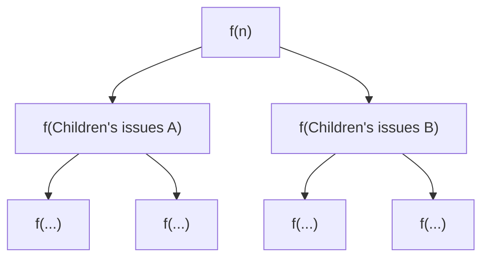
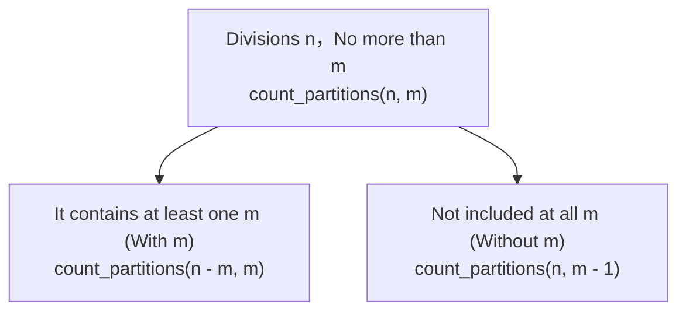

> **English original course**: CS 61A: Structure and Interpretation of Computer Programs (Fall 2024)  
> **Lecturer**: Prof. John DeNero (UC Berkeley)  
> **Text and illustrations**: VideoBook video to image to text technology e-book assembly line  
> **course coverage**: 37 / 37 on 18.2 hour audio/video instruction ⁇ 577 high-level lecture screenshots  
> **Online catalog**: [CS61A Special Catalog](/en/notes/topics/CS61A)

---


> **Lecture**: John DeNero ｜ **duration**: 32:14 ｜ **Video link back**: [B station response unit set (P10)](https://www.bilibili.com/video/BV1sy411z7nA/?p=10)

## 1. Introduction: sequence of recursion calls and waiting mechanism

In the last lesson, we saw linear recursion and interrecursion. Many beginners ask:  `while`  Why not learn recursion?

The first is the "Science of the World".
> **Many complex problems in computer science are inherently divisive and branching structures** The linear recursion is just the beginning, when a function's computational process requires exploring multiple mutually repelling options. **The tree-shaped recursion**  The result is a series of circular sentences that are incomparable in their simplicity and elegance.

The key to understanding recursion is to remember the moment. **The blocking and return mechanisms of the call pump**: 
- When a function makes another function call, the function is called as "FUNCTION". **The issuer must suspend the execution of the current order pending a complete return of results from the caller** The following sentence is followed by a comment.
- The call for a recursion **Before** The code executed is run when the code is being fed into a shell and sent to a smaller scale.
- The call for a recursion **Afterwards** The code that is executed runs when the source line is running back and forth.

---

## 2. Cascade function with symmetrical call valve

In order to see the execution sequence, we've looked at classical level printing functions.  `cascade`.

### 2.1 Definition and output of recursion coefficients
```python
def cascade(n):
    """打印正整数 n 的级联图案。"""
    if n < 10:
        print(n)
    else:
        print(n)          # 递归调用之前：入栈时打印（降序缩减）
        cascade(n // 10)  # 递归子问题：去掉个位
        print(n)          # 递归调用之后：退栈时打印（升序恢复）
```

call  `cascade(12345)`  The output of the output:
```
12345
1234
123
12
1
12
123
1234
12345
```


*⏱ Timestamp: 00:02:28 · 📷 Lecture screenshot · [Watch clip (P10 00:02:28)](https://www.bilibili.com/video/BV1sy411z7nA/?p=10&t=148)*

This perfectly symmetrical geometrical sand leakage structure is clearly reflected in:  `n=1`  The first is the printed outer layer, which is only printed once by the innermost layer of the wall.  `12`, `123`, `1234`, `12345`  The first is to print before and after the recursion.

---

### 2.2 environment model Track Call Inn
We use Python Tutor to observe  `cascade(123)`  environment model Evolution:


*⏱ Timestamp: 00:03:32 · 📷 Lecture screenshot · [Watch clip (P10 00:03:32)](https://www.bilibili.com/video/BV1sy411z7nA/?p=10&t=212)*

1. **Oh, my God.  `f1` (`n=123`)** Printed  `123` I met you.  `cascade(12)`, `f1`  Stop, the derivatives  `f2`.
2. **Oh, my God.  `f2` (`n=12`)** Printed  `12` I met you.  `cascade(1)`, `f2`  Stop, the derivatives  `f3`.
3. **Oh, my God.  `f3` (`n=1`)** Strike base conditions  `n < 10`, print  `1`.`f3`  The execution is complete and the return is indirect.  `None`.
4. **`f2`  Restored execution**: `f3`  After returning, `f2`  Continue to execute line 3  `print(n)`, print  `12`, return  `None`.
5. **`f1`  Restored execution**: `f2`  After returning, `f1`  Execution of the third line  `print(n)`, print  `123`, return  `None`.


*⏱ Timestamp: 00:05:28 · 📷 Lecture screenshot · [Watch clip (P10 00:05:28)](https://www.bilibili.com/video/BV1sy411z7nA/?p=10&t=328)*

```
调用进入 (Call / Push)        返回退出 (Return / Pop)
─────────────────────►        ◄─────────────────────
f1: cascade(123)              f1: print(123)
 └── f2: cascade(12)           └── f2: print(12)
      └── f3: cascade(1)            └── (f3 returns None)
          (print 1)
```

---

### 2.3 Choice of code style: clear vs. compact
`cascade`  The following can be written as:  `else`  The form:
```python
def cascade_short(n):
    print(n)
    if n >= 10:
        cascade_short(n // 10)
        print(n)
```


*⏱ Timestamp: 00:07:05 · 📷 Lecture screenshot · [Watch clip (P10 00:07:05)](https://www.bilibili.com/video/BV1sy411z7nA/?p=10&t=425)*

Two types of writing are functionally equivalent:
- The compact version refines the public operation, whether it's baseline or recursion.  `print(n)`).
- The standard version explicitly separates the baseline from the recursion branch.

> **SICP design philosophy**: 
> > *"Programs must be written for people to read, and only incidentally for machines to execute."* —— Harold Abelson & Gerald Jay Sussman  
> If both implementations work properly, priority is given **It is easier to communicate intent to human readers** The explicit baseline is crucial for beginners to construct a thought of the norm.

---

## 3. Code aesthetics and abstraction thinking: Inverse Cascade

If we want to print the reverse scale (from small to large, then shrink from big to small):
```
1
12
123
1234
123
12
1
```

How to dismantle this process with higher-order abstraction?


*⏱ Timestamp: 00:09:11 · 📷 Lecture screenshot · [Watch clip (P10 00:09:11)](https://www.bilibili.com/video/BV1sy411z7nA/?p=10&t=551)*

Professor DeNero designed a universal higher-order function.  `f_then_g`: 
```python
def inverse_cascade(n):
    grow(n)
    print(n)
    shrink(n)

def f_then_g(f, g, n):
    if n:
        f(n)
        g(n)

grow = lambda n: f_then_g(grow, print, n // 10)
shrink = lambda n: f_then_g(print, shrink, n // 10)
```


*⏱ Timestamp: 00:10:41 · 📷 Lecture screenshot · [Watch clip (P10 00:10:41)](https://www.bilibili.com/video/BV1sy411z7nA/?p=10&t=641)*

- `grow` Previous Recursion Calls Itself  `grow(n // 10)`, then execute  `print(n)` The first printing was done in the early 1900s, and thus it started out from the smallest front of the page (from small to large).
- `shrink` Printed first  `print(n)` Recursion calls  `shrink(n // 10)` The country's economy is in decline, and the number of people living in poverty has been steadily declining.

---

## 4. Definition and structural evolution of tree-shaped recursion

> **The tree-shaped recursion** In the execution body of a function, start **Two or more times** The first is the "recursion call".

When a call is split into two sub-calls, each sub-call being split into two smaller sub-cals, the entire computation process unfolds as one in time and space. **The branch tree (Computation Tree)**.



---

## The classic example: the tree form of Fibonacci numbers unfolded

The Fibonacci sequence is the most classic bi-branched tree recursion: 
$$\text{Fib}(0) = 0, \quad \text{Fib}(1) = 1, \quad \text{Fib}(n) = \text{Fib}(n-2) + \text{Fib}(n-1) \quad (n \ge 2)$$


*⏱ Timestamp: 00:11:46 · 📷 Lecture screenshot · [Watch clip (P10 00:11:46)](https://www.bilibili.com/video/BV1sy411z7nA/?p=10&t=706)*

### 5.1 Python implementation
```python
def fib(n):
    if n == 0:
        return 0
    elif n == 1:
        return 1
    else:
        return fib(n - 2) + fib(n - 1)
```


*⏱ Timestamp: 00:13:17 · 📷 Lecture screenshot · [Watch clip (P10 00:13:17)](https://www.bilibili.com/video/BV1sy411z7nA/?p=10&t=797)*

### 5.2 Deep-first execution (DEF)
The computer is running  `fib(5)`  And it is not the same as counting two trees, but following strictly. **The depths are priority, from left to right.** The single thread execution order:


*⏱ Timestamp: 00:14:51 · 📷 Lecture screenshot · [Watch clip (P10 00:14:51)](https://www.bilibili.com/video/BV1sy411z7nA/?p=10&t=891)*

1. Calculation  `fib(5)` First, ask for the left operand  `fib(3)`.
2. Calculation  `fib(3)` Ask for his left operand  `fib(1)` The direct hit line is back.  `1` (This is the first return value that a whole tree has ever had!)
3. Then ask  `fib(3)`  The right operand  `fib(2)` Starting the calculation  `fib(0) -> 0`  and  `fib(1) -> 1`, return  `1`.
4. `fib(3)`  The following is a summary: $1 + 1 = 2$- Right now.  `fib(5)`  And the left side is full of it.
5. Then start the right tree.  `fib(4)`  The whole tree form unfolded, and eventually came out  $2 + 3 = 5$.

---

## 6. Calculate expenses and repeat calculations: `@trace`  Watching the tree-shaped explosion

When we run it in Python  `fib(35)`  When the program is visible to the naked eye, a cardboard appears. Why do modern processors with main frequencies up to several GHz need only seconds to calculate 35 bits?

### 6.1 Use  `@trace`  Exploring the Call of Duty
Using the CS61A  `@trace`  Decorator, we can put the function in and out of the Call Inn at the terminal in real time:

```python
from ucb import trace

@trace
def fib(n):
    if n == 0:
        return 0
    elif n == 1:
        return 1
    return fib(n - 2) + fib(n - 1)
```


*⏱ Timestamp: 00:18:02 · 📷 Lecture screenshot · [Watch clip (P10 00:18:02)](https://www.bilibili.com/video/BV1sy411z7nA/?p=10&t=1082)*

Running  `fib(5)`  The terminal prints a tree-like nested call:
- `fib(3)`  The data is independently summoned and fully calculated.  **Two times.**; 
- `fib(2)`  Repeatedly calculated  **Three times**; 
- Baseline conditions  `fib(1)`  Called  **Five times.**, `fib(0)`  Called  **Three times**!


*⏱ Timestamp: 00:20:01 · 📷 Lecture screenshot · [Watch clip (P10 00:20:01)](https://www.bilibili.com/video/BV1sy411z7nA/?p=10&t=1201)*

### 6.2 Indicative complexity and memoization predictions
Calculation  $fib(n)$  The number of nodes in the leaves of a tree is strictly equal to  $Fib(n+1)$.
- With  $n$  The number of calls in a geometrically-numbered explosion is increasing, and the time complexity is increasing.  $O(\phi^n)$ The gold divided by  $\phi \approx 1.618$).
- Repeat computing accounts for 99.99% or more of CPU cycles!
- **The warning** In the next chapter, we will learn: **Memoization and Dynamic Planning** The only way to make a tree recursion linear is to cache the results.  $O(n)$  The speed is complete.

---

## The core problem: Counting Partitions

The problem is that the tree-like recursion is a real irreplaceable phenomenon. **Problems with the combined number of spaces that are mutually exclusive**.

### 7.1 Definition of the problem
> **Counting Partitions** The positive integers:  $n$  Divided into a series **Not more  $m$  The positive integers** (in non-decreasing order) to find the total number of different ways of dividing.

**Examples** Please:  $n = 6, m = 4$  The number of legal divisions is as follows:
```
1) 2 + 4
2) 1 + 1 + 4
3) 3 + 3
4) 1 + 2 + 3
5) 1 + 1 + 1 + 3
6) 2 + 2 + 2
7) 1 + 1 + 2 + 2
8) 1 + 1 + 1 + 1 + 2
9) 1 + 1 + 1 + 1 + 1 + 1
```
Counting  **9 species** So, what?  `count_partitions(6, 4)`  Should return  `9`.


*⏱ Timestamp: 00:22:04 · 📷 Lecture screenshot · [Watch clip (P10 00:22:04)](https://www.bilibili.com/video/BV1sy411z7nA/?p=10&t=1324)*

---

### 7.2 Core insights: two-way choice of space
How to divide all divisions into two **The report also highlights the importance of the EU's efforts to promote sustainable development.**  What is the subset?

Professor DeNero provides an extremely classic analysis framework: exploring the schemes of division. **Whether the maximum number of candidates is used  $m$**: 


*⏱ Timestamp: 00:24:39 · 📷 Lecture screenshot · [Watch clip (P10 00:24:39)](https://www.bilibili.com/video/BV1sy411z7nA/?p=10&t=1479)*



1. **Subsection 1: Use at least one  $m$ (With at least one $m$)**
   - And since it's clear that using a  $m$ And the rest of the numbers have to be figured out.  $n - m$.
   - The remainder is still allowed to be used no more than  $m$  The number of
   - The answer is: `count_partitions(n - m, m)`.
   - In  $n=6, m=4$  When: Immediately to get out  $6 - 4 = 2$  The way the dividing system works  `2+4`  and  `1+1+4`  Two types of ().

2. **Subsection 2: Not used at all  $m$ (Without any $m$)**
   - Since it is not used  $m$ And then all the breakdowns have to be done. **Less than equal to  $m - 1$**.
   - The sum of the digits is still prime.  $n$.
   - The answer is: `count_partitions(n, m - 1)`.
   - In  $n=6, m=4$  When: No more than immediate use  $3$  The number of  $6$  The following is a list of the topics covered by this article:

The two parts are combined: $2 + 7 = 9$ The perfect mathematical solution to the problem!


*⏱ Timestamp: 00:26:19 · 📷 Lecture screenshot · [Watch clip (P10 00:26:19)](https://www.bilibili.com/video/BV1sy411z7nA/?p=10&t=1579)*

---

## 8. Border drift and code landing of baseline conditions

The most commonly tested in tree-shaped recursion design is the internal function of a tree. **The border baseline conditions (Base Cases)**.

### 8.1 Extensive baseline analysis
1. **$n == 0$**: 
   - And I'm just going to have to get the target numbers, like:  $n - m = 0$ This means that a series of pre-order choices constitute a single selection. **The complete legal separation scheme**.
   - Successful program counts  $+1$ So, what is the  `return 1`.
2. **$n < 0$**: 
   - The sub-section selected and exceeded the target (e.g., using  $4$  To break up  $2$ The rest  $-2$ I'm not sure what the hell happened.
   - The program is ineffective. `return 0`.
3. **$m == 0$**: 
   - The maximum allowable breakdown has been reduced to  $0$ But there are still  $n > 0$  The first is the "Street of the World".
   - The program is ineffective. `return 0`.

### 8.2 Full Python code implementation
```python
def count_partitions(n, m):
    """计算使用不超过 m 的部分拆分正整数 n 的方式总数。
    
    >>> count_partitions(6, 4)
    9
    >>> count_partitions(5, 3)
    5
    """
    if n == 0:
        return 1      # 基线 1：成功完成一种拆分
    elif n < 0:
        return 0      # 基线 2：选数超额，路径非法
    elif m == 0:
        return 0      # 基线 3：无可用正整数零件
    else:
        with_m = count_partitions(n - m, m)
        without_m = count_partitions(n, m - 1)
        return with_m + without_m
```


*⏱ Timestamp: 00:28:57 · 📷 Lecture screenshot · [Watch clip (P10 00:28:57)](https://www.bilibili.com/video/BV1sy411z7nA/?p=10&t=1737)*

---

### 8.3 Examples of tracking: `count_partitions(5, 3)`
to  $n=5, m=3$  For example, there are five ways to divide: 
`1+1+1+1+1`, `1+1+1+2`, `1+2+2`, `1+1+3`, `2+3`.

Through two-way branches recursion:
- `with_m = count_partitions(2, 3)` $\rightarrow$  The first two are: `1+1`, `2`).
- `without_m = count_partitions(5, 2)` $\rightarrow$  The first is the number of people who have been killed. `1+1+1+1+1`, `1+1+1+2`, `1+2+2`).
- Total  $2 + 3 = 5$  The species.


*⏱ Timestamp: 00:31:08 · 📷 Lecture screenshot · [Watch clip (P10 00:31:08)](https://www.bilibili.com/video/BV1sy411z7nA/?p=10&t=1868)*

---

## 9. Core points and thought-provoking topics

### The key rules are refined
1. **Time reflectivity of the call order** Recursion: The pre-calling statement is executed when the tree is deeply rooted, and the post-recursion statement is executes when the tree's root is back.
2. **The use of tree-shaped recursion** The question of how to solve the problem: **Combined selectivity** When selecting and not selecting a string, adding or multiplying the string, and making decisions under both sets of rules, tree-shaped recursion is a natural modeling language.
3. **Weighing performance of tree-shaped searches** Simple tree-shaped recursion is easily trapped in a repetitive computation trap, and time complexity is often exponential; but its code structure is unparalleled by its simplicity and mathematical transparency.
4. **The two-way rule of division**: Split the solution space into two disjoint cases: including an element and excluding it. This is a common technique in algorithm design.

---

### Self-testing after school

#### Exercise 1: Count Stairs
You're climbing a piece of land  $n$  The stairs of the stairway, every time you can climb up  $1$  step or  $2$  Step by step. Write a function  `count_stairs(n)`  Calculation climbs to the next level  $n$  The first step is to create a new level of education.
```python
def count_stairs(n):
    """
    >>> count_stairs(1)
    1
    >>> count_stairs(2)
    2
    >>> count_stairs(3)
    3
    >>> count_stairs(4)
    5
    """
    if n == 1:
        return 1
    elif n == 2:
        return 2
    return count_stairs(n - 1) + count_stairs(n - 2)
```
*Think: Why is the problem of walking a ladder exactly equal to the Fibonacci sequence in structure?*

#### Exercise 2: Pathways to the Countdown
In a grid map, you can see the  $(0, 0)$  Starting, you can only move one step to the right or upwards each time to reach your destination.  $(x, y)$ Please write the total path number using tree-shaped recursion  `paths(x, y)`: 
```python
def paths(x, y):
    """
    >>> paths(2, 2)
    6
    >>> paths(1, 1)
    2
    """
    if x == 0 or y == 0:
        return 1
    return paths(x - 1, y) + paths(x, y - 1)
```
Whether it's the problem of stairs, path counting or integer division, the essence of tree-shaped recursion is to break down endpoint targets into a final step in the process of deriving several inverse directions for each other's paths.

---

