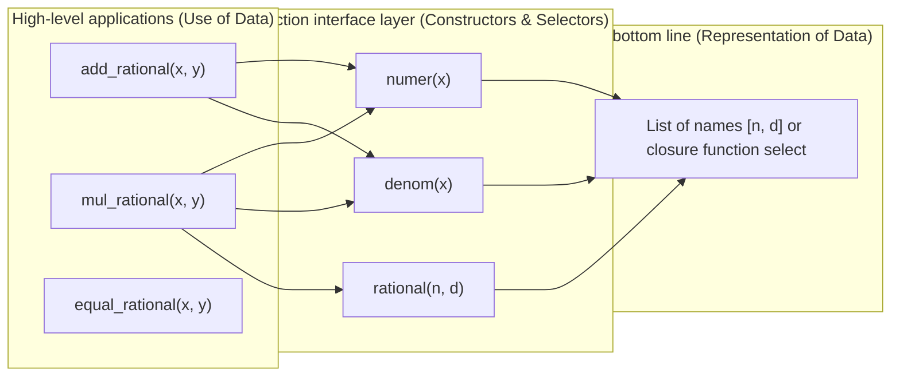

> **Earlier edition:** The Chinese edition was expanded on 22 October 2026. This English translation covers the previous edition. [Read the updated Chinese lecture](/notes/cs61a/lecture-13).

> **English original course**: CS 61A: Structure and Interpretation of Computer Programs (Fall 2024)  
> **Lecturer**: Prof. John DeNero (UC Berkeley)  
> **Text and illustrations**: VideoBook video to image to text technology e-book assembly line  
> **course coverage**: 37 / 37 on 18.2 hour audio/video instruction ⁇ 577 high-level lecture screenshots  
> **Online catalog**: [CS61A Special Catalog](/en/notes/topics/CS61A)

---


> **Lecture**: John DeNero ｜ **duration**: 29:08 ｜ **Video link back**: [B-station response unit set (P13)](https://www.bilibili.com/video/BV1sy411z7nA/?p=13)

## 1. Introduction: Why is there a shortage of data?

In our daily programming, we intuitively think that "data" is a byte sequence, a string of numbers or a list that is stored in the memory. But in computer science (especially in the SICP system), it's not the same thing as the SICP system. **Data is defined by its behavior, not the physical storage.**.

### 1.1 Behavioral Conditions
> **The moral of the matter** The only criteria for determining whether a structure can represent a rational number of metals is: **The constructor and selector of the algorithm are consistent with a rational algebraic behavior.**.


*⏱ Timestamp: 00:00:33 · 📷 Lecture screenshot · [Watch clip (P13 00:00:33)](https://www.bilibili.com/video/BV1sy411z7nA/?p=13&t=33)*

The molecular formula  $n$  and the mother  $d$  The rational numbers  $x = \text{rational}(n, d)$ It must be strictly met: 
$$\frac{\text{numer}(x)}{\text{denom}(x)} = \frac{n}{d}$$

As long as the above relationship is established, whether or not the bottom is a binary list  `[n, d]` The dictionary  `{'n': n, 'd': d}` The double-precision floating-point number or a higher-order function is a perfectly valid and equivalent rational number!

---

## 2. abstractiondata type (ADT): Contract between constructor and selector

Concepts in the real world are often complex (e.g., dates consist of years/months/days, geographic coordinates consist of latitudes/dimensions). **abstraction data type (Abstract Data Type, ADT)**  It allows us to operate these complex components as a whole unit.


*⏱ Timestamp: 00:06:54 · 📷 Lecture screenshot · [Watch clip (P13 00:06:54)](https://www.bilibili.com/video/BV1sy411z7nA/?p=13&t=414)*

The main goal of data abstraction is to **Separation of Concerns**: 
- **How data are represented**
- **How data is manipulated**

In order to establish a safe separation between the two, it is necessary to establish a clear interface agreement:
1. **The Constructors** Functions used to create this data type instance:  `rational(n, d)`.
2. **Selectors**: A function used to extract the components of a data type, such as  `numer(x)`  and  `denom(x)`.


*⏱ Timestamp: 00:09:32 · 📷 Lecture screenshot · [Watch clip (P13 00:09:32)](https://www.bilibili.com/video/BV1sy411z7nA/?p=13&t=572)*



---

## 3. Practical combat exercises: Complete construction of rational arithmetic systems

Why we should construct rational ADT instead of directly performing floating-point numerical decomposition  `1 / 3`?
- The number of floating-point computers that use a limited number of binary numbers is lost in accuracy. $1/3 \approx 0.3333333333333333$).
- We can achieve this by keeping the molecules and their fractions exactly equal to each other. **The most accurate numerical calculation without loss of precision**.


*⏱ Timestamp: 00:08:31 · 📷 Lecture screenshot · [Watch clip (P13 00:08:31)](https://www.bilibili.com/video/BV1sy411z7nA/?p=13&t=511)*

### 3.1 Mathematical derivation of rules such as multiplication, addition and division
The first is the algebraic function of prime numbers:
- **Multiplication is the process of multiplying**: 
  $$\frac{n_1}{d_1} \times \frac{n_2}{d_2} = \frac{n_1 \cdot n_2}{d_1 \cdot d_2}$$
- **Addition**: 
  $$\frac{n_1}{d_1} + \frac{n_2}{d_2} = \frac{n_1 \cdot d_2 + n_2 \cdot d_1}{d_1 \cdot d_2}$$
- **The Equality Declaration** The question is whether the molecular fractions are identical because  $1/2 = 2/4$ (ii) Cross-validation of the data: 
  $$\frac{n_1}{d_1} = \frac{n_2}{d_2} \iff n_1 \cdot d_2 = n_2 \cdot d_1$$

### 3.2 Purely selector- and constructor-based function implementation
```python
def mul_rational(x, y):
    """有理数乘法。"""
    return rational(numer(x) * numer(y), denom(x) * denom(y))

def add_rational(x, y):
    """有理数加法。"""
    nx, dx = numer(x), denom(x)
    ny, dy = numer(y), denom(y)
    return rational(nx * dy + ny * dx, dx * dy)

def equal_rational(x, y):
    """有理数判等。"""
    return numer(x) * denom(y) == numer(y) * denom(x)

def print_rational(x):
    """有理数可视化输出。"""
    print(f"{numer(x)} / {denom(x)}")
```


*⏱ Timestamp: 00:11:00 · 📷 Lecture screenshot · [Watch clip (P13 00:11:00)](https://www.bilibili.com/video/BV1sy411z7nA/?p=13&t=660)*


*⏱ Timestamp: 00:12:03 · 📷 Lecture screenshot · [Watch clip (P13 00:12:03)](https://www.bilibili.com/video/BV1sy411z7nA/?p=13&t=723)*

> **What a surprise!** The code for all of the above functions is: **We never mentioned any specific Python data type such as lists, dictionary, metagroups, etc.** They're all based on abstraction.  `rational`, `numer`, `denom`  Writing: Even if the bottom line has not been realized, the top logic is 100% complete!

---

## The main rule: Abstraction Barriers

The abstraction barrier is an invisible firewall that tightly divides the knowledge available to different levels of large software systems:


*⏱ Timestamp: 00:13:35 · 📷 Lecture screenshot · [Watch clip (P13 00:13:35)](https://www.bilibili.com/video/BV1sy411z7nA/?p=13&t=815)*


*⏱ Timestamp: 00:15:07 · 📷 Lecture screenshot · [Watch clip (P13 00:15:07)](https://www.bilibili.com/video/BV1sy411z7nA/?p=13&t=907)*


*⏱ Timestamp: 00:16:42 · 📷 Lecture screenshot · [Watch clip (P13 00:16:42)](https://www.bilibili.com/video/BV1sy411z7nA/?p=13&t=1002)*

```
┌─────────────────────────────────────────────────────────────┐
│ 1. 使用有理数进行业务计算的程序                             │
│     treat rational numbers as whole data values              │
│     (调用: add_rational, mul_rational, print_rational)      │
├─────────────────────────────────────────────────────────────┤
│ ══════════════════ 抽象屏障 1 (Barrier 1) ══════════════════ │
├─────────────────────────────────────────────────────────────┤
│ 2. 实现有理数算术运算与构造的层级                           │
│     treat rational numbers as numerators and denominators    │
│     (调用: rational, numer, denom)                           │
├─────────────────────────────────────────────────────────────┤
│ ══════════════════ 抽象屏障 2 (Barrier 2) ══════════════════ │
├─────────────────────────────────────────────────────────────┤
│ 3. 实现选择器与构造器的具体数据结构层级                     │
│     treat rational numbers as two-element lists              │
│     (使用: 列表字面量 [n, d], 索引选择 x[0], x[1])          │
├─────────────────────────────────────────────────────────────┤
│ ══════════════════ 抽象屏障 3 (Barrier 3) ══════════════════ │
├─────────────────────────────────────────────────────────────┤
│ 4. Python 语言运行时底层对列表与内存的实现                   │
│     (C 语言数组分配、垃圾回收等，外部不可见)                 │
└─────────────────────────────────────────────────────────────┘
```

> **Barrier guidelines** The first is that the code is written in a single layer. **The public interface provided by the barrier just below it is called, and it is strictly prohibited to cross the barrier downwards to assume more underlying details.**!

---

## Criticism of serious crime: the disastrous consequences of breaking the barrier to abstraction

To deeply instill in students the seriousness of abstraction barriers, Professor DeNero demonstrated a code that was extremely harsh but apparently capable of running the block and gave one of the most famous warning phrases in CS61A history:


*⏱ Timestamp: 00:18:39 · 📷 Lecture screenshot · [Watch clip (P13 00:18:39)](https://www.bilibili.com/video/BV1sy411z7nA/?p=13&t=1119)*

```python
# 极其糟糕的调用示例 (跨越屏障罪状 1)
add_rational([1, 2], [1, 4])

# 极其糟糕的除法实现 (跨越屏障罪状 2)
def divide_rational(x, y):
    return [x[0] * y[1], x[1] * y[0]]
```


*⏱ Timestamp: 00:20:10 · 📷 Lecture screenshot · [Watch clip (P13 00:20:10)](https://www.bilibili.com/video/BV1sy411z7nA/?p=13&t=1210)*

### The guilty section
1. In the Call  `add_rational`  When the programmer directly enters two lists of qubits  `[1, 2]` I'm not calling Constructors.  `rational(1, 2)` This assumes that rational numbers must be a list.
2. In the definition  `divide_rational`  When the programmer uses a direct list of sub-labels  `x[0]`  and  `y[1]` I'm not calling the selector.  `numer(x)`  and  `denom(y)` and finally the direct return bracket list, without passing  `rational(...)`  The building.

> **The classic sentence by Professor DeNero**: 
> > *"If I saw somebody's computer with this code on it, I think I would honestly just light it on fire and just watch it burn, because code that violates abstraction barriers should burn."*  
> (If I see this code that destroys the abstraction barrier on whose computer, I really want to burn it and watch it burn to ashes because the code that tramples on the abstraction Barrier should be burned!)

### Why is it so hard?
Once there is a rational underlying that indicates changes (e.g., to change performance with subgroups, class objects, or to add simplified logic), **All the code that violates the abstraction barrier will collapse in an instant.**!

---

## 6. The power of data abstraction: simplifying automated decentralization through GCD

### 6.1 Basic constructor and selector under the traditional list representation
```python
def rational(n, d):
    return [n, d]

def numer(x):
    return x[0]

def denom(x):
    return x[1]
```


*⏱ Timestamp: 00:24:17 · 📷 Lecture screenshot · [Watch clip (P13 00:24:17)](https://www.bilibili.com/video/BV1sy411z7nA/?p=13&t=1457)*

If we now evaluate  $3/2 \times 5/3$ The result is  $15/6$ Although the numerical value is correct, it has not been reduced to a standard score.  $5/2$.

### 6.2 Zero Modified High-Level Logic: Reconstructed Constructor only
Using the maximum convention number (GCD), we divide the number of conventions by molecular divisors directly when constructing rational numbers:
```python
from math import gcd

def rational(n, d):
    """构造始终处于既约形态的有理数。"""
    g = gcd(n, d)
    return [n // g, d // g]
```


*⏱ Timestamp: 00:27:55 · 📷 Lecture screenshot · [Watch clip (P13 00:27:55)](https://www.bilibili.com/video/BV1sy411z7nA/?p=13&t=1675)*

**The effects of the shadow**: 
- execute  `mul_rational(rational(3, 2), rational(5, 3))`  Automated output  `5 / 2`!
- execute  `add_rational(rational(2, 5), rational(1, 10))` (I got it)  $25/50$ Automation is a process of automating the  `1 / 2`!
- **The whole thing  `add_rational`, `mul_rational`, `equal_rational`, `print_rational`  It's not necessary to change a character.** This is the extreme scalability and maintainability of software that follows the abstraction barrier.

---

## 7. Thinking up: constructing data with pure functions (functional pair)

To fully demonstrate that cryptographic data is behavior and not a specific container crypt, Professor DeNero demonstrates the computer science miracle of Church Pairs: **It is not used to create a list, subset or any built-in data structure.**!

### 7.1 Functional constructor and distributed closure
```python
def rational(n, d):
    """完全使用函数闭包表示有理数。"""
    def select(name):
        if name == 'n':
            return n
        elif name == 'd':
            return d
    return select

def numer(x):
    return x('n')

def denom(x):
    return x('d')
```


*⏱ Timestamp: 00:02:45 · 📷 Lecture screenshot · [Watch clip (P13 00:02:45)](https://www.bilibili.com/video/BV1sy411z7nA/?p=13&t=165)*


*⏱ Timestamp: 00:04:22 · 📷 Lecture screenshot · [Watch clip (P13 00:04:22)](https://www.bilibili.com/video/BV1sy411z7nA/?p=13&t=262)*

### 7.2 environment model Perspective: Data captured by closure
execute  `x = rational(3, 8)`  and  `numer(x)`: 


*⏱ Timestamp: 00:05:22 · 📷 Lecture screenshot · [Watch clip (P13 00:05:22)](https://www.bilibili.com/video/BV1sy411z7nA/?p=13&t=322)*

```
Global frame
  rational ───► func rational(n, d)
  numer    ───► func numer(x)
  denom    ───► func denom(x)
  x        ───► func select(name) [parent=f1]

f1: rational [parent=Global]
  n: 3
  d: 8
  select ───► func select(name) [parent=f1]
```
1. call  `rational(3, 8)`  Local shrimp  `f1`  It's tied in.  `n = 3, d = 8`.
2. The internal function returned  `select`  has parent frame  `f1`.
3. when executing  `numer(x)`  That's what I mean.  `x('n')`  The new building  `f2` The parameters  `name = 'n'`. In the parent frame  `f1`  found in  `n = 3`  And he's back!

> **The Final Revelation**: 
> - Variable  `x`  It's a function itself!
> - The state data is not contained in any specialised cluster of clusters, but is quietly perpetuated in functions that are **lexical closure Parent Frame (Parent Frame)**  In the middle.
> - Any entity that complies with the conduct contract can become data. **The process and data are completely unified in the deepest part of theory.**.

---

## 8. The main points and considerations

### The key rules are refined
1. **Data abstraction separates representation and use** Constructors and selectors have built the only public communications protocol.
2. **Abstraction barrier is strictly prohibited** High-level business code should not assume the specific storage data structure of the bottom.
3. **Closure is the object** Function closure: Complete packing and response to requests, an object-oriented idea that first sprang up in functional languages.

---

### Self-testing after school

#### Exercise 1: Line segment abstraction in a plane rectangular coordinate system
Please design a data abstraction for lines in the two-dimensional plane.  `make_point(x, y)` Selector  `x_point(p)`, `y_point(p)` and lines.  `make_segment(start_p, end_p)` Selector  `start_segment(s)`, `end_segment(s)` The function is then written as the middle point of a line segment.  `midpoint_segment(s)`: 
```python
def make_point(x, y):
    return [x, y]

def x_point(p):
    return p[0]

def y_point(p):
    return p[1]

def make_segment(start_point, end_point):
    return [start_point, end_point]

def start_segment(s):
    return s[0]

def end_segment(s):
    return s[1]

def midpoint_segment(s):
    p1 = start_segment(s)
    p2 = end_segment(s)
    mid_x = (x_point(p1) + x_point(p2)) / 2
    mid_y = (y_point(p1) + y_point(p2)) / 2
    return make_point(mid_x, mid_y)
```
Beware of  `midpoint_segment`  There is absolutely no index of the brackets, and all operations are strictly abstraction-blocked!

---

