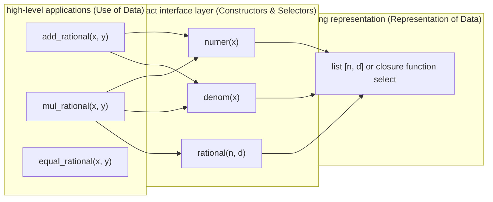

> **Course**: UC Berkeley CS61A (Fall 2024)  
> **Module**: Module 2: Recursion & Data Abstraction (Recursion & Sequences)  
> **Lecturer**: Prof. John DeNero (UC Berkeley)  
> **Video duration**: 29:08 ｜ **Classroom screenshots**: 16 pieces of blackboard writing/code demonstration  
> **Direct video**: [📺Watch the original video of this lecture on Bilibili (P13)](https://www.bilibili.com/video/BV1sy411z7nA/?p=13)  
> **Quick navigation**: [← Previous Lecture (P12 Lecture 12 Containers)](/en/notes/cs61a/lecture-12) ｜ [📚 Return to the full book catalog](/en/notes/topics/CS61A) ｜ [Next lecture (P14 Lecture 14 Trees) →](/en/notes/cs61a/lecture-14)

---

## Table of Contents
1. [Introduction: What is “data”? Behavioral axioms and performance independence](/en/notes/cs61a/lecture-13#1-introduction-what-is-data-behavioral-axioms-and-performance-independence)
2. [Abstract data type (ADT): Contract between constructors and selectors](/en/notes/cs61a/lecture-13#2-abstract-data-type-adt-contract-between-constructor-and-selector)
3. [Practical exercise: Complete construction of rational number arithmetic system](/en/notes/cs61a/lecture-13#3-practical-drill-complete-construction-of-rational-number-arithmetic-system)
4. [Core Principle: Abstraction Barriers](/en/notes/cs61a/lecture-13#4-core-principle-abstraction-barriers)
5. [Critique of Felony: The Disastrous Consequences of Violating the Barrier of Abstraction](/en/notes/cs61a/lecture-13#5-felonious-critique-disastrous-consequences-of-violating-the-barrier-of-abstraction)
6. [The power of data abstraction: automatic reduction with GCD](/en/notes/cs61a/lecture-13#6-the-power-of-data-abstraction-automatic-reduction-through-gcd)
7. [Thinking about dimensionality enhancement: Use pure functions to construct data (functional pairs)](/en/notes/cs61a/lecture-13#7-thinking-dimensionally-use-pure-functions-to-construct-data-functional-pairs)
8. [Key points and thinking questions of this lecture](/en/notes/cs61a/lecture-13#8-core-points-and-thinking-questions-of-this-lecture)

---

### In-depth formal specification and micro-evaluation process (Operational Semantics)
In the "Table of Contents" module, the underlying computer operations rely on strict formal evaluation logic:
1. **Hierarchical parsing of abstract syntax trees (AST)**: 
   - The source code character stream is first divided into terminal symbol tokens (Tokens) by the lexical analyzer (Lexer), and then constructed into a multi-fork syntax tree by the syntax parser (Parser);
   - Operator priority and associativity are solidified during the syntax tree construction phase, eliminating ambiguity at runtime;
2. **Dynamic transitions of environment chains**: 
   - Each function call generates a new frame whose static lexical environment is determined by the function object's  `parent`  Attributes are completely determined;
   - The variable search traces back up the environment chain in one direction until the global environment frame. If it is not found, it will be triggered.  `NameError`  Abnormal;
3. **State Invariants**: 
   - The key to writing robust programs is to clarify loop invariants (Loop Invariants) and function pre/post-conditions (Pre/Post-conditions);
   - In complex control flow jumps, ensure that state variables maintain legal business constraints before each iteration.


## 1. Introduction: What is “data”? Behavioral axioms and performance independence

In daily programming, we intuitively think that "data" is a sequence of bytes, a string of numbers, or a list stored in memory. But in computer science (especially the SICP system), **Data is defined by its "behaviour", not how it is physically stored**.

### 1.1 Behavioral Conditions
> **behavioral axioms**: To judge whether a certain structure can represent a "rational number", the only criterion is: **Whether its constructor and selector cooperate to satisfy the axioms of algebraic behavior of rational numbers**.

[](https://www.bilibili.com/video/BV1sy411z7nA/?p=13&t=33)
*⏱ Timestamp: 00:00:33 · 📷 Classroom screenshot · [Watch the corresponding clip on Bilibili (P13 00:00:33)](https://www.bilibili.com/video/BV1sy411z7nA/?p=13&t=33)*

#### 📸 In-depth reading of classroom blackboard writing and code demonstration (00:00:33)

**\[On-site blackboard writing/code demonstration restoration\]**:
At this time point, Professor DeNero conducted a core demonstration and key blackboard derivation on the screen:
> *“The purpose of maintaining abstraction barriers is so that you can change your data representation without having to rewrite your entire program. Let's poke a little bit deeper into this idea of data representation. What is data? What does it mean for something to represent a rational number? Well, ...”*

**\[Underlying computing model and micro execution mechanism\]**: 
1. **Execution context and timing tracing**: 
   - At the current discussion point "1. Introduction: What is "data"? Behavioral axioms and performance independence", the interpreter strictly follows the core evaluation protocol;
   - The expression evaluates the operators first, then evaluates the operands strictly from left to right, and finally applies the function object to the argument list;
   - If the environment model is involved, the local frame strictly records its static lexical parent pointer (Parent Pointer points to the environment where the function is defined), forming an orthogonal architecture with the dynamic call stack at runtime.
2. **Memory topology and object references**: 
   - Variable symbols are just keys in a hash table (environment frame), and pointers point directly to first-class citizen objects in heap memory;
   - Assignment statements are discrete-time snapshots of the state and never create implicit mathematical dependency monitoring.

**\[Guidelines for avoiding pitfalls and guidance on high-frequency test points\]**: 
- **Common misunderstandings**: In the test questions related to "Violation of Barriers of Rational Number ADT Interface", beginners can easily guess the results based on the surface form of the code, leading to scope confusion or variable shadowing misjudgments;
- **The golden rule of debugging**: When encountering nested calls and complex branches, be sure to draw independent partial frames on the scratch paper, indicate the specific binding value of each formal parameter, and derive it step by step.


For the molecule  $n$  and the denominator  $d$  rational numbers composed of  $x = \text{rational}(n, d)$, it must strictly satisfy: 
$$\frac{\text{numer}(x)}{\text{denom}(x)} = \frac{n}{d}$$

As long as the above relationship holds, no matter whether the bottom layer is a two-element list  `[n, d]`, dictionary  `{'n': n, 'd': d}`, double-precision floating point number, or a higher-order function, it is a completely legal and equivalent representation of rational numbers!

---

### In-depth formal specification and micro-evaluation process (Operational Semantics)
In the module "1. Introduction: What is "data"? Behavioral axioms and performance independence", the underlying computer operations rely on strict formal evaluation logic:
1. **Hierarchical parsing of abstract syntax trees (AST)**: 
   - The source code character stream is first divided into terminal symbol tokens (Tokens) by the lexical analyzer (Lexer), and then constructed into a multi-fork syntax tree by the syntax parser (Parser);
   - Operator priority and associativity are solidified during the syntax tree construction phase, eliminating ambiguity at runtime;
2. **Dynamic transitions of environment chains**: 
   - Each function call generates a new frame whose static lexical environment is determined by the function object's  `parent`  Attributes are completely determined;
   - The variable search traces back up the environment chain in one direction until the global environment frame. If it is not found, it will be triggered.  `NameError`  Abnormal;
3. **State Invariants**: 
   - The key to writing robust programs is to clarify loop invariants (Loop Invariants) and function pre/post-conditions (Pre/Post-conditions);
   - In complex control flow jumps, ensure that state variables maintain legal business constraints before each iteration.


## 2. Abstract data type (ADT): Contract between constructor and selector

Concepts in the real world are often composite (e.g. dates consist of year/month/day, geographical coordinates consist of latitude/longitude). **Abstract Data Type (ADT)**  Allows us to operate these composite parts as an integral unit.

[](https://www.bilibili.com/video/BV1sy411z7nA/?p=13&t=414)
*⏱ Timestamp: 00:06:54 · 📷 Classroom screenshot · [Watch the corresponding clip on Bilibili (P13 00:06:54)](https://www.bilibili.com/video/BV1sy411z7nA/?p=13&t=414)*

#### 📸 In-depth reading of classroom blackboard writing and code demonstration (00:06:54)

**\[On-site blackboard writing/code demonstration restoration\]**:
At this time point, Professor DeNero conducted a core demonstration and key blackboard derivation on the screen:
> *“A new method of abstraction. Here we go. So, most values are compound values, in the sense that they combine different objects together in order to create some object with multiple parts, such as a date, which has a year, a month, and a day, all combined together into one thing. Or a geographic posi...”*

**\[Underlying computing model and micro execution mechanism\]**: 
1. **Execution context and timing tracing**: 
   - At the current discussion point "2. Abstract Data Type (ADT): Contract of Constructor and Selector", the interpreter strictly follows the core evaluation protocol;
   - The expression evaluates the operators first, then evaluates the operands strictly from left to right, and finally applies the function object to the argument list;
   - If the environment model is involved, the local frame strictly records its static lexical parent pointer (Parent Pointer points to the environment where the function is defined), forming an orthogonal architecture with the dynamic call stack at runtime.
2. **Memory topology and object references**: 
   - Variable symbols are just keys in a hash table (environment frame), and pointers point directly to first-class citizen objects in heap memory;
   - Assignment statements are discrete-time snapshots of the state and never create implicit mathematical dependency monitoring.

**\[Guidelines for avoiding pitfalls and guidance on high-frequency test points\]**: 
- **Common misunderstandings**: In the test questions related to "Violation of Barriers of Rational Number ADT Interface", beginners can easily guess the results based on the surface form of the code, leading to scope confusion or variable shadowing misjudgments;
- **The golden rule of debugging**: When encountering nested calls and complex branches, be sure to draw independent partial frames on the scratch paper, indicate the specific binding value of each formal parameter, and derive it step by step.


The core goal of data abstraction is **Separation of Concerns**: 
- **The underlying representation of data (How data are represented)**
- **High-level use of data (How data are manipulated)**

In order to establish safe isolation between the two, an explicit interface contract must be developed:
1. **Constructor**: Function used to create instances of this data type, such as  `rational(n, d)`.
2. **Selectors**: Function used to extract various components of this data type, such as  `numer(x)`  with  `denom(x)`.

[](https://www.bilibili.com/video/BV1sy411z7nA/?p=13&t=572)
*⏱ Timestamp: 00:09:32 · 📷 Classroom screenshot · [Watch the corresponding clip on Bilibili (P13 00:09:32)](https://www.bilibili.com/video/BV1sy411z7nA/?p=13&t=572)*

#### 📸 In-depth reading of classroom blackboard writing and code demonstration (00:09:32)

**\[On-site blackboard writing/code demonstration restoration\]**:
At this time point, Professor DeNero conducted a core demonstration and key blackboard derivation on the screen:
> *“We have another function, numer x, which returns the numerator of a rational number, x. And likewise, we have a denom x function, which returns the denominator. So we have a way of combining together a numerator and a denominator, and then we have a way of selecting those two parts. This is called a...”*

**\[Underlying computing model and micro execution mechanism\]**: 
1. **Execution context and timing tracing**: 
   - At the current discussion point "2. Abstract Data Type (ADT): Contract of Constructor and Selector", the interpreter strictly follows the core evaluation protocol;
   - The expression evaluates the operators first, then evaluates the operands strictly from left to right, and finally applies the function object to the argument list;
   - If the environment model is involved, the local frame strictly records its static lexical parent pointer (Parent Pointer points to the environment where the function is defined), forming an orthogonal architecture with the dynamic call stack at runtime.
2. **Memory topology and object references**: 
   - Variable symbols are just keys in a hash table (environment frame), and pointers point directly to first-class citizen objects in heap memory;
   - Assignment statements are discrete-time snapshots of the state and never create implicit mathematical dependency monitoring.

**\[Guidelines for avoiding pitfalls and guidance on high-frequency test points\]**: 
- **Common misunderstandings**: In the test questions related to "Violation of Barriers of Rational Number ADT Interface", beginners can easily guess the results based on the surface form of the code, leading to scope confusion or variable shadowing misjudgments;
- **The golden rule of debugging**: When encountering nested calls and complex branches, be sure to draw independent partial frames on the scratch paper, indicate the specific binding value of each formal parameter, and derive it step by step.




---

### In-depth formal specification and micro-evaluation process (Operational Semantics)
In the "2. Abstract Data Type (ADT): Contract of Constructor and Selector" module, the underlying computer operations rely on strict formal evaluation logic:
1. **Hierarchical parsing of abstract syntax trees (AST)**: 
   - The source code character stream is first divided into terminal symbol tokens (Tokens) by the lexical analyzer (Lexer), and then constructed into a multi-fork syntax tree by the syntax parser (Parser);
   - Operator priority and associativity are solidified during the syntax tree construction phase, eliminating ambiguity at runtime;
2. **Dynamic transitions of environment chains**: 
   - Each function call generates a new frame whose static lexical environment is determined by the function object's  `parent`  Attributes are completely determined;
   - The variable search traces back up the environment chain in one direction until the global environment frame. If it is not found, it will be triggered.  `NameError`  Abnormal;
3. **State Invariants**: 
   - The key to writing robust programs is to clarify loop invariants (Loop Invariants) and function pre/post-conditions (Pre/Post-conditions);
   - In complex control flow jumps, ensure that state variables maintain legal business constraints before each iteration.


## 3. Practical drill: complete construction of rational number arithmetic system

Why do we construct a rational ADT instead of directly performing floating point division  `1 / 3`?
- Computer floating point numbers use limited binary decimal expansion, which will cause precision loss ($1/3 \approx 0.3333333333333333$).
- By keeping the numerator and denominator to be exact pairs of integers, we can achieve **Completely exact fractional arithmetic without loss of precision**.

[](https://www.bilibili.com/video/BV1sy411z7nA/?p=13&t=511)
*⏱ Timestamp: 00:08:31 · 📷 Classroom screenshot · [Watch the corresponding clip on Bilibili (P13 00:08:31)](https://www.bilibili.com/video/BV1sy411z7nA/?p=13&t=511)*

#### 📸 In-depth reading of classroom blackboard writing and code demonstration (00:08:31)

**\[On-site blackboard writing/code demonstration restoration\]**:
At this time point, Professor DeNero conducted a core demonstration and key blackboard derivation on the screen:
> *“And we'll see what we mean by data abstraction. So a rational member can be expressed as a numerator divided by a denominator, where both numerator and denominators are integers. And since we can represent integers exactly, this gives us an exact representation of fractions. So a pair of integers le...”*

**\[Underlying computing model and micro execution mechanism\]**: 
1. **Execution context and timing tracing**: 
   - At the current discussion point "3. Practical Exercise: Complete Construction of a Rational Number Arithmetic System", the interpreter strictly follows the core evaluation protocol;
   - The expression evaluates the operators first, then evaluates the operands strictly from left to right, and finally applies the function object to the argument list;
   - If the environment model is involved, the local frame strictly records its static lexical parent pointer (Parent Pointer points to the environment where the function is defined), forming an orthogonal architecture with the dynamic call stack at runtime.
2. **Memory topology and object references**: 
   - Variable symbols are just keys in a hash table (environment frame), and pointers point directly to first-class citizen objects in heap memory;
   - Assignment statements are discrete-time snapshots of the state and never create implicit mathematical dependency monitoring.

**\[Guidelines for avoiding pitfalls and guidance on high-frequency test points\]**: 
- **Common misunderstandings**: In the test questions related to "Violation of Barriers of Rational Number ADT Interface", beginners can easily guess the results based on the surface form of the code, leading to scope confusion or variable shadowing misjudgments;
- **The golden rule of debugging**: When encountering nested calls and complex branches, be sure to draw independent partial frames on the scratch paper, indicate the specific binding value of each formal parameter, and derive it step by step.


### 3.1 Mathematical derivation of rules for multiplication, addition and judgment
According to the rules of elementary fractional algebra:
- **Multiplication**: 
  $$\frac{n_1}{d_1} \times \frac{n_2}{d_2} = \frac{n_1 \cdot n_2}{d_1 \cdot d_2}$$
- **Addition**: 
  $$\frac{n_1}{d_1} + \frac{n_2}{d_2} = \frac{n_1 \cdot d_2 + n_2 \cdot d_1}{d_1 \cdot d_2}$$
- **Equality**: You cannot simply compare whether the numerator and denominator are the same (because  $1/2 = 2/4$). Verified by cross multiplication: 
  $$\frac{n_1}{d_1} = \frac{n_2}{d_2} \iff n_1 \cdot d_2 = n_2 \cdot d_1$$

### 3.2 Function implementation purely based on selectors and constructors
```python
def mul_rational(x, y):
    """有理数乘法。"""
    return rational(numer(x) * numer(y), denom(x) * denom(y))

def add_rational(x, y):
    """有理数加法。"""
    nx, dx = numer(x), denom(x)
    ny, dy = numer(y), denom(y)
    return rational(nx * dy + ny * dx, dx * dy)

def equal_rational(x, y):
    """有理数判等。"""
    return numer(x) * denom(y) == numer(y) * denom(x)

def print_rational(x):
    """有理数可视化输出。"""
    print(f"{numer(x)} / {denom(x)}")
```

[](https://www.bilibili.com/video/BV1sy411z7nA/?p=13&t=660)
*⏱ Timestamp: 00:11:00 · 📷 Classroom screenshot · [Watch the corresponding clip on Bilibili (P13 00:11:00)](https://www.bilibili.com/video/BV1sy411z7nA/?p=13&t=660)*

#### 📸 In-depth reading of classroom blackboard writing and code demonstration (00:11:00)

**\[On-site blackboard writing/code demonstration restoration\]**:
At this time point, Professor DeNero conducted a core demonstration and key blackboard derivation on the screen:
> *“And that's our new numerator, and our new denominator is the product of the denominators of the first and second rational number that we're adding together. So now we have formulas for how to multiply and add rational numbers. How do we write code that does that? Well, we'll write it in terms of our...”*

**\[Underlying computing model and micro execution mechanism\]**: 
1. **Execution context and timing tracing**: 
   - At the current discussion point "3. Practical Exercise: Complete Construction of a Rational Number Arithmetic System", the interpreter strictly follows the core evaluation protocol;
   - The expression evaluates the operators first, then evaluates the operands strictly from left to right, and finally applies the function object to the argument list;
   - If the environment model is involved, the local frame strictly records its static lexical parent pointer (Parent Pointer points to the environment where the function is defined), forming an orthogonal architecture with the dynamic call stack at runtime.
2. **Memory topology and object references**: 
   - Variable symbols are just keys in a hash table (environment frame), and pointers point directly to first-class citizen objects in heap memory;
   - Assignment statements are discrete-time snapshots of the state and never create implicit mathematical dependency monitoring.

**\[Guidelines for avoiding pitfalls and guidance on high-frequency test points\]**: 
- **Common misunderstandings**: In the test questions related to "Violation of Barriers of Rational Number ADT Interface", beginners can easily guess the results based on the surface form of the code, leading to scope confusion or variable shadowing misjudgments;
- **The golden rule of debugging**: When encountering nested calls and complex branches, be sure to draw independent partial frames on the scratch paper, indicate the specific binding value of each formal parameter, and derive it step by step.


[](https://www.bilibili.com/video/BV1sy411z7nA/?p=13&t=723)
*⏱ Timestamp: 00:12:03 · 📷 Classroom screenshot · [Watch the corresponding clip on Bilibili (P13 00:12:03)](https://www.bilibili.com/video/BV1sy411z7nA/?p=13&t=723)*

#### 📸 In-depth reading of classroom blackboard writing and code demonstration (00:12:03)

**\[On-site blackboard writing/code demonstration restoration\]**:
At this time point, Professor DeNero conducted a core demonstration and key blackboard derivation on the screen:
> *“Because we use those multiple times in our expression, and then we return a rational, which follows the formula on the right. One more function lets us really work with rational numbers, and that is equal rational, which returns true, if x and y are the same number. Now, we can't just compare their ...”*

**\[Underlying computing model and micro execution mechanism\]**: 
1. **Execution context and timing tracing**: 
   - At the current discussion point "3. Practical Exercise: Complete Construction of a Rational Number Arithmetic System", the interpreter strictly follows the core evaluation protocol;
   - The expression evaluates the operators first, then evaluates the operands strictly from left to right, and finally applies the function object to the argument list;
   - If the environment model is involved, the local frame strictly records its static lexical parent pointer (Parent Pointer points to the environment where the function is defined), forming an orthogonal architecture with the dynamic call stack at runtime.
2. **Memory topology and object references**: 
   - Variable symbols are just keys in a hash table (environment frame), and pointers point directly to first-class citizen objects in heap memory;
   - Assignment statements are discrete-time snapshots of the state and never create implicit mathematical dependency monitoring.

**\[Guidelines for avoiding pitfalls and guidance on high-frequency test points\]**: 
- **Common misunderstandings**: In the test questions related to "Violation of Barriers of Rational Number ADT Interface", beginners can easily guess the results based on the surface form of the code, leading to scope confusion or variable shadowing misjudgments;
- **The golden rule of debugging**: When encountering nested calls and complex branches, be sure to draw independent partial frames on the scratch paper, indicate the specific binding value of each formal parameter, and derive it step by step.


> **What's amazing**: In the codes of all the above operation functions, **We never mentioned any specific Python data types like lists, dictionaries, tuples, etc.**! They are entirely based on abstract  `rational`, `numer`, `denom`  Write. Even if the underlying representation has not yet been implemented, the high-level logic is 100% complete!

---

### In-depth formal specification and micro-evaluation process (Operational Semantics)
In the "3. Practical Exercise: Complete Construction of Rational Number Arithmetic System" module, the underlying computer operations rely on strict formal evaluation logic:
1. **Hierarchical parsing of abstract syntax trees (AST)**: 
   - The source code character stream is first divided into terminal symbol tokens (Tokens) by the lexical analyzer (Lexer), and then constructed into a multi-fork syntax tree by the syntax parser (Parser);
   - Operator priority and associativity are solidified during the syntax tree construction phase, eliminating ambiguity at runtime;
2. **Dynamic transitions of environment chains**: 
   - Each function call generates a new frame whose static lexical environment is determined by the function object's  `parent`  Attributes are completely determined;
   - The variable search traces back up the environment chain in one direction until the global environment frame. If it is not found, it will be triggered.  `NameError`  Abnormal;
3. **State Invariants**: 
   - The key to writing robust programs is to clarify loop invariants (Loop Invariants) and function pre/post-conditions (Pre/Post-conditions);
   - In complex control flow jumps, ensure that state variables maintain legal business constraints before each iteration.


## 4. Core Principle: Abstraction Barriers

Abstract barriers are invisible "firewalls" that strictly divide the scope of knowledge mastered by different levels in large software systems:

[](https://www.bilibili.com/video/BV1sy411z7nA/?p=13&t=815)
*⏱ Timestamp: 00:13:35 · 📷 Classroom screenshot · [Watch the corresponding clip on Bilibili (P13 00:13:35)](https://www.bilibili.com/video/BV1sy411z7nA/?p=13&t=815)*

#### 📸 In-depth reading of classroom blackboard writing and code demonstration (00:13:35)

**\[On-site blackboard writing/code demonstration restoration\]**:
At this time point, Professor DeNero conducted a core demonstration and key blackboard derivation on the screen:
> *“Now, these separations are important because they allow you to make changes to one part of your program and have other parts take advantage of those changes without breaking in any way or creating inconsistencies. So let's talk about the abstraction barriers in the development of a rational arithmet...”*

**\[Underlying computing model and micro execution mechanism\]**: 
1. **Execution context and timing tracing**: 
   - At the current discussion point "4. Core Rules: Abstraction Barriers", the interpreter strictly follows the core evaluation protocol;
   - The expression evaluates the operators first, then evaluates the operands strictly from left to right, and finally applies the function object to the argument list;
   - If the environment model is involved, the local frame strictly records its static lexical parent pointer (Parent Pointer points to the environment where the function is defined), forming an orthogonal architecture with the dynamic call stack at runtime.
2. **Memory topology and object references**: 
   - Variable symbols are just keys in a hash table (environment frame), and pointers point directly to first-class citizen objects in heap memory;
   - Assignment statements are discrete-time snapshots of the state and never create implicit mathematical dependency monitoring.

**\[Guidelines for avoiding pitfalls and guidance on high-frequency test points\]**: 
- **Common misunderstandings**: In the test questions related to "Violation of Barriers of Rational Number ADT Interface", beginners can easily guess the results based on the surface form of the code, leading to scope confusion or variable shadowing misjudgments;
- **The golden rule of debugging**: When encountering nested calls and complex branches, be sure to draw independent partial frames on the scratch paper, indicate the specific binding value of each formal parameter, and derive it step by step.


[](https://www.bilibili.com/video/BV1sy411z7nA/?p=13&t=907)
*⏱ Timestamp: 00:15:07 · 📷 Classroom screenshot · [Watch the corresponding clip on Bilibili (P13 00:15:07)](https://www.bilibili.com/video/BV1sy411z7nA/?p=13&t=907)*

#### 📸 In-depth reading of classroom blackboard writing and code demonstration (00:15:07)

**\[On-site blackboard writing/code demonstration restoration\]**:
At this time point, Professor DeNero conducted a core demonstration and key blackboard derivation on the screen:
> *“We find parts of the program that create rationals, or implement rational operations, and they treat rationals as a numerator and a denominator paired together. Now, they may not need to know exactly how that pairing happens, but they do need to know that a rational number has a numerator and a deno...”*

**\[Underlying computing model and micro execution mechanism\]**: 
1. **Execution context and timing tracing**: 
   - At the current discussion point "4. Core Rules: Abstraction Barriers", the interpreter strictly follows the core evaluation protocol;
   - The expression evaluates the operators first, then evaluates the operands strictly from left to right, and finally applies the function object to the argument list;
   - If the environment model is involved, the local frame strictly records its static lexical parent pointer (Parent Pointer points to the environment where the function is defined), forming an orthogonal architecture with the dynamic call stack at runtime.
2. **Memory topology and object references**: 
   - Variable symbols are just keys in a hash table (environment frame), and pointers point directly to first-class citizen objects in heap memory;
   - Assignment statements are discrete-time snapshots of the state and never create implicit mathematical dependency monitoring.

**\[Guidelines for avoiding pitfalls and guidance on high-frequency test points\]**: 
- **Common misunderstandings**: In the test questions related to "Violation of Barriers of Rational Number ADT Interface", beginners can easily guess the results based on the surface form of the code, leading to scope confusion or variable shadowing misjudgments;
- **The golden rule of debugging**: When encountering nested calls and complex branches, be sure to draw independent partial frames on the scratch paper, indicate the specific binding value of each formal parameter, and derive it step by step.


[](https://www.bilibili.com/video/BV1sy411z7nA/?p=13&t=1002)
*⏱ Timestamp: 00:16:42 · 📷 Classroom screenshot · [Watch the corresponding clip on Bilibili (P13 00:16:42)](https://www.bilibili.com/video/BV1sy411z7nA/?p=13&t=1002)*

#### 📸 In-depth reading of classroom blackboard writing and code demonstration (00:16:42)

**\[On-site blackboard writing/code demonstration restoration\]**:
At this time point, Professor DeNero conducted a core demonstration and key blackboard derivation on the screen:
> *“They do understand their whole data values, that they're consisting of numerators and denominators. And now we have a further detail, that the numerator and denominator are glued together using a list. So for this, we use list literals and element selection. And again, there's an abstraction barrier...”*

**\[Underlying computing model and micro execution mechanism\]**: 
1. **Execution context and timing tracing**: 
   - At the current discussion point "4. Core Rules: Abstraction Barriers", the interpreter strictly follows the core evaluation protocol;
   - The expression evaluates the operators first, then evaluates the operands strictly from left to right, and finally applies the function object to the argument list;
   - If the environment model is involved, the local frame strictly records its static lexical parent pointer (Parent Pointer points to the environment where the function is defined), forming an orthogonal architecture with the dynamic call stack at runtime.
2. **Memory topology and object references**: 
   - Variable symbols are just keys in a hash table (environment frame), and pointers point directly to first-class citizen objects in heap memory;
   - Assignment statements are discrete-time snapshots of the state and never create implicit mathematical dependency monitoring.

**\[Guidelines for avoiding pitfalls and guidance on high-frequency test points\]**: 
- **Common misunderstandings**: In the test questions related to "Violation of Barriers of Rational Number ADT Interface", beginners can easily guess the results based on the surface form of the code, leading to scope confusion or variable shadowing misjudgments;
- **The golden rule of debugging**: When encountering nested calls and complex branches, be sure to draw independent partial frames on the scratch paper, indicate the specific binding value of each formal parameter, and derive it step by step.


```
┌─────────────────────────────────────────────────────────────┐
│ 1. 使用有理数进行业务计算的程序                             │
│     treat rational numbers as whole data values              │
│     (调用: add_rational, mul_rational, print_rational)      │
├─────────────────────────────────────────────────────────────┤
│ ══════════════════ 抽象屏障 1 (Barrier 1) ══════════════════ │
├─────────────────────────────────────────────────────────────┤
│ 2. 实现有理数算术运算与构造的层级                           │
│     treat rational numbers as numerators and denominators    │
│     (调用: rational, numer, denom)                           │
├─────────────────────────────────────────────────────────────┤
│ ══════════════════ 抽象屏障 2 (Barrier 2) ══════════════════ │
├─────────────────────────────────────────────────────────────┤
│ 3. 实现选择器与构造器的具体数据结构层级                     │
│     treat rational numbers as two-element lists              │
│     (使用: 列表字面量 [n, d], 索引选择 x[0], x[1])          │
├─────────────────────────────────────────────────────────────┤
│ ══════════════════ 抽象屏障 3 (Barrier 3) ══════════════════ │
├─────────────────────────────────────────────────────────────┤
│ 4. Python 语言运行时底层对列表与内存的实现                   │
│     (C 语言数组分配、垃圾回收等，外部不可见)                 │
└─────────────────────────────────────────────────────────────┘
```

> **barrier criterion**: When writing any layer of code, **You can only call the public interface provided by the barrier directly below it. It is strictly forbidden to cross the barrier downwards to assume lower-level implementation details.**!

---

### In-depth formal specification and micro-evaluation process (Operational Semantics)
In the "4. Core Rules: Abstraction Barriers" module, the underlying computer operations rely on strict formal evaluation logic:
1. **Hierarchical parsing of abstract syntax trees (AST)**: 
   - The source code character stream is first divided into terminal symbol tokens (Tokens) by the lexical analyzer (Lexer), and then constructed into a multi-fork syntax tree by the syntax parser (Parser);
   - Operator priority and associativity are solidified during the syntax tree construction phase, eliminating ambiguity at runtime;
2. **Dynamic transitions of environment chains**: 
   - Each function call generates a new frame whose static lexical environment is determined by the function object's  `parent`  Attributes are completely determined;
   - The variable search traces back up the environment chain in one direction until the global environment frame. If it is not found, it will be triggered.  `NameError`  Abnormal;
3. **State Invariants**: 
   - The key to writing robust programs is to clarify loop invariants (Loop Invariants) and function pre/post-conditions (Pre/Post-conditions);
   - In complex control flow jumps, ensure that state variables maintain legal business constraints before each iteration.


## 5. Felonious Critique: Disastrous Consequences of Violating the Barrier of Abstraction

To instill in his students the seriousness of abstract barriers, Professor DeNero presented a piece of "extremely bad but ostensibly working" code and gave one of the most famous aphorisms in CS61A history:

[](https://www.bilibili.com/video/BV1sy411z7nA/?p=13&t=1119)
*⏱ Timestamp: 00:18:39 · 📷 Classroom screenshot · [Watch the corresponding clip on Bilibili (P13 00:18:39)](https://www.bilibili.com/video/BV1sy411z7nA/?p=13&t=1119)*

#### 📸 In-depth reading of classroom blackboard writing and code demonstration (00:18:39)

**\[On-site blackboard writing/code demonstration restoration\]**:
At this time point, Professor DeNero conducted a core demonstration and key blackboard derivation on the screen:
> *“1, 2, and 1, 4. So a half plus a 4 should give me 3 fourths. And under the code we've written, this will work just fine. I have a definition of dividing a rational, which returns a list of whatever is the 0th element of x times the first element of y. And then we have the first element of x and the ...”*

**\[Underlying computing model and micro execution mechanism\]**: 
1. **Execution context and timing tracing**: 
   - At the current discussion point "5. Felony Criticism: Disastrous Consequences of Violating the Abstract Barrier", the interpreter strictly follows the core evaluation convention;
   - The expression evaluates the operators first, then evaluates the operands strictly from left to right, and finally applies the function object to the argument list;
   - If the environment model is involved, the local frame strictly records its static lexical parent pointer (Parent Pointer points to the environment where the function is defined), forming an orthogonal architecture with the dynamic call stack at runtime.
2. **Memory topology and object references**: 
   - Variable symbols are just keys in a hash table (environment frame), and pointers point directly to first-class citizen objects in heap memory;
   - Assignment statements are discrete-time snapshots of the state and never create implicit mathematical dependency monitoring.

**\[Guidelines for avoiding pitfalls and guidance on high-frequency test points\]**: 
- **Common misunderstandings**: In the test questions related to "Violation of Barriers of Rational Number ADT Interface", beginners can easily guess the results based on the surface form of the code, leading to scope confusion or variable shadowing misjudgments;
- **The golden rule of debugging**: When encountering nested calls and complex branches, be sure to draw independent partial frames on the scratch paper, indicate the specific binding value of each formal parameter, and derive it step by step.


```python
# 极其糟糕的调用示例 (跨越屏障罪状 1)
add_rational([1, 2], [1, 4])

# 极其糟糕的除法实现 (跨越屏障罪状 2)
def divide_rational(x, y):
    return [x[0] * y[1], x[1] * y[0]]
```

[](https://www.bilibili.com/video/BV1sy411z7nA/?p=13&t=1210)
*⏱ Timestamp: 00:20:10 · 📷 Classroom screenshot · [Watch the corresponding clip on Bilibili (P13 00:20:10)](https://www.bilibili.com/video/BV1sy411z7nA/?p=13&t=1210)*

#### 📸 In-depth reading of classroom blackboard writing and code demonstration (00:20:10)

**\[On-site blackboard writing/code demonstration restoration\]**:
At this time point, Professor DeNero conducted a core demonstration and key blackboard derivation on the screen:
> *“Numer selector function. Instead, I've used the element selection that works for lists, thereby assuming that X is a list. Instead of saying, oh, it's something that has a numerator and a denominator, but I don't know exactly what it is. So I've gone down to too low of a level. And, oh, look, I did ...”*

**\[Underlying computing model and micro execution mechanism\]**: 
1. **Execution context and timing tracing**: 
   - At the current discussion point "5. Felony Criticism: Disastrous Consequences of Violating the Abstract Barrier", the interpreter strictly follows the core evaluation convention;
   - The expression evaluates the operators first, then evaluates the operands strictly from left to right, and finally applies the function object to the argument list;
   - If the environment model is involved, the local frame strictly records its static lexical parent pointer (Parent Pointer points to the environment where the function is defined), forming an orthogonal architecture with the dynamic call stack at runtime.
2. **Memory topology and object references**: 
   - Variable symbols are just keys in a hash table (environment frame), and pointers point directly to first-class citizen objects in heap memory;
   - Assignment statements are discrete-time snapshots of the state and never create implicit mathematical dependency monitoring.

**\[Guidelines for avoiding pitfalls and guidance on high-frequency test points\]**: 
- **Common misunderstandings**: In the test questions related to "Violation of Barriers of Rational Number ADT Interface", beginners can easily guess the results based on the surface form of the code, leading to scope confusion or variable shadowing misjudgments;
- **The golden rule of debugging**: When encountering nested calls and complex branches, be sure to draw independent partial frames on the scratch paper, indicate the specific binding value of each formal parameter, and derive it step by step.


### Analysis of crimes
1. calling  `add_rational`  When, the programmer directly passed in two list literals  `[1, 2]`, instead of calling the constructor  `rational(1, 2)`. This assumes that rational numbers must be lists.
2. in definition  `divide_rational` , the programmer directly uses list subscripts  `x[0]`  with  `y[1]`, instead of calling the selector  `numer(x)`  with  `denom(y)`; and finally return the square bracket list directly without passing  `rational(...)`  Construct.

> **Professor DeNero’s classic verdict**: 
> > *"If I saw somebody's computer with this code on it, I think I would honestly just light it on fire and just watch it burn, because code that violates abstraction barriers should burn."*  
> (If I see this kind of code that breaks the abstraction barrier on someone's computer, I really want to light it on fire and watch it burn to ashes, because code that tramples on the abstraction barrier should be burned!)

### Why does it have to be so harsh?
Once the underlying representation of rational numbers changes (for example, switching to tuples, class objects, or adding reduction logic for performance), **All code that violates the abstract barrier will collapse instantly**!

---

### In-depth formal specification and micro-evaluation process (Operational Semantics)
In the module "5. Criticism of Felony: Disastrous Consequences of Violating the Abstract Barrier", the underlying computer operations rely on strict formal evaluation logic:
1. **Hierarchical parsing of abstract syntax trees (AST)**: 
   - The source code character stream is first divided into terminal symbol tokens (Tokens) by the lexical analyzer (Lexer), and then constructed into a multi-fork syntax tree by the syntax parser (Parser);
   - Operator priority and associativity are solidified during the syntax tree construction phase, eliminating ambiguity at runtime;
2. **Dynamic transitions of environment chains**: 
   - Each function call generates a new frame whose static lexical environment is determined by the function object's  `parent`  Attributes are completely determined;
   - The variable search traces back up the environment chain in one direction until the global environment frame. If it is not found, it will be triggered.  `NameError`  Abnormal;
3. **State Invariants**: 
   - The key to writing robust programs is to clarify loop invariants (Loop Invariants) and function pre/post-conditions (Pre/Post-conditions);
   - In complex control flow jumps, ensure that state variables maintain legal business constraints before each iteration.


## 6. The power of data abstraction: automatic reduction through GCD

### 6.1 Basic constructors and selectors under traditional list representation
```python
def rational(n, d):
    return [n, d]

def numer(x):
    return x[0]

def denom(x):
    return x[1]
```

[](https://www.bilibili.com/video/BV1sy411z7nA/?p=13&t=1457)
*⏱ Timestamp: 00:24:17 · 📷 Classroom screenshot · [Watch the corresponding clip on Bilibili (P13 00:24:17)](https://www.bilibili.com/video/BV1sy411z7nA/?p=13&t=1457)*

#### 📸 In-depth reading of classroom blackboard writing and code demonstration (00:24:17)

**\[On-site blackboard writing/code demonstration restoration\]**:
At this time point, Professor DeNero conducted a core demonstration and key blackboard derivation on the screen:
> *“Okay, we now have a basic introduction to what lists are, and so far we've used them to create pairs. And why is that useful? Well, a rational number is a pair of integers, the numerator and the denominator. So here's a definition of the constructor of the abstract data type for rational numbers. It...”*

**\[Underlying computing model and micro execution mechanism\]**: 
1. **Execution context and timing tracing**: 
   - At the current discussion point "6. The power of data abstraction: automatic reduction through GCD", the interpreter strictly follows the core evaluation protocol;
   - The expression evaluates the operators first, then evaluates the operands strictly from left to right, and finally applies the function object to the argument list;
   - If the environment model is involved, the local frame strictly records its static lexical parent pointer (Parent Pointer points to the environment where the function is defined), forming an orthogonal architecture with the dynamic call stack at runtime.
2. **Memory topology and object references**: 
   - Variable symbols are just keys in a hash table (environment frame), and pointers point directly to first-class citizen objects in heap memory;
   - Assignment statements are discrete-time snapshots of the state and never create implicit mathematical dependency monitoring.

**\[Guidelines for avoiding pitfalls and guidance on high-frequency test points\]**: 
- **Common misunderstandings**: In the test questions related to "Violation of Barriers of Rational Number ADT Interface", beginners can easily guess the results based on the surface form of the code, leading to scope confusion or variable shadowing misjudgments;
- **The golden rule of debugging**: When encountering nested calls and complex branches, be sure to draw independent partial frames on the scratch paper, indicate the specific binding value of each formal parameter, and derive it step by step.


If calculated at this time  $3/2 \times 5/3$, the result is  $15/6$. Although the numerical values are correct, they are not reduced to reduced fractions.  $5/2$.

### 6.2 Zero modification of high-level logic: only reconstruct the constructor
Using the greatest common divisor (GCD), we construct rational numbers by dividing directly by the common divisor of the numerator and denominator:
```python
from math import gcd

def rational(n, d):
    """构造始终处于既约形态的有理数。"""
    g = gcd(n, d)
    return [n // g, d // g]
```

[](https://www.bilibili.com/video/BV1sy411z7nA/?p=13&t=1675)
*⏱ Timestamp: 00:27:55 · 📷 Classroom screenshot · [Watch the corresponding clip on Bilibili (P13 00:27:55)](https://www.bilibili.com/video/BV1sy411z7nA/?p=13&t=1675)*

#### 📸 In-depth reading of classroom blackboard writing and code demonstration (00:27:55)

**\[On-site blackboard writing/code demonstration restoration\]**:
At this time point, Professor DeNero conducted a core demonstration and key blackboard derivation on the screen:
> *“So one thing I can do is import a function that computes the greatest common divisor. In a previous lecture, I showed you how to write a function that does this, but it also happens to be built into Python. And then what I'm going to do is redefine the rational constructor to take any numerator and ...”*

**\[Underlying computing model and micro execution mechanism\]**: 
1. **Execution context and timing tracing**: 
   - At the current discussion point "6. The power of data abstraction: automatic reduction through GCD", the interpreter strictly follows the core evaluation protocol;
   - The expression evaluates the operators first, then evaluates the operands strictly from left to right, and finally applies the function object to the argument list;
   - If the environment model is involved, the local frame strictly records its static lexical parent pointer (Parent Pointer points to the environment where the function is defined), forming an orthogonal architecture with the dynamic call stack at runtime.
2. **Memory topology and object references**: 
   - Variable symbols are just keys in a hash table (environment frame), and pointers point directly to first-class citizen objects in heap memory;
   - Assignment statements are discrete-time snapshots of the state and never create implicit mathematical dependency monitoring.

**\[Guidelines for avoiding pitfalls and guidance on high-frequency test points\]**: 
- **Common misunderstandings**: In the test questions related to "Violation of Barriers of Rational Number ADT Interface", beginners can easily guess the results based on the surface form of the code, leading to scope confusion or variable shadowing misjudgments;
- **The golden rule of debugging**: When encountering nested calls and complex branches, be sure to draw independent partial frames on the scratch paper, indicate the specific binding value of each formal parameter, and derive it step by step.


**Immediate results**: 
- execute  `mul_rational(rational(3, 2), rational(5, 3))`  automatic output  `5 / 2`!
- execute  `add_rational(rational(2, 5), rational(1, 10))` (get  $25/50$) automation is simply  `1 / 2`!
- **whole  `add_rational`, `mul_rational`, `equal_rational`, `print_rational`  No need to modify a single character**! This is the ultimate scalability and maintainability given to software by adhering to abstract barriers.

---

### In-depth formal specification and micro-evaluation process (Operational Semantics)
In the "6. The power of data abstraction: automatic reduction through GCD" module, the underlying computer operations rely on strict formal evaluation logic:
1. **Hierarchical parsing of abstract syntax trees (AST)**: 
   - The source code character stream is first divided into terminal symbol tokens (Tokens) by the lexical analyzer (Lexer), and then constructed into a multi-fork syntax tree by the syntax parser (Parser);
   - Operator priority and associativity are solidified during the syntax tree construction phase, eliminating ambiguity at runtime;
2. **Dynamic transitions of environment chains**: 
   - Each function call generates a new frame whose static lexical environment is determined by the function object's  `parent`  Attributes are completely determined;
   - The variable search traces back up the environment chain in one direction until the global environment frame. If it is not found, it will be triggered.  `NameError`  Abnormal;
3. **State Invariants**: 
   - The key to writing robust programs is to clarify loop invariants (Loop Invariants) and function pre/post-conditions (Pre/Post-conditions);
   - In complex control flow jumps, ensure that state variables maintain legal business constraints before each iteration.


## 7. Thinking Dimensionally: Use pure functions to construct data (functional pairs)

In order to thoroughly prove that "data is behavior, regardless of specific container", Professor DeNero demonstrated the miracle of computer science derived from Church Pairs: **Do not use lists, tuples or any built-in data structures at all, just rely on Python functions to implement rational number pairs**!

### 7.1 Functional constructors and dispatch closures
```python
def rational(n, d):
    """完全使用函数闭包表示有理数。"""
    def select(name):
        if name == 'n':
            return n
        elif name == 'd':
            return d
    return select

def numer(x):
    return x('n')

def denom(x):
    return x('d')
```

[](https://www.bilibili.com/video/BV1sy411z7nA/?p=13&t=165)
*⏱ Timestamp: 00:02:45 · 📷 Classroom screenshot · [Watch the corresponding clip on Bilibili (P13 00:02:45)](https://www.bilibili.com/video/BV1sy411z7nA/?p=13&t=165)*

#### 📸 In-depth reading of classroom blackboard writing and code demonstration (00:02:45)

**\[On-site blackboard writing/code demonstration restoration\]**:
At this time point, Professor DeNero conducted a core demonstration and key blackboard derivation on the screen:
> *“One, two, and the rational number three-eighths. I should say one-half and three-eighths. So what happens when I print the result of multiplying together x and y? I get three over 16. It should be the case that I can change my representation, and all of this will still work. So here we go. Instead o...”*

**\[Underlying computing model and micro execution mechanism\]**: 
1. **Execution context and timing tracing**: 
   - At the current discussion point "7. Dimensionary thinking: constructing data with pure functions (functional pairs)", the interpreter strictly follows the core evaluation protocol;
   - The expression evaluates the operators first, then evaluates the operands strictly from left to right, and finally applies the function object to the argument list;
   - If the environment model is involved, the local frame strictly records its static lexical parent pointer (Parent Pointer points to the environment where the function is defined), forming an orthogonal architecture with the dynamic call stack at runtime.
2. **Memory topology and object references**: 
   - Variable symbols are just keys in a hash table (environment frame), and pointers point directly to first-class citizen objects in heap memory;
   - Assignment statements are discrete-time snapshots of the state and never create implicit mathematical dependency monitoring.

**\[Guidelines for avoiding pitfalls and guidance on high-frequency test points\]**: 
- **Common misunderstandings**: In the test questions related to "Violation of Barriers of Rational Number ADT Interface", beginners can easily guess the results based on the surface form of the code, leading to scope confusion or variable shadowing misjudgments;
- **The golden rule of debugging**: When encountering nested calls and complex branches, be sure to draw independent partial frames on the scratch paper, indicate the specific binding value of each formal parameter, and derive it step by step.


[](https://www.bilibili.com/video/BV1sy411z7nA/?p=13&t=262)
*⏱ Timestamp: 00:04:22 · 📷 Classroom screenshot · [Watch the corresponding clip on Bilibili (P13 00:04:22)](https://www.bilibili.com/video/BV1sy411z7nA/?p=13&t=262)*

#### 📸 In-depth reading of classroom blackboard writing and code demonstration (00:04:22)

**\[On-site blackboard writing/code demonstration restoration\]**:
At this time point, Professor DeNero conducted a core demonstration and key blackboard derivation on the screen:
> *“I then printed the result of multiplying x and y together, and I got 3 sixteenths. Did we really change anything? Well, certainly we did, because x is now a function. So that's a change in representation that led to another valid representation of rational numbers that works just as well with our ol...”*

**\[Underlying computing model and micro execution mechanism\]**: 
1. **Execution context and timing tracing**: 
   - At the current discussion point "7. Dimensionary thinking: constructing data with pure functions (functional pairs)", the interpreter strictly follows the core evaluation protocol;
   - The expression evaluates the operators first, then evaluates the operands strictly from left to right, and finally applies the function object to the argument list;
   - If the environment model is involved, the local frame strictly records its static lexical parent pointer (Parent Pointer points to the environment where the function is defined), forming an orthogonal architecture with the dynamic call stack at runtime.
2. **Memory topology and object references**: 
   - Variable symbols are just keys in a hash table (environment frame), and pointers point directly to first-class citizen objects in heap memory;
   - Assignment statements are discrete-time snapshots of the state and never create implicit mathematical dependency monitoring.

**\[Guidelines for avoiding pitfalls and guidance on high-frequency test points\]**: 
- **Common misunderstandings**: In the test questions related to "Violation of Barriers of Rational Number ADT Interface", beginners can easily guess the results based on the surface form of the code, leading to scope confusion or variable shadowing misjudgments;
- **The golden rule of debugging**: When encountering nested calls and complex branches, be sure to draw independent partial frames on the scratch paper, indicate the specific binding value of each formal parameter, and derive it step by step.


### 7.2 Environment Model Perspective: Data Captured by Closures
execute  `x = rational(3, 8)`  with  `numer(x)`: 

[](https://www.bilibili.com/video/BV1sy411z7nA/?p=13&t=322)
*⏱ Timestamp: 00:05:22 · 📷 Classroom screenshot · [Watch the corresponding clip on Bilibili (P13 00:05:22)](https://www.bilibili.com/video/BV1sy411z7nA/?p=13&t=322)*

#### 📸 In-depth reading of classroom blackboard writing and code demonstration (00:05:22)

**\[On-site blackboard writing/code demonstration restoration\]**:
At this time point, Professor DeNero conducted a core demonstration and key blackboard derivation on the screen:
> *“We called the function that resulted from calling rational in order to get the numerator back. By defining a function within another function, we were able to refer to the N and the D in the enclosing scope. And so this select function that we returned did have, carrying with it, the numerator and d...”*

**\[Underlying computing model and micro execution mechanism\]**: 
1. **Execution context and timing tracing**: 
   - At the current discussion point "7. Dimensionary thinking: constructing data with pure functions (functional pairs)", the interpreter strictly follows the core evaluation protocol;
   - The expression evaluates the operators first, then evaluates the operands strictly from left to right, and finally applies the function object to the argument list;
   - If the environment model is involved, the local frame strictly records its static lexical parent pointer (Parent Pointer points to the environment where the function is defined), forming an orthogonal architecture with the dynamic call stack at runtime.
2. **Memory topology and object references**: 
   - Variable symbols are just keys in a hash table (environment frame), and pointers point directly to first-class citizen objects in heap memory;
   - Assignment statements are discrete-time snapshots of the state and never create implicit mathematical dependency monitoring.

**\[Guidelines for avoiding pitfalls and guidance on high-frequency test points\]**: 
- **Common misunderstandings**: In the test questions related to "Violation of Barriers of Rational Number ADT Interface", beginners can easily guess the results based on the surface form of the code, leading to scope confusion or variable shadowing misjudgments;
- **The golden rule of debugging**: When encountering nested calls and complex branches, be sure to draw independent partial frames on the scratch paper, indicate the specific binding value of each formal parameter, and derive it step by step.


```
Global frame
  rational ───► func rational(n, d)
  numer    ───► func numer(x)
  denom    ───► func denom(x)
  x        ───► func select(name) [parent=f1]

f1: rational [parent=Global]
  n: 3
  d: 8
  select ───► func select(name) [parent=f1]
```
1. call  `rational(3, 8)`  in local frame  `f1`  Bound in  `n = 3, d = 8`.
2. internal function returned  `select`  The parent frame is  `f1`.
3. when executing  `numer(x)`  That is  `x('n')`  When, create a new frame  `f2`, parameters  `name = 'n'`. in parent frame  `f1`  found in  `n = 3`  and returned successfully!

> **ultimate revelation**: 
> - variable  `x`  It is a function in itself!
> - State data does not exist in any special "data container", but quietly resides in the function **Lexical closure parent frame (Parent Frame)**  in.
> - Any entity that conforms to a behavioral contract can become data. **Process and data are completely unified at the deepest level of theory**.

---

### In-depth formal specification and micro-evaluation process (Operational Semantics)
In the module "7. Thinking Dimensionally: Use Pure Functions to Construct Data (Functional Pairs)", the underlying computer operations rely on strict formal evaluation logic:
1. **Hierarchical parsing of abstract syntax trees (AST)**: 
   - The source code character stream is first divided into terminal symbol tokens (Tokens) by the lexical analyzer (Lexer), and then constructed into a multi-fork syntax tree by the syntax parser (Parser);
   - Operator priority and associativity are solidified during the syntax tree construction phase, eliminating ambiguity at runtime;
2. **Dynamic transitions of environment chains**: 
   - Each function call generates a new frame whose static lexical environment is determined by the function object's  `parent`  Attributes are completely determined;
   - The variable search traces back up the environment chain in one direction until the global environment frame. If it is not found, it will be triggered.  `NameError`  Abnormal;
3. **State Invariants**: 
   - The key to writing robust programs is to clarify loop invariants (Loop Invariants) and function pre/post-conditions (Pre/Post-conditions);
   - In complex control flow jumps, ensure that state variables maintain legal business constraints before each iteration.


## 8. Core points and thinking questions of this lecture

### Refining key rules
1. **Data abstraction separates representation and use**: Constructors and selectors build the only public communication protocol.
2. **It is strictly prohibited to penetrate the abstract barrier downwards**: High-level business code should never assume the underlying concrete storage data structure.
3. **Closures are objects**: Function closure can completely encapsulate state and respond to requests. This is the initial germination of object-oriented thinking in functional languages.

---

### After-class self-assessment exercises

#### Exercise 1: Line Segment Abstraction in Plane Cartesian Coordinate System
Please design a data abstraction for line segments on a two-dimensional plane. Contains points  `make_point(x, y)`, selector  `x_point(p)`, `y_point(p)`, and line segments  `make_segment(start_p, end_p)`, selector  `start_segment(s)`, `end_segment(s)`. Then write a function that calculates the midpoint of the line segment  `midpoint_segment(s)`: 
```python
def make_point(x, y):
    return [x, y]

def x_point(p):
    return p[0]

def y_point(p):
    return p[1]

def make_segment(start_point, end_point):
    return [start_point, end_point]

def start_segment(s):
    return s[0]

def end_segment(s):
    return s[1]

def midpoint_segment(s):
    p1 = start_segment(s)
    p2 = end_segment(s)
    mid_x = (x_point(p1) + x_point(p2)) / 2
    mid_y = (y_point(p1) + y_point(p2)) / 2
    return make_point(mid_x, mid_y)
```
Pay attention to  `midpoint_segment` , there is no square bracket index at all, and all operations strictly adhere to the abstract barrier!

### In-depth formal specification and micro-evaluation process (Operational Semantics)
In the "8. Core Key Points and Questions of This Lecture" module, the underlying computer operations rely on strict formal evaluation logic:
1. **Hierarchical parsing of abstract syntax trees (AST)**: 
   - The source code character stream is first divided into terminal symbol tokens (Tokens) by the lexical analyzer (Lexer), and then constructed into a multi-fork syntax tree by the syntax parser (Parser);
   - Operator priority and associativity are solidified during the syntax tree construction phase, eliminating ambiguity at runtime;
2. **Dynamic transitions of environment chains**: 
   - Each function call generates a new frame whose static lexical environment is determined by the function object's  `parent`  Attributes are completely determined;
   - The variable search traces back up the environment chain in one direction until the global environment frame. If it is not found, it will be triggered.  `NameError`  Abnormal;
3. **State Invariants**: 
   - The key to writing robust programs is to clarify loop invariants (Loop Invariants) and function pre/post-conditions (Pre/Post-conditions);
   - In complex control flow jumps, ensure that state variables maintain legal business constraints before each iteration.


---

## Berkeley Midterm/Final classic high-frequency exam questions in-depth practice

### Practical exam questions: Environment topology and microstate tracking (WWPD & Environment Diagrams)
Consider the following microscopic execution of Python code in an interactive environment:

```python
# 经典作用域与高阶函数综合考题
x = 10

def outer(x):
    y = x + 2
    def inner(y):
        return x + y
    return inner

f = outer(5)
result = f(3)
```

#### Complete problem-solving thinking model and multi-frame environment map derivation:
1. **Global Frame initialization**: 
   - global variables  `x`  Bind to integer object  `10`; 
   - global function  `outer`  Binds to the newly created function object whose embedded  `parent = Global`; 
2. **execute  `f = outer(5)`**: 
   - create a local frame  $f_1$, mark  `f1: outer [parent=Global]`; 
   - formal parameters  `x`  Bind to actual parameters  `5`; 
   - local variables  `y`  bind to  `5 + 2 = 7`; 
   - in  $f_1$  internal execution  `def inner(y):`, create a function object  `inner`, its embedded  **`parent = f1`**; 
   - Return function object  `inner`, global variables  `f`  Bind to this object;
3. **execute  `result = f(3)`**: 
   - call function  `f` (i.e.  `inner`), open up a local frame  $f_2$; 
   - **core scoring points**:frame  $f_2$  Who does parent point to?
   - **iron law**: function  `inner`  is in frame  $f_1$  is defined internally, so  $f_2$  of  **`parent = f1`**!
   - formal parameters  `y`  Bind to actual parameters  `3`; 
   - executor  `return x + y`: 
     - in current frame  $f_2$  Find  `y`: Hit local variable  `y = 3`; 
     - in current frame  $f_2$  Find  `x`: miss, trace back along parent  **$f_1$  frame**  Find it!
     - in  $f_1$  hit in frame  `x = 5` (Global  `x = 10`  Partially obscured! );
     - Calculate  `5 + 3 = 8`, as the return value;
4. **Final output conclusion**: 
   - global variables  `result = 8`.

---

## Knowledge Matrix of the core concepts of this lecture

| core knowledge dimension | Formal definition and mechanism | Typical code examples | Core Engineering and Algorithm Value | Common pitfalls |
| :--- | :--- | :--- | :--- | :--- |
| **Basic evaluation semantics** | The expression is evaluated to obtain a value, and the execution of the statement changes the internal state. | `x = 2 + 3` | Build a discrete-time state snapshot mental model | Mistaking the assignment equal sign as a dynamic constraint on an algebraic equation |
| **Environment frame topology** | The environment is an ordered chain of frames | `Global -> f1 -> f2` | Implement safe isolation of lexical scope and variables | Confusing the caller stack frame with the parent environment pointer at the definition point |
| **abstract barrier** | Isolate implementation details and calling logic through functional interfaces | `def square(x): ...` | Reduce cognitive load on large-scale systems | Destroying interfaces directly relies on underlying private data structures |
| **control flow decisions** | Conditional branch short-circuit evaluation and loop iteration progression | `if cond: ... while: ...` | Give programs non-linear decision-making and large-scale data processing capabilities | Missing the loop progression variable causes an infinite loop |
| **higher level abilities** | Functions as first-class citizens (parameter passing, return, assignment) | `make_adder(3)` | Implement factory pattern, closure persistent state and currying | Closure late binding throws loop variable capture error |

---

## Course navigation and jump

| Previous lecture | Directory | Next lecture | Original video |
| :--- | :---: | :--- | :--- |
| [← Previous lecture: Lecture 12 Containers](/en/notes/cs61a/lecture-12) | [📚 Return to CS61A complete book list](/en/notes/topics/CS61A) | [Next lecture: Lecture 14 Trees →](/en/notes/cs61a/lecture-14) | [🎬Watch this lecture on Bilibili (P13)](https://www.bilibili.com/video/BV1sy411z7nA/?p=13) |
