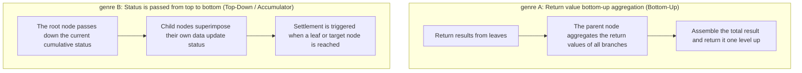

> **Course**: UC Berkeley CS61A (Fall 2024)  
> **Module**: Module 2: Recursion & Data Abstraction (Recursion & Sequences)  
> **Lecturer**: Prof. John DeNero (UC Berkeley)  
> **Video duration**: 34:32 ｜ **Classroom screenshots**: 16 pieces of blackboard writing/code demonstration  
> **Direct video**: [📺Watch the original video of this lecture on Bilibili (P14)](https://www.bilibili.com/video/BV1sy411z7nA/?p=14)  
> **Quick navigation**: [← Previous Lecture (P13 Lecture 13 Data Abstraction)](/en/notes/cs61a/lecture-13) ｜ [📚 Return to the full book catalog](/en/notes/topics/CS61A) ｜ [Next Lecture (P15 Lecture 15 Mutability) →](/en/notes/cs61a/lecture-15)

---

## Table of Contents
1. [Introduction: Hierarchical world modeling and two metaphors of trees](/en/notes/cs61a/lecture-14#1-introduction-hierarchical-world-modeling-and-two-metaphors-of-trees)
2. [The Tree Data Abstraction](/en/notes/cs61a/lecture-14#2-the-tree-data-abstraction)
3. [Programmed tree construction: Fibonacci trees (`fib_tree`)](/en/notes/cs61a/lecture-14#3-programmed-tree-construction-fibonacci-tree-fib_tree)
4. [Standard recursive paradigm for tree processing functions: statistics and expansion](/en/notes/cs61a/lecture-14#4-standard-recursive-paradigm-for-tree-processing-functions-statistics-and-expansion)
5. [Structural transformation and compact expression of trees: `increment_tree`](/en/notes/cs61a/lecture-14#5-structural-transformation-and-compact-expression-of-trees-increment_tree)
6. [Tree structure visualization: indent printing (`print_tree`)](/en/notes/cs61a/lecture-14#6-tree-structure-visualization-indent-printing-print_tree)
7. [Two schools of recursive thinking: return value aggregation vs. state parameter downloading](/en/notes/cs61a/lecture-14#7-two-schools-of-recursive-thinking-return-value-aggregation-vs-state-parameter-downloading)
8. [Final puzzle: Arbitrary node path and statistics (`count_paths`)](/en/notes/cs61a/lecture-14#8-final-puzzle-arbitrary-node-path-and-statistics-count_paths)
9. [Key points and thinking questions of this lecture](/en/notes/cs61a/lecture-14#9-core-points-and-thinking-questions-of-this-lecture)

---

### In-depth formal specification and micro-evaluation process (Operational Semantics)
In the "Table of Contents" module, the underlying computer operations rely on strict formal evaluation logic:
1. **Hierarchical parsing of abstract syntax trees (AST)**: 
   - The source code character stream is first divided into terminal symbol tokens (Tokens) by the lexical analyzer (Lexer), and then constructed into a multi-fork syntax tree by the syntax parser (Parser);
   - Operator priority and associativity are solidified during the syntax tree construction phase, eliminating ambiguity at runtime;
2. **Dynamic transitions of environment chains**: 
   - Each function call generates a new frame whose static lexical environment is determined by the function object's  `parent`  Attributes are completely determined;
   - The variable search traces back up the environment chain in one direction until the global environment frame. If it is not found, it will be triggered.  `NameError`  Abnormal;
3. **State Invariants**: 
   - The key to writing robust programs is to clarify loop invariants (Loop Invariants) and function pre/post-conditions (Pre/Post-conditions);
   - In complex control flow jumps, ensure that state variables maintain legal business constraints before each iteration.


## 1. Introduction: Hierarchical world modeling and two metaphors of trees

In computer science, tree structures are everywhere (file directory trees, parsing ASTs, organizational charts, decision trees). Professor DeNero points out that trees in computer science are **Grows upside down (roots at the top, leaves at the bottom)**.

There are two descriptive metaphors for understanding trees:

### 1.1 The Recursive Metaphor of Botany
> A tree consists of a **Root Label**  and a group **List of Branches**  composition.  
> Key corollary: **Each branch of the tree is a complete tree in itself!**

[](https://www.bilibili.com/video/BV1sy411z7nA/?p=14&t=193)
*⏱ Timestamp: 00:03:13 · 📷 Classroom screenshot · [Watch the corresponding clip on Bilibili (P14 00:03:13)](https://www.bilibili.com/video/BV1sy411z7nA/?p=14&t=193)*

#### 📸 In-depth reading of classroom blackboard writing and code demonstration (00:03:13)

**\[On-site blackboard writing/code demonstration restoration\]**:
At this time point, Professor DeNero conducted a core demonstration and key blackboard derivation on the screen:
> *“Hierarchical relationships. We've drawn pictures of trees before and discussed how in computer science they grow upside down. Now we'll talk about the common vocabulary used to describe trees. There are in fact two different metaphors used regularly. The first is the recursive description of trees, ...”*

**\[Underlying computing model and micro execution mechanism\]**: 
1. **Execution context and timing tracing**: 
   - At the current discussion point "1. Introduction: Hierarchical world modeling and two metaphors of trees", the interpreter strictly follows the core evaluation protocol;
   - The expression evaluates the operators first, then evaluates the operands strictly from left to right, and finally applies the function object to the argument list;
   - If the environment model is involved, the local frame strictly records its static lexical parent pointer (Parent Pointer points to the environment where the function is defined), forming an orthogonal architecture with the dynamic call stack at runtime.
2. **Memory topology and object references**: 
   - Variable symbols are just keys in a hash table (environment frame), and pointers point directly to first-class citizen objects in heap memory;
   - Assignment statements are discrete-time snapshots of the state and never create implicit mathematical dependency monitoring.

**\[Guidelines for avoiding pitfalls and guidance on high-frequency test points\]**: 
- **Common misunderstandings**: In the test questions related to "Tree ADT tree traversal, branch recursion and pruning modification", beginners can easily guess the results based on the surface form of the code, leading to scope confusion or variable shadowing (Shadowing) misjudgment;
- **The golden rule of debugging**: When encountering nested calls and complex branches, be sure to draw independent partial frames on the scratch paper, indicate the specific binding value of each formal parameter, and derive it step by step.


- **Leaf node (Leaf)**: A tree with no branches (the branch list is empty) is called a leaf node.

### 1.2 The Relative / Family Tree Metaphor
Each data storage location in the tree is called **Node**.
- Nodes store specific data (called the node’s  **Label**).
- There is an affinity hierarchical relationship between nodes: **Parent**, **Children**, **Siblings**, **Ancestors**, **Descendants**.
- The level at which a node is located is called its **Depth**.

[](https://www.bilibili.com/video/BV1sy411z7nA/?p=14&t=256)
*⏱ Timestamp: 00:04:16 · 📷 Classroom screenshot · [Watch the corresponding clip on Bilibili (P14 00:04:16)](https://www.bilibili.com/video/BV1sy411z7nA/?p=14&t=256)*

#### 📸 In-depth reading of classroom blackboard writing and code demonstration (00:04:16)

**\[On-site blackboard writing/code demonstration restoration\]**:
At this time point, Professor DeNero conducted a core demonstration and key blackboard derivation on the screen:
> *“Once you've constructed a tree recursively, you might want to describe certain locations within the tree. And so we say in the relative description about family trees that each location in a tree is called a node. So here are all the nodes. I have circled them. And this is the root or the root node ...”*

**\[Underlying computing model and micro execution mechanism\]**: 
1. **Execution context and timing tracing**: 
   - At the current discussion point "1. Introduction: Hierarchical world modeling and two metaphors of trees", the interpreter strictly follows the core evaluation protocol;
   - The expression evaluates the operators first, then evaluates the operands strictly from left to right, and finally applies the function object to the argument list;
   - If the environment model is involved, the local frame strictly records its static lexical parent pointer (Parent Pointer points to the environment where the function is defined), forming an orthogonal architecture with the dynamic call stack at runtime.
2. **Memory topology and object references**: 
   - Variable symbols are just keys in a hash table (environment frame), and pointers point directly to first-class citizen objects in heap memory;
   - Assignment statements are discrete-time snapshots of the state and never create implicit mathematical dependency monitoring.

**\[Guidelines for avoiding pitfalls and guidance on high-frequency test points\]**: 
- **Common misunderstandings**: In the test questions related to "Tree ADT tree traversal, branch recursion and pruning modification", beginners can easily guess the results based on the surface form of the code, leading to scope confusion or variable shadowing (Shadowing) misjudgment;
- **The golden rule of debugging**: When encountering nested calls and complex branches, be sure to draw independent partial frames on the scratch paper, indicate the specific binding value of each formal parameter, and derive it step by step.


---

### In-depth formal specification and micro-evaluation process (Operational Semantics)
In the "1. Introduction: Hierarchical World Modeling and Two Metaphors of Trees" module, the underlying computer operations rely on strict formal evaluation logic:
1. **Hierarchical parsing of abstract syntax trees (AST)**: 
   - The source code character stream is first divided into terminal symbol tokens (Tokens) by the lexical analyzer (Lexer), and then constructed into a multi-fork syntax tree by the syntax parser (Parser);
   - Operator priority and associativity are solidified during the syntax tree construction phase, eliminating ambiguity at runtime;
2. **Dynamic transitions of environment chains**: 
   - Each function call generates a new frame whose static lexical environment is determined by the function object's  `parent`  Attributes are completely determined;
   - The variable search traces back up the environment chain in one direction until the global environment frame. If it is not found, it will be triggered.  `NameError`  Abnormal;
3. **State Invariants**: 
   - The key to writing robust programs is to clarify loop invariants (Loop Invariants) and function pre/post-conditions (Pre/Post-conditions);
   - In complex control flow jumps, ensure that state variables maintain legal business constraints before each iteration.


## 2. The Tree Data Abstraction

Adhering to CS61A's consistent data abstraction philosophy, we first define the public interface of the tree:

[](https://www.bilibili.com/video/BV1sy411z7nA/?p=14&t=321)
*⏱ Timestamp: 00:05:21 · 📷 Classroom screenshot · [Watch the corresponding clip on Bilibili (P14 00:05:21)](https://www.bilibili.com/video/BV1sy411z7nA/?p=14&t=321)*

#### 📸 In-depth reading of classroom blackboard writing and code demonstration (00:05:21)

**\[On-site blackboard writing/code demonstration restoration\]**:
At this time point, Professor DeNero conducted a core demonstration and key blackboard derivation on the screen:
> *“So something like each parent is the sum of its children, which is true of a Fibonacci tree. Now that we can talk about trees, we can talk about implementing the tree abstraction. A tree has a root label and a list of branches, and the constructor is going to take those two values. Each branch must ...”*

**\[Underlying computing model and micro execution mechanism\]**: 
1. **Execution context and timing tracing**: 
   - At the current discussion point "2. The Tree Data Abstraction", the interpreter strictly follows the core evaluation protocol;
   - The expression evaluates the operators first, then evaluates the operands strictly from left to right, and finally applies the function object to the argument list;
   - If the environment model is involved, the local frame strictly records its static lexical parent pointer (Parent Pointer points to the environment where the function is defined), forming an orthogonal architecture with the dynamic call stack at runtime.
2. **Memory topology and object references**: 
   - Variable symbols are just keys in a hash table (environment frame), and pointers point directly to first-class citizen objects in heap memory;
   - Assignment statements are discrete-time snapshots of the state and never create implicit mathematical dependency monitoring.

**\[Guidelines for avoiding pitfalls and guidance on high-frequency test points\]**: 
- **Common misunderstandings**: In the test questions related to "Tree ADT tree traversal, branch recursion and pruning modification", beginners can easily guess the results based on the surface form of the code, leading to scope confusion or variable shadowing (Shadowing) misjudgment;
- **The golden rule of debugging**: When encountering nested calls and complex branches, be sure to draw independent partial frames on the scratch paper, indicate the specific binding value of each formal parameter, and derive it step by step.


### 2.1 Constructor and selector specifications
- `tree(label, branches=[])`: Construct a root node as  `label`, the subtree list is  `branches`  tree. Default  `branches`  is empty, a leaf node is constructed at this time.
- `label(t)`:Selector, return tree  `t`  the root tag.
- `branches(t)`:Selector, return tree  `t`  A branch list (each element of which is a tree).
- `is_leaf(t)`: Judgment predicate, if and only if  `branches(t)`  Return if empty  `True`.

### 2.2 Specific implementation and strict error-proofing verification
```python
def tree(label, branches=[]):
    """树构造器：确保所有分支皆为合法树。"""
    for branch in branches:
        assert is_tree(branch), "branches must be trees"
    return [label] + list(branches)

def label(tree):
    """选择器：返回根节点标签。"""
    return tree[0]

def branches(tree):
    """选择器：返回所有分支构成的列表。"""
    return tree[1:]

def is_leaf(tree):
    """谓词：检查是否为叶子节点。"""
    return not branches(tree)

def is_tree(tree):
    """谓词：递归检查是否为良构树。"""
    if type(tree) != list or len(tree) < 1:
        return False
    for branch in branches(tree):
        if not is_tree(branch):
            return False
    return True
```

[](https://www.bilibili.com/video/BV1sy411z7nA/?p=14&t=411)
*⏱ Timestamp: 00:06:51 · 📷 Classroom screenshot · [Watch the corresponding clip on Bilibili (P14 00:06:51)](https://www.bilibili.com/video/BV1sy411z7nA/?p=14&t=411)*

#### 📸 In-depth reading of classroom blackboard writing and code demonstration (00:06:51)

**\[On-site blackboard writing/code demonstration restoration\]**:
At this time point, Professor DeNero conducted a core demonstration and key blackboard derivation on the screen:
> *“By default, the list of branches is empty. So by default, I'll get a leaf, which is why I'm able to call just tree on one in order to construct this leaf node here. I put the label into a list. Branches is already a list, and so I sum them together. The label of a tree is a selector that returns the...”*

**\[Underlying computing model and micro execution mechanism\]**: 
1. **Execution context and timing tracing**: 
   - At the current discussion point "2. The Tree Data Abstraction", the interpreter strictly follows the core evaluation protocol;
   - The expression evaluates the operators first, then evaluates the operands strictly from left to right, and finally applies the function object to the argument list;
   - If the environment model is involved, the local frame strictly records its static lexical parent pointer (Parent Pointer points to the environment where the function is defined), forming an orthogonal architecture with the dynamic call stack at runtime.
2. **Memory topology and object references**: 
   - Variable symbols are just keys in a hash table (environment frame), and pointers point directly to first-class citizen objects in heap memory;
   - Assignment statements are discrete-time snapshots of the state and never create implicit mathematical dependency monitoring.

**\[Guidelines for avoiding pitfalls and guidance on high-frequency test points\]**: 
- **Common misunderstandings**: In the test questions related to "Tree ADT tree traversal, branch recursion and pruning modification", beginners can easily guess the results based on the surface form of the code, leading to scope confusion or variable shadowing (Shadowing) misjudgment;
- **The golden rule of debugging**: When encountering nested calls and complex branches, be sure to draw independent partial frames on the scratch paper, indicate the specific binding value of each formal parameter, and derive it step by step.


[](https://www.bilibili.com/video/BV1sy411z7nA/?p=14&t=498)
*⏱ Timestamp: 00:08:18 · 📷 Classroom screenshot · [Watch the corresponding clip on Bilibili (P14 00:08:18)](https://www.bilibili.com/video/BV1sy411z7nA/?p=14&t=498)*

#### 📸 In-depth reading of classroom blackboard writing and code demonstration (00:08:18)

**\[On-site blackboard writing/code demonstration restoration\]**:
At this time point, Professor DeNero conducted a core demonstration and key blackboard derivation on the screen:
> *“It has to be a list. It has to have at least one element for the label. So if that's not true, we'll return false. And it has to be the case that all the branches are trees. So in fact, isTree is a tree recursive function itself that goes through every branch in the branches of the tree. If it's not...”*

**\[Underlying computing model and micro execution mechanism\]**: 
1. **Execution context and timing tracing**: 
   - At the current discussion point "2. The Tree Data Abstraction", the interpreter strictly follows the core evaluation protocol;
   - The expression evaluates the operators first, then evaluates the operands strictly from left to right, and finally applies the function object to the argument list;
   - If the environment model is involved, the local frame strictly records its static lexical parent pointer (Parent Pointer points to the environment where the function is defined), forming an orthogonal architecture with the dynamic call stack at runtime.
2. **Memory topology and object references**: 
   - Variable symbols are just keys in a hash table (environment frame), and pointers point directly to first-class citizen objects in heap memory;
   - Assignment statements are discrete-time snapshots of the state and never create implicit mathematical dependency monitoring.

**\[Guidelines for avoiding pitfalls and guidance on high-frequency test points\]**: 
- **Common misunderstandings**: In the test questions related to "Tree ADT tree traversal, branch recursion and pruning modification", beginners can easily guess the results based on the surface form of the code, leading to scope confusion or variable shadowing (Shadowing) misjudgment;
- **The golden rule of debugging**: When encountering nested calls and complex branches, be sure to draw independent partial frames on the scratch paper, indicate the specific binding value of each formal parameter, and derive it step by step.


> **Abstract Barrier Q&A**:
"Use  `for b in branches(t):`  Does traversing branches violate the abstraction barrier? "  
> **The answer is no!**  Because the tree abstraction is explicitly guaranteed in the public specification: `branches(t)`  What is returned is a subtree composed of **List of Branches**. Traversing branches using list operations fully conforms to the contract of this abstraction!

[](https://www.bilibili.com/video/BV1sy411z7nA/?p=14&t=614)
*⏱ Timestamp: 00:10:14 · 📷 Classroom screenshot · [Watch the corresponding clip on Bilibili (P14 00:10:14)](https://www.bilibili.com/video/BV1sy411z7nA/?p=14&t=614)*

#### 📸 In-depth reading of classroom blackboard writing and code demonstration (00:10:14)

**\[On-site blackboard writing/code demonstration restoration\]**:
At this time point, Professor DeNero conducted a core demonstration and key blackboard derivation on the screen:
> *“Notice that when I evaluated this constructor expression, there were no errors because I've built a well-formed tree. Now, it happens to be that it has this complicated nested representation. But that's not how I will access it. Instead, I'll just ask, what's the label of t? It's 1. What's the branc...”*

**\[Underlying computing model and micro execution mechanism\]**: 
1. **Execution context and timing tracing**: 
   - At the current discussion point "2. The Tree Data Abstraction", the interpreter strictly follows the core evaluation protocol;
   - The expression evaluates the operators first, then evaluates the operands strictly from left to right, and finally applies the function object to the argument list;
   - If the environment model is involved, the local frame strictly records its static lexical parent pointer (Parent Pointer points to the environment where the function is defined), forming an orthogonal architecture with the dynamic call stack at runtime.
2. **Memory topology and object references**: 
   - Variable symbols are just keys in a hash table (environment frame), and pointers point directly to first-class citizen objects in heap memory;
   - Assignment statements are discrete-time snapshots of the state and never create implicit mathematical dependency monitoring.

**\[Guidelines for avoiding pitfalls and guidance on high-frequency test points\]**: 
- **Common misunderstandings**: In the test questions related to "Tree ADT tree traversal, branch recursion and pruning modification", beginners can easily guess the results based on the surface form of the code, leading to scope confusion or variable shadowing (Shadowing) misjudgment;
- **The golden rule of debugging**: When encountering nested calls and complex branches, be sure to draw independent partial frames on the scratch paper, indicate the specific binding value of each formal parameter, and derive it step by step.


---

### In-depth formal specification and micro-evaluation process (Operational Semantics)
In the module "2. The Tree Data Abstraction", the underlying computer operations rely on strict formal evaluation logic:
1. **Hierarchical parsing of abstract syntax trees (AST)**: 
   - The source code character stream is first divided into terminal symbol tokens (Tokens) by the lexical analyzer (Lexer), and then constructed into a multi-fork syntax tree by the syntax parser (Parser);
   - Operator priority and associativity are solidified during the syntax tree construction phase, eliminating ambiguity at runtime;
2. **Dynamic transitions of environment chains**: 
   - Each function call generates a new frame whose static lexical environment is determined by the function object's  `parent`  Attributes are completely determined;
   - The variable search traces back up the environment chain in one direction until the global environment frame. If it is not found, it will be triggered.  `NameError`  Abnormal;
3. **State Invariants**: 
   - The key to writing robust programs is to clarify loop invariants (Loop Invariants) and function pre/post-conditions (Pre/Post-conditions);
   - In complex control flow jumps, ensure that state variables maintain legal business constraints before each iteration.


## 3. Programmed tree construction: Fibonacci tree (`fib_tree`)

In actual projects, trees are often not constructed by hand-hard-coded nesting, but by algorithms. **Programmatic recursive generation**. Take the Fibonacci tree as an example:

[](https://www.bilibili.com/video/BV1sy411z7nA/?p=14&t=712)
*⏱ Timestamp: 00:11:52 · 📷 Classroom screenshot · [Watch the corresponding clip on Bilibili (P14 00:11:52)](https://www.bilibili.com/video/BV1sy411z7nA/?p=14&t=712)*

#### 📸 In-depth reading of classroom blackboard writing and code demonstration (00:11:52)

**\[On-site blackboard writing/code demonstration restoration\]**:
At this time point, Professor DeNero conducted a core demonstration and key blackboard derivation on the screen:
> *“I create the leaf using my tree constructor. Otherwise, I need to build the two branches of a Fibonacci tree. The left branch and the right branch are both going to be constructed with recursive calls to fibtree. Finally, I want to return a tree. That means calling the tree constructor on some label...”*

**\[Underlying computing model and micro execution mechanism\]**: 
1. **Execution context and timing tracing**: 
   - At the current discussion point "3. Programmed tree construction: Fibonacci tree (`fib_tree`)", the interpreter strictly follows the core evaluation convention;
   - The expression evaluates the operators first, then evaluates the operands strictly from left to right, and finally applies the function object to the argument list;
   - If the environment model is involved, the local frame strictly records its static lexical parent pointer (Parent Pointer points to the environment where the function is defined), forming an orthogonal architecture with the dynamic call stack at runtime.
2. **Memory topology and object references**: 
   - Variable symbols are just keys in a hash table (environment frame), and pointers point directly to first-class citizen objects in heap memory;
   - Assignment statements are discrete-time snapshots of the state and never create implicit mathematical dependency monitoring.

**\[Guidelines for avoiding pitfalls and guidance on high-frequency test points\]**: 
- **Common misunderstandings**: In the test questions related to "Tree ADT tree traversal, branch recursion and pruning modification", beginners can easily guess the results based on the surface form of the code, leading to scope confusion or variable shadowing (Shadowing) misjudgment;
- **The golden rule of debugging**: When encountering nested calls and complex branches, be sure to draw independent partial frames on the scratch paper, indicate the specific binding value of each formal parameter, and derive it step by step.


```python
def fib_tree(n):
    """递归构造对应 Fibonacci(n) 计算过程的形态树。"""
    if n <= 1:
        return tree(n)
    else:
        left, right = fib_tree(n - 2), fib_tree(n - 1)
        return tree(label(left) + label(right), [left, right])
```
- Baseline branch: when  $n \le 1$  When , directly return the single node leaf  `tree(n)`.
- Recursive branch: Recursively generate the left subtree and the right subtree, and use the sum of the root labels of the two subtrees as the root label of the current tree.

---

### In-depth formal specification and micro-evaluation process (Operational Semantics)
In "3. Programmed tree construction: Fibonacci tree (`fib_tree`)" module, the underlying computer operations rely on strict formal evaluation logic:
1. **Hierarchical parsing of abstract syntax trees (AST)**: 
   - The source code character stream is first divided into terminal symbol tokens (Tokens) by the lexical analyzer (Lexer), and then constructed into a multi-fork syntax tree by the syntax parser (Parser);
   - Operator priority and associativity are solidified during the syntax tree construction phase, eliminating ambiguity at runtime;
2. **Dynamic transitions of environment chains**: 
   - Each function call generates a new frame whose static lexical environment is determined by the function object's  `parent`  Attributes are completely determined;
   - The variable search traces back up the environment chain in one direction until the global environment frame. If it is not found, it will be triggered.  `NameError`  Abnormal;
3. **State Invariants**: 
   - The key to writing robust programs is to clarify loop invariants (Loop Invariants) and function pre/post-conditions (Pre/Post-conditions);
   - In complex control flow jumps, ensure that state variables maintain legal business constraints before each iteration.


## 4. Standard recursive paradigm for tree processing functions: statistics and expansion

All recursive functions that operate on trees follow a highly unified structural skeleton:
```python
def process_tree(t):
    if is_leaf(t):
        return base_result(t)
    return aggregate([process_tree(b) for b in branches(t)])
```

### 4.1 Calculate the total number of leaf nodes (`count_leaves`)
```python
def count_leaves(t):
    """统计树 t 中所有叶子节点的数量。"""
    if is_leaf(t):
        return 1
    return sum([count_leaves(b) for b in branches(t)])
```

[](https://www.bilibili.com/video/BV1sy411z7nA/?p=14&t=805)
*⏱ Timestamp: 00:13:25 · 📷 Classroom screenshot · [Watch the corresponding clip on Bilibili (P14 00:13:25)](https://www.bilibili.com/video/BV1sy411z7nA/?p=14&t=805)*

#### 📸 In-depth reading of classroom blackboard writing and code demonstration (00:13:25)

**\[On-site blackboard writing/code demonstration restoration\]**:
At this time point, Professor DeNero conducted a core demonstration and key blackboard derivation on the screen:
> *“If t is only a leaf and I count the leaves, there's one leaf. The recursive case typically makes a recursive call on each branch, then aggregates the results. In this case, what we're going to do is take each branch in the branches of the tree and count the leaves in each branch. The leaves in the t...”*

**\[Underlying computing model and micro execution mechanism\]**: 
1. **Execution context and timing tracing**: 
   - At the current discussion point "4. Standard recursive paradigm for tree processing functions: statistics and expansion", the interpreter strictly follows the core evaluation protocol;
   - The expression evaluates the operators first, then evaluates the operands strictly from left to right, and finally applies the function object to the argument list;
   - If the environment model is involved, the local frame strictly records its static lexical parent pointer (Parent Pointer points to the environment where the function is defined), forming an orthogonal architecture with the dynamic call stack at runtime.
2. **Memory topology and object references**: 
   - Variable symbols are just keys in a hash table (environment frame), and pointers point directly to first-class citizen objects in heap memory;
   - Assignment statements are discrete-time snapshots of the state and never create implicit mathematical dependency monitoring.

**\[Guidelines for avoiding pitfalls and guidance on high-frequency test points\]**: 
- **Common misunderstandings**: In the test questions related to "Tree ADT tree traversal, branch recursion and pruning modification", beginners can easily guess the results based on the surface form of the code, leading to scope confusion or variable shadowing (Shadowing) misjudgment;
- **The golden rule of debugging**: When encountering nested calls and complex branches, be sure to draw independent partial frames on the scratch paper, indicate the specific binding value of each formal parameter, and derive it step by step.


- **baseline conditions**: If the current node is a leaf and itself is a leaf node, return  `1`.
- **Recursive aggregation**: Traverse each branch, recursively find the number of leaves, and use the built-in function  `sum`  Add up!

---

### 4.2 Collect all leaf labels: list flattening technique (`leaves`)
If we wish to return a flat list of labels for all leaf nodes in the tree:
```
fib_tree(4) 的叶子为: [0, 1, 1, 0, 1]
```

[](https://www.bilibili.com/video/BV1sy411z7nA/?p=14&t=923)
*⏱ Timestamp: 00:15:23 · 📷 Classroom screenshot · [Watch the corresponding clip on Bilibili (P14 00:15:23)](https://www.bilibili.com/video/BV1sy411z7nA/?p=14&t=923)*

#### 📸 In-depth reading of classroom blackboard writing and code demonstration (00:15:23)

**\[On-site blackboard writing/code demonstration restoration\]**:
At this time point, Professor DeNero conducted a core demonstration and key blackboard derivation on the screen:
> *“We're going to use a fact about sum, which is that if you sum a list of lists, you get a list containing the elements of all of the lists in the input. Let me show you some examples. If you sum the lists 1, 2, 3, and 4, you get one list containing 1, 2, 3, and 4. In order to call sum on a list of li...”*

**\[Underlying computing model and micro execution mechanism\]**: 
1. **Execution context and timing tracing**: 
   - At the current discussion point "4. Standard recursive paradigm for tree processing functions: statistics and expansion", the interpreter strictly follows the core evaluation protocol;
   - The expression evaluates the operators first, then evaluates the operands strictly from left to right, and finally applies the function object to the argument list;
   - If the environment model is involved, the local frame strictly records its static lexical parent pointer (Parent Pointer points to the environment where the function is defined), forming an orthogonal architecture with the dynamic call stack at runtime.
2. **Memory topology and object references**: 
   - Variable symbols are just keys in a hash table (environment frame), and pointers point directly to first-class citizen objects in heap memory;
   - Assignment statements are discrete-time snapshots of the state and never create implicit mathematical dependency monitoring.

**\[Guidelines for avoiding pitfalls and guidance on high-frequency test points\]**: 
- **Common misunderstandings**: In the test questions related to "Tree ADT tree traversal, branch recursion and pruning modification", beginners can easily guess the results based on the surface form of the code, leading to scope confusion or variable shadowing (Shadowing) misjudgment;
- **The golden rule of debugging**: When encountering nested calls and complex branches, be sure to draw independent partial frames on the scratch paper, indicate the specific binding value of each formal parameter, and derive it step by step.


Recall the black magic from the previous lecture: `sum([[1, 2], [3]], []) -> [1, 2, 3]`. Using list splicing as a folding base, we can achieve flattening very elegantly:

```python
def leaves(t):
    """返回树 t 的所有叶子标签构成的单层列表。"""
    if is_leaf(t):
        return [label(t)]
    return sum([leaves(b) for b in branches(t)], [])
```

[](https://www.bilibili.com/video/BV1sy411z7nA/?p=14&t=1009)
*⏱ Timestamp: 00:16:49 · 📷 Classroom screenshot · [Watch the corresponding clip on Bilibili (P14 00:16:49)](https://www.bilibili.com/video/BV1sy411z7nA/?p=14&t=1009)*

#### 📸 In-depth reading of classroom blackboard writing and code demonstration (00:16:49)

**\[On-site blackboard writing/code demonstration restoration\]**:
At this time point, Professor DeNero conducted a core demonstration and key blackboard derivation on the screen:
> *“And returns a list of the leaf labels. If it's a leaf, then we get the label and put it in a list. Otherwise, we sum up something. Here are eight alternatives. I recommend that you pause and think about it. I'm going to show you the answer in three, two, one. Our goal is to get a list of leaf labels...”*

**\[Underlying computing model and micro execution mechanism\]**: 
1. **Execution context and timing tracing**: 
   - At the current discussion point "4. Standard recursive paradigm for tree processing functions: statistics and expansion", the interpreter strictly follows the core evaluation protocol;
   - The expression evaluates the operators first, then evaluates the operands strictly from left to right, and finally applies the function object to the argument list;
   - If the environment model is involved, the local frame strictly records its static lexical parent pointer (Parent Pointer points to the environment where the function is defined), forming an orthogonal architecture with the dynamic call stack at runtime.
2. **Memory topology and object references**: 
   - Variable symbols are just keys in a hash table (environment frame), and pointers point directly to first-class citizen objects in heap memory;
   - Assignment statements are discrete-time snapshots of the state and never create implicit mathematical dependency monitoring.

**\[Guidelines for avoiding pitfalls and guidance on high-frequency test points\]**: 
- **Common misunderstandings**: In the test questions related to "Tree ADT tree traversal, branch recursion and pruning modification", beginners can easily guess the results based on the surface form of the code, leading to scope confusion or variable shadowing (Shadowing) misjudgment;
- **The golden rule of debugging**: When encountering nested calls and complex branches, be sure to draw independent partial frames on the scratch paper, indicate the specific binding value of each formal parameter, and derive it step by step.


- If it is a leaf: return a list containing its own single element  `[label(t)]`.
- If not a leaf: recursively call each subtree  `leaves(b)`  Get the sublist by  `sum(..., [])`  Stitch all sublists into one big flat list!

---

### In-depth formal specification and micro-evaluation process (Operational Semantics)
In the "4. Standard Recursive Paradigm of Tree Processing Functions: Statistics and Expansion" module, the underlying computer operations rely on strict formal evaluation logic:
1. **Hierarchical parsing of abstract syntax trees (AST)**: 
   - The source code character stream is first divided into terminal symbol tokens (Tokens) by the lexical analyzer (Lexer), and then constructed into a multi-fork syntax tree by the syntax parser (Parser);
   - Operator priority and associativity are solidified during the syntax tree construction phase, eliminating ambiguity at runtime;
2. **Dynamic transitions of environment chains**: 
   - Each function call generates a new frame whose static lexical environment is determined by the function object's  `parent`  Attributes are completely determined;
   - The variable search traces back up the environment chain in one direction until the global environment frame. If it is not found, it will be triggered.  `NameError`  Abnormal;
3. **State Invariants**: 
   - The key to writing robust programs is to clarify loop invariants (Loop Invariants) and function pre/post-conditions (Pre/Post-conditions);
   - In complex control flow jumps, ensure that state variables maintain legal business constraints before each iteration.


## 5. Structural transformation and compact expression of trees: `increment_tree`

Suppose we want to add 1 to the label value of each node in the tree to generate a new tree:

```python
def increment_tree(t):
    """返回一棵与 t 结构完全相同、所有节点标签增加 1 的新树。"""
    return tree(label(t) + 1, [increment_tree(b) for b in branches(t)])
```

[](https://www.bilibili.com/video/BV1sy411z7nA/?p=14&t=1127)
*⏱ Timestamp: 00:18:47 · 📷 Classroom screenshot · [Watch the corresponding clip on Bilibili (P14 00:18:47)](https://www.bilibili.com/video/BV1sy411z7nA/?p=14&t=1127)*

#### 📸 In-depth reading of classroom blackboard writing and code demonstration (00:18:47)

**\[On-site blackboard writing/code demonstration restoration\]**:
At this time point, Professor DeNero conducted a core demonstration and key blackboard derivation on the screen:
> *“Notice that I keep the label the same, and that's because this function doesn't do anything with the labels of the nodes that aren't leaves. Here's another tree processing function, increment t, which returns a tree like t, but with all labels incremented. I'll show you a trick. You don't always nee...”*

**\[Underlying computing model and micro execution mechanism\]**: 
1. **Execution context and timing tracing**: 
   - At the current discussion point "5. Structural transformation and compact expression of trees: `increment_tree`”, the interpreter strictly follows the core evaluation convention;
   - The expression evaluates the operators first, then evaluates the operands strictly from left to right, and finally applies the function object to the argument list;
   - If the environment model is involved, the local frame strictly records its static lexical parent pointer (Parent Pointer points to the environment where the function is defined), forming an orthogonal architecture with the dynamic call stack at runtime.
2. **Memory topology and object references**: 
   - Variable symbols are just keys in a hash table (environment frame), and pointers point directly to first-class citizen objects in heap memory;
   - Assignment statements are discrete-time snapshots of the state and never create implicit mathematical dependency monitoring.

**\[Guidelines for avoiding pitfalls and guidance on high-frequency test points\]**: 
- **Common misunderstandings**: In the test questions related to "Tree ADT tree traversal, branch recursion and pruning modification", beginners can easily guess the results based on the surface form of the code, leading to scope confusion or variable shadowing (Shadowing) misjudgment;
- **The golden rule of debugging**: When encountering nested calls and complex branches, be sure to draw independent partial frames on the scratch paper, indicate the specific binding value of each formal parameter, and derive it step by step.


> **The exquisite mechanism behind the minimalist one-line flow**:
Why doesn't this implementation have any  `if is_leaf(t)`  Branch judgment?
> - When a leaf node is encountered, `branches(t)`  Is an empty list  `[]`.
> - list comprehension  `[increment_tree(b) for b in []]`  Naturally evaluates to an empty list  `[]`, no need for recursion.
> - Generate directly  `tree(label(t) + 1, [])`  and return!
> - The built-in empty set short-circuit property of list comprehension naturally acts as a guard for the baseline condition!

---

### In-depth formal specification and micro-evaluation process (Operational Semantics)
In "5. Structural transformation and compact expression of trees: `increment_tree` In the module, the underlying computer operations rely on strict formal evaluation logic:
1. **Hierarchical parsing of abstract syntax trees (AST)**: 
   - The source code character stream is first divided into terminal symbol tokens (Tokens) by the lexical analyzer (Lexer), and then constructed into a multi-fork syntax tree by the syntax parser (Parser);
   - Operator priority and associativity are solidified during the syntax tree construction phase, eliminating ambiguity at runtime;
2. **Dynamic transitions of environment chains**: 
   - Each function call generates a new frame whose static lexical environment is determined by the function object's  `parent`  Attributes are completely determined;
   - The variable search traces back up the environment chain in one direction until the global environment frame. If it is not found, it will be triggered.  `NameError`  Abnormal;
3. **State Invariants**: 
   - The key to writing robust programs is to clarify loop invariants (Loop Invariants) and function pre/post-conditions (Pre/Post-conditions);
   - In complex control flow jumps, ensure that state variables maintain legal business constraints before each iteration.


## 6. Tree structure visualization: indent printing (`print_tree`)

Trees printed out as nested lists (e.g.  `[3, [1], [2, [1], [1]]]`) is difficult to be quickly recognized by the human eye. By passing the indent depth parameter recursively, we can print out an intuitive hierarchical indented text tree:

```python
def print_tree(t, indent=0):
    """以缩进文本形式直观打印树形结构。"""
    print('  ' * indent + str(label(t)))
    for b in branches(t):
        print_tree(b, indent + 1)
```

[](https://www.bilibili.com/video/BV1sy411z7nA/?p=14&t=1252)
*⏱ Timestamp: 00:20:52 · 📷 Classroom screenshot · [Watch the corresponding clip on Bilibili (P14 00:20:52)](https://www.bilibili.com/video/BV1sy411z7nA/?p=14&t=1252)*

#### 📸 In-depth reading of classroom blackboard writing and code demonstration (00:20:52)

**\[On-site blackboard writing/code demonstration restoration\]**:
At this time point, Professor DeNero conducted a core demonstration and key blackboard derivation on the screen:
> *“The number 5 after that, I would build the string using multiplication and addition, and if I print that out, then I get 5 indented. By default, I don't want the root label to be indented at all, but I want the possibility of indentation to happen later, where I'm going to take those two spaces, mul...”*

**\[Underlying computing model and micro execution mechanism\]**: 
1. **Execution context and timing tracing**: 
   - At the current discussion node "6. Tree structure visualization: indent printing (`print_tree`)", the interpreter strictly follows the core evaluation convention;
   - The expression evaluates the operators first, then evaluates the operands strictly from left to right, and finally applies the function object to the argument list;
   - If the environment model is involved, the local frame strictly records its static lexical parent pointer (Parent Pointer points to the environment where the function is defined), forming an orthogonal architecture with the dynamic call stack at runtime.
2. **Memory topology and object references**: 
   - Variable symbols are just keys in a hash table (environment frame), and pointers point directly to first-class citizen objects in heap memory;
   - Assignment statements are discrete-time snapshots of the state and never create implicit mathematical dependency monitoring.

**\[Guidelines for avoiding pitfalls and guidance on high-frequency test points\]**: 
- **Common misunderstandings**: In the test questions related to "Tree ADT tree traversal, branch recursion and pruning modification", beginners can easily guess the results based on the surface form of the code, leading to scope confusion or variable shadowing (Shadowing) misjudgment;
- **The golden rule of debugging**: When encountering nested calls and complex branches, be sure to draw independent partial frames on the scratch paper, indicate the specific binding value of each formal parameter, and derive it step by step.


Output effect:
```
3
  1
  2
    1
    1
```
The number of spaces indented for each node is proportional to its depth in the tree.  `indent`, clear layers and pleasing to the eye.

---

### In-depth formal specification and micro-evaluation process (Operational Semantics)
In "6. Tree Structure Visualization: Indented Printing (`print_tree`)" module, the underlying computer operations rely on strict formal evaluation logic:
1. **Hierarchical parsing of abstract syntax trees (AST)**: 
   - The source code character stream is first divided into terminal symbol tokens (Tokens) by the lexical analyzer (Lexer), and then constructed into a multi-fork syntax tree by the syntax parser (Parser);
   - Operator priority and associativity are solidified during the syntax tree construction phase, eliminating ambiguity at runtime;
2. **Dynamic transitions of environment chains**: 
   - Each function call generates a new frame whose static lexical environment is determined by the function object's  `parent`  Attributes are completely determined;
   - The variable search traces back up the environment chain in one direction until the global environment frame. If it is not found, it will be triggered.  `NameError`  Abnormal;
3. **State Invariants**: 
   - The key to writing robust programs is to clarify loop invariants (Loop Invariants) and function pre/post-conditions (Pre/Post-conditions);
   - In complex control flow jumps, ensure that state variables maintain legal business constraints before each iteration.


## 7. Two schools of recursive thinking: return value aggregation vs. state parameter downloading

There are two fundamental models of thinking when dealing with tree structures:

[](https://www.bilibili.com/video/BV1sy411z7nA/?p=14&t=1369)
*⏱ Timestamp: 00:22:49 · 📷 Classroom screenshot · [Watch the corresponding clip on Bilibili (P14 00:22:49)](https://www.bilibili.com/video/BV1sy411z7nA/?p=14&t=1369)*

#### 📸 In-depth reading of classroom blackboard writing and code demonstration (00:22:49)

**\[On-site blackboard writing/code demonstration restoration\]**:
At this time point, Professor DeNero conducted a core demonstration and key blackboard derivation on the screen:
> *“And if we run this example on, say, 4, then we'll get 4 times 3 times 2 times 1 is 24. And this is an example of taking the return value of a recursive call and manipulating it. In this case, we're multiplying in n. But there's another way. Instead, I could define fact times, which takes in both n a...”*

**\[Underlying computing model and micro execution mechanism\]**: 
1. **Execution context and timing tracing**: 
   - At the current discussion point "7. Two schools of recursive thinking: return value aggregation vs. state parameter transmission", the interpreter strictly follows the core evaluation protocol;
   - The expression evaluates the operators first, then evaluates the operands strictly from left to right, and finally applies the function object to the argument list;
   - If the environment model is involved, the local frame strictly records its static lexical parent pointer (Parent Pointer points to the environment where the function is defined), forming an orthogonal architecture with the dynamic call stack at runtime.
2. **Memory topology and object references**: 
   - Variable symbols are just keys in a hash table (environment frame), and pointers point directly to first-class citizen objects in heap memory;
   - Assignment statements are discrete-time snapshots of the state and never create implicit mathematical dependency monitoring.

**\[Guidelines for avoiding pitfalls and guidance on high-frequency test points\]**: 
- **Common misunderstandings**: In the test questions related to "Tree ADT tree traversal, branch recursion and pruning modification", beginners can easily guess the results based on the surface form of the code, leading to scope confusion or variable shadowing (Shadowing) misjudgment;
- **The golden rule of debugging**: When encountering nested calls and complex branches, be sure to draw independent partial frames on the scratch paper, indicate the specific binding value of each formal parameter, and derive it step by step.




### Example: Print all paths from root to leaves and (`print_sums`)
Print the sum of the values of all nodes along the complete path from the root node to each leaf node:
```python
def print_sums(t, so_far=0):
    """自顶向下下传前缀路径和。"""
    so_far = so_far + label(t)
    if is_leaf(t):
        print(so_far)
    else:
        for b in branches(t):
            print_sums(b, so_far)
```

[](https://www.bilibili.com/video/BV1sy411z7nA/?p=14&t=1607)
*⏱ Timestamp: 00:26:47 · 📷 Classroom screenshot · [Watch the corresponding clip on Bilibili (P14 00:26:47)](https://www.bilibili.com/video/BV1sy411z7nA/?p=14&t=1607)*

#### 📸 In-depth reading of classroom blackboard writing and code demonstration (00:26:47)

**\[On-site blackboard writing/code demonstration restoration\]**:
At this time point, Professor DeNero conducted a core demonstration and key blackboard derivation on the screen:
> *“And for each leaf, prints out the sum of all the labels from the root to that leaf. Much like the fact times function, I'm going to add a second argument. The sum so far. So that I can build up the sum as I go and then when I get to the leaf, I just print it out. So whether this is a leaf or not, th...”*

**\[Underlying computing model and micro execution mechanism\]**: 
1. **Execution context and timing tracing**: 
   - At the current discussion point "7. Two schools of recursive thinking: return value aggregation vs. state parameter transmission", the interpreter strictly follows the core evaluation protocol;
   - The expression evaluates the operators first, then evaluates the operands strictly from left to right, and finally applies the function object to the argument list;
   - If the environment model is involved, the local frame strictly records its static lexical parent pointer (Parent Pointer points to the environment where the function is defined), forming an orthogonal architecture with the dynamic call stack at runtime.
2. **Memory topology and object references**: 
   - Variable symbols are just keys in a hash table (environment frame), and pointers point directly to first-class citizen objects in heap memory;
   - Assignment statements are discrete-time snapshots of the state and never create implicit mathematical dependency monitoring.

**\[Guidelines for avoiding pitfalls and guidance on high-frequency test points\]**: 
- **Common misunderstandings**: In the test questions related to "Tree ADT tree traversal, branch recursion and pruning modification", beginners can easily guess the results based on the surface form of the code, leading to scope confusion or variable shadowing (Shadowing) misjudgment;
- **The golden rule of debugging**: When encountering nested calls and complex branches, be sure to draw independent partial frames on the scratch paper, indicate the specific binding value of each formal parameter, and derive it step by step.


- state variables  `so_far`  Passed as a parameter to the deeper layers of the recursive call.
- when hit  `is_leaf(t)`  when, `so_far`  Exactly the sum of the entire root-to-leaf path is recorded and printed immediately.

---

### In-depth formal specification and micro-evaluation process (Operational Semantics)
In the module "7. Two schools of recursive thinking: return value aggregation vs. state parameter transmission", the underlying computer operations rely on strict formal evaluation logic:
1. **Hierarchical parsing of abstract syntax trees (AST)**: 
   - The source code character stream is first divided into terminal symbol tokens (Tokens) by the lexical analyzer (Lexer), and then constructed into a multi-fork syntax tree by the syntax parser (Parser);
   - Operator priority and associativity are solidified during the syntax tree construction phase, eliminating ambiguity at runtime;
2. **Dynamic transitions of environment chains**: 
   - Each function call generates a new frame whose static lexical environment is determined by the function object's  `parent`  Attributes are completely determined;
   - The variable search traces back up the environment chain in one direction until the global environment frame. If it is not found, it will be triggered.  `NameError`  Abnormal;
3. **State Invariants**: 
   - The key to writing robust programs is to clarify loop invariants (Loop Invariants) and function pre/post-conditions (Pre/Post-conditions);
   - In complex control flow jumps, ensure that state variables maintain legal business constraints before each iteration.


## 8. Final puzzle: arbitrary node path and statistics (`count_paths`)

### 8.1 Problem Definition
> **target**: Given a tree  `t`  with a target integer  `total`, statistics from **Starting from the root node and extending to any node in the tree** (not necessarily to leaf nodes), the sum of node labels is exactly equal to  `total`  the total number of paths.

[](https://www.bilibili.com/video/BV1sy411z7nA/?p=14&t=1786)
*⏱ Timestamp: 00:29:46 · 📷 Classroom screenshot · [Watch the corresponding clip on Bilibili (P14 00:29:46)](https://www.bilibili.com/video/BV1sy411z7nA/?p=14&t=1786)*

#### 📸 In-depth reading of classroom blackboard writing and code demonstration (00:29:46)

**\[On-site blackboard writing/code demonstration restoration\]**:
At this time point, Professor DeNero conducted a core demonstration and key blackboard derivation on the screen:
> *“If it starts from the top and meanders for a while without getting all the way to a leaf of a tree. So here's an example tree. For a problem like this, it's always a good idea to look at an example and draw that example out as a tree. So here we have three branches. One of the branch has two branche...”*

**\[Underlying computing model and micro execution mechanism\]**: 
1. **Execution context and timing tracing**: 
   - At the current discussion point "8. Final problem: arbitrary node path and statistics (`count_paths`)", the interpreter strictly follows the core evaluation convention;
   - The expression evaluates the operators first, then evaluates the operands strictly from left to right, and finally applies the function object to the argument list;
   - If the environment model is involved, the local frame strictly records its static lexical parent pointer (Parent Pointer points to the environment where the function is defined), forming an orthogonal architecture with the dynamic call stack at runtime.
2. **Memory topology and object references**: 
   - Variable symbols are just keys in a hash table (environment frame), and pointers point directly to first-class citizen objects in heap memory;
   - Assignment statements are discrete-time snapshots of the state and never create implicit mathematical dependency monitoring.

**\[Guidelines for avoiding pitfalls and guidance on high-frequency test points\]**: 
- **Common misunderstandings**: In the test questions related to "Tree ADT tree traversal, branch recursion and pruning modification", beginners can easily guess the results based on the surface form of the code, leading to scope confusion or variable shadowing (Shadowing) misjudgment;
- **The golden rule of debugging**: When encountering nested calls and complex branches, be sure to draw independent partial frames on the scratch paper, indicate the specific binding value of each formal parameter, and derive it step by step.


**Exploring important features**: 
- Node labels may contain negative numbers or zeros!
- Therefore, **Even if you have gathered the target sum at a certain node, you must not stop searching for its branches.**! Because it is entirely possible that it will happen later  `+1, -1`  Thus forming a deeper legal path.

---

### 8.2 Problem-solving strategies and two-way decomposition
For a search starting from the current node, there are only two possible legal paths:
1. **The path ends exactly at the current root node**: if  `label(t) == total`, then this node forms a legal path by itself, counting  $+1$; otherwise  $0$.
2. **The path continues into a branch**: for each branch  $b$, to find in it  $b$  is the starting point and the node sum is equal to  `total - label(t)`  subpath.

[](https://www.bilibili.com/video/BV1sy411z7nA/?p=14&t=2011)
*⏱ Timestamp: 00:33:31 · 📷 Classroom screenshot · [Watch the corresponding clip on Bilibili (P14 00:33:31)](https://www.bilibili.com/video/BV1sy411z7nA/?p=14&t=2011)*

#### 📸 In-depth reading of classroom blackboard writing and code demonstration (00:33:31)

**\[On-site blackboard writing/code demonstration restoration\]**:
At this time point, Professor DeNero conducted a core demonstration and key blackboard derivation on the screen:
> *“Executed this line, so I do need to assign it to something otherwise. I'll set it to zero. So either I found a path that ended at the root label or I didn't, but I also need to count all the paths that end in one of the nodes of the branches. My goal is to count how many such paths there are in each...”*

**\[Underlying computing model and micro execution mechanism\]**: 
1. **Execution context and timing tracing**: 
   - At the current discussion point "8. Final problem: arbitrary node path and statistics (`count_paths`)", the interpreter strictly follows the core evaluation convention;
   - The expression evaluates the operators first, then evaluates the operands strictly from left to right, and finally applies the function object to the argument list;
   - If the environment model is involved, the local frame strictly records its static lexical parent pointer (Parent Pointer points to the environment where the function is defined), forming an orthogonal architecture with the dynamic call stack at runtime.
2. **Memory topology and object references**: 
   - Variable symbols are just keys in a hash table (environment frame), and pointers point directly to first-class citizen objects in heap memory;
   - Assignment statements are discrete-time snapshots of the state and never create implicit mathematical dependency monitoring.

**\[Guidelines for avoiding pitfalls and guidance on high-frequency test points\]**: 
- **Common misunderstandings**: In the test questions related to "Tree ADT tree traversal, branch recursion and pruning modification", beginners can easily guess the results based on the surface form of the code, leading to scope confusion or variable shadowing (Shadowing) misjudgment;
- **The golden rule of debugging**: When encountering nested calls and complex branches, be sure to draw independent partial frames on the scratch paper, indicate the specific binding value of each formal parameter, and derive it step by step.


### 8.3 Elegant recursive implementation
```python
def count_paths(t, total):
    """计算以 t 为根节点、路径和等于 total 的路径总数。
    
    >>> t = tree(3, [tree(-1), tree(1, [tree(2, [tree(1)]), tree(3)])])
    >>> count_paths(t, 3)  # [3] 与 [3, -1]
    2
    >>> count_paths(t, 7)  # [3, 1, 2, 1] 与 [3, 1, 3]
    2
    """
    found = 1 if label(t) == total else 0
    branch_paths = sum([count_paths(b, total - label(t)) for b in branches(t)])
    return found + branch_paths
```
- The code does not need to be complicated  `if-else`  The branches are blocked, the counts of the two paths are accumulated in parallel, and the mathematical logic is perfectly consistent!

---

### In-depth formal specification and micro-evaluation process (Operational Semantics)
In "8. Finale Puzzle: Arbitrary Node Path and Statistics (`count_paths`)" module, the underlying computer operations rely on strict formal evaluation logic:
1. **Hierarchical parsing of abstract syntax trees (AST)**: 
   - The source code character stream is first divided into terminal symbol tokens (Tokens) by the lexical analyzer (Lexer), and then constructed into a multi-fork syntax tree by the syntax parser (Parser);
   - Operator priority and associativity are solidified during the syntax tree construction phase, eliminating ambiguity at runtime;
2. **Dynamic transitions of environment chains**: 
   - Each function call generates a new frame whose static lexical environment is determined by the function object's  `parent`  Attributes are completely determined;
   - The variable search traces back up the environment chain in one direction until the global environment frame. If it is not found, it will be triggered.  `NameError`  Abnormal;
3. **State Invariants**: 
   - The key to writing robust programs is to clarify loop invariants (Loop Invariants) and function pre/post-conditions (Pre/Post-conditions);
   - In complex control flow jumps, ensure that state variables maintain legal business constraints before each iteration.


## 9. Core points and thinking questions of this lecture

### Refining key rules
1. **Trees are recursively self-similar structures**: Each branch of a tree is itself a tree; algorithms for processing trees are naturally tree recursive.
2. **obey tree abstract barrier**: only use  `label(t)`, `branches(t)`, `is_leaf(t)`, it is strictly forbidden to use the underlying index  `t[0]`, `t[1:]`  Destroy encapsulation.
3. **Two types of path search modes**: Bottom-up result merging (such as  `count_leaves`) vs. top-down state download (such as  `count_paths`  in  `total - label(t)`).

---

### After-class self-assessment exercises

#### Exercise 1: Find the maximum depth of the tree (Height/Depth)
Define the tree height of a single leaf node to be 0. Write function  `height(t)`  Calculate the maximum height of a tree:
```python
def height(t):
    """
    >>> height(tree(1))
    0
    >>> height(tree(1, [tree(2), tree(3, [tree(4)])]))
    2
    """
    if is_leaf(t):
        return 0
    return 1 + max([height(b) for b in branches(t)])
```

#### Exercise 2: Finding the maximum node of a tree
Write function  `max_label(t)`  Find the maximum label of all nodes in the tree:
```python
def max_label(t):
    """
    >>> max_label(tree(5, [tree(12), tree(3, [tree(7)])]))
    12
    """
    return max([label(t)] + [max_label(b) for b in branches(t)])
```
Use list concatenation with  `max`  Aggregation and tree traversal are extremely simple in Python!

### In-depth formal specification and micro-evaluation process (Operational Semantics)
In the "9. Core Key Points and Questions of This Lecture" module, the underlying computer operations rely on strict formal evaluation logic:
1. **Hierarchical parsing of abstract syntax trees (AST)**: 
   - The source code character stream is first divided into terminal symbol tokens (Tokens) by the lexical analyzer (Lexer), and then constructed into a multi-fork syntax tree by the syntax parser (Parser);
   - Operator priority and associativity are solidified during the syntax tree construction phase, eliminating ambiguity at runtime;
2. **Dynamic transitions of environment chains**: 
   - Each function call generates a new frame whose static lexical environment is determined by the function object's  `parent`  Attributes are completely determined;
   - The variable search traces back up the environment chain in one direction until the global environment frame. If it is not found, it will be triggered.  `NameError`  Abnormal;
3. **State Invariants**: 
   - The key to writing robust programs is to clarify loop invariants (Loop Invariants) and function pre/post-conditions (Pre/Post-conditions);
   - In complex control flow jumps, ensure that state variables maintain legal business constraints before each iteration.


---

## Berkeley Midterm/Final classic high-frequency exam questions in-depth practice

### Practical exam questions: Environment topology and microstate tracking (WWPD & Environment Diagrams)
Consider the following microscopic execution of Python code in an interactive environment:

```python
# 经典作用域与高阶函数综合考题
x = 10

def outer(x):
    y = x + 2
    def inner(y):
        return x + y
    return inner

f = outer(5)
result = f(3)
```

#### Complete problem-solving thinking model and multi-frame environment map derivation:
1. **Global Frame initialization**: 
   - global variables  `x`  Bind to integer object  `10`; 
   - global function  `outer`  Binds to the newly created function object whose embedded  `parent = Global`; 
2. **execute  `f = outer(5)`**: 
   - create a local frame  $f_1$, mark  `f1: outer [parent=Global]`; 
   - formal parameters  `x`  Bind to actual parameters  `5`; 
   - local variables  `y`  bind to  `5 + 2 = 7`; 
   - in  $f_1$  internal execution  `def inner(y):`, create a function object  `inner`, its embedded  **`parent = f1`**; 
   - Return function object  `inner`, global variables  `f`  Bind to this object;
3. **execute  `result = f(3)`**: 
   - call function  `f` (i.e.  `inner`), open up a local frame  $f_2$; 
   - **core scoring points**:frame  $f_2$  Who does parent point to?
   - **iron law**: function  `inner`  is in frame  $f_1$  is defined internally, so  $f_2$  of  **`parent = f1`**!
   - formal parameters  `y`  Bind to actual parameters  `3`; 
   - executor  `return x + y`: 
     - in current frame  $f_2$  Find  `y`: Hit local variable  `y = 3`; 
     - in current frame  $f_2$  Find  `x`: miss, trace back along parent  **$f_1$  frame**  Find it!
     - in  $f_1$  hit in frame  `x = 5` (Global  `x = 10`  Partially obscured! );
     - Calculate  `5 + 3 = 8`, as the return value;
4. **Final output conclusion**: 
   - global variables  `result = 8`.

---

## Knowledge Matrix of the core concepts of this lecture

| core knowledge dimension | Formal definition and mechanism | Typical code examples | Core Engineering and Algorithm Value | Common pitfalls |
| :--- | :--- | :--- | :--- | :--- |
| **Basic evaluation semantics** | The expression is evaluated to obtain a value, and the execution of the statement changes the internal state. | `x = 2 + 3` | Build a discrete-time state snapshot mental model | Mistaking the assignment equal sign as a dynamic constraint on an algebraic equation |
| **Environment frame topology** | The environment is an ordered chain of frames | `Global -> f1 -> f2` | Implement safe isolation of lexical scope and variables | Confusing the caller stack frame with the parent environment pointer at the definition point |
| **abstract barrier** | Isolate implementation details and calling logic through functional interfaces | `def square(x): ...` | Reduce cognitive load on large-scale systems | Destroying interfaces directly relies on underlying private data structures |
| **control flow decisions** | Conditional branch short-circuit evaluation and loop iteration progression | `if cond: ... while: ...` | Give programs non-linear decision-making and large-scale data processing capabilities | Missing the loop progression variable causes an infinite loop |
| **higher level abilities** | Functions as first-class citizens (parameter passing, return, assignment) | `make_adder(3)` | Implement factory pattern, closure persistent state and currying | Closure late binding throws loop variable capture error |

---

## Course navigation and jump

| Previous lecture | Directory | Next lecture | Original video |
| :--- | :---: | :--- | :--- |
| [← Previous lecture: Lecture 13 Data Abstraction](/en/notes/cs61a/lecture-13) | [📚 Return to CS61A complete book list](/en/notes/topics/CS61A) | [Next lecture: Lecture 15 Mutability →](/en/notes/cs61a/lecture-15) | [🎬Watch this lecture on Bilibili (P14)](https://www.bilibili.com/video/BV1sy411z7nA/?p=14) |
